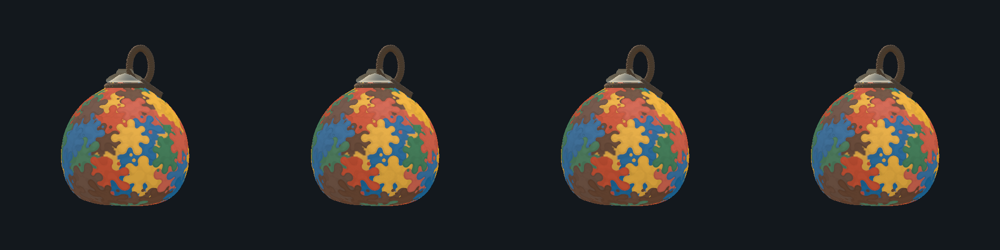
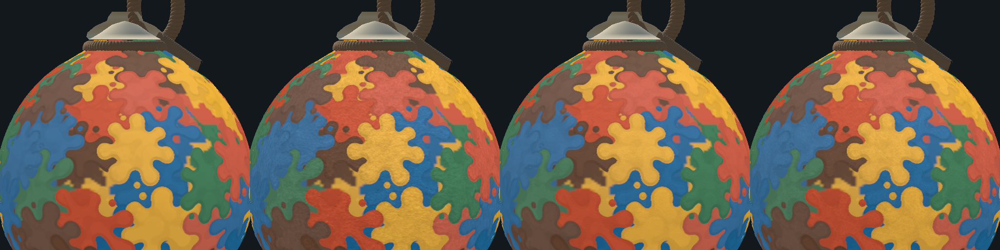

# Mac 클레이 비교 앱 — 윤곽·질감·배경 파일 사용 설명서

이 문서는 **#543 이미지 파일 비교 앱과 #569 윤곽 PNG 비교 기능**의 사용법이다. 완성된 같은 5색 박을 보면서 스티커의 질감·두께·광택·색·빛·배경을 비교한다. 방에 입장하거나 직접 박을 칠할 필요가 없다. 일반 게임의 설정을 바꾸는 DEV 화면과는 별개이며, 여기서 바꾼 값은 게임이나 원본 파일에 자동 저장되지 않는다. 단, #569의 `Save as startup shape`를 누르면 **윤곽 모드·설정·선택 PNG만** 비교 앱 전용 프로필에 저장한다. 저장 범위는 [17.8절](#178-윤곽-프로필-저장다시-불러오기)을 따른다.

대상 Scene은 `Assets/Experiments/ClayPreview/ImageSamples/Scenes/ImageClayPreview.unity`다. 기존 세 프리셋 앱이나 파일 기능 없는 코팅 앱을 열면 이 문서의 `FILES / IMAGES`가 보이지 않을 수 있다. 구현 범위는 [둥근 클레이 실험 문서의 #543 절](ROUNDED_CLAY_STICKER_EXPERIMENT.md#543-스티커-질감배경-파일을-직접-불러오는-mac-실험), 실제 수행한 검사와 미실행 항목은 [검증 기록](VALIDATION.md)의 2026-11-07 · #543 절을 참고한다.

## 1. 이미 빌드된 앱으로 바로 보기

1. Finder에서 프로젝트 폴더를 연다.
2. `Builds` → `Experiments` → `ClayPreview`로 들어간다.
3. 원하는 빌드의 `생성시각-고유값` 폴더를 연다. 새 앱을 찾는다면 폴더 이름의 시각을 확인한다. 예전 앱도 같은 파일명을 사용한다.
4. `Hapio-Clay-Experiment.app`을 더블클릭한다.
5. 왼쪽에 완성 박, 오른쪽에 `CLAY STUDY` 조절 패널이 보이는지 확인한다.
6. 네 번째 `Sticker-local coating`이 선택돼 있고 그 아래에 `FILES / IMAGES`가 있으면 이미지 파일 비교 버전이다.

처음 실행할 때는 **외부 질감과 외부 배경이 없는 상태**다. 윤곽은 저장된 시작 프로필이 없으면 기존 원본으로, 프로필이 있으면 저장한 모드·이미지·절차 설정으로 복원한다. 실제 도색 기록으로 만든 고정 도안을 사용하므로 다시 실행해도 얼룩 배치를 무작위로 바꾸지 않는다. 앱 파일은 빌드 산출물이어서 저장소에 포함하지 않는다. 다른 컴퓨터에 소스만 내려받았다면 [직접 빌드하기](#12-unity에서-직접-준비하고-mac-앱-빌드하기)를 따른다.

오른쪽 패널은 길다. **포인터를 오른쪽 패널 위에 둔 채 스크롤**하면 아래의 팔레트·재질·빛·시점·종료 버튼까지 볼 수 있다. 왼쪽 박 영역에서 스크롤하면 패널 이동 대신 박 확대·축소가 된다.

## 2. 3분 안에 샘플 비교하기

1. 시작 프리셋 `Sticker-local coating`을 유지한다.
2. `FILES / IMAGES`에서 `Fine clay`를 누른다.
3. 파일명과 작은 질감 미리보기가 생기고 `Apply surface texture`가 켜지는지 확인한다.
4. 같은 자리의 박을 보면서 `Hand-made`, `Fine fiber`를 차례로 누른다.
5. 차이가 약하면 박 위에서 휠로 확대하고 `GRAIN CONTRAST`를 올린다. 무늬 크기는 `PATTERN SCALE`로 조절한다.
6. `Apply surface texture`를 껐다 켜서 **같은 재질·색·도안에서 추가 질감만** 비교한다.
7. 처음 상태로 돌아가려면 `Clear texture`를 누른다.

켜진 체크 칸은 금색으로 채워지고 꺼진 칸은 비어 보인다. 질감 파일을 고르기 전에는 관련 조절이 비활성화된다.

| 앱 버튼 | 어떤 질감인가 | 원본 파일 |
| --- | --- | --- |
| `Fine clay` | 고운 무광 클레이의 미세입자 | [FineMatteClay.png](../Assets/Experiments/ClayPreview/ImageSamples/Sources/FineMatteClay.png) |
| `Hand-made` | 손으로 빚은 듯한 얕고 넓은 주름 | [HandKneadedClay.png](../Assets/Experiments/ClayPreview/ImageSamples/Sources/HandKneadedClay.png) |
| `Fine fiber` | 고운 한지 섬유결 | [FineHanjiFiber.png](../Assets/Experiments/ClayPreview/ImageSamples/Sources/FineHanjiFiber.png) |

세 원본은 각각 1254×1254 RGB 이미지다. 앱의 내장 샘플도 외부 파일과 같은 이미지 처리 경로를 사용한다. 제작 프롬프트는 [ImageSamplePrompts.json](../Assets/Experiments/ClayPreview/ImageSamples/Sources/ImageSamplePrompts.json)에 보관한다.

아래 #543 질감 비교 이미지는 왼쪽부터 **추가 질감 없음 / Fine clay / Hand-made / Fine fiber**다. 새 윤곽 선택 UI의 화면 캡처가 아니라 표면 질감 차이를 설명하는 자료다. 네 칸의 도안·카메라·조명은 같다.

아래 확대 비교만 질감 차이를 드러내기 위해 `PATTERN SCALE 0.25 / GRAIN CONTRAST 1 / SHALLOW RELIEF 1`로 강조했다. 앱 시작값이나 모든 사용자에게 권장하는 확정값은 아니다.

## 3. 내 이미지로 스티커 표면 질감 바꾸기

1. 사용할 이미지를 PNG 또는 JPG/JPEG로 준비한다. 조건은 [파일 조건](#5-파일-조건과-취소실패-처리)을 따른다.
2. `STICKER SURFACE` 아래의 `Choose texture file…`을 누른다.
3. Mac 파일 선택창에서 이미지를 선택하고 `Choose`로 확정한다. Editor에서 시험할 때는 Unity의 파일 선택창을 사용한다.
4. 선택된 파일명과 작은 미리보기를 확인한다.
5. 박을 확대하고 질감 조절 3개를 하나씩 바꾼다.
6. 효과가 마음에 들지 않으면 `Apply surface texture`를 끄거나 다른 파일·샘플을 고른다.

질감 입력은 **색 그림을 박 위에 그대로 붙이는 기능이 아니다.** 이미지의 밝고 어두운 결을 추출해 기존 스티커 색의 명암과 얕은 표면 방향에 사용한다. 빨간 이미지를 넣었다고 스티커가 빨간색으로 바뀌지 않는다. 색을 바꾸려면 `PALETTE · RGB / HEX`를 사용한다.

가져온 이미지는 처리 후 중립 회색에 가까운 미리보기로 보일 수 있다. 전체 평균 밝기를 빼고 밝기 차이를 사용하는 구조라서, **완전히 단색인 흰색·검정·회색 이미지나 완전히 투명한 이미지는 질감 변화가 없다.** 입자·섬유·주름처럼 실제 밝기 변화가 있는 이미지를 고른다. 일반 사진을 쓸 수도 있지만 피사체의 명암까지 반복 무늬로 보일 수 있다.

효과는 실제 스티커가 있는 부분에 적용한다. 완료 시 채워진 얇은 바탕·끈·뚜껑에 같은 질감을 덮지 않는다. 파일로 얼룩의 윤곽이나 도장 위치를 교체하지 않으며, 높이·면적·게임 판정을 다시 계산하지 않는다.

### 표면 질감 조절값

| 화면 항목 | 범위 | 시작값 | 조작 결과 |
| --- | --- | --- | --- |
| `Apply surface texture` | ON/OFF | 파일을 불러오면 ON | 가져온 파일을 유지한 채 추가 질감만 켜고 끈다. |
| `PATTERN SCALE` | 0.25~12 | 1 | **작게** 하면 무늬가 크게 보이고, **크게** 하면 더 촘촘하게 반복된다. |
| `GRAIN CONTRAST` | 0~1 | 0.5 | 기존 색 위에 보이는 이미지 결의 밝고 어두운 차이를 조절한다. 0이면 이 명암 변화가 없다. |
| `SHALLOW RELIEF` | 0~1 | 0.2 | 이미지 결이 조명에 반응하는 얕은 요철을 조절한다. 최대 약3도의 표면 방향 변화이며 실제 외곽 두께를 만드는 설정이 아니다. |

`GRAIN CONTRAST`와 `SHALLOW RELIEF`는 별도다. 명암만 비교하려면 요철을0으로, 조명에 의한 굴곡만 비교하려면 명암을0으로 둔다. 질감 OFF는 둘을 한꺼번에 끄지만 두 슬라이더의 숫자는 유지한다.

다른 질감 파일이나 샘플을 고르면 새 이미지가 적용되고 추가 질감은 ON으로 바뀐다. **크기·명암·요철 값은 유지**되므로 같은 조건의 파일 비교가 가능하다. 세 값까지 초기화하려면 `Clear texture`를 누른 뒤 다시 파일을 고른다.

## 4. 배경 이미지 넣기

1. 오른쪽 패널을 내려 `BACKGROUND`를 찾는다.
2. `Choose background file…`을 누른다.
3. PNG 또는 JPG/JPEG를 선택한다.
4. 선택한 파일명과 작은 미리보기, 박 뒤의 배경을 확인한다.
5. `Fill view (crop); OFF = fit whole image`로 맞춤 방식을 바꾼다.

| 상태 | 배경 표시 |
| --- | --- |
| `Fill view` ON | 가로세로 비율을 유지한 채 박 영역을 가득 채운다. 화면과 비율이 다르면 이미지 가장자리가 잘린다. |
| `Fill view` OFF | 가로세로 비율을 유지하면서 이미지 전체가 들어오게 맞춘다. 남는 곳은 기존 단색 배경으로 보인다. |
| `Clear background` | 가져온 배경만 제거하고 기존 스튜디오 단색으로 돌아간다. |

배경을 억지로 가로나 세로로 늘리지 않는다. 세로 그림을 가로로 넓은 창에서 `Fill view`로 보면 많이 잘릴 수 있으므로, 그림 전체가 필요한 비교에서는 OFF를 사용한다. PNG의 투명 부분은 알파를 유지한다.

배경은 **카메라에 고정된 2D 이미지**다. 박을 돌려도 함께 돌아가지 않으며 광원을 옮겨도 배경 자체 밝기는 바뀌지 않는다. 배경 사진의 빛이 박에 반사되거나 박의 환경광이 되는 HDRI 기능은 아니다. 조명까지 비교하려면 별도로 `LIGHT`를 조절한다.

질감과 배경에는 서로 다른 이미지를 사용할 수 있다. `Clear texture`는 배경을 지우지 않고, `Clear background`는 질감을 지우지 않는다. 배경을 제거하거나 새 파일로 교체해도 현재 `Fill view` 선택은 유지된다.

## 5. 파일 조건과 취소·실패 처리

| 조건 | 지원 범위 |
| --- | --- |
| 형식 | 표면 질감·배경은 PNG, JPG/JPEG. **윤곽은 투명 PNG만**([17.4절](#174-내-png를-준비하는-규격)) |
| 해상도 | 가로·세로 **각각** 1~2048px. 정사각형일 필요는 없다. |
| 파일 크기 | 비어 있지 않은 파일, 최대16MiB(16×1024×1024바이트) |
| 표면 질감 | 원본의 색 대신 밝기 차이와 알파를 사용한다. 반복 표시한다. |
| 배경 | 원본 이미지의 색과 알파를 사용한다. |
| 그 외 형식 | PSD·EXR·HDR·TGA·WebP 등의 직접 불러오기는 지원하지 않는다. PNG/JPEG로 준비한다. |

큰 이미지는 선택 전에 이미지 편집기에서 가로·세로 각각2048px 이하로 줄여 저장한다. 앱이 자동으로 초대형 이미지를 축소하는 구조가 아니다. 헤더의 크기·파일 용량을 먼저 확인한 뒤 디코딩한다.

파일 선택창에서 취소하면 이전 파일과 설정이 유지된다. 읽기 실패·손상·지원하지 않는 데이터·크기 초과도 이전 결과를 지우지 않고 해당 영역에 오류를 표시한다. 확장자만 `.png`로 바꿔도 이미지 데이터가 바뀌지 않으므로 해결되지 않는다.

불러온 파일은 읽기만 한다. 앱이 외부 원본을 덮어쓰거나 Unity 프로젝트에 자동 임포트하지 않는다. 명시적 윤곽 프로필 저장은 선택 PNG의 복사본을 앱 전용 JSON에 포함하며 외부 원본을 수정하지 않는다. 새 파일 적용이 성공한 뒤 이전 임시 이미지를 해제하며, 종료 시 불러온 이미지와 표시용 자원도 해제한다. 파일창을 여는 동안 박 조작은 잠시 멈춘다.

## 6. 네 가지 표현 프리셋 비교하기

`PRESET`은 같은 고정 도안의 표현 방식을 바꾼다. 선택된 버튼이 강조된다. 이미지 비교 앱은 **네 번째 `Sticker-local coating`으로 시작**한다.

| 버튼 | 비교할 내용 | 기본 두께 | 기본 Gloss |
| --- | --- | ---: | ---: |
| `Original v2` | 기존 #524 표현 기준 | 0.0100 | 0.35 |
| `Original outline + enhanced clay` | 기존 얼룩 윤곽에 개선된 재질 | 0.0140 | 0.08 |
| `Rounded outline + enhanced clay` | 새 둥근 윤곽과 개선 재질 | 0.0140 | 0.08 |
| `Sticker-local coating` | 둥근 윤곽에 스티커 자체 방향의 코팅 광택(V4) | 0.0140 | 0.08 |

프리셋을 바꾸면 **두께·Gloss·접촉 음영·기본 미세 질감은 해당 프리셋의 기본값으로 돌아간다.** 외부 질감·배경·이미지 조절값·편집한 팔레트·빛·현재 시점은 유지한다. 따라서 사용자가 바꾼 두께까지 똑같이 비교하려면 프리셋을 바꾼 뒤 같은 숫자로 다시 맞춘다.

`Original v2`에서는 개선 재질 전용 `CONTACT SHADE`와 `FINE DETAIL`이 비활성화된다. 외부 파일의 추가 질감과 개선 재질에 원래 있는 미세 질감은 서로 다른 설정이다.

새 윤곽은 같은 타격 기록을 다른 표현용 브러시로 그린 결과다. 얼룩 배치를 보기 좋게 다시 뽑거나 오래된 자국을 삭제하는 기능은 아니다.

## 7. 두께·광택·음영 조절하기

패널을 내려 `THICKNESS`부터 확인한다. 슬라이더 옆 숫자가 현재값이다.

| 항목 | 범위 | 개선 프리셋 시작값 | 무엇이 바뀌나 |
| --- | --- | ---: | --- |
| `THICKNESS` | 0~0.02 | 0.0140 | 스티커의 돌출 높이. 실제 박의 메시 형상을 교체하거나 도색 판정 면적을 바꾸지 않는다. |
| `GLOSS` | 0~1 | 0.08 | 코팅의 추가 반짝임. 0은 추가 광택이 없고, 높이면 강해진다. 모든 스티커에 같은 강도를 쓴다. |
| `CONTACT SHADE` | 0~0.5 | 0.15 | 겹친 스티커의 높이 차이에 따른 부드러운 접촉 음영. 개선 프리셋 전용이다. |
| `FINE DETAIL` | 0~1 | 1 | 개선 재질에 내장된 미세 요철·얕은 주름 강도. 외부 질감의 `SHALLOW RELIEF`와 별도다. |

V4는 도장 자체의 표면 방향을 이용해 반사를 나누며, 스티커가 없는 완료 바탕은 추가 코팅 반사에서 제외한다. 다만 강한 빛·Gloss·밀집된 얼룩의 조합은 큰 밝은 부분으로 보일 수 있다. 스티커별 반사 여부를 비교할 때는 같은 시점에서 `GLOSS 0 → 0.35 → 1`로 바꾸고 빛 방향도 조금 움직여 본다.

두께0에서도 색 그림은 남는다. 높이에 의존하는 접촉 음영·재질 세부 변화와 추가 표면 질감의 명암은 별개이므로, 완전히 평평한 색 기준을 보려면 외부 질감도 OFF하고 개선 재질의 `FINE DETAIL`도0으로 둬 비교한다.

## 8. 5색 팔레트와 HEX 입력

`PALETTE · RGB / HEX`에는 화·수·목·금·토 색이 각각 있다. 색 견본은 입력한 기본색이며, 실제 박 화면에는 농도·광택·조명이 더해지므로 견본과 화면 픽셀이 완전히 같은 RGB로 보이는 것은 아니다.

| 속성 | 기본 HEX | 기본 RGB(R, G, B) |
| --- | --- | --- |
| 화 / FIRE | `D85736` | 216, 87, 54 |
| 수 / WATER | `1471A7` | 20, 113, 167 |
| 목 / WOOD | `3D8258` | 61, 130, 88 |
| 금 / METAL | `F8B72A` | 248, 183, 42 |
| 토 / EARTH | `6F4A32` | 111, 74, 50 |

### HEX로 바꾸기

1. 바꿀 속성의 `HEX` 칸을 클릭한다.
2. 기존 내용을 지우고 예를 들어 `D85736`처럼 **6자리 RRGGBB**를 입력한다.
3. Enter나 Tab을 누르거나 다른 칸을 클릭해 확정한다. 입력 도중 매 글자를 바로 적용하지 않는다.
4. 색 견본·RGB 숫자·박의 해당 색이 함께 바뀌는지 확인한다.

대문자·소문자와 앞의 `#`, 앞뒤 공백을 허용한다. 예를 들어 `#d85736`도 된다. `FFF` 같은3자리, 알파가 포함된8자리, 0~9/A~F 이외 문자는 거절한다. 오류 테두리와 `HEX needs 6 digits: 0–9, A–F. Previous color is kept.`가 보이면 이전 유효 색이 유지된 상태다. 올바른6자리를 다시 입력한다.

### RGB로 바꾸기

각 `R`, `G`, `B`에 정수를 입력하고 확정한다. 채널 범위는0~255이며 범위 밖 값은 경계값으로 맞춘다. RGB 확정 시 HEX와 견본도 갱신된다.

색이 바뀌면 기존 고정 타격 기록을 새 팔레트로 다시 표현한다. `Updating colors…`가 보이는 동안에는 새 결과를 만드는 중이다. 준비 전에는 이전 완성 그림을 유지하며, 반복 입력해도 오래된 처리 결과를 최신 입력 위에 덮어쓰지 않게 한다. 이미지/절차 윤곽이나 부분 도색 진단을 사용하지 않는 기존 완성 비교에서는 원래 기본색으로 돌아오면 고정 지도를 직접 사용한다. 새 윤곽/진단 모드에서는 같은 기본색이어도 선택한 윤곽·시나리오의 재생 결과를 사용한다.

`Reset palette`는 다섯 색만 위 기본색으로 돌린다. 질감 파일·배경·빛·시점·두께·Gloss는 그대로다. 색을 바꿔도 스티커의 높이·위치·소유권·게임 규칙은 바뀌지 않는다.

## 9. 광원 움직이기

`LIGHT`는 박을 비추는 비교용 직접광이다. 박을 돌리는 것과 빛을 돌리는 것을 나눠 비교할 수 있다.

| 항목 | 범위 | 초기값(정확한 내부값 / 화면 반올림) |
| --- | --- | --- |
| `LEFT / RIGHT` | −180~180도 | −41.4914도 / 약−41도 |
| `UP / DOWN` | −80~80도 | 70.0484도 / 약70도 |
| `LIGHT INTENSITY` | 0~2 | 1.00 |

`LEFT / RIGHT`로 좌우 방향, `UP / DOWN`으로 높이 방향을 바꾼다. `LIGHT INTENSITY`를0으로 내려도 기존 확산·기본 음영까지 모두 검게 만드는 설정은 아니다. 비교용 직접광 강도를 바꾸는 값이다.

`Reset light`는 위 세 값만 초기화한다. 프리셋을 바꿔도 빛은 유지되지만 `Reset preset`은 빛도 초기화한다. 외부 배경의 밝기·색과 HDRI는 이 슬라이더로 바뀌지 않는다.

## 10. 회전·확대·여섯 방향 보기

- **박 영역에서 왼쪽 버튼을 누른 채 드래그**: 좌우 회전과 위아래 기울기. 버튼·슬라이더 영역에서는 박 회전 입력을 받지 않는다.
- **박 영역에서 휠/스크롤**: 확대·축소. 배율 범위는0.65~3이다. 확대해서 전체 박이 화면 밖으로 나가는 것은 의도한 확대 동작일 수 있다.
- **오른쪽 패널 위에서 스크롤**: 조절 패널 이동.
- 파일 선택창을 열거나 앱이 비활성화되면 진행 중인 드래그는 취소한다.

| `VIEW` 버튼 | 시점 |
| --- | --- |
| `Front` | 정면 |
| `Right` | 우측면 |
| `Back` | 후면 |
| `Left` | 좌측면 |
| `Diagonal` | 좌우45도 사선 |
| `Above` | 좌우45도·위쪽40도 사선 |

방향 버튼은 해당 방향과 **기본 배율1**로 맞춘다. 시점만 바꾸며 색·질감·빛·재질값은 유지한다. `Reset preset`도 정면·기본 배율로 되돌리지만 다른 값까지 함께 초기화하므로 아래 차이를 확인한다.

## 11. 초기화 버튼별 차이와 값 보관

| 동작 | 바뀌는 것 | 유지되는 것 |
| --- | --- | --- |
| 다른 `PRESET` 선택 | 표현 방식, 해당 기본 두께·Gloss, 접촉 음영0.15·기본 미세 질감1 | 파일·이미지 조절값·팔레트·빛·시점 |
| `Reset palette` | 다섯 기본색, 잘못 입력한 HEX 표시 | 파일·이미지 조절값·재질·빛·시점 |
| `Reset light` | 빛의 방향·강도 | 파일·이미지 조절값·색·재질·시점 |
| `VIEW` 방향 버튼 | 시점, 배율1 | 파일·이미지 조절값·색·재질·빛 |
| `Reset preset` | **현재 프리셋**의 기본 재질값, 기본색, 기본빛, 정면·배율1 | 선택한 프리셋, 질감·배경 파일, 이미지 조절값, 윤곽 모드·비교 시나리오 |
| `Clear texture` | 질감 이미지 제거, ON·크기1·명암0.5·요철0.2로 초기화 | 배경·맞춤 방식·색·빛·재질·시점 |
| `Clear background` | 배경 이미지만 제거 | 질감·Fill 선택·색·빛·재질·시점 |
| 앱 종료 후 다시 실행 | 재질·팔레트·빛·질감·배경은 초기 상태. 윤곽 시작 프로필이 있으면 그 모드·이미지·절차 값 복원 | 고정 도안·프로젝트 파일·명시적으로 저장한 윤곽 프로필 |

**`Reset preset`으로 외부 파일까지 지워지지는 않는다.** 완전한 파일 미적용 상태가 필요하면 `Clear texture`와 `Clear background`를 각각 누른다.

전체 화면의 재질·팔레트·빛·질감·배경을 묶어 저장하거나 완성 화면을 내보내는 버튼은 없다. **윤곽만은 `Save as startup shape`로 저장하고 `Reload saved shape`로 복원**할 수 있다([17.8절](#178-윤곽-프로필-저장다시-불러오기)). 마음에 드는 조합은 사용한 파일 이름, HEX5개, 질감/재질/빛 숫자, 프리셋을 메모하거나 화면 캡처로 남긴다. 게임에 적용하려면 이 결과를 바탕으로 별도 구현·설정 반영이 필요하다. 비교 앱의 값을 게임 DEV에 자동 복사하지 않는다.

`Quit`는 패널 아래쪽에 있으며 Mac 비교 앱을 종료한다. Unity Editor Play에서의 종료는 Editor의 Play 버튼으로 한다. 앱은 자동 회전하지 않고30fps를 목표로 하며, 다른 앱으로 전환하면 렌더를 멈춘다.

## 12. Unity에서 직접 준비하고 Mac 앱 빌드하기

### 필요한 환경

- 현재 프로젝트 기준 Unity6000.6.5f1과 프로젝트 패키지를 정상적으로 여는 환경.
- macOS에서 Mac Standalone 빌드가 가능한 Unity 설치.
- 네이티브 파일 선택기를 컴파일할 `xcrun clang++`와 macOS SDK/Cocoa, `lipo`, `codesign` 도구. Xcode 또는 사용 가능한 Apple 개발 도구 경로가 준비돼 있어야 한다.
- 저장된 Scene과 컴파일 오류가 없는 프로젝트. Play 모드·컴파일 도중에는 준비/빌드를 실행하지 않는다.

추가 UPM 패키지는 설치하지 않는다. 이 경로는 Mac 실험 앱 빌드이며 iOS Export나 일반 게임의 `Hapio > Development Build`와 다르다.

### 최초 준비 또는 소스/샘플 변경 후

1. 기존 Scene의 미저장 편집을 먼저 확인한다. 필요한 변경을 저장하거나 별도 사본으로 보존한다. 도구가 임의로 대신 저장하지 않는다.
2. Play를 종료하고 컴파일을 기다린다.
3. 메뉴 **`C6 Lab > Experiments > Clay Images > Prepare Texture and Background Preview`**를 선택한다.
4. 준비 과정은 샘플3종·동일 데이터 복사·이미지 Scene 참조와 셰이더 기준을 검사한다. 기존 완성 색/높이 지도를 다시 칠하지 않는다.
5. Editor에서 직접 보려면 `Assets/Experiments/ClayPreview/ImageSamples/Scenes/ImageClayPreview.unity`를 열고 Play한다. Editor의 파일 선택은 네이티브 Mac 플러그인 대신 Unity 파일창을 사용한다.
6. 앱을 만들 때는 Play를 종료한다.

이미지 Scene을 일반 게임의 Build Settings 목록에 추가하지 않는다. 전용 메뉴가 실험 Scene 하나만 지정해 빌드한다. 다른 게임 Scene을 이미지 비교용으로 덮어쓰거나, 게임 Scene에 비교 컨트롤러를 추가하지 않는다.

### 앱 만들기와 찾기

1. 메뉴 **`C6 Lab > Experiments > Clay Images > Build Texture and Background Mac App`**을 선택한다.
2. 빌드가 끝날 때까지 기다린다. Console의 성공/오류를 확인한다.
3. 출력 경로 `Builds/Experiments/ClayPreview/<생성시각-고유값>/Hapio-Clay-Experiment.app`을 연다.
4. 최근 빌드 위치는 **`C6 Lab > Experiments > Clay Sticker > Open Last Mac Preview Build`**에서도 열 수 있다.
5. 앱에서 `FILES / IMAGES`와 샘플3종이 보이는지 확인한다.

`Build Coating Mac App`이나 `Build Mac Comparison App`은 다른 이전 비교 경로다. 외부 질감·배경 파일 기능을 보려면 위 `Clay Images`의 정확한 빌드 메뉴를 사용한다.

빌드는 준비 자료를 **읽기만 하며 자동으로 다시 준비하지 않는다.** 샘플 PNG나 표현 셰이더/include가 바뀌었다는 오류가 나면 변경 이유를 먼저 확인하고 `Prepare Texture and Background Preview`를 명시적으로 실행한 뒤 빌드한다. 임의로 해시 문자를 수정해 검사를 건너뛰지 않는다.

빌드 때만 파일 선택기 네이티브 번들을 arm64+x86_64로 만들고 `Assets/Experiments/ClayPreview/NativeBuildStage`에 임시 배치한다. 정상 종료 시 stage를 정리하고 기존 활성 플랫폼·Build Settings·PlayerSettings를 복원한다. 소스는 [tools/ClayPreviewNative](../tools/ClayPreviewNative/README.md)에 있고 빌드 바이너리는 커밋하지 않는다. 로컬 개발용 서명이 사용되며 배포용 공증을 수행하는 빌드가 아니다.

## 13. 같은 조건으로 평가하는 권장 순서

아래는 비교 작업 순서다. 새로운 게임 규칙이나 확정 미술 설정을 제안하는 표가 아니다.

1. **기준 맞추기**: 네 번째 프리셋 → `Reset preset` → `Clear texture` → `Clear background` → `Front`.
2. **한 가지 질감만 비교**: Fine clay 선택 → 기본1/0.5/0.2에서 ON/OFF. 같은 위치를 확대해 결을 확인한다.
3. **세 샘플 비교**: 같은 숫자에서 Hand-made와 Fine fiber를 바꾼다. 파일이 바뀌어도 도안이나 빛을 함께 바꾸지 않는다.
4. **질감 자체와 광택 분리**: 먼저 Gloss0에서 결을 고르고, 이어 Gloss만 올려 코팅 반사를 본다. 필요하면 명암0/요철0을 각각 시험한다.
5. **빛 영향 확인**: 빛 좌우 방향만 움직인 뒤 Reset light. 배경을 넣기 전후에도 같은 재질과 빛을 유지한다.
6. **색 비교**: 팔레트 한 색만 바꾸고 결과 갱신이 끝난 뒤 확인한다. 색 견본과 조명된 표면을 구분한다.
7. **여섯 방향 확인**: Front·Right·Back·Left·Diagonal·Above에서 반복 경계, 극점, 얼룩 사이 잘림을 확인한다.
8. **기록 남기기**: 사용한 질감/배경 파일과 모든 숫자, 좋았던 점·어색한 부분을 메모한다. 앱 종료 시 재질·색·빛·질감·배경의 임시 설정은 사라진다. 윤곽을 다시 쓰려면 적용 완료 후 `Save as startup shape`로 저장한다.

프리셋 전체를 비교할 때는 각 프리셋이 재질 기본값을 다시 지정한다는 점에 유의한다. **같은 두께·Gloss 비교**인지 **각 프리셋 기본 모습 비교**인지 먼저 정해 기록하면 결과를 해석하기 쉽다.

## 14. 자주 생기는 상황

| 증상·실제 안내 | 확인과 해결 |
| --- | --- |
| `FILES / IMAGES`가 없다 | 파일 기능 없는 구형 앱/Scene인지 확인한다. `ImageClayPreview.unity`와 `Clay Images > Build Texture and Background Mac App`을 사용한다. |
| 질감 슬라이더가 흐리거나 눌리지 않는다 | 아직 질감 파일이 없다. 내장 샘플 또는 외부 파일을 고른다. 배경 맞춤도 배경을 고른 뒤 활성화된다. |
| 파일창에서 취소했는데 변화가 없다 | 정상 동작이다. 기존 파일과 값이 유지된다. |
| `Choose an image of 16 MiB or less.` 또는 `Choose a nonempty image of 16 MiB or less.` | 빈 파일/용량을 확인하고16MiB 이하 PNG/JPEG로 다시 저장한다. |
| `Image width and height must each be between 1 and 2048 pixels.` | 가로·세로 각각2048 이하로 준비한다. 한쪽만2048 이하인 것은 부족하다. |
| `Only PNG and JPEG image data is supported.` | 지원 형식으로 내보낸다. 확장자 이름만 바꾸지 않는다. |
| `This PNG/JPEG could not be decoded.` 또는 헤더 오류 | 이미지 편집기에서 정상적으로 열리는지 확인한 뒤 PNG/JPEG로 다시 내보낸다. 기존 적용 파일은 유지된다. |
| `The image could not be read (…)` | 선택한 파일이 읽을 수 있는 로컬 위치에 있는지 확인한다. 원본 접근 문제를 해결한 뒤 다시 고른다. |
| `The Mac picker plug-in is missing. Rebuild the comparison app with its native picker stage.` | 이미지용 전용 Mac 빌드 메뉴로 앱을 다시 만든다. 일반 게임/구형 빌드에 바이너리를 수동 복사하지 않는다. |
| `The Mac picker plug-in has an incompatible version. Rebuild the comparison app.` | 현재 소스로 전용 비교 앱을 다시 빌드한다. |
| `Use Prepare Texture and Background Preview first.` | 저장/Play 종료 후 이미지 준비 메뉴를 먼저 실행한다. |
| `A display shader or texture include changed. Explicitly prepare this preview; Build never refreshes it automatically.` | 소스 변경이 의도한 것인지 확인하고 이미지 준비를 다시 실행한 뒤 빌드한다. |
| 미저장 Scene 안내 때문에 Prepare/Build가 멈춘다 | 편집 내용을 먼저 저장하거나 사본으로 보존한다. 도구는 기존 편집을 자동 저장/폐기하지 않는다. |
| `A native plug-in stage remains from an interrupted build…` | 실제 빌드와 Play가 멈췄는지 확인한다. `C6 Lab > Experiments > Clay Sticker > Remove Stale Mac Picker Stage`로 이 도구 소유의 잔여 stage를 정리하고 다시 빌드한다. |
| `xcrun`/`clang++` 빌드 실패 | Apple 개발 도구 경로와 macOS SDK, Console의 해당 오류를 확인한다. 임의 UPM 패키지 추가로 해결되는 경로가 아니다. |
| HEX 오류 테두리/메시지 | 알파 없는6자리 RRGGBB를 입력하고 확정한다. 이전 유효 색은 유지된다. |
| 질감이 아무것도 안 바뀌는 것 같다 | ON 상태, 무늬가 있는 이미지인지, 명암·요철 강도가0인지 확인한다. 단색 이미지는 중립이다. 같은 박 위치를 확대해 비교한다. |
| 배경이 심하게 잘린다 | `Fill view`를 끈다. ON에서 비율 유지 크롭은 정상이다. |
| Reset을 눌러도 외부 파일이 남는다 | `Reset preset`은 파일 초기화가 아니다. Clear texture/Clear background를 각각 사용한다. |
| 다른 앱을 보고 돌아오니 잠시 멈춘 것 같다 | 비활성 상태에서 렌더를 쉬는 비교 앱이다. 해당 창을 활성화한다. |

## 15. 이 앱으로 바뀌지 않는 것과 현재 한계

- 일반 Lab/Hapio 게임의 기본 표현·DEV 설정·통신·명중·성장·건조·면적·소유권·승패·투척 물리를 바꾸지 않는다. 방 생성·LAN·핫스팟 검증용 앱이 아니다.
- `Choose texture file…`의 입력 질감은 색/높이 판정 지도를 덮어쓰거나 각 얼룩의 모양·배치를 바꾸지 않는다. 외곽 교체는 별도의 `Choose outline PNG…`를 사용하며 기존 기록의 위치·회전·성장 규칙은 유지한다.
- 원래 고정 기록의 작은 얼룩, 기존 지원 셀에 따른 일부 잘림, 완료 바탕에 보이는 셀 경계·유령 윤곽까지 해결한 버전은 아니다. 해당 현상과 새 표면 결을 나눠 평가한다.
- 샘플은 반복용 이미지로 제작했지만 수학적으로 완전한 이음새 연결을 보장하지 않는다. 과도한 반복이나 확대에서는 경계가 보일 수 있다.
- `SHALLOW RELIEF`는 조명용 얕은 요철이며 실제 두께 메시를 생성하지 않는다. `GLOSS`는 개별 스티커마다 별도 난수 강도를 주는 설정이 아니다.
- 저장된 완성 도안은1024×512이며 추가 파일 상한2048px과 구분한다. 큰 질감 파일을 넣어도 게임 판정 해상도나 원래 도장 지원 범위를 늘리지 않는다.
- 이번 파일 선택 앱은 Mac 비교용이다. iOS용 파일 선택·실기기 성능·장시간 사용 결과를 이 문서의 기능 존재만으로 통과했다고 해석하지 않는다.

## 16. 유지보수할 때 확인할 파일

| 바꾸려는 부분 | 시작 파일 |
| --- | --- |
| 파일 버튼·샘플·ON/OFF·값 유지·오류 표시 | [ClayPreviewController.Images.cs](../Assets/Experiments/ClayPreview/Runtime/ClayPreviewController.Images.cs) |
| 기존 프리셋·RGB/HEX·빛·회전·Reset | [ClayPreviewController.cs](../Assets/Experiments/ClayPreview/Runtime/ClayPreviewController.cs) |
| 이미지 형식·용량·해상도·회색 데이터 변환·이미지 해제 | [ClayPreviewImageImport.cs](../Assets/Experiments/ClayPreview/Runtime/ClayPreviewImageImport.cs) |
| 스티커 적용 재질·고정 배경·Fit/Fill | [ClayPreviewImagePresentation.cs](../Assets/Experiments/ClayPreview/Runtime/ClayPreviewImagePresentation.cs) |
| 패널·슬라이더·체크 표시 스타일 | [ClayPreview.uss](../Assets/Experiments/ClayPreview/Runtime/ClayPreview.uss) |
| Scene 준비·샘플/소스 검증·이미지 전용 빌드 메뉴 | [ClayPreviewImageExperiment.cs](../Assets/Editor/WatercolorPaint/ClaySticker/ClayPreviewImageExperiment.cs) |
| 네이티브 번들 컴파일·임시 stage·복구 메뉴 | [ClayPreviewMacImagePickerBuild.cs](../Assets/Editor/WatercolorPaint/ClaySticker/ClayPreviewMacImagePickerBuild.cs) · [네이티브 소스 설명](../tools/ClayPreviewNative/README.md) |
| 샘플 원본·같은 바이트의 런타임 자료·Manifest | [ImageSamples](../Assets/Experiments/ClayPreview/ImageSamples) |
| 윤곽 파일·모드·슬라이더·프로필 UI·이전 그림 보존 | [ClayPreviewController.Splatter.cs](../Assets/Experiments/ClayPreview/Runtime/ClayPreviewController.Splatter.cs) |
| 원본 Alpha 베이크·512px 여백과 높이 | [ClayPreviewShapeMask.cs](../Assets/Experiments/ClayPreview/Runtime/ClayPreviewShapeMask.cs) |
| 윤곽 프로필 형식·원본 바이트·저장/복원 | [ClayPreviewShapeProfile.cs](../Assets/Experiments/ClayPreview/Runtime/ClayPreviewShapeProfile.cs) |
| 단일/재타격/67회 재생·지원 범위 지도 | [ClayPreviewPaletteReplay.cs](../Assets/Experiments/ClayPreview/Runtime/ClayPreviewPaletteReplay.cs) · [ClayPreviewShapeDiagnostics.cs](../Assets/Experiments/ClayPreview/Runtime/ClayPreviewShapeDiagnostics.cs) |
| 최대 범위·잘림·바탕 UI 연결 | [ClayPreviewController.ShapeDiagnostics.cs](../Assets/Experiments/ClayPreview/Runtime/ClayPreviewController.ShapeDiagnostics.cs) |
| 외부 윤곽 입력 예제3종 | [Samples/ClayShapePNG](../Samples/ClayShapePNG) |

셰이더나 샘플을 수정하면 준비 자료와 소스 기준 검사를 함께 확인한다. 게임용 자료와 비교용 자료를 구분하고, 실행하지 않은 환경을 검증 완료로 기록하지 않는다.

## 17. 이미지 윤곽과 스플래시 비교 (#569)

이 절은 **새로 불러온 PNG의 모양을 실제 박에 붙여 비교하는 방법**이다. 표면 결을 바꾸는 `Choose texture file…`와 별도의 기능이며, 일반 게임의 기본 브러시·면적·성장·건조·소유권·승패·통신은 바꾸지 않는다. 특정 원본 파일에 묶여 있지 않아 실행 중 여러 PNG를 차례로 교체할 수 있다.

### 17.1 먼저 맞는 앱과 장면인지 확인하기

1. 열려 있는 이전 비교 앱이 있다면 `Quit`로 닫는다. 소스를 업데이트해도 이미 실행 중이거나 예전에 빌드한 앱은 자동으로 바뀌지 않는다.
2. 새 빌드가 필요하면 [12절](#12-unity에서-직접-준비하고-mac-앱-빌드하기)의 **`Clay Images > Build Texture and Background Mac App`**을 사용한다. 일반 게임의 `Hapio > Development Build`나 Lab iOS Export로 만드는 앱과 다르다.
3. 프로젝트의 `Builds/Experiments/ClayPreview/<생성시각-고유값>/Hapio-Clay-Experiment.app` 중 방금 생성된 폴더를 연다. 파일명은 예전 빌드와 같으므로 생성시각을 확인한다. Unity에서는 `C6 Lab > Experiments > Clay Sticker > Open Last Mac Preview Build`로 최근 출력 위치를 찾을 수 있다.
4. 앱을 열고 오른쪽 패널에서 **`STICKER OUTLINE / 스티커 외곽`**, **`Choose outline PNG…`**, **`최대 표시 범위 / 적용 비교`**가 보이는지 확인한다. 패널 아래로 스크롤해야 할 수 있다.
5. `PRESET`에서 네 번째 **`Sticker-local coating`**을 선택한다. 저장한 시작 윤곽 프로필이 있으면 시작 후 해당 모양을 다시 적용하는 시간이 추가로 필요하다.

| Unity에서 여는 장면 | 사용할 수 있는 기능 |
| --- | --- |
| [ImageClayPreview.unity](../Assets/Experiments/ClayPreview/ImageSamples/Scenes/ImageClayPreview.unity) | **권장 시작점.** 네 프리셋, 윤곽 PNG, 범위 비교, 팔레트·빛, 표면 질감·배경 파일 선택 |
| [CoatingClayPreview.unity](../Assets/Experiments/ClayPreview/Rounded/Scenes/CoatingClayPreview.unity) | 네 프리셋, 윤곽 PNG·범위 비교, 팔레트·빛. 표면 질감·배경의 `FILES / IMAGES`는 없음 |
| [RoundedClayPreview.unity](../Assets/Experiments/ClayPreview/Rounded/Scenes/RoundedClayPreview.unity) | 이전 세 프리셋 비교. 새 윤곽/범위 기능에 필요한 네 번째 코팅 프리셋·고정 팔레트 기록이 없으므로 해당 조절은 비활성화 |
| [ClayPreview.unity](../Assets/Experiments/ClayPreview/Scenes/ClayPreview.unity) | 초기 비교 경로. 이 절의 네 번째 프리셋 기반 작업 대상이 아님 |

Editor에서 시험할 때는 권장 장면을 더블클릭한 뒤 Play한다. 실제 게임의 Home/Battle Scene에 비교 컨트롤러를 추가하거나 일반 Build Settings에 실험 장면을 추가할 필요는 없다.

### 17.2 세 종류의 파일 입력 구분하기

| 실제 버튼 | 무엇을 입력하나 | 박에서 바뀌는 것 |
| --- | --- | --- |
| **`Choose outline PNG…`** | 투명 배경 PNG | 스티커의 외곽·분리 방울·내부 빈 공간. 원본 Alpha를 사용 |
| **`Choose texture file…`** | PNG/JPG의 밝고 어두운 결 | 이미 있는 스티커 내부의 명암·미세 요철. 외곽은 바꾸지 않음 |
| **`Choose background file…`** | PNG/JPG 배경 그림 | 박 뒤의 카메라 고정 배경. 스티커 모양·조명은 바꾸지 않음 |

예를 들어 빨간 스플래시를 **윤곽**으로 넣으면 그 빨강은 외곽 판정에 쓰지 않는다. 앱 팔레트의 다섯 색으로 같은 모양을 붙인다. 같은 파일을 **표면 질감**에 넣으면 색의 밝기 차이를 결로 사용할 뿐 스플래시 외곽을 따지 않는다.

### 17.3 제공된 PNG 세 개로 첫 비교하기

추가 파일이 없어도 저장소의 [Samples/ClayShapePNG](../Samples/ClayShapePNG)를 사용할 수 있다. 이들은 **파일 선택용 예제**이며 앱에 자동 적용되는 고정 원본이 아니다. 생성·정리 기준은 [샘플 설명](../Samples/ClayShapePNG/PROMPTS.md)에 있다.

| 선택할 파일 | 원본에서 구분할 형태 |
| --- | --- |
| [01_broad_splash.png](../Samples/ClayShapePNG/01_broad_splash.png) | 넓고 둥근 몸통, 불규칙한 둥근 돌기, 떨어진 방울 |
| [02_flowing_splash.png](../Samples/ClayShapePNG/02_flowing_splash.png) | 대각선으로 길게 흐르는 몸통과 두꺼운 둥근 꼬리 |
| [03_cluster_splash.png](../Samples/ClayShapePNG/03_cluster_splash.png) | 큰 덩어리들이 넓게 이어진 군집과 완만한 굴곡 |

1. `ImageClayPreview` 또는 새 이미지 비교 앱을 연다.
2. 필요하면 `VIEW`의 `Front`로 맞춘다. 두께·광택을 먼저 바꿀 필요는 없다.
3. `Choose outline PNG…`를 누른다.
4. 파일 선택창에서 **프로젝트 폴더 → `Samples` → `ClayShapePNG` → `01_broad_splash.png`** 순서로 찾아 선택을 확정한다. 이 폴더는 `Assets` 밖에 있으므로 Unity Project 창이 아닌 Mac 파일 선택창/Finder에서 찾는다.
5. `OUTLINE SOURCE`가 **`Image alpha / 이미지 원형`**으로 바뀌고 선택한 파일명이 표시되는지 확인한다. 다른 프리셋이었다면 네 번째 코팅 프리셋으로 이동한다. 이 자동 이동에서는 현재 두께·광택·음영·빛을 유지한다.
6. **`Updating outline… previous completed picture is kept`**가 보이는 동안 기다린다. 작은 미리보기와 실제 박은 새 결과가 완료된 뒤 바뀐다. 잠시 이전 그림이 보이는 것은 파일 선택이 실패했다는 뜻이 아니다.
7. 완료 후 파란색 Alpha 마스크와 실제 박에 붙은 도안을 확인한다. 마스크 미리보기가 파란색인 것은 원본 RGB를 바꾸는 오류가 아니라 **외곽만 분리해서 보여주는 표시**다.
8. 같은 버튼으로 `02_flowing_splash.png`, `03_cluster_splash.png`를 차례로 고른다. 앞의 파일을 지우거나 앱을 재실행할 필요가 없다.
9. 비교할 때는 색·두께·Gloss·빛·시점을 함께 바꾸지 않는다. 모양의 차이가 약하면 다음 절의 **최초 명중 1회**로 분리해서 본다.

빠르게 다른 파일을 연속 선택하면 마지막 요청이 적용된다. 새 선택을 처리하는 동안 이미 완료된 이전 그림을 유지하며, 늦게 끝난 오래된 요청을 최신 선택 위에 다시 표시하지 않는다. 파일창 취소는 현재 선택과 설정을 바꾸지 않는다. 잘못된 PNG·손상된 파일·생성/재생 실패는 오류를 표시하고 직전 유효 그림을 유지한다.

### 17.4 내 PNG를 준비하는 규격

| 항목 | 입력 규격과 처리 |
| --- | --- |
| 형식 | **실제 Alpha가 있는 투명 PNG만**. JPEG·불투명 배경 PNG를 자동으로 배경 제거하지 않음 |
| 해상도 | 가로·세로 각각 1~2048px. 정사각형일 필요 없음 |
| 용량 | 비어 있지 않은 파일, 최대16MiB |
| Alpha | 완전히 빈 이미지·거의 보이지 않는 Alpha는 거절. 그림 바깥에는 실제 투명 부분이 있어야 함 |
| RGB 색 | 외곽·높이를 만드는 기준으로 쓰지 않음. 실제 스티커 색은 팔레트와 농도·조명을 따름 |
| 표현용 결과 | **512×512px**, 원본 전체 캔버스의 종횡비 유지 |
| 배치 | 원본을 자르지 않고 중앙 배치. 사방 **최소32px** 투명 여백을 확보 |
| 보존하는 형태 | 연결된 몸통, 떨어진 방울, 내부 구멍. 작은 성분을 임의로 삭제하거나 가장 긴 돌기에 맞춰 내용물을 다시 확대하지 않음 |
| 높이 | Alpha 내부 거리에서 둥근 테두리 높이를 생성. 사진의 명암을 그대로 돌출 높이로 쓰지 않음 |

체커무늬가 **그림 자체에 그려진 이미지**는 투명 PNG가 아니다. 이미지 편집기에서 배경 레이어를 끈 상태로 PNG를 내보낸다. 흰 배경을 투명으로 만들지 않고 파일 확장자만 `.png`로 바꾸는 것으로는 해결되지 않는다.

원본에 이미 큰 투명 여백이 있으면 그 여백도 보존되어 도장이 더 작게 보일 수 있다. 이는 그림의 불투명 부분만 잘라 크게 확대하지 않는 규칙 때문이다. 제공된 세 샘플에도 원본 여백이 있으며, 앱은 그 캔버스를 다시 512px 표현 규격에 맞춘다. 아주 가는 가지·작은 방울은 512px 변환 중 축소되거나 약해질 수 있다. 픽셀 단위의 모든 세부가 원본 해상도 그대로 남는다는 보장은 아니다.

### 17.5 최대 표시 범위를 읽는 방법

**이미지 파일의 크기와 박에 표시할 수 있는 최대 범위는 다르다.** 이미지가 512×512 마스크에 들어가도 모든 명중에서 모양 전체가 표시되는 것은 아니다.

| 구분 | 정확한 기준 |
| --- | --- |
| 현재 비교 기록의 계산 지도 | **256×128 = 32,768셀** |
| 부분 도색 최대 허용 범위 | **실제로 칠해진 각 셀에서 상하·좌우·대각선으로 2셀씩 넓힌 영역의 합집합 안까지 표시 가능** |
| 한 셀만 칠한 예시 | 일반 위치에서 중심 포함 최대5×5셀. 전체 도장을 고정5×5 사각형에 넣는다는 뜻은 아님 |
| 여러 셀을 칠했을 때 | 각 셀 주변의 여유를 합침. 명중·성장으로 생긴 실제 셀 모양에 따라 최대 범위도 달라짐 |
| 이음새·극점 | 가로는 박의 이음새를 넘어 이어지며 세로는 맨 위·아래 셀에서 멈춤 |
| 범위 밖 가지·방울 | 화면 표시에서 잘릴 수 있음. 원본 PNG는 수정되지 않음 |
| 면적·진행률 | 이2셀 여유는 표시용이다. 실제 도색 면적·진행률·승리 판정에 추가하지 않음 |
| **100% 완성 예외** | 완성 그림은 이 지원 제한을 우회함. 스티커 사이의 빈틈은 기존 완료 바탕으로 채움 |

단위인 **셀**은 박 표면 계산 구역이다. 입력 PNG의 픽셀이나 폰 화면의 픽셀을 뜻하지 않는다. 512px 마스크, 1024×512 출력 지도, 256×128 계산 셀은 서로 다른 해상도다.

`최대 표시 범위 / 적용 비교`를 펼치면 다음 두 지도를 볼 수 있다. 둘 다 **박 표면의 같은 좌표계**로 표시하며, 평면 원본 PNG를 박 전체 지도에 억지로 겹친 그림이 아니다.

| 지도·색 | 의미 |
| --- | --- |
| 첫 지도 **초록** | 실제로 도색 판정을 받은 셀 |
| 첫 지도 **파랑** | 실제 셀 밖이지만 표시가 허용되는2셀 여유. 초록과 파랑을 합친 곳이 최대 허용 범위 |
| 두 번째 지도 **파랑** | 현재 도장의 원형이 허용 범위 안에 있는 샘플 |
| 두 번째 지도 **붉은색** | 현재 도장의 원형이 지원 범위 밖에 있어 잘릴 수 있는 샘플 |

아래의 `실제 도색 …셀 / 최대 허용 …셀`은 서로 다른 수다. 뒤의 수가 크다고 더 많이 칠한 것으로 판정하지 않는다. 두 번째 지도는 **셀 중심을 표면에 투영한 진단**이다. 표기된 범위 밖 샘플 수는 안티앨리어싱을 포함한 실제 화면 픽셀의 손실률이 아니다. 원본 이미지 픽셀의 몇%가 잘렸는지로 해석하지 않는다.

기존 윤곽 모드는 세 브러시가 서로 달라 한 장의 공통 원형 잘림 지도를 만들지 않는다. 이때는 실제 셀·최대 범위를 읽고, 이미지/절차 모드에서 원형의 잘림을 비교한다. 완료된 고정 도안만 그대로 보는 상태에서는 새 진단 지도가 없을 수 있다. 이미지·절차 모드나 아래의 부분 도색 시나리오를 선택하면 진단 결과를 만든다.

### 17.6 한 개 → 재타격 → 완성 순서로 비교하기

1. `Choose outline PNG…`로 그림을 선택하고 새 윤곽 적용이 끝날 때까지 기다린다.
2. `최대 표시 범위 / 적용 비교`를 펼친다.
3. `도장 비교`에서 아래 항목을 차례로 선택한다. 선택할 때마다 이전 완료 그림을 유지하다 새 계산이 완료된 뒤 교체된다.
4. 부분 도색에서는 `Front`로 몸통 앞을 보고, 원본 마스크와 박 위 도장의 돌기·방울을 비교한다.
5. 지원 지도에서 붉은 부분이 보이면 이미지 생성 오류인지로 단정하기 전에 현재 도색 셀의 표시 한도인지 확인한다.
6. 마지막으로67회 완성에서 여섯 방향을 보고, 개별 모양과 전체 겹침의 인상을 나눠 평가한다.

| `도장 비교`의 실제 항목 | 무엇을 보는가 |
| --- | --- |
| **`기존 67회 완성 기록`** | 원래 고정된 seed123·67회 기록에 현재 윤곽을 재생. 위치·회전·크기·겹침은 참고 PNG의 배치를 복사한 것이 아님 |
| **`최초 명중 1회 · 정면 진단`** | 독립된 임시 기록에서 정면의 고정 명중1회. 최초 도색2% 테스트값으로 개별 윤곽과 지원 범위를 확인 |
| **`최초 명중 + 재타격 3회 · 같은 지점`** | 같은 임시 조건에서 최초1회와 동일 지점 재타격3회, 총4회. 재타격당1.5% 테스트값으로 새 군집·겹침을 확인 |

부분 도색 두 항목은 실제 도색 계산 경로로 만든 **별도 진단용 기록**이다. 기존67회 기록의 앞부분을 잘라 ‘같은 위치 재타격’이라고 부르거나, 일반 게임의 수치를 변경하지 않는다. 2%·1.5%는 이 진단의 고정 테스트값이며 모든 실제 게임 명중의 면적을 뜻하지 않는다.

`완료 바탕 표시 · 색과 높이 함께`를 끄면 비교 전용 경로에서 빈틈을 채우던 **바탕색과 바탕 높이**를 함께 제외한다. 실제 스티커의 색·높이와 일반 게임의 완료 규칙은 유지한다. 완성 박의 모양이 달라 보일 때 이 옵션을 켜고 꺼서 스티커 겹침과 바탕이 만든 모양을 구분한다. 바탕을 꺼도 남는 윤곽이 현재 스티커 그림이며, 전체100% 표시가 원본 도안의 배치와 같아진다는 뜻은 아니다.

옵션이 비활성화돼 있으면 새 실험 셰이더가 연결된 이미지/코팅 Scene인지 확인하고 현재 소스로 전용 앱을 다시 빌드한다. 원본 게임 셰이더를 임의로 교체하거나 해시 검사를 끄지 않는다.

### 17.7 모드·설정 버튼 사용하기

`OUTLINE SOURCE`에서 다음 세 모드를 고른다. 이미지 또는 절차 모드를 고르면 네 번째 코팅 프리셋을 사용한다. **자동 프리셋 이동은 현재 두께·광택·음영·빛을 유지**한다. 반면 사용자가 `PRESET` 버튼 자체를 누르는 동작은 [6절](#6-네-가지-표현-프리셋-비교하기)처럼 해당 재질 기본값을 다시 지정한다.

| 실제 항목 | 동작 |
| --- | --- |
| `Original / 기존 윤곽` | 선택한 표현 프리셋의 원래 윤곽 자료로 돌아감. 현재 메모리에 선택해 둔 PNG는 남아 있어 이미지 모드로 다시 전환 가능 |
| `Image alpha / 이미지 원형` | 선택한 PNG의 Alpha를 사용. 이미지가 아직 없으면 오류 안내 후 이전 모드 유지 |
| `Procedural / 절차 생성` | 수학적 몸통·돌기·방울을 생성. 참고 이미지를 그대로 추적하는 모드가 아님 |

`Procedural shape settings / 생성 모양`은 절차 모드에서만 조절한다. 이미지 모드에서는 원본을 바꾸지 않도록 비활성화한다. 펼치기 화살표를 눌러 슬라이더를 볼 수 있다.

| 절차 생성 항목 | 범위 | 기준값 | 용도 |
| --- | --- | ---: | --- |
| `BODY FULLNESS` | 0.12~0.30 | 0.1625 | 가운데 덩어리의 크기 |
| `LOBE COUNT` | 5~20, 정수 | 9 | 둥근 돌기 개수 |
| `LOBE REACH` | 0.05~0.30 | 0.21 | 돌기가 뻗는 길이 |
| `LOBE WIDTH` | 0.015~0.08 | 0.048 | 돌기의 굵기 |
| `LOBE SOFTNESS` | 0~1 | 0.85 | 둥근 끝과 덩어리 연결의 부드러움 |
| `IRREGULARITY` | 0~1 | 1 | 길이·배치의 불규칙함 |
| `BODY ASYMMETRY` | 0~1 | 1 | 몸통·돌기의 비대칭과 굽음 |
| `DROPLET COUNT` | 0~12, 정수 | 4 | 주변 방울 개수 |
| `DROPLET SIZE` | 0.005~0.04 | 0.04 | 주변 방울 크기 |
| `DROPLET DISTANCE` | 0~0.15 | 0.1438 | 주변 방울의 떨어진 거리 |
| `SHAPE SEED` | 정수 | 572 | 같은 생성 모양을 재현하는 난수 기준 |

- `New shape`는 시드를1 증가시킨다.
- `Saved reference settings`는 위 절차 생성 기준값을 적용한다. 사용자가 저장한 시작 프로필을 불러오는 버튼은 **`Reload saved shape`**다.
- `Flowing clay`와 `Broad splash`는 절차 설정의 비교 프리셋이다. 같은 기준에서 일부 돌기 수·길이·굵기·비대칭을 바꾼다.
- 절차 모드는 가장 긴 부분에 맞춰 전체를 자동 축소하는 기존 규칙을 유지한다. 돌기 길이를 늘리면 다른 부분도 함께 작아질 수 있다. 이미지 모드의 고정 캔버스/여백 배치와는 다르다.
- 같은 시드만으로 같은 모양이 복원되는 것은 아니다. 모든 슬라이더 값도 같아야 한다. 세 브러시 슬롯은 같은 생성 마스크를 사용하지만 박 위의 기록된 위치·회전·겹침은 서로 다르다.

### 17.8 윤곽 프로필 저장·다시 불러오기

`Save as startup shape`는 **윤곽만 저장하는 명시적 버튼**이다. 값을 움직이는 것만으로 저장되지는 않는다.

1. 사용할 이미지 또는 절차 모양을 정한다.
2. `Updating outline…`가 끝나고 새 마스크·박이 실제로 바뀐 것을 확인한다.
3. `Save as startup shape`를 누른다. 처리 중이라는 오류가 나오면 적용이 끝난 뒤 다시 누른다.
4. 다른 파일이나 설정을 시험한다.
5. `Reload saved shape`를 누르고 재생 완료를 기다린다. 저장한 모드·원본 이미지·절차 값으로 돌아오는지 확인한다.
6. 앱을 닫았다가 새로 열어도 저장된 윤곽을 다시 불러온다. 시작 프로필이 없으면 `Original / 기존 윤곽`으로 시작한다. Editor에서는 컨트롤러의 `Restore Saved Shape On Start` 설정으로 자동 복원 여부를 구분할 수 있다.

| 항목 | 윤곽 프로필에 저장되는가 |
| --- | --- |
| 윤곽 모드 | 저장 |
| 몸통·돌기·방울의 전체 절차 슬라이더와 시드 | 저장 |
| 선택한 원본 PNG | **원본 바이트를 프로필 안에 포함**. 파일명·해시·베이크 버전도 저장 |
| 원본 PNG의 외부 절대 경로 | 복원 근거로 저장하지 않음. 원본을 이동해도 내장된 바이트로 복원 |
| `PRESET` 네 버튼의 현재 선택 | 별도 저장 안 함. 이미지/절차 윤곽 복원은 코팅 프리셋을 사용 |
| 최초1회·재타격3회·67회 선택, 완료 바탕 ON/OFF | 저장 안 함 |
| `THICKNESS`, `GLOSS`, `CONTACT SHADE`, `FINE DETAIL` | 저장 안 함 |
| 팔레트 RGB/HEX 다섯 색 | 저장 안 함 |
| 표면 질감·배경 파일과 각 조절값 | 저장 안 함 |
| 광원·시점·확대, 완성 화면 캡처 | 저장 안 함 |

프로필은 `Application.persistentDataPath` 아래의 **`HapioClayShape/startup-profile.json`**에 저장된다. 앱에 저장 경로를 보여주는 별도 UI는 없다. 프로젝트의 Scene·원본 PNG·게임 설정·Git 파일에 자동 기록하지 않는다. Editor와 Mac 앱은 제품 이름·실행 환경에 따라 `persistentDataPath`가 다를 수 있으므로, Editor에서 저장한 프로필이 Mac 앱에 자동 전달된다고 가정하지 않는다. 저장 파일은 최대24MiB이며 원본 PNG가 내장돼 일반 설정 JSON보다 클 수 있다.

Mac에서 저장 파일을 확인하려면 먼저 Save를 누른 뒤 Finder에서 **이동 → 폴더로 이동…**을 열고 `~/Library/Application Support`로 이동한다. Unity의 회사/제품에 해당하는 폴더에서 `HapioClayShape/startup-profile.json`을 찾는다. 현재 프로젝트의 회사 이름은 `DefaultCompany`, Editor 제품 이름은 `C6_Physics_Lab`이고, 전용 Mac 비교 빌드는 제품 이름을 `Hapio Clay Experiment`로 사용한다. 회사·제품 설정을 바꾼 빌드는 저장 위치도 달라질 수 있다. 파일 이름으로 확인하고, 처음 저장하기 전에는 해당 폴더·파일이 없을 수 있다. 앱 실행 파일이 있는 `Builds` 폴더 안에 프로필이 생기는 것은 아니다.

`Reset shape defaults`는 **현재 실행의 윤곽**을 `Original / 기존 윤곽`과 절차 기준값으로 돌리고 현재 선택한 PNG도 비운다. 저장된 시작 프로필 파일을 삭제하거나 덮어쓰지 않는다. 따라서 저장한 옛 이미지가 다음 실행에서 다시 나오지 않게 하려면, Reset 후 재생 완료를 기다리고 **다시 `Save as startup shape`를 눌러 빈 원본 상태를 저장**한다.

`Reset preset`, `Reset palette`, `Clear texture`, `Clear background`는 이 윤곽 프로필 파일을 지우지 않는다. 반대로 윤곽을 Reload/Reset해도 현재 질감·배경·팔레트·빛을 초기화하지 않는다. 현재 앱 안에서 여러 설정을 시험할 때와 앱을 완전히 종료한 뒤 다시 시작할 때의 보관 범위를 구분한다.

### 17.9 오류가 나거나 예상과 다를 때

| 증상·메시지 | 확인할 내용 |
| --- | --- |
| `Choose outline PNG…`가 없고 옛 `Apply splash shape`만 보임 | 구형 앱이다. 현재 소스로 새 `Clay Images` 앱을 빌드하고 생성시각을 확인 |
| 윤곽/비교 조절 전체가 비활성화 | 네 번째 프리셋·고정 팔레트 기록이 있는 Image/Coating 장면인지 확인. 초기/세 프리셋 장면에서는 사용 불가 |
| PNG를 골라도 빨간색/초록색이 그대로 붙지 않음 | 정상이다. 윤곽은 Alpha만, 실제 색은 오행 팔레트를 사용 |
| 흰색/체커무늬 배경까지 사각형으로 붙이려 함 또는 투명 배경 오류 | 실제 Alpha가 있는 PNG로 준비. JPG/배경색을 자동 분리하는 기능은 없음 |
| `The PNG is fully transparent…` 또는 `alpha is too faint…` | 불투명한 그림 부분이 실제로 있는지 확인하고 지나치게 옅은 Alpha를 수정 |
| `No outline pixels remain above the sticker compositor threshold after fitting to 512 px…` | 원본에는 그림이 있어도 축소 후 표시할 Alpha가 남지 않은 상태. 불투명한 몸통·가지·방울을 충분히 크게 하고 지나친 캔버스 여백·미세한 점만 있는 이미지를 피한다. 이전 그림은 유지된다. |
| `Wait until the current outline replay finishes before saving.` | 새 요청이 완료되기 전 저장을 눌렀음. 적용 완료 뒤 다시 저장 |
| 파일창을 취소했는데 그대로임 | 정상이다. 기존 선택·그림·설정을 유지 |
| 새 PNG를 골랐는데 잠깐 이전 그림이 보임 | 새 세대의 그림을 만드는 중. 완료 안내까지 기다린 뒤 비교 |
| 원본보다 작게 보임 | 원본 캔버스의 투명 여백을 유지하고 고정32px 여백을 추가하는 규칙, 곡면·도장 크기를 확인 |
| 긴 가지·방울만 일부 안 보임 | 최초1회/재타격 진단과 붉은 범위 밖 샘플을 확인. 지원 셀 때문에 잘리는 것과 원본 오류를 구분 |
| 67회 완성에서 개별 모양이 잘 안 보임 | 겹친 스티커가 앞의 모양을 가릴 수 있음. 단일 명중과 바탕 ON/OFF로 분리 비교 |
| 기본값을 눌렀는데 다시 실행하면 옛 PNG가 나옴 | `Reset shape defaults`는 저장 파일을 바꾸지 않음. Reset 완료 후 Save로 시작 프로필 갱신 |
| 저장/Reload 오류 | 안내 메시지와 저장 위치·파일 손상/권한·프로필/베이크 버전을 확인. 실패 시 이전 유효 상태 유지 |
| 버튼 글자가 서로 겹치거나 누를 높이가 거의 없음 | 수정 전 앱인지 확인. 새 UI는 세로 버튼 최소40px와 가로 행 분할을 구분한다. 기존 글꼴 연결과 별개인 배치 수정이며 실제 확인 결과는 검증 기록을 따른다. |
| 한글이 □로 보임 | 현재 Scene의 기존 UI 글꼴 참조·실행한 빌드를 확인한다. 이 증상만으로 새 윤곽의 적용 실패로 판단하지 않는다. |

### 17.10 비교 결과와 검증 기록 구분하기

이 문서는 조작 방법과 코드상 동작을 설명한다. 이를 읽거나 파일을 선택했다는 이유로 외형 승인·일반 게임 적용·iOS 실기기 검증이 끝난 것은 아니다. 실제 실행 환경·검사 건수·화면 확인과 미실행 범위는 [VALIDATION.md](VALIDATION.md)의 **#569 후속 기록**을 따른다.

비교 결과를 전달할 때는 사용한 PNG 이름, `OUTLINE SOURCE`, 비교 시나리오, 바탕 ON/OFF, 두께·Gloss·다섯 HEX·빛·시점, 좋았던 점과 남은 문제를 함께 남긴다. 윤곽은 프로필로 저장할 수 있지만 재질·색·배경을 포함한 전체 화면은 프로필에 들어가지 않으므로 별도 메모나 캡처가 필요하다.
