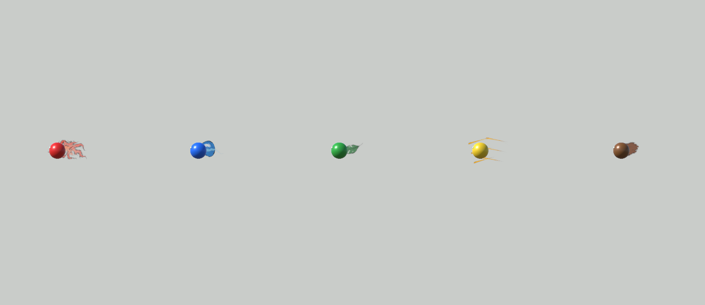
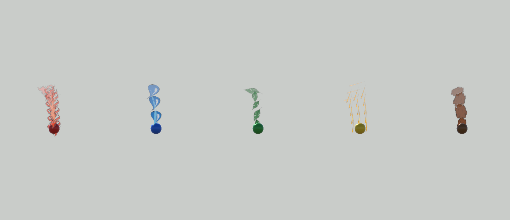

# 오행 구슬 비행 트레일

이 문서는 #219의 시각 효과 연결과 비교 방법을 설명한다. 검사 코드를 추가했거나 비교 창이 존재한다는 사실을 실행 검증 완료로 해석하지 않는다. 이 브랜치에서 실제 수행한 검사의 환경·결과는 `docs/VALIDATION.md`의 해당 기록을 확인한다.

## 변경 범위

오행별로 투사체가 실제 지나간 위치에 먹선·담채 잔상을 남긴다. 투척 입력, `LabThrowMath`의 속도 계산, `Rigidbody` 이동, Host의 명중 판정과 피해·도색 규칙은 기존 경로를 사용한다. 시각 효과는 새 투척 요청이나 명중 요청을 만들지 않는다.

| 속성 | 꼬리 형태 | 주로 비교할 부분 |
| --- | --- | --- |
| 화 | 갈라지는 넓은 불꽃 붓결 | 짧은 비행에서도 뾰족하게 갈라지는 실루엣 |
| 수 | 이어진 물줄기와 분리된 큰 물방울 | 물줄기와 물방울 사이의 빈 공간 |
| 목 | 일정한 거리마다 남는 잎 붓자국 | 연속 면 대신 반복되는 잎 모양 |
| 금 | 같은 경로를 따라가는 세 가닥 평행 먹선 | 세 줄이 하나의 넓은 선으로 뭉개지지 않는지 |
| 토 | 간격을 두고 남는 굵고 둥툭한 마른 붓 덩어리 | 잎과 구별되는 덩어리와 거친 끝 |

가까운 정면 카메라에서는 실제 이동 경로가 겹쳐 보일 수 있다. 비교 창의 정면 결과를 먼저 확인하며, 측면은 경로와 잔상 형태를 추가로 살피는 용도다. 긴 사선 꼬리 이미지를 구슬 뒤에 붙여 비행 경로처럼 보여주는 방식은 사용하지 않는다.

## Inspector에서 조정하기

1. `Assets/Lab/Art/Orbs/LabOrbAppearance.asset`을 선택한다.
2. `Element Flight Trails`의 참조에서 변경할 프로필을 선택한다. 실제 파일은 `Assets/Lab/Art/ElementTrails/Profiles/{Fire,Water,Wood,Metal,Earth}FlightTrail.asset`이다. 이 참조는 일반 방과 솔로의 투사체 표현에 함께 사용된다.
3. 프로필의 다음 값을 조정한다. 게임 수치용 `LabConfig`와 DEV 공유 설정을 바꾸는 기능은 아니다.

| 프로필 항목 | 단위·역할 |
| --- | --- |
| `Max Length` | 월드 단위. 잔상으로 보관할 경로의 최대 길이. 지속 시간과 별개다. |
| `Width` | 월드 단위. 전체 리본 폭과 반복 자국의 가로폭. 금은 세 줄을 포함한 폭이다. |
| `Lifetime` | 초. 지나간 위치가 남는 시간. 세션 일시정지와 함께 멈춘다. |
| `Particle Spacing` | 월드 단위. 실제 이동 경로를 따라 찍는 붓자국 사이의 거리. |
| `Particle Size` | 월드 단위. 물방울·잎·덩어리 같은 자국의 세로 길이. |
| `Color` | 해당 효과의 담채 색상. 피해 숫자나 박 도색의 색상을 변경하지 않는다. |
| `Ribbon Texture` | 연속 리본용 투명 텍스처. 위가 구슬 진행 방향이다. |
| `Particle Texture` | 반복 자국용 투명 텍스처. 위가 기록된 이동 방향이다. |
| `Material` | 현재 URP에서 먹선·담채와 알파를 표현하는 재질. |

글자, 한지 배경과 구슬 본체는 꼬리 텍스처에 포함하지 않는다. 투명한 틈과 마른 붓결이 있어야 하며, 검은 먹선이 속성 색상으로 덮이지 않는지 확인한다. 효과의 색상은 박의 도색 색상이나 피해 표시와 독립된 표현값이다.

Play Mode 중 프로필 원본 에셋을 편집하면 에셋 변경이 남을 수 있다. 임시 비교 뒤 유지할 값과 되돌릴 값을 구분한다. 실제 기기에는 새 빌드가 필요하다.

## 다섯 종류 비교하기

비교 창은 일반 게임의 저장 Scene을 수정하지 않는 **Editor 전용 도구**다. Editor에 게임 실행 여부를 자동으로 바꾸는 메뉴는 추가하지 않는다.

1. `Assets/Lab/Scenes/Lab.unity`를 열고 Play Mode에 진입한다. 방 생성이나 전투 시작은 비교 창의 필수 조건이 아니다.
2. `C6 Lab → Visuals → Compare Element Flight Trails`를 연다.
3. `Compare / replay`를 누른다. 화·수·목·금·토가 왼쪽부터 표시된다.
4. 기본 `Short flight (0.20 s)`와 `Auto capture`를 유지하면 짧은 실제 비행의 화면을 지정 시점에 고정해서 비교한다. 기본 캡처 시점은 0.14초이며, Editor 프레임 경계에서 그 시점에 도달한 첫 렌더가 표시된다. 정확히 0.14초로 물리를 재구성하는 기능은 아니다.
5. 기본 정면은 현재 Lab 카메라의 설정과 **해당 카메라 자신의 화면 비율**을 복사하고 현재 설정값으로 계산한 자리 0의 위치를 사용한다. 비교 이미지 전체에 억지로 늘리지 않고 여백을 두어 보여준다. 실제 전투 카메라 밖으로 나간 부분은 기본 정면에서도 보이지 않는다.
6. `Side view` 또는 `Front close-up (auxiliary)`를 켜고 재생해 실루엣과 경로를 추가로 본다. 이 두 보조 시점은 실제 기록된 위치와 구슬 위치에 화면을 맞추며, 다섯 효과에 동일한 배율·화각을 적용한다. 측면은 옆에서, 확대 정면은 기존 정면 방향에서 본다. 물리와 경로는 그대로이며 카메라의 구도만 바뀌므로 기본 전투 카메라의 가시성을 증명하는 자료로 사용하지 않는다.
7. 자연스러운 비행 종료·잔상 소멸은 `Auto capture`를 끄고 관찰한다. `Short flight`를 끄면 비교용 비행 시간은 0.45초다. 이 시간은 일시적인 설정 복사본에만 적용된다.
8. `Compare / replay`를 다시 눌러 이전 잔상과 새 출발점이 이어지지 않는지 확인한다. `Stop and clear` 또는 창 닫기로 비교 개체를 제거한다.

`Freeze preview`는 **표시된 이미지**만 고정한다. 실제 게임이나 비교 투사체의 시간을 멈추지 않는다. 비교 투사체는 원래 시간대로 끝나고 잔상이 사라진다. 게임의 일시정지 메뉴나 Editor Pause가 켜져 있으면 비교도 정상 시간으로 진행할 수 없으므로 먼저 해제한다. 이 도구는 전역 `Time.timeScale`이나 물리 설정을 변경하지 않는다.

각 투사체는 실제 `LabProjectile.Create`와 `LaunchVisual`을 사용한다. 동일한 `LabThrowMath` 발사값과 `Rigidbody` 물리를 가지며, 비교 전용 물리 Scene에서 정상 FixedUpdate 간격으로 실행된다. 일반 전투 개체와 충돌하거나 피해·도색·네트워크 상태를 변경하지 않는다. 테스트용으로 정의한 부드러운 곡선에 구슬을 옮겨 그린 이미지는 아니다.

`Export displayed PNG`는 현재 표시된 다섯 화면만 PNG 한 장으로 저장한다. 이미지의 순서는 화·수·목·금·토이며, 이 자료는 표현 비교용이다. 멀티플레이, 실제 명중 또는 iOS 성능 검증의 근거로 사용하지 않는다.

## 실제 게임에서 확인할 항목

비교 창에서 구별된다는 것과 실제 전투에서 읽힌다는 것은 별도로 확인한다.

- 솔로에서 실제 구슬을 생성·조합·투척해 현재 전투 카메라에서 꼬리를 확인한다.
- 다섯 속성을 각각 던져 화의 갈라짐, 수의 물방울, 목의 반복 잎, 금의 세 줄, 토의 덩어리를 구분한다.
- 빠르고 짧은 투척과 느린 투척에서 잔상 길이·폭을 확인한다.
- 명중과 빗나감 후 남은 자국이 자연스럽게 사라지는지 확인한다.
- 한 번 던진 뒤 다시 던지기, Retry, 로비 복귀에서 이전 잔상이 이어지거나 남지 않는지 확인한다.
- 세션 일시정지·재개 시 이동과 잔상이 함께 멈추고 이어지는지 확인한다.
- Host와 참가자의 투사체 표현을 따로 확인한다. 색상과 형태는 전달된 속성을 사용하며, 참가자 표현은 피해·도색 권한을 갖지 않는다.
- iOS에서는 실제 기기의 화면 크기·프레임과 여러 투사체가 겹치는 상황을 확인한다. Editor의 화면 비교만으로 기기 성능을 통과 처리하지 않는다.

## 코드 연결

| 수정하려는 내용 | 확인할 파일 |
| --- | --- |
| 오행별 표현값·텍스처·재질 | `Assets/Lab/Scripts/Throw/LabElementTrailProfile.cs` |
| 실제 위치 기록과 길이·나이 제한 | `Assets/Lab/Scripts/Throw/LabFlightTrailPath.cs` |
| 오행 프로필 선택 | `Assets/Lab/Scripts/Orb/LabOrbAppearance.cs` |
| 투척의 시작·명중·실패 수명과 효과 연결 | `Assets/Lab/Scripts/Throw/LabProjectile.cs` |
| 기존 물리·발사 계산 | `Assets/Lab/Scripts/Throw/LabThrowMath.cs` |
| 비교 창과 임시 물리 Scene 생성·정리 | `Assets/Editor/ElementTrailComparison/LabElementTrailComparisonWindow.cs` |
| 비교 Scene의 Editor 전용 물리 진행 | `Assets/Lab/Scripts/Throw/EditorOnly/LabElementTrailComparisonPhysics.cs` |

비교용 물리 진행 컴포넌트는 `#if UNITY_EDITOR`로 한정되므로 기기 빌드에 포함되지 않는다. 저장된 Lab Scene이나 런타임 메뉴에 자동 연결하지 않으며 비교 창이 명시적으로 생성한 임시 Scene에서만 사용한다.

## 표현 수명과 기존 코드 호환

- 명중·빗나감에서는 효과를 투사체에서 분리해 기존 세계 위치에 남긴 뒤 `Lifetime`에 따라 없앤다. Retry·로비 복귀·연결 종료에서는 같은 투사체 루트와 함께 즉시 정리한다.
- 새 `Begin`은 이력·입자·이전 종료 예약을 비운다. 이번 작업은 투사체 오브젝트 풀 자체를 추가하지 않는다.
- 현재 게임은 세션 일시정지 때 `Time.timeScale=0`을 사용한다. 이력·입자·잔상 수명도 같은 시간을 사용한다.
- 오행 프로필이 없거나 `None`이면 기존 `TrailRenderer`를 사용한다. 저장된 기본 외형에는 다섯 프로필을 연결해 새 효과가 적용된다.
- 이력은 최대512점, 입자는 최대512개(금은 세 개 묶음을 유지하는510개), 한 샘플의 신규 방출은 최대64개(금은21묶음·63개)로 제한한다. 극단적인 간격·긴 프레임에서는 오래된 부분을 줄여 개체 수를 제한한다.
- 연속 리본은 시간과 월드 최대 길이를 각각 잘라낼 수 있도록 경로 이력에서 Mesh를 구성한다. 금은 같은 이력에서 세 폭을 계산하고, 원근으로 짧아지는 비행에서도 보이도록 실제 거리 샘플마다 세 붓선 묶음을 함께 남긴다. 반복 자국은 World 공간의 수동 거리 방출 Particle System이다.
- 게임 설정150개·프로토콜5642(#212 통합)와 Host/Client의 기존 `LabProjectile.Create`·`Launch`/`LaunchVisual` 경로는 그대로 사용한다. 새 네트워크 메시지는 없다.

## 저장된 기본 표현값

| 프로필 | 최대 길이 | 폭 | 유지 시간(초) | 입자 간격 | 입자 세로 길이 |
| --- | ---: | ---: | ---: | ---: | ---: |
| 화 | 2.0 | 0.60 | 0.42 | 0.24 | 0.60 |
| 수 | 2.1 | 0.40 | 0.45 | 0.48 | 0.50 |
| 목 | 1.8 | 0.38 | 0.50 | 0.32 | 0.52 |
| 금 | 2.2 | 0.55 | 0.38 | 0.27(세 붓선 묶음) | 0.50 |
| 토 | 1.8 | 0.50 | 0.50 | 0.40 | 0.54 |

시간 외의 수치는 월드 단위다. 위 값은 첫 구현의 시각 기본값이며 iOS 실기기에서 튜닝을 완료했다는 의미가 아니다. 원본 PNG·알파 가져오기·생성 프롬프트는 [에셋 안내](../Assets/Lab/Art/ElementTrails/README.md)에 기록한다.

## 실제 GPU 비교 이미지

화·수·목·금·토 순서다. 아래는 실제 `LabProjectile`의 위치를 기록한 렌더이며 시안 합성이나 수동 곡선 애니메이션이 아니다. 같은 단일 프로세스에서 실행한 표현 fixture로, 실제 다기기 전투나 iOS 결과를 뜻하지 않는다.

짧은0.20초 비행 중 약0.14초에 캡처한 측면 보조 시점:

0.45초 비행 중 약0.34초에 캡처한 확대 정면 보조 시점:

두 보조 시점은 실제 기록 경로에 카메라를 맞춘 것이며 게임 카메라 그대로의 가독성을 보증하지 않는다. 실제 전투 카메라를 복사한 기본 정면과 iOS 화면에서도 별도로 확인해야 한다.
