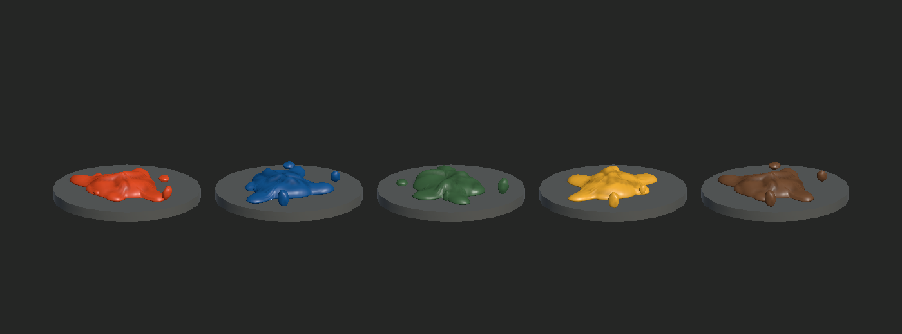
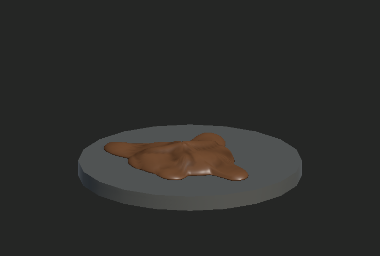
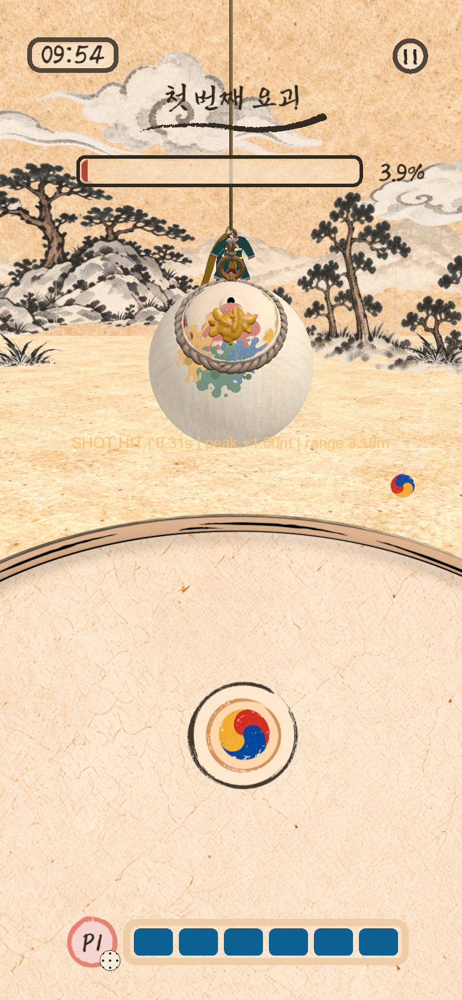
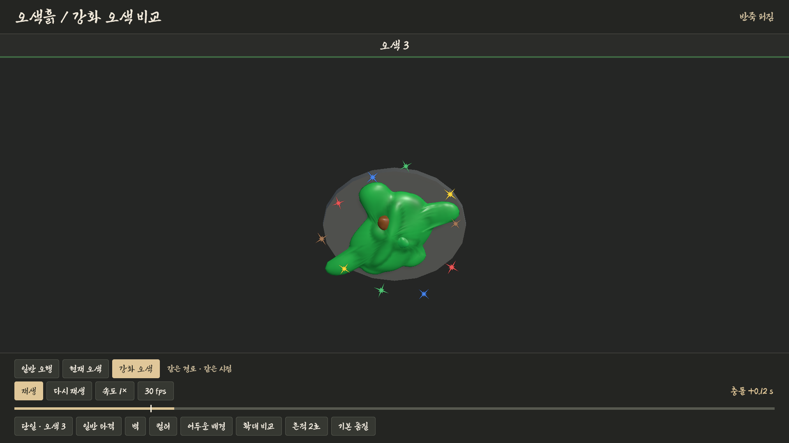
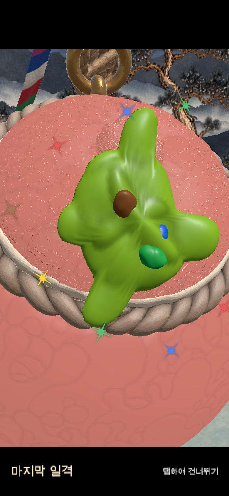

# 오색흙 오행 VFX

Lab과 Hapio 전투에서 일반 원소 구슬과 오색 구슬을 던지면 종이결과 층진 안료색을 입힌 3D 구슬이 실제 투사체를 따라 날아간다. 박에 닿으면 공이 눌리고 진흙이 퍼지며, 작은 진흙 방울과 젖은 흔적이 남았다 사라진다. 일반 명중의 원소 형상·색띠 폭발은 제외했다. 강화 오색 보상에는 명중 순간의 짧은 별 파열을 추가한다. 타격 부위에 쌓이는 최종 색과 두께는 기존 클레이 스티커 도색이 관리한다.

## 다른 환경에서 이어서 작업

이슈 #576과 PR 브랜치 `codex/five-elements-vfx-handoff`에서 소스와 Unity 에셋을 함께 받는다.

```sh
git fetch origin codex/five-elements-vfx-handoff
git switch --track origin/codex/five-elements-vfx-handoff
```

Unity 6000.6.5f1로 프로젝트를 열어 패키지 복원을 마친다. 비교 씬은 아래 메뉴로 실행하고, 실제 전투는 `Assets/Hapio/Scenes/Home.unity` → Play → 기존 개발자 솔로 진입을 사용한다. 하단 보드에는 기존 2D 스프라이트가 표시된다. 새 구슬 재질은 일반 오행·오색 투사체의 비행과 충돌 직후 눌림에 적용된다. 지귀 부적 보상·숨은 파편은 각자의 전용 표현 경로를 사용한다.

아래 화면은 2026-11-06의 구현 기준 `46ae9987`에 당시 작업을 적용해 캡처했다. 이후 main을 기준으로 한 이 PR의 실행 결과는 `docs/VALIDATION.md`의 2026-11-09 항목에서 확인한다.


아래는 main `02a27205`를 통합한 2026-11-09 진흙 전용 변경의 실제 Unity Metal 렌더다. 원소 해방 효과는 재생하지 않는다.





<details>
<summary>이전 전투의 비행 화면 (2026-11-06)</summary>


</details>



## 3D 구슬과 색 매핑

**Project → Assets/Experiments/FiveElements/Orbs**에서 원하는 원소 프리팹을 씬으로 끌어 놓는다. 다섯 프리팹은 지름 1인 구형 메시다. Prefab Mode에서 카메라를 돌리거나 구슬 Transform을 회전하면 표면을 따라 도는 종이 섬유와 조명에 반응하는 상앗빛 붓자국을 확인할 수 있다. 전투 투사체와 비교 씬은 같은 재질을 비행 본체와 최초 충돌 시 눌림에 쓴다.

| 속성 | 프리팹 | 안료 중간톤 · sRGB |
| --- | --- | --- |
| 화 | Fire | 주홍 `#DE4A21` |
| 수 | Water | 파랑 `#145896` |
| 목 | Wood | 녹색 `#3F6642` |
| 금 | Metal | 황금 `#ECAA2F` |
| 토 | Earth | 갈색 `#744D32` |

**Assets/Lab/Resources/FiveElements/OrbSurface**의 원소별 Material에서 먹선, 그림자, 중간톤, 밝은 두 색면, 붓자국 색을 조절한다. 색상은 첨부 그림의 구슬 안쪽에서 추출했다. `PaperGrain.png`는 적색 채널에 종이 요철, 녹색에 잔섬유, 청색에 안료 입자감을 담은 512×512 반복 텍스처다. 셰이더가 구슬의 로컬 좌표로 세 방향에서 읽어 UV 이음새 없이 표면에 붙인다. 투사체를 재사용할 때 지정된 재질을 다시 연결하며, 단색 비교에는 별도의 회색 재질을 쓴다.

## 비교 씬 재생

1. MUSA 프로젝트를 Unity 6000.6.5f1로 연다. **C6 Lab → Experiments → Five Elements → Open Comparison**을 선택한다. 또는 `Assets/Experiments/FiveElements/Scenes/FiveElementsComparison.unity`를 직접 연다.
2. **Play**를 누른다. 왼쪽부터 **화·수·목·금·토**다. 같은 크기의 공 다섯 개가 동시에 날아가 0.68초에 맞는다. 표시 시계는 접촉 순간을 0초로 잡는다.
3. **단일 · 토**를 선택하거나 토 이름을 누른다. 일시정지하고 시간 막대를 움직여 구슬 눌림, 진흙 퍼짐, 작은 방울 낙하, 흔적 소멸 순서를 본다. 같은 시간을 **단색**과 **컬러**로 비교할 수 있다.
4. 일반/강타, 밝은/어두운 배경, 바닥/벽/움직이는 벽, 흔적 1~3초, 확대/게임 거리, 품질을 전환한다. **30/60 fps**는 데모의 재생 표본 간격과 목표 프레임률을 설정한다. 슬로 모션과 일시정지는 비교 씬 안의 시계에만 적용한다.

다섯 속성 모두 같은 진흙 명중 구조를 사용하며 색은 위 팔레트로 구분한다. 화염·물결·잎·금속 쐐기·모래 해방은 재생하지 않는다.

## 전투 연동

- `LabProjectile`이 실제 위치·방향·월드 지름을 비행 효과에 전달한다. Host의 실제 투척, 던진 사람의 로컬 예측, 원격 복제본이 이 경로를 사용한다. 오색 구슬도 같은 클레이 경로를 쓰며 기존 색 순환을 몸통·꼬리·방울에 적용한다.
- `LabNetwork`와 `LabNetwork.Actions`의 현재 피격 표현 지점이 `LabImpactFeedback.PlayContact`를 호출한다. Host와 예측 타격은 접촉 법선을 직접 사용한다. 관전자와 다른 참가자는 기존 `targetImpact`에 선택적으로 실리는 대상 로컬 법선과 지름을 사용한다. 손님 쪽에서 이미 선반영한 충돌은 기존 수신 처리에서 한 번만 표시한다. 피격 강도는 기존 `LabPaintImpact.Normalize`가 계산한 법선 방향의 속도에 비례한다.
- 준비 화면에서는 `LabBattleRenderWarmup`의 비공개 복사본으로 일반 오행 5종과 오색 1종의 구슬 재질·클레이 비행·퍼짐을 먼저 그린다. 실제 투척 풀·seed·도색 상태를 사용하지 않고 준비가 끝나면 복사본을 해제한다.
- 움찔·소리·햅틱은 기존 이벤트가 담당한다. 독립된 비교 씬은 점수, HP, 네트워크 메시지, 사운드를 만들지 않는다. 전투의 마지막 일격 다시보기는 #659부터 같은 클레이 표현을 전용 수동 시계 풀에서 재생한다. 공유 시간표와 게임 판정은 유지한다(`FINAL_HIT_REPLAY.md`).

독립 효과가 필요한 호출자는 다음처럼 한 번 받은 비행 핸들을 보관한다. `direction`과 `incoming`은 월드 좌표 방향, `diameter`는 월드 단위 지름이다.

```csharp
var pool = LabFiveElementVfx.ForScene(gameObject.scene);
var flight = pool.BeginFlight(LabOrbElement.Earth, start, direction, diameter, strength);
// 이동 중 매 프레임
flight.Move(currentPosition, currentDirection);
// 한 번만 판정한 접촉 지점에서
flight.Hit(worldPoint, worldNormal, incoming, hitTransform, leaveMark: true);
```

빗나가거나 발사를 취소하면 `flight.Cancel()`을 호출한다. 비행 복제본과 타격 승인이 분리된 게임에서는 비행을 회수하고 승인된 경로에서 `pool.PlayImpact(..., leaveMark: false)`를 호출한다. 씬 안에서 하나의 풀을 공유하며 재사용된 핸들로 늦게 도착한 타격은 무시한다.

## 아트와 비용 조절

`Assets/Lab/Resources/FiveElements/Profile.asset`을 Inspector에서 연다. 공유 로직 하나가 다섯 속성을 재생한다.

| 설정 | 시작값 및 용도 |
| --- | --- |
| Fire / Water / Wood / Metal / Earth, Monochrome | 뒤따르는 반죽·퍼짐·작은 방울의 안료색. 구슬 자체의 색면과 반사는 위의 원소별 Material에서 조절한다. |
| Wet Gloss, Trail Diameters | 반죽의 젖은 반사와 꼬리 길이. 기본 0.65와 1.6D. D는 공 지름이다. |
| Press Seconds, Spread Seconds, Spread | 눌림 약 0.052초, 퍼짐 약 0.12초. 강도에 따라 시간·면적·파편 도달 거리가 함께 바뀐다. |
| Clay Drops, Drop Speed / Lifetime, Gravity Diameters | 반죽 파편 기본 4개, 수명 0.56초. 강한 타격일수록 더 멀리 퍼진다. |
| Contact Seconds | 기본 0.86초. 실제 Battle의 임시 진흙 접촉 수명이며 `contactSeconds / Lerp(0.95, 1.13, strength)`로 강도를 반영한다. 원소 해방 연출과 무관하다. |
| Mark Seconds, Max Flights / Impacts | 데모 흔적 기본 2초. 기본 한도는 비행 16개, 타격·흔적을 합해 24개. 낮은 품질의 타격 한도는 10개다. |

공·짧은 꼬리·퍼짐 메시 원형은 `LabClayShapes`, 비행은 `LabClayFlightSlot`, 눌림·퍼짐·작은 방울·잔흔 수명은 `LabClayImpactSlot`이 담당한다. 젖은 진흙은 `LabWetPigment` 셰이더로 그린다. 원소 해방 전용 코드·셰이더는 이 PR에서 제외했다.

## 피버·섬광 보상 오색 구슬 — #627 / #659

오색 구슬의 실제 데이터는 계속 `element=None`, `fiveColor=true`다. 표시 전용 `fiveColor` 인자를 명시했을 때만 공통 클레이가 이 구슬을 받아들이며, 일반적인 무속성 요청은 기존처럼 거절한다. 일반 구슬의 메시·실제 경로·눌림·퍼짐·수명·도색 규칙은 유지한다. 오색은 아래 강화 프로필에 따라 표현 크기와 시간을 별도로 적용하며 실제 구슬의 지름·물리·도색 면적은 변경하지 않는다.

`LabFiveColorSparkle`의 기존 색상 주기를 현재 비행 lease에 연결한다. 몸통은 기존 PaperOrb의 종이결과 농담을 유지하며 모든 색면을 기기별 재질 복제 없이 바꾼다. 꼬리는 기존 오색 흐름을 진흙 목·방울·안료 자국에 적용한다. 구형 TrailRenderer를 동시에 겹쳐 표시하지 않는다. 반납한 lease는 새로 재사용한 구슬에 색을 쓰지 못하고, 일반 원소로 재사용할 때 오색 재질 속성을 지운다.

명중은 공통 클레이 접촉만 표시한다. #627 당시 함께 표시하던 오색 먼지·별가루는 #659에서 제거했다. 후속 승인으로 오색만 같은 진흙 메시·재질을 크게 눌러 빠르게 퍼뜨리고 다섯 색의 방울을 강조한다. 색이 명중 순간 노랑으로 되돌아가지 않도록 투사체 종료 전에 색상 위상을 잡는다. 기존 `targetImpact.payload`의 접촉 법선·크기에 선택적 `fiveColorAge`를 함께 보낸다. 구형 payload가 이 필드를 생략하면 위상0으로 읽으며, 비정상 위상은 표시 단계에서0으로 처리한다. 새 메시지 종류·공유 설정·접속 버전·게임 판정 필드는 추가하지 않는다. Guest 선반영의 접촉은 Host 확인 때 두 번 만들지 않는다. 오색 명중 확인 이벤트와 본인 보상 피드백은 기존대로 유지하며 별도 먼지·별가루는 생성하지 않는다.

보드의 오색 그림·광륜·반짝임, 피버 문구/화면 번쩍임/부적 흐름, 스태미나/북/음악은 기존 연결을 유지한다. 같은 오색 타입인 섬광 보상에도 공통 표현이 적용된다. 팀 피버 구슬은 기존 실제 원소를 사용하고, 지귀 부적·물구슬은 기존 전용 표현을 유지한다. 마지막 일격 다시보기는 #659부터 공통 클레이를 전용 재생 시계로 그린다(`FINAL_HIT_REPLAY.md` 참고). 준비 화면은 실제 게임 풀·난수를 소비하지 않는 여섯 번째 비공개 오색 복사본으로 새 재질 경로도 먼저 그린다.

빠른 확인은 실제 Home에서 2스테이지 솔로를 시작한 뒤 **Hapio → VFX 실험실**을 열어 **Y5(야광귀 피버)**를 실행한다. 피버에서 생성한 구슬을 던져 3D 몸통·진흙 꼬리와 오색 순환, 명중 눌림·퍼짐을 확인하고 옛 먼지/별빛이 추가로 겹치지 않는지 비교한다. 일반 구슬과 비교할 때는 피버 시작 전에 일반 구슬을 준비한다. 이 메뉴는 개발 확인용이며 실행 결과와 실기기 수행 여부는 `VALIDATION.md`를 따른다.

실제 Battle은 `leaveMark:false`로 접촉 수명만 표시한 뒤 기존 도색이 최종 색을 유지한다. 비교 씬의 `leaveMark:true`는 `max(contactSeconds의 강도 보정값, markSeconds)` 동안 진흙 흔적을 표시한다. 잔흔 수명을 늘려도 실제 칠 면적이나 도색 유지시간이 바뀌지는 않는다.

모바일 Renderer에는 Decal Renderer Feature가 없어 임시 접촉 흔적은 표면의 접평면에 놓는다. 대상의 Transform으로 접촉점과 법선을 갱신하고 흔적의 월드 지름을 유지한다. 급한 곡면에서는 가장자리가 뜨거나 표면 안쪽에 들어갈 수 있다. 스킨 변형이 필요한 장기 흔적은 기존 표면 도색 쪽으로 전달한다.

## 확인 환경

프로젝트는 Unity 6000.6.5f1, URP 17.6.0, 선형 색 공간을 쓴다. iOS는 Mobile 품질과 Mobile_RPAsset의 Forward 렌더러, 60 fps를 대상으로 한다. 게임 기본 공 지름은 0.33, 전투 카메라 반경은 8, 수직 시야각은 52도다. 비교 씬은 한 사람의 단일 타격과 5명 분량의 동시 타격을 재현한다. 최대 동시 수는 실전 계측에 따라 프로필에서 조정한다.

편집기 검증기는 `C6Lab.Editor.LabFiveElementsPlaybackCheck.Run`이다. 별도의 프로젝트 복사본에서 그래픽을 켠 Unity 배치 모드로 실행하고 `-fiveElementsOutput`에 결과 폴더를 지정한다. 검증기가 직접 종료하므로 `-quit`을 붙이지 않는다. 실행 결과와 기기 측정 범위는 [검증 기록](VALIDATION.md)을 참고한다.


### #659 대체 궤적의 크기 통일

오색 클레이 풀이 가득 찼거나 사용할 수 없어 기본 TrailRenderer로 표시할 때에도 실제 오색 투사체는 일반 구슬의 폭·잔상 시간·폭 곡선을 그대로 사용한다. 오색 색 흐름만 적용하며 예전의 5배 폭·0.45초 강제 잔상·전용 폭 곡선을 추가하지 않는다. 지귀 부적의 푸른 전용 표현과 기존 독립 미리보기 경로는 유지한다. 새 Inspector/DEV 설정·재질 원본·게임 판정은 변경하지 않는다.


### #659 오색 보상 강화와 직접 비교

게임 기본은 강화 ON이다. `Assets/Lab/Resources/FiveElements/Profile.asset`의 **Five-color reward · presentation only**에서 조절한다. 일반 오행 값은 그대로이며 아래 값은 로컬 아트 프로필이므로 DEV 공유 설정 수·접속 규약을 변경하지 않는다. `fiveColorBoostEnabled`를 끄면 #659 최초 PR의 공통 크기 오색 클레이로 돌아간다. 구형 먼지·별가루를 되살리는 옵션은 아니다.

| Inspector 필드 | 기본값 | 의미 |
| --- | --- | --- |
| Five Color Boost Enabled | ON | 오색만 강화. 일반 오행·지귀 전용 구슬은 유지 |
| Five Color Trail Diameters | 2.4 | 실제 지나간 경로를 따르는 꼬리 길이, 구슬 지름 단위 |
| Five Color Trail Width Scale | 1.4 | 진흙 목·가느다란 안료 자국의 폭 배율 |
| Five Color Drop Size Scale | 1.3 | 비행 방울·명중 방울의 선형 크기 배율 |
| Five Color Spread Scale | 1.35 | 임시 명중 얼룩의 가로/세로 배율, 실제 칠 면적 아님 |
| Five Color Press Width Scale | 1.2 | 최초 눌림의 최대 폭 배율 |
| Five Color Press Seconds | 0.06초 | 강도 보정 전 눌림 시간 |
| Five Color Spread Seconds | 0.10초 | 강도 보정 전 퍼짐 시간, 초반 빠른 확장 후 감속 |
| Five Color Clay Drops | 5 | 다섯 순색의 명중 방울, 저품질 최대3 |
| Five Color Drop Lifetime | 0.65초 | 튀는 방울이 줄어드는 시간 |
| Five Color Contact Seconds | 0.95초 | 강도 보정 전 임시 접촉 수명 |
| Five Color Stars Enabled | ON | 강화 오색 명중에 짧은 별 파열 추가 |
| Five Color Star Count | 10 | 별 개수 5~12, 저품질 최대5개 |
| Five Color Star Lifetime | 0.45초 | 같은 명중 시계로 페이드·축소한 뒤 종료 |
| Five Color Star Size | 0.42D | 별 최대 너비, 실제 구슬 지름 단위 |
| Five Color Star Reach | 2.6D | 접촉점에서 바깥으로 퍼지는 최대 반경 |

오색 비행 몸통의 크기·회전과 실제 궤도는 기존과 같다. 꼬리는 공간상 색 차이를 유지하면서 흐르고, 명중 방울은 접촉 시작 위상으로 정한 다섯 순색을 짧은 생애 동안 유지해 작은 화면에서도 다색이 읽히게 한다. 강화 비행만 경로64샘플을 쓰며 일반/현재 비교는32샘플을 유지한다. 표면 퍼짐은 여전히 접평면 메시이므로 급한 곡면·큰 구슬에서 실제 도색 경계와 동일한 면적을 나타내지 않는다.

직접 비교:

1. **C6 Lab → Experiments → Five Elements → Open Comparison** → Play. 이 비교 장면은 Game 뷰를 `Full HD (1920×1080)` 등 가로 화면으로 두면 버튼과 경로를 함께 확인하기 쉽다. 실제 게임의 세로 설정은 바꾸지 않는다.
2. **현재 오색 / 강화 오색** 버튼을 전환한다. `일반 오행`은 기존 다섯 원소다. 전환 시 재생 위치·선택 구슬·카메라·강도·배경·일시정지는 유지하고 같은 seed부터 경로를 복원한다. 확대 카메라는 강화된 벽 접촉까지 담도록 모든 비교 모드에 동일한 여백을 둔다.
3. 비행 중 일시정지해 꼬리 길이·폭을 비교한다. 명중 뒤 시간 막대로 눌림·퍼짐·5색 방울·별 파열을 확인한다. 접촉 +0.12~0.20초에서 별이 퍼진 모양을, +0.45초 이후에는 진흙만 남는 모습을 비교한다. `단일`과 `다섯 동시`, `게임 거리`, `낮은 품질`로 가독성·겹침을 비교한다.
4. 실제 전투는 2스테이지 개발자 솔로에서 **Hapio → VFX 실험실 → Y4 오색 보상 / Y5 야광귀 피버**로 확인한다. 이 메뉴는 기존 확인 도구이며 배포 UI에 새 버튼을 추가하지 않는다.

비교 버튼은 해당 풀의 `FiveColorBoostEnabled`만 바꾸며 Resources 프로필을 저장하지 않는다. `BeginFlight` 때 선택한 강화 여부는 해당 비행과 `Flight.Hit`까지 유지한다. 실제 전투의 별도 승인 접촉은 동일한 저장 프로필을 쓴다. 이미 사용 중인 프로필 수치를 실행 중 직접 바꾸면 일부 값은 시작 때, 일부는 매 프레임 읽으므로 동일 시점 비교에는 비교 버튼을 사용한다.

풀 부족 시 기본 TrailRenderer의 공통 폭·수명은 유지한다. Wet Pigment 셰이더가 없거나 지원되지 않는 오색은 URP Unlit으로 같은 풀 메시·시간축을 그린다. 일반 구슬의 기존 대체 경로는 유지한다. 다시보기 오색은 그 간소 표현마저 준비할 수 없으면 시각 파편만 생략하고 타격음·결과 전환을 유지하며 구형 먼지/별가루로 돌아가지 않는다. 준비 화면은 같은 오색 프로필로 워밍업한다.


### 강화 오색의 짧은 별 파열

`LabClayImpactSlot`은 강화 오색의 접촉에만 날카로운 별 모양을 펼친다. `Yaguang/FiveColorSparkle.png`의 기존 이미지를 원본 그대로 사용하며, 기본10개에는 다섯 색을 두 번씩 배치한다. 초반에 빠르게 바깥으로 퍼지고 축소·페이드한 뒤0.45초에 끝나므로 진흙 접촉은 계속 남는다. `Five Color Stars Enabled`만 끄면 강화 클레이는 유지하고 별만 끌 수 있다. `현재 오색` 비교와 일반 구슬에는 별이 없다.

새 `LabFiveColorStar` 셰이더가 실제 렌더 카메라를 향하는 투명 쿼드를 그린다. 별은 첫 사용 때 풀에 생성하고 다음 접촉에 재사용하며 프레임마다 객체를 만들지 않는다. 메시·재질·이미지를 공유하고 낮은 품질에서는5개로 제한한다. 콜라이더·물리·피해·도색 이벤트는 만들지 않는다. 별 리소스를 준비하지 못하면 별만 생략하고 클레이는 계속 표시한다.

위치·색·스핀·페이드는 클레이의 명중 Age와 전용 seed에서 계산한다. 따라서 다시보기 정지·늦은 표본·컷 변경·반복 샘플에서도 동일하게 재현되며, 기존 `LabFiveColorSparkle.Burst`의 독립 Update나 구형 먼지를 되살리지 않는다. 준비 화면의 비공개 오색 접촉에서도 실제 별 셰이더를 한 번 그린 뒤 함께 해제한다. iOS 성능은 별도 검증 대상이다.


2026-11-11 macOS/Metal Editor의 실제 캡처다. 왼쪽부터 5색을 동시 비교하는 대신 단일 강화 오색의 접촉 +0.12초에 멈췄다. 두 번째 그림은 저장된2스테이지의 실제 오색 투척을 마지막 일격으로 재생한 화면이다. 상세 자동화 조건은 VALIDATION에 남겼다.




