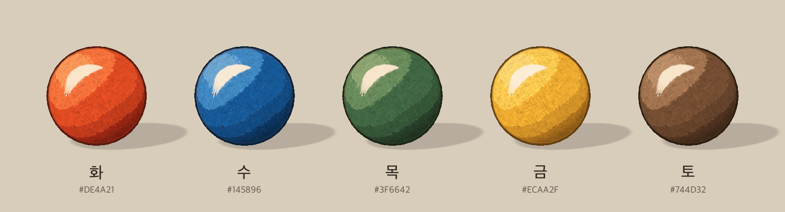
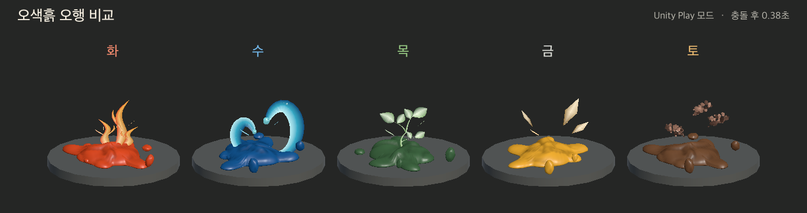
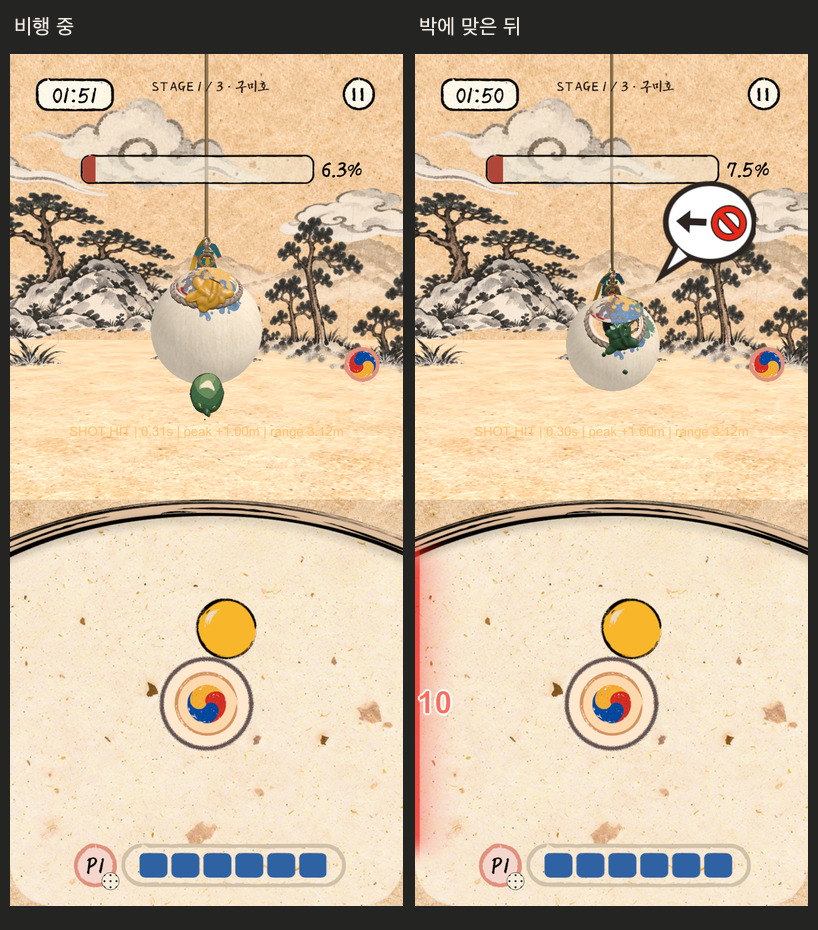

# 오색흙 오행 VFX

Lab과 Hapio 전투에서 일반 원소 구슬을 던지면 종이결과 층진 안료색을 입힌 3D 구슬이 실제 투사체를 따라 날아간다. 박에 닿으면 공이 눌리고 퍼진 뒤 짧은 색띠에서 기운이 풀린다. 타격 부위에 쌓이는 최종 색과 두께는 기존 클레이 스티커 도색이 관리한다.

## 다른 환경에서 이어서 작업

이슈 #576과 PR 브랜치 `codex/five-elements-vfx-handoff`에서 소스와 Unity 에셋을 함께 받는다.

```sh
git fetch origin codex/five-elements-vfx-handoff
git switch --track origin/codex/five-elements-vfx-handoff
```

Unity 6000.6.5f1로 프로젝트를 열어 패키지 복원을 마친다. 비교 씬은 아래 메뉴로 실행하고, 실제 전투는 `Assets/Hapio/Scenes/Home.unity` → Play → **DEV · SOLO**에서 시작한다. 하단 보드에는 기존 2D 스프라이트가 표시된다. 새 구슬 재질은 일반 오행 투사체의 비행과 충돌 직후 눌림에 적용된다. 지귀 부적 보상·숨은 파편과 특수 오색구슬은 각자의 전용 표현 경로를 사용한다.

아래 화면은 2026-11-06의 구현 기준 `46ae9987`에 당시 작업을 적용해 캡처했다. 이후 main을 기준으로 한 이 PR의 실행 결과는 `docs/VALIDATION.md`의 2026-11-09 항목에서 확인한다.





<details>
<summary>실제 구미호 전투의 비행과 명중 화면</summary>



</details>

## 3D 구슬과 색 매핑

**Project → Assets/Experiments/FiveElements/Orbs**에서 원하는 원소 프리팹을 씬으로 끌어 놓는다. 다섯 프리팹은 지름 1인 구형 메시다. Prefab Mode에서 카메라를 돌리거나 구슬 Transform을 회전하면 표면을 따라 도는 종이 섬유와 조명에 반응하는 상앗빛 붓자국을 확인할 수 있다. 전투 투사체와 비교 씬은 같은 재질을 비행 본체와 최초 충돌 시 눌림에 쓴다.

| 속성 | 프리팹 | 안료 중간톤 · sRGB |
| --- | --- | --- |
| 화 | Fire | 주홍 `#DE4A21` |
| 수 | Water | 파랑 `#145896` |
| 목 | Wood | 녹색 `#3F6642` |
| 금 | Metal | 황금 `#ECAA2F` |
| 토 | Earth | 갈색 `#744D32` |

**Assets/Lab/Resources/FiveElements/OrbSurface**의 원소별 Material에서 먹선, 그림자, 중간톤, 밝은 두 색면, 붓자국 색을 조절한다. 색상은 첨부 그림의 구슬 안쪽에서 추출했다. `PaperGrain.png`는 적색 채널에 종이 요철, 녹색에 잔섬유, 청색에 안료 입자감을 담은 512×512 반복 텍스처다. 셰이더가 구슬의 로컬 좌표로 세 방향에서 읽어 UV 이음새 없이 표면에 붙인다. 투사체를 재사용할 때 지정된 재질을 다시 연결하며, 단색 비교에는 별도의 회색 재질을 쓴다.

## 비교 씬 재생

1. MUSA 프로젝트를 Unity 6000.6.5f1로 연다. **C6 Lab → Experiments → Five Elements → Open Comparison**을 선택한다. 또는 `Assets/Experiments/FiveElements/Scenes/FiveElementsComparison.unity`를 직접 연다.
2. **Play**를 누른다. 왼쪽부터 **화·수·목·금·토**다. 같은 크기의 공 다섯 개가 동시에 날아가 0.68초에 맞는다. 표시 시계는 접촉 순간을 0초로 잡는다.
3. **단일 · 토**를 선택하거나 토 이름을 누른다. 일시정지하고 시간 막대를 움직여 응집, 외곽의 부스러짐, 알갱이 낙하 순서를 본다. 같은 시간을 **단색**과 **컬러**로 비교할 수 있다.
4. 일반/강타, 밝은/어두운 배경, 바닥/벽/움직이는 벽, 흔적 1~3초, 확대/게임 거리, 품질을 전환한다. **30/60 fps**는 데모의 재생 표본 간격과 목표 프레임률을 설정한다. 슬로 모션과 일시정지는 비교 씬 안의 시계에만 적용한다.

| 속성 | 충돌 뒤 먼저 볼 부분 |
| --- | --- |
| 화 | 비대칭으로 올라가는 불꽃 혀와 작은 불씨 |
| 수 | 끝이 안으로 말리는 넓은 C자 물결과 떨어지는 방울 |
| 목 | 짧은 줄기의 Y자 분기와 시간차를 두고 펼쳐지는 잎 |
| 금 | 곧게 튀는 얇은 쐐기와 면을 뒤집을 때의 반사 |
| 토 | 바깥으로 퍼지는 기운 안에서 가까운 모래알이 잠깐 뭉쳤다가 가장자리부터 떨어지는 변화 |

## 전투 연동

- `LabProjectile`이 실제 위치·방향·월드 지름을 비행 효과에 전달한다. Host의 실제 투척, 던진 사람의 로컬 예측, 원격 복제본이 이 경로를 사용한다. 특수 보상 오색구슬에는 기존의 색 순환 연출을 사용한다.
- `LabNetwork`와 `LabNetwork.Actions`의 현재 피격 표현 지점이 `LabImpactFeedback.PlayContact`를 호출한다. Host와 예측 타격은 접촉 법선을 직접 사용한다. 관전자와 다른 참가자는 기존 `targetImpact`에 선택적으로 실리는 대상 로컬 법선과 지름을 사용한다. 손님 쪽에서 이미 선반영한 충돌은 기존 수신 처리에서 한 번만 표시한다. 피격 강도는 기존 `LabPaintImpact.Normalize`가 계산한 법선 방향의 속도에 비례한다.
- 움찔·소리·햅틱은 기존 이벤트가 담당한다. 독립된 비교 씬은 점수, HP, 네트워크 메시지, 사운드를 만들지 않는다. 전투의 마지막 일격 다시보기는 별도 시간축과 전용 연출을 사용한다.

독립 효과가 필요한 호출자는 다음처럼 한 번 받은 비행 핸들을 보관한다. `direction`과 `incoming`은 월드 좌표 방향, `diameter`는 월드 단위 지름이다.

```csharp
var pool = LabFiveElementVfx.ForScene(gameObject.scene);
var flight = pool.BeginFlight(LabOrbElement.Earth, start, direction, diameter, strength);
// 이동 중 매 프레임
flight.Move(currentPosition, currentDirection);
// 한 번만 판정한 접촉 지점에서
flight.Hit(worldPoint, worldNormal, incoming, hitTransform, leaveMark: true);
```

빗나가거나 발사를 취소하면 `flight.Cancel()`을 호출한다. 비행 복제본과 타격 승인이 분리된 게임에서는 비행을 회수하고 승인된 경로에서 `pool.PlayImpact(..., leaveMark: false)`를 호출한다. 씬 안에서 하나의 풀을 공유하며 재사용된 핸들로 늦게 도착한 타격은 무시한다.

## 아트와 비용 조절

`Assets/Lab/Resources/FiveElements/Profile.asset`을 Inspector에서 연다. 공유 로직 하나가 다섯 속성을 재생한다.

| 설정 | 시작값 및 용도 |
| --- | --- |
| Fire / Water / Wood / Metal / Earth, Monochrome | 뒤따르는 반죽·퍼짐·기운의 안료색. 구슬 자체의 색면과 반사는 위의 원소별 Material에서 조절한다. |
| Wet Gloss, Trail Diameters | 반죽의 젖은 반사와 꼬리 길이. 기본 0.65와 1.6D. D는 공 지름이다. |
| Press Seconds, Spread Seconds, Spread | 눌림 약 0.052초, 퍼짐 약 0.12초. 강도에 따라 시간·면적·파편 도달 거리가 함께 바뀐다. |
| Clay Drops, Drop Speed / Lifetime, Gravity Diameters | 반죽 파편 기본 4개, 수명 0.56초. 강한 타격일수록 더 멀리 퍼진다. |
| Release | 기운 수명 0.86초, 대표 형상과 띠 개수, 크기, 강조광, 중력과 속도. |
| Grains Per Clump, Earth Gather End / Crumble Start / Edge Lead | 덩이당 기본 알갱이 17개와 더 작은 잔알갱이 11개. 시간 설정은 기운 수명을 1로 둔 비율이다. 바깥 알갱이와 중심 알갱이의 분리 시차를 조절한다. |
| Mark Seconds, Max Flights / Impacts | 데모 흔적 기본 2초. 기본 한도는 비행 16개, 타격·흔적을 합해 24개. 낮은 품질의 타격 한도는 10개다. |

공·짧은 꼬리·퍼짐 메시 원형은 `LabClayShapes`, 개별 형상과 움직임은 `LabElementRelease`와 `LabElementReleaseForms`에서 재생성한다. 젖은 반죽과 기운 셰이더는 프로필과 같은 Resources 폴더에 있다. 모래알은 응집체별 동작을 하나의 기운 메시에 합쳐 그린다. 정상 조건에서 기운 메시는 활성 타격당 한 번 그린다. 두 셰이더는 불투명 깊이 쓰기를 사용한다.

모바일 Renderer에는 Decal Renderer Feature가 없어 임시 접촉 흔적은 표면의 접평면에 놓는다. 대상의 Transform으로 접촉점과 법선을 갱신하고 흔적의 월드 지름을 유지한다. 급한 곡면에서는 가장자리가 뜨거나 표면 안쪽에 들어갈 수 있다. 스킨 변형이 필요한 장기 흔적은 기존 표면 도색 쪽으로 전달한다.

## 확인 환경

프로젝트는 Unity 6000.6.5f1, URP 17.6.0, 선형 색 공간을 쓴다. iOS는 Mobile 품질과 Mobile_RPAsset의 Forward 렌더러, 60 fps를 대상으로 한다. 게임 기본 공 지름은 0.33, 전투 카메라 반경은 8, 수직 시야각은 52도다. 비교 씬은 한 사람의 단일 타격과 5명 분량의 동시 타격을 재현한다. 최대 동시 수는 실전 계측에 따라 프로필에서 조정한다.

편집기 검증기는 `C6Lab.Editor.LabFiveElementsPlaybackCheck.Run`이다. 별도의 프로젝트 복사본에서 그래픽을 켠 Unity 배치 모드로 실행하고 `-fiveElementsOutput`에 결과 폴더를 지정한다. 검증기가 직접 종료하므로 `-quit`을 붙이지 않는다. 실행 결과와 기기 측정 범위는 [검증 기록](VALIDATION.md)을 참고한다.
