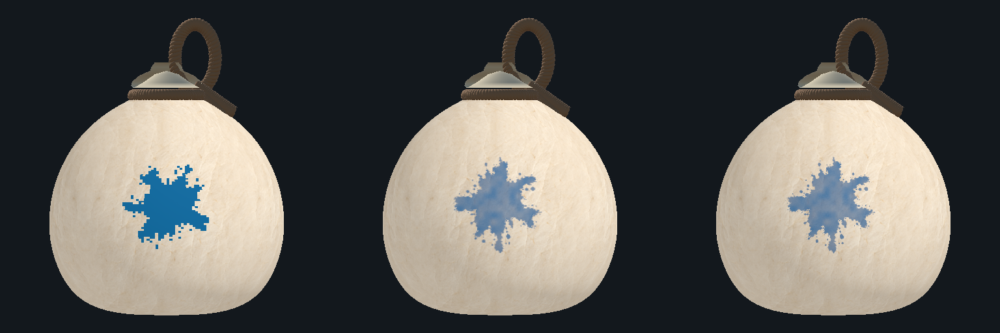
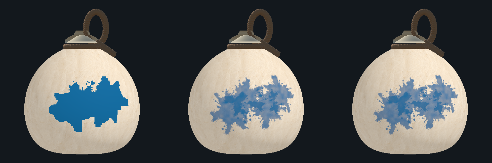

# 박 고해상도 도색 시제품

실험 이슈 #290의 Editor 전용 비교 도구다. 현행 셀 판정과 자연스러운 물감 표현의 차이를 실제 저장 박에 렌더해 비교한다. 기존 게임에 새 도색 모드를 연결하지 않는다.

## 실행과 비교

1. Unity 6000.6.5f1에서 프로젝트를 열고 Play를 누르지 않는다.
2. `C6 Lab > Experiments > High Resolution Paint`를 연다. Scene을 교체하거나 저장할 필요가 없다.
3. `Re-hits (after first)`를 0으로 두면 최초 명중 1회다. `Next re-hit` 또는 슬라이더로 1, 2, 3회를 차례로 비교한다. 3 다음은 최초 상태로 돌아간다.
4. 왼쪽은 현행 `LabPaintSurface`의 원래 크기·Point 지도, 가운데는 1024×512, 오른쪽은 2048×1024의 독립 시각 지도다. 세 박 모두 저장된 같은 `WhiteGourd.prefab`과 종이 셰이더를 복제해 사용한다.
5. `Element`는 오행 색, `Fixed seed`는 재현할 시드다. `Hit location`에서 정면·경도 이음새·북극을 선택한다. `Yaw / Pitch / Zoom`으로 같은 시점에서 비교한다.
6. `Pigment density / Density variation / Fine grain`은 고해상도 그림만 조절한다. `Export this comparison`은 현재 세 화면을 왼쪽부터 위 순서로 PNG에 저장한다.

기본 fixture는 시드123, 최초2%, 재타격 회당1.5%다. 현행 판정의 누적 칠한 셀 수는 655 → 1,146 → 1,638 → 2,129다. 각 재타격 뒤 모델 시간을 1초 진행한다. 건조는 fixture에 복사한 설정에서만 OFF이며 원본 `LabConfig`는 그대로다.

## 실제 박 렌더 예시

왼쪽부터 현행 Point / 고해상도1024 / 고해상도2048이다. 실제 투사체 플레이가 아닌 고정 입력의 Editor 렌더다.

최초 명중 1회:



같은 지점 재타격 3회 뒤:



## 구현 구조

| 파일 | 책임 |
| --- | --- |
| `Assets/Lab/Scripts/Experiments/HighResolutionPaint/LabHighResolutionPaintFixture.cs` | Editor에서만 컴파일하는 고정 입력 fixture. 기존 판정 클래스를 네 단계까지 독립 재생하고 시각 브러시의 위치·크기·회전을 생성한다. |
| `Assets/Editor/HighResolutionPaint/LabHighResolutionPaintBaker.cs` | 기존 SPLATTER 원본을 읽어 GPU RenderTexture에 최대4개의 브러시를 누적한다. |
| `Assets/Editor/HighResolutionPaint/LabHighResolutionPaint.shader` | 구면 방향을 접선 좌표로 투영하고 연속 마스크·경계 alpha·내부 농담을 premultiplied RGB로 출력한다. |
| `Assets/Editor/HighResolutionPaint/LabHighResolutionPaintWindow.cs` 및 UXML/USS | 세 해상도 비교와 설정·PNG 내보내기. |
| `Assets/Editor/PaintStyleComparison/LabPaintStudyRenderer.cs` | 기존 preview renderer 재사용. 호출자가 소유하는 시각 텍스처 입력과 선택적 박 자동 구도·Pitch를 추가했다. 기존 비교 창의 기본 구도는 유지한다. |
| `Assets/Editor/HighResolutionPaint/LabHighResolutionPaintValidation.cs` | 실제 GPU 렌더, 투영·색·alpha·격리 검사와 로컬 증거 내보내기. |

### 시각 지도와 판정의 차이

고해상도 지도는 기존 256×128 색 지도를 확대해 만드는 것이 아니다. 원본 브러시를 표면 방향에서 직접 샘플해 그린다. 재타격 브러시는 현행 모델에서 새로 추가된 셀들의 중심 방향을 참고한다. 브러시 크기는 작은 표면 샘플 격자에서 새 면적을 추정해 정하며, 그림의 셀 경계를 잘라 정확한 칸 수에 맞추지는 않는다.

따라서 고해상도 실루엣·겹침·작은 튀김점과 현행 판정은 점별로 일치하지 않는다. 표시한 Host 진행률은 현행 모델의 결과이며 고해상도 그림의 alpha 합계가 아니다. 농담이 옅어졌다고 게임 진행률이 줄지는 않는다. P번호 무늬는 외형 비교에서 끄며 게임의 실제 소유권 데이터는 건드리지 않는다.

명중·조합·투척·성장·건조·승리·소유권·통신의 기존 코드는 변경하지 않았다. Lab/Hapio Scene·Prefab·머티리얼·기존 셰이더·LabConfig·Build Settings도 수정하지 않는다. 향후 실전 통합에는 세부 형태·건조 삭제·상태 복원과 판정 경계의 연결이 별도로 필요하다.

### 색상과 자원

`LabPaintPalette.ColorFor`는 이미 선형 RGB를 반환한다. 새 GPU 브러시에서는 `MaterialPropertyBlock.SetVector`로 전달한다. `SetColor`로 다시 전달하면 Linear 프로젝트에서 이중 변환되어 색이 지나치게 어두워지는 것을 실제 픽셀 검사로 확인했다.

단순 누적은 고정 블렌딩 `One / OneMinusSrcAlpha`로 처리한다. 같은 텍스처를 shader 입력·출력으로 동시에 읽지 않으며 매 프레임 누적 갱신하지 않는다. 창의 설정을 바꾸었을 때만 그림을 다시 만든다. PNG용 화면 읽기는 Editor 비교 도구의 편의 기능이며 모바일 실전 성능 근거로 사용하지 않는다. 창을 닫을 때 preview scene·복제 재질·그림·RenderTexture를 정리한다.

사용자 요청으로 Unity CLI 연결 패키지 `com.unity.pipeline` 0.9.0-exp.1을 설치했다. 기존 패키지의 버전은 바꾸지 않았다.

## 확인 기록

2026-10-22 / 기준 main `6740a05d` / Unity6000.6.5f1 / macOS Metal.

- 집중 EditMode 4/4 통과. 직접 실행한 기존 모델과 fixture의 RGBA·P번호·revision·누적 면적이 일치하고 저장 Config가 바뀌지 않는지 확인했다.
- CLI 연결 후 같은 집중 검사 4/4를 확인했다.
- 실제 저장 박을 세 해상도로 렌더했다. 정면의 네 명중 단계와 이음새·북극의 최종 단계, 총6개 비교 화면을 생성했다.
- GPU 지도에서 중간 alpha·낮은 경계 alpha·premultiplied RGB·선형 색상 비율을 검사했다. 최초 도색은 여러 비대칭 위치에서 CPU와 GPU의 안쪽/바깥쪽 투영을 비교했다.
- 활성 Scene과 dirty 상태, 저장 Config가 검증 전후 동일했다. 작업 전 저장한 Scene·Prefab·머티리얼·프로젝트 설정 등108개 파일의 해시가 동일했다.
- 실제 Editor 창을 열어 UI 배치와 비교 이미지를 확인했다. 오행5색×4단계의20개 상태 전환과 화면 갱신을 확인했고 임시 preview root·RenderTexture 해제 검사도 통과했다. 원시 로그·XML·증거 JSON은 저장소에 넣지 않는다.

미실행: iOS·실기기·LAN/핫스팟 플레이·GPU 성능 측정·고해상도 그림의 실전 판정/건조/완성 박 관람 통합. 고해상도 표현과 현행 판정의 완전 일치는 이번 시제품의 검증 항목이 아니다.

## 검증 재실행

Editor의 Test Runner에서 `LabHighResolutionPaintTests`를 실행한다.

GPU 비교 증거는 Editor의 C# 실행 도구에서 다음 메서드에 절대 출력 폴더를 전달해 생성한다. 이 메서드는 Scene을 저장하거나 네트워크 세션을 만들지 않는다.

```csharp
C6Lab.Experiments.Editor.LabHighResolutionPaintValidation.Export(outputDirectory);
```

배치 실행은 `C6_HIRES_EVIDENCE_DIR` 환경 변수에 절대 경로를 지정하고 `C6Lab.Experiments.Editor.LabHighResolutionPaintValidation.RunFromCommandLine`을 실행한다. 실제 그래픽 장치가 필요하며 `-nographics`에서는 통과시키지 않는다.
