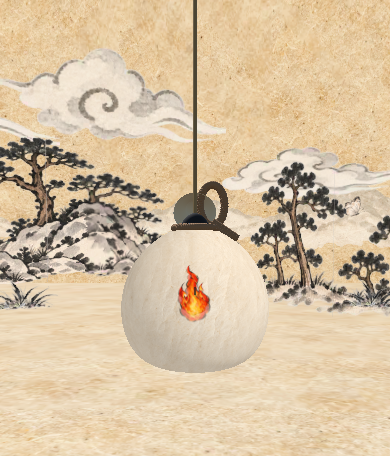

# 지귀 표면 불꽃 표현 개선 (#340)

## 변경 이유와 범위

사용자 피드백은 ‘불씨 모양 자체가 불처럼 보이지 않음’이었다. #332 표현은 중심과 외곽을 원형 면으로 겹쳐 과녁처럼 보였다. 기존 BlastFire 이미지에도 문제가 있어 재사용하지 않고, 현재 한지·먹선·담채 그래픽에 맞는 투명 불꽃을 새로 생성했다.

이 작업은 시각 표현만 바꾼다. 실제 근원/불 패치의 표면 방향과 각도, helper/대상P, 명중·도색 차단·성장·시간표·피버·소비·보상·통신 규약(5672/Lab33/Game16)은 바꾸지 않았다. Scene/Prefab의 배치도 수정하지 않는다.

## 에셋과 연결

- 원본 이미지: `Assets/Lab/Resources/Jigwi/SurfaceFlameWash.png` — 내장 image_gen으로 생성한1254×1254 RGBA PNG. 출력물을 편집하지 않고 그대로 복사했으며 실제 alpha 채널을 가진다.
- 머티리얼: `Assets/Lab/Resources/Jigwi/SurfaceFlame.mat`. Shader와 Texture를 저장 참조하므로 Shader.Find만으로 빌드 포함을 기대하지 않는다.
- 셰이더: `Assets/Lab/Art/Effects/JigwiSurfaceFlame.shader` — `C6Lab/Jigwi Ink Flame`. 현재 URP와 Built-in용 pass를 제공한다. 이번 실제 GPU 검사는 현재 프로젝트의 URP/Metal 환경이다.
- 코드: `LabJigwiStagePresentation` → `GroupArt` → `Part`. Resources의 원본 머티리얼은 수정하지 않고 실행용 사본을 만든다.
- 텍스처 가져오기: Default/FromInput alpha, sRGB, Clamp/Bilinear, mipmap, 최대1024, 무압축. 원본 PNG는 유지한다.

생성 이미지는 불규칙한 먹선·마른 붓결·주홍/주황 담채·밝은 황금색 중심과 위로 갈라지는 불꽃 실루엣을 가진다. 기존 동심원3겹을 제거했고 근원은 본색으로, 일반 불 패치는 조금 어두운 색/불투명도로 구분한다. 실제 차단 범위에는 연한 그을음 면을 남기고 그 안에 불꽃을 그린다. 불꽃 그림의 크기가 판정을 좁히거나 넓히지 않는다.

표면 면은8개의 반경 고리×48분할로 실제 박 MeshCollider에 투영한다. 텍스처 UV를 넣고 결과를 캐시해 매 프레임 수백 번 raycast하지 않는다. 근원·패치 방향, 메시, 스케일, 표현 반경이 바뀌면 다시 계산한다. 새 Collider는 없다.

## 움직임과 조절

셰이더는 실제 전투 시각에서 얻은 `_FlameTime`만 쓴다. 전역 `_Time`으로 따로 진행하지 않으며 Pause/시작 대기 중에는 흔들림도 멈춘다. 아래쪽은 덜 움직이고 위쪽 붓결을 더 흔들어 불의 흐름을 표현한다. 기존 해제 fade와100초 정리를 유지한다.

`LabJigwiStagePresentation` Inspector의 시각 설정:

| 필드 | 기본값 | 의미 |
| --- | --- | --- |
| Flame Material | Resources 기본 에셋 | 새 불꽃 원본 |
| Flame Animation Speed |2.4|위쪽 일렁임 속도|
| Flame Sway |0.03|UV 일렁임 폭|
| Patch Flame Share |0.62|실제 차단 범위 안에서 일반 불 그림이 차지하는 비율|
| Scorch Wash Opacity |0.13|전체 차단 범위의 그을음 농도|
| Flame Opacity |0.76|일반 불 그림의 불투명도|
| Surface Lift |0.015|표면과 표현의 간격|
| Extinguish Seconds |0.45|불 해제 후 사라지는 시간|

판정 각도는 기존 DEV의 별도 값이다. 위 시각 설정과 혼동하지 않는다. 이 컴포넌트는 필요할 때 네트워크 객체에 생성된다. 기존 Prefab에 임의로 추가하거나 자동 저장하지 않았다.

## 생성 정보

- 도구: 내장 `image_gen` / 신규 생성 / `transparent_background=true`.
- 기존 BlastFire 이미지는 입력이나 편집 대상으로 사용하지 않았다.
- 최종 프롬프트:

> Use case: game-asset. Asset type: one production-ready 2D flame sprite on genuine transparent alpha for the Korean folk cooperative game Hapio, displayed on a cream paper gourd in a hand-painted ink-and-wash game. Primary request: create a NEW strongly recognizable living fire silhouette, NOT a circular target or generic vector icon. One asymmetrical upright flame with three broad curling pointed tongues: tall central tongue, shorter side licking flames, a compact lower body and bright golden-yellow heart in the lower middle as an intuitive aiming focus. Hand-painted Korean ink-and-watercolor illustration: broken irregular charcoal-black brush contour of varying weight, torn dry-brush edges, vermilion and burnt orange pigment washes over a warm golden inner flame, visible brush grain and subtle uneven pigment pooling. A few open brush gaps, not excessive speckles. Mostly flat watercolor values, no glossy 3D rendering, no uniform SVG outlines, no smooth airbrush glow, no gradient ball, no concentric rings, no face, no symbols, no labels. Crisp broad readable silhouette at 80 px high. Single centered flame filling about 74% of a square canvas height and 58% width, complete silhouette with generous transparent margins, no cropped tips, no detached flying particles so animation can add them separately. No paper texture or background outside the flame, no white/black background, no ground shadow, no grid, no sheet, no text or watermark. Actual transparent background, preserve translucent watercolor edges. Aim for refined hand-drawn storybook/folk ink art rather than a stock fire emoji.

## 확인 범위

검사 결과는 최종 실행 후 아래에 기록한다. 실제 기기·네이티브 빌드·사람의 미술 평가와 자동 GPU 렌더 확인은 구분한다. 자동 검사가 그림의 아름다움이나 조작감을 보장하지 않는다.

### 실행 결과 · 2026-10-27

- 기준 main `45c800fd`, 작업 브랜치 `fix/#340-jigwi-flame-visual`.
- Unity6000.6.5f1·macOS/Metal의 기존 Editor에서 관련 PlayMode **9/9 통과(13.34초)**. 실패·Skipped·Inconclusive0. 최초9건(14.09초) 이후 확인 이미지의 전투 viewport 출력만 조정하고 동일9건을 다시 실행했다.
- 기존 근원/피해자/helper 표시·독립 해제·100초 정리·표면 좌표 검사와 새 Material/Texture·GPU alpha·Pause/Resume 시계 검사를 포함한다.
- 저장 Home→실제 Stage03의 WhiteGourd/카메라에서 새 불꽃 renderer를 껐다 켠 실제 픽셀 차이와 주홍색 픽셀을 확인했다. 단순 Hierarchy 존재만으로 통과시키지 않았다.
- 아래 이미지는 실제 Battle카메라의 전투 viewport만 출력한 **Editor 검사 이미지**다. Canvas나 Scene 배치·FOV를 저장 변경하지 않았으며 임시 렌더 상태는 복원했다.
- 기존 Editor는 닫지 않고 재생을 멈춘 Home 화면으로 돌아왔다. 실제기기·네이티브 빌드·사람의 미술/조작 평가는 미실행이다.

