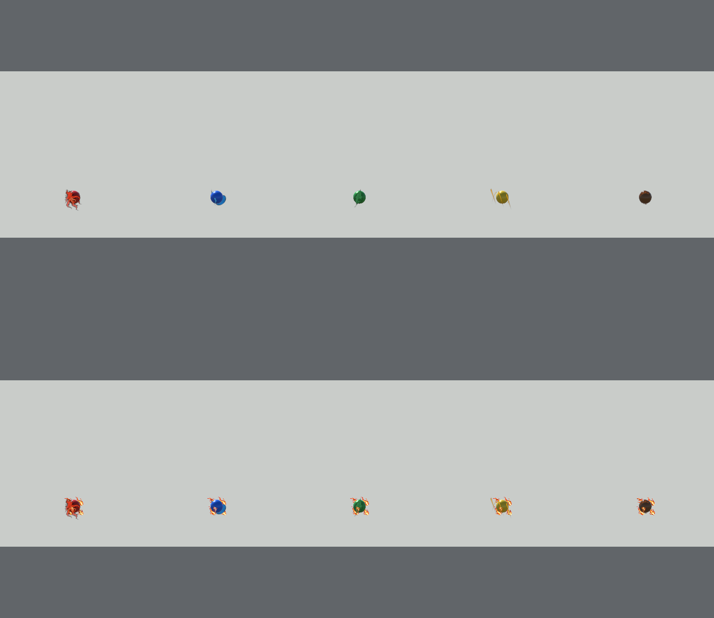
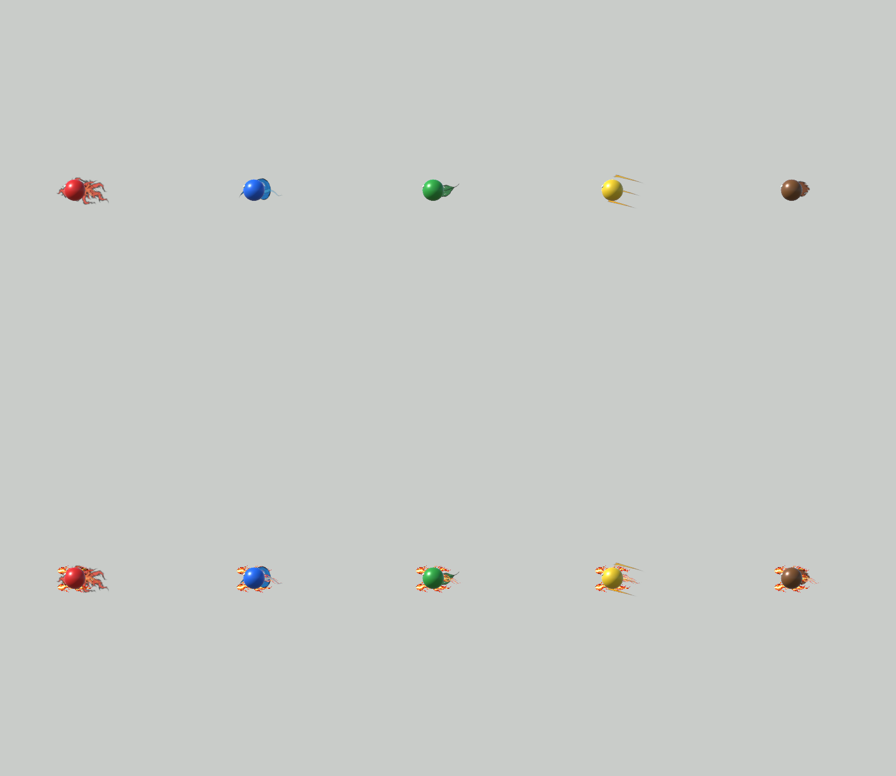

# 지귀 B 성공 보상 전용 불꽃 궤적

기준: main `78a8467d`, 작업 `feat/#390-jigwi-reward-fire-trail`. 게임 규칙은 #388을 유지하고 비행 표현만 분리한다. 실행 검증 결과는 `VALIDATION.md`의 #390 항목을 따른다.

## 1. 적용 조건과 유지하는 규칙

- Host가 기존 `jigwiABReward`에 캡처한 B 성공 보상 발사에만 전용 화염을 켠다. 성공 직후5초에 발사한 공이 대상이며 보상 시간이 지나도 승인된 공은 해당 비행 종료까지 유지한다.
- 원래 오행의 `LabElementFlightTrail`은 실제 원소를 계속 표시한다. 이전 #388의 '모든 보상 꼬리를 Fire로 교체'하는 처리는 제거했다.
- 실제 구슬 원소·공격 자격·도색 색·Rigidbody·Collider·속도·중력·충돌/명중/도색은 변경하지 않는다. 기존 크기1.3배와 도색1.5배는 그대로이며 표현에서 보상 배율을 다시 곱하지 않는다.
- 공유 LabConfig253개·설정 인덱스·프로토콜5678·Lab39/Game23을 유지한다. 새 설정은 기기 로컬 표현 에셋이며 통신 필드/요청을 추가하지 않는다.
- Scene·기존 오행 프로필/이미지/Material·UI 배치는 변경하지 않는다.

## 2. 효과 구성과 코드 연결

| 요소 | 실제 구현 |
| --- | --- |
| 구슬 가장자리 화염 | 전용2×2 네 프레임 텍스처를 카메라를 향한 네 장의 작은 카드로 표시한다. 중심 속성 색을 전부 덮는 큰 구체는 만들지 않는다. |
| 밝은 화염 꼬리 | 기존 `LabFlightTrailPath`의 실제 world 위치 이력을 따라 새 리본 Mesh를 만든다. 새 전용 리본 그림·폭 흔들림과 나이별 alpha를 적용한다. |
| 불티 | 실제 이동 거리마다 작은 카드를 남기고 짧게 위로 떠오르며 흐려진다. 개수·나이·경로 길이를 제한한다. |
| 렌더링 | 현재 URP의 `C6Lab/Element Ink Trail` shader/Material과 MaterialPropertyBlock을 재사용한다. 새 물리 컴포넌트나 광원, 후처리 패키지는 추가하지 않는다. |

필요한 billboards는 Mesh로 묶어 그리며 별도 ParticleSystem은 생성하지 않는다. 화염/리본/불티 세 Mesh만 전용 컴포넌트가 소유한다. 판정용 GameObject/레이어를 바꾸지 않으며, 카메라마다 실제 이력을 투영하여 해당 카메라에 맞춘 정점을 갱신한다.

- `Assets/Lab/Scripts/Throw/LabProjectile.cs`: 발사/승인/명중/취소 경로에서 전용 효과를 연결한다. `JigwiRewardFireTrail` getter로 현재 층을 확인할 수 있다.
- `LabJigwiRewardFireTrail.cs`: `Begin`, `Reconfigure`, `StopAndFade`, `Clear` 및 실제 경로·화염 애니메이션·불티 렌더링.
- `LabJigwiRewardFireProfile.cs`: 아래 Inspector 값과 새 그림/기존 Material 참조.
- `Resources/Jigwi/RewardFire/RewardFireProfile.asset`: 런타임 Resources로 읽는 로컬 표현 원본.
- 기존 `LabNetwork` Host/예측/원격 비행의 보상 flag 경로와 실패 revision 정리는 수정하지 않고 사용한다.

## 3. Inspector 조절

Project에서 `Assets/Lab/Resources/Jigwi/RewardFire/RewardFireProfile.asset`을 선택한다. DEV의1.3/1.5 보상 규칙과는 별개의 표현 설정이다.

| Inspector 항목 | 기본값 | 의미 |
| --- | ---: | --- |
| Width Scale | 1.3 | 승인된 공 지름 대비 리본 폭. 화염 카드 폭에도 적용 |
| Max Length Diameters | 5 | 실제 지나간 경로에서 남기는 최대 길이, 공 지름 단위 |
| Lifetime | 0.45초 | 지나간 위치의 잔상 수명 |
| Flame Animation Fps | 12 | 4프레임 화염 외피의 재생 속도 |
| Ember Spacing Diameters | 0.65 | 불티 생성 간격, 공 지름 단위 |
| Ember Lifetime | 0.35초 | 불티 수명 |
| Max Particles | 32 | 불티 카드 상한. 명칭은 particles지만 실제 구현은 Mesh 카드 |
| Flame Color | 흰색 | 새 그림의 크림색 핵·주홍·먹선을 보존하는 곱셈 tint. Alpha로 강도 조절 |
| Ember Color | 따뜻한 연노랑 | 불티 tint |
| Flame Texture | RewardFlameAtlas | 좌상→우상→좌하→우하4프레임 |
| Ribbon Texture | RewardFlameRibbon | 위=구슬 쪽, 아래=오래된 경로 |
| Ember Texture | RewardEmber | Unity에서 만든 작은 투명 물방울 도형 |
| Material | ElementInkTrail | 기존 URP 투명 Material, 원본 변경 없음 |

프로필은 이후 발사/렌더링에서 사용한다. 실제 규칙 배율은 기존 지귀 DEV251/252에서 조절한다. 실행 중 폭을 바꾸더라도 새로운 물리 반지름을 만들지 않는다.

## 4. 승인·Pause·명중·정리

- 같은 flag를 재수신하거나 `Reconfigure`로 폭을 보정해도 이미 기록한 경로와 애니메이션 시작점을 초기화하지 않는다.
- 늦게 true 승인되면 현재 위치에서 새 층을 시작하며 과거 경로를 조작해 덧그리지 않는다. false로 바뀌면 전용 층만 지운다.
- Pause는 기존 scaled `Time.time`을 따라 경로·불티·애니메이션·fade를 멈춘다.
- 정상 명중/빗나감은 외피 방출을 즉시 끝내고 기존 world 경로·불티가 최대 수명 뒤 자연스럽게 사라진다.
- 분리된 효과도 기존 `projectileRoot` 아래에 두고 `LabProjectileRevisionStamp`로 승인 revision을 유지한다. B 실패의 이전 공/잔상은 즉시 제거되고 실패 이후 승인된 공은 보존된다.
- Disable/Retry/방 나가기/Scene 종료는 `Clear` 및 기존 전체 투사체 정리 경로를 사용한다. 재사용 시 이전 위치와 잇는 긴 선을 만들지 않는다.
- 궤적/불티 수·수명은 제한하고 소유 Mesh 및 임시 fallback 자원은 파괴 때 정리한다.

## 5. 같은 조건으로 비교하기

1. Unity에서 Lab 또는 Battle을 Play한다. 실제 방을 시작할 필요는 없다.
2. `C6 Lab > Visuals > Compare B Reward Fire Trails`를 연다.
3. 비교 창에서 같은 속도의 일반 오행5종과 B 보상5종을 함께 확인한다. 비교용 전용 PhysicsScene을 사용하며 실제 세션·도색·전투를 진행하지 않는다.
4. 기본0.20초의 짧은 비행에서 일반 화와 보상 화의 차이, 수/목/금/토의 원래 꼬리가 함께 남는지 확인한다. 정면/측면과 프레임 고정으로 실제 지나간 경로에 남는지 확인한다.
5. PNG 내보내기는 현재 비교 프레임의 증거다. 실제 B 소화 성공이나 실기기 통신 검증을 대체하지 않는다.

비교 세션은 효과 차이를 보기 위해 두 행의 공 크기/속도/카메라를 같게 둔다. 실제 보상 크기1.3배는 생산 경로와 자동 검사가 별도로 확인한다.

아래 이미지는 실제0.20초 비행에서 같은 시각에 캡처한 비교다. 위=일반, 아래=B 보상, 왼쪽부터 화·수·목·금·토다.





## 6. 검사 범위와 남은 실환경 확인

- PlayMode:5속성/일반Fire 대비 전용 층·물리 컴포넌트/속도/중력 보존, 반복 승인/취소, 실제 꺾인 경로·Pause·재사용·분리fade.
- 기존 B 물 경로와 미션 취소 검사에 전용 층/분리 잔상을 포함하여 이전 revision 제거와 이후 승인 보존을 확인한다.
- B 성공5초 창·1.3/1.5·게임 결과는 기존 Core 검사와 통합 검사로 확인한다.
- 최종 체감 기준: 실제 정면 카메라의 짧은 비행에서도 일반 화 꼬리와 움직이는 외피·밝은 꼬리·불티가 구분된다.
- 실기기·LAN/핫스팟·빌드·발열/성능은 실행한 경우에만 VALIDATION에 기록한다.

## 7. 새 이미지와 생성 근거

빌트인 image_gen을 사용해 실제 alpha가 있는 새 원본을 만들고 픽셀 수정 없이 프로젝트에 복사했다. 두 원본은1254×1254 RGBA다. Atlas 완전 투명 픽셀65.63%, Ribbon78.61%이며 alpha 범위는0~255다. Import는 alpha FromInput·alphaIsTransparency·Clamp·Bilinear·NPOT None·mipmap OFF·최대2048·Uncompressed다.

- `Assets/Lab/Resources/Jigwi/RewardFire/RewardFlameAtlas.png`:4프레임 투명 애니메이션.
- `Assets/Lab/Resources/Jigwi/RewardFire/RewardFlameRibbon.png`:실제 경로 리본용 투명 원화.
- `RewardEmber.png`:Unity에서 절차적으로 만든32×32 중성 흰색 불티 도형, 생성 이미지의 배경 제거/수정에 사용하지 않았다.

### Atlas 최종 생성 프롬프트

```text
Use case: stylized-concept.
Asset type: production Unity mobile game particle sprite sheet, true transparent RGBA background.
Primary request: ONE seamless cyclic flame animation atlas, exactly 2 columns and 2 rows (4 equal square cells), no lines between cells. Each cell contains one similar but animated flickering bright flame tuft for an enchanted thrown orb's blazing reward trail, with small tongues branching to the sides. Read cells left-to-right, top-to-bottom. Base at bottom center, tips pointing upward. Four consecutive animation phases with comparable overall mass and size, each silhouette gently swaying differently and splitting pointed flame tongues.
Style/medium: Korean fantasy ink-and-light-watercolor game art: irregular sparse charcoal-black dry-brush contour, flat vermilion-red outer tongues, orange and golden middle, clearly bright warm-ivory core. Clean readable broad flame silhouette even at tiny phone scale, energetic dancing FIRE, not a leaf or a static brush slash. Keep core opaque with subtle watercolor variation, outer flame edge partially transparent.
Composition/framing: square canvas, exactly aligned 2x2 equal cells. Identical baseline and central axis in every cell. Generous transparent margins inside every cell (at least 15 percent). Each sprite fully isolated from other cells; no flames touching or crossing cell boundaries. All four fit inside their own central 70 percent. All background pixels must be truly transparent, not white, black, parchment or checkerboard.
Text: none. No orbs, no scenery, no lettering, no labels, no frame, no spark clouds, no smoke, no baked glow halo. This is a reusable particle texture, not a mockup.
```

### Ribbon 최종 생성 프롬프트

```text
Use case: stylized-concept. Asset type: a single transparent RGBA brush texture for a Unity reward fire flight ribbon.
Primary request: one elongated, broad, tapering BLAZING FIRE wake, vertical on a square transparent canvas. Its broad leading base is near the TOP center (it connects behind a flying orb), while three long split pointed flame tails taper toward the BOTTOM. It must look like a bright burning streak, with a broad creamy ivory hot core, gold-orange middle and vermilion red flaring edges. Sparse irregular dry charcoal-black ink edges, flat Korean fantasy watercolor wash, hand-painted broad readable silhouette. Fire tongues weave and separate with transparent gaps toward the bottom, core stays cohesive toward the top. Small internal dry brush breaks only at edge. No smoke.
Composition/framing: centered, entirely inside middle 65 percent of canvas width and 80 percent of canvas height. Plenty of empty transparent margin. Single continuous flame wake with no other elements. No orb, no lettering, no parchment, no panel, no border, no background of any color, no checkerboard, no halo. Actual transparent pixels around the painted silhouette. This texture is stretched along an actual projectile path at runtime, not a design mockup.
```
