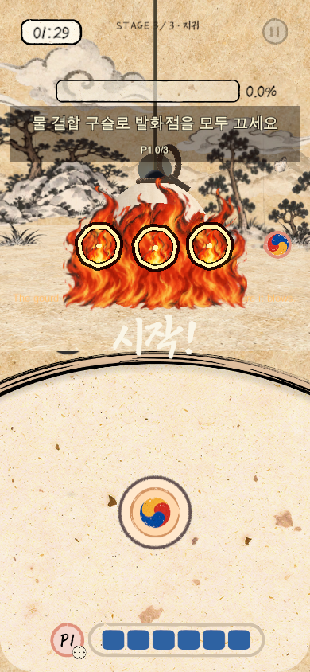
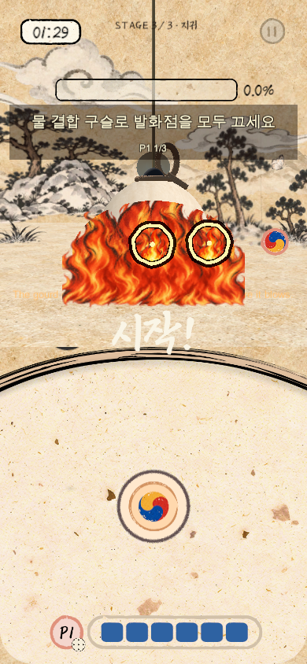
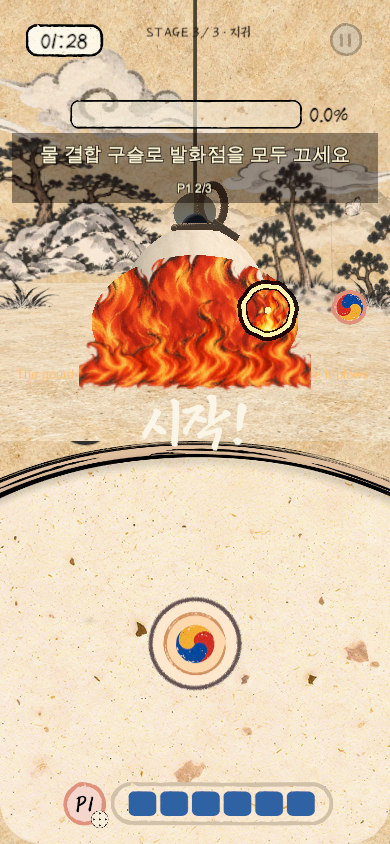
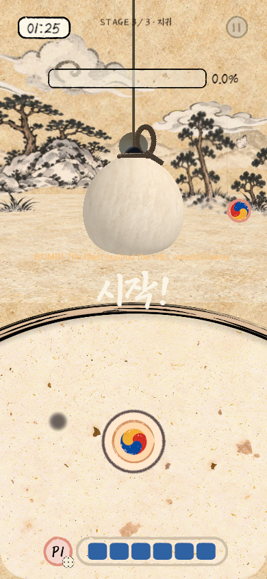
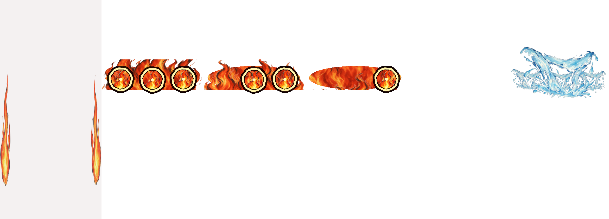
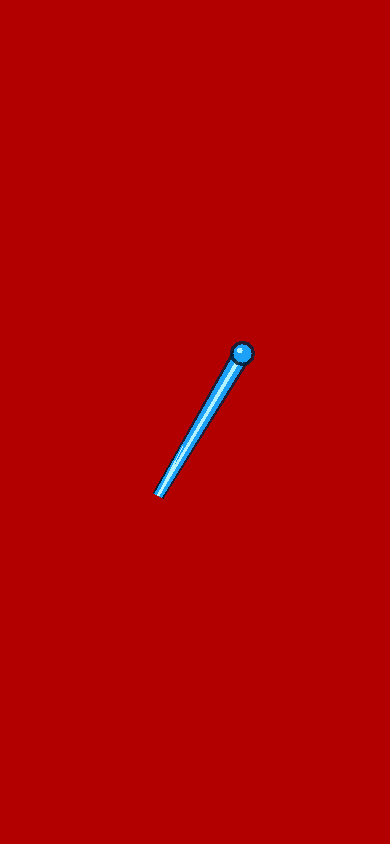

# 지귀 개인 발화·전원 화면 소화 — #341

작성: 2026-10-27. main 통합 갱신: 2026-10-28. 대상: `feat/#341-jigwi-screen-patterns`. 본문은 #341 구현 기준이며 #332의 박 표면 근원·도색 차단 사양을 대체한다. 기존 기록은 삭제하지 않고 당시 검증 기록으로 남긴다.

## 1. 실행 범위와 유지하는 규칙

- Hapio의 지귀(Stage03), 시간표 DEV228 ON일 때 실행한다. 1~3스테이지 공통 Battle Scene, 실제 WhiteGourd 칠 표면·충돌체, 투척 입력/물리, 박 회전, 도색·건조·100% 승리, 개인 HP·결과 흐름은 기존 경로를 사용한다.
- 일반 Lab의 StageNone 수동 물 전용 화재·Overheated 실험은 유지한다. 새 A/B는 그 Overheated 상태를 사용하지 않는다.
- 전투120초, A 예고10/40/60/80초, B 예고30/50/70/90초, 공통 기믹20/40/60/80초다. A/B 진행 중 다음 A/B 슬롯은 한 번만 Skipped로 기록하며 밀린 패턴을 연속 실행하지 않는다.
- 100초에는 A/B를 성공 처리하지 않고 취소·정리한다. 기존 공용 폭탄 정리 정책을 재사용하고, 마지막20초 자동 회복2배를 적용한다. 미완성 시간 초과는 기존 Defeat다.
- 기존 LAN·핫스팟 전송·owner-local 개인 조합판은 유지한다. 설정·A/B DTO·구슬 메타데이터가 추가되어 **251개 설정 / 프로토콜5677 / Lab38 / Game21**인 기기끼리 사용한다. 기존240개 main 및249개 지귀 단독 브랜치 앱과 혼용하지 않는다. main의 구미호/야광귀 피버와 스토리 자료는 보존한다.

## 2. A — 개인 발화

1. 대상 한 명에게1초 예고 후 최대10초 동안 자동 스태미나 회복4배를 적용한다. 최댓값·생성 비용·명중 즉시 회복은 바꾸지 않는다.
2. 대상 판의 기존·신규·수신 Raw/Combined에5초 소각 기한을 부여한다. 북과 아이템은 제외한다. 합성/전달로 가장 이른 기한을 늘리지 않는다.
3. 실제 발사 승인 뒤에는 이미 비행 중인 공을 소각하지 않는다. 기존 투사체 물리·종료 처리를 따른다.
4. 대상 본인의 실제 Combined 박 명중3회로 A를 조기 종료한다. 오색 Combined도 충돌1회당1회, Relay는 제외한다. 화재 충돌·가상 호환 명중·중복 명중은 세지 않는다. 정상 박 명중의 칠·보상·통계는 기존대로 한 번만 적용한다.
5. 조기 성공 시 물을 끼얹는 효과를0.6초 표시하고 해당 A에서 부여한 소각 예약을 모든 소유자의 구슬에서 제거한다. 아직 남은 공은 보존하고 이미 소각된 공은 복원하지 않는다. 자연 만료·100초 정리도 예약을 제거하되 성공 효과는 재생하지 않는다.

`LabOrbState.jigwiABBurnAt`은 이름과 달리 **시작 시각이 아닌 절대 소각 마감 시각**이다. 예:11초에 부여→16초에 소각. 일반 `createdAt/expiresAt`을 덮어쓰지 않고 두 수명 중 빠른 기한을 사용한다. `jigwiABBurnEventId`로 해제 출처를 구분한다.

## 3. B — 모든 플레이어의 화면 화재

- 각 참가자의 **박 앞을 가리는 큰 불장막과 움직이는 발화점3개**를 Canvas에 표시한다. 박 표면에 붙이지 않는다. 발화점은 공통 전투 시계로 조금씩 움직이고, 실제 박보다 앞에 둔 자신의 판정 대상을 조준한다.
- 불장막의 일반 부위에 Water를 맞히면 공은 소모되고 물을 끼얹는 효과만 나온다. 발화점을 끈 것으로 처리하지 않는다. 실제 켜진 발화점에 Water가 명중할 때만 그 점을 끈다.
- 발화점을 하나씩 끌 때 남은 수에 맞춰3→2→1의 전용 불장벽 이미지를 교체한다. 단순 알파·Rect 축소만으로 단계를 만들지 않는다. 박을 가리는 짙은 중심부와 박 공격 차단은 마지막1개까지 유지한다. **자신의 발화점3개가 모두 꺼져야** 자기 장막이 완전히 사라지고 박 공격이 허용된다. 재점화하면 장막과 시각 단계도 되돌아온다.
- B 활성 중 정상 Raw 음·양 조합 결과만 Water Combined가 된다. 기존 공·폭탄 개봉 결과·아이템 결과를 바꾸거나 무료 Water를 지급하지 않는다. 소화가 끝난 사람이 Water를 만들어 동료에게 전달할 수 있다.
- Water Combined를 자신의 켜진 발화점에 실제로 던져 맞히면 해당 점을 끈다. 타 속성 공도 실제 화재 충돌이면 소모되지만 소화하지 않는다. 다른 플레이어의 불은 자기 투사체를 가로채지 않는다. 불을 손가락으로 눌러 끌 수 없다.
- 각 불은 꺼진 시점부터12초 뒤 개별 재점화한다. 자기 불을 모두 꺼도 다른 사람의 불이 남으면 재점화가 계속된다. **모든 참가자의 불이 동시에 꺼진 순간** 공동 성공한다.
- 불장벽이 보이는 동안 사용자 제공 `GroupFireLoop`를 한 개의2D AudioSource로 반복 재생한다. 같은 회차의 반복 snapshot이나 단계 변화로 소리를 다시 시작하지 않는다. 자기 불을 모두 끄면 정지하고 재점화하면 다시 시작한다. Pause는 일시정지/이어 재생하며 A·패턴 종료·화면 이탈 때 남기지 않는다. 기존 `LabAudioSettings.SfxVolume`을 따른다.
- B가12초 이상 지속되면 보관 Raw/Combined의 전용 반경 배율 .65를 적용한다. 폭탄 `small`·콤보 배율과 별도이며 작은 쪽을 사용하고 반복해서 곱하지 않는다. 칠 면적·피해 예산은 바꾸지 않는다. 최소 잡기 범위는 유지한다.
- 끝나면 B의 축소만 해제한다. 이미 발사된 공은 발사 승인 때 정한 크기/물리를 유지한다. 생성된 Water는 그대로 남는다.
- 발화점/장막 명중은 박 도색·명중 스태미나 보상·박 명중 통계·A 명중 수를 만들지 않는다. 자기 장막이 남은 상태에서 곡선 비행 등으로 박까지 닿더라도 Host 최종 판정이 공을 소비하고 칠·피해·명중 보상을 차단한다. 자기 장막이 제거되면 다른 사람이 아직 소화 중이어도 박을 칠 수 있다.

## 4. 화면과 판정의 연결

`LabJigwiABFireMotion.Position` → `LabNetwork.TryGetJigwiABFireWorldPosition` → 같은 위치를 Host의 숨은 `LabJigwiFireSurface` 콜라이더와 각 화면의 실제 battleCamera 투영에 사용한다.

- 발화점은 자리별 실제 `LaunchPosition/LaunchVelocity`의 허용 중간 세기 투척이 박 앞 평면을 처음 지나는 높이에 둔다. 기본3점은 releaseX .15/.5/.85로 분산하며 작은 미동만 더한다. 현재 기본 프로필의 기준 속도는 약2.815 board widths/s다. 투척·중력·입력을 보정하거나 공을 표적으로 유도하지 않는다. 이 계산은 회차/소유자/자리/설정/기하 변경 시 갱신하고 매 프레임 탐색하지 않는다. 발화점은 박 회전·로컬 화면 비율에 따라 임의 이동시키지 않는다. 불장막 사각형은 현재 실제 박과 모든 발화점의 이동 범위를 감싸는 작은 여백으로 계산한다. 최대 로프·스윙의 전체 궤적을 화면에 펼치지 않는다.
- 실제 `LabProjectile`의 owner-filtered 충돌만 `LabModel.ConfirmJigwiABFireHit`로 연결한다. 클라이언트의 화면 클릭이나 ‘맞혔다’는 UI 요청을 승인하지 않는다.
- 장막은 발화점보다 뒤·박보다 앞의 owner별 BoxCollider이며 발화점은 SphereCollider다. 같은 거리의 충돌에서도 발화점을 우선한다. 장막은 하나라도 켜졌을 때 전체 활성, 모두 꺼졌을 때 비활성이다. 표현이 작아졌다고 충돌 구멍을 만들지 않는다.
- `lastWaterSplashAt`은 Host가 승인한 Water 충돌의 표현 시각으로, 소화와 별도다. 실제 소화 상태는 각 점의 `lit/extinguishedAt/relightAt`만 따른다.
- 꺼진 불도 같은 콜라이더 객체를 유지하며 비활성화한다. 재점화 때 같은 객체를 켜므로 이전에 발사된 공의 표적 참조도 유효하다.100초/단계 종료에는 객체를 제거한다.
- `LabJigwiScreenPresentation`은 실제 world 위치/반경을 Canvas 좌표/지름으로 투영한다. 모든 Graphic의 raycastTarget과 CanvasGroup의 blocksRaycasts는 OFF다. 일시정지 메뉴 아래에 배치해 기존 메뉴 입력을 가로채지 않는다.
- 전투 Pause/시작 대기는 소각·성장·회복·재점화와 표현 clock을 멈춘다. 과거 소화 snapshot을 늦게 받거나 다시 바인딩해도 물 효과를 재생하지 않는다.

## 5. DEV·Inspector

원본은 `Assets/Lab/Resources/LabConfig.asset`, 실행 DEV는 복사본이다. Home/Lobby의 지귀 탭에서 변경한다. 공통·다른 요괴 탭과 일반 Lab 수동 탭에는 새 A/B 필드를 표시하지 않는다. Host가 세션 설정으로 공유하며 적용/재시작 장벽은 기존 경로를 따른다.

| 인덱스 | Inspector 속성 | 기본값 | 범위 |
| --- | --- | --- | --- |
|228|JigwiStageTimelineEnabled|ON|ON/OFF|
|229|JigwiStageWarningSeconds|1초|0~3초|
|235|JigwiStageFeverMultiplier|2배|1~4배|
|240|JigwiABPersonalDurationSeconds|10초|1~30초|
|241|JigwiABPersonalRecoveryMultiplier|4배|1~10배|
|242|JigwiABPersonalRequiredHits|3회|정수1~10|
|243|JigwiABPersonalBurnSeconds|5초|.5~30초|
|244|JigwiABGroupFireCount|3개/명|정수1~6|
|245|JigwiABRelightSeconds|12초|1~60초|
|246|JigwiABShrinkDelaySeconds|12초|0~60초|
|247|JigwiABShrinkScale|.65|.2~1|
|248|JigwiABFireMoveAmount|.03|0~.1 정규화 폭|
|249|JigwiABFireMovePeriodSeconds|4초|1~20초|
|250|JigwiABFireTargetRadius|.3 world|.1~1|

기존230~234 표면 설정은 값/배열 위치를 보존하되 DEV에서 숨긴 예약 슬롯이다. 기존236·237 오색구슬 보상과238·239 구미호 피버는 그대로 유지한다. main의0~239 인덱스는 보존하고 새 A/B240~250만 뒤에 붙인다. Inspector의 화면 효과 `waterDouseSeconds/flameSpeed/flameSway`와 B의 `curtainTexture/curtainStage2Texture/curtainStage1Texture/curtainDenseFrame/curtainDenseUv`는 새 프리팹에서 조정할 수 있다. B 단계 원화는3종을 쓰고 중앙 밀도용 크롭은 강한3단계 원본을 유지한다. 모든 원화는 UV 크롭으로 종횡비를 보존한다. `waterFlightTrail`의 최소/최대 표시 폭·먹선/물/하이라이트 색을 Inspector에서 조절하며 잔상 수명/길이는 기존 WaterFlightTrail 프로필을 따른다. `audioView.clip/volume`은 Inspector에서 바꿀 수 있다.

## 6. 수정할 파일 지도

| 책임 | 파일/메서드 |
| --- | --- |
| A/B 상태·타이밍·보상/소비 | `Assets/Lab/Scripts/Core/LabModel.JigwiAB.cs` |
| 기존 모델의 호출 지점 | `LabModel.cs`: 생성·조합·전달·발사·ConfirmHit·회복·ExpiresAt, `LabModel.JigwiStage.cs`: facade |
| DTO·깊은 복사·입력 검증·불 미동 | `LabJigwiABContracts.cs`; `LabContracts.cs`: snapshot/orb metadata |
| 설정·범위·배열 인덱스 | `LabConfig.cs` |
| 통신·보드 헤더·델타 | `LabNetwork*.cs`, `LabBoardReplication.cs`; `LabNetwork.JigwiAB.cs`: clock/geometry/콜라이더 |
| 구슬의 반경·잡기/합성·소각 표시 | `LabOrbBoard.cs`, `LabOrbView.cs`, `LabJigwiOrbFlame.cs` |
| 투척 크기·실제 화재 충돌 | `Assets/Lab/Scripts/Throw/LabProjectile.cs` |
| B 물 실제 비행 잔상 | `Assets/Lab/Scripts/Throw/LabJigwiWaterFlightPath.cs`, `LabJigwiWaterTrailGraphic.cs`; `LabProjectile` 공통 시작/승인/종료 연결 |
| B 불장벽 반복 소리 | `Assets/Lab/Scripts/Audio/LabJigwiGroupFireAudio.cs`; 화면의 own lit/Pause/종료 상태만 소비 |
| 화면 표시 | `Assets/Lab/Scripts/UI/LabJigwiScreenPresentation.cs`, `LabJigwiHud.cs` |
| 편집 가능한 화면 소스 | `Assets/Lab/Resources/Jigwi/ScreenOverlay.prefab` |
| 새 프리팹 생성 도구 | `Assets/Editor/Bootstrap/JigwiOverlayBuilder.cs`: C6 Lab/Jigwi/Create or Update Screen Overlay Prefab |

구형 `LabJigwiStageContracts/Presentation`은 자료/격리 검사 호환 코드로 보존하지만 새 게임에서는 표면 교정·근원·불 패치·도색 차단을 생성하지 않는다. 기존 수동 Lab의 `LabJigwiFireSurface`는 별도로 유지한다. 게임 Scene을 다시 생성하거나 Lab Scene을 Battle에 복사하지 않는다.

## 7. 생성 에셋과 투명도

| 파일 | 출처·사용 |
| --- | --- |
|`Assets/Lab/Resources/Jigwi/SurfaceFlameWash.png`|#340에서 생성한 불규칙 먹선·주홍 담채 불꽃 원본. 새 화면/구슬 불에 재사용. 기존 BlastFire0~5 이미지와 별개. 기존 importer/GUID 유지|
|`Assets/Lab/Resources/Jigwi/WaterDouseWash.png`|#341 built-in image_gen 생성, transparent_background=true. 생성 PNG를 픽셀 수정 없이 복사.1536×1024 RGBA, 원본 alpha0~254/완전 투명 픽셀52.75%. Unity import는 alpha FromInput·alphaIsTransparency·Clamp·Bilinear·max1024·Uncompressed·NPOT None(런타임1024×683, 원본 비율 보존)|
|`Assets/Lab/Resources/Jigwi/ScreenFireCurtainWash.png`|#341 B 보완에서 built-in image_gen으로 생성한 연결된 단일 투명 불장막.1484×1060 원본 비율·alpha 보존, Unity max2048·NPOT None·Uncompressed. 원문 프롬프트와 검증 범위는11절|
|`Assets/Lab/Resources/Jigwi/ScreenFireCurtainStage2.png` / `ScreenFireCurtainStage1.png`|2026-10-28 built-in image_gen으로3단계 원본을 기준으로 추가 생성. 각1484×1060 RGBA·픽셀 수정 없이 복사. 프롬프트는12절|
|`Assets/Lab/Resources/Jigwi/GroupFireLoop.wav`|사용자 제공 `612277__robinhood76__10835-big-fire-loop.wav` 원본 복사.13.5초·2ch·44100Hz. 외부 출처/라이선스 메타데이터는 추정하지 않음|
|`Assets/Lab/Resources/Jigwi/ScreenFlame.shader`|Canvas용 alpha blend/clip/stencil/색상, Resources 포함. 전투 clock으로만 흔들리며 Pause 때 고정|

물 생성 프롬프트(원문):

> Use case: game-asset. Asset type: a single production-ready transparent watercolor splash/pour effect sprite for the Korean folk cooperative game Hapio. Create a sheet of cool blue water being thrown downward from above to quench fire: a broad sweeping curved crest across the upper-middle, two irregular descending streams curling toward the center and a spreading lower splash with a few large distinct teardrop droplets close to it. Shape should suggest a satisfying splash of a bucket of water, NOT a circular icon, not a wave landscape, not a pool surface. Match hand-painted Korean ink-and-wash storybook game art: irregular broken dark blue ink brush contours, flat translucent pale aqua and medium indigo washes, dry-brush gaps, subtle pigment grain/pooling. Lively asymmetry, clear broad shapes legible at small size; no glossy 3D water, no photoreal spray, no smooth vector edges or airbrush glow. Palette predominantly light azure, turquoise and muted indigo with a small amount of cream-white reflected watercolor. One isolated composition on genuine transparent alpha, complete splash with comfortable transparent margins all around. Square canvas, composition wider than tall, empty alpha outside water and droplets; no hanji or paper/background texture, no white/black backdrop, no flame, no bucket, no person, no lettering, no symbols, no watermark, no grid or sprite sheet. This sprite will animate downward/scaling/fading over an existing game screen and also shrink into small extinguish splashes; leave the spaces between water strokes transparent.

불 원본의 생성 프롬프트와 이전 표현 기록은 `JIGWI_FIRE_VISUAL.md`를 따른다. 전용 샤우팅 음성은 미할당이다. B 불장벽 소리는12절의 사용자 제공 반복 효과음을 사용한다.

## 8. 확인 방법

1. Home에서 Play → 솔로 또는 같은 버전2~5인 LAN/핫스팟 방을 시작한다. 기존 일시정지 메뉴의 DEV 다음 스테이지를 두 번 사용해 지귀로 간다.
2. A10초 예고/11초 활성: 대상의 회복4배·구슬 불을 본다. 기존 공 하나는5초 기다려 소멸, 다른 공은 합성/전달해도 마감이 늘어나지 않는지 본다. 유효 Combined 박 명중3회면 물 효과·남은 구슬 보존을 확인한다.
3. B30초 예고/31초 활성: 각자 불3개·미동을 본다. 정상 음양 조합→Water를 각자 불에 던진다. 박에 칠/명중 보상이 생기지 않아야 한다. 타 속성은 공만 소모되고 다른 사람의 불을 가로채지 않아야 한다.
4. 한 불만 끄고12초 뒤 개별 재점화를 본다. 미해결12초부터 작은 공의 잡기·전달을 확인한다. 전원 불을 동시에 끄면 재점화 중지·반경 복원을 본다.
5. Pause 중 소각/재점화/미동이 멈추고 Resume 후 남은 시간부터 이어지는지,100초 정리/회복2배·승패·다음 판에 이전 불이 남지 않는지 본다.

위 수동 시나리오는 **실행 완료 체크리스트가 아니다**. 자동 검사 환경·실제 결과와 실기기 미검증 범위는 아래 검증 기록을 따른다.

아래9~12절은 각 보완 당시의 검증 이력이다. 그 절의249개 설정과5674~5676 규약은 당시 값이며 현재 사용 규약이나 이번 main 통합의 통과 결과를 뜻하지 않는다. 현재 설정/접속 기준은1·5절, 이번 통합의 실행 여부는 `VALIDATION.md`의2026-10-28 통합 절을 따른다.

## 9. 장막 보완 전 1차 검증 기록 — 규약5674

아래는 불장막/발화점 분리 보완 전의 1차 기록이다. 현재 보완판의 결과는10절과 구분한다. 기준: main `d13823ba` + 보존한 #340 표현 커밋 `c4e8abec`에서 시작한 #341 소스. Unity6000.6.5f1·macOS/Metal Editor. 새 standalone Mac 앱이나 실기기 앱은 실행하지 않았다.

| 확인 | 결과·범위 |
| --- | --- |
| 전체 EditMode | **1459/1459 통과**,64.60초. 실패/Skipped/Inconclusive0 |
| 전체 PlayMode | **440/440 통과**,467.48초. 실패/Skipped/Inconclusive0 |
| 최종 에셋 집중 재검사 | 물 importer의 원본 비율 보정 후 지귀 PlayMode **44/44 통과**,35.53초. 실패/Skipped/Inconclusive0 |
| 실제 저장 게임 경로 | Home.StartSolo → 공통 카운트다운 → DEV 다음 스테이지2회 → Stage03 A/B. 실제 WhiteGourd 칠/충돌 mesh와 기존 화면 연결, 구형 표면 표시0, Canvas 위치와 Host 불 콜라이더 일치 |
| GPU 표현 | 저장 프리팹/실제 셰이더로 A 열기·B 불3개·성공 물을 임시 UI 카메라에 렌더. alpha/색상 픽셀 비교. 아래 이미지는 이 격리 렌더이며 실제 기기 화면 캡처는 아님 |
| 레이아웃·기존 설정 |6개 Scene의 DEV 외 RectTransform576개 위치/크기/부모 불변. Home/Lobby에는 DEV11행·라벨/숨김만 갱신. 나머지5개 Scene은 바이트 동일. 기존0~237 유효값 불변(저장 시 main의236/237 기본값도 명시적으로 직렬화) |
| 미실행 | 실기기 설치·실제 다중 기기 LAN/핫스팟·네이티브 빌드·사람의 조준성/재미·기기 성능·전용 음성/SFX |

- 기존 `LabJigwiStageModelTests`20개 메서드와 모든 TestCase를 현재 규칙으로 개별 이관했다. 범위·대형 Tick·소유자 격리·아이템·명중 보상1회·Retry/방 ID·deep copy/member validation 의도를 유지하고, 피버 경계/수동 OFF 경로도 보존했다. 삭제/Ignore/Explicit/조건부 숨김은 추가하지 않았다.
- 새 Core 설정/모델 검사에 경계 시각·복수 인원·소각 기한 계승·B 전원 소화/재점화·독립 축소·비정상 DTO 거절을 추가했다. 구형 raw 표면 DTO/표현의 격리 검사는 현재 게임에서 사용 중이라는 증거와 구분한다.
- 새 PlayMode는 실제 `LabProjectile` 물리 질의→Core 소화·보상 없음, 외국 owner 거절, 같은 콜라이더 재점화, 폰/태블릿 비율의 world 투영, 보드 잡기/반경·칠 예산 독립, 헤더 깊은 복사·만료 델타, Pause/수신 순서, 승인된 예측 반경을 검사한다. fixture는 다중 기기 접속 성공을 뜻하지 않는다.
- 검사에서 발견한 새 구슬 불꽃의 MaterialPropertyBlock 생성 시점 오류를 생성 지연으로 수정했다. 기존 수동 과열 검사의 음수 시작 시계는 명시적인 양수 Host 시계 fixture로 바꾸었다. 공통 폭탄 검사4건은90초용 구슬을0초부터 넣어 A에 소각시키던 fixture였으므로90초로 진행한 뒤 삽입하도록 정정했다. 구형 DEV 라벨·토큰 기대값도 현재 값으로 갱신했다.
- 통신 검토 중 오래된 보드 header.paused가 최신 bulk snapshot의 Resume를 덮던 경계를 발견해 Overlay 결과 기준으로 통일했다. 체크포인트/세대/terminal 보호는 유지한다. 예측 투사체는 승인 반경을 표시용 콜라이더에도 반영하며 Host의 경로·속도·권한은 바꾸지 않는다.
- 원시 실행 로그·개인 경로/기기 정보는 저장소에 넣지 않았다. 기존 Scene.meta·별도 로컬 보고서와 검사 전 자동 생성 Resources4개는 원래 바이트로 보존한다. 패키지·빌드 경로/설정은 바꾸지 않았다.

## 10. B 불장막·발화점 분리 및 단계 피드백 · 2026-10-27

- 사용자 확인: 발화점3개를 모두 꺼야 자기 불장막이 해제되고 박을 칠 수 있다.1개라도 남으면 장막은 유지한다. 물 효과가 보인 사실을 소화 성공으로 취급하지 않는다.
- 추가 피드백: 하나씩 끌 때 바깥 불꽃 높이/개수·농도를 낮추고, 중심부와 최종 공격 차단은 유지한다. 기본3개의 시각 강도는1/.84/.65, 모두 끄면0이다. A 규칙·표현은 유지한다.
- 이 보완 당시 접속 규약은 **5675/Lab36/Game19**, 공유 설정249개는 그대로다. 물 명중 시각 데이터가 추가되므로5674 앱과 혼용하지 않는다.
- 새 Canvas 요소 `GroupFireCurtain`·고정 중심부·바깥 불꽃9겹·발화점의 간단한 먹선 링·별도 물 효과가 기존 ScreenOverlay 프리팹에 추가된다. 바깥 불꽃 높이는1/.88/.76, 농도는1/.84/.65이며 고정 중심부는 마지막 점까지 박을 가린다. 기존 Scene 배치/DEV 수치는 수정하지 않는다.
- B 전용 `fireLayer`의 RectMask2D가 전투 카메라 영역과 실제 요괴 HP 바 아래로 표시를 제한한다. 조합판·스태미나·시간/HP를 덮지 않는다. A는 이 마스크 밖에 둔다. 실제 박 mesh의 현재 모서리와 모든 발화점(꺼진 점 포함)의 이동/반경 범위를 같은 평면에 투영해 Host Box와 화면에 사용하며 최대 로프/스윙 전체 궤적은 포함하지 않는다.
- 지귀 집중 EditMode **227/227 통과(4.43초)**, 최종 지귀 PlayMode **51/51 통과(36.41초)**. 저장 Home→Stage03의 실제 Canvas/Box/발화점, 장막물명중과소화분리, 마지막점차단, 전부소화후박개방, 개별재점화, 다섯자리·폰/태블릿 투영, 단계별 실제 GPU 픽셀 차이와 조합판 영역 alpha 침범0을 확인했다.
- 최종 전체 EditMode **1470/1470 통과(39.08초)**. 실패/Skipped/Inconclusive0. 전체 PlayMode440건은 보완 전1차 결과다. 이번 B 변경은 관련 PlayMode51건으로 검사했으며 전체 PlayMode는 재실행하지 않았다. 실기기·다중기기 LAN/핫스팟·네이티브 빌드는 미검증이다.
- 첫 집중 PlayMode의1건은 격리 fixture를 원점에서6km 떨어뜨려 카메라 역투영 float 정밀도를 잃은 문제였다.61m로 옮겨 같은 엄격한 오차 기준을 유지하고 통과했다. 확인 캡처용 CanvasGroup은 Unity의 null 비교를 사용하도록 정정했다. 초기에 장막이 화면 전체를 덮던 범위는 실제 박/발화점 기준으로 좁히고 마스크로 HUD를 보호했다.

현재 효과·실제 저장 Stage03 이미지는 아래11절의 최종 기록을 따른다. 이 절의51건은 당시 판정/표현 검사이며 실제 허용 스와이프 도달성의 증거로 사용하지 않는다.

## 11. 실제 투척 도달 높이·새 불장막 원화 · 2026-10-27

### 수정 원인과 검증 범위

기존 발화점은 카메라 위쪽 좌표를 가까운 월드 평면에 더하는 방식이라 저장된 실제 기본 투척값(중력30·최대속도12.5)으로 도달하기 어려웠다. 앞선 물리 질의 검사는 임의로 계산한 발사 속도와 클래스 기본값을 사용했으므로 실제 손 조작의 도달성을 입증하지 못했다. 투척 입력과 물리는 유지하며 발화점의 공통 배치 계산을 수정한다. 최신 결과와 상세 배치는 이 절 아래에 기록한다.

Home→Stage03 검사는 저장 Scene·WhiteGourd·HUD 연결과 같은 좌표 투영을 확인한다. 그 검사의 직접 Core 명중 fixture는 비행 조준성 근거로 사용하지 않는다. 저장 LabConfig 복사본과 실제 Board 입력으로 생성된 gesture를 쓰는 별도 검사에서 허용 입력·실제 투사체·정확한 발화점 ID를 확인한다. 자동 검사와 사람이 손으로 조준한 결과도 구분한다.

### 새 원화

- 파일: `Assets/Lab/Resources/Jigwi/ScreenFireCurtainWash.png`
- 제작: built-in `image_gen`, `transparent_background=true`. 생성 PNG를 픽셀 편집 없이 프로젝트로 복사했다. 원본1484×1060 RGBA, alpha0~255, 완전 투명 픽셀34.92%다.
- 한 덩어리로 이어진 먹선·주홍 담채 불장막이다. 이전 사각 붉은 중심판과 같은 불꽃9장을 길게 늘인 표현을 대체한다. A에서 쓰는 `SurfaceFlameWash`는 유지한다.
- Unity에서는 Default·FromInput alpha·alphaIsTransparency·Clamp·Bilinear·max2048·NPOT None·Uncompressed로 가져와1484×1060을 유지했다. `ScreenOverlay.prefab`의 B 단일 원화/중앙 크롭에 연결했다. 실제 기기 확인 완료를 뜻하지 않는다.

생성 프롬프트(원문):

> Use case: stylized-concept. Asset type: one production-ready transparent 2D fire-curtain sprite for a Korean ink-and-watercolor cooperative game UI. Primary request: create a completely new coherent wall of fire, seen straight on, to hide a hanging round gourd behind it. A single organic connected flame mass, approximately square composition and slightly wider than tall, with an uneven crown of 6 to 8 broad interlocking flame tongues at different heights, flowing together into a densely painted connected lower/middle body. Strong readable silhouette and flame-shaped side contours. The central 65 percent of the fire area must have dense nearly opaque pigment with NO see-through holes, so an object behind it is hidden. The outer tips and small dry-brush fragments can taper into transparent alpha. Style: traditional Korean storybook ink-and-wash, irregular broken charcoal-black brush edges, broad flat cinnabar/vermillion and burnt sienna watercolor washes, soft muted golden-ochre inner flame accents, visible rough dry-brush grain, hand-painted asymmetry. Not realistic fire or photographic flames. No smooth vectors, no neon bloom, no glossy gradients. The entire design must be an integrated continuous fire veil, not repeated individual campfires, not nine identical vertical flame stamps or parallel stripes. No flat solid rectangular panel, rounded rectangle, badge, shield, card, thick enclosing frame, outline around a box, ground platform or stones. Natural flame bottom and ragged sides, free silhouette with clear transparent margin around the whole composition. Use the complete canvas, centered, all flame tips and the connected lower edge fully visible. Genuine transparent background, no paper, no white/black backdrop, no smoke backdrop, no gourd, no rope, no character, no icons, no targets or rings, no text, no symbols, no watermark, no sprite sheet. This is a standalone painted fire asset; gameplay markers will be drawn separately.

### 최종 적용·확인 기록

- 현재 규약은 **5676/Lab37/Game20**, 공유 설정249개다. 발화점의 파생 위치 계산이 바뀌므로 이전5675 앱과 혼용하지 않는다.
- B는 `curtainArt` 한 장과 같은 PNG의 중앙 밀도 크롭 `curtainCore`를 사용한다. `curtainArtMask.showMaskGraphic=false`이며 종전의 붉은 판과 반복 `OuterFlame1~9`는 없다. 원화 UV를 cover 크롭해 비율을 유지한다. 단계별 주 원화 높이는1/.92/.84, 농도는1/.84/.65이고 중앙 차폐와 Host 공격 gate는 마지막 점까지 유지한다. 안내문은 실제 발화점 투영을 피해 B에서만 옮기며 A로 돌아오면 원위치를 복원한다.
- Unity6000.6.5f1·macOS/Metal Editor. 전체 EditMode **1470/1470 통과(200.90초)**, 최종 지귀 PlayMode **53/53 통과(39.15초)**. 실패·Skipped·Inconclusive0. 이번에는 전체 PlayMode를 재실행하지 않았으며 과거440건을 이 소스의 통과 수로 사용하지 않는다.
- 새 도달성 검사1건 안에서 **48회 실제 동적 투사체**를 확인했다. 저장 `Resources/LabConfig`를 복제하고 실제 Board의 TryBeginDrag→DragTo→EndDrag가 만든 `ThrowRequested` 속도·거리·releaseX를 LaunchPosition/LaunchVelocity에 그대로 사용했다. Arc/Straight ×3인/5인 전 자리×기본3점을 확인하고 일반/.65 축소·31.2/43.2초 및 .75초 위상 차이·최대 미동 .1을 교차 샘플했다. 모든 점과 장막을 켠 채 매번 **정확한 발화점 ID**를 확인했다. 임의 VelocityTo·공중 조준 보정·표적 반경 확대는 이 도달성 검사에 사용하지 않았다.
- 위48회는 시계가 고정된 표적 위상별 물리/입력 fixture다. 실제 다중 기기의 연속 미동 조준·사람 손 조작·전체 DEV 조합을 입증하지 않는다. 높은 공기 저항이나 극단적인 DEV 투척 설정 전부의 도달성은 확인하지 않았다. 저장 Home→Stage03 검사에서는 실제 WhiteGourd/카메라/Canvas 연결과3→2→1→0 표시·박 개방·재점화를 별도로 확인했다.
- 첫 집중 실행의53건 중1건은 오래된 ‘장막 해제 후 박 명중’ 검사가 수평80 속도를 넣던 fixture였다. 실제 저장 설정은 최대12.5로 제한하고 중력30이므로 박 아래로 떨어졌다. 합법적인 중간 flick을 실제 LaunchVelocity로 계산하도록 검사만 고쳤고 수신·Monster 접촉·Core 승인을 나눠 확인했다. 런타임 투척 물리는 바꾸지 않았다.
- 수정 전후 모든7개 Scene·원본 LabConfig·A의 SurfaceFlameWash 및 importer·기존 별도 로컬 파일 해시가 같다. 검사 부수 Resources4개를 기존 바이트로 복원했다. 새 B 프리팹과 새 이미지/문서만 해당 표현 변경에 사용했다. 패키지·ProjectSettings·기존 Scene 배치를 바꾸지 않았다.
- **미실행:** 실제 iPhone/iPad·다중기기 LAN/핫스팟·네이티브 빌드/성능·사람의 조준성/미술 만족도. 독립 Mac 게임 앱은 실행하지 않았다.

현재 단계별 확인 이미지는12절의 최신 기록을 따른다. 위1470/53건은 단계별 전용 이미지·물 Canvas 잔상·B 반복 효과음 추가 전의 기록이다.

## 12. 불장벽3단계 전용 이미지·실제 물 궤적·사용자 효과음 · 2026-10-28

- 기존 강한 `ScreenFireCurtainWash`를3단계로 유지하고2·1단계 이미지를 별도로 생성했다. 같은 투영 Rect/알파에서 실제 texture를 교체하므로 이미지 자체의 불길 실루엣이 달라진다. 남은 불 수3/2/1에 대응하고0이면 숨기며 재점화는 해당 단계로 복원한다. 중앙 차폐는 같은 강한 원본의 크롭을 유지하며 Host의 박 공격 차단은 변경하지 않았다.
- 기존3D WaterStream은 이미 연결돼 있었지만 B의 Canvas 불장벽 뒤에 가려졌다. `LabJigwiWaterFlightPath`는 실제 투사체가 지나간 Transform 위치만 기존 `LabFlightTrailPath`에 기록한다. `LabJigwiWaterTrailGraphic`이 그 점을 실제 battleCamera로 투영해 장벽 앞에 먹선/물줄기/물방울/공 머리를 그린다. 예측 조준선이나 다른 이동 경로를 만들지 않는다.
- 로컬 소유자+B 회차별로 구분하고 예측 승인 시 같은 이력을 유지한다. 기존 Water 프로필의 수명/최대 길이/폭을 재사용한다. 전체 기록64개, 화면16경로·2048점으로 제한한다. 최종 소화로 B가 끝나도 남은 물 잔상은 자연 소멸하며 Pause는 정지, 재사용/취소/Stage·세션 이탈은 즉시 정리한다. 수명·칠·피해·명중·통신 규약은 그대로다.
- 사용자 첨부 WAV는 원본 그대로 복사했다. Unity import는 스테레오·원본44100Hz·Vorbis quality1·DecompressOnLoad이며 원본 WAV를 재인코딩하거나 수정하지 않는다. 단일 AudioSource loop/2D/playOnAwake OFF/doppler0, 기본 volume.6×기존 SFX 볼륨이다. 불장벽 표시/소화/재점화/Pause/앱 전환/종료만 재생 수명에 반영한다.
- 이 보완은 표현만 변경하므로 공유 설정249개·5676/Lab37/Game20을 유지한다. A·실제 투척 물리·발화점 높이와 반경·Host 소화/박 gate·도색·승패·LAN/핫스팟·기존 Scene 배치는 변경하지 않는다.

### 추가 이미지 생성 근거

제작 도구: built-in `image_gen`, `transparent_background=true`, 기존3단계 PNG를 참조한 각기 별도의 생성 호출. 두 PNG 모두1484×1060 RGBA 원본을 픽셀 변경 없이 저장했다. 기존3단계 파일과 importer는 보존했다.

2단계 프롬프트(원문):

> Use case: precise-object-edit. Asset type: production transparent 2D fire wall sprite for a Korean ink-and-watercolor game. Input image is the style and registration reference, and is the existing strongest stage of the same wall. Preserve its vermilion and burnt-sienna washes, broad rough charcoal ink outlines, muted golden inner accents, dense pigment and dry-brush grain. Same front view, same overall horizontal footprint, same baseline near the bottom edge, clear transparent outer margin. Keep a broad connected opaque painted base; do not create a flat rectangular panel. All flame tips must fit in the canvas. Genuine transparent alpha, no background, no paper, no text, no icons, no target rings, no ground, no gourd, no frame, no watermark. One single sprite, not a comparison or sprite sheet. Retain the reference canvas framing/aspect approximately 1484x1060. Do not scale the original down as a whole or merely fade it; redraw the flame silhouette into a distinct extinguishing state. Create the MEDIUM stage: about two thirds of the original fire volume remains. Lower the uneven crown to roughly 70 percent of the original height and use four or five broad connected tongues instead of the original tall numerous flames. A few flame tongues have visibly collapsed, with irregular lopsided gaps in the upper crown only. The connected lower half remains dense, warm and opaque, so this still reads as a substantial blocking wall of fire. Keep the entire base width and baseline aligned to the original. Upper cleared space is transparent. No smoke cloud or blue water; gameplay draws those separately.

1단계 프롬프트(원문):

> Use case: precise-object-edit. Asset type: production transparent 2D fire wall sprite for a Korean ink-and-watercolor game. Input image is the style and registration reference, and is the existing strongest stage of the same wall. Preserve its vermilion and burnt-sienna washes, broad rough charcoal ink outlines, muted golden inner accents, dense pigment and dry-brush grain. Same front view, same overall horizontal footprint, same baseline near the bottom edge, clear transparent outer margin. Keep a broad connected opaque painted base; do not create a flat rectangular panel. All flame tips must fit in the canvas. Genuine transparent alpha, no background, no paper, no text, no icons, no target rings, no ground, no gourd, no frame, no watermark. One single sprite, not a comparison or sprite sheet. Retain the reference canvas framing/aspect approximately 1484x1060. Do not scale the original down as a whole or merely fade it; redraw the flame silhouette into a distinct extinguishing state. Create the LOW final remaining-fire stage: about one third of the original fire volume remains, clearly weaker and shorter than a medium stage. A dense broad low bed of red-orange flame and only two or three short blunt curling flame tongues; maximum tongue height roughly 42 percent of the reference image height. Preserve the full original base width and bottom baseline, with the upper half and most upper sides genuinely transparent. The lower base must stay opaque and richly painted, never a faint ghost. This is a distinct dying wall of fire which has not yet been fully extinguished, not an isolated campfire, and not a row of repeated separate flames. No smoke cloud or water.

### 추가 보완의 실행 검증

- Unity6000.6.5f1·macOS/Metal Editor. 지귀 PlayMode **66/66 통과(42.47초)**, 기존 오행 트레일 PlayMode **9/9 통과(3.21초)**. 실패·Skipped·Inconclusive0. Runtime/Editor/Lab·Hapio 검사7개 어셈블리 오프라인 컴파일도 오류0이다. 이 표현 보완에서는 EditMode 전체와 전체 PlayMode를 재실행하지 않았다. 앞선1470/53건과 구분한다.
- 서로 다른3개 저장 텍스처 참조, 동일 프레임/알파에서 main만 격리한 단계 GPU 픽셀 차이,0 숨김·재점화 복원·누락 시 strong fallback, 실제 저장 Home→Stage03 연결을 확인했다.
- 물은 실제 이력 코너/현재 위치 투영,owner·회차 격리,Host/예측 경로·승인 시 이력 유지,실제 충돌 후 fade·B완료 후 잔상·Pause·취소/재사용·64개 초과 정리를 확인했다. GPU 검사는 불투명 붉은 Canvas 앞에서 공 머리와 이전 경로 지점의 파란 픽셀을 각각 확인했다. 실제 저장 전투 화면에서 사람이 던진 결과나 기기 조작 검증을 뜻하지 않는다.
- 소리는 실제13.5초 clip 참조·단일2D source·B 표시 수명·같은 회차 snapshot30회/단계 변화 재시작0·Pause/Resume·앱 전환·소화/재점화·A/종료 정지를 검사했다. 검사 중 음소거하여 재생 요청/상태/설정을 계측했고, 사람이 청취한 음질·음량·실기기 루프 이음새는 미검증이다. 검사 전 Unity 내부 청취 볼륨은 보존하고 검사 후 복원했다.
- 기존7개 Scene·원본 LabConfig·A 원화/importer·기존 강한 B 원화/importer·별도 로컬 파일 등19개 보호 파일 해시가 같다. 검사 부수 Resources4개를 원래 바이트로 복원했다. 새 PNG2개와 WAV는 생성/첨부 원본과 바이트가 같다. 패키지·ProjectSettings·기존 Scene 배치 변경0.
- **미실행:** 실제 iPhone/iPad·다중기기LAN/핫스팟·네이티브빌드/성능·사람의 그림/조준/청취 평가. 독립 Mac 게임 앱을 실행하지 않았다.

### 현재 화면과 물 궤적 격리 렌더

다음은 실제 저장 Stage03의 Editor GameView에서 clock을 고정/앞당긴3→2→1→0 표시다. 캡처에서만 Pause 패널을 투명하게 했고 실제 Pause 규칙은 보존했다. 시간이 인위적으로 진행돼 시작/공통 기믹 문구가 겹칠 수 있다.

|3개|2개|1개|0개|
|---|---|---|---|
|||||

다음은 A/B3/B2/B1/B0/A물의 격리 GPU 비교이며 실제 전투 배경은 포함하지 않는다.

다음 물 이미지는 불투명 붉은 Canvas를 사용한 GPU 차폐 검사다. 실제 지나간 코너와 현재 공 위치가 모두 장막 앞에 보이는지 확인하기 위한 fixture이며 실제 게임 미술 시안이 아니다.

