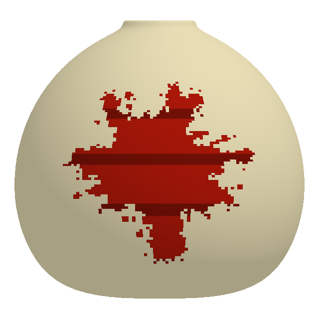
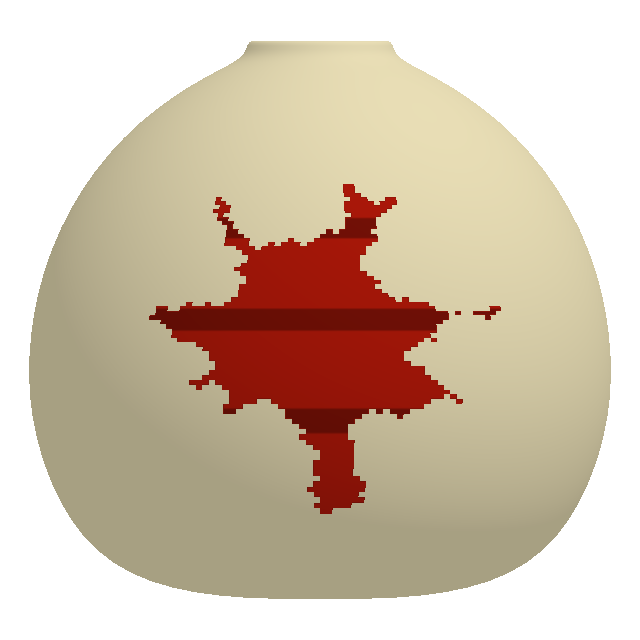

# 근처 유효 명중으로 유지하는 점진적 페인트 건조 — #225

## 문서 범위

Unity 6000.6.5f1의 `Assets/Lab/Scenes/Lab.unity`에 연결된 Paint 모델·공유 설정·DEV 조작을 설명한다. 이 문서에서 “건조”는 색의 명암 변화가 아니라 **시간이 지나면 실제 도색 셀이 빈 표면 경계부터 사라지는 규칙**이다. 새 게임·도색 마스크·물리 판정을 설계하는 문서가 아니다.

현재 설정은 **157개, 프로토콜 5644, 연결 토큰 `C6PhysicsLab/11`**이다. 이전 0~152번을 보존하고 153~156번 네 값만 덧붙인다. 과거153개·5643 앱을 섞어 접속하지 않는다. 검증 결과는 [VALIDATION](VALIDATION.md)의 이번 변경 기록을 따른다. 아래 시나리오와 코드 설명 자체는 실행 증거가 아니다.

## 기본값과 변경 위치

| 설정 | DEV 인덱스 | 기본값 | DEV 허용 범위 | Config 필드 / 공개 속성 |
| --- | ---: | ---: | --- | --- |
| Paint Drying | 153 | ON | 정수0/1, ON/OFF 버튼 | `paintDryingEnabled` / `PaintDryingEnabled` |
| Drying Delay (seconds) | 154 | 5초 | 0~60초 | `paintDryingDelaySeconds` / `PaintDryingDelaySeconds` |
| Drying Rate (%/s) | 155 | 0.2%p/초 | 0~5%p/초 | `paintDryingPercentPerSecond` / `PaintDryingPercentPerSecond` |
| Nearby Hit Radius (surface degrees) | 156 | 20° | 1~90° | `paintNearbyHitRadiusDegrees` / `PaintNearbyHitRadiusDegrees` |

원본은 `Assets/Lab/Resources/LabConfig.asset`이며 런타임 DEV는 복사본만 바꾼다. `PaintGrowthSettings`가 라운드에 `DryingEnabled`, `DryingDelaySeconds`, `DryingPercentPerSecond`, `NearbyHitRadiusDegrees`를 캡처한다. Inspector에서 범위를 벗어난 수치는 Getter에서 제한하고 NaN/Infinity는 각 기본값으로 대체한다. DEV·공유 배열은 유한수·범위·정수 조건을 통과해야 하며 한 항목이라도 잘못되면 전체 적용을 거절한다.

속도는 **현재 칠한 면적에 대한 비율이 아니라 전체 계산 표면에 대한 %p/초**다. `초당 셀 수 = Drying Rate × CellCount / 100`으로 환산하며 작은 잔량은 소수 예산으로 보관한다. 표면 분할을 바꿔도 같은 면적 비율을 지정한다. 실제 삭제는 불투명 셀 단위이므로 작고 낮은 해상도의 얼룩은 셀 간격으로 줄어든다. Rate 0이면 ON이어도 삭제하지 않는다.

## DEV 사용 순서

1. Editor Play Mode 또는 Development 앱에서 **DEV → Gourd**를 펼치고 마지막 **Paint Drying**을 ON으로 바꾼다.
2. 세 숫자와 대응 슬라이더를 조정한다. OFF이면 이 세 조작을 잠그고 기존 입력값은 유지한다. **DEFAULTS**는 원본의 ON·5·0.2·20을 입력에 불러온다.
3. 혼자는 **START/RESTART SOLO**, 접속 전 Host는 **CREATE ROOM**, 기존 Host 로비는 **APPLY TO ROOM**으로 적용한다. 공유 전투 중에는 먼저 공동 일시정지하고 Host의 **APPLY & RESTART**를 사용한다.
4. 공유 방은 네 값을 포함한 전체157개 지문을 참가자에게 확인받은 뒤 시작한다. Client가 자신의 DEV에서 세션값을 바꾸는 경로는 없다. 패널 입력만 바꾸거나 닫으면 진행 중인 판의 규칙은 바뀌지 않는다.
5. Paint 전투에서 주변을 반복해서 맞혀 유지되는 부분과 멀리 떨어져 줄어드는 부분을 비교한다. 종료 후에도 확인하려면 먼저 결과를 기록한 뒤 Retry/설정 변경을 한다.

기본은 ON이다. DEV에서 OFF로 적용하면 이전 성장 알고리즘을 그대로 호출한다. Crack에서는 Paint Surface 시간을 진행하지 않으므로 이 규칙을 적용하지 않는다. 구슬 입력·이동·전달·투척·명중 승인·명중 보상·크랙 피해는 변경하지 않는다.

## 명중과 보호 시간

- Host가 실제 투사체 명중을 승인한 뒤 `LabModel.ConfirmHit`가 실제 피격 방향을 `LabPaintSurface.RegisterHit`에 전달한다.
- 범위는 피격점과 각 셀의 **정규화된 박 로컬 방향 사이 구면각도**다. 20°는 월드 미터나 화면 픽셀이 아니며, 화면상 가까운 뒷면을 보호하지 않는다. 임의 메시의 삼각형을 따라 구한 최단 표면 거리가 아니라 기존 구면 셀 지도의 각거리다.
- 범위 안에 현재 칠해진 모든 셀의 마지막 근처 명중 시각을 갱신한다. 다른 오행 색·P번호, 연결되지 않은 튀김점도 포함한다. 기존 셀의 색·P번호·도색량은 바꾸지 않는다.
- 이미 칠한 지점의 재타격뿐 아니라 **빈 지점의 첫 명중도 주변 기존 칠을 보호**한다. 유효 명중이지만 추가 성장량이 없는 경우에도 시간을 갱신한다. 거절·중복 처리된 요청, 잘못된 방향/색/P번호/면적 share, share0은 갱신하지 않는다.
- 같은 연결 성분 전체를 보호하지 않는다. 기존 재타격은 무작위 군집 시작점을 고를 수 있으나 **보호 기준은 그 시작점이 아니라 실제 명중점**이다.
- 새로 칠한 셀에는 실제 생성 시각부터 자체 유예를 준다. 자동 성장 때문에 가까운 오래된 칠의 시각이 갱신되지는 않는다.

주변 재타격 없이 `마지막 근처 명중 시각 + Delay`가 지나면 해당 셀이 축소 대상이 될 수 있다. 줄어드는 도중 근처에 다시 맞히면 남아 있는 주변 셀이 새 유예를 받는다. 사라진 칠을 복구하지 않으며 그 자리는 기존 최초 도색·군집 성장 규칙으로 다시 칠한다.

## 경계 침식과 시간 순서

Host 전투 시간의 **0.1초 고정 tick**을 사용한다. 화면 프레임마다 임의 양을 지우지 않고 호출 구간을 tick 경계로 나눈다. 성장 셀의 생성 시각도 성장 예산상 실제 발생 시각으로 기록하고 구간 종료 시각으로 돌아온다.

1. tick 이전에 발생한 성장을 먼저 처리한다.
2. tick에서 보호가 끝나고 **빈 표면과 맞닿은 불투명 셀**을 큐에 넣는다. 색/플레이어 사이 접점은 빈 표면이 아니므로 삭제 경계로 삼지 않는다.
3. 오래 노출된 경계와 외곽층을 우선하고 안정적인 동률 순서로 총 속도 예산만큼 제거한다. 삭제 중 새로 노출된 안쪽은 다음 경계 후보가 된다. 무작위 내부 셀을 뚫거나 나이만으로 얼룩 전체를 한 번에 삭제하지 않는다.
4. 실제 삭제한 셀만 CoveredCount와 Revision에 반영한다. 삭제 셀은 **RGBA=(0,0,0,0), P번호=0**이며 색/무늬는 함께 사라진다. 살아 있는 다른 셀의 색/투척자 값은 유지한다.
5. 같은 tick에 예정됐던 성장을 이어서 처리한다. 따라서 **같은 시각에는 건조가 성장보다 먼저**다. 그 이전에100%가 됐다면 즉시 완료해 이후 침식을 수행하지 않는다.

보호 중인 시간은 삭제 예산으로 저축하지 않는다. 삭제 가능한 경계가 없으면 남는 휴면 예산을 쌓지 않아 나중에 새로 칠한 부분이 한꺼번에 지워지는 현상을 막는다. 실제로 더 지울 셀이 있을 때의 작은 소수 잔량만 이어간다.

기존 제한시간 동률 규칙을 유지한다. 정확히 deadline에 발생할 마지막 성장 셀은 보류하고 시간초과 Defeat를 우선한다. deadline 이전 실제 완성은 해당 시점의 Victory로 기록한다. 공동 일시정지 동안에는 Host 전투 시계가 멈추므로 성장·건조 모두 진행하지 않는다.

## 성분 분리와 남은 성장량

침식이 좁은 연결부를 지우면 하나의 얼룩이 여러 성분으로 나뉠 수 있다. 기존 합치기 전용 연결 구조를 그대로 신뢰하지 않고 살아 있는 셀의 연결 성분과 실제 빈 경계를 다시 구성한다.

각 FIFO 성장 공급은 한 번만 보존한다. 원래 anchor가 원래 성분 안에서 살아 있으면 그 셀이 속한 새 성분에, 없어졌으면 **원래 성분에서 살아남은 셀 중 원래 anchor와 구면 방향이 가장 가까운 셀의 성분 하나**에 귀속한다. 연결 ID·색·P번호·공급 순서·소수 잔량을 유지하며 여러 성분에 복제하지 않는다. 원래 성분의 칠이 모두 없어지면 그 공급의 쓸 수 없는 잔량을 폐기한다. 새로 생긴 무관한 얼룩으로 넘기지 않는다.

군집은 원래 중심·크기·형상·불규칙성 값을 유지한다. `GrowthCluster.Rebase`가 과거 탐색 큐와 방문 기록만 비우고 새 생존 성분에서 가장 가까운 빈 경계로 탐색 시작점을 옮긴다. 이미 칠한 셀을 다시 칠하지 않고 실제 새 빈 셀만 성장량과 진행도에 센다.

## 진행도·승리·동기화

`Coverage = CoveredCount / CellCount`를 유지하므로 건조로 지운 실제 셀만큼 목표 표시가 내려간다. 화면에100%로 보이게만 처리하거나, 과거 최고 도색률로 승리를 결정하지 않는다. 기존 숫자 표시의 내림과 마지막 빈 셀 확인 규칙을 유지한다.

Host 모델만 건조를 계산한다. Host 표시 캐시와 Client는 기존 `paint_cells` delta/체크포인트의 **색상과 P번호 맵**을 받는다. 삭제용 빈 RGBA/P0도 같은 원자적 검증/해시/Revision/Snapshot 공개 경로를 사용하며 별도 로컬 건조 애니메이션을 판정으로 삼지 않는다. Replica와 관람 복사본은 스스로 시간을 진행해 칠을 지우지 않는다. 독립 코어 fixture의 new LabPaintGrowthSettings()는 명시적 설정 전까지 OFF이며, 실제 게임은 LabConfig에서 기본 ON을 캡처한다.

100% Victory 또는 다른 결과 상태로 넘어가면 모델이 Surface 시간을 더 진행하지 않는다. Surface 자체도 완료 후 Advance를 즉시 반환하므로 완성 박은 보존된다. 기본 ON의 완성 박 관람·개인 무늬 설정은 유지한다. Retry/새 판은 맵과 성장 공급뿐 아니라 건조 시계·보호/노출 시각·경계/큐·잔량도 초기화한다. 설정을 바꾸지 않는 Retry는 기존 건조 설정을 유지한다.

## 파일과 책임

| 파일 | 변경·확인 지점 |
| --- | --- |
| `Assets/Lab/Scripts/Core/LabConfig.cs` | 네 Inspector 원본값·유효 속성·DEV153~156·Gourd 분류·157개 Capture/Apply·라운드 설정 캡처 |
| `Assets/Lab/Scripts/UI/LabDeveloperMode.cs` | 이전 저장 패널을 늘려 새 행 생성, 토글·세 슬라이더, OFF/Host 권한에 따른 잠금, 기존 적용 버튼 경로 |
| `Assets/Lab/Scripts/Core/LabPaintSurface.cs` | `RegisterHit` 주변 보호, `AdvanceGrowth` 실제 emit 시각, `PaintFundedCell` 새 셀 기록, Clear/Replica 경계 |
| `Assets/Lab/Scripts/Core/LabPaintSurface.Drying.cs` | 보호/노출 시각, 고정 tick, 경계 heap 침식, 실제 셀 삭제, 성분 재구성·공급 귀속 |
| `Assets/Lab/Scripts/Core/LabPaintSurface.Clusters.cs` | 분리 후 기존 군집 형상을 유지하는 `GrowthCluster.Rebase` |
| `Assets/Lab/Scripts/Core/LabModel.cs` | 기존 `ConfirmHit`·`TryAdvance`를 통한 유효 명중·전투 시간·pause/deadline/결과 경계 |
| `Assets/Lab/Scripts/Session/LabNetwork.cs` | 프로토콜5644, 기존 Host 설정 승인과 맵/Snapshot 공개 경로 |
| `Assets/Lab/Scripts/Session/LabPaintReplication.cs` | 기존 RGBA/P번호 delta·체크포인트의 빈 셀 수신 경로. 새 wire 형식을 만들지 않음 |

이번 `LabConfig.asset` 재저장은 Unity API로 새 건조4값을 기록한다. 코드 기본값으로 이미 사용하던 무거운 폭탄4값·폭발 패널티3값도 직렬화되므로 에셋 diff에 함께 나타난다. 해당 기존153개 유효값·인덱스를 바꾸는 기획 변경과 구별한다. Scene·Prefab·마스크·구슬 재질·패키지는 이 기능의 변경 대상이 아니다.

## 확인 시나리오와 검증 범위

다음은 **확인할 조건**이며 이 표 자체는 수행 결과가 아니다. 실제 수행 여부·환경·결과는 [VALIDATION](VALIDATION.md)에 기록한다. 이번 문서 작성 시점의 독립 Mac 다중 앱·iOS 빌드·실제 터치·핫스팟 실기기 건조 확인은 미실행이다.

| 시나리오 | 확인할 조건 |
| --- | --- |
| OFF 비교 | 같은 seed·타격·시간표에서 이전 성장 결과와 색/P맵·잔량이 같음 |
| 유예와 감소 | 유예 동안 감소 없고 이후 실제 외곽 셀만 지워지며 표면 해상도를 바꿔도 같은 %p 속도 |
| 주변 보호 | 가까운 다른 색/분리 성분·U이음새 양쪽은 보호하고 범위 밖/뒷면은 미보호 |
| 부분 유지 | 연결된 얼룩의 근처만 갱신, 줄어드는 중 재타격은 남은 부분만 유지, 이미 지운 곳 자동 복원 없음 |
| 승인 경계 | 무효·중복·share0 요청은 보호하지 않고, 빈곳 첫 명중·유효 무성장 재타격은 주변 보호 |
| 생성 시각 | 새 성장 셀은 자체 유예를 받고 자동 성장으로 오래된 칠이 보호되지 않음 |
| 성분 분리 | 좁은 연결부 삭제 뒤 공급 중복 없음·색/P/FIFO 보존·마지막 셀 소멸 시 해당 잔량 폐기 |
| 시간 분할 | 같은 타격·시간표의 긴 Advance와 여러 짧은 Advance가 같은 맵·잔량·Revision에 도달 |
| 동률·종료 | 동일 tick 건조→성장, deadline 정확 동률은 Defeat, 이전 완료는 Victory, 결과 뒤 지도 고정 |
| 재시작·권한 | OFF의 수치 잠금/값 보존, DEFAULTS, Host 공유 지문, 일시정지 APPLY & RESTART, 원본 불변 |
| 수신·표시 | 삭제 delta와 전체 체크포인트에서 RGBA/P0·CoveredCount·진행률이 같고 Replica가 독자 침식하지 않음 |
| 관람·회귀 | 완료 박 지도/무늬 보존, Retry 건조 시각 초기화, 기존4패턴·구슬/폭탄/투척·Crack 동작 유지 |

## 실제 GPU 비교 자료

아래는 저장 WhiteGourd 메시·생산 셰이더에 실제 Surface 지도를 표시한 통제 fixture다. 최초6%·유예1초·건조2%p/초·보호반경90°를 사용해 변화가 보이게 했으며, 기본값5초·0.2%p/초·20°의 실플레이나 독립 기기 검증으로 해석하지 않는다.

| 최초 도색 | 경계부터 일부 축소 |
| --- | --- |
|  |  |

[근처 명중으로 보호된 상태](images/paint-03-drying-nearby-hit-protected.png)는 일부 축소 상태와 같은 지도·화면이다. 이후 보호가 끝나면 [전체 소멸](images/paint-04-drying-fully-erased.png)해 원래 표면으로 돌아간다.
