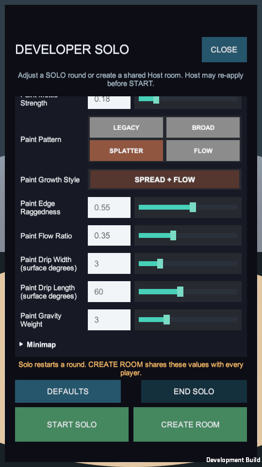
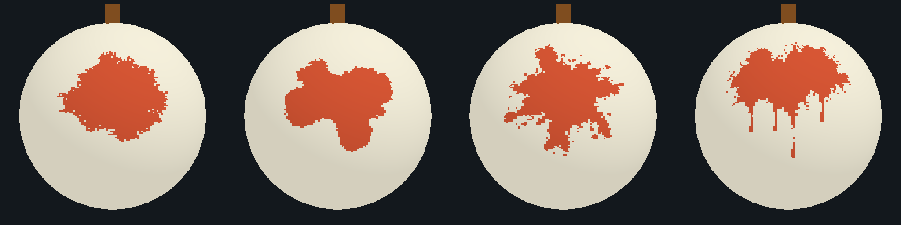

# 도색 패턴 4종의 실제 전투 적용 — Experiment #200 후속

## 적용 범위와 사용법

기존 Editor 비교 실험에 이어 사용자가 실제 전투 연결을 승인했다. **DEV → Gourd → Paint Pattern**에서 `LEGACY / BROAD / SPLATTER / FLOW`를 선택한다. 기본은 **SPLATTER(2)**이며, 사용자 첨부와 동일한 Splatter 원본 마스크를 사용한다. Editor 비교 창도 남아 있지만 그 창의 고정 위치·완료 fixture는 게임 로직으로 가져오지 않았다.

| 선택 | 최초 명중의 실제 도색 | 후속 성장 |
| --- | --- | --- |
| LEGACY(0) | 기존 초기 도색 | 기존 Paint Growth Style의 ORIGINAL(0) / SPREAD + FLOW(1) |
| BROAD(1) | 넓고 비대칭인 얼룩 마스크 | 넓은 외곽 선호와 기존 메우기/뻗기·세로 가중치 |
| SPLATTER(2, 기본) | 거친 본체와 떨어진 튀김점 | 해당 연결 영역의 경계에서 불규칙한 인접 성장 |
| FLOW(3) | 세로로 흐르는 물감 마스크 | Host가 샘플한 중력 방향의 꼬리 및 일반 경계 성장 |

숫자 입력칸·슬라이더 대신 2×2 이름 버튼을 사용한다. 선택한 버튼은 색으로 구별한다. Pattern이 LEGACY일 때만 기존 `Paint Growth Style` 토글을 누를 수 있고, 다른 패턴으로 바꿔도 그 하위 값은 삭제하지 않는다. `Paint Edge Raggedness`는 후속 외곽의 요철 선호도이며 원본 마스크 자체를 바꾸지는 않는다. FLOW에서는 기존 `Paint Flow Ratio / Drip Width / Drip Length / Gravity Weight`를 함께 사용한다.

아래는 실제 Mac Development 앱에서 Gourd를 펼친 화면이다. 검증 fixture의 조정값이므로 전체 숫자가 일반 기본값이라는 의미는 아니다. Splatter가 선택돼 있고 기존 성장 토글은 비활성이다.

확정 경계는 기존과 같다. 솔로는 **START/RESTART SOLO**, 새 방은 **CREATE ROOM**, Host의 전투 전 로비는 **APPLY TO ROOM**, 공동 일시정지한 Host는 **APPLY & RESTART**를 사용한다. 버튼 선택만으로 진행 중인 맵을 다시 찍거나 기존 색을 바꾸지 않는다. 일반 Retry는 승인한 패턴을 유지하고 도색을 초기화한다. DEFAULTS는 원본 Config의 Splatter로 복원한다. 실행 중 변경은 복사본에만 적용된다.

## 초기 튀김점의 판정 규칙

검정 바깥은 미도색, 밝은 발자국은 해당 속성의 실제 도색이다. Host 승인 명중의 구면 위치에 마스크를 투영한다. 미도색 지점의 최초 도색은 기존 `Paint Initial Coverage (%)`의 **같은 전체 면적 예산**을 사용한다. 작은 독립 튀김점에도 별도 무료 면적을 지급하지 않는다.

- 최초 명중에서 본체와 떨어진 튀김점이 생길 수 있다. 모두 알파255인 실제 셀이며 진행률·공유 맵·완료에 포함한다.
- 서로 인접하지 않은 셀 묶음은 별도 Region이다. 초기 발자국은 4방향 연결 성분별로 나눠 정수 셀 예산을 소비하고, 초기 소수 잔여분은 실제 명중점의 성분에 남긴다.
- 이미 칠한 곳의 명중은 새 발자국을 찍지 않고 **맞은 지점의 연결 영역**에만 반복 성장 예산을 공급한다. 떨어진 다른 점은 별도 성장량을 받지 않는다. 자연스럽게 접촉·병합한 뒤에는 같은 영역이다.
- 이후 성장은 반드시 현재 연결 영역의 빈 인접 셀을 따라 진행한다. 확장 도중 새 위성점으로 뛰어넘지 않는다.
- 기존 색은 덮거나 섞지 않는다. 영역 병합과 명중별 공급의 FIFO 순서는 기존 규칙을 사용한다.

해상도는 기존 64×32 / 128×64 / 256×128을 유지한다. 초기 크기는 전체 표면의 비율로 보정하고 이산 셀 경계에서 정확한 초기 정수 셀 수를 맞춘다. 해상도가 낮으면 아주 작은 점·가는 꼬리 일부가 표현되지 않거나 분리될 수 있다. 원본 이미지의 모든 픽셀이 각 해상도에서 보존된다고 보장하지 않는다.

확장 때 마스크는 경계 선택의 선호도로 사용한다. 최초 원의 반경을 시간에 따라 키우는 방식이 아니다. 성장량이 소진되면 멈추며, 끝·극점·막힌 꼬리에서는 일반 경계로 돌아가 마지막 빈 셀까지 도달할 수 있다. 실제 전체 셀 도색·100% 목표·승리 판정과 공유 맵의 기준은 유지한다.

## 색상·표시·공유

작성용 5색의 단일 위치는 `LabPaintPalette.SrgbColorFor`다. 실제 라운드의 Rules가 `ColorFor`로 linear RGB를 캡처한다. 구슬 재질·아이콘과 기존 피격 연출의 색은 수정하지 않는다.

| 속성 | 물감 sRGB |
| --- | --- |
| 화 / Fire | `#D85736` |
| 수 / Water | `#1471A7` |
| 목 / Wood | `#3D8258` |
| 금 / Metal | `#F8B72A` |
| 토 / Earth | `#6F4A32` |

기존 필드 0~138을 보존하고 `Paint Pattern`을 **인덱스139**, 정수0~3으로 추가했다. 전체140개 설정을 원자적으로 검사·지문화·공유한다. 프로토콜은5635, 연결 토큰은 `C6PhysicsLab/11`이다. 서로 다른 버전 앱을 섞어 시험하지 않는다. Host만 도색·성장을 계산하고 Client는 기존 셀 delta/체크포인트로 받은 RGBA 맵을 표시한다. 패턴마다 Client가 독립 마스크를 다시 찍지 않는다.

실제 표시 지도는 기존 최대256×128·linear RGBA32·Point 샘플링이다. Editor 비교의1024×512·Bilinear 지도를 그대로 전송하지 않으므로 네트워크 지도의 셀 수·최대 payload는 늘리지 않았다. Grain은 별도 RGB 내부 질감 설정이며 기본 OFF다.

## 코드와 에셋 연결

| 위치 | 수정할 때 확인할 책임 |
| --- | --- |
| `Assets/Lab/Scripts/Core/LabConfig.cs`, `Assets/Lab/Resources/LabConfig.asset` | 기본 Splatter, Inspector enum, DEV139번, capture/apply/검증 |
| `Assets/Lab/Scripts/UI/LabDeveloperMode.cs` | 기존 Canvas 행 확장, `SettingChoices/Choice0..3`, DEFAULTS와 선택 표시, Legacy 하위 토글 |
| `Assets/Lab/Scripts/Core/LabPaintPattern.cs` | enum, Resources 마스크의 최초 명중 시 지연 읽기와 캐시 |
| `Assets/Lab/Scripts/Core/LabPaintSurface.Patterns.cs` | 충돌 지점 투영·면적 보정·연결 성분 분리·경계 선택 |
| `Assets/Lab/Scripts/Core/LabPaintSurface.cs`, `.SpreadFlow.cs` | 기존 예산/FIFO/병합/완료·Legacy·중력 방향 흐름 |
| `Assets/Lab/Scripts/Core/LabPaintPalette.cs`, `LabModel.Rules` | 물감 전용5색과 라운드 캡처 |
| `Assets/Lab/Scripts/Session/LabNetwork.cs`, `LabPaintReplication.cs` | 버전·Host 설정 승인·도색 맵 전송·표시 캐시 |
| `Assets/Lab/Resources/GourdPaint/Patterns/{Broad,Splatter,Flow}.png` | 빌드에 포함되는 실제 마스크. #200 비교 원본과 동일 PNG 바이트 |
| `Assets/Editor/PaintStyleComparison/LabPaintPatternImporter.cs` | runtime 마스크만 linear/readable·최대1024·무압축·no mipmap으로 가져오기 |
| `Assets/Editor/PaintStyleComparison/LabPaintPatternValidation.cs` | 명시적으로 호출하는 실제 RegisterHit/Advance·저장 메시 렌더 증거 출력 |
| `Assets/Lab/Tests/EditMode/LabPaintPattern*Tests.cs`, `Assets/Lab/Tests/PlayMode/LabPaintPatternDeveloperTests.cs` | 실제 마스크·면적/연결성·완료·복제·설정·저장 Canvas의 적용 경계 |

실행 Scene·Prefab·구슬 머티리얼·패키지는 변경하지 않는다. 신규 마스크의 생성 근거는 기존 `Assets/Lab/Art/GourdPaint/Experiments/StyleComparison/GENERATION.md`에 있다. 비교 도구와 runtime이 같은 작성용 팔레트를 참조한다.

## 실제 알고리즘 렌더와 검증의 구분

아래는 왼쪽부터 **Legacy / Broad / Splatter / Flow**다. 실제 저장 WhiteGourd 메시와 기존 셰이더, production `RegisterHit`로 만든256×128 지도·Point 표시를 사용했다. 잘 보이도록 초기6%·같은 seed200·같은 명중 위치를 사용한 명시적 렌더 fixture이며 **기본 초기2%의 수동 플레이 사진은 아니다**. 네 모드 모두1,966셀의 같은 면적이다.

동일 지점의 반복 명중은 기존 색을 덮지 않기 때문에 색띠를 만들 수 있다. 이 변경이 덧칠·혼색 규칙까지 바꿨다는 의미는 아니다. 오프라인 비교의 강제 완성 fixture 대신 이번 runtime 렌더의 Complete는 실제 반복 공급·Advance를 통해 마지막 셀까지 채운 결과다.

컴파일·EditMode·PlayMode·다중 앱·빌드의 실행 결과는 [검증 기록](VALIDATION.md)의 #200 후속을 따른다. 이전 비교 도구의497/141 결과는 이번 기능의 PASS로 승계하지 않는다. iOS·실제 터치·핫스팟·모바일 CPU/GPU·GC 성능은 별도 실행 증거가 필요하다. 특히 미도색 명중의 초기 투영·면적 보정은 전체 셀 스캔과 임시 배열을 사용하므로 연속 피격 비용을 아직 보장하지 않는다.
