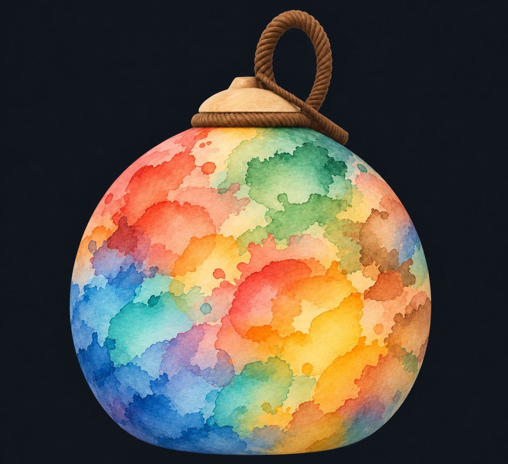
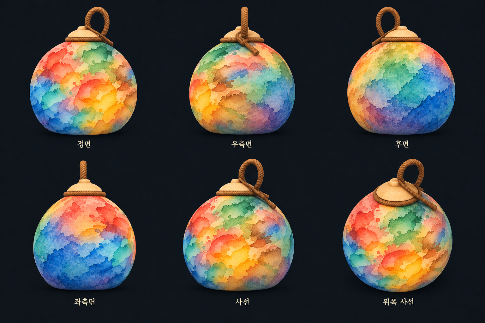

# 박 채색 표현 기준 명세

> 현재 기본 표현은 [#506 클레이 스티커](CLAY_STICKER_PAINT.md)다. 아래는 이전 종이/외형 비교 이력이며 그 구현·검증 범위로 읽는다.

> **최신 승인 기준(2026-11-04): 불투명한 얼룩 한지 스티커.** 아래 1~7절은 이전 수채 방향의 설계 이력이다. 현재 표현과 구현은 [불투명 얼룩 스티커](PAPER_STICKER_PAINT.md)를 우선하며, 기존 투명 겹침·옅은 경계 요구를 새 모드에 적용하지 않는다.

작성일: 2026-11-03 · 문서 버전: 1.0

**기준 상태: 사용자 선택 시안에 따른 표현 목표. 이 문서 작성으로 Unity 구현이나 실행 검증이 완료된 것은 아니다.** 현재 코드의 동작은 기존 구현 문서를 따르며, 이 문서는 앞으로 채색 표현을 추가·수정할 때 사용할 아트 및 동작 기준이다.

구현 연결과 실제 검증 범위는 [수채 브러시 채색 구현 문서](WATERCOLOR_BRUSH_STAMPS.md)를 따로 확인한다. 아래 시안은 아트 기준이며 실행 증거가 아니다.

## 1. 목표와 적용 범위

완성된 박이 여러 번의 명중으로 만들어진 하나의 수채 작품처럼 보이게 한다. 핵심은 **내부 농담과 투명도를 가진 수채 브러시 자국을 찍어 쌓고, 겹친 색과 이전 자국을 남기면서 가장자리 옆으로 이어 붙여 큰 얼룩을 만드는 표현**이다.

사용자가 말한 “스티커를 붙이는 느낌”, “클립스튜디오에서 브러시 하는 것처럼”은 개별 브러시 자국이 인지되는 누적 방식을 뜻한다. 박 표면에 별도 두께·종이 조각·튀어나온 메시를 붙이는 요구가 아니다.

일반 협동 도색의 전투와 완성 박 관람에 적용할 표현 기준이다. 현재 수채를 끄는 땅따먹기의 청홍 구분은 그대로 유지한다. 게임 규칙·서버 구조·전투 수치를 변경하는 명세는 아니다.

## 2. 기준 이미지와 우선순위

### 주 기준인 단일 시안

개별 자국의 형태, 내부 농담, 투명한 겹침, 색감과 표면 질감은 이 이미지를 우선 기준으로 삼는다. 박의 전체 형태·뚜껑·끈·Scene 배치를 이 그림에 맞춰 새로 바꾸는 요구는 아니다.

### 여러 각도 참고 시안

정면·우측면·후면·좌측면·사선·위쪽 사선의 재질 인상을 참고한다. 두 이미지는 AI 생성 예상 시안이며 실제 Unity 렌더나 테스트 증거가 아니다. 6방향 시안의 얼룩 연결은 근사 표현이다. 실제 구현에서는 하나의 표면에 기록된 도색이 모든 시점에서 정확히 이어져야 한다.

시안의 완성 그림을 박에 고정 텍스처로 붙이지 않는다. 실제 명중·성장 이력에 따라 작품이 달라져야 한다. 시안에 보이는 도장 개수·크기·색 배치는 게임 수치나 정해진 도색 순서가 아니다.

## 3. 표현 규칙

| ID | 항목 | 표현 기준 |
| --- | --- | --- |
| VIS-PAINT-001 | 브러시 자국 | 큰 둥근 굴곡과 불규칙한 가장자리를 가진 수채 얼룩이다. 크기·회전·형태의 차이로 동일한 모양의 기계적인 반복을 줄인다. 내부에 옅고 진한 농담, 일부 안료 고임, 미세한 입자를 포함한다. |
| VIS-PAINT-002 | 누적과 겹침 | 새 자국의 투명한 부분으로 아래 자국이 비친다. 일부 경계는 남고 일부는 자연스럽게 이어져, 여러 번 쌓인 과정이 보인다. 겹침에 따른 농도 증가를 제한해 반복 명중이 작품 전체를 검게 만들지 않게 한다. |
| VIS-PAINT-003 | 퍼짐과 성장 | 확정된 성장 위치에 브러시 자국이 이어 붙으며 연결된 큰 얼룩이 된다. 진한 안쪽과 옅게 스며든 외곽이 함께 존재한다. 기존 자국을 통째로 확대하거나 모든 경계를 균일하게 밀어내는 모습으로 대체하지 않는다. |
| VIS-PAINT-004 | 색과 혼색 | 화의 주홍·수의 파랑·목의 초록·금의 노랑·토의 갈색을 기본 색군으로 유지한다. 투명한 겹침에서 청록·주황·보라·올리브 등의 중간색을 허용한다. 큰 색면과 개별 자국이 계속 읽혀야 한다. |
| VIS-PAINT-005 | 경계 | 얇고 불연속적인 안료 테두리와 옅은 수분 번짐을 섞는다. 모든 자국에 같은 굵기의 외곽선을 두르거나 전체 그림을 흐려 개별 자국을 지우지 않는다. |
| VIS-PAINT-006 | 표면 질감 | 박 표면에 고정된 고운 종이결과 얇은 안료 질감이다. 그림자·두께가 있는 스티커, 유광 도료, 두꺼운 물감, 과장된 구김·양각 섬유로 보이지 않게 한다. |
| VIS-PAINT-007 | 완성 상태 | 100% 완료 시 전체 칠하기 대상 표면에 도색이 이어진다. 옅은 색을 통해 종이결이 비칠 수 있으나 큰 무색 구멍 때문에 미완성으로 보이지 않아야 한다. |
| VIS-PAINT-008 | 시점과 결과 일치 | 얼룩의 위치·형태·색이 박에 붙어 회전한다. 전투·결과 관람·PNG는 같은 최종 표현을 사용한다. 시점마다 다른 그림으로 교체하지 않는다. |

### 3.1 브러시 원본과 변형

- 원본 브러시는 외곽 모양뿐 아니라 내부 농도와 투명도를 표현해야 한다. 브러시 이미지를 단색으로 꽉 채워 내부 농담을 지우지 않는다.
- 복수의 브러시 형태와 크기·회전·농도 차이를 사용한다. 구체적인 원본 개수와 변화 범위는 실제 박 비교에서 정한다.
- 적용 색은 확정된 원소 색을 바탕으로 한다. 한 명중이 임의의 다른 원소 도색을 생성하는 규칙을 추가하지 않는다. 한 자국 안의 다색 표현은 기존 칠과의 투명한 겹침·국소 혼색으로 만들 수 있다.
- 작은 튀김점도 실제 도색에 포함된 범위를 표현한다. 면적과 관계없는 장식 점을 미도색 구역에 찍어 새 칠처럼 보이게 하지 않는다.
- 재사용되는 무늬는 자연스럽게 변형하되, 같은 확정 기록을 복원하면 같은 결과가 나오도록 한다. 화면을 갱신할 때마다 새 모양을 뽑지 않는다.

### 3.2 겹침과 혼색의 인상

아래층이 일부 비치고, 겹친 곳은 조금 더 진해지며, 두 자국의 윤곽이 함께 읽혀야 한다. 내부 농담·색 혼합·경계 농축은 서로 조절할 수 있어야 한다.

다색 혼합은 접점과 겹침 내부에 집중한다. 붓 자국과 관계없는 넓고 균일한 무지개 띠, 원소별로 나뉜 거대한 단색 구획, 누적될수록 회색이나 검정으로 뭉개지는 결과는 기준에 맞지 않는다. 같은 색끼리 겹쳐도 농도와 부분적인 경계 차이로 이전 자국을 알아볼 수 있어야 한다.

### 3.3 최초 명중과 재타격 성장

1. 최초 명중은 현재 판정이 승인한 위치와 영역에 브러시 자국으로 표시한다.
2. 재타격의 성장 위치·면적은 기존 게임 로직이 정한다. 표현은 그 확정 영역에 새 브러시 자국이 연결되는 것으로 구성한다.
3. 새 자국은 기존 칠과 넓게 이어지는 부분과 옅은 번짐을 함께 보인다. 이전 자국을 모두 덮어 하나의 균일한 면으로 만들지 않는다.
4. 등장 연출 중에도 질감·기존 자국·브러시의 최종 위치는 표면에 고정한다. 기존 자국이 미끄러지거나 그레인이 확대되는 모습은 허용하지 않는다.
5. 표현이 추가되는 횟수나 크기를 실제 성장량·소모량·진행도에 다시 곱하지 않는다.

## 4. 게임 판정과 표현의 경계

| 구분 | 기준 |
| --- | --- |
| 실제 칠한 영역과 진행률 | Host가 확정한 표면 지도·면적을 따른다. 표시 이미지의 색·투명도를 읽어 역산하지 않는다. |
| 실제 색·P번호·기여도 | 기존 판정 데이터를 유지한다. 혼색으로 새 속성·소유자·기여도를 생성하지 않는다. P번호를 수치 보간하지 않는다. |
| 플레이어 무늬 | 기존 ON/OFF와 실제 P번호 연결을 유지한다. 시안에 무늬가 없다는 이유로 기능을 제거하지 않는다. |
| 성장·건조 | 현재 또는 병행 작업에서 확정된 규칙을 따른다. 브러시의 시각적 농도와 실제 건조 타이머를 같은 값으로 취급하지 않는다. |
| 건조로 삭제된 영역 | 현재 지도에 맞춰 과거 도장 표현도 제거한다. 남은 칠은 유지하며, 과거 아래층을 실제 새 도색처럼 부활시키지 않는다. |
| 100% 승리 | 기존 실제 면적 판정을 유지한다. 종이가 비쳐 보이는 광학 효과는 미도색 셀이 아니며, 표현만으로 승리하지 않는다. |
| 복원과 다기기 표시 | 확정 기록·순서·고정 seed에 따라 최종 모양을 일관되게 복원한다. 로컬 수신 시간은 등장 연출에만 영향을 준다. GPU의 미세한 차이는 허용하되 도장 배치·주요 색층·완성 결과는 일치해야 한다. |
| 관람과 PNG | 진행 중 표현을 최종 상태로 확정한 뒤 같은 결과를 독립 복사한다. 전투 객체 해제·다음 Scene이 이미 저장한 작품을 지우지 않게 한다. |

서버·동기화 작업과 분리된 표현 요구다. 이 문서만으로 전송 포맷·공유 설정·행동 승인 경로를 변경할 권한이나 구현 완료를 의미하지 않는다. 추가 동기화 자료가 필요해지면 별도 구현 계획에서 영향과 호환성을 검토한다.

## 5. 표현 설정의 기준

게임 수치 원본과 분리된 표현 프로필에서 비교·조절한다. 기존 항목은 재사용할 수 있으나 아래 표가 모두 현재 Inspector에 구현돼 있다는 뜻은 아니다.

| 조절 항목 | 조절할 인상 | 구분 |
| --- | --- | --- |
| 브러시 선택·크기·회전 변화 | 도장 형태와 반복감 | 기존 시각 기록과의 연결·지원 범위 검토 필요 |
| 기본 농도·내부 농담 | 옅고 진한 면과 종이 노출 | 기존 수채 설정 재사용 대상 |
| 겹침 농도·누적 상한 | 중첩부의 깊이와 과도한 어두워짐 방지 | 후속 구현 대상 |
| 혼색 강도·범위 | 다른 색이 비치거나 섞이는 정도 | 후속 구현 대상 |
| 테두리 강도·폭·불균일성 | 안료 고임과 끊김 | 기존 설정 확장 대상 |
| 옅은 외곽·등장 시간 | 새 자국이 붙고 스며드는 느낌 | 기존 수채 설정 확장 대상 |
| 종이결·미세 입자 | 담채 내부 질감 | 기존 재질·설정 재사용 대상 |
| 새 표현 비교 ON/OFF | 기존 표현과의 동일 상태 비교 | 후속 비교 경로에서 제공 |

수치 확정 원칙:

- 현재 게임의 도색량·성장량·성장 속도·건조 수치·전투 시간을 이번 문서에서 재정의하지 않는다.
- 기존 고해상도 기본 1024×512를 비교 시작점으로 사용한다. 화질만으로 무조건 해상도를 올리지 않는다.
- 현행 수채의 등장 시간 .4초는 기존 구현값이며 이번 시안으로 새로 확정한 속도가 아니다. 브러시 개수·변화 폭·혼색 비율·등장 시간의 최종값은 실제 렌더 비교에서 정하고 표현 프로필에 기록한다.
- 이미지의 색을 화면에서 임의로 추출해 공유 원소 팔레트를 교체하지 않는다. 실제 팔레트가 바뀌는 요구는 별도 변경으로 취급한다.

## 6. 명세 작성 당시 구현과 목표의 차이

이 절은 명세 작성 당시 `7ba2f0e8`의 도색 표현 파일을 기록한다. 이후 #466/V2 구현·현재 기본값은 [수채 브러시 채색](WATERCOLOR_BRUSH_STAMPS.md), 실제 수행 결과는 [검증 기록](VALIDATION.md)을 따른다. 병행 중인 통신 변경을 새 채색 표현의 구현 근거로 취급하지 않는다.

| 현재 확인한 구조 | 이번 목표와의 차이 |
| --- | --- |
| `HighResolutionRuntime.shader`의 `Candidate`는 주변 후보 중 하나의 색·P를 선택한다. | 외곽을 부드럽게 복원하지만 색 사이의 투명 레이어 혼합은 만들지 않는다. |
| `WatercolorRuntime.shader`의 `Composite`는 선택된 속성의 농도층을 사용한다. | 새로운 다색 혼합과 아래 자국이 비치는 합성은 추가 구현이 필요하다. |
| 현 수채 광학 값은 속성별 층에 가산 누적한다. | 브러시의 앞뒤 순서에 따른 반투명 색 합성과 동일하지 않다. |
| 시각 기록은 최근128개이며 오래된 항목을 버린다. 현재 셀 지도는 최종 색·P만 보관한다. | 모든 과거 도장의 개별 윤곽·혼색을 현재 기록 재생만으로 영구 복원할 수 있다고 보장할 수 없다. |
| 결과 관람은 `PrepareVisualCapture` 후 실제 표시 텍스처를 복사한다. | 새 표현도 같은 최종 표시 경로에 포함해야 한다. |

**구현 전 해결할 사항:** 128개 초과·재동기화·품질 변경 뒤에도 완성 작품의 주요 층과 혼색을 안정적으로 보존할 방법이 필요하다. 단순히 기록 제한을 해제하거나 무한한 GPU·메모리 누적을 사용하지 않는다. 베이크·체크포인트·추가 복원 자료 등 구체적 수단과 서버 영향은 후속 구현 계획에서 결정한다. 원형 기록이 폐기된 뒤 완전히 같은 개별 테두리까지 보존할 범위도 그때 명시한다.

### 관련 구현 위치

아래 위치는 후속 작업자가 확인할 연결 지점이며, 수정 완료 목록이 아니다.

| 책임 | 위치 |
| --- | --- |
| 실제 표면 판정·성장·건조와 시각 기록 | `Assets/Lab/Scripts/Core/LabPaintSurface*.cs`, `LabPaintVisualStamp.cs` |
| 고해상도 지도와 수채 합성 | `Assets/Lab/Resources/GourdPaint/HighResolutionRuntime.shader`, `WatercolorRuntime.shader` |
| 표현 프로필·캐시·실제 표시 바인딩 | `Assets/Lab/Scripts/Throw/LabWatercolorPaint*.cs`, `LabGourdPaint.cs` |
| 박 바탕 재질과 P번호 무늬 | `Assets/Lab/Art/GourdPaint/LabGourdPaint.shader` |
| 결과 관람의 독립 복사 | `Assets/Lab/Scripts/UI/GourdViewer/LabGourdResultPreview.cs` |

현행 실행 설명은 [런타임 고해상도 도색](RUNTIME_HIGH_RESOLUTION_PAINT.md), [수채 질감과 번짐](WATERCOLOR_PAINT_EXPERIMENT.md), [도색 건조](PAINT_DRYING.md)를 함께 읽는다. 해당 문서의 과거 구현값·검사 결과를 새 표현의 완료 근거로 사용하지 않는다.

## 7. 수용 기준과 확인 시나리오

선택된 이미지의 아트 방향은 확인됐지만, 아래 Unity 시나리오는 **이번 명세 작성에서 모두 미실행**이다. 후속 구현의 실제 결과만 [검증 기록](VALIDATION.md)에 남긴다.

| 검증 ID | 확인 상태와 행동 | 기대 결과 | 수행 상태 |
| --- | --- | --- | --- |
| VP-01 | 단색 최초 명중1회 | 내부 농담·투명도·불규칙한 윤곽을 가진 하나의 수채 브러시 자국이 읽힌다. | 미실행 |
| VP-02 | 같은 색으로 재타격3회 | 확정 성장 위치에 자국이 이어 붙고, 이전 부분 경계와 농담이 남는다. 전체가 한 번에 확대되거나 검게 뭉개지지 않는다. | 미실행 |
| VP-03 | 2색 겹침·3색 교차 | 아래 자국이 비치고 국소 혼색이 생긴다. 개별 자국과 큰 색군이 계속 구분된다. | 미실행 |
| VP-04 | 5색으로100% 완료 | 전체 대상 표면이 칠해진 작품으로 보인다. 옅은 부분에도 색이 있고 실제 진행률·승리 판정은 기존 지도와 같다. | 미실행 |
| VP-05 | 정면·좌우·후면·사선·위쪽, U이음새·극 확인 | 같은 얼룩이 표면에 붙어 연속적으로 돌아가며, 이음새·위아래에서 눈에 띄는 끊김·폭 왜곡·질감 미끄러짐이 없다. | 미실행 |
| VP-06 | 건조와 근처 재타격 | 지워진 칠의 잔상이 남거나 아래층이 부활하지 않는다. 보호·성장 면적 등 기존 규칙이 유지된다. | 미실행 |
| VP-07 | P무늬 ON/OFF·소유권 변경 | 실제 P번호와 무늬 연결을 유지한다. 혼색으로 없는 P번호나 새 게임 속성이 생기지 않는다. | 미실행 |
| VP-08 | 시각 기록128/129개 경계·재동기화·품질 변경·자원 재생성 | 오래된 도장 처리 정책에 따라 주요 색층과 완성 작품이 안정적으로 복원된다. 선행 보존 설계와 함께 검증한다. | 미실행 |
| VP-09 | 같은 확정 상태의 반복 갱신·일시정지/재개 | 중복 도장·추가 농도 누적·무늬 재추첨이 없다. 복원 때 과거 타격을 다시 연출하지 않는다. | 미실행 |
| VP-10 | 완료 후 관람·PNG·다음 스테이지 | 최종 표현을 그대로 복사하고 이전 작품의 독립 수명을 유지한다. 단색·픽셀 표현으로 되돌아가지 않는다. | 미실행 |
| VP-11 | 동일 상태에서 기존/새 표현 ON/OFF | 표면 색·P·실제 면적·판정 해시·승패가 같다. 차이는 표현에 한정된다. | 미실행 |
| VP-12 | 땅따먹기와 iPhone 성능 | 기존 팀 색 판독성을 유지한다. 새 경로의 CPU/GPU 시간·메모리·발열은 별도 측정하며 시안만으로 통과 처리하지 않는다. | 미실행 |

고정된 명중 상태·카메라·조명으로 기존 표현과 새 표현을 비교한다. 미적 승인에서는 개별 브러시의 인지성, 투명한 층의 겹침, 성장의 연결감, 과도한 탁해짐 여부, 완성 작품의 전체 인상을 함께 확인한다.

## 8. 후속 변경 기록

| 버전 | 날짜 | 내용 | 구현·검증 상태 |
| --- | --- | --- | --- |
| 1.0 | 2026-11-03 | 선택된 단일/6방향 시안에 따라 수채 브러시 누적 표현의 기준 작성 | 작성 당시 문서·시안 정리. 새 Unity 표현 미구현, 실행 검사 미실행 |
| 1.1 | 2026-11-03 | #466 누적 브러시와 V2 안료 대비·채도·표면 입자·불규칙 테두리 연결 | 실제 Battle/정적6방향·기록 재생·관람/PNG 연결 확인. 미적 최종 승인·실기기는 별도이며 상세 근거는 연결 문서를 따른다. |

후속 구현은 관련 VIS-PAINT ID와 변경한 표현 설정을 명시한다. 실제 코드가 반영되면 현재 구현과 목표의 차이를 갱신하고, 검증 결과는 수행한 환경·버전과 함께 별도로 기록한다.

## 9. 2026-11-04 승인 변경 — 불투명 얼룩 스티커

사용자가 둥근 돌출부·튀김점이 있는 얼룩 모양을 불투명한 한지 스티커처럼 겹치는 시안을 승인했다. 새 색은 아래색을 완전히 덮고, 내부에는 같은 색의 종이결만 남긴다. 기존 오행색을 사용하며 수채 혼색·연결부 투명화·유화 붓 홈은 새 모드의 기준이 아니다. 실제 외곽과 게임 지급 셀을 같은 새 마스크로 연결한다. 면적·성장 예산은 유지하되 셀 위치·해시가 달라지는 점을 구분한다. 적용 경로·검증은 [구현 문서](PAPER_STICKER_PAINT.md)와 [검증 기록](VALIDATION.md)을 따른다.
