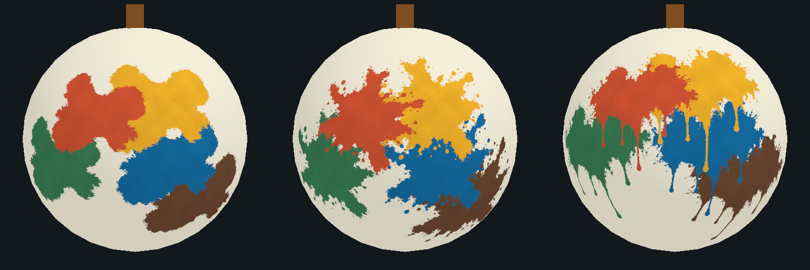

# Experiment #200 — 실제 박 물감 3종 비교

## 범위와 열기

실제 저장된 `Assets/Lab/Resources/GourdPaint/WhiteGourd.prefab`과 기존 `LabGourdPaint.shader`를 사용해 **넓은 얼룩형(Broad)·튀긴 물감형(Splatter)·흐르는 물감형(Flow)**을 비교하는 Editor 실험이다. Unity **6000.6.5f1 / URP17.6.0**, 기준 main `a3cf6f3e`, 브랜치 `experiment/#200-gourd-paint-style-comparison`에서 작성했다.

1. 이 브랜치를 Unity로 연다.
2. **C6 Lab → Experiments → Paint Style Comparison**을 선택한다.
3. 왼쪽 Broad, 가운데 Splatter, 오른쪽 Flow를 비교한다.
4. **Stage**로 Single(한 얼룩)·Multicolor(다색)·Complete(전체 도색 fixture)를 선택한다.
5. 공통 **Yaw**·**Zoom**을 움직여 같은 시점에서 세 모델을 확인한다. **Internal grain**은 기존 내부 질감의 표시를 함께 켜고 끈다.
6. **Reset View**는 시점을 초기화한다. **Export PNG…**에서 출력 파일을 직접 선택하면 현재 세 렌더를 나란히 저장한다.

배경색·카메라·박 메시·색·seed·표면 도색량은 공통이다. 그림을 합성해 박처럼 보이게 한 시안이 아니라 실제 메시/기존 셰이더를 카메라로 렌더한다. 매번 복사한 재질·전용 프리뷰 Scene·텍스처를 사용하며 기존 열려 있는 Scene을 저장하거나 변경하지 않는다. 창을 닫을 때 생성 자원을 해제한다. Play Mode나 실기기 앱의 DEV 기능은 이번 실험의 사용 경로가 아니다.

## 실제 메시 비교 결과

왼쪽부터 Broad / Splatter / Flow. 같은18% 면적과 사용자 팔레트5색을 사용한 실제 Editor 렌더다.

## 공통 비교 조건

| 항목 | 값·의미 |
| --- | --- |
| 원본 마스크 | 3종1254×1254 RGB PNG. 검정 바깥/밝은 물감 발자국. 생성 지시/근거는 에셋 폴더의 `GENERATION.md` |
| 비교 지도 | 1024×512. 세로는 구면 높이의 등간격으로 같은 면적의 표면 셀을 구성 |
| 렌더 | 스타일별512×512, 비교1536×512 |
| Seed | 200. 같은 초기 위치·기준색·변형 seed 사용 |
| Single | 전체 셀의6% 내림 = 31,457 / 524,288셀 |
| Multicolor | 다섯 위치의 합18% 내림 = 94,371 / 524,288셀 |
| Complete | 524,288 / 524,288셀. 기존 색을 남기고 빈 곳을 가까운 기준 타격색으로 채운 **명시적인 완료 미리보기 fixture** |
| 마스크 처리 | 구면 접평면의 각거리로 투영. 밝기0.15 이상을 발자국으로 잡고 크기를 보정한 뒤 작은 경계 셀 차이만 조정하여 세 스타일의 실제 도색 셀 수를 맞춤 |
| 표시 | 도색 셀은 불투명, 바깥은 RGBA0. 비교 지도만 Bilinear로 표시. 기존 전투 Point 샘플링은 유지 |
| 농담 | 같은 색의 약한 밀도차0.92~1.0 및 별도 기존 Grain. 칠한 셀 내부를 흰 구멍으로 뚫지 않음 |

각 마스크는 기본 실루엣이 다르므로 같은 면적을 맞춘 뒤의 가로·세로 폭은 다를 수 있다. 작은 튄 점도 비교 지도에서는 실제 칠한 셀에 포함한다. 고립점이나 준비된 패턴을 게임의 연속 성장 규칙으로 새로 채택한 것은 아니다.

## 사용자 팔레트

후속 제공한 팔레트 이미지의 각 색 내부를 샘플링하고 포함된 색상 프로필을 sRGB로 변환한 기준값이다. 원본 이미지·개인 프로필 데이터는 저장소에 넣지 않는다. 원본 Figma의 숫자를 직접 조회한 값으로 주장하지 않는다.

| 색 | 기준 sRGB | RGB |
| --- | --- | --- |
| 주황 | `#D85736` | 216, 87, 54 |
| 노랑 | `#F8B72A` | 248, 183, 42 |
| 초록 | `#3D8258` | 61, 130, 88 |
| 파랑 | `#1471A7` | 20, 113, 167 |
| 갈색 | `#6F4A32` | 111, 74, 50 |

단일 원본은 `LabPaintStyleStudy.PaletteColor`의 작성용 sRGB 값이다. 비교 지도가 linear 데이터 텍스처이므로 지도에 쓰기 전에 linear로 변환해 이중 밝아짐을 방지한다. 실제 화면의 색은 기존 셰이더의 곡면 조명·질감·농담에 따라 밝기가 달라진다. 색 순서/위치는 세 스타일에 동일하며 기존 전투 구슬·속성색·Host 도색 팔레트는 변경하지 않는다.

## 게임과 구분할 것

- 새로운 코드가 기존 `LabPaintSurface`·Host 명중·성장 예산·100% 승리·네트워크 전송에 자동 연결되지 않는다. 원본 Lab Scene/Prefab/Shader/Config/패키지를 유지한다.
- 다색 비교는 서로 다른 고정 타격 위치를 사용하는 준비된 데이터다. 같은 지점을 반복 명중하는 게임 상황이나 실제 성장 타이밍의 결과가 아니다.
- 기존 도색을 덮지 않는다. 이 도구가 서로 다른 타격 위치에 색을 분포시켰다는 이유로 게임의 동심원 색띠/덧칠 규칙을 해결했다고 기록하지 않는다.
- Complete는 준비된 미리보기이며 실제 게임에서100% 성장·승리했다는 증거가 아니다.
- 스타일 결정 후 본 게임에 적용할 때 필요한 판정 지도와 표시 지도 일치·기기간 공유·반복 명중 색 배치는 후속 범위다. 이번 실험을 main에 자동 병합하지 않는다.

## 수정할 코드

| 위치 | 책임 |
| --- | --- |
| `Assets/Lab/Scripts/Experiments/PaintStyleComparison/LabPaintStudyMask.cs` | 입력 마스크 복사·밝기 변환·보간·바깥0 |
| `Assets/Lab/Scripts/Experiments/PaintStyleComparison/LabPaintStyleStudy.cs` | 고정 비교 위치/팔레트·구면 투영·도색량 보정·완료 fixture |
| `Assets/Editor/PaintStyleComparison/LabPaintStyleComparisonWindow.cs`·UXML·USS | 비교 창·조작·그림 표시·지정 위치 PNG 출력 |
| `Assets/Editor/PaintStyleComparison/LabPaintStudyRenderer.cs` | 실제 프리팹 복제·기존 셰이더·전용 카메라·자원 정리 |
| `Assets/Editor/PaintStyleComparison/LabPaintStyleComparisonValidation.cs` | 3스타일×3단계의 명시적 로컬 렌더 출력·Scene 상태 확인·메타데이터 |
| `Assets/Editor/PaintStyleComparison/PaintStyleMaskImporter.cs` | 이 마스크 폴더만 linear/readable/무압축/no mipmap/NPOT 유지 |
| `Assets/Lab/Tests/EditMode/LabPaintStyleStudyTests.cs` | 면적·입력·결정성·팔레트·실제 에셋 검사 |

단계가 바뀔 때만 CPU 지도를 새로 만들며 회전/확대/질감 변경은 캐시된 지도와 텍스처를 사용한다. 이 최적화를 실기기 성능 측정 결과로 해석하지 않는다. 실행 여부는 `docs/VALIDATION.md`의 #200 기록에서 확인한다.
