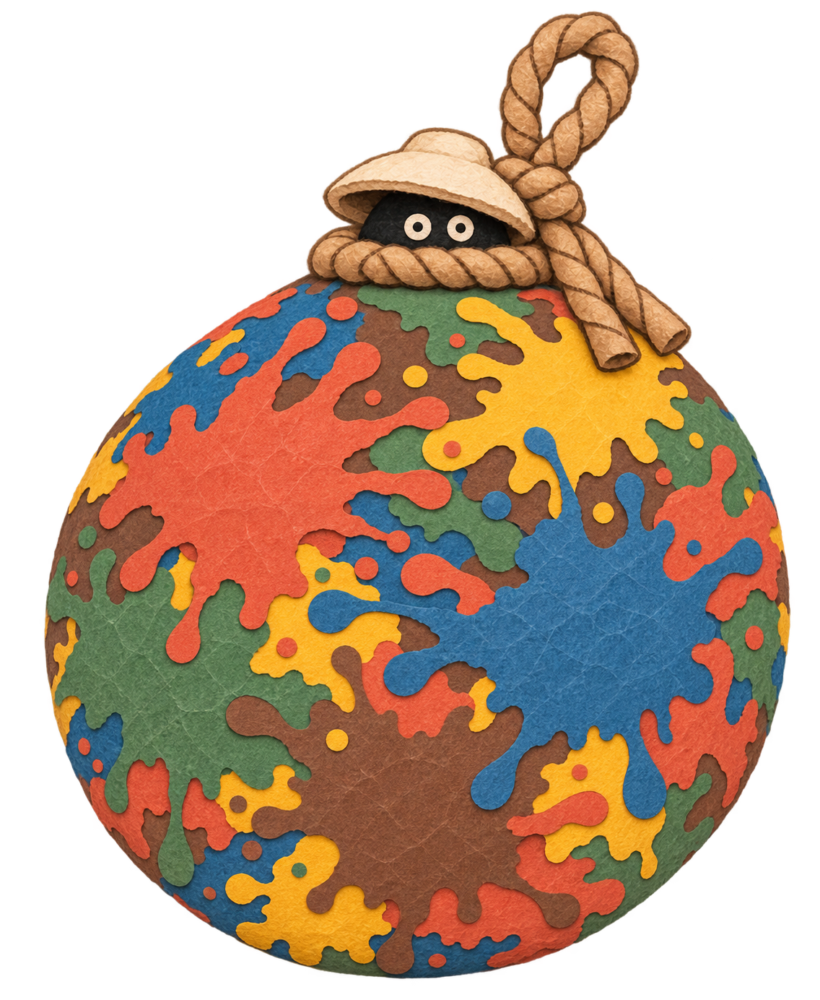

# 불투명 얼룩 스티커 채색

> 현재 기본 표현은 [#506 클레이 스티커](CLAY_STICKER_PAINT.md)다. 아래는 이전 종이/외형 비교 이력이며 그 구현·검증 범위로 읽는다.

2026-11-04 · #466 · `feat/#466-watercolor-brush-stamps`

사용자가 승인한 표현은 **둥근 돌출부와 튀김점이 있는 불투명한 한지 얼룩을 겹쳐 붙이는 모습**이다. 이전 수채·경계 투명화·유화 비교는 이력으로 보존한다. 이 문서는 실제 연결과 변경 지점을 설명하며, 실행 결과는 [VALIDATION](VALIDATION.md)의 해당 날짜 기록을 따른다.

위 이미지는 생성 시안이다. 기존 Unity 박 모델과 동일하다는 뜻은 아니다. 이번 구현은 기존 모델·Scene·카메라 배치를 유지하고 채색 표현을 변경한다.

## 실행과 조정

일반 협동의 저장 기본값은 `Assets/Lab/Resources/GourdPaint/WatercolorStampProfile.asset`의 `settings.mode = PaperSticker`다. 파일명은 기존 연결을 보존한다. Inspector에서 다음 값을 조정한 뒤 **새 라운드**를 시작한다.

| 항목 | 저장 기본값 | 역할 |
| --- | --- | --- |
| mode | PaperSticker | 불투명 스티커. Watercolor는 이전 비교 경로 |
| paperSticker.grainStrength | 0.24 | 불투명 색면의 종이결 농담 |
| paperSticker.grainScale | 2 | 지도에 고정된 미세 종이결 반복 |
| paperSticker.edgeStrength | 0.08 | 겹쳐 붙은 최상층의 얇은 경계 음영 |
| revealSeconds | 0 | 즉시 불투명 적용. 스티커에서는 수채식 교차 페이드를 사용하지 않음 |

색 원본은 기존 `LabPaintPalette`의 화 `#D85736`, 수 `#1471A7`, 목 `#3D8258`, 금 `#F8B72A`, 토 `#6F4A32`다. 분홍·보라 비교 팔레트는 적용하지 않는다. 세부 종이결은 RGB의 밝기만 바꾸며, 아래 색을 비추거나 실제 Alpha를 낮추지 않는다. 가장 바깥 화면 윤곽에는 계단을 줄이는 래스터 안티앨리어싱이 있다.

기존 수채의 density·overlap 등 저장값은 보존한다. 스티커의 불투명도는 이 값으로 낮아지지 않는다. 실행 중 프로필을 고쳐도 이미 시작한 라운드의 복사본은 바뀌지 않는다.

## 외곽과 실제 영역

- `LabPaperStickerBaker`가 넓은 중심·비대칭의 두꺼운 돌출부·둥근 끝·분리된 튀김점을 가진 공통 마스크를 수치적으로 생성한다.
- `GourdPaint/PaperSticker/SplatterMask.png`는 CPU용 white RGB+Alpha, `SplatterData.png`는 GPU용 R/A=같은 커버리지·G=종이결·B=안쪽 거리다. 양쪽은 전체 사각형 UV와 같은 `.15` 기준을 사용한다. GPU 샘플 위치를 CPU의 `u*(size-1)`에 맞춘다.
- Host/Solo의 `BeginPaintArt`가 빈 라운드에서 `LabPaintSurface.SetPaperStickerContour()`를 호출한다. 새 마스크는 Splatter에만 적용한다. 기존 Broad·Flow·Legacy와 그 캐시는 교체하지 않는다. Broad/Flow의 GPU 데이터는 원래 판정 마스크를 크기 변경 없이 옮긴다.
- 초기·반복 명중의 면적과 성장 예산은 기존 설정을 사용한다. **새 외곽 때문에 실제 칠해지는 셀 위치·색/P지도 해시는 의도적으로 달라진다.** 같은 지도라고 주장하지 않는다. 새 입력의 반복·분할 실행 결정성은 별도로 확인한다.
- 기존 성장 연결성·수직 우대·군집 선택·건조·승리 규칙은 유지한다. 임의 스티커를 미도색 영역에 장식으로 추가하지 않는다. 튀김점도 실제 지급 영역에 포함된다.

## 합성·성장·건조

`LabWatercolorStampRuntime`은 기존 이름과 저널 재생 구조를 유지하면서 모드별 셰이더와 데이터를 선택한다. 새 모드는 `PaperSticker/OpaquePaperStickerRuntime`을 사용한다.

1. `StrokeBegin`: 이미 칠한 영역 안에서 새 얼룩 실루엣이 겹치는 곳을 새 색으로 완전히 덮는다. 미도색 셀은 여기서 추가하지 않는다.
2. `PaintCells`: 실제 확정된 새 셀의 표현 픽셀을 Alpha 1로 채운다. 성장 셀이 최초 도장 반경 밖까지 나가도 버리지 않는다. 원본 도장의 UV는 게임 판정을 다시 제한하는 조건이 아니다.
3. `EraseCells`: 해당 영역의 누적 색층과 최상층 표현 ID를 모두 삭제한다. 재도색 때 과거 아래색이 부활하지 않는다.
4. 최종 출력: 기존 중간 수채 실루엣으로 다시 잘라내거나 서로 다른 스티커 RGB를 넓게 평균하지 않는다. 같은 스티커 ID의 공간 가중치를 합쳐 경계의 곡선을 복원하고 하나의 색면을 선택한다. 종이결과 얇은 경계는 RGB만 바꾼다.

경계용 고해상도 최상층 ID는 실제 P지도와 별개인 표현 데이터다. 이것으로 소유권·기여도·승패를 계산하지 않는다. 별도 3D 스티커 메시를 계속 생성하지 않는다.

스티커 ID용 작업 패스도 기존 프레임 작업 예산에 포함한다. 보조 ID 텍스처만 손실돼도 `Ready`를 취소하고 저널을 재생한다.

## 동기화·관람·PNG

- 실제 추가·삭제 셀과 순서를 보존하는 기존 `LabPaintArtJournal`·4KiB 페이지·Bulk 전송을 재사용한다. 과거 128개 시각 힌트만으로 그림을 재구성하지 않는다.
- 표현 모드·중첩 설정·데이터 해시를 라운드 버전에 고정한다. 새 표현은 `paper-stickers-v1`이며 접속 규약은 **5685 / Lab46 / Game30**이다. 공유 게임 설정은 257개 그대로다. 모든 참가자는 같은 새 빌드를 사용한다.
- 기존 판정 지도·압축·행동 요청 형식·소유권 결정은 유지한다. 화면의 스티커 색이나 최상층 ID를 판정 데이터로 역산하지 않는다.
- `LabGourdPaint.VisualPaintTexture`와 전체 표현 블록을 전투·관람·PNG가 공유한다. PNG 클론은 기존 전체 PropertyBlock 복사를 사용한다.
- 전체 기록 적용과 GPU 완료는 구분한다. GPU 자원 재생성 후에도 같은 기록에서 같은 결과를 복원한다.

## 베이크와 실제 확인

- 베이크: `C6 Lab > Experiments > Bake Opaque Paper Sticker`.
- 확인 이미지: `C6 Lab > Experiments > Paper Sticker Validation`에서 Assets 밖 폴더 선택.
- 출력: 최초 명중·재타격3회 비교, 실제 시간 성장을 거친 5색 100% 완성 6방향, GPU 지도, production PNG, 검증 JSON.
- 이번 확인은 이전의 ‘최초 자국만 계속 찍은 완성 시제품’을 성장 검증으로 사용하지 않는다. 실제 `RegisterHit`와 `Advance` 기록을 쓴다.
- `LabPaperStickerBuildValidation`은 선택된 새 모드에서 데이터와 해시를 읽기 전용으로 검사한다. 빌드가 원본이나 베이크 데이터를 자동으로 덮어쓰지 않는다.

기존 수채 원본·베이크·V3/TextureStudy 실험 자료는 보존한다. 저장 Scene·Prefab 배치는 이번 변경 대상이 아니다. 실제 iOS·LAN·핫스팟 플레이와 성능 측정의 수행 여부는 자동 검사·Editor 렌더와 구분해 기록한다.

## 별도 곡면 부착 비교 (2026-11-04)

본문의 누적 지도 방식과 구분되는 [곡면 스티커 시제품](SURFACE_STICKER_PROTOTYPE.md)을 추가했다. 이는 Editor-only 외형 비교이며 현재 게임 기본 표현을 교체하지 않는다. 에셋 원형과 실제 지급 셀 제한형의 차이를 확인하고, 대응 방식을 승인받은 후 실시간 연결을 진행한다.
