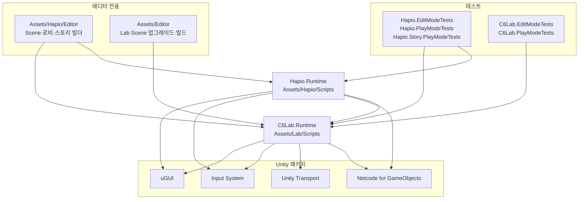
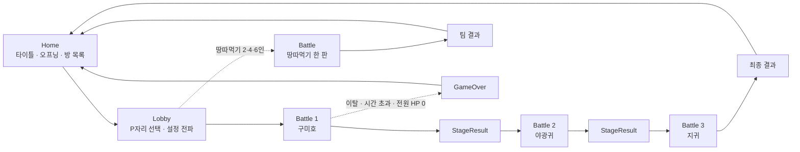
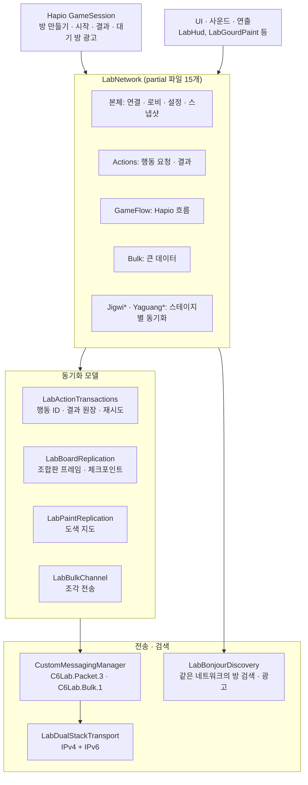

# 프로젝트 구조

작성일: 2026-11-02. 실제 게임인 **Hapio**가 게임 규칙·물리·통신 엔진인 **Lab** 위에 올라가 있는 구조다. 파일 수와 줄 수는 작성 시점의 대략값이며, 접속 규약·공유 설정 개수의 현재값은 [AGENTS](../AGENTS.md)의 최신 호환 기준을 따른다.

## 저장소 최상위

```text
2026-C6-M10-MUSA/
├── Assets/              게임의 모든 코드·에셋
├── docs/                개발 문서 · 검증 기록 · 이미지 · 에셋 생성 프롬프트
├── tools/               이펙트 텍스처 생성 Python 스크립트
├── Packages/            manifest.json · packages-lock.json
├── ProjectSettings/     Unity 프로젝트 설정
├── .github/             이슈 템플릿 · PR 템플릿
├── AGENTS.md            작업 규칙 · 버전 규약 이력
└── README.md            게임 소개

git에서 제외: Builds/ · Library/ · Temp/ · Logs/ · UserSettings/ · *.csproj · *.slnx
(루트의 C6.Prototype.*.csproj는 과거 프로토타입의 IDE 파일 잔재로 현재 빌드와 무관하다)
```

## 어셈블리 의존 관계

화살표는 "참조한다"는 뜻이다. Hapio는 Lab을 참조하지만 Lab은 Hapio를 모른다. `Assets/Editor`와 `Assets/Hapio/Editor`는 asmdef가 없어 Unity 기본 에디터 어셈블리(Assembly-CSharp-Editor)로 묶인다.



## 실행 흐름 (Scene)

게임 진입점은 `Assets/Hapio/Scenes/Home.unity`다. 1~3스테이지는 같은 Battle Scene을 다시 쓴다. `Assets/Lab/Scenes/Lab.unity`는 단판 실험·회귀 확인용이다. 자세한 흐름은 [게임 흐름](GAME_FLOW.md)을 따른다.



## 통신 계층

NGO의 RPC나 NetworkVariable 대신 `CustomMessagingManager`의 이름 붙은 메시지 두 개에 JSON 패킷을 실어 보낸다. 조합판 물리는 각 기기가, 소유권·명중·도색 확정은 Host가 맡는다. 자세한 구조는 [개인 조합판 권한 구조](LOCAL_BOARD_AUTHORITY.md)를 따른다.



## Assets 상세

### `Assets/Hapio` — 실제 게임 (namespace `Hapio`)

```text
Hapio/
├── Scripts/
│   ├── Core/     15개  GameSession(.Start/.Finish/.Results/.RoomCreation/.TerritoryStats),
│   │                   GameRunFlow, GameFlowSnapshot, GameFlowState, GamePendingRoomRegistry,
│   │                   GamePaintFinishBarrier, GameStageCatalog/Definition/Settings, GameScenePaths
│   ├── UI/       11개  GameLobbyView, GameLobbySwipe, GameBattleBindings, GameScreen,
│   │                   GameStageResultView, GameTerritoryResult, GameStartOverlay,
│   │                   GameYokaiPresentation, GameSafeArea, GamePreviewAspect, GamePreviewInput
│   └── Story/    12개  GameOpeningController, StoryPlayer, StorySequence, StoryCutDefinition 등
├── Scenes/             Home · Lobby · Battle · StageResult · GameOver
├── Resources/Hapio/    GameSession.prefab, GameStartOverlay.prefab, StageCatalog.asset,
│                       Stages/Stage01_gumiho · Stage02_yaguang · Stage03_jigwi
├── Story/Opening/      ApprovedScript.json, Cuts/ 25컷, Views/ 25개
├── Art/                Story(머티리얼·타이틀), UI(GameLobby.prefab · StageResult · Team)
├── Editor/       15개  GameBuild, GameSceneBuilder, GameStageAssets, 로비·결과 Scene 업그레이드,
│                       Story*Builder
└── Tests/              EditMode 15 · PlayMode 8 · PlayMode/Story 4
```

### `Assets/Lab` — 규칙·물리·통신 엔진 (namespace `C6Lab`)

```text
Lab/
├── Scripts/
│   ├── Core/        36개  LabModel(.Team/.Jigwi*/.Yaguang*/.FeverTime/.RawGeneration/.StageYokai …),
│   │                      LabContracts, LabConfig, LabTeams, LabPlayerSlots, LabPaintSurface(×8),
│   │                      LabPaintVisualStamp, LabResultStats, LabJigwiAB/StageContracts
│   ├── Session/     31개  통신 전부 — LabNetwork(partial 15개), LabBoardReplication,
│   │                      LabPaintReplication, LabActionTransactions, LabBulkChannel,
│   │                      LabDualStackTransport, LabBonjourDiscovery, LabPendingRoom, LabRoomPresence
│   ├── Orb/         21개  LabOrbBoard, LabOrbView, LabOrbAppearance, 구슬 효과(폭탄·불·무지개·벽)
│   ├── Throw/       22개  LabThrowMath, LabProjectile, LabTarget, LabGourdPaint, LabGourdYokai,
│   │                      비행 트레일, 수채·고해상도 도색 런타임
│   ├── UI/          45개  LabHud, LabSceneController, LabDeveloperMode, LabLobbyView, LabSeatCamera,
│   │                      팀·피버·지귀·야광귀 HUD, GourdViewer/(결과 박 관람)
│   ├── Audio/       14개  LabBattleBgm, LabHaptics, 생성·조합·투척·요괴별 효과음
│   ├── Environment/  2개
│   └── Experiments/  3개  고해상도 도색 · 도색 스타일 비교
├── Resources/             LabConfig.asset(수치 원본), Audio/(BGM·효과음), Jigwi, Bomb,
│                          GourdPaint, OrbBoard, Sabotage, Stamina, Yaguang 등
├── Art/                   BottomHud, Environment(나비·구름), Lobby(한지 로비 원본), Orbs,
│                          GourdYokai(공통 검은 요괴 모델·애니메이션), ElementTrails, UI
├── Scenes/                Lab.unity
└── Tests/                 EditMode 96 · PlayMode 74
```

### 그 밖의 `Assets`

```text
Assets/
├── Editor/                     Lab용 에디터 도구 (Scene 업그레이드 · 빌드 · 비교 창)
│   ├── Bootstrap/   30개       LabBuild, LabSceneBuilder, LabIosPostprocess,
│   │                           LabMobileBuildValidation, Lab*Upgrade(Scene 업그레이드) 등
│   └── BackgroundStudio · ElementTrailComparison · GourdExport ·
│       HighResolutionPaint · PaintStyleComparison · WatercolorPaint   표현 비교 창·박 PNG 내보내기
├── Plugins/iOS/C6LabHaptics.mm iOS 햅틱 네이티브 코드
├── Settings/                   URP 렌더러·품질 설정
├── _Project/HapioMVP/          비어 있음
└── DefaultNetworkPrefabs.asset NGO 기본 네트워크 프리팹 목록
```

## docs

개발 문서 목차는 [docs/README](README.md)다. 실제 수행한 검증은 [VALIDATION](VALIDATION.md)에만 기록한다.
