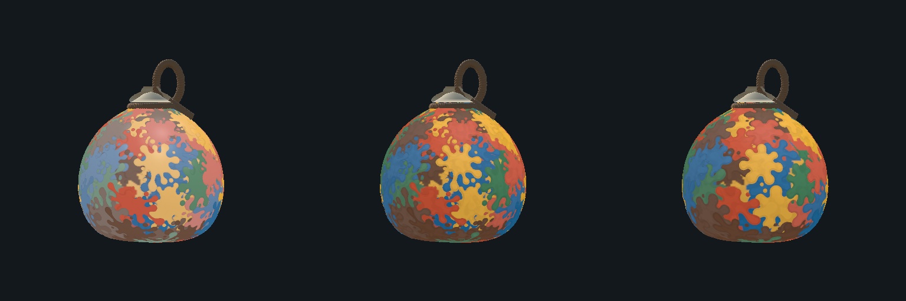
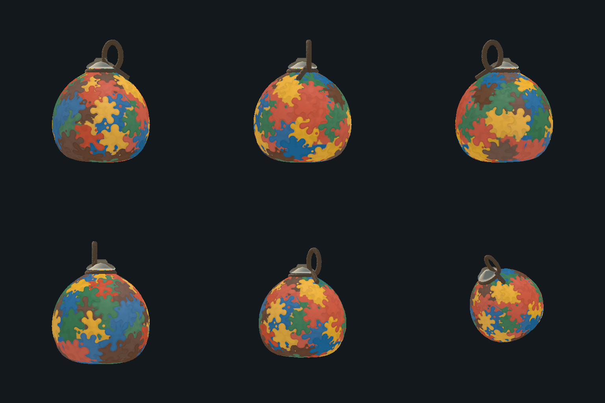
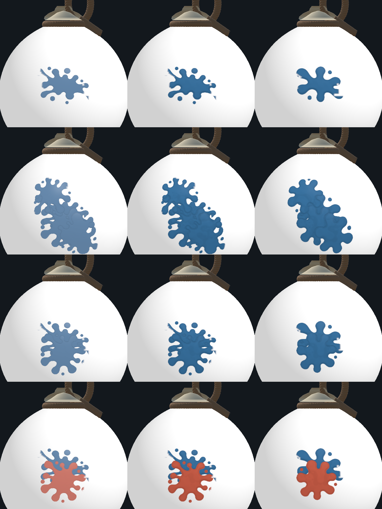
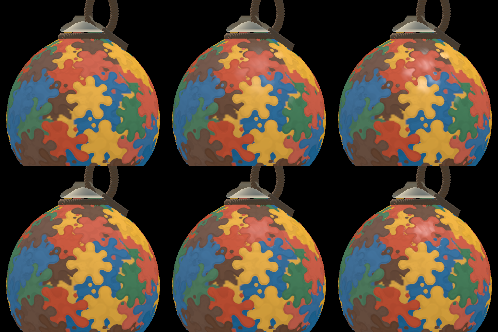
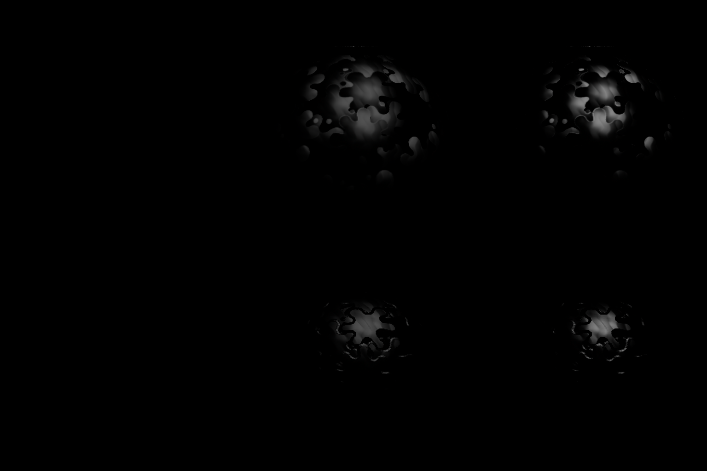
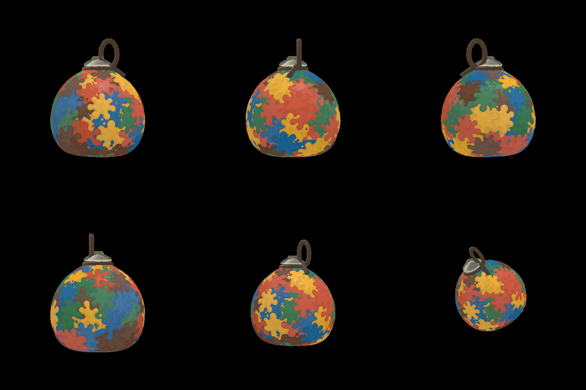

# 둥근 클레이 스티커 비교 실험 (#527)

일반 게임 기본 표현을 바꾸기 전에, 같은 완성 박에서 윤곽과 재질의 영향을 분리해 비교하는 Mac 전용 실험이다. #524의 개별 스티커 광택은 `b3421668`에 보존되어 있다.

아래의 기존 3종 설명·이미지·검사 결과는 `79c64789`에 보존한 V3 단계 기록이다. 최신 네 번째 프리셋의 실행 방법은 [스티커별 코팅 V4 실험](#스티커별-코팅-v4-실험)을 따른다. 두 실험은 별도 Scene과 준비·빌드 메뉴를 사용한다.

## 비교 프리셋

| 순서 | 표현 | 두께 | 광택 | 색 농도 |
|---|---|---:|---:|---|
| 1 | 기존 #524 | 0.01 | 0.35 | 기존 0.65~1 |
| 2 | 기존 윤곽 + 개선 재질 | 0.014 | 0.08 | 0.9~1 |
| 3 | 새 둥근 윤곽 + 개선 재질 | 0.014 | 0.08 | 0.9~1 |

개선 프리셋의 접촉 음영 기본값은 0.15, 미세 질감은 1(최대 약 3도 법선 변화)이다. 512px 베이크의 둥근 높이 테두리는 20px 기준이다. 이 값은 참고 이미지에서 측정한 물성이 아니라 비교 시작값이다.

프리셋 전환은 미리 구운 지도와 재질을 바꾸며 기록이나 구슬을 다시 생성하지 않는다. 두께·광택·접촉 음영·질감은 즉시 조정된다. 색 농도와 윤곽을 바꾸려면 명시적으로 샘플을 다시 준비해야 한다. 실험값은 게임 설정에 자동 저장되지 않는다.

## 원본과 데이터

- `Assets/Experiments/ClayPreview/Rounded/Sources`에는 내장 imagegen으로 생성한 투명 배경 원본 3종을 보존한다. 최초 생성의 회색 농담·외곽 잔재를 그대로 도색 색으로 쓰지 않는다.
- Unity 베이크에서 Alpha로 형태를 추출하고 순백색 마스크와 512×512 데이터로 정제한다. 도색 색상은 기존 오행 팔레트에서 가져온다.
- 생성 프롬프트: 넓은형은 큰 둥근 굴곡 7~9개, 길쭉한형은 대각선 방향 굴곡 5~7개, 군집형은 둥근 세 덩어리가 합쳐진 형태. 각 형태에 소수의 둥근 물방울, 투명 여백, 순백색 채움. 글씨·조명·그림자·종이 배경·가느다란 가지를 제외한다. 생성 후 순백색과 매끈한 외곽을 요청한 보정도 수행했다.
- 기존 CPU 판정 브러시와 원본 v2 에셋은 보존한다. 새 Alpha와 높이 R은 의도적으로 달라진다.
- 높이 지도는 R=두께, GB=공통 표면 기준의 코팅 방향, A=실제 스티커 커버리지 계약을 유지한다. 별도 스티커 메시나 높이용 추가 RT는 만들지 않는다.
- 새 실험 재질은 `clay-stickers-v3`로 구분한다. 게임 라운드의 v2 기록은 수정하지 않고 명시적 실험 의존성 주입으로 재생한다. 네트워크 규약·공유 설정은 바꾸지 않는다.

## 표현과 한계

넓고 둥근 높이 경사, 실제 스티커 높이 차이의 접촉 음영, 박의 로컬 좌표에 고정된 얕은 표면 주름을 적용한다. 완료용 바탕층은 스티커의 음영을 받을 수 있지만 자체 광택을 만들지 않는다. 두께 0에서는 높이에 의존하는 음영과 질감 변화가 사라진다.

완성 도안은 기존 고정 seed와 실제 명중 기록을 사용한다. 오래된 자국을 삭제하거나 위치를 미술적으로 재배치하지 않는다. 따라서 참고 이미지의 큰 얼룩 배치까지 동일하게 재현했다는 의미는 아니다. 진행 중에는 기존 셀 지원 범위가 새 윤곽을 자를 수 있다. 이 현상을 숨기려고 실제 도색 면적이나 판정을 확장하지 않는다.

## 확인 범위

검증 결과와 실제 사용 메뉴·출력 경로는 작업 완료 시 아래에 기록한다. iOS와 실기기 네트워크는 이번 실험 범위에서 미실행이다.

## 사용 방법

1. 저장된 Scene을 열고 Play 모드를 종료한다. 미저장 Scene이 있으면 이 도구는 저장하거나 덮어쓰지 않고 안내한다.
2. Unity 메뉴 `C6 Lab > Experiments > Rounded Clay > Prepare Imported Comparison`을 선택한다. 생성 원본을 바꾼 경우에만 다시 준비한다.
3. `C6 Lab > Experiments > Rounded Clay > Build Mac Comparison App`을 선택한다. 빌드는 준비된 파일을 검사하며 자동 재도색하지 않는다.
4. 표시되는 `Builds/Experiments/ClayPreview/<생성시각>/Hapio-Clay-Experiment.app`을 연다.
5. 우측의 세 프리셋으로 같은 박을 비교한다. 처음에는 3번 둥근 윤곽이 열린다. 프리셋을 바꾸면 해당 기본값으로 돌아간다.
6. Thickness·Gloss·Contact Shade·Fine Detail을 조절한다. 원본 프리셋에서는 새 음영·질감 조절이 비활성화된다. 아래 항목은 패널을 스크롤해 볼 수 있다.
7. 박 부분 드래그는 회전, 휠은 확대/축소다. 6방향 버튼과 Reset preset으로 시점을 확인한다. Quit으로 앱을 종료한다.

앱은 자동 회전 없이 30fps를 목표로 하며 비활성화 시 렌더를 멈춘다. 방 생성·연결·직접 도색이 필요 없다.

## 실제 렌더 비교

왼쪽부터 원본 #524, 기존 윤곽+개선 재질, 새 둥근 윤곽+개선 재질이다. 각 프리셋의 시작값을 사용한 비교이며 순수하게 윤곽 하나만 달라지는 비교는 아니다. 가운데/오른쪽은 동일 재질 설정이다.

위쪽부터 정면·우측·후면 / 좌측·사선·위쪽 사선이다.

위쪽부터 최초 명중 / 재타격 3회 / 같은 색 겹침 / 다른 색 겹침이다. 이 시트는 가장자리와 겹침을 확인하는 확대 크롭이다.

## V3 단계 검증 결과

EditMode1958/1958, 관련 PlayMode28/28, GPU31/31을 통과했다. Mac 앱을 빌드하고 세 프리셋과 독립 조절을 확인했다. 상세 환경·시간·측정 한계는 [검증 기록](VALIDATION.md)의 #527 항목을 참조한다.

기존 고정 도안과 실제 면적을 보존한 결과, 일부 완료 바탕에는 셀 색 경계가 남아 있다. 참고 이미지의 큰 얼룩 배치와 같은 미술적 완성도를 보장하는 결과는 아니다. 원본·재질·윤곽의 차이를 직접 평가하기 위한 실험이다.

## 스티커별 코팅 V4 실험

V3의 둥근 윤곽·색 농도·두께 지도를 유지하면서, 반사 방향을 박 몸체가 아닌 각 스티커의 기록된 중심·방향·둥근 테두리에서 계산하는 네 번째 프리셋이다. 일반 협동 게임에 기본 적용한 버전이 아니라, 같은 도안에서 코팅 표현을 비교하는 Mac 실험이다.

### 보존 범위와 기본값

- 기존 `OriginalV2`·`OriginalV3`·`RoundedV3`의 `Color.png`·`Height.exr`·`SampleInfo.json`은 다시 굽지 않는다. 기존 세 프리셋 Scene도 보존한다. 준비 도구는 이 파일들의 내용과 수정 시각을 대조한다.
- 새 자료는 `Assets/Experiments/ClayPreview/Rounded/CoatingV4`에 저장한다. 네 가지 프리셋은 같은 seed 123·67회 실제 명중 기록·판정 지도·기록 해시를 사용한다.
- V4는 둥근 V3와 같은 색 농도 0.9~1, 두께 0.014, 광택 0.08, 접촉 음영 0.15, 미세 질감 1로 시작한다. 다른 프리셋의 기존 기본값은 유지한다.
- 색 RGBA, 표시 변위 높이 R, 실제 스티커 커버리지 A는 둥근 V3와 같은 비트를 유지한다. 변경 대상은 코팅 반사용 GB 법선과 이를 해석하는 실험 재질이다. 실제 충돌 메시·명중·도색 면적·성장·건조·소유권·승패 규칙은 바꾸지 않는다.
- 모든 지도는 1024×512이며 색은 Linear PNG, 높이·법선·커버리지는 RGBA Half EXR다. 도장마다 별도 메시를 만들거나 법선용 RT를 추가하지 않는다.
- 높이 EXR는 iOS에도 RGBA Half·무압축 override를 둔다. iOS가 활성인 Editor에서 Default만 따르면 가져올 때 RGBM으로 바뀌어 A 커버리지가 사라진다(`CLAY_STICKER_PAINT.md`의 샘플과 빌드 관리 절).

### 준비·실행 방법

1. 저장된 Scene을 연 뒤 Play 모드를 종료한다. Untitled Scene이 열려 있거나 코팅 Scene에 미저장 변경이 있으면 먼저 안내하고 중단하며, 사용자의 Scene을 자동 저장하거나 버리지 않는다.
2. 메뉴 `C6 Lab > Experiments > Rounded Clay > Prepare Coating Comparison`을 선택한다. 기존 3종을 읽기 전용으로 검사한 뒤 V4만 준비한다. 기존 3종 자료가 없는 경우에는 앞의 V3 사용 방법으로 먼저 준비해야 하며, V4 도구가 대신 재생성하지 않는다.
3. 새 Scene은 `Assets/Experiments/ClayPreview/Rounded/Scenes/CoatingClayPreview.unity`다. 기존 `RoundedClayPreview.unity`는 여전히 3종 비교용으로 남는다.
4. 메뉴 `C6 Lab > Experiments > Rounded Clay > Build Coating Mac App`을 선택한다. 기존 `Build Mac Comparison App`은 3종 앱을 만드는 메뉴이므로 구분한다.
5. 이전 실험 앱을 닫고 방금 생성된 `Builds/Experiments/ClayPreview/<생성시각>/Hapio-Clay-Experiment.app`을 연다. 시작 프리셋은 네 번째 `Sticker-local coating`이다.
6. 세 번째와 네 번째를 전환해 같은 도안과 기본값을 비교한다. 두께·광택·접촉 음영·미세 질감 슬라이더, 드래그 회전·휠 확대, 6방향·Reset·Quit 조작은 기존과 같다. 프리셋 전환 시 해당 기본값으로 돌아가며 게임 DEV 설정에는 저장하지 않는다.

셰이더를 변경했으면 **Prepare Coating Comparison을 다시 실행한 뒤 빌드**한다. V4 메타데이터는 `StickerCoatingRuntime.shader`와 `StickerCoatingSurface.shader` 소스 파일의 SHA256을 각각 `compositorSourceHash`·`surfaceSourceHash`로 보관한다. 현재 소스와 다르거나 해시가 없는 오래된 자료는 빌드를 거부한다. 빌드가 자동 재베이크하지 않으며, 명시적인 준비가 끝나면 새 Scene의 메타데이터 해시 연결도 갱신한다.

### 데이터 규약과 코드 연결

| 항목 | V2·V3 | 새 V4 |
|---|---|---|
| 샘플 형식 | `clay-preview-sample-v2` / `clay-preview-sample-v3` | `clay-preview-sample-v4` |
| V4와 비교하는 표현 버전 | `clay-stickers-v3` | `clay-stickers-v4` |
| 높이 R | 변위용 높이 | V3와 동일 |
| GB | 커버리지로 미리 곱한 공통 표면 접선 기울기 | 커버리지로 미리 곱한 오브젝트 로컬 전체 법선의 Oct 인코딩 |
| A | 실제 스티커 커버리지 | V3와 동일; 완료용 바탕은 코팅 없음 |

도장 중심 기준 돔·베벨 기울기는 최대 25도이며 저장된 Half 자료에서는 양자화 오차가 생길 수 있다. 표면 미세 주름은 별도로 최대 약 3도다. 반사 집중도는 Gloss에 따라 32~128로 변하고 작은 화면에서는 방향 변화량으로 반사를 감쇠한다.

V4의 `heightChannels` 표기는 `R:physical-height;GB:oct-object-normal;A:actual-coverage`다. GB는 `A × Oct01(normalOS)`로 저장한다. A가 충분히 있을 때만 나누어 복원하고, 오브젝트 법선을 월드 법선으로 변환해 반사에 쓴다. 박의 구면 법선을 다시 더하지 않는다. 겹침에서는 Oct 좌표를 그대로 평균하지 않고 3D 법선을 혼합한 뒤 다시 인코딩한다. 빈 곳과 완료용 바탕은 스티커 반사를 만들지 않는다.

- 준비·고정 지도·Scene·빌드: `Assets/Editor/WatercolorPaint/ClaySticker/StickerCoatingExperiment.cs`
- 반사 법선 기록: `Assets/Experiments/ClayPreview/Runtime/Shaders/StickerCoatingRuntime.shader`
- 코팅 표시: `Assets/Experiments/ClayPreview/Runtime/Shaders/StickerCoatingSurface.shader` / `C6Lab/Experiments/StickerCoatingSurface`
- 앱 프리셋·버전·인코딩 검사: `Assets/Experiments/ClayPreview/Runtime/ClayPreviewController.cs`

생산용 라운드 저널은 기존 V2 형식 그대로다. 새 compositor는 명시적인 실험 생성자 인자로만 주입한다. 일반 게임의 기본 생성자·Resources·프로필·네트워크 버전·공유 설정·Scene 목록에는 V4를 연결하지 않는다.

### 비교 이미지 읽는 방법

다음 비교는 **위 행 V3 / 아래 행 V4**, **왼쪽부터 Gloss 0 / 0.35 / 1**, 두께 0.014·동일 카메라·조명·시점이다. 앱 기본 광택 0.08과는 다른 분석용 3단계 비교다. 최초 명중, 재타격 3회, 떨어진 두 스티커, 같은 색 겹침, 다른 색 겹침, 5색 완성을 각각 출력한다.

완성 표면 확대는 줌 1.3의 고정 크롭이다. 이 이미지에서 끈이나 바닥이 잘리는 것은 의도한 확대이며, 전체 형태는 줌 0.68의 기존 전체 보기와 6방향 결과로 확인한다.

반사 비교는 양쪽 모두 Linear Half RT를 RGBAFloat로 읽은 뒤 `전체 색(Gloss G) − 전체 색(Gloss 0)`을 계산한다. 음수는 0으로 제한하고 양쪽에 같은 변환을 적용한다. 밝기 과장 배율은 사용하지 않는다. PNG 저장 직전에만 Linear RGB를 sRGB로 변환하며, 수치 검사는 Float 값으로 한다. 따라서 첫 열은 추가 반사 성분이 없는 검은 결과다. 이는 전체 재질을 검게 만드는 게임 표현이 아니다.

별도 `*-v4-debug-reflection.png`는 V4의 `_SpecularOnly=1` 출력과 해당 모드의 Gloss 0 출력을 차감한 검사 자료다. 원본 끈·뚜껑 등 코팅 외 재질이 차분에서 상쇄된다. 일반 비교 이미지와 내부 디버그 출력을 혼동하지 않는다.

다음은 V4·Gloss 0.35의 전체 보기다. 위쪽 정면·우측·후면 / 아래쪽 좌측·사선·위쪽 사선 순서다.

원시 비교 출력은 `Temp/sticker-coating-comparison` 아래의 `coating-*` PNG와 `sticker-coating-report.json`에 저장된다. 위 문서용 이미지는 해당 출력에서 골라 보관한다. 기존 V3 이미지와 파일명을 공유하지 않는다.

### V4 검증·측정 상태

V4 최종 실행은 전체 EditMode **1958/1958**, 관련 PlayMode **30/30**, GPU 계약 **45/45** 통과다. Mac 앱 빌드와 네 번째 기본값·3/4 프리셋 전환·Gloss0/1·우측 보기·휠 확대·Reset을 확인했다. 드래그 회전의 수동 결과는 자동 조작에서 확정하지 못했으며 장시간 반사 떨림과 미적 승인은 남아 있다. 앞의 PlayMode28·GPU31은 V3 이력이며 합산하지 않는다. 상세 환경과 결과는 [검증 기록](VALIDATION.md)의 V4 항목을 따른다.

추가 검사 대상은 색 RGBA·높이 R·커버리지 A의 정확한 일치, 같은 저널·면적·기록 해시, Oct 법선과 겹침·이음새 처리, 완료 바탕의 무반사, Gloss 0, 건조 시 모든 채널 제거, 129개 이후 기록 재생·높이 자원 복구, 기존 세 프리셋 파일 보존과 새 네 번째 전환이다. 검사 코드가 존재한다는 이유만으로 통과로 기록하지 않는다.

보고서의 재생 시간과 예열 후 5회 렌더/읽기 평균은 **멈춘 Editor에서 GPU 완료·읽기 대기를 포함한 CPU 경과시간**이다. RT 메모리 증분은 Unity Profiler가 보고한 생성 RT 크기의 전후 차이이고, 6개 RT의 픽셀 저장량은 별도 추정치다. 실제 GPU 프레임 시간·물리 GPU 상주 메모리·iOS 성능은 측정하지 않는다. 이전 V3 수치를 최신 V4 측정값으로 재사용하지 않는다.

### 실험 앱의 LIGHT 조절

우측 패널을 아래로 스크롤하면 `LIGHT` 항목이 나온다. 박을 회전하지 않고 빛의 방향을 옮겨 스티커의 테두리·반사를 비교할 수 있다.

| 슬라이더 | 조절 범위 | 초기값 |
|---|---:|---:|
| `LEFT / RIGHT` — 좌우 방위각 | −180°~180° | −41.4914° |
| `UP / DOWN` — 위아래 고도각 | −80°~80° | 70.0484° |
| `LIGHT INTENSITY` — 강도 | 0~2 | 1 |

초기 방향은 기존 표현용 스튜디오의 유효 조명 방향에 맞춘 값이다. 강도 0은 직접광과 코팅 반사를 끄며 환경광·기본 음영은 남는다. 패널의 각도 표시는 정수로 반올림된다. `Reset light`는 조명만 되돌리고 시점·두께·광택·접촉 음영·질감은 유지한다. 프리셋을 전환해도 조명은 유지하므로 같은 빛 아래에서 비교할 수 있다. `Reset preset`은 시점·재질·조명을 함께 초기화한다.

컨트롤러는 복제한 전용 재질에만 `_ClayPreviewLighting=1`과 월드 방향·강도를 설정하며, 실험 전용 Directional Light도 같은 방향·강도로 움직인다. 세 surface 셰이더의 기본값은 모두 `_ClayPreviewLighting=0`이다. 일반 게임의 재질과 조명 설정을 켜거나 저장하는 기능이 아니다.

**조명 표현만 변경했다면** `C6 Lab > Experiments > Rounded Clay > Refresh Preview Lighting Metadata`를 선택한 뒤 `Build Coating Mac App`을 사용한다. 기존 지도·compositor·메타데이터 연결을 검사하고 V4의 surface 소스 해시와 해당 Scene의 메타데이터 연결만 명시적으로 갱신한다. 지도 생성용 compositor가 바뀌었거나 브러시·색 농도·저장 규약을 바꿨다면 여전히 `Prepare Coating Comparison`이 필요하다. 빌드는 엄격한 읽기 전용 검사를 유지하며 자동 갱신·재도색하지 않는다.

이 메타데이터 갱신은 지도 재생·비교 이미지 재생성·성능 측정을 수행하지 않는다. 기존 생성 시각과 측정값을 새 조명 기능의 결과로 해석하지 않는다. 조명 조절 추가분은 전체 EditMode1958/1958, 관련 PlayMode16/16, 기존 GPU31/31 및 변경 전 셰이더와의 기본 경로 비교3/3을 통과했다. 패널 겹침 보완 후 미리보기 PlayMode14건을 다시 실행해 통과했고 새 Mac 앱도 빌드했다. 기존 V3/V4의 재생·성능 측정을 이번에 반복한 것으로 합산하지 않는다. 상세 실행 범위는 VALIDATION의 2026-11-06 조명 항목을 따른다.

### 실험 앱의 PALETTE · RGB·HEX 조절

팔레트 편집을 포함한 앱은 저장된 코팅 비교 Scene에서 Play를 종료한 뒤 `C6 Lab > Experiments > Rounded Clay > Prepare Palette Preview`를 한 번 실행하고, `Build Coating Mac App`으로 만든다. 이 준비는 같은 seed 123·67회 명중 기록을 별도 `Palette/FrozenJournal.bytes`와 `PaletteReplayData.asset`으로 보관한다. 기존 네 프리셋의 PNG·EXR·샘플 JSON과 이전 Scene을 다시 굽지 않는다. 빌드는 연결된 기록·자료·브러시·compositor의 핀을 읽기 전용으로 검사하며, 누락되거나 달라진 자료를 자동 생성하지 않는다. 명시적으로 다시 준비한 뒤 빌드해야 한다.

앱의 우측 패널을 스크롤해 `PALETTE`를 연다. 화·수·목·금·토마다 색 견본, HEX 입력칸과 R·G·B 입력칸이 있다. 총 15개의 RGB 정수 입력칸 또는 각 색의 6자리 HEX로 편집할 수 있으며, 둘 중 하나를 바꾸면 다른 입력값과 색 견본도 함께 갱신된다.

| 원래 속성 | R | G | B | HEX |
|---|---:|---:|---:|---|
| 화 / FIRE | 216 | 87 | 54 | `#D85736` |
| 수 / WATER | 20 | 113 | 167 | `#1471A7` |
| 목 / WOOD | 61 | 130 | 88 | `#3D8258` |
| 금 / METAL | 248 | 183 | 42 | `#F8B72A` |
| 토 / EARTH | 111 | 74 | 50 | `#6F4A32` |

RGB 또는 HEX를 입력하고 **Enter를 누르거나 Tab·다른 항목 클릭으로 입력칸을 벗어나면** 적용된다. 입력 중 매 글자마다 재생하지 않는 지연 확정 방식(`isDelayed`)이며, RGB 확정값은 0~255로 제한한다. HEX는 `RRGGBB` 형식의 6자리 16진수만 허용하며, 앞의 `#`는 생략할 수 있고 대소문자는 구분하지 않는다. 예를 들어 `d85736`과 `#D85736`은 같은 색이다. 유효한 입력은 대문자 6자리로 정리한다. 자릿수가 다르거나 16진수가 아닌 문자가 있으면 오류 안내를 표시하고 기존 색을 유지한다. 3자리 축약형이나 Alpha를 포함한 8자리 값은 적용하지 않는다.

위 값은 sRGB 기준 원색이다. 재생할 때 Linear로 변환하고 기존 명중별 색 농도·흰색 배합·겹침 순서를 적용하므로, 박의 최종 픽셀은 견본색과 항상 같지 않다. 조명·광택·접촉 음영도 계속 적용된다. HEX 입력 추가는 UI 변경이므로 이미 준비된 팔레트 기록·지도를 다시 굽을 필요가 없다.

다섯 색이 모두 원래 값이면 기존 고정 지도를 직접 표시해 비교 기준을 보존한다. 색을 바꾸면 동일한 기록을 프레임마다 제한된 작업량으로 재생한다. 현재 고정 기록은 약 34번의 분할 갱신이 필요하며, 소요 시간은 기기와 프레임 속도에 따라 달라진다. `Updating colors…` 동안에는 이전에 완성된 그림을 유지하고, 마지막 GPU 작업까지 완료된 그림만 교체한다. 재생 중 다시 수정하면 최신 입력으로 다시 준비하며 부분 도색 이미지를 완성 결과처럼 표시하지 않는다.

편집한 팔레트는 네 프리셋에 공통으로 유지되어 같은 색 조합으로 재질·윤곽을 비교할 수 있다. `Reset palette`는 다섯 색만 위 표의 원래 값으로 되돌리고, 시점·재질·조명은 유지한다. `Reset light`는 팔레트를 유지한다. `Reset preset`은 팔레트·시점·재질·조명을 함께 기본값으로 되돌린다.

이 기능은 **Mac 비교 앱 안에서만 쓰는 임시 표현 설정**이다. 원래 속성의 위치·도장 순서·높이·면적·소유권·게임 판정은 바꾸지 않으며, 게임 팔레트·DEV 설정·원본 에셋에 저장하지 않는다. 앱을 다시 실행하면 원래 다섯 색으로 시작한다. 준비 검사의 통과와 실제 앱에서의 입력·외형 수동 확인은 구분하며, 실행 결과는 [검증 기록](VALIDATION.md)의 해당 범위를 따른다.

## #543 스티커 질감·배경 파일을 직접 불러오는 Mac 실험

실행·파일 준비·샘플3종·슬라이더·배경·팔레트·광원·초기화·빌드·문제 해결은 별도 [상세 사용법](CLAY_PREVIEW_IMAGE_USER_GUIDE.md)에 모았다. 실제 수행 결과와 미실행 범위는 [검증 기록](VALIDATION.md)의2026-11-07 #543 절을 따른다.

이 기능은 `ImageSamples/Scenes/ImageClayPreview.unity`만 켠다. 기존 네 프리셋·고정 도안·일반 게임 기본값은 유지하며, 파일 이미지로 도색 지도·윤곽·물리 두께·판정·저널을 대체하지 않는다. 표면 질감은 Linear 중립0.5 Half/mipmap 데이터로 실제 스티커 A지원에만 적용한다. 배경은 sRGB/알파를 유지하는 카메라 고정 Unlit 층이다.

유지보수 연결은 다음과 같다.

| 역할 | 구현 |
|---|---|
| 파일 UI·임시 상태·개별 원복 | `Runtime/ClayPreviewController.Images.cs` |
| 재질·배경 연결과 소유 자원 해제 | `Runtime/ClayPreviewImagePresentation.cs` |
| PNG/JPEG 사전검사·중립 질감 변환·파일 선택 | `Runtime/ClayPreviewImageImport.cs` |
| 샘플·Scene·표현 소스 핀의 명시적 준비와 읽기 전용 빌드 검사 | `Assets/Editor/WatercolorPaint/ClaySticker/ClayPreviewImageExperiment.cs` |
| Mac 네이티브 파일 선택기 소스 | `tools/ClayPreviewNative/ClayPreviewMacImagePicker.mm` |
| 실험 빌드의 임시 네이티브 stage·일반 빌드 잔재 차단 | `Assets/Editor/WatercolorPaint/ClaySticker/ClayPreviewMacImagePickerBuild.cs` |

Runtime 경로는 `Assets/Experiments/ClayPreview` 아래다. `Prepare`는 기존 색/높이 지도를 다시 굽지 않고 표현 소스 핀과 이미지 전용 연결을 갱신한다. `Build`는 자료를 자동 갱신하지 않는다. 임시 네이티브 번들은 실험 Mac 빌드의 `using` 범위에서만 Assets에 들어가며 추가 UPM 패키지는 없다.
