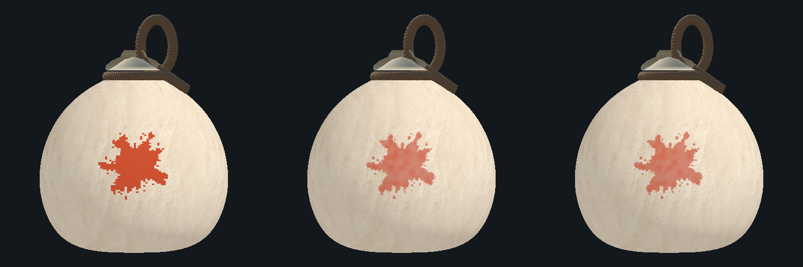
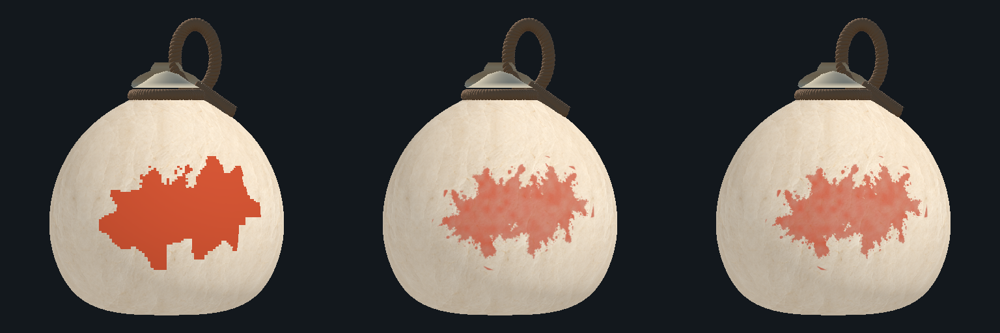

# 실제 게임 고해상도 도색 (#299)

## 사용과 기본값

Lab과 Hapio 공통 Battle의 Paint 모드에서 고해상도 표현을 사용한다. 기본은 **ON / 1024×512**다. DEV의 **Gourd → High Resolution Paint**에서 기존 표현과 전환하고, **High Resolution Paint Quality**에서 1024×512 또는 2048×1024를 선택한다. Host가 일반 설정 적용 경계(로비 적용 또는 일시정지 후 재시작)에서 확정하고 참가자에게 공유한다. 원본 Inspector 필드는 `highResolutionPaintEnabled`, `highResolutionPaintQuality`다.

인덱스200은 ON/OFF(기본1), 201은 품질(기본0, 1이면2048)이다. 공유 설정202개, 프로토콜5663, Lab 토큰 `C6PhysicsLab/24`, Hapio 토큰 `C6HapioGame/6`을 사용한다. 참여 앱은 같은 버전이어야 한다. 기존0~199의 순서·규칙은 유지한다.

## 실제 런타임 렌더 비교

같은 확정 판정 상태를 기존 표현(왼쪽) / 런타임1024×512(가운데) / 런타임2048×1024(오른쪽)로 렌더했다. Editor용4회 시제품 결과가 아니라 게임용 `LabHighResolutionPaintRuntime`의 출력이다. 이미지의 진행률은 그림 alpha를 합산한 값이 아니며 아래 판정 경계를 따른다.

최초 명중1회:

재타격3회 뒤:

## 판정과 표현의 경계

`LabPaintSurface`의 원래64×32/128×64/256×128 색·P번호 지도가 면적·성장·건조·팀 점유·100% 승리를 결정한다. 렌더링 실패나 품질 변경이 이 지도를 수정하지 않는다. 고해상도 이미지를 읽어 진행률을 계산하거나 이미지 자체를 네트워크로 전송하지 않는다.

Host는 최초 얼룩과 실제 성장 시작 시 원본 브러시의 구면 위치·접선·반경·패턴·색·P번호·시드를 시각 기록으로 남긴다. 현재 확정 색/P 지도와 함께 작은 기록을 전송하고 각 기기가 GPU에서 그림을 만든다. 미세한 가장자리와 담채 농도는 시각적 차이를 허용한다. 연한 농담은 별도의 미도색 칸이 아니며, 지워진 도색과 팀 소유권은 현재 확정 지도에 맞춰 재조정한다. 전투의 입력·투척·명중·보상·요괴 패턴·개인 조합판·LAN/핫스팟 전송 경로는 유지한다.

기존4종 패턴과 P번호 무늬를 유지한다. LEGACY나 오래된 기록이 없는 부분은 확정 지도를 바탕으로 연속적인 경계를 복원한다. P번호와 팀 색은 수치 보간으로 새 값이 생기지 않도록 함께 선택한다.

## 코드 연결

| 위치 | 책임 |
| --- | --- |
| `Core/LabPaintSurface.Visual.cs` | 판정 난수·면적에 관여하지 않는 시각 기록, 원본 방어적 복사, 버전 관리 |
| `Core/LabPaintVisualStamp.cs` | 최대128개, 각44바이트의 검증·직렬화·해시. 최신 기록 유지 |
| `Session/LabPaintReplication.cs` | 기존 RGBA/P 해시 유지. 시각 기록을 별도 해시와 같은 트랜잭션에 포함하고 전부 검증한 뒤 원자적으로 반영 |
| `Session/LabNetwork.CopyPaintToDisplay` | 같은 확정 상태의 셀·시각 기록을 표시 캐시에 설치 |
| `Throw/LabHighResolutionPaintRuntime.cs` | 브러시 캐시와 현재 지도 재조정, 해상도 변경·GPU 자원 손실 복원·해제 |
| `Resources/GourdPaint/HighResolutionRuntime.shader` | 연속 구면 브러시·담채와 확정 색/P 상태 합성. Player 빌드에도 포함 |
| `Throw/LabGourdPaint.cs` | 기존 판정용 `PaintTexture`/`PainterTexture` 보존, 실제 표시용 `VisualPaintTexture`/`VisualPainterTexture` 연결 |
| `UI/GourdViewer/LabGourdResultPreview.cs` | 결과 확정 후 실제 고해상도 그림을 독립 복사. 전투 해제·다음 스테이지가 기존 결과를 지우지 않도록 소유·해제 |

위 경로의 공통 접두어는 `Assets/Lab/Scripts/`이며 셰이더는 `Assets/Lab/` 아래다. 기존 #290 Editor 도구는 별도로 유지하며 런타임 비교 기준으로 사용할 수 있다. 시제품 자체의4회 제한·Editor API를 Player에 넣지 않는다.

## 복원·수명·비용

- 기록은 최신128개(5,632바이트)로 제한한다. 전체 체크포인트에는 현재 셀 지도와 제한된 기록을 함께 넣는다. 성장·건조 중 기록이 같으면 재전송하지 않는다. 중복·손상·누락 상태는 부분 표시하지 않고 기존 체크포인트 복구를 사용한다.
- 일반 갱신은 프레임당 브러시 최대8개이며 지도 변화가 있을 때만 재조정한다. 체크포인트 복원 중에는 현재 확정된 기존 표현으로 표시하고 완성되지 않은 고해상도 그림을 노출하지 않는다.
- 결과 관람 직전 `PrepareVisualCapture()`는 최신 확정 그림을 완료한 뒤 복사한다. 결과 자격·CPU 해시 검사는 그대로다. 닫기·Retry·다음 스테이지에서 소유한 텍스처를 해제한다.
- 런타임 ARGB32 지도3장 기준 픽셀 저장량은1024에서6MiB, 2048에서24MiB다. 관람 복사본2장은 추가4/16MiB이며 기존 원본 업로드·프리뷰 렌더 타깃과 그래픽 드라이버 비용은 별도다. 이 계산은 모바일 실측 성능 결과가 아니다.
- 셰이더·RT 형식·기기 해상도가 지원되지 않거나 할당에 실패하면 현재 판정용 표현을 사용한다. 이 경우 진행·입력·승패를 중단하지 않는다.

## 확인 방법

1. Home의 DEV에서 기본 ON·1024를 확인하고 솔로를 시작한다. 명중1회와 같은 곳 재타격3회에서 계단식 원본과 연속 브러시 표현을 비교한다.
2. 5색과 P번호 무늬, LEGACY/BROAD/SPLATTER/FLOW를 비교한다. 품질·ON/OFF는 DEV 적용 후 새 라운드로 확인한다.
3. 건조 ON에서 경계가 줄고, 근처 명중 시 기존 보호 규칙이 적용되는지 확인한다. 2:2에서는 상대 색과 소유권이 함께 바뀌는지 확인한다.
4. 100% 완료 후 관람 화면을 열고 닫거나 다음 스테이지로 이동한다. 결과 그림이 픽셀 표현으로 되돌아가지 않고 전투 텍스처와 독립적으로 유지돼야 한다.
5. 자동 검사는 `LabPaintVisualStateTests`, `LabHighResolutionPaintConfigTests`, `LabHighResolutionPaintRuntimeTests` 및 기존 결과 관람·세 스테이지 흐름 검사를 사용한다. 실행 결과와 미실행 환경은 `VALIDATION.md`의 #299 절을 기준으로 읽는다.
