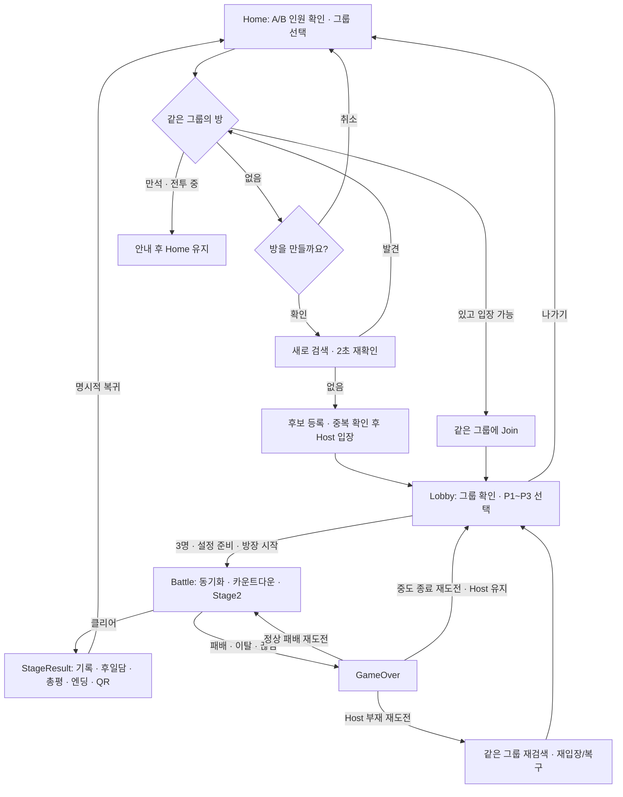

# 스태프 스테이지 선택·3인 단판 시연 (#735)

## 적용 범위와 진행 순서

`Hapio > Demo Build`는 스태프가 1·2·3스테이지 중 하나를 고르는 별도 시연 앱을 만든다. 일반 게임의 Story `[1,2,3]`, 땅따먹기, 기존 Lab 실행은 바꾸지 않는다. Development 여부는 DEV 사용 가능 여부를 결정하며, 시연 콘텐츠 선택은 전용 `HAPIO_STAFF_STAGE_DEMO` 빌드 표시로 결정한다.

현재 시연은 A/B 그룹을 구분한다(#753). 기본 3카드 앱은 그룹 선택 → 스테이지 선택이며, **Stage 2 Only 앱은 A/B 인원 확인 → 그룹 선택 → 기존 방 입장 / 방이 없으면 생성 확인 → 입장**으로 진행한다(#767). 야광귀 선택 카드를 한 번 더 누르지 않는다. 이후 P1·P2·P3 선택 → 방장 시작 → 기존 준비 동기화·3/2/1 → 한 판 → 봉인 카드·개인 기록·후일담 → 전원 마치기/준비·방장 총평 진행 → 총평 → 엔딩 → QR → Home 순서다.

- 스태프 선택 화면의 박스는 1스테이지 구미호·2스테이지 야광귀·3스테이지 지귀다. 방에 들어간 뒤 전투 도중 스테이지를 바꾸지 않는다.
- 실제 스테이지 번호는 그대로 유지한다. 예를 들어 지귀를 고르면 실제 Stage3 규칙·배경·박·결과 키를 쓰면서 한 판짜리 경로 `[3]`를 실행한다. 진행 위치 `1/1`을 실제 Stage1로 해석하지 않는다.
- 방은 방장 포함 정확히 세 명이며 P1~P3를 고른다. 현재 로비의 준비 완료는 세 명 입장·서로 다른 P자리 선택·설정 동기화 완료다. 별도의 Ready 버튼을 추가하지 않으며, 세 번째 사람이 들어와도 자동 시작하지 않는다.
- 로비에서 나가면 연결을 정리하고 스태프 선택 화면으로 돌아간다. 전투 중 이탈은 전원 게임 오버를 거친 뒤 아래 #740의 명시적 재도전으로 자리 선택에 복귀한다. 시간 초과·전멸의 정상 패배 재도전은 기존처럼 같은 방에서 같은 스테이지를 다시 시작한다.
- 시연에서는 튜토리얼·솔로·땅따먹기를 시작하지 않는다. 일반판의 오프닝·튜토리얼·3스테이지 진행은 유지한다.

## 세 기기로 시연하기

1. 세 기기에 같은 시연 빌드를 설치하고 같은 LAN 또는 개인용 핫스팟에 연결한다. iOS 로컬 네트워크 권한을 허용하고 Host 앱을 전경에 둔다.
2. 세 기기 모두 같은 A/B 그룹을 고른다. 기본 3카드 앱은 이어 같은 스테이지를 누르며, Stage 2 Only 앱은 그룹을 누르면 방 검색·입장 절차를 시작한다.
3. 먼저 열린 호환 방이 있으면 참가하고, 없으면 생성 확인창의 `확인`을 누른 뒤 방을 만들어 들어간다. 방 목록에서 별도로 방을 누를 필요가 없다.
4. 각 기기에서 서로 다른 P1·P2·P3를 고른다. 세 자리와 설정이 준비되면 방장이 시작 버튼을 누른다.
5. 선택한 한 판이 끝나면 기존 기록·후일담을 읽고 준비한다. 방장이 총평 진행을 눌러 엔딩으로 이동한다. 다른 스테이지를 자동 실행하지 않는다.
6. 엔딩 뒤 마무리 페이지에서 `스테이지 선택으로 돌아가기`를 눌러 다음 시연을 준비한다.

### 검색·생성·취소의 동작

- 한 번에 한 스테이지 입장 요청만 진행한다. 검색·생성·입장 중에는 다른 박스를 중복 선택하지 않는다.
- 검색은 선택한 실제 스테이지와 A/B 그룹, Story 모드, 정원 3명, 시연 호환 버전이 맞는 방을 대상으로 한다.
- 같은 그룹·스테이지 방이 만석이면 만석 안내를, 전투 중이면 진행 중 안내를 표시한다. 다른 그룹으로 자동 이동하지 않는다. A의 만석·전투 중 상태는 B의 방 생성에 영향을 주지 않는다. 생성 중인 방은 방장이 들어올 때까지 기다린다.
- 동시에 방을 만들면 그룹·스테이지별 고정 Bonjour 이름으로 충돌을 확인하고 재검색·기존 방 참가를 시도한다. 일반 게임에서 이름에 번호를 붙이는 기존 정책은 유지한다.
- 고정 Bonjour 이름(`Hapio-Staff-<리비전>-<프로토콜>-Stage-<번호>-Group-<1또는2>`)은 화면에 그대로 쓰지 않는다. 로비 방 제목은 `LabRoomNames.Display`가 `A그룹` 또는 `B그룹`으로 표시한다. 스테이지 번호·요괴 이름은 방 제목에 표시하지 않는다. 검색·접속에는 표시 문구가 아닌 실제 그룹·스테이지 번호를 검증한다.
- 검색·입장 요청은 35초로 제한한다. 확인 한 번에 생성 후보는 하나만 만들고 이름 충돌 뒤에는 기존 방을 기다리며 자동 재생성하지 않는다. 검색·연결·공개 실패는 안내 후 다시 선택할 수 있다. 취소하면 해당 요청의 대기 광고·예약 포트·진행 중 Join을 정리한다.
- 검색은 기존 Bonjour IPv4/IPv6 경로와 입장 승인·재연결 표를 재사용한다. 공유기의 기기 격리나 Bonjour 차단으로 서로 검색할 수 없는 네트워크에서는 하나의 방으로 모이는 것을 보장하지 않는다. 이때 네트워크 권한·동일 네트워크·기기 간 통신 허용 여부를 확인한다.

## A/B 인원 표시와 생성 확인 (#767)

Stage 2 Only 선택 화면에 들어오면 방에 참가하지 않고 기존 Bonjour 검색을 시작한다. A/B 카드에는 `1/3 · 입장 가능`, `3/3 · 정원 완료`, `진행 중`, `방 생성 중`을 표시한다. 최초 검색 중과 검색 실패를 `방 없음`으로 표시하지 않는다. 이 숫자는 기존 방 정원 계산을 따르므로 재연결을 위해 보존 중인 자리도 포함한다. 닉네임·P번호 명단·기기명은 공유하지 않는다.

방이 발견되지 않으면 그룹별 생성 확인창을 띄운다. `취소`는 방·포트·참가 자리를 만들지 않고 선택 화면으로 돌아간다. `확인` 후에도 검색을 새로 시작해 2초 동안 재확인한다. 다른 기기가 먼저 연 방이 있으면 그 방에 입장하고, 만석·진행 중이면 두 번째 방을 만들지 않는다. 확인창을 기다리는 시간에는 네트워크 작업의 35초 제한을 적용하지 않으며, 확인 후 새 제한을 시작한다.

생성 후보의 고정 이름 등록이 확정된 뒤에도 2초 동안 같은 그룹의 다른 후보를 확인한다. 기존 Host가 우선이고 생성 후보끼리는 동일한 방 key 순서로 선택한다. 패자는 자기 후보만 정리한 뒤 선택된 방을 기다린다. 이름 충돌이나 잠깐 사라진 후보를 이유로 자동 생성 반복을 하지 않는다. 예상과 다른 이름으로 등록된 시연 방은 생성 완료로 처리하지 않는다. 실제 입장 가능 여부와 정원은 Host가 최종 검증한다.

이 변경은 기존 광고 정보를 사용하며 Staff revision3·전투 패킷·일반 게임 규칙은 바꾸지 않는다. 동일 LAN/핫스팟에서 서로 검색 가능한 기기들의 생성 경쟁을 다루며, 서로 통신할 수 없는 네트워크 구역 사이의 전역 단일 방이나 Host migration을 제공하지 않는다. 기존 중도 종료 후 `다시 도전`의 같은 그룹 복구 의사는 유지한다.

## 중도 종료 후 자리 선택으로 다시 도전 (#740)

- 스태프 시연에서 전투 중 나가기·참가자 연결 끊김·Host 연결 끊김으로 끝난 게임 오버의 기존 복귀 버튼은 `다시 도전`으로 표시한다. 일반 게임과 로딩/동기화 오류 화면의 복귀 동작은 바꾸지 않는다.
- 연결된 누구든 누르면 Host가 이전 run·실제 stage·revision·설정 세대를 확인해 같은 방의 전원을 P1~P3 자리 선택으로 돌린다. 중복 요청과 이전 판의 요청은 새 로비/전투를 초기화하지 않는다.
- Host는 중도 종료 직후 전투 자료를 정리해 방의 입장을 먼저 열지만, 게임 오버 화면은 재도전 입력까지 유지한다. 끊긴 참가자가 같은 스테이지를 선택해 재입장한 경우에도 재도전 요청으로 보고 기존 방을 로비로 전환한다.
- Host가 없거나 재도전 승인이 5초 안에 오지 않으면, 선택 스테이지를 별도 보존한 뒤 기존 연결 종료와 Home 로드를 기다려 그 스테이지의 검색→입장/생성을 자동 실행한다. 이는 새 방 찾기/생성이며 Host migration이 아니다. 기존 검색의 35초 한도·진행 중/만석 안내·중복 방 생성 방지·취소는 유지한다.
- P번호·보류 자리·이전 자리 기억·시작 준비·전투 구슬/투사체/도색·결과·박 관람 자료를 초기화한다. 같은 스테이지·연결된 참가자·Host의 조정값은 유지한다. Host가 사라져 새 방이 되면 사라진 Host의 메모리 설정까지 복원하지는 않는다.
- 세 명 입장·서로 다른 P자리 선택·설정 확인 후 방장만 수동 시작한다. 재도전·재입장·세 번째 참가만으로 전투를 자동 시작하지 않는다.
- 정상 시간 초과·전멸의 재도전, 일반 Story/Lab/땅따먹기, 로비 나가기와 정상 엔딩 뒤 선택 화면 복귀는 유지한다.

## 개인 기록과 마무리 페이지

리더보드/개인 기록은 기존 결과 화면과 Host가 확정한 이번 방 세 명의 `LabSnapshot.players`를 사용한다. 기존 개인 수상 기록을 재사용하며, 새로운 순위 점수·글로벌 랭킹·저장 서버를 추가하지 않는다. 봉인 총평에는 실제 플레이한 한 스테이지의 성공 시간과 내 신규 도색 면적 기여도만 연결한다. 플레이하지 않은 나머지 두 스테이지 기록을 0초나 성공 기록으로 채우지 않는다.

QR 설정은 `Assets/Hapio/Resources/Hapio/Demo/Staff/FinalPageConfig.asset`의 Inspector에서 바꾼다.

| 항목 | 용도 |
| --- | --- |
| `heading`, `message` | 마무리 제목·안내 |
| `qrSprite` | 실제 사용할 QR 이미지 |
| `destinationUrl` | QR 이미지에 넣은 목적지의 문서화용 URL. 이 문자열로 QR을 자동 생성하지 않는다. |
| `qrCaption` | QR 아래 설명 |

현재 URL은 미정이며 QR 이미지를 지정하지 않으면 `QR 준비 중 · 추후 교체 예정`이라는 임시 표시를 쓴다. 임의의 가짜 QR은 만들지 않는다. 실제 QR을 넣을 때는 이미지가 연결하는 주소와 `destinationUrl`을 함께 맞추고 별도로 스캔 확인한다. 엔딩을 넘긴 터치가 마무리 페이지의 복귀 버튼까지 연속 작동하지 않도록 입력 해제 후 버튼을 연다.

## 준비와 빌드

프로젝트 기준 Unity 버전은 `ProjectSettings/ProjectVersion.txt`를 따른다. 다음 메뉴는 일반 게임 빌드와 구분된다.

| 목적 | Unity 메뉴 |
| --- | --- |
| 선택 UI·선택별 엔딩·마무리 페이지를 한 번에 준비 | `Hapio > Demo > Prepare Staff Stage Demo` |
| 저장된 스태프 선택 UI를 명시적으로 준비/갱신 | `Hapio > Demo > Update Staff Demo UI` |
| 스테이지별 총평·엔딩 사본과 마무리 페이지를 명시적으로 준비/갱신 | `Hapio > Demo > Update Staff Stage Demo Stories and Final Page` |
| 배포용 Mac | `Hapio > Demo Build > Release > Build Mac App` |
| 배포용 iOS Xcode 프로젝트 | `Hapio > Demo Build > Release > Export iOS Xcode Project` |
| DEV 사용 가능 Mac/iOS 확인용 | `Hapio > Demo Build > Development QA` 아래 대상 메뉴 |
| 최근 결과 폴더 열기 | `Hapio > Demo Build > Open Last Output` |

이미 준비된 에셋으로 빌드할 때 갱신 메뉴를 다시 실행할 필요는 없다. 빌드는 저장된 에셋과 연결을 검사하며 누락 자료를 자동 생성하거나 일반 Scene을 저장하지 않는다. iOS 내보내기 뒤에는 생성된 Xcode 프로젝트에서 기존 개발 Team·연결 기기·서명을 설정한다. Xcode 프로젝트 생성 성공과 실제 기기 설치·실행 성공은 구분한다.

- 출력 폴더: `Builds/HapioDemo/<UTC시각-고유번호-release또는qa>/`
- Mac 앱: `macOS/합이오_쇼케이스.app` (Release·QA 동일 파일명, 출력 폴더로 구분)
- iOS 프로젝트: `iOS/`
- 앱 표시명: `합이오_쇼케이스`
- 앱 식별자: 원래 플랫폼 Bundle ID + `.staffdemo`

Release에서도 스태프 선택 화면은 제공하지만 숨김 DEV는 열리지 않는다. QA는 기존 숨김 DEV 입력을 사용할 수 있다. Release와 QA는 같은 시연 앱을 교체할 수 있으므로 빌드의 `build-manifest.json`에서 생성 시각·소스 커밋·미커밋 변경·대상·QA 여부·스테이지별 설정 해시를 확인한다. 빌드 도구는 임시 앱 이름·식별자·플랫폼·Scene 목록·설정을 복원하며 기존 출력 폴더를 덮어쓰지 않는다.

## 야광귀만 선택하는 전용 빌드 (#750)

일반 `Demo Build > Release` 메뉴는 계속 1·2·3 선택 앱을 만든다. 야광귀만 보여줄 때는 아래 **Stage 2 Only** 메뉴를 사용한다. 이 옵션은 이전 #706 타이틀·오프닝 전용 시연과 다르며, 현재 스태프 시연의 3인 자리 선택·수동 시작·#740 재도전·결과·총평·엔딩·QR을 그대로 사용한다.

### Unity에서 빌드하기

1. 로컬 작업을 먼저 보존하고 이 프로젝트의 최신 main을 Pull한다. Unity Hub에서 같은 프로젝트 폴더를 열고 컴파일을 마친다. Play 모드를 종료하고 저장할 Scene 변경은 먼저 저장한다. 빌드 도구가 미저장 Scene을 임의 저장하지 않는다.
2. 아래 메뉴에서 대상을 선택한다. 이미 저장된 시연 자료가 있으면 Prepare/Update 메뉴를 다시 실행할 필요가 없다.
3. 완료 로그의 `HAPIO_DEMO_BUILD_OK` 또는 `Stage 2 Only > Open Last Output`으로 출력 폴더를 연다.

| 목적 | Unity 메뉴 |
| --- | --- |
| DEV가 숨겨진 Mac 시연 앱 | `Hapio > Demo Build > Stage 2 Only > Release > Build Mac App` |
| DEV가 숨겨진 iOS Xcode 프로젝트 | `Hapio > Demo Build > Stage 2 Only > Release > Export iOS Xcode Project` |
| DEV 조절을 사용하는 Mac 앱 | `Hapio > Demo Build > Stage 2 Only > Development QA > Build Mac App` |
| DEV 조절을 사용하는 iOS Xcode 프로젝트 | `Hapio > Demo Build > Stage 2 Only > Development QA > Export iOS Xcode Project` |
| 이번 Editor에서 만든 최근 야광귀 전용 출력 | `Hapio > Demo Build > Stage 2 Only > Open Last Output` |

- 출력: `Builds/HapioStage2Demo/<UTC시각-고유번호-release또는qa>/`.
- Mac: `macOS/합이오_쇼케이스.app` (Release·QA 동일 파일명). 표시명은 `합이오_쇼케이스`다.
- Mac 앱 빌드는 로컬 서명 도구가 있는 macOS의 Unity Editor에서 실행한다.
- iOS: `iOS/`. 생성된 Xcode 프로젝트에서 Team·연결 기기·서명을 설정해 빌드한다. Xcode 내보내기·서명·설치·실행은 각각 별도 확인한다.
- 식별자: 일반 플랫폼 Bundle ID + `.staffdemo.stage2`. 일반 앱과 기존 3카드 시연 앱을 교체하지 않는다. Release와 QA는 같은 전용 식별자를 사용한다.
- Mac 앱은 생성 후 내부 실행 파일명을 `HapioShowcase`로 정리하고 서명을 검증한다. 화면 표시명과 `.app` 이름은 `합이오_쇼케이스`를 유지하며 한글 실행 파일명에서 발생하는 macOS 서명 도구의 충돌을 피한다. 내장 Unity 라이브러리 서명이 유효하지 않은 로컬 산출물만 다시 로컬 서명하고 검증한다. 이미 유효한 서명과 iOS 서명은 바꾸지 않는다. 이 로컬 서명은 App Store 배포용 서명이 아니다.

터미널에서는 같은 Unity Editor에 프로젝트 경로와 `-executeMethod Hapio.Editor.GameDemoBuild.StageTwoMac`을 전달하면 Release Mac 앱을 만든다. iOS는 `StageTwoIos`, QA는 `StageTwoMacDevelopment`/`StageTwoIosDevelopment`다. 저장된 Player Settings의 Scripting Define이나 Build Settings Scene을 수동으로 바꾸지 않는다. 일반 Build Settings에서 Scene만 골라 빌드하면 이 제한이 들어가지 않는다.

### 세 명이 사용하기

1. 같은 빌드를 실행하고 같은 LAN 또는 핫스팟에 연결한다. Mac 앱은 Mac용이며 iPhone에는 iOS 빌드를 설치한다.
2. A/B 카드의 `1/3` 같은 인원수와 방 상태를 확인한 뒤 같은 그룹을 누른다. 기존 방이 있으면 참가하고, 없으면 생성 확인창이 열린다. `확인`을 누른 기기만 생성 절차를 진행하며 `취소`하면 선택 화면에 남는다. 야광귀 선택 카드는 없으며 실제 플레이할 스테이지는 Stage2로 고정한다. 1·3스테이지 진입 요청도 거절된다.
3. 세 명이 서로 다른 P1·P2·P3를 고른 뒤 방장이 시작한다. 두 명이나 자리 미선택 상태에서는 시작하지 않는다.
4. 야광귀 한 판 뒤 기존 개인 기록·야광귀 총평·엔딩·QR로 이동한다. 중도 종료 뒤 `다시 도전`하면 같은 그룹·스테이지 자리 선택으로 돌아온다. 정상 엔딩 뒤 Home으로 돌아오면 A/B 방 입장 버튼을 표시한다.

manifest는 `variant=staff-stage-2-only-demo`, `selectableStages=[Stage2]`, `participants=3`이며 실제 번호·설정·결과 키도 Stage2다. A/B 구분이 추가된 Staff revision3을 사용한다. 같은 새 버전의 3카드 시연에서 같은 그룹·Stage2를 선택한 참가자와는 호환되며, 그룹이 없는 revision2·일반 게임·Lab·구형 #706 앱과는 섞지 않는다.

전용 빌드는 `HAPIO_STAFF_STAGE_DEMO`와 `HAPIO_STAFF_STAGE_TWO_ONLY`를 **해당 Player 컴파일에만** 전달한다. 일반 게임의 Scene·StageCatalog·LabConfig·원본 에셋·저장된 빌드 설정을 바꾸지 않으며, 일회성 반영 스크립트나 별도 Scene이 필요하지 않다. 최초 전용 빌드는 `VALIDATION.md`의 #750, 현재 A/B 그룹의 실제 검증 범위는 #753 기록을 확인한다.

## 코드 연결과 버전 경계

| 코드 | 책임 |
| --- | --- |
| `GameStaffDemoView` / `StaffDemoUiAssets` | 기존 Home Canvas·Scaler·Raycaster 아래에 붙는 저장된 선택 패널과 입장 요청·상태 표시 |
| `GameSession.DemoRooms` / `GameSession.DemoOverview` | 입장 없는 인원 조회, 검색→참가 / 생성 확인→재검색→후보 확인→입장, 취소·시간 제한 |
| `GamePendingRoomRegistry` / `LabPendingRoom` | 그룹·스테이지별 대기 광고와 예약 포트의 소유·전달 |
| `LabRoomPresence` / `LabBonjourDiscovery` | 실제 스테이지 `s=1~3`와 그룹 `g=1~2`를 검색 정보로 전달 |
| `LabNetwork.SetDemoStageIdentity` | 접속 승인에 사용할 스테이지·그룹 고정과 이전 검색/티켓 정리 |
| `GameRunProfile` / `GameRunFlow` / `GameFlowState` | `[1]`·`[2]`·`[3]` 중 한 경로를 세션에 고정·검증 |
| `GameStageStoryPresentation` / `StaffStageDemoStoryAssets` | 실제 선택 스테이지 기록·후일담·총평·엔딩 연결 |
| `StaffDemoFinalPage` / `StaffDemoFinalPageConfig` | 임시 QR와 의도적인 선택 화면 복귀 |
| `GameDemoBuild` / `LabGameBuildVariant` | 전용 빌드 표시·에셋 검사·앱 식별·출력 분리 |

일반판·Lab의 통신 식별자는 변경하지 않는다. 스태프 시연은 `C6-HAPIO-STAFF-3-<LabProtocolVersion>` 검색 규약과 `C6HapioStaffDemo/3/S<선택 스테이지>/G<그룹 번호>` 접속 토큰으로 분리한다. G1은 A, G2는 B다. 스테이지나 그룹이 다르면 검색 목록뿐 아니라 Host 접속 승인에서도 다른 방으로 취급한다. 빌드 manifest의 `S0/G0`은 선택 전 호환 계열 표시이며 실제 입장 때 선택한 번호로 바뀐다.

## 두 그룹을 동시에 운영하기 (#753)

1. 여섯 기기에 같은 새 시연 버전을 설치하고 같은 LAN/핫스팟에 연결한다.
2. 첫 세 대는 `A그룹`, 나머지 세 대는 `B그룹`을 누른다. 가장 먼저 해당 그룹 방을 연 기기가 방장이 된다. 같은 그룹 내에서만 검색·생성·입장한다.
3. 각 로비의 방 제목에서 A/B를 확인하고 P1·P2·P3를 하나씩 고른다. 두 방은 각자 방장이 시작하며 P번호·시간·도색·결과·엔딩은 서로 독립적이다.
4. 잘못 골랐으면 로비에서 나가 Home으로 돌아온 뒤 다른 그룹 버튼을 누른다. 검색·입장·전투·결과·재도전 중에는 그룹을 바꿀 수 없다. 검색 중에는 먼저 `취소`한다.
5. 선택 그룹은 이번 앱 실행 동안 Home/QR 복귀와 재도전에도 유지된다. 앱을 완전히 종료하고 다시 실행하면 미선택이다. 기본 3카드 앱에서는 Home의 `그룹 변경`으로 다시 고른다.

중도 이탈·끊김 재도전은 같은 그룹 자리 로비로 돌아간다. Host가 사라지면 같은 그룹·스테이지 방만 다시 검색/생성한다. 정상 시간 초과·전멸은 기존처럼 방장이 같은 방·명단으로 해당 스테이지를 다시 시작한다. 어느 경우에도 다른 그룹으로 자동 복구하지 않는다.

### Scene 기반 흐름

아래 흐름은 A/B에서 각각 독립적으로 실행된다. 각 그룹마다 Scene을 복제하지 않는다.

그룹 선택과 검색은 Home의 패널이다. 로딩·동기화·3/2/1은 Battle 내부 상태이며 총평·엔딩·QR는 StageResult 내부 화면이다. 기본 3카드 시연만 그룹 선택과 방 검색 사이에 스테이지 선택이 추가된다.

이전 야광귀 전용 `[2]` 시연의 자료·호환 경로는 보존한다. 다만 현재 `Demo Build` 메뉴는 이 문서의 선택형 시연을 만든다. 일반 게임 앱, 구형 야광귀 앱, 선택형 시연 앱을 섞어 방에 들어가지 않는다.

## 검증 범위

선택별 1·2·3 경로, 같은 스테이지 방 참가·동시 생성 충돌·만석·진행 중·취소·재입장·선택 불일치 거절, 세 명 수동 시작, 한 판 완료, 실제 기록과 선택별 엔딩·QR 복귀를 확인한다. 일반 Story·Lab·땅따먹기는 회귀 대상으로 유지한다.

자동 검사는 코드·저장 자료와 로컬 패킷 참가자의 흐름을 확인한다. 실제 세 기기의 UI·무선 환경을 확인한 것으로 표현하지 않는다. 최초 스태프 시연의 수행 결과는 `VALIDATION.md`의 #735, 현재 A/B 그룹은 #753 기록을 따른다. iPhone/iPad 일반 Wi-Fi·핫스팟 확인은 별도 실기기 검증 항목이며, 수행 전에는 미실행으로 남긴다.

## 쇼케이스 로고·앱 이름 (#772)

현재 `Demo Build`의 전체 스테이지·Stage 2 Only 및 Release·Development QA는 앱 표시명과 Mac 파일명을 **합이오_쇼케이스**로 사용한다. 각 출력 폴더와 앱 식별자는 기존과 같아 일반 게임·시연 종류별 연결 구분을 유지한다.

시작 화면은 Unity 로고 대신 일반 게임 타이틀의 검은 `합이오` 글자 로고를 2초 표시한다. 같은 타이틀의 글꼴·색을 재사용한 로고 PNG와 밝은 아이보리 배경의 불투명 1024px 아이콘을 사용한다. iOS 홈 화면과 Mac 앱 아이콘도 이 아이콘을 사용한다.

- 평소에는 기존 빌드 메뉴를 그대로 사용한다. 이미 준비된 PNG를 다시 만들 필요는 없다.
- 원래 타이틀 글꼴이 바뀌었거나 로고 자료가 없을 때만 `Hapio > Demo > Prepare Showcase Branding`을 실행한다. `AnimatedTitle.prefab`의 `합이오` Text에서 글꼴·색을 읽어 `Assets/Hapio/Art/Branding/ShowcaseLogo.png`와 `ShowcaseIcon.png`를 다시 만든다. 원본 타이틀와 Scene은 저장하지 않는다.
- 빌드는 로고 자료를 자동 생성하지 않는다. 저장된 PNG가 없으면 준비 메뉴를 안내하며 중단한다.
- iOS와 Mac 내부 실행 파일명은 서명 도구 호환을 위해 `HapioShowcase`를 쓴다. 홈 화면·Finder의 앱 표시명과 Mac `.app` 파일명은 `합이오_쇼케이스`다.
- 로고·시작 화면·아이콘·표시명은 시연 빌드 동안만 적용하고, 성공·실패·취소 뒤 원래 Player Settings를 복원한다. 일반 게임 및 Lab 빌드의 설정은 유지한다.
- 정식 앱 아이콘 원본은 아직 확인되지 않아 현재는 타이틀 글자 기반 임시 아이콘을 쓴다. 나중에 `ShowcaseIcon.png`를 같은 1024×1024 불투명 RGB PNG로 교체하면 된다. 수동 교체 뒤에는 Prepare 메뉴가 임시 아이콘으로 다시 덮어쓰므로 실행하지 않는다.
- 기존 설치 앱은 자동 변경되지 않는다. 새 이름·로고를 보려면 다시 내보내고 설치해야 한다.
