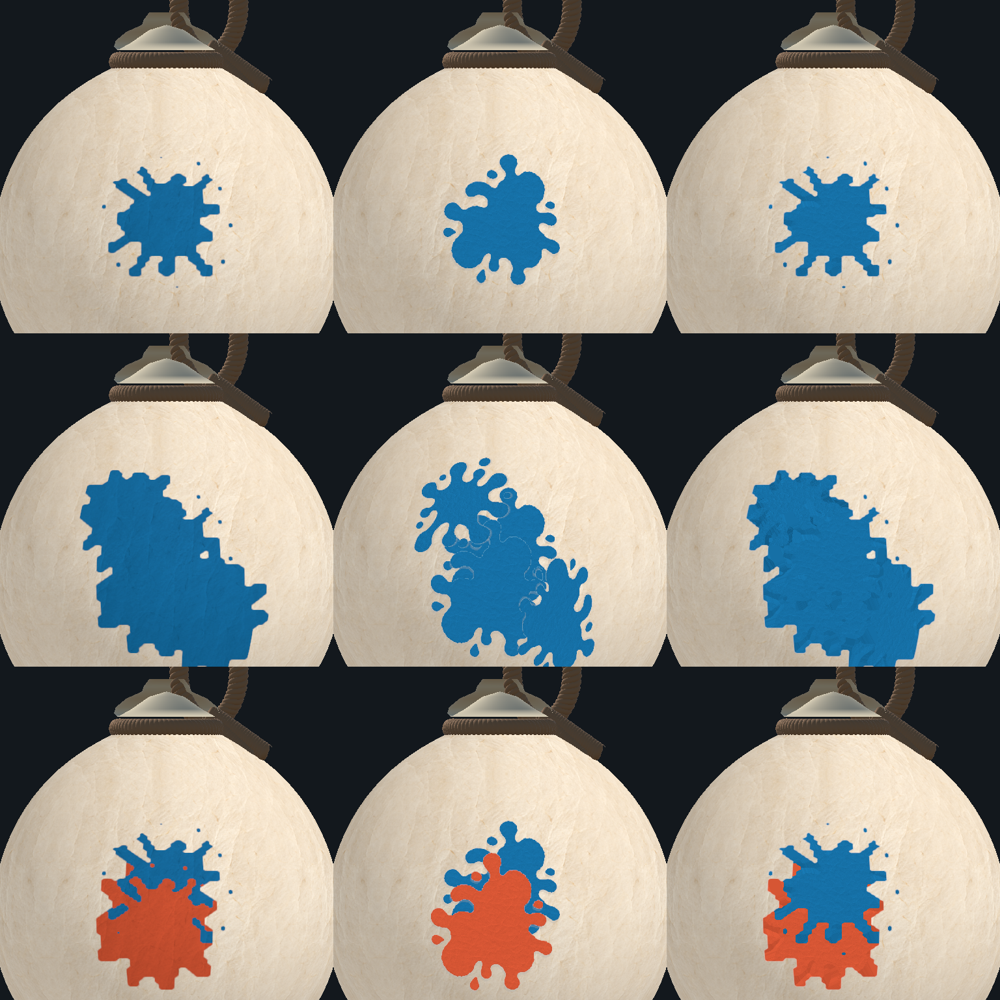
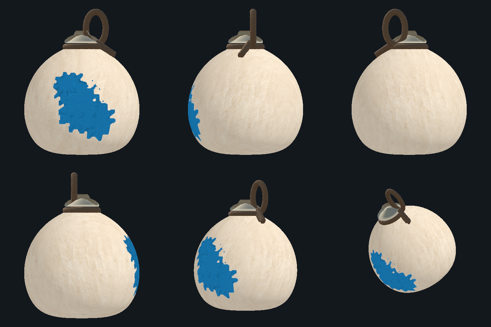

# 곡면 스티커 에셋 시제품

> 현재 기본 표현은 [#506 클레이 스티커](CLAY_STICKER_PAINT.md)다. 아래는 이전 종이/외형 비교 이력이며 그 구현·검증 범위로 읽는다.

2026-11-04 · #466 · 외형 검토용, 게임 기본 표현에 미연결

## 목적과 현재 상태

박의 종이 텍스처에 색을 합성하는 기존 방식과 구분하여, 별도로 준비한 얼룩 RGBA 에셋을 실제 박 곡면 위의 별도 MeshRenderer로 표시하는 시제품이다. 저장된 `WhiteGourd.prefab`을 Preview Scene에 복제하고, 원본 박의 삼각형 일부를 읽어 법선 방향으로 아주 조금 띄운다. 평면 사각형을 공중에 띄우거나 셀마다 GameObject를 만들지 않는다.

**이번 승인 범위는 에셋 준비와 정지 화면 비교까지다.** 기존 Battle/완성 박 관람/PNG의 새 메시 연결, 네트워크 전송, 성장 애니메이션, 기본 모드 전환은 수행하지 않았다. 기존 #466 구현과 미커밋 변경은 보존했다.

## 준비한 에셋

`Assets/Editor/WatercolorPaint/SurfaceSticker/Assets/`

| 파일 | 원본 크기 | 형태 |
|---|---|---|
| `BroadPaper.png` | 1254×1254 | 넓고 비대칭인 얼룩·둥근 가지·분리된 튀김점 |
| `LongPaper.png` | 1254×1254 | 대각선으로 길게 뻗는 얼룩 |
| `ClusterPaper.png` | 1254×1254 | 큰 둥근 덩어리가 이어진 얼룩 |

내장 imagegen으로 생성한 중립색 종이 원본이다. 배경 Alpha와 불투명 내부를 유지하며, 별도 셰이더가 실제 기록에 저장된 오행색을 입힌다. 각 도장 seed와 ID로 형태를 고정하며 게임 RNG는 호출하지 않는다. 원본 에셋을 수정하지 않고, 판정형 비교에서만 사용용 복사본의 투명 영역 RGB를 확장해 검은 테두리를 예방한다. 원본 Alpha는 유지한다.

프롬프트 공통 기준: 승인된 박 이미지의 종이 얼룩을 스타일 참고로 사용. 한 장에 단일 평면·정면 얼룩, 중립색 불투명 한지, 고운 섬유, 비대칭 굵은 둥근 가지와 분리된 방울, 투명 배경. 박·끈·인물·문자·배경·그림자·원근은 제외. 개별 형태는 위 표의 넓은형/긴형/군집형으로 구분했다.

## 실행 방법

Unity Editor를 정지·컴파일 완료 상태로 두고 다음 메뉴를 실행한다.

`C6 Lab → Experiments → Surface Sticker → Export Comparison`

Assets 바깥의 출력 폴더를 선택한다. 현재 Scene을 저장하거나 전투를 시작하지 않는다. 이미지와 검증 JSON을 해당 폴더에 저장한다. 원본 에셋 임포트 설정을 새로 준비해야 하면 `LabSurfaceStickerPrototype.ImportAssets()`를 Editor에서 실행한다. 게임의 Resources 프로필과 전역 렌더러 설정은 수정하지 않는다.

## 비교 이미지 읽는 방법

행: 위부터 최초 명중 1회 / 같은 지점 재타격 3회 추가 / 파랑·주홍 두 색.

열:

1. **왼쪽 — 현재 누적 지도 표현**: 기존 #466 PaperSticker 경로.
2. **가운데 — 에셋 원형을 붙인 외형 시제품**: 원본 Alpha 실루엣을 사용한다. 곡면 부착 모습을 보기 위한 비교이며 실제 도색 면적 일치를 주장하지 않는다.
3. **오른쪽 — 기존 판정 영역으로 제한한 메시 표현**: 실제 지급 셀의 합집합과 일치하는 영역에 에셋의 내부 RGB 질감을 매핑한다. 원본 Alpha 윤곽 대신 판정 윤곽을 사용하므로 기존 셀 형태가 남는다. 이를 에셋 원형이 그대로 적용된 결과로 설명하면 안 된다.

6방향은 정면·오른쪽·후면 / 왼쪽·사선·위쪽 사선이다. 정면에만 명중한 실제 기록이므로 후면까지 임의로 칠하지 않는다.

## 코드 연결

| 파일 | 책임 |
|---|---|
| `LabSurfaceStickerPrototype.cs` | 원본 임포트·실제 Host 규칙 fixture·별도 메시·정지 화면 비교·보존 검사 |
| `LabSurfaceStickerMesh.cs` | 원본 Read/Write 설정을 바꾸지 않고 실제 박 삼각형을 읽어 국소 곡면 메시 생성 |
| `LabSurfaceStickerHistory.cs` | 기존 저널에서 실제 추가 셀을 도장별로 읽고, 삭제 셀은 모든 층에서 제거 |
| `LabSurfaceStickerGpuChecks.cs` | 실제 셰이더·메시를 별도 렌더 타깃에 그려 7개 계약 확인 |
| `SurfaceSticker.shader` | 에셋 RGB/Alpha·기록 색·독립적인 약한 조명. 박 바탕 질감과 누적 PaintMap은 읽지 않음 |
| `LabPaintStudyRenderer.cs` | 선택적 `configureStudyInstance` 콜백 추가. 기존 호출은 동일 경로 |

스티커 접점에는 플레이어 번호와 별개인 도장 순서 ID를 쓴다. 인접 조각마다 Alpha를 독립 합성해 바탕이 가는 틈으로 보이지 않도록, 경계에서 최상층 하나를 선택한다. 실제 색/P지도에는 이 ID를 기록하지 않는다.

## 수행한 확인과 한계

- Unity 6000.6.5f1 / Metal / 정지 상태 Editor에서 실제 박을 렌더했다.
- 최초 명중은 655셀, 재타격 3회 추가는 2129셀, 두 색은 1146셀이다. 표시 전후 색/P지도 해시와 CoveredCount·PaintCount가 같았다.
- 기록 보조 검사 6개: 중복 연산, 모든 층 삭제, 삭제 후 재도색, 실제 셀 합집합, 동일 에셋 선택, 순번 누락 거절.
- 현재 Scene 목록·dirty 상태·Unity RNG·원본 LabConfig가 비교 전후 같았다.
- GPU 계약 검사 7개 통과: 미도색 투명, 내부 불투명, 맞닿은 경계 Alpha 틈 없음·색 혼합 없음, 제출 역순 동일, 원본 에셋 Alpha, 잘못된 영역 거절, 곡면 좌표 반지름 독립·경도 연결. 초기 검사 사각형의 Metal 앞뒷면 문제를 양방향 winding fixture로 수정한 뒤 재실행했다. 실제 게임 셰이더의 Cull Back은 유지했다.
- 세부 실행 근거는 `VALIDATION.md`의 같은 날짜 시제품 항목을 따른다. 과거 전체 EditMode/PlayMode 실행 결과를 이번 시제품의 재실행 결과로 사용하지 않는다.
- `generatedMeshBytes`는 생성 정점/인덱스 버퍼의 추정량이다. 실제 메모리 프로파일링이나 모바일 성능 검증이 아니다.
- 이 Editor 시제품은 전체 기록을 임시 RAM에 읽는다. 실시간 무제한 스티커·128개 초과 렌더·한도/전송/자원 복원 보장을 뜻하지 않는다. 판정형 비교의 최상층 ID는 최대 255개로 명시적으로 제한한다.
- 기존 칠 위의 재덮기 범위를 새로 추측하지 않는다. 실제 지급 셀만 다루므로 두 색의 완전한 source-over 게임 연결은 남아 있다.
- 각 정지 장면은 최종 영역으로 투영 범위를 계산한다. 성장 도중 UV 고정·형태 변화 없는 재생은 아직 검증하지 않았다.
- **중앙의 에셋 원형과 오른쪽의 기존 판정 윤곽은 같지 않다.** 에셋 원형을 유지하려면 도색 영역 선택과의 대응 설계를 추가로 승인받아야 한다. 현재 결과를 그대로 게임 기본값으로 전환하지 않는다.

## 시각 승인 후 남는 연결

승인된 실루엣을 실제 성장 영역에 대응시키는 방법을 확정하고, 기존 기록·건조·소유권을 유지하면서 전투→관람→PNG로 이어지는 별도 렌더 경로를 구현한다. 이전 자국을 임의 삭제하지 않는다. 서버/통신 변경을 함께 끼워 넣지 않으며 iOS·Mac Player는 이번 범위에 포함하지 않는다.
