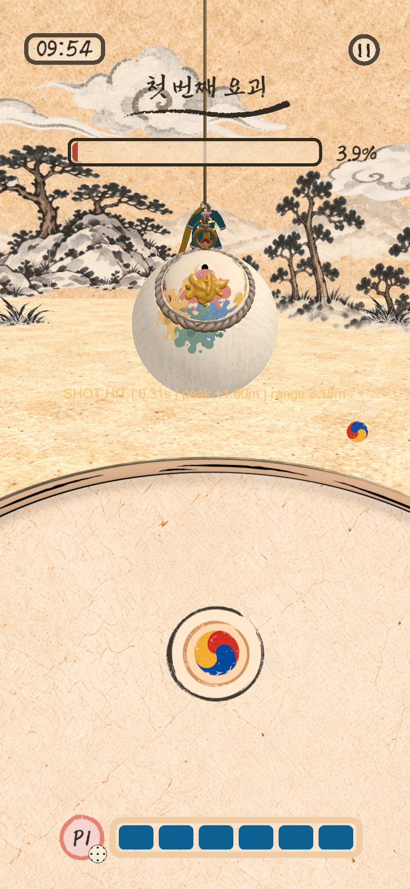
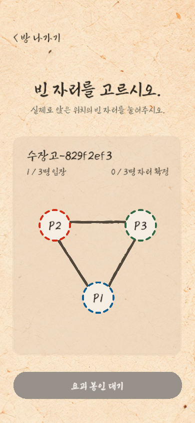

# C6 Physics Lab 검증 범위

## 2026-11-10 — 전투 상단 진행 막대가 100%에서 끝까지 차지 않던 문제

- **기준:** `fix/battle-paint-bar-fill`, 커밋 `5e3b9982`. Unity 6000.6.5f1 batch(macOS, Apple M3 Pro, Metal). 프리팹·Scene·접속 묶음·설정 수는 바꾸지 않았다.
- **원인:** 채움 이미지 `DynamicFill`은 비율 유지(`m_PreserveAspect: 1`)로 저장돼 있다. 그림은 466×59(약 7.9:1)인데 새 전투 UI가 236×21(약 11.2:1) 틀에 넣어, 높이 21에 맞춘 약 166 폭만 왼쪽에 그려졌다. 100%가 틀의 약 70%까지만 찼고, 모든 값에서 막대가 숫자의 약 0.7배로 보였다. 숫자와 `fillAmount`는 같은 칠 칸 수에서 계산돼 맞았다.
- **바꾼 것:** `GameBattleUiPresentation`이 채움을 새 틀에 넣을 때 비율 유지를 끈다. 튜토리얼과 독립 Lab은 이 경로를 타지 않는다.

| 확인 | 결과 |
| --- | --- |
| 수정 전 Mac 개발 빌드 화면(채움 100%·50%) | 100%가 틀의 약 70%, 50%가 약 35%에서 멈춤. 비율 유지를 끄면 100%가 끝까지 참 |
| 새 PlayMode `GameBattlePaintBarTests`(실제로 그려지는 폭) | PASS. 수정을 되돌리면 폭 165.9(틀 236)로 실패 |
| 전체 EditMode / 전체 PlayMode(`5e3b9982`, main 병합 전) | 2160/2160, 734/742 |
| main `a530f423` 병합 뒤 `GameBattlePaintBarTests`·`GameSceneFlowTests` | 30/30 PASS(`GameBattleUiPresentationTests` 포함) |

- 전체 PlayMode 실패 8건(`LabJigwiABNetworkTests` 7건, `GameJigwiStageIntegrationTests` 1건)은 이 변경 전 main `c68ca8c5`에서도 같은 8건이 실패했다(같은 두 fixture를 그 커밋에서 실행, 2/10 PASS). 이 PR은 고치지 않았다.
- **미실행:** 실기기 화면, 멀티 게스트 화면.

## 2026-11-09 — 결과 카드에서 내가 받은 칭호만 붉게 강조

- **기준:** `feat/result-my-title-highlight`, 커밋 `5f9fe518`. Unity 6000.6.5f1 batch(macOS, Apple M3 Pro, Metal). 프리팹·Scene·접속 묶음·설정 수는 바꾸지 않았다. 최신 main `33762faf` 병합 뒤에는 아래 표의 관련 검사만 다시 돌렸다.
- **바꾼 것:** 부적 카드 뒷면과 패배 대시보드에서 저장된 시안 띠(1·4행)를 끄고, 내가 받은 칭호 줄마다(동점 포함) 띠를 얹고 이름에 `(나)`를 붙인다. 패배 대시보드에 실제 기록을 넣는다. 동작은 `STAGE_STORY_PRESENTATION.md`의 "내 칭호 강조"를 따른다.

| 확인 | 결과 |
| --- | --- |
| 새 EditMode `StoryRecordHighlightTests`(저장 프리팹 4종, 카드 앞면 제외, 패배 표 실제 기록) | 6/6 PASS |
| PlayMode `GameStageStoryPresentationTests`(동점·`(나)`), `GameSceneFlowTests`(실제 결과 화면 경로) | 병합 뒤 32/32 PASS |
| 대조 실험 5가지(시안 띠 유지, 패배 표 미기록, 내 칭호 판정 제거, 연결 제거, 카드 앞면 포함) | 모두 해당 검사 실패 |
| 전체 EditMode / 전체 PlayMode(`5f9fe518`, 병합 전) | 2156/2156, 741/741 PASS |

- 시안은 실제 프리팹을 Editor batch로 렌더링해 사용자가 `(나)` 포함 안을 골랐다.
- 독립 검토에서 카드 앞면 도장 글자를 표로 잘못 잡는 문제와 문서 누락을 확인해 고쳤다.
- 전체 기록·2:2 결과 표의 갈색 강조는 바꾸지 않았다.
- **미실행:** 실기기 화면, 멀티 게스트 화면, 긴 공동 수상 이름(`P1, P2(나)`)의 실제 표시.

## 2026-11-09 — 결과·Home·Lobby의 시안에 없는 안내 줄 숨기기

- **기준:** `fix/hide-result-status-line`, main `d1ea7b12` 위 `f37b4443`·`79bc2e15`. Unity 6000.6.5f1 batch(macOS, Apple M3 Pro, Metal). 접속 묶음과 설정 수는 그대로다.
- **바꾼 것:** StageResult 이야기 화면의 `Status` 줄과 Home·Lobby의 `ConnectionMessage` 줄을 실행 중 숨긴다. 프리팹은 바꾸지 않았다. Lobby 문구는 계속 계산하지만 화면에는 나오지 않는다. Direct IP 창의 안내 문구는 그대로다.

| 확인 | 결과 |
| --- | --- |
| `GameFinishReplayTests`·`GameStageStoryPresentationTests`(결과 화면 30프레임 숨김 포함) | 9/9 PASS |
| `GameStageStoryAssetTests` | 5/5 PASS |
| `GameLobbyViewTests` | 19/19 PASS |
| 대조 실험(결과 줄 표시, Lobby 줄 표시) | 해당 검사 실패 |
| 전체 EditMode(`79bc2e15`) | 2150/2150 PASS |
| 전체 PlayMode(`79bc2e15`) 1회차 | 692/731 PASS, 39건 실패 |
| 전체 PlayMode(`79bc2e15`) 2회차 | 731/731 PASS |

- 1회차 실패 39건 중 38건은 실행 중 Mac 덮개가 닫혀 잠든 것이 원인이다(전원 로그 17:06:21 `Clamshell Sleep`, 이후 검사 지연과 시각이 일치). 멈춘 검사 2건이 세션을 정리하지 못해 뒤 검사 36건의 SetUp이 연쇄 실패했다. 나머지 1건은 잠들기 전의 `LabPaintSpreadFlowRenderTests` GPU 화면 비교(픽셀 차 3, 허용 1)이며 2회차에서 통과했고 원인은 조사하지 않았다.
- **미실행:** 실기기 화면 확인, 방 입장 실패·연결 끊김을 실제로 겪을 때의 사용감.

## 2026-11-09 — 전투 화면의 내부 거절 코드 숨기기

- **기준:** `fix/hide-rejection-codes`, main `02a27205` 위 `a46fe72d`와 그 뒤 로비 자리 거절 문구 커밋. Unity 6000.6.5f1 batch(macOS, Apple M3 Pro, Metal).
- **바꾼 것:** Hapio 게임 흐름에서 거절 사유가 내부 코드(영문 대문자·숫자·밑줄 또는 빈 값)면 `Notice`를 바꾸지 않고 개발 빌드 로그에만 남긴다. 로비 자리 거절은 한국어 안내로 표시한다. 독립 Lab은 코드를 그대로 표시한다. 접속 묶음과 설정 수는 그대로다.

| 확인 | 결과 |
| --- | --- |
| EditMode `LabRejectionNoticeTests`(11건)·`LabLobbyRejoinTests` | 32/32 PASS |
| PlayMode 실제 솔로에서 스태미나를 다 쓰고 북 누르기, `GameLobbyViewTests`, `LabLobbyPositionSelectionTests` | 2/2, 24/24 PASS |
| 대조 실험(코드 숨김 제거, 자리 안내 제거) | 해당 검사 실패 |
| 전체 EditMode / 전체 PlayMode(`a46fe72d`) | 2149/2149, 731/731 PASS |

- 자리 거절 문구는 전체 실행 뒤에 고쳤고, 위 표의 관련 검사만 다시 돌렸다.
- 폭탄·여우불 등 영어 안내 문장과 DEV 솔로의 `SHOT HIT` 수치는 이번 범위가 아니어서 그대로 표시된다.
- **미실행:** 실기기 화면 확인, 스테이지 결과 화면 하단 빨간 글씨의 원인 확인(코드 변경 없음).

## 2026-11-09 — 1~3스테이지 박 1.4배

- **기준:** `feat/stage-gourd-size`, main `2427de5a` 위 `d3b4aaa9`. Unity 6000.6.5f1 batch(macOS, Apple M3 Pro, Metal). 그 뒤 커밋은 코드 동작 없이 툴팁 위치·문서만 바꿨다.
- **바꾼 것:** 스테이지 박(rig가 있는 박)만 `LabGourdVisualRig.StageSizeMultiplier` 1.4배로 그린다. 판정 껍데기가 함께 커져 Game 토큰만 47로 올렸다. 다시 굽지 않았고 흰 박은 그대로다. 크기는 실제 게임 화면 시안(현재·1.15·1.3·1.4·1.5배)에서 사용자가 골랐다.

| 확인 | 결과 |
| --- | --- |
| 새 PlayMode `GameStageGourdSizeTests`(세 스테이지 배율·판정 껍데기), `LabGourdVisualRigTests`, `LabWhiteGourdGoldenTests` | 7/7 PASS |
| 대조 실험(배율을 1로 되돌림) | 새 검사 실패(1.54 기대, 1.1 실제) |
| `LabGameFlowBridgeTests`·`LabLobbyRejoinTests` | 43/43 PASS |
| 전체 EditMode / 전체 PlayMode(`d3b4aaa9`) | 2139/2139, 730/730 PASS |

- 바닥과의 관계: 로그의 판정 AABB 아래쪽은 −1.058, 바닥 윗면은 −0.8이다. AABB는 기울어진 메시의 느슨한 상자다. 독립 검토에서 1스테이지 판정 메시 정점으로 다시 계산한 정지 자세 바닥은 약 −0.53이다(실행 측정 아님). 줄 흔들림 아래쪽이나 명중 반동에서는 잠깐 땅과 겹칠 수 있다.
- 독립 검토의 실제 지적 2건(툴팁이 상수에 붙음, 호환 기록 누락)을 고쳤다.
- **미실행:** 실제 플레이로 100% 칠 도달 가능 여부 확인, 실기기 화면 비율별 확인, 멀티 실기기, 마지막 일격 다시보기·결과 화면의 1.4배 구도 육안 확인.

## 2026-11-09 — 멀티 완료 연출 준비 판정

- **기준:** `fix/multiplayer-finish-visual-identity`, main `3a3ec9e3` 위 `8cf2c9a0`. Unity 6000.6.5f1 batch(macOS, Apple M3 Pro, Metal). 그 뒤 커밋은 호환 기록·주석만 바꿨다.
- **원인:** 게스트의 최종 칠 일치 판정이 기기마다 따로 세는 `VisualVersion`을 방장 값과 비교했다. 게스트가 준비를 보내지 못해 다시보기와 1.2초 연출이 모두 시작되지 않고 12초 한도로 결과에 갔다.
- **바꾼 것:** 모든 기기가 같은 도장 마지막 순번(`LastVisualSequence`)으로 비교한다. 메시지 필드가 바뀌어 Game 토큰만 46으로 올렸다.

| 확인 | 결과 |
| --- | --- |
| 수정 전 Mac 개발 앱 3개(방장 1·게스트 2, 127.0.0.1), 1스테이지 | 방장 49, 게스트 57·58로 불일치. 게스트 ready 0, 12초 동안 일정 23번 재예약, 연출 없음 |
| 수정 후 같은 방식 | 세 기기 모두 113 일치. 게스트 약 0.2초 만에 ready, 확정 뒤 세 기기 1.2초 연출 재생, 한도 미사용 |
| 새 EditMode 2건(묶음이 달라도 일치, 마지막 도장이 없으면 불일치) | 수정 전 2건 실패, 수정 후 통과 |
| `GameSessionFinishTests`·`LabGameFlowBridgeTests`·`LabLobbyRejoinTests` | 63/63 PASS |
| 전체 EditMode / 전체 PlayMode(`8cf2c9a0`) | 2139/2139, 729/729 PASS |

- Mac 실행은 진단 로그와 임시 자동 진행을 넣은 별도 빌드로 했다(이 브랜치에는 없다). 자동 진행은 방장이 칠을 직접 넣어 100%를 만들었으므로 실제 투척과 마지막 일격 다시보기(`replay=0`)는 지나지 않았다.
- 독립 검토에서 코드 문제는 없었고, Game 46 호환 기록 누락 1건을 고쳤다.
- **미실행:** 실기기 멀티, 멀티에서의 마지막 일격 다시보기, 2·3스테이지의 실제 멀티 완료, Direct가 아닌 Bonjour 입장 경로.

## 2026-11-09 — #498 전투 첫 사용 렌더링 미리 그리기

- **기준:** `perf/#498-battle-pso-prewarm`, main `56e9c79f` 위 `c3bae1d9`·`ef533273`·`b243db2f`. Unity 6000.6.5f1 batch(macOS, Apple M3 Pro, Metal), `-buildTarget iOS`. 설정 수와 접속 묶음은 바꾸지 않았다.
- **한계:** 이 기록은 복사본이 실제로 그려지고 깨끗이 사라지는지를 확인한 것이다. iPhone에서 첫 투척·첫 명중의 끊김이 줄었는지는 **측정하지 않았다**(`HAPIO_FRAME_SPIKE` 실기기 비교 NOT_RUN). 화면이 없는 batch 실행에서는 화면용 BattleCamera가 렌더링되지 않아, 검사가 그 카메라에만 임시 RenderTexture를 준다.

| 확인 | 결과 |
| --- | --- |
| PlayMode `GameBattleRenderWarmupTests`(새 2건) | 2/2 PASS |
| PlayMode `GameTutorialFlowTests`·`LabFirstHitPaintPrewarmTests`, EditMode `GameFrameSpikePolicyTests`(`c3bae1d9`) | 11/11, 3/3 PASS |
| 대조 실험 5가지(ACK 대기 제거, 복사본을 화면 밖에 둠, 복사본 미삭제, 보드 복사본 제거, 이동 거리 축소) | 모두 해당 검사 실패 |
| 전체 EditMode / 전체 PlayMode(`b243db2f`) | 2121/2123, 713/717 PASS(실패는 아래 기존 6건) |

- 독립 검토에서 1건이 확인됐고 고쳤다: 복사본 이동이 짧아 꼬리 붓 무늬 입자가 나오지 않던 문제.
- **덮지 않은 첫 사용:** 조합판 TextMesh, 생성 미리보기 LineRenderer, 오색·지귀 전용 그림.
- **미실행:** iPhone 측정, 2대 이상 실기기의 시작 시간, Mac·iOS 앱.

## 2026-11-09 — #501 로비에서 끊긴 게스트의 같은 방·같은 P번호 재입장, #502 전투 중 백그라운드 현재 동작 유지

- **기준:** `feat/#501-background-reconnect`. main `e15f61f0` 위에서 만들고 검사했다. 커밋은 `27ccc99d`(기능)와 `be8f280e`·`d6111aa3`·`3f8c3846`·`3d27c6f1`·`f8e593b3`(독립 검토 1~5차 반영), 그 뒤의 기록 커밋이다. Unity 6000.6.5f1 batch(macOS, Apple M3 Pro, Metal), `-buildTarget iOS`. Library는 다른 worktree에서 복제했다. 같은 Mac에서 다른 폴더의 Unity Editor가 열려 있었다.
- **바꾼 것:** 동작은 `GAME_FLOW.md`의 "로비 재입장(#501)" 항목과 `AGENTS.md` #501 절에 적었다. 코드는 `LabNetwork.LobbyRejoin.cs`(새 파일)와 `LabNetwork.cs`·`LabNetwork.Recovery.cs`·`LabNetwork.GameFlow.cs`·`GameSession.cs`·`GameLobbyView.cs`·`GameLobbySeatDesign.cs`다. 게스트의 lobby 받기는 동작을 바꾸지 않고 `ReceiveLobby`로 옮겼다(검사에서 직접 부르기 위해). Game 토큰만 `C6HapioGame/45`로 올렸다.
- **#502:** 코드를 바꾸지 않았다. 결정과 현재 동작을 `GAME_FLOW.md` "종료·정지·DEV"에 적었다.

| 확인 | 결과 |
| --- | --- |
| 새 EditMode `LabLobbyRejoinTests`(21건)와 `LabGameFlowBridgeTests`·`LabJoinRejectionTests` | 50/50 PASS |
| PlayMode `LabLobbyRejoinNetworkTests`(새 5건), `GameLobbyViewTests`(새 2건 포함 19건), `GameSceneFlowTests`(새 1건 포함 25건) | 49/49 PASS(138초, `3d27c6f1`) |
| 대조 실험 17가지(아래) | 17가지 모두 해당 새 검사가 실패 |
| `3d27c6f1` 전체 EditMode / 전체 PlayMode | 2109/2109 PASS(22.0초) / 714/714 PASS(585초) |
| `f8e593b3`(최종 코드) 전체 EditMode / 전체 PlayMode | 2110/2110 PASS(21.2초) / 714/714 PASS(570초) |

- `LabLobbyRejoinNetworkTests`는 한 Editor 프로세스 안에서 진짜 NGO·UTP 방장과 게스트를 loopback으로 연결한다. 전송 제한 시간은 2초로 줄였다. 끊김은 게스트의 NGO 갱신 단계를 멈춰(하트비트가 끊김) 만들었다. 다섯 경우를 본다.
  - 시간 초과로 끊긴 게스트가 같은 방에 새 연결로 P2를 되찾는다. 그 사이 매 프레임 "연결됨" 또는 "들어가는 중"이었다.
  - 제한 시간보다 긴 정지 뒤 복귀하면 바로 다시 들어간다.
  - 나가기는 P를 바로 비우고 표를 버린다.
  - 방장이 방을 닫으면 다시 들어가지 않는다.
  - 응답 없는 방장에게는 30초 한도에서 진행 중인 시도까지 끝낸다(한도는 검사에서 2초로 줄임).
- 대조 실험: 수정한 코드를 하나씩 예전처럼 되돌리고, 대응하는 새 검사가 실패하는지 확인했다. 매번 원래 코드로 되돌렸다.
  - 자리 맡기 없음: EditMode 6건과 실제 연결 검사가 실패.
  - 승인 대기 중인 재입장을 새 자리로 셈: "같은 프레임 두 명" 검사가 실패.
  - P 기억을 예전 방식으로: "P를 취소한 채 끊김" 검사가 실패.
  - 30초에 진행 중인 시도를 끊지 않음: 한도 검사가 실패.
  - 나가기 뒤에도 표를 유지: 나가기 검사가 실패.
  - "자리 비움" 표시를 지움: 로비 화면 검사가 실패.
  - 받아 주지 않은 표로도 정원 찬 카드를 엶: EditMode·PlayMode 카드 검사가 실패.
  - 정원 찬 카드를 늘 막음: EditMode 카드 검사가 실패.
  - 카드 문구가 표를 무시: PlayMode 카드 검사가 실패.
  - 소식 없는 게스트도 자리를 맡음: 해당 검사가 실패.
  - 전투 중 나가기를 떠남으로 표시하지 않음: 해당 PlayMode 검사가 실패.
  - Direct IP 표를 방 카드에 묶지 않음: 해당 검사가 실패.
  - 같은 포트 Direct IP가 표를 새로 만듦: 카드 검사의 Direct IP 단언이 실패.
  - 자리를 되찾은 새 연결을 확인된 것으로 치지 않음: "첫 패킷 전에 다시 끊김"·"확인된 연결을 바꾼 새 연결" 검사가 실패.
  - 2:2 로비 복귀 때 확인 목록을 비우지 않음: "2:2 로비 복귀" 검사가 실패.
  - 지금 판의 나가기 신호만 떠남으로 표시: 다른 판을 가리키는 나가기 단언이 실패.
  - 기억해 둔 P로 돌아온 연결을 확인된 것으로 치지 않음: 해당 검사가 실패.
- 앞선 커밋의 전체 실행:
  - `27ccc99d`: EditMode 2096/2096, PlayMode 711건 중 710 PASS. 실패는 `LabPlayerPaintPatternRenderTests.PatternToggleChangesOnlyRenderedInkWithoutReuploadingOrRevisingMaps`(픽셀 하나 122 → 123)였다. 그 fixture만 두 번 다시 돌려 5/5, 5/5 PASS.
  - `d6111aa3`: EditMode 2103/2103, PlayMode 713건 중 712 PASS. 실패는 `LabPlayerPaintPatternRenderTests.ActualSavedShaderDistinguishesAllSixPaintersWithoutChangingPaperAlphaOrCoverage`였다.
  - `3f8c3846`: EditMode 2106/2106, PlayMode 714/714 PASS.
  - 두 실패 모두 이 문서 앞쪽에 "실행마다 다르게 실패"로 기록된 GPU 화면 비교다.
- 새 네트워크 검사가 그 GPU 검사에 영향을 주는지 따로 확인했다.
  - 같은 순서(새 네트워크 검사 → GPU 두 fixture)로 두 번 돌렸다. 한 번은 기록된 간헐 실패 2건(`ActualSavedShader…`, `LabWatercolorSurfaceGrainTests.SurfaceGrainChanges…`)이 났고, 한 번은 모두 통과했다.
  - 이어서 GPU fixture만 돌리기와 새 검사 뒤에 돌리기를 번갈아 네 번씩, 모두 8회 돌렸다. 8회 모두 PASS였다.
  - 새 검사와 관계없는 기존 간헐 실패로 본다.
- **독립 검토:** 읽기 전용 검토자와 반박 검증자를 네 차례 돌렸다.
  - 1차: 검토자 4명. #501에서 6건이 확인됐고 1건은 반박됐다. #473에서는 흰 박 바닥 묻힘 1건이 확인됐다(그 PR의 확인 사항).
  - 2차: 실제 문제 2건과 검사 빈틈 2건.
  - 3차: 3건이 확인됐고(중간 1) 1건은 반박됐다.
  - 4차: 3건이 확인됐다(중간 1: 2:2 로비 복귀 뒤 처리된 전투 중 끊김을 맡음).
  - 5차: 처음부터 다시 훑은 검토자는 중간 이상을 찾지 못했다. 4차 수정의 작은 빈틈 1건이 확인됐다.
  - 확인된 것은 모두 고쳤고, 고칠 때마다 검사를 더하고 대조 실험으로 그 검사가 문제를 잡는지 확인했다.
- **main `1823993d`(#551·#552·#567·#571·#573 포함) 병합 뒤:** `44e799da`에서 EditMode 2123건 중 2121 PASS, PlayMode 715건 중 711 PASS. 실패 6건은 `LabJigwiABModelTests.BBucketArrivesSeatBySeatAndEachPourPaintsAtOnce`, `GameTutorialTests.GoalStepPlaysTheApprovedLinesWithGeumokAndBul`, `LabJigwiABNetworkTests` 3건, `GameJigwiStageIntegrationTests` 1건이다. 같은 6건을 #501 없는 main `1823993d`에서 돌려 같은 메시지로 모두 실패함을 확인했다. 이 PR이 만든 실패가 아니며 고치지 않았다. Game 토큰은 #551의 44 위인 45, 프로토콜 5697·`C6PhysicsLab/58`은 #551 값이다.
- 각 실행의 skip·inconclusive는 0이다. batch 가져오기가 덧붙인 Lobby PNG `.meta` 20개의 WebGL 항목은 매번 되돌렸다.
- **미실행:** iPhone의 실제 화면 잠금·백그라운드(멈춘 시간을 재는 벽시계와 복귀 처리는 Editor에서 그 함수를 직접 불러 확인했다), 실제 Wi-Fi 끊김, 두 대 이상의 실기기, Bonjour 방 카드로 정원 찬 방에 실제로 다시 들어가기(카드 문구는 꾸민 방 목록으로, 입장 가능 판단은 EditMode로만 확인했다), Mac·iOS 앱.

## 2026-11-09 — #557 방장 로비의 Direct IP 주소·포트 표시

- **기준:** `fix/#557-direct-ip-host-address`, main `56e9c79f` 위 `28e82aef`·`fe7fae5e`. Unity 6000.6.5f1 batch(macOS, Apple M3 Pro, Metal), `-buildTarget iOS`. 전체 실행은 `fe7fae5e`와 같은 내용의 작업 트리에서 돌렸다. 설정 수와 접속 묶음은 바꾸지 않았다.
- **방법:** 주소는 `getifaddrs`로 읽는다. 관리 코드의 인터페이스 목록은 iOS IL2CPP 동작이 확인되지 않아 쓰지 않았다. 인터페이스 이름(`en0`, `bridge100`, `ap1`, `pdp_ip0` 등)의 의미는 일반 지식이며 실기기에서 확인하지 않았다.

| 확인 | 결과 |
| --- | --- |
| EditMode `LabLocalAddressesTests`(새 14건: 표시 필터·정렬·이 Mac 읽기), `GameLobbyAssetTests` | 21/21 PASS |
| PlayMode `GameLobbyViewTests`(새 1건, 기존 검사 2건 보강) | 19/19 PASS |
| 대조 실험 5가지(포트 자동 입력 복원, 주소 줄 겹침, 주소 줄 숨김, 셀룰러 필터 제거, 169.254 필터 제거) | 모두 해당 검사 실패 |
| 전체 EditMode / 전체 PlayMode | 2135/2137, 712/716 PASS(실패는 아래 기존 6건) |

- 독립 검토에서 2건이 확인됐고 고쳤다: 저장 프리팹 검사·갱신 도구에서 Awake 전 주소 줄이 null이 되는 문제(첫 전체 실행의 `GameLobbyAssetTests` 4건 실패와 일치), 빈 포트 거절 문구 단언이 항상 통과하던 검사 빈틈.
- **미실행:** iPhone의 실제 주소 표시(Wi-Fi·핫스팟·유선), 실기기 간 Direct IP 입장, Direct IP 게스트의 2:2·3:3 방 모드 수신, iOS IL2CPP에서의 `getifaddrs` 호출.

## 2026-11-08 — #473 모든 박 1.1배 (Gourd Visual Size 1.4 → 1.54)

- **기준:** `feat/#473-gourd-size`. main `e15f61f0`에서 고치고 검사했다. Unity 6000.6.5f1 batch(macOS, Apple M3 Pro, Metal), `-buildTarget iOS`. Library는 다른 worktree에서 복제했다. 같은 Mac에서 다른 폴더의 Unity Editor가 열려 있었다.
- **바꾼 것:**
  - `LabConfig.asset`의 `gourdVisualSize`와 코드 기본값을 1.4에서 1.54로 올렸다. 코드 기본값은 `LabConfig.DefaultGourdVisualSize`이며, 실행 중 설정이 없을 때 `LabGourdPaint`도 이 값을 쓴다. 흰 박은 크기/1.8, 스테이지 박은 크기/1.4배로 그리므로 모든 박이 이전의 1.1배다. 판정 충돌체는 기존 동작대로 보이는 껍데기를 따라 커진다.
  - 굽기 기준(`GameGourdRigBake.ReferenceVisualSize` 1.4, `TargetBodyHeight` 2.390325)은 그대로 두고 주석만 고쳤다. 박을 다시 굽지 않았다.
  - `Hapio/Upgrade Menu DEV Rows`(batch `-executeMethod`)로 Home·Lobby의 저장 DEV 140행을 1.54로 저장했다. 장면마다 6줄이 바뀌었다.
    - 입력의 `m_Text`, 슬라이더의 `m_Value`.
    - 입력 자식의 표시 글자(`1.` → `1.5`).
    - 슬라이더 Fill·Handle의 구동 앵커 3줄(0.36 → 0). 저장할 때 Unity가 구동 값을 비운다. 저장 257행 중 107행이 이미 이 상태였다.
  - 흰 박 마운트 골든을 `GOURD_GOLDEN_RECORD=1`로 다시 기록했다. 바뀐 줄은 예상한 4줄이다.
    - `visual.position` y: 0.186667 → 0.121333.
    - `visual.scale`: 0.777778 → 0.855556.
    - `shellInMount`·`hitboxInMount`: 대각 1.4 → 1.54, y −0.334444 → −0.451889.
    - 요괴 골든(`WhiteGourdYokai.txt`)은 바이트 단위로 같다.
  - `LabDeveloperConfigTests`의 기본값 단언을 1.54로 바꿨다.
  - 문서: `AGENTS.md` #473 절, `DEVELOPER_MODE_PARAMETER_SPEC.md`, `GOURD_MODELS.md`.
    - `DEVELOPER_MODE_PARAMETER_SPEC.md`에는 기본값과 충돌체가 따라 커지는 현재 동작을 적었다.
- **접속 묶음:** Host가 보내는 공유값(인덱스 140)만 바뀐다. 그래서 설정 259개·5691·`C6PhysicsLab/52`·`C6HapioGame/39`를 그대로 둔다. #211·#225·#266의 기본값 변경과 같은 처리다.

| 확인 | 결과 |
| --- | --- |
| 골든 기록 실행(마운트 검사만) | 1/1 PASS. `WhiteGourdMount.txt` 4줄 변경, `WhiteGourdYokai.txt`는 그대로 |
| 기록 없이 `LabWhiteGourdGoldenTests` | 2/2 PASS |
| EditMode 관련 5 fixture | 151/151 PASS |
| PlayMode `LabGourdHitboxTests`·`LabGourdVisualRigTests`·`GameStageGourdIntegrationTests` | 12/12 PASS |
| 전체 EditMode | 2089/2089 PASS(22.5초) |
| 전체 PlayMode | 706건 중 705 PASS(575초). 실패 1건은 아래 |
| 실패 1건만 다시: `LabWatercolorSurfaceGrainTests` fixture 두 번 | 2/2 PASS, 2/2 PASS |

- EditMode 관련 5 fixture는 `LabDeveloperConfigTests`·`GameSceneAssetTests`·`GameGourdRigBakeTests`·`GameEditorMenuCleanupTests`·`LabPaintDryingConfigTests`다.
- 전체 PlayMode의 실패 1건은 `LabWatercolorSurfaceGrainTests.PigmentTextureIsStaticAndFollowsTheObjectAcrossScreenTranslationAndRigRotation`이다.
  - 0.12초 간격으로 찍은 두 화면의 RGB 차이가 최대 2였다(한도 1).
  - 이 검사는 흰 박 프리팹을 크기 설정 없이 따로 그리므로 이번 변경과 무관한 일시적 실패로 본다.
- 각 실행의 skip·inconclusive는 0이다. batch 가져오기가 덧붙인 Lobby PNG `.meta` 20개의 WebGL 항목은 매번 되돌렸다.
- **계산만 했고 실행하지 않은 것:** 장면 값과 설정으로 계산했다.
  - 흰 박(2:2·3:3·Lab 단판·튜토리얼)은 줄이 위아래로 출렁일 때(±0.45) 가장 낮은 지점에서 보이는 바닥 아래로 약 8cm 들어간다. 1.4에서는 16cm 위였다.
  - 스테이지 박은 그 지점에서도 바닥 위에 남는다.
  - 세게 맞아 박이 더 내려가면, 아래쪽을 노린 공이 바닥에 먼저 닿아 빗나감이 되는 경우가 드물게 생길 수 있다.
  - 전투 카메라와 다시보기 카메라의 거리는 박 크기를 따라 바뀌지 않는다.
- **미실행:** Editor·기기 화면 확인, 실기기의 판정과 프레임 비용, Mac·iOS 앱.

## 2026-11-08 — DEV 행 Editor 메뉴가 Home·Lobby의 저장 257행을 지키게 (PR #561 후속)

- **기준:** `fix/menu-dev-row-240`, 바로 아래 절의 커밋 위(main `92d511ee`)에서 고치고 검사했다. 그 뒤 main `488104e7`(#562)을 rebase가 아니라 merge(`a434b800`)로 받아 다시 검사했다(표의 "병합 뒤"). Unity 6000.6.5f1 batch(macOS, Apple M3 Pro, Metal), `-buildTarget iOS`. 같은 Mac에서 다른 폴더의 Unity Editor가 열려 있었다.
- **문제:**
  - `Hapio/Upgrade Menu DEV Rows`·`Upgrade Three Yokai Stages`·`Upgrade 2v2 Lobby UI`(저장 패널이 259행이 아니면 같은 갱신을 부름)는 저장 패널을 `DeveloperFields.Count`(259)행으로 늘려 클레이 257·258행을 장면에 저장했다. #506 이후 `GameSceneAssetTests`는 저장 패널을 257행으로 요구하므로, 메뉴를 돌리면 Home·Lobby 검사가 실패했다.
  - `Upgrade Figma Game Lobby`는 저장 패널이 259행이 아니면 멈춰, 지금 장면에서는 실행되지 않았다.
  - 같은 메뉴들의 글꼴 갱신(`UpgradeFonts`)이 Home의 오프닝 Prefab 인스턴스(`GameOpening.prefab`, #354) Text 8개에 `ShillaCultureBold` 덮어쓰기를 장면에 저장했다. 예를 들어 `Speaker`는 원래 `Shilla_Culture(M)`이다.
- **고친 것:**
  - 저장 행 수를 `GameSceneBuilder.SavedDeveloperRowCount`(= `LabConfig.ClayThicknessField`, 257) 하나로 정했다. DEV 행 갱신·추가, 새 메뉴 생성, `Upgrade 2v2 Lobby UI`의 스키마 확인(`MenuDeveloperSchemaIsCurrent`), `Upgrade Figma Game Lobby`의 확인이 이 값을 쓴다.
  - DEV 행 갱신은 257행부터의 저장 행(예전 도구가 저장한 것)을 지운다.
  - 글꼴 갱신은 Prefab 인스턴스의 Text를 건너뛴다. 기존에 건너뛰던 `GameLobbyView` 아래에 더한 것이다.
  - 고친 `Upgrade Menu DEV Rows`의 결과를 장면에 저장했다. Home·Lobby 각 11줄로, DEV 행 0·1·41·43·48·52·53·54·72·73은 숨기고 237은 보인다. 2026-11-05 DEV 표시 정리의 공통 탭 규칙(`GameStageSettings.IsFieldShown`)이다. 실행 중에는 패널을 열 때 다시 정하므로 게임 동작은 같다.
  - `GameEditorMenuCleanupTests`에 검사 2개를 더했다. ① Home 복사본에 실행 중 클레이 행과 틀린 240 기본값을 넣은 뒤 DEV 행 갱신을 부르면 257행·원본 기본값으로 돌아오고, Prefab 인스턴스 Text의 글꼴은 그대로다. 복사본은 검사 뒤 지운다. ② `MenuDeveloperSchemaIsCurrent`가 저장된 Home·Lobby를 현재 형식으로 본다.
  - `AGENTS.md` #506 절과 `GAME_FLOW.md`(Battle 절, 에디터 도구 절)에 저장 행 규칙을 적었다.

| 확인 | 결과 |
| --- | --- |
| 대조: 고치기 전 `Upgrade Menu DEV Rows` 실행 | Home·Lobby가 259행(행 오브젝트 62개씩 추가). 같은 11행 보이기 변경과 Home 오프닝 글꼴 덮어쓰기 8개. 이어서 `GameSceneAssetTests` 9건 중 7 PASS(Home·Lobby가 행 수 257 기대, 실제 259) |
| 대조: 고치기 전 `Upgrade Figma Game Lobby` 실행 | `The existing Canvas and complete scoped DEV panel must be retained.`로 멈춤(종료 코드 1), 바뀐 파일 없음 |
| 대조: 새 검사 + 고치기 전 Editor 코드 | 4건 중 2 PASS. 새 2건 실패(행 수 259, 스키마 확인 False) |
| 대조: 새 검사 + Prefab 글꼴 건너뛰기만 뺀 코드 | 4건 중 3 PASS. ①이 `Speaker`(기대 `Shilla_Culture(M)`, 실제 `ShillaCultureBold`)에서 실패 |
| 고친 뒤 `Upgrade Menu DEV Rows` 두 번 | 1번째: Home·Lobby 각 11줄(위 보이기)만 바뀜. 2번째: 바뀐 것 없음 |
| 이어서 `Upgrade Three Yokai Stages` → `Upgrade 2v2 Lobby UI` → `Upgrade Figma Game Lobby` | 모두 예외 없이 끝남. Home·Lobby·`GameLobby.prefab`·StageResult·스테이지 자료는 그대로. 무관한 재저장 두 가지는 되돌렸다: `GameOver.unity`에 `FigmaStageResult`의 새 필드 2줄(`blueTeamBackground`·`redTeamBackground`, 값 없음), Team 그림 `.meta` 9개의 WebGL 항목 |
| `GameSceneAssetTests`+`GameEditorMenuCleanupTests` / 전체 EditMode | 13/13 PASS(1.2초) / 2064/2064 PASS(20.7초). 늘어난 2건이 새 검사다 |
| PlayMode `GameSceneFlowTests`·`GameLobbyViewTests`·`GameOpeningControllerTests`·`GameStageUiTests` | 48/48 PASS(107.8초; 21·15·10·2) |
| 병합 뒤: 네 메뉴를 차례로 실행(`Upgrade Menu DEV Rows` → `Three Yokai Stages` → `2v2 Lobby UI` → `Figma Game Lobby`) | 모두 예외 없이 끝남. Home·Lobby는 네 메뉴 모두에서 그대로. `Upgrade 2v2 Lobby UI`만 main이 새로 부르는 디자인 단계(`GameMenuDesignUpgrade`·`GameSeatDesignUpgrade`)로 `GameLobby.prefab`의 Sprite 1개(`Lab/Art/Lobby/4ba8d.png` → `Hapio/Art/UI/Seats/5089e.png`)와 빈 이름 36줄을 다시 저장하고 그림 `.meta` 30개에 WebGL 항목을 붙였다. 이 PR이 바꾸지 않은 경로라 되돌렸다 |
| 병합 뒤: `GameSceneAssetTests`+`GameEditorMenuCleanupTests` / 전체 EditMode | 13/13 PASS(1.6초) / 2087/2087 PASS(21.5초) |
| 병합 뒤: PlayMode 위 네 fixture | 50/50 PASS(125.0초; 23·15·10·2). `GameSceneFlowTests`는 main 병합으로 23건이 됐다 |

- 각 실행의 skip·inconclusive는 0이다. 대조용 코드 되돌림과 메뉴 실행의 무관한 재저장은 되돌렸고 커밋하지 않았다. batch 가져오기가 덧붙인 Lobby PNG `.meta` 20개의 WebGL 항목도 매번 되돌렸다.
- **미실행:** Editor 화면에서 메뉴를 직접 누르는 확인, `Create Missing Development Game Scenes`(장면이 모두 있어 새로 만들지 않는다. 바꾼 줄은 컴파일만 확인), 전체 PlayMode, Mac·iOS 앱·실기기.

## 2026-11-08 — Home·Lobby 저장 DEV 240행을 원본 기본값 10으로 맞춤 (main EditMode 실패 2건)

- **기준:** `fix/menu-dev-row-240`. main `886e65db`에서 고치고 검사한 뒤, #559·#560이 들어온 main `92d511ee` 위로 rebase해 다시 검사했다. Unity 6000.6.5f1 batch(macOS, Apple M3 Pro, Metal), `-buildTarget iOS`. Library는 다른 worktree에서 복제했다. 같은 Mac에서 다른 폴더의 Unity Editor가 열려 있었다.
- **증상:** EditMode `GameSceneAssetTests.MenuScreens_HaveSavedEditableCanvasAndInput`의 Home·Lobby 2건이 `Setting240`에서 실패했다. 저장된 DEV 패널의 입력·슬라이더는 15, `LabConfig.asset` 기본값은 10이다. PR #559·#560을 검사하다 main에서도 나는 실패로 찾았다.
- **원인:** #540이 `jigwiABPersonalDurationSeconds`(DEV 240, 지귀 A 제한 시간)를 15→7(`14813416`)→10(`5413486d`)으로 바꾸면서 Home·Lobby의 저장 DEV 행은 다시 저장하지 않았다.
- **고친 것:**
  - 두 장면의 `Setting240`만 10으로 저장했다. 장면마다 3줄이다: `Value` InputField의 `m_Text`, 그 자식 `Text`의 `m_Text`, `Slider`의 `m_Value`(모두 15→10). 라벨·슬라이더 범위(1~15)와 다른 오브젝트·Transform·참조는 그대로다. 바뀐 줄마다 소속 오브젝트를 장면 계층 경로로 확인했다.
  - 그 사이 main의 #562(`d3bf68a2`)도 같은 세 줄을 10으로 저장했다. 그래서 main을 merge(`a434b800`)한 뒤 이 PR에는 `Setting240` 변경분이 남지 않는다.
  - 메뉴 `Hapio/Upgrade Menu DEV Rows`는 쓰지 않았다. 이 도구(`GameSceneBuilder.UpgradeDeveloperRows`)는 저장 패널을 `DeveloperFields.Count`(259)행으로 늘려 클레이 257·258행까지 장면에 써 넣는다. 같은 검사는 #506 이후 저장 패널이 257행(`ClayThicknessField`)이고 클레이 두 행은 실행 중에 붙는다고(`GameScreen.EnsureClayDeveloperRows`) 요구하므로, 메뉴를 그대로 돌리면 행 수 단언에서 실패한다. 대신 그 도구의 행 갱신(라벨, `SetTextWithoutNotify`, 슬라이더 범위·`SetValueWithoutNotify`)을 저장된 257행 중 원본과 다른 행에만 적용하는 임시 Editor 스크립트를 `-executeMethod`로 실행해 Unity가 저장하게 했다. Scene YAML은 손으로 고치지 않았고 스크립트는 커밋하지 않았다.
  - batch 가져오기가 실행할 때마다 Lobby PNG `.meta` 20개에 WebGL 플랫폼 항목을 덧붙여 매번 되돌렸다.
- **영향:** 게임 동작은 바뀌지 않는다. 실행 중 DEV 패널을 열면 `GameScreen.SelectDeveloperScope`가 모든 칸을 세션 값으로 다시 채운다(코드로 확인했고 실행 검사는 아니다).

| 확인 | 결과 |
| --- | --- |
| `886e65db`, 고치기 전: 임시 스크립트로 저장 257행의 라벨·입력값·슬라이더 값·범위를 원본과 비교 | Home·Lobby 모두 240행만 다름(입력 `15`·슬라이더 15, 원본 10). 라벨·범위는 같음 |
| `886e65db`, 대조: 두 장면만 main 것으로 되돌린 `GameSceneAssetTests` | 9건 중 7 PASS. Home·Lobby 2건이 `Setting240`(기대 10, 실제 15)에서 실패 |
| `886e65db`, 고친 뒤: `GameSceneAssetTests` / 전체 EditMode | 9/9 PASS(1.0초) / 2058/2058 PASS(20.6초) |
| `92d511ee`로 rebase 뒤: `GameSceneAssetTests` / 전체 EditMode | 9/9 PASS(0.9초) / 2062/2062 PASS(20.4초). 늘어난 4건은 #504가 더한 검사다 |

- 각 실행의 skip·inconclusive는 0이다.
- **남은 것:** `Hapio/Upgrade Menu DEV Rows`·`Hapio/Upgrade Three Yokai Stages`·`Hapio/Upgrade 2v2 Lobby UI`(저장 패널이 259행이 아니면 같은 갱신을 부름)는 여전히 259행을 현재 형식으로 본다. 그대로 실행하면 257·258행이 장면에 저장되어 위 검사의 행 수 단언이 실패한다. `docs/GAME_FLOW.md`는 새 DEV 행을 이 메뉴로 추가한다고 적고 있다. 이 커밋에서는 도구를 고치지 않았고, 같은 PR의 위 절에서 고쳤다.
- **미실행:** 위 메뉴 자체 실행, PlayMode(장면 값 3줄만 바뀌고 위 영향 참고), Editor 화면 확인, Mac·iOS 앱·실기기.

## 2026-11-08 — #558 스테이지 스토리·새 UI와 같은 방 재도전 통합

- **기준:** main `886e65db`, #556 `dc2c0e82`, #553 `58079a69`. 두 PR의 원본 이력을 순서대로 병합하고 실제 게임 연결을 추가했다. 문서 충돌은 양쪽 검증 기록을 보존했다.
- **환경:** Unity 6000.6.5f1, macOS·Metal, Standalone 활성 플랫폼의 live Editor. 기존 프로젝트와 분리한 작업 위치를 사용했으며 Editor는 `-noaudio`로 실행했다. 아래 결과는 이 작업에서 실제 실행한 검사이며 두 원본 PR의 작성자 기록과 구분한다.

### 자동 검사

| 실행 | 실제 결과 | 후속 처리 |
| --- | --- | --- |
| 첫 전체 EditMode | 2,081개 중 2,077 통과·4 실패 | 전송 검사 시계, 실패 Scene의 관람 참조 전제, Home/Lobby DEV240 표시값 차이 수정 |
| 수정 후 전체 EditMode | **2,081/2,081 통과** | 실패 0·건너뜀 0 |
| 첫 전체 PlayMode | 685개 중 676 통과·9 실패 | 지귀 검사 조건 8건과 클레이 검사 대기 1건을 아래처럼 구분해 재실행 |
| `LabJigwiABNetworkTests` 최종 재실행 | **9/9 통과** | 복제 설정에서 구형 시간표·즉시 소각 정책을 명시. 소각 해제 복제는 실제 부적 완료 승인 경로로 확인 |
| `GameJigwiStageIntegrationTests` | **1/1 통과** | 실제 저장 설정의 새 시간표에서 A·B 확인 시각을 계산. 게임 시간표는 되돌리지 않음 |
| `GameBattleUiPresentationTests` | **2/2 통과** | 일반 세 스테이지에서도 조합판 합성 성공을 필수 단언하도록 강화 |
| `ClayPreviewPlayModeTests.FiveActualRgbEditorsClampSrgbExactlyAndKeepPaletteAcrossPresetsWithIndependentReset` | **1/1 통과** | 첫 실행에서 Game 뷰가 비활성화돼 180초 제한을 넘김. 활성 Game 뷰에서 같은 검사는 9.79초에 완료 |
| 추가 `GameSceneFlowTests.SavedStorySkipAndEndingButtonsReceiveRealMouseClicksAtTheirVisibleScreenPositions` | **1/1 통과** | 저장 결과 화면에서 GraphicRaycaster 최상위 대상과 실제 가상 마우스 이동·누름·뗌으로 Skip→카드→엔딩→Home 확인. 직접 이벤트 호출로 대체하지 않음 |

첫 전체 PlayMode에서는 `GameSceneFlowTests` 22개, `GameStageRetryPlayModeTests` 2개, `GameStageStoryPresentationTests` 3개, `GameLobbyViewTests` 13개가 모두 통과했다. 기존 `StoryPlayerTests` 11개·`StoryResultPresentationTests` 9개·`StoryTapAdvanceTests` 4개도 통과했다. 여기에는 카드 실제 기록·실패 실제 봉인율·이전 성공 기록 보존·같은 방 재도전 초기화·전원 결과/관람 게이트·패배 뒤 연결 종료 fallback·최종 6컷 엔딩·입력 해제 보호가 포함된다.

**수정 후 전체 PlayMode 685개를 다시 실행한 결과로 표현하지 않는다.** 전체 실행에서 발견한 실패를 관련 묶음으로 재검사했고, 마지막 실제 포인터 검사 1개를 별도로 추가했다. 현재 확인된 미해결 검사 실패는 없다.

### 실패 원인과 보존 범위

- `LabTerminalSnapshotCatchupTests`는 실제 큐 삽입 시각보다 이른 가상 시각 1초로 전송을 요청했다. 검사 시계를 실제 시각 이후로 맞췄다. 최종 전체 EditMode에서 비어 있지 않은 도색 지도·Defeat 스냅샷의 정확한 복구와 새 라운드 누출 방지를 확인했다.
- GameOver에는 원래 완성 박 관람 참조가 없다. 실패 화면을 승리 화면과 같은 관람 참조 조건으로 검사하던 새 검사를 실제 연결에 맞췄다.
- main의 실제 A 지속시간은 10초인데 Home/Lobby에 저장된 DEV240 표시값은 15였다. Unity API로 해당 Text/InputField/Slider만 10으로 맞췄다. 원본 설정과 Scene의 위치·크기는 변경하지 않았다.
- 지귀의 구형 네트워크 검사는 저장 설정을 복제한 뒤 예전 시간표와 A 중 소각을 가정했다. 최신 main은 A10/B45/A66/B83과 A 중 소각 보류를 사용한다. 구형 호환 검사에만 해당 정책을 명시했고, 실제 게임 Scene 검사는 최신 시간표를 검증한다. 실패 만료는 소각 해제가 아니므로 마지막 owner-delta 해제 검사는 실제 부적 완료 승인을 사용한다.
- 검사 중 자동 변경된 지귀 리본 재질의 `_NORMALMAP` 제거는 원본으로 복원해 통합에서 제외했다. Lab Scene·Battle Scene·Packages·ProjectSettings와 게임 판정·도색 압축·Bulk 선택 ACK 형식은 변경하지 않았다.

### 빌드와 Editor 화면 확인

- `Hapio > Development Build > Build Mac App` 경로로 **Mac 개발 빌드 성공**(빌드 호출 57.6초). 출력은 `Builds/Hapio/20261108-155628-5341e594/macOS/Hapio-Development.app`이다. Home·Lobby·공통 Battle·StageResult·GameOver 5개 Scene을 포함하며 제작용 StageStoryPreview Scene은 포함하지 않는다.
- Editor의 C6 Portrait(390×844)에서 새 전투 UI와 지귀 봉인 카드의 앞·뒷면을 확인했다. 실제 종료 기록의 100%·남은 30초와 기록이 표시됐고, 카드의 박 관람 버튼으로 기존 3D 관람 화면을 열었다가 같은 카드 뒷면으로 복귀했다.
- 이 시각 확인은 기존 Editor DEV 솔로 시작단계(3)를 유지하고, 임시 복사 설정의 최초 도색량100%·마르기OFF로 결과를 준비한 것이다. 실제 투척 명중이나 일반 경기 클리어 시험으로 기록하지 않는다. 원본 설정에 저장하지 않았다.
- 네이티브 자동 클릭의 상하단 버튼 전달이 일관되지 않아, 위 추가 PlayMode 검사에서 실제 UI 입력 경로와 레이캐스트 대상으로 별도 확인했다. 실제 입력 검사는 6컷 엔딩 뒤 진짜 Home 복귀까지 통과했다.
- 작업 완료 후 기존 Unity·Hub·검증 앱과 통합용 Editor를 종료했다. 빌드 앱을 추가 실행하지 않았다.

### 게시 직전 최신 main 통합 확인

- 작업 중 main에 추가된 #559(방 공개 재등록)·#560(배경 재질 동기화), 기준 `92d511ee`를 통합 커밋 `a09f66a4`로 보존했다. 충돌은 AGENTS·VALIDATION 문서뿐이며 양쪽 기록을 유지하고 현재 Game39와 새 배경 재질 규칙을 함께 남겼다.
- 이 최신 통합본에서 **전체 EditMode 2,085/2,085 통과**(29.63초).
- 관련 PlayMode **59/59 통과**: 두 PendingRoomRetry fixture 합계5, GameLobbyView15, LabFigmaLobby12, GameBattleUiPresentation2, GameStageRetry2, GameSceneFlow23. 마지막23개에는 실제 마우스의 스킵·엔딩·Home 검사도 포함된다. skip·inconclusive는 모두0이다.
- 최신 통합본의 Mac 개발 빌드도 성공했다(호출16.3초). 최종 출력은 `Builds/Hapio/20261108-163016-39dd4b42/macOS/Hapio-Development.app`이며 독립 앱 실행은 하지 않았다.
- 읽기 검토에서 방 공개 재등록은 Home의 입장 전 광고 수명이며 실패한 스테이지 재도전과 분리돼 있음을 확인했다. 배경 숨은 재질 동기화는 Editor 전용이고 새 UI의 조합대 런타임 복사본과 다른 저장 재질을 대상으로 한다.

### 이번에 실행하지 않은 항목

- iPhone/iPad 설치·실기기 터치·노치/회전·오디오 청취.
- Mac 독립 실행 앱의 플레이, 실제 LAN/일반 Wi-Fi/핫스팟에서 여러 기기 연결과 원격 결과 확인.
- 위 항목은 기존 검증 기록이나 코드 존재로 PASS를 대신하지 않는다. 현재 호환 묶음은 설정259개·5691·Lab52·**Game39**다.

## 2026-11-08 — #503 방장 입장 전 대기 방 공개 실패 재시도

- **기준:** main `886e65db` 위의 `fix/#503-pending-room-register-retry`. Unity 6000.6.5f1 batch(macOS, Apple M3 Pro), iOS 활성, 실제 macOS Bonjour(dns_sd). Library는 다른 worktree에서 복제했다.
- **강제 실패 방법:**
  - 진행 중인 등록은 discovery 자신의 `Fail`로 끝냈다. 오류 응답·시간 초과와 같은 경로다.
  - 시작 거절은 예약 소켓 두 개를 한 번만 숨겨 `StartAdvertise`가 바로 false를 돌려주게 했다.
  - 실제 로컬 네트워크 권한 창·거부, Wi-Fi 끊김은 재현하지 않았다.

| 확인(검토 반영 `0e8edb42` 기준, 괄호는 첫 커밋 `4faa3c93`) | 결과 |
| --- | --- |
| 관련 EditMode(`LabBonjourRegistrationTests`·`LabDiscoveryBackoffTests`·`LabRoomPresenceTests`·`GamePendingRoomRegistryTests`) | 58/58 PASS(첫 커밋 58/58). 이름 충돌 재시도와 마지막 번호 실패 검사를 포함한다 |
| 새 PlayMode `LabPendingRoomRetryTests` 4건 | 4/4 PASS: 첫 등록이 실패해도 같은 포트로 확정되고 이름 충돌 예산은 0으로 돌아감, 시작 거절 뒤에도 재시도, 확정 뒤 끊기면 뒤 번호를 요청받아도 자기 이름으로 복구, 대기 1초→2초와 6회 뒤 실패(포트는 주인이 정리할 때까지 예약) |
| 새 PlayMode `GamePendingRoomRetryTests` 1건 | PASS: 기다리는 카드가 다음 카드를 막지 않음, 마지막 재시도가 실패한 뒤에만 카드가 빠지고 기존 안내가 뜨며 포트가 풀림 |
| 새 PlayMode `LabFigmaLobbyTests.ACreatedRoomWaitingToRetry…` 1건(`0e8edb42`에서 추가) | PASS: Lab 로비의 실제 카드 두 개로 같은 동작(기다리는 카드 유지·다음 카드 확정·입장 가능 카드 1개, 마지막 실패 뒤 카드 제거·`creationError`·포트 해제) |
| `GameLobbyViewTests` 새 2건 | PASS: 실패한 방이 재시도 안내 뒤 예약 포트로 자동 입장, 실패 뒤 한도에 닿으면 권한 안내, 재시도를 다 쓰면 기존 안내 |
| 관련 PlayMode 묶음(새 검사 포함 `LabPendingRoomRetryTests`·`GamePendingRoomRetryTests`·`GameLobbyViewTests`·`LabFigmaLobbyTests`·`LabDiscoveryRecoveryTests`) | 37/37 PASS(65.4초; 첫 커밋 36/36) |
| 대조 1(첫 커밋): 재시도를 끔(이름 충돌이 아닌 실패는 바로 실패, 이전 동작) | 새 7건 모두 실패 |
| 대조 2(첫 커밋): 기다리는 카드가 다음 카드를 다시 막게 함(등록부) | `GamePendingRoomRetryTests`만 "A waiting card does not hold back the next one."에서 실패 |
| 대조 3: 확정된 방도 재시도 때 앞 카드 번호를 따르게 되돌림 | `AConfirmedRoomThatLosesItsRegistrationAsksForItsOwnNameAgain`만 실패: 자기 번호 대신 +7 번호로 등록 |
| 대조 4: 확정 때 이름 충돌 예산을 초기화하지 않음 | `AFirstRegistrationThatFails…`만 실패: 예산 사용 2 |
| 대조 5: Lab 로비가 기다리는 카드에서 다음 카드를 다시 막게 함 | 새 Lab 로비 검사만 "A waiting card does not hold back the next one."에서 실패 |
| 전체 EditMode | 2056/2058 PASS(20.7초; 첫 커밋 2056/2058, 21.8초). 실패 2건은 아래 main 실패다 |
| 전체 PlayMode | 667/675 PASS(521.5초; 첫 커밋 666/674, 527.0초). 실패 8건은 아래 main 실패다 |

- 각 실행의 skip·inconclusive는 0이다. 대조 변경은 되돌렸고 커밋하지 않았다.
- 첫 실행에서 새 `GamePendingRoomRetryTests`가 한 번 실패했다. 검사는 첫 Tick에서 항상 native 등록이 시작된다고 가정했다. 실제로는 다른 카드가 그 이름을 먼저 가져가, 지역 이름 충돌(-65548)로 다음 번호로 넘어갔다. 제품 동작이 맞으므로, 등록이 실제로 시작될 때까지 Tick하도록 검사를 고쳤다. 위 결과는 고친 뒤의 것이다.
- **검토:** 독립 검토 3갈래(상태 전환, 호출부 정책·UI, 검사·문서)를 돌리고 지적마다 반박 검증을 붙였다. 인정된 3건을 `0e8edb42`에서 고쳤다.
  - 확정된 카드도 재시도 때 앞 카드 번호를 따라, 이름 충돌이 없어도 번호가 바뀔 수 있었다.
  - 재시도가 이름 충돌 예산을 계속 썼다. 오래 떠 있는 Lab 카드라면, 나중의 이름 충돌 때 다음 번호로 가지 못하고 실패할 수 있었다.
  - Lab 로비의 차례 규칙에 검사가 없었고, 포트 해제 단언은 검사가 직접 정리한 뒤라 의미가 없었다.
  - 기각된 7건은 의도한 정책이거나 이미 문서에 있는 내용이었다. 기다리는 카드의 이름·번호가 비는 것, 재시도 중 Lab 안내가 없는 것, 30초 한도로 Hapio 재시도가 4번쯤에서 끊기는 것 등이다.
- **이 PR과 무관하게 실패한 검사(main `886e65db`):**
  - EditMode `GameSceneAssetTests.MenuScreens_HaveSavedEditableCanvasAndInput`의 Home·Lobby 2건. 저장된 DEV 패널 240행은 15인데 `LabConfig.asset`은 10이다. #540이 이 값을 15→7(`14813416`)→10(`5413486d`)으로 바꿀 때 Home·Lobby의 DEV 행을 다시 저장하지 않았다.
  - PlayMode `LabJigwiABNetworkTests` 7건과 `GameJigwiStageIntegrationTests.SavedHomeReachesJigwiWithScreenAThenScreenBAndPreservesTheRealPaintShell` 1건. 대부분 지귀 B 장막·발화점 관련 NullReference·IndexOutOfRange다.
  - 지귀·DEV 코드를 바꾸지 않는 다른 브랜치(#504, 같은 main 기준)에서도 같은 10건이 실패했다. 지귀 실패의 원인은 조사하지 않았다.
- **미실행:** iPhone의 로컬 네트워크 권한 창·거부, Wi-Fi 끊김, 여러 기기에서 카드가 보이는지 확인. `DNSServiceRegister`가 이름 충돌이 아닌 오류로 바로 거절하는 경우는 강제하지 못했다. `LabPendingRoom`에서 같은 분기를 타는 `StartAdvertise`의 이른 false 반환으로 대신 확인했다. 앱 복귀 때 재시도를 앞당기는 동작은 만들지 않았다.

## 2026-11-08 — #504 배경 재질 `_MainTex`·`_Color` 사본 맞추기

- **기준:** main `886e65db` 위의 `chore/#504-background-material-sync`. Unity 6000.6.5f1 batch(macOS, Apple M3 Pro), iOS 활성. Library는 다른 worktree에서 복제했다.
- **원인 확인(임시 진단 스크립트 8개, 커밋 안 함):**
  - URP `BaseShaderGUI.SetMaterialKeywords`는 `_MainTex`와 `_BaseMap`이 모두 있으면 `_BaseMap`의 텍스처·타일링·오프셋을 `_MainTex`에, `GetColor("_BaseColor")`를 `_Color`에 복사한다.
  - 이 복사는 가져오기·불러오기가 아니라 재질 속성을 처음 읽을 때 일어났다. Stage02 `YokaiGround` 복사본의 `_MainTex` 텍스처만 다르게 저장해 가져왔다. 불러오기만 했을 때는 dirty가 아니었다. `GetTexture`·`HasProperty`로 처음 읽자 사본이 `_BaseMap` 값이 되고 dirty가 됐고, 저장하자 파일도 바뀌었다. `shader`·`SerializedObject` 접근만으로는 바뀌지 않았다.
  - 색 사본도 같다. `_Color`만 흰색인 `Eye pupils` 복사본은 처음 읽은 뒤 dirty였고, 저장하자 `_Color`가 `_BaseColor` 값으로 바뀌었다.
  - `GetColor`는 시험한 6색 중 3색을 `SetColor`로 넣은 값보다 float 1~2단계 작게 돌려줬다(예: 0.55 → 0.54999995). `SerializedObject`로 보면 저장값은 `SetColor`에 넣은 그대로였다. 이 3색을 `_Color`에 같은 숫자로 저장한 파일은 다시 가져와 처음 읽을 때 dirty가 됐다. `_BaseColor`를 다시 읽어 복사하면(URP와 같은 방식) 6색 모두 dirty가 아니었다. `-nographics` 유무와 관계없이 같았다.
  - 고치기 전 `이미지만 적용`의 재질 쓰기(`_BaseMap`·`_BaseColor`만)를 복사본에 실행하고 저장했다. `_MainTex`의 타일링·오프셋이 옛 값(3×3, 0)으로 남았고, 다시 불러와 읽자 dirty였다.
  - 지금 저장된 Studio 재질 12개는 복사본을 다시 가져와 처음 읽어도 dirty가 아니다. 이번 변경은 재질·Scene 파일을 바꾸지 않는다.
- **고친 것:**
  - `LabBackgroundStudio.ApplyImage`가 URP와 같은 방식(기본값을 다시 읽어 복사)으로 사본까지 쓴다.
  - Studio Inspector는 저장 재질이 Studio 값과 다르면 경고한다.
  - `GameStageBackgroundAssetTests`에 EditMode 검사 3개(TestCase 포함 4건)를 더했다.
- **남은 것(바꾸지 않음):** 검토 중 저장소의 URP Lit/Unlit 재질 74개를 모두 다시 확인했다. `_MainTex`가 `_BaseMap`과 다른 파일은 없다. `_Color`의 글자가 `_BaseColor`와 다른 파일은 28개이고, 모두 배경 Studio 밖이다.
  - 25개는 채널마다 float 1~6단계만 작다: 구운 박 14개(`Assets/Hapio/Art/Gourds/Stage0N_*/Materials`), `Assets/Hapio/Art/Yagwanggwi/Materials` 7개, Lab 4개(`Art/Orbs/OrbBoardPlate`·`OrbCombined`·`OrbYin`, `Resources/GourdPaint/Stem`). 25개 모두 URP가 저장된 `_BaseColor`에서 복사할 값과 비트 단위로 같았다(새 파일 검사와 같은 계산). `Hanbok_gold_edging`·`Hanbok_long_robe_teal`·`OrbCombined` 복사본은 처음 읽어도 dirty가 아니었고, 다른 속성을 바꿔 저장해도 `_Color`가 그대로였다.
  - `Assets/Hapio/Art/Yagwanggwi/Materials`의 `Eye ivory`·`Eye pupils`·`Inner ivory` 3개는 `_Color`가 흰색이다. Editor가 처음 읽으면 dirty가 되어, 다음 저장 때 `_Color` 줄이 `_BaseColor` 값으로 바뀐다(`Eye pupils`로 확인). 세 재질을 참조하는 Prefab·Scene·에셋은 없어서 평소에는 읽히지 않는다. 다른 작업의 에셋이라 그대로 뒀다.
- **검토:** 독립 검토 2갈래(코드·검사, 문서)를 돌리고 지적마다 반박 검증을 붙였다.
  - 인정된 지적은 1건이다. "남은 것" 목록이 14개로 불완전했고, 저장소 전체를 다시 확인해 28개로 고쳤다.
  - 기각된 2건도 문구는 다듬었다. `ApplyImage`가 Editor 전용이라는 점과 "저절로 바뀐다"는 표현이다.
  - 검토의 부수 관찰은 "불러온 색이 파일 값과 1단계 다르다"였다. 이것을 직접 확인하다가, 첫 커밋처럼 `_Color`에 같은 숫자를 쓰면 일부 색에서 다시 dirty가 되는 것을 찾았다. `fbb7d820`에서 URP와 같은 방식으로 고쳤다.
  - 2차 검토는 두 PR을 함께 독립 4갈래로 보고 반박 검증을 붙였다. #504에서 인정된 지적은 문구 2가지였고 둘 다 고쳤다.
    - 검사 주석이 색 사본은 dirty를 만들지 않는다고 썼다.
    - 문서가 `GetColor` 차이를 "float 한두 단계"로 단정했다. 저장소 재질에서는 1~6단계였다.
  - 단위 검사가 저장값을 직접 읽지 않는다는 지적은 기각됐다. 그래도 `SerializedObject`로 저장된 `_Color`를 읽어 비교하도록 바꿨다. 이후 대조 C는 0.55의 r 채널에서 바로 실패했다.

| 확인(검토 반영 기준, 괄호는 첫 커밋 `bc97169f`) | 결과 |
| --- | --- |
| 배경 EditMode 3 fixture(`GameStageBackgroundAssetTests`·`GameBackgroundAnimationAssetTests`·`GameSceneAssetTests`) | 16건 중 14 PASS. 새 4건과 기존 배경 검사가 통과했다. 실패 2건은 아래 main 실패다 |
| 대조 A: Stage02 `YokaiGround.mat`의 `_MainTex` GUID만 HanjiSand로 바꿈 | 새 파일 검사(Battle)만 실패: `YokaiGround.mat`의 `_MainTex`가 `_BaseMap`과 다름 |
| 대조 B: `ApplyImage`에서 사본을 쓰는 두 줄을 뺌 | 새 `ApplyImageWritesTheHiddenCopiesSoUrpsOwnCopyChangesNothing`만 실패: Lit `_MainTex`가 옛 텍스처 |
| 대조 C: `ApplyImage`가 `_Color`에 `color`를 그대로 씀(첫 커밋의 방식) | 같은 검사만 실패: 0.55·0.29·0.81에서 저장된 `_Color`(r)가 URP가 복사할 값과 다름 |
| 대조 D: Stage01 `YokaiGround.mat`의 `_Color` r만 float 1단계 낮춤(1.015 → 1.0149999) | 새 파일 검사(Battle)만 실패: URP가 복사할 값은 1.015 |
| 전체 EditMode | 2060/2062 PASS(20.1초; 첫 커밋 2060/2062, 22.5초). 실패 2건은 아래 main 실패다 |
| 전체 PlayMode | 659/667 PASS(512.0초; 첫 커밋 659/667, 518.9초). 실패 8건은 아래 main 실패다. 이 변경은 Editor 전용이라 PlayMode 경로에 닿지 않는다 |

- 각 실행의 skip·inconclusive는 0이다. 대조 변경과 진단 스크립트는 되돌렸고 커밋하지 않았다.
- **이 PR과 무관하게 실패한 검사:**
  - EditMode `GameSceneAssetTests.MenuScreens_HaveSavedEditableCanvasAndInput`의 Home·Lobby 2건. 저장된 DEV 패널 240행은 15인데 `LabConfig.asset`은 10이다. #540이 이 값을 15→7(`14813416`)→10(`5413486d`)으로 바꿀 때 Home·Lobby의 DEV 행을 다시 저장하지 않았다.
  - PlayMode `LabJigwiABNetworkTests` 7건과 `GameJigwiStageIntegrationTests.SavedHomeReachesJigwiWithScreenAThenScreenBAndPreservesTheRealPaintShell` 1건. 대부분 지귀 B 장막·발화점 관련 NullReference·IndexOutOfRange다. 지귀 코드를 바꾸지 않는 #503 브랜치(같은 main 기준)에서도 같은 8건이 실패해 main `886e65db`의 실패로 본다. 원인은 조사하지 않았다.
- **미실행:** Editor 화면에서 Inspector 경고를 직접 보는 확인, 실기기. 이 변경은 Editor 전용이다.

## 2026-11-07 — ClayPreview 높이 EXR의 iOS 가져오기 (main에서 계속 실패하던 검사 1건)

- **기준:** main `d640e0ef` 위의 `fix/clay-preview-exr-hash`(수정 `9fdf0996`, 검토 반영 `5f62e01d`). Unity 6000.6.5f1 batch(macOS, Apple M3 Pro, Metal). Library는 끝난 worktree에서 복제했고, 원래 폴더처럼 활성 플랫폼이 iOS다. 같은 Mac에서 다른 폴더의 Unity Editor가 열려 있었다.
- **증상:** #542(`f6d4ab29`)가 #524의 v2 샘플을 main에 들인 뒤, 원래 폴더의 Library를 복제한 worktree에서 돌린 전체 PlayMode는 모두 `ClayPreviewPlayModeTests.PackedSampleKeepsAllFourHalfChannelsAndActualCoatingCoverage` 1건이 실패했다. 가져온 `Sample/Height.exr`의 GPU 읽기 해시가 `73e0cbd6…`로 기대값 `6388ad86…`과 달랐다. 위 #544 절과 아래 Bulk 절들에 적힌 실패 1건이 이것이다. 다른 작업 위치에서는 통과했다(#543의 `e45468c4` 기록, 전체 PlayMode 661/661 PASS).
- **원인:** 높이 EXR의 가져오기 설정은 Default(RGBA Half·무압축·최대 1024)만 있고 iOS override가 없었다. iOS가 활성이면 Unity가 이 Half EXR를 선형 공간 RGBM(범위 5, 복원 배율 5^2.2≈34.49)으로 인코딩해 가져온다. 형식은 RGBA Half 그대로다. 하지만 A가 k/255(k=7~51) 배율로 바뀌고 RGB는 그 배율로 나뉘어, 높이 R·법선 GB·커버리지 A가 모두 달라진다.
  - 이 모델로 계산하면 A 524,288개 전부, RGB 1,572,864개 중 1,572,850개가 덤프와 비트 단위로 같다. 모델은 RGB를 sRGB 곡선으로 선형화해 배율로 나눈 뒤 다시 sRGB로 저장한다. 나머지 14개는 반올림 1 ULP 차이다. 검토 에이전트가 원본 EXR과 GPU 덤프만 보고 독립적으로 찾았다. 알파 곱하기·나누기, sRGB 변환 한 번, 비정규수 버림, 채널 순서 바꿈, LDR 자르기, 다른 RGBM 범위(2·4·6·8)는 맞지 않았다.
  - 파일과 `SampleInfo.json`은 맞다. 무압축 Half EXR을 직접 풀어 아래→위 행 순서로 해시하면 `heightRawHash`와 같고, R만 해시하면 `physicalHeightRawHash`와 같다(5개 모두).
  - Library 문제가 아니다. 같은 조건에서 강제로 다시 가져와도 `73e0cbd6…`였다.
  - Standalone(Mac)은 Default를 따라 정확히 들어온다(아래). 그래서 통과한 기록들은 Standalone이 활성인 Library에서 나왔을 것으로 본다. 그 작업 위치의 Library는 확인하지 않았다.
- **고친 것:**
  - 높이 EXR 5개(`Sample`, `Rounded`의 `OriginalV2`·`OriginalV3`·`RoundedV3`·`CoatingV4`)의 `.meta`에서 iOS 블록만 override(RGBA Half·무압축·최대 1024)로 바꿨다. 색 PNG는 iOS에서도 그대로 들어와 바꾸지 않았다. PNG·EXR·JSON·Scene 파일 내용은 그대로다.
  - `ClayPreviewBuild.ImportMap`이 높이 지도에 같은 override를 쓴다. 세 실험의 빌드·준비 검사가 쓰는 `ValidateMap`은 iOS override의 RGBA Half 형식과 최대 크기 1024 이상을 요구한다. 형식을 직접 고르면 압축 항목은 쓰이지 않고 iOS 탭에서 바꿀 수도 없으므로 확인하지 않는다(검토에서 찾았고 아래 대조로 확인했다).
  - PlayMode `EveryExperimentHeightExrKeepsAnExactIosImport`가 실험 폴더의 모든 EXR(지금은 높이 지도 5개)에서 같은 조건을 확인한다. 활성 플랫폼과 무관하다.
  - `CLAY_STICKER_PAINT.md`·`ROUNDED_CLAY_STICKER_EXPERIMENT.md`·AGENTS.md #524 절에 이유를 적었다.
- **검토:** 읽기 전용 검토 3갈래(Unity 가져오기·호출 경로·검사와 문서)와 독립 재현 1개를 돌리고, 지적마다 반박 검토를 붙였다. 남은 지적 8건은 `5f62e01d`에서 고쳤다: 압축 검사가 지나치고 최대 크기를 안 봄, 다섯 EXR 중 `Sample`만 검사함, VALIDATION 기록이 없음, 문서가 A만 바뀐다고 씀. "iOS 지원 모듈이 없는 Editor에서 검사가 막힌다"는 지적은 반박 검토에서 기각됐다.

| 확인(따로 적지 않으면 iOS 활성) | 결과 |
| --- | --- |
| 고치기 전: 다섯 세트를 GPU로 읽어 `SampleInfo.json`과 비교 | 높이 EXR 5개 모두 다름(RGBM), 색 PNG 5개 같음 |
| 같은 조건에서 `Sample/Height.exr` 강제 다시 가져오기 | 전후 모두 `73e0cbd6…` |
| iOS override를 넣은 뒤 | 높이 5개·색 5개 모두 같음, `ValidateMap` 10개 통과 |
| Standalone(Mac) 활성, 고친 뒤 | 높이 5개·색 5개 모두 같음 |
| iOS override를 압축 Compressed·최대 2048로 둠(Inspector에서 다시 켠 경우) | 정확히 들어옴(`6388ad86…`) |
| iOS override 최대 512 | 512×256으로 줄어 다름 |
| `9fdf0996`: ClayPreview PlayMode 두 fixture | 22/22 PASS |
| `9fdf0996`: `Sample/Height.exr.meta`만 main 것으로 되돌린 대조 | 16건 중 14 PASS. `PackedSample…`이 같은 `73e0cbd6…`로, 새 iOS override 단언이 실패 |
| `9fdf0996`: 전체 EditMode / 전체 PlayMode | 2046/2046 PASS(20.1초) / 666/666 PASS(520.5초) |
| `5f62e01d` 대조 1: `Sample`은 Compressed·2048, `RoundedV3`은 main `.meta` | `ValidateMap`은 `RoundedV3` 높이만 거절. PlayMode 17건 중 16 PASS, 새 검사만 `RoundedV3`에서 실패 |
| `5f62e01d` 대조 2: `Sample` iOS 최대 512 | 실험 컨트롤러가 "The sample maps must both be 1024 x 512."로 시작을 거부해 17건 모두 SetUp에서 실패 |
| `5f62e01d`: ClayPreview PlayMode 두 fixture | 23/23 PASS(17·6) |
| `5f62e01d`: 전체 EditMode / 전체 PlayMode | 2046/2046 PASS(19.5초) / 667/667 PASS(507.7초) |

- 각 실행의 skip·inconclusive는 0이다. 대조에 쓴 `.meta` 변경과 임시 진단 스크립트는 되돌렸고 커밋하지 않았다.
- **미실행:**
  - 샘플을 다시 굽는 Prepare/Rebake 메뉴. `ImportMap`은 이 메뉴에서만 실행되므로 직접 실행하지 않았다. 같은 API 순서를 임시 진단 스크립트로 실행해 같은 iOS 설정값과 정확한 가져오기를 확인했다.
  - Mac 실험 앱 빌드·실행, 실기기. 이 실험은 iOS 앱에 들어가지 않는다.

## 2026-11-08 — 땅따먹기 달 숨김

- Unity 6000.6.5f1 macOS PlayMode `GameBattleUiPresentationTests` **2/2 PASS**. 땅따먹기 SOLO에서는 야광귀 배경의 달 오브젝트가 숨겨지고, 스토리 2스테이지에서는 표시된다.

## 2026-11-08 — 땅따먹기 2:2·3:3 전투 에셋과 야광귀 배경

- Figma 4229:5583·4229:7267·4234:1028 기준으로 땅따먹기의 밝은 표제, 청·홍 점령 바, 팀 위치 연결선과 북 표시를 적용했다. 땅따먹기의 단판 규칙을 유지하고 표현만 야광귀 배경·조합대·스태미나 변형을 선택한다.
- Unity 6000.6.5f1 macOS Game View에서 땅따먹기 SOLO에 4/6인 표시 데이터를 넣어 두 화면을 캡처했다. 야광귀 바닥이 조합대의 투명 영역까지 이어지는 모습을 확인했다.
- PlayMode `GameBattleUiPresentationTests`·`LabOrbHudCompositionTests`·`LabTeamBattleScreenTests` **15/15 PASS**. 단판과 야광귀 표현 선택, 위·아래 배경 투영 일치, 두 팀의 2/3인 마커와 북 표시, 기존 팀 막대와 구슬 합성을 확인했다.
- EditMode `GameBattleUiAssetTests`·`GameStageBackgroundAssetTests`·`LabDrumMinimapTests` **8/8 PASS**. iPhone과 4/6대 실제 멀티플레이는 미실행이다.

## 2026-11-08 — 조합대 투명 영역의 배경 톤 경계 수정

- **원인:** 세 BoardStage PNG 바깥 픽셀의 alpha는 0이었다. 확대된 타원의 투명한 모서리를 통해, 기존 OrbCamera가 하단 viewport에 별도의 Board Hanji Backing을 덧그리는 경로가 드러났다. 스테이지 배경과 이 한지의 질감·색이 달라 수평 경계가 생겼다.
- **수정:** Hapio의 투명 조합대 합성이 활성일 때 원래 입력 카메라는 객체·Transform·pixelRect·투영을 입력 계산용으로 유지하고 화면 렌더만 끈다. 구슬은 기존 foreground 카메라로 계속 합성한다. `GameBoardBackgroundContinuation`은 원본 전투 카메라의 시점·투영을 하단으로 연장한다. 공유 경계에서 같은 view ray를 사용하며 원본 전투 카메라의 viewport/FOV와 스테이지 배경 PNG/색은 변경하지 않는다. 독립 Lab과 합성 fallback에서는 원래 카메라 렌더를 유지하고, Release에서 enabled·cullingMask를 복원한다. URP의 모바일 Nothing clear가 색을 지울 수 있어 단순 투명 clear 방식은 사용하지 않는다.
- **실제 확인:** Unity 6000.6.5f1 macOS Editor Game View에서 세 스테이지를 순서대로 캡처하여 타원 위/양쪽의 수평 톤 경계가 사라지고 기존 낮·밤·노을 배경이 이어짐을 확인했다. 조합대 위치·구슬/북 합성·P/스태미나·기존 물리 윤곽은 유지했다. 캡처/임시 도구/원시 로그는 저장소에 포함하지 않는다.
- **자동 검사:** PlayMode GameBattleUiPresentationTests 2 + LabOrbHudCompositionTests 8 = **10/10 PASS**. 하단 한지 패스 중지/원래 입력 투영 유지/카메라 복원, 배경 경계 위·아래 ray 일치, 기존 구슬 합성을 확인했다. EditMode GameBattleUiAssetTests·GameStageBackgroundAssetTests·LabDrumMinimapTests **8/8 PASS**.
- **미실행:** iPhone 실기기·Mac/iOS 플레이어 빌드·실제 다기기. 하단 배경 연장 카메라의 실기기 렌더 비용은 측정하지 않았다.

## 2026-11-08 — 조합대 Figma 배치 후속 수정

- **문제:** 앞선 전투 UI 작업은 새 조합대 텍스처를 기존 화면 전체 크기의 판 Quad에 입혔다. 원 전체가 보이는 결과여서 Figma 4229:3949·4238·4282의 확대된 타원/화면 밖 잘림과 달랐다.
- **수정:** 원본 부품의 732.850891×494.996063 크기, y=459, x=-162(1)/-165(2·3)를 402×874 화면 기준으로 적용한다. 원본 레이어를 합친 투명 PNG의 1.5 단위 여백을 보정한다. LabOrbHudComposition에 선택적 배경 슬롯을 추가하여 조합대→기존 스태미나/P→실제 구슬→나머지 HUD 순서로 합성한다. 정상 합성 중 기존 판 Renderer만 숨기며 판 Transform·메시·충돌 프로필·입력 카메라·배경 Scene은 바꾸지 않는다. 합성 fallback에서는 기존 렌더러를 유지한다.
- **기준 링크:** 4212:2461은 조합대가 아닌 단색 사각형 노드였다. 1스테이지 조합대는 4229:3949, 2·3은 4229:4238·4282 및 4203:1039·1589를 기준으로 확인했다.
- **실제 실행:** Unity 6000.6.5f1 macOS Editor Game View에서 세 스테이지를 순서대로 캡처하여 윗곡선·좌우/아래 잘림·스태미나/P/구슬 합성과 기존 낮·밤·노을 배경을 확인했다. 임시 캡처 코드/이미지/로그는 커밋 대상에 포함하지 않는다. PlayMode GameBattleUiPresentationTests 2건 + LabOrbHudCompositionTests 7건 = **9/9 PASS**. EditMode GameBattleUiAssetTests·GameStageBackgroundAssetTests·LabDrumMinimapTests **8/8 PASS**.
- **미실행:** iPhone 실기기·Mac/iOS 플레이어 빌드·실제 4/6대 멀티플레이. 화면 그림 배치만 변경했으며 물리 판정 영역 확장은 이 작업에 포함하지 않는다.

## 2026-11-08 — Figma 스테이지 전투 UI 컴포넌트

- **범위:** Figma 4185:2672·4203:1039·4203:1589·4234:1028. Hapio의 시간/일시정지, 스테이지 표제, 박/팀 점령 바, P/북 위치, 오행 구슬/생성 북, 스태미나와 조합대 표현을 공용 테마로 구성했다. 1의 어두운 잉크/2·3의 밝은 잉크, 세 조합대·스태미나 외곽선, 2:2·3:3 위치 컴포넌트를 포함한다.
- **보존 확인:** Scene, 기존 스테이지 환경 에셋, 원본 LabConfig와 LabOrbAppearance, 조합대 충돌 프로필, 공유 설정 수와 프로토콜은 변경하지 않았다. 원본 대신 런타임 복사본에 구슬 표현 override를 넣고 조합대 머티리얼을 로컬 복사한다. DEV99 기본 50%에서 위치 부품이 디자인 크기로 보이도록 표현 배율만 보정한다.
- **Unity 6000.6.5f1 / macOS 실제 실행:**
  - PlayMode `GameBattleUiPresentationTests` **2/2 PASS**: Home→SOLO→1·2·3, 실제 HUD/보드 테마·배경 활성·일시정지 연결·스태미나 합성 위계, 땅따먹기 SOLO에서 합성 4/6인 snapshot으로 2/3인 팀 마커·P번호·북 소유/위치 확인.
  - PlayMode `LabOrbHudCompositionTests` **7/7 PASS**: 기존 구슬 합성 위계/합성 경로 회귀. 최종 선택 실행은 **9/9 PASS**.
  - EditMode `GameBattleUiAssetTests`·`GameStageBackgroundAssetTests`·`LabDrumMinimapTests` **8/8 PASS**: 에셋 연결, 원본 설정/공유 수치 보존, 기존 스테이지 배경과 미니맵 회귀.
  - 실제 Editor Game View에서 세 스테이지를 전환하여 전체 화면을 캡처·확인했다. 낮·밤·노을 배경은 기존 자료를 사용하며 새 표제/진행률/조합대/생성 북/스태미나 색과 위치 표시를 확인했다. 임시 캡처 도구와 이미지·원시 로그는 저장소에 넣지 않았다.
- **검증 도구 조정:** batch의 ScreenCapture는 Game View 렌더 타깃이 없어 실패했고, 수동 카메라 합성은 완전한 화면을 담지 못해 시각 근거로 쓰지 않았다. 이후 실제 Editor Game View 캡처로 확인했다. 팀 마커 검사에서는 Destroy가 다음 프레임까지 남기는 이전 레이어를 제외하고 새 레이어를 검사하도록 고쳤다.
- **미실행:** Mac/iOS 플레이어 빌드, iPhone 실기기, 실제 4/6대 멀티플레이. 합성 snapshot 검사를 실제 다기기 전투 성공으로 해석하지 않는다. 전체 EditMode/PlayMode 모음은 이 작업에서 재실행하지 않았다.

## 2026-11-07 — #478 공용 로딩 화면 main 통합 (PR #544)

- **기준:** `feat/#478-loading-view`(`38deec81`)에 main `3f693056`(#541·#545·#547 포함)을 병합하고(`969e2937`, 충돌 없음) 아래를 고쳤다(`0b69fe50`). 검사는 열린 PR #538(`b4977e94`)까지 임시로 합친 트리 `2f524035`에서 Unity 6000.6.5f1 batch(macOS)로 돌렸다. 같은 Mac에서 다른 폴더의 Unity Editor가 열려 있었다.
- **고친 것:**
  - 기존 `GameLobbyViewTests` 6건이 실패했다. 로딩 화면이 방 들어가기·나오기를 최소 1초 덮어, 검사가 자리·나가기·다음 쪽 버튼을 누르지 못했다. 로딩 화면 동작은 그대로 두고, 검사의 누르기 도우미가 로딩 화면이 닫힌 뒤 누르게 했다. 어두워지는 동안 맨 위 막은 로딩 화면(정렬 30150)으로 기대한다.
  - DEV 다음 스테이지처럼 다른 스테이지로 Battle을 다시 불러올 때 로딩 화면이 뜨던 것을 막았다(`ShowsLoading(..., stageChanges)`). 같은 스테이지 재시작(튜토리얼 RESTART·DEV 재시작)은 그대로 뜬다.
  - `GameLoadingSessionTests`의 Host 포트를 IPv4·IPv6 양쪽에서 비어 있는지 확인하게 했다(2026-11-05 규칙). 5초 넘는 `GameLoadingViewFlowTests`에 `[Category("Slow")]`를 붙였다.
  - `docs/GAME_FLOW.md`에 #478 절을 더하고, #418 막 설명과 `GameSceneFade` 주석을 로딩 화면 기준으로 고쳤다.
  - 브랜치의 main 병합 커밋 `38deec81`이 이 문서를 main 쪽으로 정리하면서 빠진 #478 기록 9개를 `38283912`에서 그대로 되살렸다(아래). 그 기록의 NOT_RUN·취소 표기는 당시 그대로다.

| 실행한 검사 (`2f524035`) | 결과 |
| --- | --- |
| EditMode 전체 | **2046/2046 PASS**(`GameLoadingViewTests` 9/9) |
| PlayMode 전체 | 666건 중 **664 PASS**, 506.5초. `GameLobbyViewTests` 13/13, `GameLoadingSessionTests` 3/3, `GameLoadingViewFlowTests` 2/2, `GameTutorialFlowTests` 4/4 |
| 실패 2건 | `ClayPreviewPlayModeTests.PackedSampleKeepsAllFourHalfChannelsAndActualCoatingCoverage`는 main에서도 같은 해시(`73e0cbd6…`)로 실패한다. `LabPlayerPaintPatternRenderTests.ActualSavedShaderDistinguishesAllSixPaintersWithoutChangingPaperAlphaOrCoverage`는 한 픽셀이 1단계(123 → 122) 달랐다. 같은 트리에서 그 fixture만 두 번 다시 돌려 둘 다 5/5 PASS였다. 이 변경은 `Assets/Lab`을 건드리지 않는다 |
| 고치기 전 대조 | #544를 고치기 전 트리 `5bd160e7`(main + #538 + #544)에서는 PlayMode 666건 중 659 PASS였다. 위 `GameLobbyViewTests` 6건과 ClayPreview 1건이 실패했다 |

- **미실행:** iPhone·실기기, 여러 기기에서 방 만들기·입장·첫 전투(준비 n/m). 방에 들어간 뒤 로딩 화면이 닫힐 때까지(약 1.2~1.5초) 자리 화면을 누를 수 없는 체감은 확인하지 않았다.

## #478 로딩 화면 1단계: 화면 자체 (아직 화면 전환에 붙이지 않음) — 2026-11-06

- **기준:** main `46ae9987` → `feat/#478-loading-view`. Play가 꺼진 것을 확인한 뒤 컴파일, Editor API 에셋 작업, Editor 안 계산·화면 그리기만 했다.
- **화면 (사용자 시안):** 위에서부터 다음 순서다.
  - 한지 배경: 시안 바탕색 #F9E5C9 위에 기존 `Lab/Art/GourdPaint/Textures/Hanji.png` 결을 55%로 겹친다. 이 그림은 바탕색보다 어두워 곱하기만으로는 시안 색이 안 나와서다.
  - 가운데 제자리에서 달리는 캐릭터. 뜰 때마다 무작위로 고르고, 지금은 불이 한 명이다.
  - "로딩중"(굵은 신라문화체).
  - 진행 막대: 막대 바탕 #E3D8CA, 테두리 #CEC3B3, 차오르는 부분 #6C4626. 0%에서는 둥근 점(손잡이)이다.
  - 차오르는 끝 위의 % 말풍선: #916745 바탕에 흰 글자. 꼬리가 차오른 끝의 가운데를 가리킨다.
- **움직임 (사용자 설명):**
  - 말풍선은 막대 위 높이를 유지한 채 가로로만 따라간다. 움직이는 빠르기만큼 뒤로 기울고(최대 14°), 멈추면(100% 포함) 똑바로 선다.
  - 보이는 진행은 실제 진행을 부드럽게 따라간다. 뒤로 가지 않고, 1초에 막대 폭 0.8보다 빨리 가지 않는다. 숫자는 정수 %이고, 다 찼을 때만 100%가 된다.
  - 캐릭터는 6장을 0.14초씩, 약 0.84초에 한 바퀴로 넘긴다. 처음에는 0.1초(0.6초 한 바퀴)였는데, 사용자 확인 결과 너무 빨라 느리게 했다. 발이 닿는 3·6번째 그림에서 몸이 4% 납작해졌다 0.08초에 돌아온다.
  - 100%가 되면 다음 착지 그림에서 멈춰 선다.
- **"로딩중"과 말풍선이 겹치지 않게 (사용자 요청):** 시안에서는 말풍선이 "로딩중"과 같은 높이라 움직이면 글자를 가린다. 그래서 막대 자리를 "로딩중" 아래 끝 − 8pt − 말풍선(20+꼬리 5) − 2pt로 계산해 정한다. 시안보다 약 15pt 아래다.
- **그림:** 사용자가 준 불이 달리기 6장(1024×1024, 긴급 교체본: 앞 주먹을 다시 그림)을 모두 같은 사각형(여섯 장 전체를 합친 범위 + 8px)으로 잘랐다. 그래서 서로 자리가 맞는다. 492×512로 줄여 `Assets/Hapio/Art/Loading/Characters/Bul/BulRun01~06.png`에 두었다(4.6MB → 1.5MB).
- **구성:**
  - `GameLoadingView`: 화면. 그리기만 하고, 언제 띄우고 진행이 얼마인지는 다음 단계에서 GameSession이 정한다. 정렬 30050: 시작 가림막 30000 위, 화면 전환 막 30100 아래.
  - `GameLoadingShape`: 그림 없이 그리는 둥근 네모·알약·꼬리.
  - `GameLoadingArt` + `Resources/Hapio/Loading/LoadingArt.asset`: 그림·색·크기·시간 값. 캐릭터 목록이라 5명으로 늘릴 수 있다.
  - Editor 메뉴 `Hapio > Loading > Preview Loading Screen (Play Mode)`: Play 중 0% → 100%를 고르지 않은 걸음으로 5초 동안 채우고, 0.8초 뒤 닫는다.

| 실행한 확인 | 결과 |
| --- | --- |
| 컴파일 · Console 오류 | **PASS**: compilationFailed=false, 오류 0 (검사 파일 포함) |
| 그림 가져오기 · 값 연결 (Editor 안) | **PASS**: 불이 6장 492×512, 한지, 굵은 신라문화체, 색 4개가 시안 값과 같음, 0.84초 한 바퀴(그림당 0.14초) |
| 화면 그리기 (Editor 미리보기 장면, Play 아님) | **PASS**: 0%·55%·100%를 그려 "로딩중" → 말풍선 → 막대 순서와 겹치지 않음을 눈으로 확인. 처음 그렸을 때 캐릭터가 흰 네모로 나와(첫 그림이 다음 프레임에야 들어감) 뜨는 순간 첫 그림을 넣도록 고쳤다 |
| 배치 규칙 (Editor 안) | **PASS**: 말풍선 위 끝이 "로딩중" 아래 끝에서 8pt 아래, 0.999 → "99%" |

- **새 검사 (NOT_RUN):**
  - EditMode `GameLoadingViewTests`: 배치, 차오름·꼬리 자리, % 글자, 진행 따라가기, 기울기, 달리기·착지, 무작위 고르기, 한지 맞춤, 그림·색 연결.
  - PlayMode `GameLoadingViewFlowTests`: 실제로 띄워 50% → 100% 채우기, 기울었다 섬, 뒤로 안 감, 100%에서 착지 후 멈춤, 미리보기가 닫힘.
- **미실행:** Play 미리보기로 움직임 확인, iPhone 실기기, 실제 화면 전환 연결(다음 단계).

## #478 로딩 화면 2단계: 앱 첫 화면·화면 전환에 붙이기 — 2026-11-06

- **사용자 결정:**
  - 판(인게임) 밖에서 기다리는 순간이면 모두 이 로딩 화면이 뜬다.
  - "게임 시작할 때"는 앱을 켜서 첫 화면을 불러올 때다.
  - 스테이지 사이 전환은 따로 씬을 만들 예정이라 뺀다.
  - 아무리 짧아도 최소 0.8초는 보이고 0→100%가 한 번 차 보인다.
- **뜨는 곳 (`GameSession.Loading.cs`, `ShowsLoading`):**
  - 앱 첫 화면: Home의 첫 프레임부터 다 그려질 때까지. `GameSession.Start`에서 띄운다. 씬을 하나 더 두는 방식(부트 씬)은 빌드 순서를 바꿔야 해서 하지 않았다.
  - 화면을 바꿀 때 전부: 타이틀·방 목록 ↔ 자리 고르기, 자리 고르기 → 첫 전투, 오프닝 → 튜토리얼, 튜토리얼 → 방 목록·타이틀, 결과·게임오버 → 타이틀·방, 같은 전투 다시 불러오기(튜토리얼 RESTART 등).
  - **안 뜨는 곳:** 한 판 안의 전환(전투 ↔ 스테이지 결과 ↔ 다음 전투, 전투 → 게임오버).
- **막대가 차는 방식:**
  - 씬 불러오기로 60%까지 찬다.
  - 그다음 준비로 100%까지 찬다.
    - Home·자리 고르기: 화면이 그려지면 100%.
    - 첫 전투: 막대 아래에 "준비 n/m"을 쓰고, 준비 인원만큼 95%까지 찬다. 3·2·1의 "3"보다 0.5초 먼저 100%로 닫히기 시작해, 숫자를 가리지 않고 예전 "전투 준비 중"도 보이지 않는다.
    - 튜토리얼: 첫 대사를 띄울 수 있게 되면 100%. 첫 대사는 로딩 화면이 닫힌 뒤에 나온다.
- **닫힘:** 100%가 된 뒤 0.2초 보여 주고 0.15초에 사라진다. 보인 지 0.8초가 안 됐으면 그때까지 기다린다.
  - 바로 끝나는 전환도 0→100%가 약 0.88초에 차도록 진행 따라가기 값을 바꿨다: 빠르기 6 → 10, 최대 0.8 → 1.6 막대 폭/초, 마지막 0.5%는 붙임.
  - 그래서 짧은 전환은 약 1.2초 보인다.
- **예전 가림막:**
  - "튜토리얼 준비 중…" 가림막은 지웠다.
  - 첫 전투의 "전투 준비 중"·화면 전환 검은 막(#418)은 그대로 돌되, 로딩 화면이 그 위(정렬 30150, 막 30100 위)에 그려져 보이지 않는다. 그 상태를 보는 기존 검사는 바뀌지 않는다.
  - 3·2·1과 "시작!"은 예전 그대로다.

| 실행한 확인 | 결과 |
| --- | --- |
| 컴파일 · Console 오류 | **PASS**: compilationFailed=false, 오류 0 (검사 파일 포함) |
| 규칙 계산 (Editor 안) | **PASS**: 0→100% 0.88초, 최소 0.8초·100% 0.2초·사라짐 0.15초, 준비 1/3 = 71.7%, 전투 → 결과 = 안 뜸, 자리 고르기 → 전투 = 뜸 |
| 에셋 저장 | **PASS**: 준비 글자 값 3개, 보이고 닫히기 값 3개 추가, 진행 따라가기 6 → 10, 0.8 → 1.6 |

- **새 검사 (NOT_RUN):** PlayMode `GameLoadingSessionTests`.
  - 앱 첫 화면이 로딩 화면에 덮였다가 0.8초 이상 뒤 100%로 닫히는지.
  - 튜토리얼 시작 때 로딩 화면이 뜨고 예전 가림막은 한 번도 안 보이며, 첫 대사가 로딩이 닫힌 뒤 나오는지.
  - 튜토리얼 → 방 목록에서도 뜨는지.
  - 화면 쌍별 뜸/안 뜸 표.
- **미실행:** Play에서 방 만들기·입장·첫 전투(여러 기기, 준비 n/m), 결과 → 타이틀, iPhone 실기기. 기존 PlayMode 전체(로딩 화면이 Home 첫 1초쯤을 덮으므로 영향이 없는지).

### #478 로딩 화면 수정: 앱 첫 화면·오프닝 → 튜토리얼 제외, 최소 1초 — 2026-11-06

- **사용자 결정 세 가지:**
  1. 앱을 켜서 첫 화면이 뜰 때는 로딩 화면 없이 바로 메인 화면이 뜬다. 2단계의 `GameSession.Start` 표시를 지웠다. Editor에서 다른 씬으로 Play를 시작해 Home으로 옮겨 갈 때는 화면 전환이므로 그대로 뜬다.
  2. 오프닝(스토리) → 튜토리얼 사이에는 띄우지 않는다. 나중에 따로 만든다. Home → Battle이면서 튜토리얼일 때만 뺀다(`ShowsLoading(…, tutorialStarting)`). 튜토리얼 → 방 목록·타이틀과 튜토리얼 RESTART에는 그대로 뜬다.
  3. 아무리 짧아도 보이는 시간을 0.8초 → **1초**로 늘렸다(`minimumSeconds`). 바로 끝나는 전환은 약 1.15초 보인다.
- **예전 가림막 되살림 (사용자 결정):** 3단계에서 지운 "튜토리얼 준비 중…" 가림막을 오프닝 → 튜토리얼 사이에 다시 띄운다. 따로 만들 전환이 들어오기 전까지다.
  - 연습 판을 준비하는 동안부터 첫 대사를 띄울 수 있을 때까지 덮는다. 3단계 이전과 같은 규칙이다.
  - 튜토리얼 RESTART 때는 로딩 화면이 그 위에 그려진다.
  - 첫 대사는 가림막과 로딩 화면이 모두 사라진 뒤 나온다.

| 실행한 확인 | 결과 |
| --- | --- |
| 컴파일 · Console 오류 | **PASS**: compilationFailed=false, 오류 0 |
| 규칙 (Editor 안) | **PASS**: 튜토리얼 시작(Home → Battle) = 안 뜸, Battle → Home = 뜸, 최소 1초 저장 |

- **수정 검사 (NOT_RUN):** PlayMode `GameLoadingSessionTests`.
  - 앱 첫 화면에 1.2초 동안 로딩 화면이 한 번도 안 뜨는지.
  - 오프닝 → 튜토리얼에 로딩 화면은 안 뜨고 예전 "튜토리얼 준비 중…" 가림막이 덮었다가 첫 대사 때는 사라졌는지.
  - 튜토리얼 → 방 목록에 1초 이상 뜨고 100%로 닫히는지.
  - 화면 쌍 표에 튜토리얼 시작을 더했다.
- **미실행:** Play·iPhone 확인.

### #478 로딩 화면: 묵이 추가 (무작위) — 2026-11-06

- **무엇:** 사용자가 준 묵이 달리기 6장을 넣었다. 로딩 화면이 뜰 때마다 불이·묵이 중 한 명이 무작위로 나온다. 캐릭터는 계속 늘어날 예정이라, 새 캐릭터는 `LoadingArt.asset`의 `runners`에 한 줄씩 더하면 된다.
- **그림:**
  - 원본은 1024×1024, 배경이 투명하다. 여섯 장을 모두 같은 사각형(전체를 합친 범위 + 8px, 823×813)으로 잘라 서로 자리가 맞는다.
  - 긴 변 512로 줄여 512×506으로 `Assets/Hapio/Art/Loading/Characters/Muk/MukRun01~06.png`에 두었다. 가져오기 설정은 불이 그림과 같다(Sprite, 밉맵 없음, 최대 512).
  - 머리띠 끈까지 그림에 넣어, 몸은 화면 가운데보다 조금 오른쪽에 보인다("이미지 그대로 가운데 고정"과 같은 기준).
- **값 (Editor API로 저장):** 그림당 0.14초(한 바퀴 0.84초, 불이와 같음), 크기·자리 보정 없음(`scale` 1, `offset` 0).
- **착지 그림:** 그림 1·4는 두 발이 다 뜬 보폭이고, 그림 2·5에서 앞발이 땅에 닿는다. 그래서 묵이의 착지 그림은 `{1, 4}`(0부터)다. 불이는 그대로 `{2, 5}`다. 100%가 되면 그 그림에서 멈춰 선다.

| 실행한 확인 | 결과 |
| --- | --- |
| 그림 가져오기 · 값 연결 (Editor 안) | **PASS**: 불이 6장 492×512 + 묵이 6장 512×506, 둘 다 사용 가능, 0.14초, 착지 불이 2·5 / 묵이 1·4 |
| 화면 그려 보기 (Editor 안, 화면 밖) | **PASS**: 같은 높이 182pt, 같은 자리. 묵이 6장 모두 "로딩중"과 겹치지 않음 |

- **수정 검사 (NOT_RUN):**
  - EditMode `GameLoadingViewTests`: 그림 검사를 캐릭터마다로 바꿨다. 불이·묵이가 6장·한 크기·0.84초인지, 착지 그림이 맞는지, 무작위로 둘 다 나오는지.
  - PlayMode `GameLoadingViewFlowTests`·`GameLoadingSessionTests`: "불이"로 정해 두었던 확인을 "뽑힌 캐릭터"로 바꿨다. 100%에서 멈추는 그림도 뽑힌 캐릭터의 착지 그림인지 본다.
- **미실행:** Play에서 여러 번 띄워 둘이 번갈아 나오는지 눈으로 확인, iPhone 실기기.

### #478 로딩 화면: 솔이 추가 (무작위 셋 중 하나) — 2026-11-06

- **무엇:** 사용자가 준 솔이(초록 띠, 옥구슬) 달리기 6장을 넣었다. 이제 로딩 화면이 뜰 때마다 불이·묵이·솔이 중 한 명이 무작위로 나온다. 이름은 `docs/POPUP_STORY_WORKFLOW.md`의 캐릭터 색(솔이 = 초록)을 따랐다.
- **그림:**
  - 원본은 1024×1024, 배경이 투명하다. 테두리 밖의 아주 옅은 점(평균 불투명도 2/255)은 보이지 않아 그대로 두었다.
  - 여섯 장을 모두 같은 사각형(전체를 합친 범위 + 8px, 807×803)으로 잘라 서로 자리가 맞는다.
  - 긴 변 512로 줄여 512×509로 `Assets/Hapio/Art/Loading/Characters/Sol/SolRun01~06.png`에 두었다. 가져오기 설정은 불이 그림과 같다.
- **값 (Editor API로 저장):** 그림당 0.14초(한 바퀴 0.84초), 크기·자리 보정 없음.
- **착지 그림:** 묵이와 같은 순서다. 그림 1·4는 두 발이 다 뜬 보폭이고, 그림 2·5에서 앞발이 땅에 닿는다. 그래서 `{1, 4}`(0부터)다.

| 실행한 확인 | 결과 |
| --- | --- |
| 컴파일 · Console 오류 | **PASS**: compilationFailed=false, 오류 0 |
| 그림 가져오기 · 값 연결 (Editor 안) | **PASS**: 불이 492×512 · 묵이 512×506 · 솔이 512×509, 모두 6장·사용 가능·0.14초, 착지 불이 2·5 / 묵이·솔이 1·4 |
| 화면 그려 보기 (Editor 안, 화면 밖) | **PASS**: 셋 다 같은 높이 182pt, 같은 자리. 솔이 6장 모두 "로딩중"과 겹치지 않음 |

- **수정 검사 (NOT_RUN):**
  - EditMode `GameLoadingViewTests`: 캐릭터 목록을 불이·묵이·솔이로, 솔이 착지 그림을 더했다. 무작위로 나오는지는 이제 목록 전체와 비교한다.
  - PlayMode `GameLoadingSessionTests`: 뽑힌 캐릭터가 `LoadingArt`의 목록에 있는지로 바꿨다. 캐릭터가 늘어도 이 검사는 고치지 않아도 된다.
- **미실행:** Play에서 여러 번 띄워 셋이 번갈아 나오는지 눈으로 확인, iPhone 실기기.

### #478 로딩 화면: 묵이 그림 교체 — 2026-11-06

- **무엇:** 사용자가 준 새 묵이 달리기 6장으로 바꿨다. 파일 이름·`.meta`가 그대로라 `LoadingArt.asset`의 연결과 값(0.14초, 착지 `{1, 4}`)은 바뀌지 않는다.
- **그림:**
  - 원본 1024×1024, 배경 투명. 여섯 장을 같은 사각형(전체를 합친 범위 + 8px, 824×886)으로 잘랐다.
  - 긴 변 512로 줄여 476×512로 `MukRun01~06.png`를 덮어썼다. 머리띠 끈이 예전보다 위로 올라가 세로가 길어졌지만, 몸 크기는 화면에서 예전과 거의 같다.
- **착지 그림:** 예전과 같은 순서다. 그림 1·4는 두 발이 다 뜨고, 그림 2·5에서 앞발이 땅에 닿는다.

| 실행한 확인 | 결과 |
| --- | --- |
| 다시 가져오기 · 연결 (Editor 안) | **PASS**: 묵이 6장 476×512 한 크기, 사용 가능, 착지 1·4, 가져오기 설정 그대로(Sprite, 밉맵 없음, 최대 512) |
| 화면 그려 보기 (Editor 안, 화면 밖) | **PASS**: 높이 182pt, 같은 자리, 6장 모두 "로딩중"과 겹치지 않음 |

- **검사:** 코드·검사 변경 없음. 기존 EditMode `GameLoadingViewTests`의 그림 검사(6장·한 크기·0.84초·착지 1·4)가 새 그림에도 맞는다(NOT_RUN).

### #478 로딩 화면 솔이 앞머리 — 2026-11-06

- `LoadingArt`에 솔이의 달리기 그림별 앞머리 끝 위치를 넣었다. 달릴 때 앞머리 끝이 가볍게 뒤로 들렸다 내려오며, 100%에서 착지하면 0.14초에 걸쳐 제자리로 돌아온다.
- Unity 6000.6.5f1에서 컴파일 오류 0건. EditMode `GameLoadingViewTests` 9개, PlayMode `GameLoadingViewFlowTests` 2개 통과.
- Editor에서 390×844 로딩 화면을 렌더링해 솔이 6장 각각의 정지·최대 흔들림을 비교했다. 눈에 보이는 픽셀 변화는 앞머리 주변에 한정됐고, 100% 착지 이후 흔들림이 0으로 돌아오는 것을 별도로 확인했다. iPhone 실기기 미실행.
- 후속 조정에서 위로 들리는 폭을 그림 높이의 1.4%에서 2.5%로 키웠다. 같은 해상도에서 6장을 다시 렌더링했다. 메시의 실제 최대 이동량은 4.44~4.54pt였고, 앞머리 주변에만 픽셀 변화가 있었으며 메시 뒤집힘 없이 착지 후 정지했다. 컴파일 오류 0건, 위 EditMode 9개와 PlayMode 2개를 다시 실행해 모두 통과했다.

### #478 로딩 화면 금옥이 — 2026-11-06

- 사용자가 준 금옥이 달리기 6장(460×488, 투명 배경, 여섯 장 모두 같은 크기)을 그대로 `Assets/Hapio/Art/Loading/Characters/Geumok/GeumokRun01~06.png`로 가져왔다. 받은 파일과 프로젝트 파일이 바이트까지 같은 것을 확인했다. `LoadingArt`의 네 번째 후보이며, 그림당 0.14초이고 2·5번 그림에서 착지한다(그림 1·4는 두 발이 다 뜨고, 2·5에서 앞발이 땅에 닿는다).
- Unity 6000.6.5f1에서 컴파일 오류 0건. EditMode `GameLoadingViewTests` 9개 통과. 금옥이의 그림 순서·착지 프레임과 네 캐릭터의 무작위 선택을 검사했다.
- PlayMode `GameLoadingViewFlowTests` 2개 통과. `GameLoadingSessionTests`를 포함한 실행은 테스트 씬 정리 중 대기 상태가 이어져 취소했다. 화면 전환 테스트 결과는 미확정이다.
- Editor에서 390×844 로딩 화면을 렌더링했다. 여섯 장 모두 투명 여백과 182pt 배치가 적용됐고, ‘로딩중’과 겹치지 않으며 100% 착지에서 멈췄다. iPhone 실기기 미실행.

### #478 로딩 화면 만복이 — 2026-11-06

- 사용자가 준 만복이 달리기 6장(483×433, 투명 배경, 여섯 장 모두 같은 크기)을 그대로 `Assets/Hapio/Art/Loading/Characters/Manbok/ManbokRun01~06.png`로 가져왔다. 받은 파일과 프로젝트 파일이 바이트까지 같은 것을 확인했다. `LoadingArt`의 다섯 번째 후보이며, 그림당 0.14초이고 2·5번 그림에서 착지한다(그림 1·4는 두 발이 다 뜨고, 2·5에서 앞발이 땅에 닿는다).
- 원본에는 그림 전체에 아주 옅은 흰 막(불투명도 평균 2~5/255)이 있다. 한지 위에 그려 그림 사각형 안팎의 밝기를 비교하니 차이가 1/255 안팎으로 한지 결의 흔들림과 같았고, 대비를 6배로 올려도 사각형 테두리가 보이지 않아 그대로 두었다.
- Unity 6000.6.5f1에서 컴파일 오류 0건. EditMode `GameLoadingViewTests` 9개와 PlayMode `GameLoadingViewFlowTests` 2개 통과. 만복이 그림 순서·착지와 다섯 캐릭터의 무작위 선택을 검사했다.
- Editor에서 390×844 화면에 여섯 장을 렌더링했다. 182pt 배치에서 ‘로딩중’과 겹치지 않고 100%에서 착지 자세를 유지했다. 내보낸 PNG ZIP 6개 항목의 무결성을 확인했다. iPhone 실기기 미실행.

## 2026-11-07 — Bulk 선택 ACK·창 64·스냅샷 조각 4000자·버스트 끝 ACK 반복

main `f6d4ab29`(네트워크 코드는 간섭 보고서 기준 `46ae9987`과 같다) 위의 `fix/bulk-selective-ack`에서 Unity 6000.6.5f1 batch mode(macOS, Apple M3 Pro)로 실행했다. 마지막 검사 전에 main `3f118e40`(#546)을 병합했다. 새 Mac·iOS 빌드는 만들지 않았다. 아래는 실제로 실행한 것만 적는다. 접속 묶음은 설정 259개·**5690**·`C6PhysicsLab/51`·`C6HapioGame/37`이다.

| 실행 검사 | 결과 | 시간 |
| --- | --- | --- |
| EditMode `LabBulkChannelTests`·`LabBulkAdaptiveRetransmitTests`·`LabSessionSettingsTests`·`LabSharedSettingsSchemaTests`·`LabGameFlowBridgeTests`·`LabPaintReplicationTests` | **130/130 PASS** | 0.9초 |
| EditMode 전체(main 병합 전·후) | **2032/2032 PASS**(두 번) | 20.4초 · 19.5초 |
| PlayMode 전체(main 병합 전) | **655건 중 654 PASS · 1 FAIL** | 481.8초 |
| PlayMode 전체(main `3f118e40` 병합 후) | **661건 중 660 PASS · 1 FAIL**(같은 1건) | 486.4초 |
| 위 실패 1건의 main 대조 | `ClayPreviewPlayModeTests.PackedSampleKeepsAllFourHalfChannelsAndActualCoatingCoverage`(EXR 가져오기 해시 `73e0cbd6…`가 기대 `6388ad86…`와 다름)는 이 변경 없는 main `3f118e40`에서도 같은 해시로 실패했다. 이 worktree의 Library는 원래 폴더에서 복제했다 | 이 fixture만 브랜치·main 각각 16건 중 15 PASS |
| 임시 병합(이 브랜치 + `origin/fix/bulk-presample-rto-backoff` `50c023d9`)의 EditMode `LabBulkChannelTests`·`LabBulkAdaptiveRetransmitTests`·`LabSessionSettingsTests`·`LabPaintReplicationTests` | **97/97 PASS**(그쪽 새 검사 4건 포함) | 0.7초 |

- skip·inconclusive는 모두 0이다.
- 새 검사 10건: `LabBulkChannelTests` 4건(받은 조각 비트맵, 비트가 기본 창 전체를 덮음, 7번째 송신마다 잃는 순서 유지 링크에서 다시 보낸 수 = 잃은 수, 봉투 JSON의 64비트 왕복·1,200바이트), `LabBulkAdaptiveRetransmitTests` 5건(선택 ACK된 조각은 다시 보내지 않고 바이트를 바로 뺌, 창 안 모든 구멍을 백오프 없이 한 번에, 잃은 재전송은 뒤에 보낸 조각이 도착해야 다시 보냄, 늦게 온 옛 ACK·보내지 않은 순번 처리, 선택 ACK로 RTT 표본), `LabSessionSettingsTests` 1건(문자당 6바이트 escape의 4000자 조각이 Bulk 논리 본문 한 개에 듦).
- 바꾼 기존 검사 3건: 중복 ACK 3회 빠른 재전송과 에코 할인 규칙을 지웠으므로 같은 성질을 선택 ACK로 검사한다. `TheThirdRepeatedAckResendsOnlyTheFirstMissingChunkOncePerGap` → `AGapIsResentAsSoonAsALaterChunkIsHeldAndRepeatsOfTheSameAckResendNothing`, `ATimeoutOfANewerChunkAlsoBacksOffButAWindowExpiringTogetherCountsOnce`(이름 유지, 빠른 재전송 준비 단계 없이 같은 백오프 검사), `TheEchoDiscountAccumulatesAcrossAdvancesAndExpiresAfterATimeout` → `EchoesOfResentCopiesSayNothingNewButALaterArrivalStillRevealsAGapAtOnce`. 접속 번호 검사 2건은 값만 바꿨다.
- 위 임시 병합의 충돌은 AGENTS.md #437 첫 줄(둘 다 살림)과 `TheEchoDiscount…` 검사(이 브랜치의 선택 ACK 판 유지)였다. `LabBulkChannel.cs`는 자동으로 합쳐졌다. 병합 브랜치는 측정 뒤 지웠다.

**전후 측정(임시 하네스, 커밋하지 않음):** 보고서의 하네스를 `Assets/ZZTempNetProbe/`에 복사해 PlayMode batch 60 fps로 돌렸다. 한 프로세스에 NGO Host 1 + Guest N−1을 두고 Guest마다 손실·지연·흔들림 UDP 프록시(순서 유지, 양방향 손실)를 붙였다. 트래픽은 실제 `LabBulkSender/Receiver`·`LabSessionSettings.ChunkSnapshot`·도색 발행이다. 시나리오마다 2초 준비 뒤 30초를 쟀다. 하네스의 ACK 봉투에 `sack`을, Guest에 버스트 끝 ACK 반복을 게임과 같게 넣었다. 창·조각 크기·ACK 반복을 바꾸는 손잡이는 하네스에만 두고 효과 나누기 표에만 썼다.

- 기준(main): 같은 Mac·이 worktree에서 변경 전에 18개 시나리오를 다시 쟀다(2026-11-06). 보고서 `main-interference.jsonl`과 잡음 안에서 같았다(r30l5 재전송 .260 vs .251, r100l10 .411 vs .378). †는 다시 재지 않아 보고서 값을 쓴 행이다.
- 측정 조건: 기준 측정 동안 다른 worktree의 Unity batch가 함께 돌았다. ACK 반복 없이 처음 잰 실행은 기계가 잠든 r100l20부터 버렸고, r100l1은 다른 프로젝트 Scene을 열라는 외부 요청 대화상자 로그로 실패해 쓰지 않았다(잠들기 전 8개만 표 3에 씀). 최종 실행(2026-11-07)은 21/21 통과, 시나리오마다 32.2초였다. 그 앞 8개(r30l0~r100l5)는 다른 worktree의 전체 PlayMode와 겹쳤다. 겹치지 않은 효과 나누기 실행의 같은 시나리오와는 값이 비슷했다(r30l5 34/83 vs 35/83 ms, r100l5 83/202 vs 83/217 ms). 효과 나누기·조합 실행은 겹침 없이 모두 정상 시간으로 통과했다.
- "건너뛴 스냅샷"은 64 KiB 백로그로 Host가 그 피어 발행을 건너뛴 횟수, "Bulk KB/s·피어"는 재전송을 포함해 Host가 Bulk로 보낸 양이다. 도색 반영은 Host가 도색 프레임을 큐에 넣은 때부터 Guest 적용까지다.

| 시나리오 | 도색 반영 p50/p95/최대 ms | Bulk 재전송 비율 | 건너뛴 스냅샷 | Bulk KB/s·피어 |
| --- | --- | --- | --- | --- |
| r30l0 (3인, 30/5 ms, 0%) | 35/37/53 → **34/36/51** | .003 → .000 | 0 → 0 | 73 → 57 |
| r30l1 (3인, 30/5 ms, 1%) | 35/39/733 → **34/37/100** | .053 → .011 | 0 → 0 | 77 → 58 |
| r30l5 (3인, 30/5 ms, 5%) | 35/939/1452 → **34/83/112** | .260 → .053 | 18 → 0 | 99 → 60 |
| r30l10 (3인, 30/5 ms, 10%) | 666/2720/3783 → **34/100/200** | .401 → .100 | 147 → 0 | 93 → 63 |
| r30l20 (3인, 30/5 ms, 20%) | 3933/6933/8100 → **67/217/448** | .587 → .213 | 458 → 0 | 39 → 74 |
| r100l0 (3인, 100/20 ms, 0%) | 83/86/117 → **83/85/89** | .039 → .008 | 0 → 0 | 78 → 58 |
| r100l1 (3인, 100/20 ms, 1%) | 83/217/633 → **83/100/233** | .104 → .024 | 0 → 0 | 82 → 58 |
| r100l5 (3인, 100/20 ms, 5%) | 414/1686/4031 → **83/202/567** | .315 → .056 | 107 → 0 | 88 → 60 |
| r100l10 (3인, 100/20 ms, 10%) | 1300/3010/3783 → **100/349/650** | .411 → .119 | 272 → 0 | 68 → 66 |
| r100l20 (3인, 100/20 ms, 20%) | 3935/7319/9800 → **216/534/832** | .534 → .207 | 460 → 0 | 38 → 72 |
| r300l0 (3인, 300/50 ms, 0%) | 1135/1250/1400 → **200/217/221** | .313 → .500 | 179 → 0 | 74 → 116 |
| r300l1 (3인, 300/50 ms, 1%) | 1167/1416/1716 → **200/400/797** | .503 → .499 | 206 → 0 | 99 → 116 |
| r300l5 (3인, 300/50 ms, 5%) | 1449/2698/4284 → **219/549/900** | .490 → .500 | 283 → 0 | 76 → 114 |
| r300l10 (3인, 300/50 ms, 10%) | 1783/2993/4566 → **419/850/1250** | .510 → .452 | 343 → 0 | 66 → 106 |
| r300l20 (3인, 300/50 ms, 20%) | 2483/5400/7467 → **1693/3952/6467** | .606 → .426 | 425 → 148 | 54 → 72 |
| r250l0 (3인, 250/40 ms, 0%) | 883/1034/1150 → **167/183/187** | .076 → .054 | 78 → 0 | 67 → 60 |
| p5r200l0 (5인, 200/30 ms, 0%) | 733/865/950 → **135/150/158** | .076 → .049 | 169 → 0 | 81 → 71 |
| r30burst5 (3인, 30/5 ms, 5%, 평균 4개 묶음 손실) | 34/350/983 → **34/83/200** | .143 → .070 | 1 → 0 | 87 → 61 |
| p5r100l5 (5인, 100/20 ms, 5%)† | 566/1755/3795 → **85/216/651** | .304 → .059 | 268 → 0 | 97 → 73 |
| p6r100l5 (6인, 100/20 ms, 5%)† | 651/1516/2950 → **87/234/437** | .301 → .061 | 302 → 0 | 104 → 73 |
| bo2 (3인, 30/5 ms, 1%, 8초·20초에 2초 끊김)† | 35/2667/3500 → **35/1740/2434** | .119 → .166 | 88 → 42 | 71 → 63 |

RTT 300 ms에서는 이 브랜치만으로 RTT 표본이 없는 Guest 연결이 남아(RTO 0.25초 고정) 모든 조각이 한 번씩 더 나갔다. 간섭 보고서 약한 고리 4번이며 `fix/bulk-presample-rto-backoff`가 고친다. 두 변경을 함께 쓸 때를 보려고 임시 병합본으로 다시 쟀다. 칸은 도색 반영 p50/p95 ms · 재전송 비율 · 건너뛴 스냅샷 · Bulk KB/s·피어다.

| 시나리오 | main | 이 브랜치만 | 이 브랜치 + RTO 수정(임시 병합) |
| --- | --- | --- | --- |
| r300l0 | 1135/1250 · .313 · 179 · 74 | 200/217 · .500 · 0 · 116 | **200/217 · .023 · 0 · 59** |
| r300l1 | 1167/1416 · .503 · 206 · 99 | 200/400 · .499 · 0 · 116 | **200/433 · .037 · 0 · 61** |
| r300l5 | 1449/2698 · .490 · 283 · 76 | 219/549 · .500 · 0 · 114 | **328/683 · .075 · 0 · 62** |
| r300l10 | 1783/2993 · .510 · 343 · 66 | 419/850 · .452 · 0 · 106 | **498/1062 · .111 · 6 · 64** |
| r300l20 | 2483/5400 · .606 · 425 · 54 | 1693/3952 · .426 · 148 · 72 | **1883/4128 · .222 · 166 · 50** |
| p5r300l1† | 1233/1784 · .396 · 587 · 76 | — | **204/483 · .072 · 0 · 75** |
| r100l10 | 1300/3010 · .411 · 272 · 68 | 100/349 · .119 · 0 · 66 | **100/320 · .115 · 0 · 65** |

효과 나누기(같은 최종 코드, 하네스 손잡이만 바꿈). 칸은 도색 반영 p50/p95 ms · 재전송 비율 · 건너뛴 스냅샷이다.

| 시나리오 | main | 선택 ACK+ACK 반복, 창 32·조각 512 | + 창 64 | + 조각 4000, ACK 반복 없음 | 최종 |
| --- | --- | --- | --- | --- | --- |
| r30l5 | 35/939 · .260 · 18 | 35/83 · .053 · 0 | 34/98 · .052 · 0 | 34/99 · .092 · 0 | **34/83 · .053 · 0** |
| r30l20 | 3933/6933 · .587 · 458 | 84/1278 · .212 · 38 | 83/333 · .221 · 4 | 81/315 · .281 · 0 | **67/217 · .213 · 0** |
| r100l5 | 414/1686 · .315 · 107 | 84/316 · .072 · 0 | 83/217 · .075 · 0 | 84/217 · .077 · 0 | **83/202 · .056 · 0** |
| r100l10 | 1300/3010 · .411 · 272 | 283/1033 · .123 · 12 | 101/332 · .127 · 0 | 100/383 · .145 · 0 | **100/349 · .119 · 0** |
| r250l0 | 883/1034 · .076 · 78 | 900/1050 · .064 · 90 | 167/184 · .125 · 0 | (무효) | **167/183 · .054 · 0** |
| p5r200l0 | 733/865 · .076 · 169 | 747/852 · .051 · 168 | 135/151 · .113 · 0 | (무효) | **135/150 · .049 · 0** |

- 손실 회복: 손실 1~5%에서 재전송 비율이 손실률과 같아졌다(.011, .053~.056). 10%·20%는 .10~.12·.21이다(재전송의 재손실·ACK 손실). RTT 30·100 ms의 손실 5~20%에서 도색 반영 p95가 0.9~7.3초에서 0.08~0.53초로, 건너뛴 스냅샷이 18~460회에서 0으로 줄었다.
- 창 포화: 손실 0%의 3인 250 ms·5인 200 ms에서 도색 반영 p50이 0.73~0.88초에서 0.14~0.17초로 줄었다. 선택 ACK만으로는 그대로였고 창 64가 고쳤다.
- 스냅샷 조각: 3인 r30l0(손실 0%)의 피어당 Bulk 데이터그램이 main 125.7개/s에서 최종 70.1개/s, Bulk가 73에서 57 KB/s로 줄었다.
- 버스트 끝 ACK 반복: 재전송 비율 r30l5 .092 → .053, r30l10 .168 → .100, r100l5 .077 → .056.
- 300 ms: 이 브랜치만으로도 도색 반영이 줄었지만 표본 없는 연결의 이중 송신 때문에 Bulk가 106~116 KB/s였다. RTO 수정과 함께면 재전송이 손실 0~10%에서 .02~.11(20%는 .22), Bulk 50~64 KB/s이고 r300l5 도색 반영은 328/683 ms다(main 1449/2698, bulk-rtt 세션이 잰 RTO 수정만 1675/2997 ms). 손실 5~20%에서는 이중 송신이 손실 일부를 가리던 몫만큼 이 브랜치만일 때보다 조금 늦다. r300l20은 RTO 수정과 함께여도 p95 4.1초·건너뜀 166회로 무겁다.
- 끊김(bo2): 도색 반영 p95 2.7 → 1.7초, 건너뜀 88 → 42회. 끊김 동안과 직후의 시간 초과·백오프(약한 고리 5번)는 그대로라 재전송 비율은 .119 → .166이다.
- 정리: 측정 뒤 `Assets/ZZTempNetProbe/`와 `.meta`를 지웠고 `Assets/InitTestScene*.unity`는 남지 않았다. 배치 가져오기가 실행마다 덧붙인 Lobby 텍스처 `.meta` 20개는 매번 되돌렸고 커밋하지 않았다.
- 미실행: iPhone·실기기·실제 Wi-Fi/핫스팟·IL2CPP·여러 기기. 하네스 손실은 트래픽과 무관한 무작위이고 경로는 순서를 지키므로, 실제 혼잡에서 창 64가 늘리는 큐 지연과 순서가 뒤바뀌는 경로의 추가 재전송은 재지 않았다.

## 2026-11-06 — #477 튜토리얼 검사 실패 정리 (#534 병합 후)

main `a8ddda75` 위의 `fix/#477-tutorial-test-expectations`에서 Unity 6000.6.5f1 batch mode(macOS)로 실행했다. 아래는 실제로 실행한 것만 적는다.

| 원인 | 고친 것 |
| --- | --- |
| EditMode `MirrorPops…`가 `StopArrivalSpeed(-3, .5)`에 3을 기대했지만, 같은 검사가 앞 줄에서 확인하는 상한 √8≈2.83에 잘린다 | 검사만: 상한 안의 -2 → 2로 바꿨다(음수 방향의 절댓값 처리는 그대로 검사) |
| "성공!" 색: asset만 흰 글자(검정 테두리 0.2)이고 코드 기본값·검사는 검정이었다 | 사용자 결정으로 흰 글자 유지. `GameTutorialArt` 기본값·tooltip, EditMode·PlayMode 검사를 흰색으로 맞췄다. asset과 화면은 그대로다 |
| PlayMode 이름표: 화면 아래에 붙은 경우의 허용치에 `nameScreenMargin`(2)이 빠져 있었다 | 검사만: 화면 배율을 곱한 여백을 허용치에 넣었다 |
| 튜토리얼 박(실제 결함): #521(#507, 11-04 병합)의 스테이지 박이 튜토리얼에도 달려 구미호 박이 됐다. #534의 요괴 돌리기(흰 박 `GourdYokai_Details` 기준)는 #521이 없는 브랜치에서 만들어져 돌 대상을 못 찾았다 | `GameBattleBindings.MountStageGourd`가 튜토리얼에서는 스테이지 박을 달지 않는다(흰 박). 요괴가 가운데 자리로 120° 돈다 |
| DEV 버튼: `LabHud.Update`가 켜고 튜토리얼 `LateUpdate`가 끄기를 매 프레임 반복했다 | `LabHud.developerSettingsHidden`(직렬화 안 함)을 두고 튜토리얼이 켠다. 튜토리얼이 없어지면 되돌린다 |
| PlayMode 손동작: 던지기·북 밀기가 고정 world 거리라 batch의 넓은 판(폭 13.97)에서 최소 거리 0.12판폭에 못 미쳤고, 폭탄 끌기는 여러 프레임에 걸쳐 판의 실제 마우스 확인이 끌기를 취소했다 | 검사만: 판 폭 기준 거리(던지기 0.2판폭, 북은 판 옆 끝 너머에서 놓기)와 한 프레임 안 합성 시간 끌기로 바꿨다 |

| 확인 | 결과 |
| --- | --- |
| EditMode `Hapio.Tests.GameTutorialTests` | 39건 모두 PASS |
| PlayMode `Hapio.Tests.GameTutorialFlowTests` | 4건 모두 PASS |
| EditMode 전체 | **2015건 모두 PASS** |
| PlayMode 전체 | **644건 모두 PASS**, 462.1초 |
| 미실행 | iOS·Mac 실기기에서 튜토리얼 화면(흰 박·요괴 정면·"성공!"·DEV 숨김) 확인 |

## 2026-11-06 — #526 2스테이지 야광귀 박 100K 모델 굽기

main `59d0400d`(#535 병합) 위의 `feat/#526-stage2-gourd-100k-bake`에서 Unity 6000.6.5f1 batch mode(macOS)로 실행했다. 아래는 실제로 실행한 것만 적는다.

| 확인 | 결과 | 범위 |
| --- | --- | --- |
| 100K 원본 대조(일회성 Editor 코드, 커밋 안 함) | 노드 29개 동일, 공연 클립 커브 280개 동일(0~96프레임 최대 차 1.5e-5), 재질 누락 0, 렌더러 22·99,865삼각형(원본 446,594) | 원본 GameReady의 루트 배율 17.09628·모델 위치·Animator 컨트롤러로 `Yagwanggwi_Gourd_100K_GameReady.prefab`을 새로 저장했다. 원본 FBX·GameReady는 바뀌지 않았다 |
| 2스테이지 굽기(`GameGourdRigBaker.BakeStage2`) | star-shaped 100%, 판정 편차 평균 0.0131·최대 0.0449(이전 0.0130·0.0455), 시간표 15/26/29/38/45/47·주기 48(이전과 같음), 배율 0.99992, 렌더러 17·71,011삼각형(이전 311,442) | 바뀐 파일은 `Generated/Stage02_*`(같은 GUID)·`BakeReport.txt`·`Stage02_Yagwanggwi_Battle.prefab`뿐이고 1·3스테이지 파일·`YokaiPeek.anim`·`YokaiProfile`은 그대로다. 두 칠 재질에는 셰이더 기본값과 같은 속성 5개가 새로 기록됐다 |
| EditMode 전체 | **2015건 중 2013 PASS · 2 FAIL** | `GameGourdRigBakeTests`(1~3스테이지 저장본=재계산, 삼각형 상한 90,000)·`LabGameFlowBridgeTests`(Game35) 통과. 실패 2건은 `GameTutorialTests.MirrorPopsLikeABubble…`·`TutorialArtHoldsTheThreeFaces…`다 |
| PlayMode 전체 | **644건 중 643 PASS · 1 FAIL**, 427.8초 | `GameStage2GourdHitFinishTests` 1·`GameStageGourdIntegrationTests` 1·`GameFinishReplayTests` 4·`LabWhiteGourdGoldenTests` 2(흰 박 불변)·`LabContinuousRopeTests` 5·`GourdResultViewerPlayModeTests` 3 모두 통과. 실패 1건은 `GameTutorialFlowTests.FinishedOpeningOpensThePracticeBoardOnceThenTheRoomList`(불이 얼굴 위치 19.51 > 18.58)다 |
| 위 실패 3건의 main 대조 | main `59d0400d`(이 변경 없이)에서도 같은 3건 실패 | 이 변경을 잠시 빼고 `GameTutorialTests`(39건 중 2 FAIL)·`GameTutorialFlowTests`(4건 중 1 FAIL)를 다시 돌렸다. #534 튜토리얼 검사이며 이 변경과 관계없다 |
| 화면 캡처(임시, 커밋 안 함) | 원본·100K 아트 옆모습 동일, 전투 박 앞·옆 정상 | 정적 자세 Editor 렌더. 이전 굽기 전투 박과의 직접 비교는 하지 않았다 |
| 미실행 | — | iOS·Mac 실기기 성능·화면, 다인 실기기 |

## 2026-11-05 — DEV 표시 정리 (효과 없는 값·지귀 시간표·오색구슬 칠·Inspector·전투 DEV)

`chore/dev-hide-inactive-fields` 브랜치의 별도 worktree에서 Unity 6000.6.5f1 batch mode(macOS)로 실행했다. 아래 표는 실제로 실행한 것만 적는다. 시간은 NUnit XML의 `duration`이고, Unity 시작·가져오기·컴파일은 포함하지 않는다.

| 확인 | 결과 | 범위 |
| --- | --- | --- |
| EditMode 전체 — main `de1b56c5`(#509·#528·#529) 병합 뒤 최종 | **1976 PASS / 0 FAIL**, 23.5초 | 이 PR의 새 검사 7건 포함. `LabDeveloperConfigTests`: 효과 없는 10칸의 라벨·인덱스·저장값·폼 전달, 저장된 `Lab.unity` DEV 패널에서 묶음을 모두 펼쳐도 숨김·은퇴 행이 안 보이고 Lab 단독 장면은 228 ON에서도 `Jigwi` 묶음·205를 보임(`LabOnly`), 전투 DEV 숨김 규칙(228 ON이면 178~183·192~195, 지귀 스테이지에서만 205), 은퇴 25칸(#509의 244·245·251~255 포함)의 `HideInInspector`·`SerializeField`와 실제 폼 인덱스 대응. `GameStageSettingsTests`: 10칸이 어느 탭에도 표시되지 않고 공통 적용은 그대로, 지귀 탭이 폼의 228 ON에서 11칸을 접고 적용 범위는 그대로, 237이 공통 탭이고 세 스테이지에 들어감 |
| PlayMode 전체 — 병합 뒤 최종 | **640건 중 637 PASS · 2 FAIL · 1 Inconclusive**, 415.2초 | DEV 관련 51건 모두 통과: `GameStageUiTests`(저장된 Home DEV 탭: 공통에서 10칸 숨김·237 표시, 야광귀에서 236 표시·237 숨김, 지귀에서 228 슬라이더·입력으로 APPLY 전 즉시 접기/펴기, APPLY 뒤 다시 열기), Lab DEV 패널 PlayMode 9개 파일, `GameSceneFlowTests` DEV 검사(실제 Battle의 전투 DEV를 1~3스테이지마다 열고 묶음을 펼쳐도 178~183·192~195와 `Jigwi` 제목이 숨고, 205는 3스테이지에서만 숨음) |
| PlayMode 실패 2·Inconclusive 1 | 기존 실패 | `LabHangingRenderInterpolationTests.OutsideRenderingTheTransformsAlwaysHoldTheFixedPose`(batchmode에서 WaitForEndOfFrame 없음), `LabWatercolorPaintRuntimeTests.DescriptorBurstRespectsTheActiveCapAndConvergesToASettledCheckpoint`(색 1단계 차이), Inconclusive `LabHangingRenderInterpolationTests.DuringRealRenderingTheDrawnPoseLiesBetweenTheTwoFixedPoses`. 위 검사 시간 단축 절의 기존 실패 목록에 있는 항목이며 DEV 표시와 관계없다 |
| 병합 전(main `25014885` 기준) | EditMode 1976·1977 PASS / 0 FAIL, PlayMode 673건 중 669 PASS · 3 FAIL · 1 Inconclusive(2회) | 첫 커밋 뒤와 전투 DEV 커밋 뒤에 각각 전체를 돌렸다. 실패 3건은 위 2건과 `LabJigwiABPresentationTests.SavedRawImagesRenderWarmAAndBAndBlueWaterIntoAnIsolatedPortraitUiTarget`(불꽃 픽셀 0)이다. 이 검사는 #509가 지귀 화면 검사를 다시 쓰면서 병합 트리에 없다 |

미실행:

- Editor GUI Test Runner, Inspector 화면 눈 확인(`HideInInspector`는 속성 검사로만 확인)
- 다른 Mac, iOS, 실기기, 다인 LAN

## 2026-11-05 — Editor 메뉴 정리 (Battle 덮어쓰기·고장 메뉴 제거)

`chore/editor-menu-cleanup` 브랜치에서 Unity 6000.6.5f1 batch mode(macOS)로 실행했다. 처음에는 main `25014885` 기준으로, 이어 main `683c6f27`(#528·#509 포함)을 병합한 뒤 다시 실행했다. EditMode는 `-nographics`, PlayMode는 그래픽을 켠 batch다. 아래 표는 실제로 실행한 것만 적는다.

| 확인 | 결과 | 범위 |
| --- | --- | --- |
| 컴파일 | **PASS** | batch 실행 중 Runtime·Editor(`Assembly-CSharp-Editor`)·EditMode/PlayMode 검사 묶음 전체 컴파일, 오류 0. `LabSceneBuilder.cs`의 경고는 남은 기존 줄의 `FindFirstObjectByType` 폐기 경고(CS0618)뿐이다. |
| EditMode 전체(병합 뒤) | **1969 PASS / 0 FAIL / 0 skip** (21.7초) | main `683c6f27`의 1,967건(C6Lab 1,782 · Hapio 185)과 새 검사 2건. |
| EditMode 전체(병합 전, main `25014885` 기준) | **1972 PASS / 0 FAIL / 0 skip** (48.6초) | Lab·Hapio EditMode 전체. 새 `GameEditorMenuCleanupTests` 2건 포함: 다시 만든 Stage02 기본값(`GameStageAssets.YaguangDefaults`)이 야광귀 탭에 보이는 칸만 쓰고 저장 Stage02와 같으며 카탈로그 `Validate`를 통과함, 지운 메뉴 6개와 `UpgradeBattleFromSavedLab`이 Editor 어셈블리에 다시 등록되지 않음. 두 검사 모두 밀리초 단위이고 GPU·Lab 전용·대체 기능 검사가 아니라 `[Category]`를 붙이지 않았다. |
| PlayMode `Hapio.PlayModeTests` 전체(병합 뒤) | **58 PASS / 0 FAIL / 0 skip** (143.8초) | 바뀐 Editor 코드를 직접 부르는 PlayMode 검사는 없다. 저장된 스테이지 카탈로그·Battle·Home/Lobby DEV 행을 읽는 가장 가까운 묶음(`GameSceneFlowTests` 21, `GameLobbyViewTests` 13, `GameOpeningControllerTests` 10, `GameFinishReplayTests` 4, `GameStageUiTests` 2, `GameYokaiPresentationTests` 2 등)을 실행했다. |
| 참조 검색 | **없음** | `git grep`으로 지운 메뉴 이름·메서드·클래스를 찾았다. 남은 언급은 고친 `docs/GAME_FLOW.md`·`Assets/Lab/Art/UI/README.md`의 제거 안내, 과거 실행 기록(이 문서의 「#262 최신 main 동기화 및 Draft 준비 — 2026-10-21」 등)과 새 검사뿐이다. |

변경: `Hapio/Upgrade Existing Game Scenes From Current Lab`과 Lab 전체를 Battle 위에 저장하던 `UpgradeBattleFromSavedLab`을 지웠다. `Hapio/Upgrade Three Yokai Stages`는 정의·카탈로그 생성과 Home/Lobby DEV 행·StageResult/GameOver 글꼴 갱신만 하고 Battle을 열거나 저장하지 않는다. `YaguangDefaults`에서 은퇴 슬롯 211을 뺐다. `C6 Lab/Build Editable Lab Scene`·`Migrate Legacy Throw Tuning`·`Remove Unused Template Samples`(그 메서드와 Build 전용 보조 함수)와 `LabDeveloperPanelUpgrade.cs`(`Upgrade Developer Controls`)·`LabTemporaryBackdropUpgrade.cs`(`Apply Temporary Battle Background`)를 지웠다. Scene·Prefab·에셋 YAML은 바꾸지 않았다. batch 가져오기가 실행 때마다 Lobby PNG `.meta` 20개에 WebGL 플랫폼 항목을 덧붙였으나 이번 변경과 무관해 매번 되돌렸다. 접속 번호(5688/`C6PhysicsLab/49`/`C6HapioGame/34`)와 공유 설정 수는 바꾸지 않았다.

미실행: Lab·Story·ClayPreview PlayMode, 메뉴 자체 실행(`Upgrade Three Yokai Stages`는 Home/Lobby/StageResult/GameOver를 저장하므로 실행하지 않았다), Editor 화면에서 메뉴 목록 육안 확인, iOS·Mac 앱.

## 2026-11-05 — 검사 시간 단축·카테고리

`chore/test-suite-speedup` 브랜치(main `25014885` 기준)의 별도 worktree에서 실행했다. 표 끝의 "병합 뒤" 행은 main `d12f4f84`(#509)를 병합한 트리에서 실행했다. Unity 6000.6.5f1 batch mode, macOS, 같은 Mac이다. 아래 표는 실제로 실행한 것만 적는다. 시간은 NUnit XML의 `duration`이고, Unity 시작·가져오기·컴파일은 포함하지 않는다.

| 확인 | 결과 | 범위 |
| --- | --- | --- |
| 변경 전 EditMode 전체 | **1970 PASS / 0 FAIL**, 47.7초 | 기준 측정. main 그대로 |
| 변경 전 PlayMode 전체 | **673건 중 667 PASS · 5 FAIL · 1 Inconclusive**, 639.4초 | 기준 측정. 실패 5건은 아래 기존 실패이며 변경 전부터 있었다 |
| 1차 변경 뒤 PlayMode 전체 | **671건 중 662 PASS · 8 FAIL · 1 Inconclusive**, 410.0초 | 새 실패 4건(다시보기 `GameFinishReplayTests` 3건, `GameStage2GourdHitFinishTests` 1건)을 찾았다. 짧아진 시작 대기 때문에 박 자세 기록이 명중 0.8초 전까지 쌓이기 전에 던져 다시보기 후보에서 빠졌다. 진단 출력으로 확인했다(명중 2.46초, 가장 오래된 자세 1.68초) |
| 다시보기 검사 수정 뒤 | **5/5 PASS** | `GameFinishReplayTests` 4건, `GameStage2GourdHitFinishTests` 1건. 던지기 전 자세 기록 창을 기다린다. 런타임은 고치지 않았다 |
| 최종 EditMode 전체 | **1970 PASS / 0 FAIL**, 19.4초 | `LabPaintSplatterConsistencyTests` 1.41초, `LabPaintSpreadFlowTests` 0.25초 |
| 카테고리 적용 뒤 PlayMode 전체 | **671건 중 667 PASS · 3 FAIL · 1 Inconclusive**, 424.0초 | 실패 3건은 모두 기존 실패다 |
| 카테고리 적용 뒤 빠른 묶음 | PlayMode **352건 중 349 PASS · 2 FAIL · 1 Inconclusive**, 57.0초 / EditMode **1824 PASS**, 18.1초 | PlayMode는 `-testCategory "!Slow;!Legacy;!LabOnly"`, EditMode는 `"!Legacy;!LabOnly"`. 결과 XML에 제외 카테고리 0건 |
| 코드 검토 | 독립 검토 3관점 + 반박 검증 | 확인된 4건 수정: 다시보기 검사의 대기를 `ResetSwing` 앞으로 옮겨 첫 투척이 리셋 자세에서 출발하게 함, Hapio도 쓰는 공용 경로 검사 3파일(`LabQuickConnectTests`, `LabLobbyPositionSelectionTests`, `LabPlayerPaintPatternUiTests`)의 `LabOnly`를 메서드 단위로 좁힘. 기각 3건(Slow 클래스 안의 짧은 동기 검사는 클래스 단위 유지) |
| 검토 수정 뒤 최종 PlayMode 전체 | **671건 중 666 PASS · 4 FAIL · 1 Inconclusive**, 430.4초 | Hapio PlayMode 152.1초(전 362.6초), `GameSceneFlowTests` 83.3초(전 223.5초), 다시보기 5건 통과. 실패 4건은 모두 기존 실패다(아래 3건 + `LabWatercolorSurfaceGrainTests` 정적 입자, 1차 변경 뒤에도 같은 실패) |
| 검토 수정 뒤 최종 PlayMode 빠른 묶음 | **358건 중 355 PASS · 2 FAIL · 1 Inconclusive**, 58.7초 | 제외 카테고리 0건. 실패 2건은 기존 실패다. EditMode는 r3 이후 바뀌지 않아 다시 돌리지 않았다 |
| 병합 뒤 EditMode 전체 | **1967 PASS / 0 FAIL**, 25.1초 | 빠른 묶음(`"!Legacy;!LabOnly"`) **1821 PASS**, 19.2초, 제외 카테고리 0건 |
| 병합 뒤 PlayMode 전체 | **640건 중 635 PASS · 4 FAIL · 1 Inconclusive**, 435.9초 | Hapio PlayMode 156.4초, `GameJigwiStageIntegrationTests` 3.4초(검사 전용 시작 단축 아래 #509 A·B 통과). 실패 중 3건은 기존 실패(`LabHangingRenderInterpolationTests` 렌더 밖 자세, `LabWatercolorPaintRuntimeTests` Descriptor, `LabWatercolorSurfaceGrainTests` 종이 영향 2). `LabPaintSpreadFlowRenderTests.SavedShellComparesLegacyAndSpreadFlow…`는 경계 반올림 3으로 한 번 실패했다. 단독 3회 재실행과 GPU 묶음 재실행에서 모두 통과했고 그 전 4회 전체 실행에서도 통과했다 |
| 병합 뒤 GPU 묶음 | **58건 중 56 PASS · 1 FAIL · 1 Inconclusive**, 75.4초 | 실패는 기존 `LabWatercolorPaintRuntimeTests` Descriptor다 |
| 병합 검토 | 독립 검토 3관점 + 반박 검증 | 수정 3건: 자동 병합이 #509가 지운 검사의 `GPU`를 다른 검사(`BMaskUsesTheBattleViewport…`)로 옮긴 것을 되돌림, 0.55초가 된 `LabJigwiABNetworkTests`의 `Slow` 제거, 보고서 현재 구성 건수 갱신. #509로 안 쓰이게 된 경로를 보는 검사의 `Legacy` 정리는 하지 않았다(보고서에 적음) |
| 병합 뒤 PlayMode 빠른 묶음(`Slow` 제거 후) | **340건 중 338 PASS · 1 FAIL · 1 Inconclusive**, 61.0초 | 제외 카테고리 0건. 실패와 Inconclusive는 기존 `LabHangingRenderInterpolationTests` 2건이다 |

기존 실패(변경 전 기준 실행부터 있었고 이번 변경과 관계없음):

- 매번 실패:
  - `LabHangingRenderInterpolationTests.OutsideRenderingTheTransformsAlwaysHoldTheFixedPose`: batchmode에서 WaitForEndOfFrame이 호출되지 않는다.
  - `LabJigwiABPresentationTests.SavedRawImagesRenderWarmAAndBAndBlueWaterIntoAnIsolatedPortraitUiTarget`: 불꽃 픽셀이 0이다.
  - `LabWatercolorPaintRuntimeTests.DescriptorBurstRespectsTheActiveCapAndConvergesToASettledCheckpoint`: 색이 1단계 다르다.
- 실행마다 다르게 실패: `LabJigwiWaterTrailTests.AuthoritativeAndPredictedWater…`, `LabPlayerPaintPatternRenderTests.ActualSavedShaderDistinguishesAllSixPainters…`, `LabWatercolorSurfaceGrainTests.PigmentTextureIsStatic…`
- 매번 Inconclusive: `LabHangingRenderInterpolationTests.DuringRealRenderingTheDrawnPoseLiesBetweenTheTwoFixedPoses`

미실행:

- Editor GUI Test Runner
- 다른 Mac, iOS, 실기기
- 동시에 여러 실행을 돌려 포트 충돌을 확인하는 검사
- 실제 게임의 시작 대기: 기본값을 바꾸지 않았으므로 앱 실행 확인은 하지 않았다

구성·카테고리·실행 묶음은 [검사 모음 보고서](TEST_SUITE_REPORT.md)의 현재 구성 절에 있다.

## 2026-11-04~05 — #509 지귀 B 지목 동시 명중

`feat/#509-jigwi-group-sync`(#479 브랜치 위) 작업 중 팀원이 Unity6000.6.5f1 Editor(macOS)로 확인한 것만 적는다.

| 확인 | 이번 결과 | 범위 |
| --- | --- | --- |
| (1/5) Host 규칙 EditMode | **팀원 PASS 보고** | `LabJigwiABModelTests`·`LabJigwiABSupplyModelTests`·`LabJigwiStageModelTests`·`LabJigwiStageBlastTests`·`LabJigwiSupplyReplicationTests`·`LabBoardReplicationTests`·`LabSharedSettingsSchemaTests`·`LabGameFlowBridgeTests` (테스트 픽스처 실수 4건을 고친 뒤) |
| (3/5) DEV 은퇴 EditMode | **팀원 PASS 보고** | `LabDeveloperConfigTests`·`LabJigwiABConfigTests`·`LabJigwiStageConfigTests`·`GameStageSettingsTests`·`MenuScreens_HaveSavedEditableCanvasAndInput` |

(2/5) `LabJigwiSyncPillarViewTests`와 (4/5) PlayMode(`LabJigwiABPresentationTests`·`LabJigwiABNetworkTests`·`LabJigwiGroupFireAudioTests`·`GameJigwiStageIntegrationTests`), EditMode 전체 Run All, SOLO/2인 이상 Play, 실기기 진동·iOS 빌드·LAN/핫스팟은 이 기록 시점에 **결과를 받지 못했거나 미실행**이다. 확인하면 이 절에 덧붙인다.

이후 단계: (6/9) 지귀 A/B 외침 목소리 삭제와 (7/9) 불기둥 대신 박 동시 명중으로 바꾼 뒤 팀원이 Test Runner를 돌려 실패 2개를 보고했고, 테스트 픽스처(동기 명중에 지급 물 구슬 사용)를 고쳤다. (8/9) 성공 물벼락 / 실패 조합판 불바다 3초 / 5초 보상과 DEV251/252 은퇴는 커밋만 했고 **Test Runner 결과는 아직 받지 못했다**.

#479 브랜치(main `0681d25` #506까지 병합)를 합쳤다. 충돌은 접속 번호 줄, `LabModel.cs` 칠하기 줄(main의 `paintImpactStrength` + #509 승리 1회 조건), `AGENTS.md`/`JIGWI_SCREEN_PATTERNS.md` 절이었다. #509는 **5688/`C6PhysicsLab/49`/`C6HapioGame/33`**, 설정 259개다. 병합 뒤 결과는 아직 기록하지 않았다.

## 2026-11-05 — 마지막 일격 다시보기 (스토리 1·2·3)

`feat/final-hit-replay` 브랜치에서 Unity 6000.6.5f1 batch mode(macOS)로 실행했다. 아래 표는 실제로 실행한 것만 적는다.

| 확인 | 결과 | 범위 |
| --- | --- | --- |
| EditMode 전체 | **1970 PASS / 0 FAIL** | 새 `LabFinishReplayShotTests`(기록 왕복·크기·거절·비행 경로·자세 보간·장면 시간표·짧은 비행 맞춤), `GamePaintFinishBarrierTests` 다시보기 release 2개, `GameSessionFinishTests` 기록 채택·패킷 4096자 한도 2개, 토큰 `C6HapioGame/33` |
| PlayMode 다시보기·회귀(검토 수정 뒤) | **36 PASS / 0 FAIL** | `GameFinishReplayTests`(1·3스테이지 실제 투척 → 세 장면·명중 3회·ghost 물리 없음·HUD/전투 카메라 꺼짐·실제 박 표시·통계/칠 불변·한지 막 아래 결과, 새 탭 건너뛰기 → 솔로 결과, 최근 명중 없는 100% → 기존 1.2초 복사본), `GameStage2GourdHitFinishTests`(2스테이지 실제 투척 → 다시보기·결과 미리보기), `GameSceneFlowTests`, `LabWhiteGourdGoldenTests`, `LabContinuousRopeTests`, `GameStageGourdIntegrationTests` |
| PlayMode 회귀(검토 수정 전) | **56 PASS / 0 FAIL** | 위 항목에 더해 `LabGourdPaintTests`, `LabPaintDryingPlayModeTests`, `GourdResultViewerPlayModeTests`, `GameJigwiStageIntegrationTests`, `LabGourdVisualRigTests` |
| 세 스테이지 장면 캡처 | 임시 PlayMode(커밋 안 함) | 휴대폰 세로 비율 RT로 장면당 6프레임 확인. 레터박스 막대는 이미지에 직접 그렸고 캡션·컷 번쩍임은 화면 오버레이라 캡처에 없음 |
| 코드 검토 | 독립 검토 3관점 + 반박 검증 | 확인된 2건 수정: 늦은 재예약에서 12초 안에 들지 않으면 commit 전에 기존 연출로 내림, 자세 기록 256스텝으로 늘리고 창이 다 남지 않은 명중 제외 |

미실행: iOS·Mac 앱 실기기(세로 화면 구도·성능), 다인 Host/Guest 동시 재생·Guest 건너뛰기·늦은 재예약 내림. 검토 수정 뒤에는 `LabGourdPaintTests` 등 위 56개 중 나머지 PlayMode를 다시 돌리지 않았다.

## 2026-11-05 — batch PlayMode 기존 실패 7건 원인과 수정

`fix/batch-playmode-failures` 브랜치(main `25014885` 기준)에서 Unity 6000.6.5f1 batch mode(`-runTests`, `-nographics` 없음)로 실행했다. macOS, Apple M3 Pro, Metal, batch의 품질 레벨은 Mobile이다. 아래 표는 실제로 실행한 것만 적는다. 원인 확인용 임시 진단 검사와 셰이더 사본(float RT 분해)은 커밋하지 않았다. 일부 실행 동안 같은 Mac에서 다른 worktree의 Unity batch가 함께 돌았다.

| 검사 | 확인한 원인 | 수정 |
| --- | --- | --- |
| `LabHangingRenderInterpolationTests.OutsideRenderingTheTransformsAlwaysHoldTheFixedPose` | batch에서는 Editor가 player loop 렌더를 하지 않아 `WaitForEndOfFrame`이 없고 Test Framework가 그 yield를 실패로 처리한다. 검사 환경 문제 | 매 프레임 검사가 `camera.Render()`(64px RT)로 실제 URP 패스를 돌린 뒤 고정 자세 복귀를 본다. 패스 안에서 보간 자세가 실제로 그려졌는지(>0회)를 새로 단언한다. GUI Editor에서만 기존 `WaitForEndOfFrame` 확인을 이어서 한다 |
| `…DuringRealRenderingTheDrawnPoseLiesBetweenTheTwoFixedPoses`(Inconclusive) | 같은 이유로 batch에서 `beginContextRendering`이 0회였다 | 매 프레임 `camera.Render()`. batch 프레임은 약 0.1ms라 40프레임 동안 물리 스텝이 없을 수 있어 고정 스텝 2번 뒤 시작한다 |
| `LabJigwiABPresentationTests.SavedRawImagesRenderWarmAAndBAndBlueWaterIntoAnIsolatedPortraitUiTarget` | #479(`82708df7`)이 A의 화면 붉은 기운·양옆 불기둥을 지웠는데 이 GPU 캡처 검사만 A 따뜻한 픽셀 >64를 그대로 기대했다. 환경과 무관한 낡은 기대값 | 브랜치에서는 A 따뜻한 픽셀 0·`PersonalHeatVisible == false`로 고쳤다. main(#509 `d12f4f84`)이 이 검사를 지웠으므로 병합 뒤에는 없다(되살리지 않았다) |
| `LabWatercolorPaintRuntimeTests.DescriptorBurstRespectsTheActiveCapAndConvergesToASettledCheckpoint` | **런타임 버그.** `CommitFinished`가 남은 활성 얼룩을 역순으로 확정해 체크포인트(대기열 순서)와 순서가 달랐다. ARGB32 `Blend One One` 누적은 이 GPU에서 순서에 따라 반올림이 달라진다(진단: 같은 순서 반복 0차이, 마지막 두 도장만 바꾸면 54px ±1, 전부 뒤집으면 258px 최대 ±3) | `LabWatercolorPaintRuntime`이 오래된 것부터 확정한다. 표현 전용 경로이며 판정·통신은 바뀌지 않는다 |
| `LabJigwiWaterTrailTests.AuthoritativeAndPredictedWater…`(간헐) | batch 프레임은 약 0.12ms라 첫 물리 스텝 직후 LateUpdate의 보간 alpha가 0에 가깝고 0.1mm 미만 이동은 경로가 버린다. 고정 대기 뒤 바로 `Count >= 2`를 단언했다(진단: 같은 시나리오 40회 중 4회 1점, 모두 이동 0) | 같은 파일의 다른 검사처럼 `Until(…, 2초)`로 실제 두 번째 점을 기다린다 |
| `LabWatercolorSurfaceGrainTests.PigmentTextureIsStatic…`(간헐) | 시간에 따른 변화가 아니다. 셰이더에 시간 입력이 없고, 같은 프레임의 연속 렌더 사이에서도 가끔 한 번의 렌더만 화면 전체에 흩어진 약 420px이 ±1~2 다르다(진단: 입자 ON 렌더의 약 7%, 불투명 안료라 종이가 가려지는 OFF는 0%). float RT로 항을 나눠 보면 위치·SV_Position·미분·종이 1×1 밉은 비트 동일했고 `C6Lab/GourdPaint`의 한지 종이 샘플(`PaperSample`)만 달랐다(점 필터에서도 인접 텍셀 값, 같은 내용의 GPU 복사 텍스처에서도 발생). 이 값이 입자의 fiber 항으로 안료에 들어간다. **어느 계산·자원이 그 렌더에서 달라지는지는 확정하지 못했다.** 진단용 셰이더 사본을 다시 컴파일한 두 실행에서는 1,800번 렌더 동안 한 번도 나타나지 않았다 | 바꾸지 않았다. 아래 반복 실행에서 같은 종이 변동이 이 클래스의 다른 단언(`SurfaceGrainChangesPigmentDetail…`의 "Unpainted paper…" 2 > 1)도 깨뜨려, 한 단언만 고치는 것은 의미가 없었다 |
| `LabPlayerPaintPatternRenderTests.ActualSavedShaderDistinguishesAllSixPainters…`(간헐) | 같은 셰이더·같은 종이 샘플 변동으로 본다. 반복 실행에서 이 검사의 "Neutral owner 0 must retain the original shader arithmetic"(같은 상태 두 렌더의 정확 비교)가 한지 종이색 픽셀 `RGBA(134,118,96)`→`95`로 1 달라 실패했고, 원래 증상("modulate pigment brightness only")도 한 번 나왔다. 저수준 원인은 위와 같이 **확정하지 못했다** | 바꾸지 않았다 |

| 확인 | 결과 | 범위 |
| --- | --- | --- |
| 변경 전 단독 재현 | 26건 중 22 PASS · 3 FAIL · 1 Inconclusive | 4개 클래스 전체와 JigwiAB·수채 버스트 메서드 지정. 매번 실패 3건과 Inconclusive 1건이 그대로 나왔다 |
| 변경 전 간헐 3건 단독 10회(별도 실행 10번) | 정적 입자 **2/10 실패**, 물 경로 0/10, 소유권 렌더 0/10 | 메서드 3개만 지정 |
| 변경 뒤 6개 클래스 10회(별도 실행 10번, 55건씩) | 매달린 박 10/10, JigwiAB 10/10, 수채 런타임 10/10, 물 경로 10/10 통과. 종이 셰이더 두 클래스는 **3/10 실행에서 1건씩 실패**(정적 입자 클래스 1번, 소유권 렌더 2번) | 위 수정 대상 4건 포함. 종이 셰이더 두 클래스는 바꾸지 않은 상태 그대로다. 이 10회 뒤 매달린 박 검사에 그래픽 장치 없음(`-nographics`) Ignore 가드만 더했다 |
| 변경 뒤 PlayMode 전체 1회 | **673건 중 673 PASS · 0 FAIL · 0 Inconclusive**, 642.3초 | 가드 추가 뒤 최종 코드. 이번 1회에서는 종이 셰이더 두 클래스의 간헐 실패가 나오지 않았다. 바꾸지 않았으므로 다음 실행에서 다시 나올 수 있다 |
| main `84afd2f8`(#509·#528·#529·#530) 병합 뒤 EditMode 전체 1회 | **1976 PASS / 0 FAIL**, 22.6초 | 런타임 `LabWatercolorPaintRuntime` 변경을 포함한 병합 트리 |
| 같은 병합 뒤 PlayMode 전체 1회 | **640건 중 640 PASS · 0 FAIL · 0 Inconclusive**, 429.0초 | #509가 지운 JigwiAB 검사는 되살리지 않았다. #528 `[Category]`는 그대로 두고 렌더를 하게 된 `OutsideRendering…`에 `GPU`를 더했다. 이 1회에서도 종이 셰이더 간헐 실패는 나오지 않았다 |

미실행: Editor GUI Test Runner(바꾼 매달린 박 검사의 GUI 분기와 Editor 자체 렌더 경로 포함), 다른 Mac·GPU, iOS 실기기, EditMode(이번에 EditMode 코드는 바꾸지 않았다).

## 2026-11-04 — #479 지귀 A 부적 쓰기

`feat/#479-jigwi-talisman` 작업 브랜치에서 팀원이 Unity6000.6.5f1 Editor(macOS)로 직접 확인했다. 아래 표는 실제로 실행한 것만 적는다.

| 확인 | 이번 결과 | 범위 |
| --- | --- | --- |
| EditMode 전체(Run All) | **1867 PASS / 1 FAIL / 0 skip** | Lab·Hapio EditMode 전체. 부적·소각 순서·DTO/복제 검증·접속 버전5684·DEV241/242 은퇴·Home/Lobby 저장 DEV 패널 포함 |
| 실패 1개 | `GameSceneAssetTests.BattleCopy_PreservesTheCurrentSavedLabEnvironment` | Battle 바닥 텍스처 GUID가 Lab 저장값과 다름(Stage01 바닥 vs Lab HanjiSand). #479 변경과 무관한 배경 작업 쪽 기대값이며 담당 팀원에게 전달함 |
| SOLO 지귀 Play(에디터) | **팀원 손 확인** | Home에서 `Hapio > DEV SOLO 시작 스테이지 > 3`으로 지귀 진입. 전투 영역의 세로 한지 부적, 조합판 막힘, 1초 간격 소각, 점선 "물"을 90% 이상 쓰면 통과·물방울 구슬 지급을 보며 화면/기준값을 조정함 |

main `f40e028`(#507 박 모델·#515 조명 포함)을 합쳤다. 충돌은 게임 토큰 줄(`LabNetwork.GameFlow.cs`, `LabGameFlowBridgeTests`)과 `AGENTS.md` 절 추가뿐이었다. #507이 Game29·30을 먼저 써서 #479는 Game31로 올렸다. 이 병합 뒤 EditMode Run All·`GameJigwiStageIntegrationTests`·SOLO 지귀 Play를 팀원이 확인했다. 이어서 main `0681d25`(#506 클레이 스티커, 5686/Lab47/Game31·설정 259개)를 다시 합쳐 #479를 **5687/`C6PhysicsLab/48`/`C6HapioGame/32`**로 올렸다. 두 번째 병합 뒤 Test Runner 결과는 아직 다시 기록하지 않았다.

실기기(iPhone)·iOS 빌드·2~5인 LAN/핫스팟·5683 앱과의 혼용 거부·모바일 성능은 **미실행**이다. Stage02 `YokaiBacking.mat`/`YokaiGround.mat`이 배경 도구로 바뀌는 것은 매번 되돌렸고 이번 작업에 넣지 않았다.

## 2026-10-29 — #386 미사용 Target·Target2·GourdCrack·PackageInstaller 정리

기준 main `5c2ce667`에서 `chore/#386-unused-target-assets` 별도 작업 공간을 준비했다. 원래 프로젝트의 main·HEAD·tracked diff·작업 상태·사용자 미추적 파일 기준은 전환하거나 수정하지 않았다. Unity6000.6.5f1·macOS ARM64·Metal batch Editor 한 개에서 확인했다.

삭제 허용 목록은 `Assets/Lab/Art/Target`31개·`Target2`35개·`GourdCrack`8개(각 루트 메타 포함), `Assets/Editor/Bootstrap/PackageInstaller.cs`와 메타2개로 고정했다. 합계 **76파일·46GUID·4,391,767바이트**다. 작업 파일의 합계이며 Git 이력 크기나 빌드 용량 감소를 측정한 값은 아니다. 옛 박 모델·재질·애니메이션·크랙 Shader와 해당 재질만 다루는 Editor 메뉴, 초기 패키지 설치 후 종료하던 일회 도구만 제거했다. 패키지를 제거하거나 설정을 바꾸지 않았다.

보존 tracked 텍스트2,000개에서 후보 GUID46개의 외부 참조0을 재확인했고, 구체 경로·Resources/Shader 동적 로딩·두 MaterialTools·PackageInstaller 호출도 보존 코드에서 찾지 못했다. `LabPaintOnlyUpgrade`의 퇴역 타입 이름은 없어진 컴포넌트를 안전하게 건너뛰는 이관 코드이며 자산 로딩이 아니므로 유지했다. 과거 문서의 Crack 설명도 현재 런타임 연결 근거로 간주하지 않았다.

| 확인 | 이번 결과 | 범위 |
| --- | --- | --- |
| 삭제 전 실제 Unity 의존성 | **PASS** | `AssetDatabase.GetDependencies`로 보존 에셋1,081개·Scene7개·Prefab43개를 조회. 삭제 후보에 대한 의존성0 |
| 삭제 후 실제 Unity 의존성 | **PASS** | 같은 보존 에셋의 경로·GUID·재귀 의존성 배열이 삭제 전과 전부 동일. 후보 의존성0 |
| 재컴파일 | **PASS** | completed·failed/compilationFailed=false·errors0 |
| Hapio EditMode 전체 | **141/141 PASS**, 0.80초 | #381 카탈로그·저장 Scene/참조·기존 스테이지/설정·게임 흐름 |
| `LabGourdHitboxTests` | **7/7 PASS**, 2.56초 | 현행 저장 박의 실제 셸·충돌체 경로 |
| `LabGourdPaintTests` | **8/8 PASS**, 10.10초 | 기존 도색·초기화·표면/표현 연결 |
| `LabHighResolutionPaintRuntimeTests` | **2/2 PASS**, 0.07초 | 고해상도 런타임 경로 |
| `LabWatercolorPaintRuntimeTests` | **7/7 PASS**, 5.74초 | #369 수채 표현·맵/소유권·자원 수명 |
| `GameYokaiPresentationTests` | **2/2 PASS**, 0.01초 | 공통 검은 요괴·WhiteGourd 연결 |
| `GameSceneFlowTests.SharedCountdownWaitsForInitialPresentationAndOnlyThenStartsGameplay` | **1/1 PASS**, 5.11초 | 실제 저장 Home→Battle 표현 준비·공유 카운트다운→Playing |
| 변경·로컬 보존 | **PASS** | 허용76개 삭제+이 검증 문서만 변경. 보존 Runtime·Scene·Prefab·Resources·WhiteGourd·검은 요괴·수채·Config·Packages·테스트·#381 데이터는 기준 main과 동일. 원래 프로젝트의 main/HEAD/작업 상태·tracked diff·미추적 파일 기준 유지 |

실행한 고유 검사는 EditMode141개와 PlayMode27개이며 실패/skip/inconclusive0이다. 기존 #380·#384의 전체514개 통과를 이번 정리의 실행 결과로 재사용하지 않는다. Test Runner 임시 Scene·자동 설정 변경이 남지 않았고 검사용 Editor는 정상 종료0이다. 원시 의존성 JSON·허용 목록/해시·실행 로그는 저장소 밖에 보관했다. TargetSpinGradient·다른 실험 도구·중복 테스트·로컬 IDE/Builds/Library·사용자 부모 메타파일은 변경하지 않았다.

전체 Lab EditMode·전체 PlayMode·Mac/iOS 빌드·실기기 LAN/핫스팟·모바일 성능·손으로 하는 플레이 검증은 이번 작업에서 **미실행**이다. README 소개글과 기존 통합 지시서는 덮어쓰지 않았다.

## 2026-10-29 — #380 도색 소유권 렌더 비교 조건 격리

기준은 #378 병합 main `8d3cd58d`다. 별도 `fix/#380-paint-render-test-isolation` 작업 공간의 Unity6000.6.5f1·macOS ARM64·Metal batch Editor 한 개를 사용했다. 실제 도색·#369 수채·게임 판정·Scene·Prefab·머터리얼·설정·패키지는 변경하지 않았다.

### 조사 결과와 확인 한계

#378 전체 실행에서 실패한 것은 `LabPlayerPaintPatternRenderTests.ActualSavedShaderDistinguishesAllFivePaintersWithoutChangingPaperAlphaOrCoverage`의 마지막 P0 이미지 완전 동일 비교다. 최초 보고는 index241380의 G163→162이며 전체 이미지가 한 픽셀만 달랐다는 뜻은 아니다. 기존 검사는 최초 중립 촬영과 마지막 비교 사이에 P1~P5별 박/카메라 이동·프레임 대기를 함께 수행하고, 촬영마다 실제 Scene의 표시 property block을 다시 읽었다. 무늬는 로컬 좌표지만 최종 셰이더 조명에는 world-space 미분·시선 반사가 포함되어 있다.

임시 진단은 최초/최종 CPU 색/P 텍스처, 실제 표시 색/P 텍스처의 내용 해시·참조·규격, 머터리얼의 주요 값, 표시 property block, root/model/view/projection 행렬과 출력 PNG를 기록했다. 클래스·관련 묶음·전체 실행의 각13회 촬영에서 최초/최종 중립 조건 차이0·RGBA 차이 픽셀0이었다. **과거1단계 차이는 재현하지 못했으며, GPU 반올림·이전 검사 누수·수채 갱신 중 하나를 확정 원인으로 주장하지 않는다.** 추가 readback을 삽입한 진단 실행은 관측 시점도 바꾸므로, 이 통과만으로 과거 현상의 해결을 증명하지 않는다. 선행 검사 간섭을 특정하지 못했으며 단순 왕복 float32 계산도 시작 위치로 복귀해 누적 위치 오차로 단정하지 않았다.

확인된 검사 구조 문제는 정확한 소유권 비교와 이동 시 근사 비교를 같은 mutable rig에 섞었다는 점이다. 최종본은 이를 두 검사로 분리하고 입력·허용치를 보존했다. 고정 위치 검사의 P0 정확 비교는 즉시 및1프레임 뒤 모두 수행한다. 별도 이동 검사도5종 전부 무늬 가시성>100픽셀과 기존 평균 채널 오차 `<0.1`, CPU 색/P 맵·면적·셀 수 불변을 확인한다. 기존 assertion67개는 모두 유지하고8개를 추가했다. 촬영 helper는 RT.active를 Render 이전에 저장해 Render/readback/PNG 예외까지 복원한다. 이는 예외 격리 보완이며 과거 실패의 확정 원인과 구분한다. 임시 진단 코드는 최종 소스에서 제거했다.

| 확인 | 이번 결과 | 범위 |
| --- | --- | --- |
| 수정 전 렌더 클래스 | **4/4 PASS**, 3.29초 | main 테스트 그대로. 이번 환경에서 과거 차이 미재현 |
| 임시 진단 보완 후 클래스 | **4/4 PASS**, 3.79초 | 최초/최종 비교 조건 및 출력 차이0 |
| 임시 진단 보완 후 관련 도색 묶음 | **66/66 PASS**, 58.39초 | Paint 이름 필터. 실제 저장 박/고해상도/수채 설정 유지 |
| 임시 진단 전체 PlayMode | **513/513 PASS**, 453.39초 | 실패/skip/inconclusive0. 진단 없는 최종본 결과와 구분 |
| 최종본 재컴파일 | PASS | completed·failed/compilationFailed=false·errors0 |
| 최종본 고정 위치 소유권 단독 | **1/1 PASS**, 1.88초 | P0 즉시/1프레임 후 정확 복원·기존5종 판정 |
| 최종본 이동 단독 | **1/1 PASS**, 0.57초 | 5종 무늬 가시성·이동 `<0.1`·원본 데이터 불변 |
| 최종본 렌더 클래스 | **5/5 PASS**, 3.75초 | 기존4개+분리한 이동1개 |
| 최종본 관련 도색 묶음 | **67/67 PASS**, 58.94초 | 진단 제거·추가 이동 검사 포함 |
| 최종본 전체 PlayMode | **514/514 PASS**, 456.27초 | 실패/skip/inconclusive0. 기존513개 이름 모두 유지·분리한 이동1개만 추가, 오프닝10개·#369 수채 런타임7개 포함 |

첫 임시 진단 시도는 Material을 JsonUtility로 직렬화하려다 지원되지 않는 engine type 예외가 발생하여 대상 판정까지 도달하지 못했다. 같은66개 실행에서 별도 `GameJigwiStageIntegrationTests.SavedHomeReachesJigwiWithScreenAThenScreenBAndPreservesTheRealPaintShell`의100초 정확 double 비교도99.999999999999986으로 실패했다(64PASS·2FAIL). 진단을 명시적 머터리얼 필드 기록으로 바로잡은 뒤 관련66개와 진단 전체513개가 통과했다. 이 지귀 검사·런타임·허용 오차는 수정하지 않았으며 첫 시도의 실패를 통과로 덮지 않는다. 클래스 필터 형식 오류로0개 실행한 준비 호출은 테스트 결과에 포함하지 않는다.

원시 진단 JSON·PNG·로그와 비교 도구는 저장소 밖에 보관한다. EditMode 전체·Mac 독립 앱·iOS 빌드·실기기 LAN/핫스팟·모바일 성능은 이번 작업에서 미실행이다. 최종 전체 결과의 검사 이름을 대조해 기존513개 누락0·이동1개 추가만 확인했다. 검사용 Editor는 정상 종료0이며 Test Runner 임시 Scene·자동 설정 변경이 남지 않았다. 최종 변경은 기존 테스트1파일과 문서2파일뿐이다. 작업 중 원래 프로젝트는 별도 #381 작업의 `feat/#381-yokai-content-scaffold`/`bf6c32cc`를 거쳐 그 PR이 병합된 main `688947cd`로 진행됐다. #380에서는 그 폴더의 브랜치를 전환하거나 되돌리지 않았다. 이 결과의 검증 기준은 앞에 명시한 `8d3cd58d`이며, 후속 #381을 이번 검사 결과에 포함했다고 주장하지 않는다. 원래 폴더의 tracked diff·작업 상태·사용자 미추적 파일3개의 해시는 시작 때와 동일함을 확인했다. 이 별도 브랜치 진행을 #380의 변경으로 기록하지 않는다. 기존 #378 실패 이력은 아래에 유지한다.

### 최신 main의 #381 통합 및 PR 준비

#380 변경을 `65bd40de`로 커밋하고 최신 main `688947cd`(#383으로 병합한 #381)를 `86374714`에서 통합했다. Git의 자동 병합으로 충돌0건이며, 양쪽 VALIDATION 절을 보존했다. #381은 선택적 StageDefinition.content와 StageCatalog의 ID/Integrated 검증·제작용10종 데이터만 추가하며 기존3개 순서·공통 검은 모델·도색·Scene·프로토콜을 바꾸지 않는다. 최초 통합 시점의 최신 main 대비 차이는 동일한 테스트1파일과 문서2파일뿐이고, #381 검증 절은 최신 main과 바이트가 같다. 테스트 파일 집계는188개(실제 검사187+공통 helper1), assembly5개다.

| 통합본 확인 | 이번 결과 | 범위 |
| --- | --- | --- |
| `Hapio.EditModeTests` 전체 | **141/141 PASS**, 1.01초 | #381 카탈로그11개·기존 스테이지/저장 참조/설정·게임 흐름 포함. Lab 전체 EditMode와 구분 |
| 최초 통합본 전체 PlayMode | **514개 중513 PASS·1 FAIL**, 461.32초 | 도색5개·오프닝10개·수채7개 통과. 실패는 지귀100초 역산 정확 비교이며 아래 #384에서 구분 |
| #384 수정 후 지귀 단독 | **1/1 PASS**, 13.39초 | 실제 저장 Home→3스테이지→A/B 검사. 정확 종료 시각 비교 이후 나머지 판정까지 수행 |
| #384 수정 후 전체 PlayMode | **514/514 PASS**, 455.08초 | 실패/skip/inconclusive0. 기존514개 이름 동일, 도색5·오프닝10·수채7·지귀1 포함 |

최초 통합 실행에서 `GameJigwiStageIntegrationTests.SavedHomeReachesJigwiWithScreenAThenScreenBAndPreservesTheRealPaintShell`의100초 역산 비교가99.999999999999972로 실패했다. #381이 규칙을 바꾼 것이 아니라 기존 진단 중에도 관측한 별도 검사 오탐이다. 이 문제는 #384로 추적한다. `LabModel.ResetJigwiAB`는 동일 now를 startedAt에 저장하고 cutoffAt=now+100d를 계산하며, 스냅샷은 두 값을 산술 없이 복사한다. 같은 Unity C#에서 start100.2·cutoff200.2를 역산하면99.999999999999986으로100과 달라지지만 cutoff==start+100은 true임을 재현했다.

#384 보완은 이 assertion을 `cutoffAt == startedAt + 100d`의 정확 비교로 바꾸고 주석1줄을 추가한 것이다. epsilon·Within·skip·재시도·게임 시계·100초 규칙·지귀/도색 runtime은 변경하지 않았다. 따라서 PR의 최종 범위는 테스트2파일·문서2파일이다. 기존 #380의67개 판정과 추가8개는 그대로이며, 별도 지귀 assertion1개의 비교식만 달라진다. 수정 후 컴파일 completed·failed/compilationFailed=false·errors0, 지귀 단독과 통합 전체를 위와 같이 확인했다. 테스트 이름514개는 수정 전 목록과 같다. 검사용 Editor는 정상 종료0이며 Test Runner 임시 Scene·자동 설정 변경 잔존0이다. 원래 프로젝트의 main `688947cd`·tracked diff·작업 상태·사용자 미추적 파일3개의 해시가 PR 준비 시작 시점과 동일함을 확인했다. 최종 diff는 테스트2파일·문서2파일만 포함하며 #381 런타임·데이터·메타와 실제 도색은 최신 main과 동일하다. 과거 도색1단계 차이의 원인 미확정과 실기기·빌드 미실행을 유지한다.

## 2026-10-29 — #378 기본 batch 오프닝 입력 검사 자동 격리

기준은 #369 병합까지 포함한 main `5c644ef3`이다. 별도 `fix/#378-opening-batch-test-isolation` 작업 공간과 Unity6000.6.5f1·macOS ARM64·Metal batch Editor 한 개를 사용했다. 외부 명령으로 InputSettings 포커스 정책을 변경하지 않았다.

- 변경은 `GameOpeningControllerTests.HeldPointerDelaysBothTheFirstPageAndTheRoomBrowserUntilRelease` 한 메서드다. 원래 설정 참조·값·flags를 보관하고 소유 복사본에만 포커스 정책을 적용한다. try는 flags 변경·설정 복사·Mouse 생성 전부터 시작하며, finally가 소유 Mouse 제거·원본 설정/flags 복원·살아 있는 소유 복사본 정리를 시도한다.
- 기존 게임 판정8개와 입력4회·3프레임 대기2회를 순서대로 유지했다. 마우스 주입 상태6개와 원본/소유 자원 복원7개 assertion을 추가했다. 대기시간 늘리기·재시도·skip·기대값 완화는 하지 않았다.

| 확인 | 이번 결과 | 범위 |
| --- | --- | --- |
| 수정 전 기본 batch | **0/1 PASS·1 FAIL**, 0.92초 | focused=false, 기본 ResetAndDisableNonBackgroundDevices/PointersAndKeyboardsRespectGameViewFocus. 기존 첫 페이지 held-pointer assertion 실패 재현 |
| 재컴파일 | PASS | recompile_status completed·failed/compilationFailed=false·errors0 |
| 수정 후 단독 | **1/1 PASS**, 1.18초 | 같은 기본 batch에서 검사 자체 격리·복원, 외부 포커스 조정 없음 |
| 오프닝 클래스 전체 | **10/10 PASS**, 1.61초 | 기존 오프닝 흐름 검사 전체, 실패/skip/inconclusive0 |
| 검사 후 외부 입력 상태 | PASS | 기본 두 포커스 정책과 HideAndDontSave 유지, 저장 InputSettings 경로 없음. 검사 내부에서 원본 참조·JSON·flags·정책·소유 Mouse/복사본 정리 검증 |
| 현재 main 전체 PlayMode | **513개 중512 PASS·1 FAIL**, 461.04초 | 오프닝10개·#369 수채 런타임7개 통과. 실패는 별도 도색 owner0 픽셀 동등성 검사이며 skip/inconclusive0 |
| 별도 도색 검사 · 기준 main 단독 | **1/1 PASS**, 1.69초 | 오프닝 수정 파일을 원복·재컴파일한 뒤 단독 비교. 전체 실행의1바이트 차이를 단독으로 재현하지 못함 |
| 별도 도색 검사 · 수정본 단독 | **1/1 PASS**, 1.49초 | 오프닝 수정만 재적용·재컴파일 후 같은 도색 검사 통과. 도색 코드·허용 오차·assertion은 변경하지 않음 |
| 표준 unity test · 새 기본 batch 프로세스 | **1/1 PASS**, 0.832초 | 표준 CLI 종료0·NUnit XML Passed, 외부 포커스 정책 조정 없이 단독 실행. 기존 warm Editor도 먼저 종료 |

전체 실행에서 `LabPlayerPaintPatternRenderTests.ActualSavedShaderDistinguishesAllFivePaintersWithoutChangingPaperAlphaOrCoverage`의 마지막 owner0 비교가 index241380에서 G163→162(1단계) 차이로 실패했다. 결과 배열에서는 이 검사가 오프닝 검사보다 앞에 기록돼 있지만, 시작·종료 시각이 없어 실제 실행 선후를 확정할 수는 없다(#380 조사에서 해석 보충). 기준 main과 수정본 단독 재검사는 모두 통과했다. 원인은 확정하지 않았고 전체 실행의 실패를 단독 통과로 덮거나 전체513개가 통과했다고 표현하지 않는다. 이번 오프닝 검사 수정 범위 밖으로 남기며 그래픽·#369 구현·도색 검사 기대값은 유지한다.

실제 오프닝 런타임·Scene·Prefab·설정 에셋·#369 구현은 변경하지 않았다. 기존 #375 실패 이력은 덮어쓰지 않는다. 검사용 두 Editor 프로세스는 모두 종료했다. CLI 종료 후 자동 URP 설정 변경을 기준 원본으로 복원하고 Test Runner 임시 Scene이 남지 않았음을 확인했다. 최종 변경은 테스트1파일·관련 문서2파일뿐이며, 원래 main 작업 폴더의 브랜치·HEAD·tracked diff·사용자 미추적 파일 해시는 작업 전과 동일하다. 원시 JSON·NUnit XML·로그·임시 검사 도구는 저장소 밖에 보관했다. iOS 빌드·실기기 검증은 수행하지 않았다.

## 2026-10-29 — #375 중복 계약 검사·DEV 준비/정리 공통화

기준 main `b1d2ae5f`에서 별도 `refactor/#375-test-fixture-cleanup` 작업 트리를 만들었다. 원래 #369 작업 폴더는 전환하지 않았고, 검사 전후 브랜치·HEAD·tracked diff·사용자 미추적 파일 해시를 대조했다.

- 공통 스키마의 기존11개P3 케이스를 유지하고240/P2 케이스1개를 추가한 뒤, 지귀 설정의 중복 메서드2개만 제거했다. 228/P3·240/P2의 앞값777·전체 적용 거절·원본 유지·fingerprint 예외와 공통 오류 문구/현행 프로토콜 검사를 보존했다. 나머지 설정 기본값·범위·왕복 검사는 변경하지 않았다.
- Pattern/Grain/Cluster DEV PlayMode3파일은 기존 `LabSavedSceneNetworkFixture`의 Load/Cleanup을 사용하고 고정 포트8곳을 UseAvailablePort로 교체했다. 공통 helper 자체는 변경하지 않았다. 검사13개의 이름·assertion과 기능/helper 본문은 포트 지정8문장 외에 바이트 동일하며, 기존 Pattern/Cluster의 Time.timeScale 정리도 유지했다.
- helper 사용처는7파일에서10파일이 됐다. 실제 소유 NetworkManager·Scene만 정리하며, 원본 설정을 복원 코드로 덮어쓰기·Host 시작 재시도·오류 무시·skip 추가·전역 NetworkManager 파괴를 하지 않았다.

| 확인 | 이번 실행 결과 | 범위 |
| --- | --- | --- |
| 변경 전 대상 EditMode | **57/57 PASS** | Schema12·StageConfig31·ABConfig14, 실패/skip/inconclusive0 |
| 변경 후 대상 EditMode | **56/56 PASS** | Schema13·StageConfig30·ABConfig13, 기존2개 이름 제거·240/P2의 새 이름1개 추가 외 발견 목록·통과 결과 동일 |
| 변경 전/후 대상 PlayMode | 각각 **13/13 PASS** | Pattern7·Grain2·Cluster4, 검사명·입력·핵심 assertion 유지, 실패/skip/inconclusive0 |
| 재컴파일 | PASS | recompile_status의 failed/compilationFailed=false·errors0 |
| 변경 후 전체 EditMode | **1551/1551 PASS**, 28.30초 | C6Lab1421·Hapio130, 대상56개 포함, 실패/skip/inconclusive0 |
| 기존 helper 사용처7파일 | **53/53 PASS** | 첫 전체 PlayMode에서 CharmBubbles9·CharmHostIdentity1·DeveloperSolo14·FigmaLobby11·GourdHitbox7·GourdPaint8·JigwiSavedScene3, 새 DEV13개도 같은 실행에서 모두 통과 |
| 변경 후 전체 PlayMode · 기본 batch 입력 정책 | **506개 중505 PASS·1 FAIL**, 456.20초 | 오프닝 held-pointer1건 실패, skip/inconclusive0. 최종 재검사와 구분 |
| 같은 오프닝 검사 · 기준 main 복원 | **0/1 PASS·1 FAIL**, 0.66초 | 6개 테스트 변경을 원복하고 재컴파일한 코드에서도 동일한 첫 페이지 held-pointer assertion 실패 |
| 같은 오프닝 검사 · 임시 입력 포커스 정책 | **1/1 PASS**, 0.62초 | #375 패치를 재적용하고 메모리 InputSettings만 IgnoreFocus/AllDeviceInputAlwaysGoesToGameView로 조정, 소스·assertion은 그대로 |
| 변경 후 전체 PlayMode · 임시 입력 포커스 정책 | **506/506 PASS**, 454.49초 | 기본 환경과 같은506개 검사명, 실패/skip/inconclusive0. 결과 차이는 위 오프닝1건의 Failed→Passed뿐 |

기본 batch Editor는 focused=false이며 입력 정책은 ResetAndDisableNonBackgroundDevices/PointersAndKeyboardsRespectGameViewFocus였다. `GameOpeningControllerTests.HeldPointerDelaysBothTheFirstPageAndTheRoomBrowserUntilRelease`는 임시 Mouse를 만들지만 자체 포커스 정책을 설정하지 않는다. 위 기준 코드 재현과 환경만 바꾼 재검사로 이번6파일 정리와 환경 의존을 구분했다. 이 포커스 확인을 위해 오프닝 테스트 코드·런타임·저장된 InputSettings를 추가 수정하지 않았으며, 임시 설정은 검사용 Editor의 저장되지 않은 객체에만 적용했다. 최종 실행 환경은 Unity6000.6.5f1·macOS ARM64·Metal의 batch Editor다. 종료 전에 원래 두 입력 정책으로 복원했으며 저장된 InputSettings 에셋은 사용/수정하지 않았다. 제가 실행한 검사 Editor는 종료했고, 최초 임포트에서 자동 변경된 URP Global Settings도 기준 원본으로 복원했다. Test Runner 임시 Scene이 남지 않았음을 확인했다. 최종 변경은 테스트6파일과 관련 문서2파일뿐이며, 원래 #369의 브랜치·HEAD·작업 상태·tracked diff와 사용자 미추적 폴더 파일3개의 해시가 동일함을 확인했다. 원시 결과 JSON·로그·임시 검사 도구는 저장소 밖에 두고, Mac 독립 앱·iOS 빌드·실기기 LAN/핫스팟은 수행하지 않았다.

## 2026-10-29 — #373 미사용 배경 프로토타입·여우 표시 에셋 정리

main `a0742ef7`에서 별도 `chore/#373-unused-prototype-fox-assets` 작업 트리를 만들었다. 원래 #369 작업 폴더의 브랜치·HEAD·작업 상태·tracked diff와 사용자 미추적 파일을 보존했다.

PR 준비 시 최신 main `7aa0a215`(#370 콤보 사운드)을 충돌 없이 통합하고 다시 확인했다. 최신 main 대비 변경은 같은62개 삭제와 이 검증 기록뿐이다. #370의 음원·코드·테스트·출처 문서4개는 최신 main과 동일하고, 보존 텍스트1,998개(검증 기록 제외)의 후보 GUID·경로 참조0건, Scene7개·빌드 목록6개·테스트 C#186개 유지 및 #369/로컬 파일 보존을 재확인했다. Unity 실행 검증은 추가 수행하지 않았다.

- `Assets/BackgroundPrototype`와 루트 폴더 메타를 포함한 독립 실험 Scene·Editor 창·배경 그림·생성 머터리얼·복제 모델53개를 제거했다.
- `Assets/Hapio/Art/GumihoVisual.prefab`과 메타2개, `Assets/Lab/Art/Monster`와 루트 메타를 포함한 여우 FBX·머터리얼·텍스처7개를 제거했다. 합계62파일·34 GUID·54,500,774바이트(작업 파일 기준 약51.98MiB)다. Git 이력이나 빌드 크기 감소량을 측정한 값은 아니다.
- 실제 게임의 공통 검은 요괴는 `Art/GourdYokai`와 `Resources/GourdPaint/WhiteGourd`를 사용한다. Stage01~03의 `yokaiVisual`은 모두 null이며, 구미호 스테이지 규칙·효과음·오프닝/로비 그림은 이번 삭제 대상과 별개로 유지했다.

| 확인 | 이번 결과 | 범위 |
| --- | --- | --- |
| 삭제 허용 목록 | PASS | 승인한62개와 검증 기록만 변경. 보존된 런타임·Editor·Scene·Prefab·설정·패키지·테스트는 기준 main과 동일 |
| GUID·경로 참조 | PASS | 보존 추적 텍스트1,999개에서 후보 GUID34개의 incoming 참조0건. 후보 경로/이름은 기존 VALIDATION의 역사 기록에서만 발견되어 보존. Resources 경로·코드·Editor 메뉴 호출도 별도 확인 |
| #369 및 로컬 참조 | PASS | #369 HEAD의 보존 파일에서도 후보 GUID incoming0건. 사용자 미추적 폴더 파일3개에도 후보 GUID·경로 참조0건 |
| 현재 실행 자료 보존 | PASS | 공통 WhiteGourd/검은 요괴 모델·애니메이션·도색 몸체, 스테이지3개 설정, 기존 테스트 C#186개 동일. 게임 Scene5개·Lab·StoryPreview 총7개를 유지하고 Build Settings6개의 실제 파일 존재 확인 |
| 기존 작업 보존 | PASS | 원래 #369 브랜치·HEAD·작업 상태·tracked diff 및 사용자 미추적 파일 해시가 작업 전과 동일 |
| 공백 검사 | PASS | `git diff --check` 통과 |
| Unity 의존성 API·컴파일·EditMode·PlayMode·빌드·실기기 | **NOT_RUN** | 연결된 Editor 없이 저장된 GUID·경로·코드·설정을 교차 검사했다. `AssetDatabase.GetDependencies`·실제 렌더·게임 실행을 통과한 것으로 표현하지 않음 |

기존 VALIDATION 본문은 삭제하거나 현재 실행 결과로 재사용하지 않았다. Scene 내부·표시 중인 UI·게임 규칙·#369 수채 구현·로컬 빌드/캐시는 변경하지 않았다.

## 2026-10-29 — #371 구형 실행 도구·크래시 산출물·메타 잔재 정리

기준은 main `f6effa2c`이며, 별도 `chore/#371-legacy-artifact-cleanup` 작업 트리에서 정리했다. 기존 `experiment/#369-gourd-watercolor` 작업 폴더를 전환·수정하지 않았다.

- 현행 C#에 진단 인자 수신 코드가 없고 보존 코드·문서·설정에 파일명 참조가 없는 구형 Python 실행 도구13개를 제거했다. P1~P4, L2/L3, T02/T03, T10/T10B/T11, T13용이며 `tools/generate_*.py` 에셋 생성 도구3개는 그대로 남겼다.
- 루트의 추적된 `mono_crash` JSON1개를 제거하고 `.gitignore`에 루트 한정 `/mono_crash.*.json`만 추가했다. 크래시 원문과 기기 식별자를 검증 문서에 복사하지 않았다.
- `Assets/Gumiho_V1.meta`와 해당 경로의 폴더 메타6개를 제거했다. 실물 non-meta 에셋은0개였으며, 제거한7개 GUID와 폴더 경로의 외부 참조는 발견되지 않았다. 정상 에셋의 메타와 `Assets/_Project`의 메타는 보존했다.

| 확인 | 이번 결과 | 범위 |
| --- | --- | --- |
| 삭제 허용 목록 | PASS | 구형 실행 도구13개·크래시1개·빈 폴더 메타7개, 총21개만 삭제 |
| 잔여 참조 | PASS | 정리 후 보존된 추적 텍스트2,049개에서 제거 도구명·메타 GUID·폴더 경로 참조0건. 이 문서의 정리 설명은 후에 추가했으며 참조 검사에서 제외 |
| 게임과 개발 자료 보존 | PASS | main 대비 Lab/Hapio·Editor·배경 실험·Plugins·Settings·Packages·ProjectSettings·AGENTS·README 변경0. 기존 테스트 C#186개와 에셋 생성 도구3개 보존, 생성 도구의 Python 구문 검사 통과 |
| ignore 범위 | PASS | 루트 mono_crash JSON만 제외하며 정상 `.meta`와 docs 아래 같은 이름의 JSON은 제외하지 않음 |
| 기존 작업 보존 | PASS | 원래 #369 HEAD·작업 상태·tracked diff가 정리 전과 같고 사용자 미추적 파일3개의 SHA-256도 동일 |
| 공백 검사 | PASS | `git diff --check` 통과 |
| Unity 컴파일·EditMode·PlayMode·빌드·실기기 | **NOT_RUN** | 이번에는 실행 코드·Scene·Prefab·설정·정상 에셋 변경 없이 참조 없는 파일만 제거했다. 소스 보존 확인을 실제 실행 통과로 확대하지 않음 |

BackgroundPrototype·여우 모델·일회 Editor 도구·테스트 통합과 로컬 Builds/Library/Logs 정리는 이번 범위에 포함하지 않았다.

## #303 Figma 로비 UI 반영 — 2026-10-26

`orgin/feat/#303-onboarding-lobby-font-size` 작업 트리에서 확인했다. Figma 시작 화면 `2965:7880`, 방 목록 `2965:8042`·`2965:8616`·`2965:8734`, 자리 선택 `2965:6734`·`2965:6792`·`2965:6853`의 폰트 크기·여백·버튼/패널 크기를 공통 `GameLobby.prefab`에 반영했다. 사용자 승인으로 **2~5명 유지**, 네 인원 버튼 모두 **50×44 / 폰트18 / 라운드16**이다. 전체 화면 기준 배율을 유지하며 안전 영역 추가 축소·위치 이동은 적용하지 않는다.

- 기존 5인 P번호 순환 순서·Host 자유 번호·Direct IP·DEV·자리 해제·2:2 전용 위치를 보존했다. 시안의 뒤바뀐 P4/P5 번호는 적용하지 않았다. 기존 글꼴의 일부 화살표 표현과 네트워크 문구는 이번 레이아웃 범위에서 재구현하지 않았다.
- 빈 방 패널은 해당 Figma SVG를 별도 Hapio 에셋으로 가져왔다. Lab 그림·설정은 변경하지 않았다.

| 확인 | 이번 실행 결과 | 범위 |
| --- | --- | --- |
| Editor 컴파일 | PASS — 오류·경고 0 | Unity6000.6.5f1 연결 Editor 재컴파일 상태 확인 |
| 로비 EditMode | **3/3 PASS** | `GameLobbyAssetTests`: 공통 Prefab·Home/Lobby 연결·DEV·좌석 참조 |
| 로비 PlayMode | **4/4 PASS** | `GameLobbyViewTests`: 클릭/raycast, 2인 방 생성·입장·번호 해제·복귀, Direct IP·DEV·솔로·게임 오버 복귀 |
| 저장 Prefab 시각 확인 | PASS — Editor 격리 미리보기 | 1206×2622에서 시작·빈 방·1개/복수 방·3/4/5인 자리, 총7개. 데이터는 미리보기용이며 실제 다중 기기 연결 검증은 아님 |
| 실제 Game View | PASS — Editor 실행 확인 | Home에서 게임 시작 버튼으로 방 목록 진입, 기존 `Lobby Native 3x (1206x2622)` 해상도에서 전체 화면 배율·2~5명 버튼·줄바꿈·빈 방 패널 확인. 실기기 화면으로 간주하지 않음 |
| Scene·기존 객체 보존 | PASS | Hapio Scene5개와 기존 Prefab `.meta` 해시 유지. 기존 Prefab 객체 ID552개 추가/삭제 없이 유지 |
| iOS 재빌드·실기기·LAN/핫스팟 | **NOT_RUN** | 이번 Figma 수정 후에는 수행하지 않았다. 앞선 안전 영역 수정의 사용자 확인을 승계하지 않음 |

전체 테스트 모음은 재실행하지 않았다. 원시 실행 결과·미리보기 PNG·검증용 스크립트는 커밋 대상에 포함하지 않는다.

### #303 땅따먹기 모드 팝업·자리 선택 추가 반영 — 2026-10-26

사용자가 범위를 좁힌 Figma `2965:9670`(모드 팝업), `2965:9887`(대기), `2965:10265`(시작) 세 화면만 추가 반영했다. 위 공통 로비 작업 이후의 별도 검증이다.

- 팝업 제목24·안내18, 카드345×253, 버튼303×48로 조정했다. 팀 제목은27/19 혼합 크기, 자리 안내 제목29, 대기24·시작25로 분리하고 일반 방으로 돌아갈 때 원래 폰트 크기를 복원한다.
- 팀 패널·좌석·팀 이름·연결선 배치를 수정하고 VS 객체는 삭제 없이 숨겼다. 팀 테두리와 팝업 배경은 원본 Figma SVG를4× PNG로 변환했다. 기존 PNG의 GUID를 보존하고 연결선만 새 에셋으로 추가했다. 공통 자리 패널 원본은 기존 Lab SVG와 바이트 일치해 재사용했다.
- 저장은 `Hapio > Upgrade 2v2 Lobby UI`를 통해 수행했다. 버전이 있는 1회성 배치 갱신으로 이후 수동 편집을 보존하고, DEV 스키마가 이미 완전한 경우 Home/Lobby Scene을 재저장하지 않는다. 최종 메뉴 반복 실행에서 Prefab 바이트가 동일했다.
- 일반2~5명과 사용자 지정 인원 버튼50×44/18/16, 땅따먹기4명, 팀별 P번호, Host 자유 번호 및 시작 승인 조건을 유지했다. 시안의1/3명 예시는 실제4명 방의 상태값으로 표시하며, 실제 시작 가능 조건은 완화하지 않았다.

| 확인 | 추가 수정 후 실행 결과 | 범위 |
| --- | --- | --- |
| 연결 Editor 컴파일 | PASS — 오류·경고0 | Unity6000.6.5f1/macOS |
| 로비 EditMode | **3/3 PASS** | `GameLobbyAssetTests`, Home/Lobby 공통 연결·참조 |
| 로비 PlayMode | **5/5 PASS** | 기존4개와 새 `TerritoryLobbyKeepsFourPlayerReadinessAndRestoresStoryTypography`: 2명 선택 후에도 땅따먹기4명 유지, Host P3 선택, 준비 미달 시작 차단, 나간 뒤 일반2인 방의 폰트 복원 |
| 세 화면 시각 확인 | PASS — 격리 Editor 렌더 | 1206×2622 팝업·팀 대기·팀 시작 스타일. 시작 상태 렌더는 미리보기 데이터이며 실제4인 연결 성공으로 간주하지 않음 |
| 보존 확인 | PASS | Hapio Scene5개 및 기존 Prefab `.meta` 해시 유지. Prefab 객체 ID552개 유지 |
| iOS 재빌드·실기기·실제4인 LAN/핫스팟 | **NOT_RUN** | 이번 추가 수정 후에는 수행하지 않음 |

전체 테스트 모음은 다시 실행하지 않았고 원시 결과·검증 스크립트·렌더 PNG는 저장소 밖에 보관했다.

### #303 검정 계열 색상 통일 — 2026-10-26

사용자 지정9개 Figma 화면의 최신 색상을 다시 읽고 기본 글자/버튼의 검정 계열을 `#3F3D38`로 통일했다. 제목·인원 선택·방 이름·빈 자리 P번호와 빈 방 안내·방 카드 인원 문구를 반영했다. 실행 중 비선택 인원 버튼과 빈 자리 번호가 예전 색으로 돌아가지 않도록 `GameLobbyView`도 수정했다.

- Figma에 남은 파란 안내 `#394759`, 입장/확정 숫자·대기 버튼 `#575750`, 방장 표기·팀 색·연결선 `#545454`·흰 글자·팝업 어둡게 하기 효과는 유지한다. 모드 팝업 안내는 최신 시안의 파란 안내 색을 적용했다.
- 모드 선택 버튼2개는 기존 테두리 PNG 대신 공통 `LabRoundedGraphic` 자식으로 같은 색의 단색 배경을 그린다. 기존 Image와 객체 ID는 삭제하지 않고 비활성화했으며 Button의 대상 Graphic을 연결했다. 저장은 기존 업그레이드 메뉴를 사용했다.
- 색상 변경 직전 Prefab과 비교해 기존 RectTransform의 위치·크기·회전·배율·앵커와 폰트 크기·줄 간격이 동일하다. 인원2~5명/땅따먹기4명 규칙과 기존 버튼50×44/폰트18/라운드16도 유지한다.
- 연결 Editor 컴파일 오류·경고0, 로비 EditMode3/3 및 PlayMode5/5 통과. 모드 선택 버튼의 실제 raycast/click과 일반/땅따먹기 흐름을 포함한다.9개 화면의1206×2622 격리 렌더를 확인했다. 전체 테스트 모음·iOS 재빌드·실기기는 **NOT_RUN**이다.

기준 프로젝트는 Unity 6000.6.5f1의 `Assets/Lab/Scenes/Lab.unity`다. 이전 MUSA 프로젝트의 검증 결과를 새 구현의 결과로 승계하지 않는다.

## 원본 실험실의 로컬 기록

원본 실험실 작업 폴더에서 2026-10-10에 기록한 최신 EditMode 결과는 12/12, PlayMode 결과는 20/20이다. PlayMode에는 저장 Scene을 통한 개발자 솔로 시작, Yin/Yang 직접 조합, Rigidbody 투척과 Cylinder 피격, 새 투척 수치 적용 검사가 포함됐다. Mac Development 앱은 빌드·실행되어 DEV 입력칸 39개, 솔로 시작과 구슬 생성을 화면에서 확인했다. 이 기록은 **원본 폴더의 당시 실행 결과**이며 이관 브랜치의 실행 결과가 아니다.

원본 실험실의 원시 XML·Player/Editor 로그는 공개 저장소에 넣지 않았다. 개인 경로와 실행 환경 정보가 포함될 수 있고, 공개용 요약만 이 문서에 남긴다. 실제 손/마우스 드래그 조합·투척, 이번 투척 변경의 iOS Xcode 출력·앱 서명·실기기 설치는 원본에서도 NOT_RUN이었다.

## 이관 브랜치에서 새로 확인한 항목

| 항목 | 상태 | 근거·범위 |
| --- | --- | --- |
| Unity 소스·Scene·설정·메타데이터 이관 | PASS | 원본 실험실의 `Assets/`, `Packages/`, `ProjectSettings/`와 파일 단위 비교가 일치했다. Assets 항목 50개에 대응하는 `.meta` 50개, 누락·중복 GUID 0. |
| 이관 경로의 컴파일·EditMode | PASS | Unity 6000.6.5f1의 EditMode XML에서 **12/12**, 실패 0, 건너뜀 0, 결과 Passed. |
| 이관 경로의 PlayMode | PASS | 같은 경로의 PlayMode XML에서 **20/20**, 실패 0, 건너뜀 0, 결과 Passed. |
| 이관 경로의 Mac 앱 빌드 | PASS | `C6Lab.Editor.LabBuild.Mac` Development 빌드 성공, `C6_LAB_BUILD_OK`, 출력 크기 173,292,078 bytes, 실행 파일 존재. 앱 화면을 이 이관 경로에서 다시 관찰한 것은 아니다. |
| 이관 경로의 3개 Mac 앱 직접 연결 | NOT_RUN | 별도 실행 필요 |
| 이관 경로의 iOS 출력·네이티브 빌드·실기기 | NOT_RUN | 별도 실행 필요 |

위 XML과 Editor 전체 로그는 별도 로컬 검증 공간에만 보관한다. 이관 브랜치에서 완료한 컴파일·자동 검사·Mac 빌드를 다인 실행이나 iOS 실기기 검증으로 확대하지 않는다.

## 3D 구슬 전환 검증 — 2026-10-10

기준은 Unity **6000.6.5f1**, `Assets/Lab/Scenes/Lab.unity`와 `feat/3d-orbs`의 3D 구슬 변경이다. 아래 결과는 이 절의 변경에 대해 새로 실행한 것이며, 위 이관 기록과 합산하지 않는다. 원시 XML·Editor/Player 로그와 빌드 산출물은 개인 경로에만 보관하고 저장소에는 넣지 않았다.

| 항목 | 상태 | 근거·범위 |
| --- | --- | --- |
| Scene 업그레이드·컴파일 | PASS | 저장된 Scene을 Unity Editor API로 열어 `LabOrbBoard` 레이어와 Orb/Battle 카메라 마스크를 저장했다. 컴파일 오류 없이 `C6_LAB_3D_ORB_SCENE_SAVED` 기록 확인. |
| EditMode | PASS | XML `total=12`, `passed=12`, `failed=0`, `skipped=0`, `result=Passed`. |
| PlayMode | PASS | XML `total=23`, `passed=23`, `failed=0`, `skipped=0`, `result=Passed`. 실제 PhysX 구슬의 평면 제한·반발·감속·전달 우선순위, 교체 시각의 2D/3D 물리 제거, 저장 Scene에서 Raw→Combined→3D 투사체→Cylinder 명중·HP 감소를 포함한다. |
| Mac Development 앱 빌드 | PASS | 최종 소스로 `C6_LAB_BUILD_OK target=StandaloneOSX`, 출력 173,280,456 bytes와 앱 실행 파일 확인. |
| Mac 화면 관찰 | 부분 확인 | 변경 중간 빌드에서 DEV 솔로 시작 후 Yin(파랑)·Yang(주황) Raw가 음영 있는 3D 구체로 보이고 생성 수·스태미나가 갱신됨을 확인했다. 최종 빌드는 로비 렌더링·실행까지 확인했다. 최종 빌드의 손/마우스 조합·투척 시각 확인은 미실행. |
| iOS Xcode 프로젝트 생성 | PASS | 최종 소스로 `C6_LAB_BUILD_OK target=iOS`, `Unity-iPhone.xcodeproj/project.pbxproj` 생성 확인. Xcode 네이티브 빌드·서명·설치는 별개다. |
| 새 버전 3개 실행본 연결·자동 전달 | NOT_RUN | 구버전과 접속 토큰을 분리한 코드는 확인했지만 세 앱 연결·실제 전달을 이번 변경에서 실행하지 않았다. |
| iOS 실기기 조작·렌더링 | NOT_RUN | Xcode 앱 빌드·서명·설치·실기기 드래그는 수행하지 않았다. |

PlayMode의 합격은 실제 카메라 화면의 프레임별 시각 품질이나 손가락 감각을 보증하지 않는다. 다음 실기기 점검에서는 Raw와 Combined 생성, 좌우 전달의 속도 유지, 투척 후 동일 구체 표시와 Cylinder 피격을 화면과 로그로 함께 확인한다.

## 조합판 3D 외형 개선 — 2026-10-10

기준은 같은 Unity **6000.6.5f1**과 `feat/3d-orbs`의 외형 에셋·Scene 변경이다. 아래 결과는 이 변경 후 새로 실행한 검사다. 원시 XML·로그·빌드·임시 화면 이미지는 로컬 검증 공간에만 보관한다.

| 항목 | 상태 | 확인 범위 |
| --- | --- | --- |
| Scene·에셋 연결 및 컴파일 | PASS | Unity Editor 업그레이드 명령으로 저장 Scene에 공통 Visual Prefab, 종류별 Material, 판 배경·조명을 연결했다. 기존 Canvas 객체를 보존하고 `BoardAreaTint` Image만 비활성화했다. 컴파일 오류 없음. |
| EditMode | PASS | 최종 소스 XML `total=12`, `passed=12`, `failed=0`, `skipped=0`. |
| PlayMode | PASS | 최종 소스 XML `total=24`, `passed=24`, `failed=0`, `skipped=0`. 저장 Scene의 외형 참조, 구슬·투사체의 Material 분기, 루트 물리와 시각 자식의 분리, 기존 조합·투척 흐름을 포함한다. |
| Unity 카메라 렌더 검사 | PASS | 저장 Scene의 OrbCamera 픽셀 렌더에서 Yin 파랑·Yang 주황·Combined 보라의 구체 음영과 판 배경을 확인했다. BattleCamera에서는 원통과 바닥을 확인했다. |
| Mac Development 앱 빌드·화면 | 부분 확인 | 카메라 순서 수정까지 포함한 최종 앱 `C6_LAB_BUILD_OK target=StandaloneOSX`, 출력 172,867,651 bytes. 수정 전 Mac DEV 솔로 화면에서 Yin·Yang Raw의 입체 음영, 판 배경·원통 표시, 생성 수·스태미나 갱신을 관찰했다. 최종 앱의 수동 Combined 투척 시각 확인은 미실행. |
| iOS Xcode 프로젝트 생성 | PASS | 최종 외형·카메라 변경 소스로 Unity `C6_LAB_BUILD_OK target=iOS`, `Unity-iPhone.xcodeproj/project.pbxproj` 생성 확인. |
| iOS 네이티브 앱 빌드·설치·실행 | PASS | Xcode Debug `BUILD SUCCEEDED` 후 기존 앱과 구분된 Bundle ID의 개발 앱을 연결된 iPhone 17에 설치하고 `devicectl` 실행 성공을 확인했다. 개인 Team 서명 설정은 생성된 로컬 Xcode 프로젝트에만 적용했고 저장소에는 포함하지 않았다. |
| iOS 조합판·구슬 표시 | PASS | 첫 기기 빌드에서 UI 숫자는 갱신됐으나 조합판 배경과 구슬이 모두 보이지 않아 FAIL을 확인했다. 저장 Scene의 두 Base 카메라가 같은 Depth 0이었고, OrbCamera를 BattleCamera보다 나중에 그리도록 수정했다. 재빌드·재설치 후 사용자가 iPhone 17에서 판 배경, Yin·Yang 입체 구슬, 직접 조합한 보라색 Combined와 잡기·이동 중 표시를 확인했다. |
| iOS 실기기 투척 외형 | NOT_RUN | Combined를 날릴 때의 3D 비행 화면은 이번 기기 확인 범위에 포함되지 않았다. 자동 PlayMode의 투척·피격 검사와 구분한다. |
| 3개 실행본 연결·전달 | NOT_RUN | 이번 외형 변경 후 다시 실행하지 않았다. |

## 로컬 방·개발자 설정·빌드 경로 변경 — 2026-10-12

기준은 Unity **6000.6.5f1**, `feat/lab-hotspot-session-settings`의 `Assets/Lab/Scenes/Lab.unity`다. 아래 자동 검사는 이번 브랜치의 저장 Scene과 소스에서 새로 실행했다. 원시 XML·Editor 로그·빌드 산출물은 Git에 넣지 않고 별도 로컬 검증 폴더에 보관한다. 이전 버전의 iPhone 결과를 이번 핫스팟 지원의 결과로 승계하지 않는다.

| 항목 | 상태 | 이번 변경의 근거·범위 |
| --- | --- | --- |
| Scene 연결·Unity 컴파일 | PASS | 저장 Scene에 설정 슬라이더 39개, 방 인원 슬라이더, CREATE ROOM/APPLY TO ROOM, FIND HOST, IPv4/IPv6 전송 컴포넌트 참조를 확인했다. Unity GUI Console 컴파일 오류 0. |
| EditMode | PASS | 최종 소스의 `EditMode-GUI-final.xml`: `total=26`, `passed=26`, `failed=0`, `skipped=0`, `result=Passed`. 2~5명 자리·이웃, 설정 지문·구간 분할·주소 후보 등의 검사 포함. |
| PlayMode | PASS | 최종 소스의 `PlayMode-GUI-final.xml`: `total=28`, `passed=28`, `failed=0`, `skipped=0`, `result=Passed`. 저장 Scene의 솔로·구슬·투척 경로와 2/4/5인 자리별 투척 기하 검사 포함. |
| Mac Editor의 DEV/Host 로비 UI | PASS | Unity Play에서 39개 설정 슬라이더와 인원 슬라이더를 확인했다. 인원 3→2 변경 뒤 Host가 `PLAYERS 1/2`로 열리고, 로비의 HP 값 수정 후 APPLY TO ROOM 알림을 확인했다. 다른 앱의 설정 수신을 이 관찰로 확인한 것은 아니다. |
| Mac Editor의 Bonjour 등록 | PASS | Play 진입 후 약 11초 기다려 Host를 열었을 때 `stage=register result=confirmed`를 확인했다. 앞선 첫 시도는 시작 시각을 0초로 둔 오류로 timeout이었고, 시각 수정 후 재확인했다. 방 검색·상대 기기 접속은 별개다. |
| Mac Development 앱 빌드·가시적 경로 | PASS | GUI 메뉴 `C6 Lab/Build Mac App`에서 `C6_LAB_BUILD_OK target=StandaloneOSX`, 출력 173,314,828 bytes. `Builds/Lab/20261012-144508-fd800f57/macOS/C6_Physics_Lab.app`와 실행 파일을 확인했다. 이 빌드 자체의 다중 실행은 아래 별도 항목이다. |
| iOS Xcode 프로젝트 출력·가시적 경로 | PASS | GUI 메뉴 `C6 Lab/Export iOS Xcode Project`에서 `C6_LAB_BUILD_OK target=iOS`. `Builds/Lab/20261012-144749-98a3e3c8/iOS/Unity-iPhone.xcodeproj` 및 `Info.plist`의 `_c6lab._udp`, 로컬 네트워크 사용 설명을 확인했다. Xcode 네이티브 빌드·서명은 별개다. |
| 자동 테스트용 batchmode 진입 | BLOCKED | 터미널 Unity의 Licensing Client IPC 단계가 응답하지 않아 중단했다. 위 EditMode/PlayMode 결과는 GUI Test Runner 실행의 XML로 확인했다. |
| Mac 3개 실행본의 직접 IP·기본 설정 공유 | PASS | 새 Development 앱의 Host 1개와 Client 2개를 `127.0.0.1:7777`로 실행했다. 두 Client의 `C6_LAB_CONNECTED`·같은 revision 1 설정 지문 `C6_LAB_CONFIG_READY`, Host의 `C6_LAB_START seats=0,2,1`을 확인했다. Host Raw가 소유자 0→2→1로 두 번 전달되며 속도 3.00→2.16을 기록했다. 이 검사는 같은 Mac의 기본 설정이며 핫스팟·기기 검증이 아니다. |
| Mac 앱의 FIND HOST·변경된 DEV 값의 다중 수신 | NOT_RUN | Editor에서 Host 로비 변경은 확인했으나 별도 Client가 바뀐 39개 값을 받아 적용한 실행 기록은 아직 없다. |
| iPhone 핫스팟 Host ↔ iPad 입장·설정 공유·전투 | NOT_RUN | 사용자가 이번에는 기기 검증 없이 진행하도록 요청했다. |
| iOS 네이티브 앱 빌드·서명·설치·실행 | NOT_RUN | Unity의 Xcode 프로젝트 출력과 구분하며, 이번에는 기기를 사용하지 않는다. |

기기 검증을 하지 않은 상태에서 핫스팟 호환성을 PASS로 표시하지 않는다.

## 2~5인 로비·방 목록 선택 입장 — 2026-10-12

기준은 Unity **6000.6.5f1**, `feat/#86-two-player-room-browser`의 저장 Scene `Assets/Lab/Scenes/Lab.unity`다. 이 절은 이슈 #86 변경의 검사만 기록하며, 이전 브랜치의 다중 연결 결과를 승계하지 않는다. 원시 XML·실행 로그·빌드는 로컬에만 보관한다.

| 항목 | 상태 | 이번 변경의 근거·범위 |
| --- | --- | --- |
| EditMode | PASS | `/private/tmp/C6-issue86-EditMode.xml`: `total=29`, `passed=29`, `failed=0`, `skipped=0`, `result=Passed`. |
| PlayMode | PASS | 마지막 Scene 행 높이 수정 후 `/private/tmp/C6-issue86-PlayMode-post-row-fix.xml`: `total=29`, `passed=29`, `failed=0`, `skipped=0`, `result=Passed`. 저장 Scene의 방 목록 행 참조·레이아웃 높이 검사 포함. |
| Mac Development 앱 빌드 (행 높이 수정 전) | PASS | Unity GUI 빌드 `C6_LAB_BUILD_OK target=StandaloneOSX`, `Builds/Lab/20261012-171745-bf272d49/macOS/C6_Physics_Lab.app` (305,232,449 bytes). |
| Mac Development 앱 빌드 (최종 Scene) | BLOCKED | 행 높이 수정 후 Unity Editor가 Test Runner 창에서 입력에 응답하지 않아 재빌드하지 못했다. 실행 중인 Editor를 강제 종료하거나 같은 프로젝트를 중복 실행하지 않았다. |
| Mac 앱의 2인 방 개설·방 이름 | PASS | 실행한 앱에서 목표 인원을 2/5로 변경해 Host를 열었다. Bonjour 등록 완료 후 방 이름 `C6Lab-dca7eafe`, `PLAYERS 1/2`를 화면에서 확인했다. 참가자 입장 결과와는 별개다. |
| Client의 Bonjour 방 발견 (행 높이 수정 전) | PASS | Mac Client에서 `FIND ROOMS` 후 `C6_LAB_ROOM_LIST count=1` 및 “Select a room to join.”을 확인했다. 당시 목록 행은 레이아웃 높이 0으로 보이지 않아 선택할 수 없었다. |
| Client 목록 행 표시·선택 입장·2/2 시작 (최종 Scene) | NOT_RUN | `childControlHeight=true`로 수정하고 저장 Scene 검사를 통과했으나 새 앱의 실제 화면과 연결 흐름은 확인하지 못했다. |
| iOS Xcode 출력·네이티브 빌드·서명·설치·실행 | NOT_RUN | 이번 변경에서 수행하지 않았다. |
| iPhone 핫스팟 Host ↔ iPad 검색·입장 | NOT_RUN | 사용자가 이번에는 기기 검증 없이 진행하도록 요청했다. |

자동 검사의 PASS는 Mac 또는 실기기의 방 탐색·입장 성공을 뜻하지 않는다. 최종 Scene 수정 후 Unity 편집기가 Test Runner 창에서 입력에 응답하지 않아 재빌드·Mac 2앱 입장은 수행하지 못했다. 남은 연결 확인은 새 빌드에서 Client 목록 행 표시, 해당 방 선택 입장, 양쪽 2/2 시작을 관찰하는 것이다.

## 생성 확률·아이템 공통 규칙·main(#85) 병합 — 2026-10-12

기준은 Unity **6000.6.5f1**, `feat/#84-orb-generation-items` 브랜치에서 main의 #85(오행 속성)를 병합한 소스다. 이 변경은 GENERATE 확률(DEV 6칸), 아이템 4종의 잠금·아이콘·배지·15초 수명, 이웃 전달마다 잠금 1 감소, 투사체의 속성 색 유지, DEV 48칸을 포함한다. 아이템 효과와 더블 탭은 범위 밖이다.

| 항목 | 상태 | 이번 변경의 근거·범위 |
| --- | --- | --- |
| C# 컴파일 (Runtime·EditMode·PlayMode 어셈블리) | PASS | Unity 6000.6.5f1 내장 Roslyn 컴파일러로 Editor가 만든 컴파일 응답 파일을 사용해 프로젝트 밖 임시 경로에 빌드했다. 오류 0. Unity Editor Console 확인과는 별도다. |
| 테스트 시드 계산 | 참고 | 결정적 추첨을 Python으로 재현해, 수정·추가한 EditMode 테스트의 고정 시드가 필요한 결과(음·양 쌍, 잠금 2·3·4, 다섯 속성 분포)를 내는지 확인했다. 테스트 실행 결과를 대신하지 않는다. |
| EditMode | PASS | 커밋 `427dd367`(#85 병합·문서 반영) 소스에서 사용자가 GUI Test Runner로 전체 통과를 확인했다. 통과 개수는 기록하지 않았다. |
| PlayMode | PASS | 위와 같은 소스에서 사용자가 GUI Test Runner로 전체 통과를 확인했다. 통과 개수는 기록하지 않았다. |
| DEV 솔로: 확률 6칸·합 100 거부·아이콘·잠금 배지·15초 수명 | NOT_RUN | 화면에서 아이콘이 실제로 그려지는지 포함해 확인이 필요하다. |
| Mac 3개 실행본: 이웃 전달마다 잠금 1 감소·배지 숫자 동기화·투사체 속성 색 | NOT_RUN | 솔로에는 이웃이 없어 해금을 확인할 수 없다. |
| iOS 실기기 | NOT_RUN | 이번 변경에서는 기기를 사용하지 않았다. |

## #86과 최신 main 통합 — 2026-10-12

`feat/#86-two-player-room-browser`의 `3838823b`와 `origin/main`의 `010350de`를 병합한 소스를 기준으로 한다. 위 두 절의 개별 실행 결과를 통합 결과로 승계하지 않는다.

| 항목 | 상태 | 통합 후 근거·범위 |
| --- | --- | --- |
| C# 오프라인 컴파일 | PASS | Unity 6000.6.5f1의 Bee 응답 파일·Roslyn으로 Runtime(25개 소스), Editor(9개), EditMode 테스트(3개), PlayMode 테스트(4개) 어셈블리를 각각 컴파일했다. 오류 0. 산출물은 `/private/tmp/C6-issue86-merged-compile`에 보관하며 Unity Editor 검사와는 별개다. |
| Unity Editor 컴파일·EditMode·PlayMode | NOT_RUN | 병합 소스를 Unity Editor에서 다시 열어 실행하지 않았다. #86의 29/29는 병합 전 결과다. |
| 최종 Mac 방 목록 표시·2인 입장·전투 시작 | NOT_RUN | 병합 빌드의 실제 화면·네트워크 연결은 확인하지 않았다. |
| iOS·핫스팟 실기기 | NOT_RUN | 사용자 요청에 따라 이번 작업에서 기기 검증을 수행하지 않았다. |

## 플레이어별 개인 HP — 2026-10-12

기준은 Unity **6000.6.5f1**의 `Assets/Lab/Scenes/Lab.unity`와 이슈 #93의 개인 HP 변경이다. 아래 상태는 이 변경 자체의 실행 결과만 나타낸다. 기존 #86 통합의 오프라인 컴파일이나 다른 브랜치의 Unity 검사 결과를 승계하지 않는다. 개인 HP 감소를 일으키는 실제 요괴 공격·아이템 효과는 이번 범위에 없다.

| 항목 | 상태 | 확인할 내용·현재 근거 |
| --- | --- | --- |
| 설정 범위·슬라이더 | NOT_RUN | 49번째 `Player Max HP` 기본 300, 정수 1~300 허용과 범위 밖·소수 거절, 기존 48개 인덱스 보존을 EditMode와 DEV 화면에서 확인해야 한다. |
| Host 모델의 개인 HP·전멸 판정 | NOT_RUN | 2~5인·솔로의 독립 HP 초기화, 한 명만 0인 상태 유지, 마지막 0에서 Defeat, 무효/시간 역행/종료 후 피해 거절과 Retry 초기화의 새 EditMode 검사가 작성됐다. 실행 결과는 아직 없다. |
| 설정·스냅샷 동기화 | NOT_RUN | `Player Max HP`가 공유 설정 지문과 플레이어별 JSON/분할 스냅샷에 포함되고 프로토콜 `5606`의 참가자에게 동일하게 보이는지 검사해야 한다. |
| 저장 Scene의 정적 참조 | PASS | `Assets/Lab/Scenes/Lab.unity`의 2,394개 Unity fileID 중 중복이 없고, `PlayerHpText`가 `BattleHeader` 자식이며 `LabHud.playerHpText`에 연결된 것을 구조 검사로 확인했다. 실제 화면 표시는 별도다. |
| 저장 Scene·내 HP HUD 실행 | NOT_RUN | 로비의 `PLAYER HP —`, 전투/결과의 자기 HP 현재값/최대값, 다른 플레이어 HP가 화면에 노출되지 않는지 PlayMode·실제 화면에서 확인해야 한다. |
| Unity C# 컴파일 | PASS | Unity 6000.6.5f1이 변경된 Runtime·EditMode·PlayMode 소스보다 늦은 2026-10-12 20:00:49에 각 어셈블리 DLL을 생성했고 해당 Editor 로그에 C# 컴파일 오류가 없었다. 이후 Scene 파일의 정적 UI 참조만 수정했다. |
| EditMode·PlayMode 실행 | BLOCKED | 분리된 검증 복사본의 `unity test`는 Unity 라이선스 클라이언트 초기화 시간 초과로 중단해 XML 결과가 생성되지 않았다. 작업용 GUI Editor는 열렸지만 CLI 연결 패키지 서버가 응답하지 않아 테스트를 실행하지 못했다. 테스트 총수·통과 수는 기록하지 않는다. |
| Mac 공유 방·DEV 솔로 | NOT_RUN | Host가 2~5인 방에 정한 개인 HP가 참가자의 자기 HUD에 적용되는지, 솔로 RESTART에서 초기화되는지 새 앱으로 확인해야 한다. |
| iOS Xcode 출력·앱 빌드·실기기 | NOT_RUN | 이 변경의 Unity 출력, Xcode 빌드·서명, 설치·화면 확인은 각각 별도 실행이 필요하다. |

현재 게임플레이에는 개인 HP 피해 이벤트가 없으므로 **전원 0 Defeat의 실제 플레이 검증은 불가능**하다. 자동 모델 검사와 실제 요괴 공격·아이템 효과를 붙인 후의 플레이 검증을 구분한다.

## 투척·피격 시각 피드백 — 2026-10-12, 이슈 #96

기준은 Unity **6000.6.5f1**, `feat/#96-throw-impact-feedback`의 `Assets/Lab/Scenes/Lab.unity`다. 과거 브랜치의 테스트·기기 결과를 이 변경의 결과로 승계하지 않는다. 궤적은 투척 직후부터 그리며, 피해 숫자와 피격점 원형은 Host가 실제 충돌 및 HP 감소를 확정할 때만 그린다.

| 항목 | 상태 | 이번 변경의 근거·범위 |
| --- | --- | --- |
| 저장 Scene·에셋 참조 정적 검사 | PASS | `LabCanvas`의 `LabImpactFeedback`, BattleCamera, `LabNetwork.impactFeedback`, `LabOrbAppearance.throwTrailMaterial`의 GUID/fileID 연결 및 중복 fileID 없음 확인. 실제 Unity 로드는 별도다. |
| C# 오프라인 컴파일 | PASS | Unity 6000.6.5f1의 Roslyn과 기존 Bee 응답 파일을 바탕으로 Runtime, Editor, EditMode 테스트, PlayMode 테스트 어셈블리를 각각 컴파일했다. 4개 모두 종료 코드 0, `error CS` 0. 기존 코드의 폐기 예정 API 경고는 남아 있다. 로그는 `/private/tmp/C6-issue96-offline-compile/`에 보관한다. Unity Editor 컴파일·테스트 실행과는 구분한다. |
| EditMode 실제 실행 | BLOCKED | 새 검사는 실제 피해량·속성 및 중복·이전 라운드 신호 거절을 검사하도록 작성했다. `unity test`는 라이선스 클라이언트 IPC 연결 시간 초과를 반복했고 `/private/tmp/C6-issue96-EditMode.xml`을 생성하지 못했다. 테스트 통과 수는 기록하지 않는다. |
| PlayMode 실제 실행 | NOT_RUN | 새 검사는 비행 궤적 수명, 맞은 지점 원형·피해 숫자, 저장 Scene의 명중 경로와 참조를 검사하도록 작성했다. 테스트 실행 결과는 아직 없다. |
| Mac Host/Client 동시 화면 | NOT_RUN | 두 실행본에서 같은 확정 피해량·속성색·피격점 표시와 빗나감 효과 부재를 확인해야 한다. |
| iOS 빌드·실기기 화면 | NOT_RUN | Xcode 출력·네이티브 빌드·서명·기기 설치·터치 투척을 이번 변경에서 수행하지 않았다. |

오프라인 컴파일과 정적 연결 확인은 Unity가 Scene·머티리얼을 실제로 불러와 화면에 그렸다는 증거가 아니다. Unity Test Runner 결과와 실제 화면 관찰은 각각 별도로 갱신한다.

## 아이템 4종 효과·더블 탭 — 2026-10-13, 이슈 #92

기준은 Unity **6000.6.5f1**, `feat/#92-item-effects` 브랜치다. 이 변경은 회복물약·시크릿 상자의 더블 탭 사용, 릴레이 구슬 단계(×1·×2·MAX)와 투척 피해, 폭탄 타이머·폭발·투척 피해, DEV 56칸을 포함한다. 시각 연출은 범위 밖이다.

| 항목 | 상태 | 이번 변경의 근거·범위 |
| --- | --- | --- |
| C# 오프라인 컴파일 | PASS | Unity 6000.6.5f1 내장 Roslyn으로 현재 디스크의 Runtime·EditMode·PlayMode 소스를 단계마다 컴파일했다. 오류 0. |
| PlayMode (1단계 시점) | 부분 확인 | 더블 탭·회복물약 커밋 직후 GUI Test Runner: 41개 중 37개 통과, 4개 실패. 새 더블 탭 검사는 통과했다. 실패 4개는 아래 표의 기존 main 문제다. |
| EditMode·PlayMode (최종 소스) | NOT_RUN | 시크릿 상자·릴레이 구슬·폭탄 검사를 추가한 뒤의 실행 결과는 아직 기록하지 않았다. |
| DEV 솔로: 물약 `HP_FULL` 거절·상자 열기·릴레이 ×1 투척·폭탄 타이머·폭발 | NOT_RUN | 화면 확인이 필요하다. 솔로에서 효과를 보려면 `Item Unlock Swipes Min`·`Max`를 0으로 둔다. |
| Mac 3개 실행본: 릴레이 ×2·MAX 단계, 넘겨받은 사람의 폭발과 알림 | NOT_RUN | 전달이 필요한 동작이라 솔로로는 확인할 수 없다. |
| iOS 실기기 | NOT_RUN | 이번 변경에서는 기기를 사용하지 않았다. |

이 브랜치 이전 main(#94·#95·#97·#98 병합 후)에서 이미 실패하는 PlayMode 검사는 다음과 같다. 이번 변경의 원인이 아니며 별도 수정 대상이다.

| 검사 | 원인 |
| --- | --- |
| `SavedHudAndDeveloperSliderShowLocalPlayerHpAcrossSoloRestart` | 솔로 재시작은 항상 새 세션(1라운드)을 만드는데 2라운드를 기대한다. |
| `PhysicalContactAloneNeverCombinesButDirectYinYangDropDoes` | #98에서 접촉 자동 결합이 기본으로 켜졌는데 접촉만으로는 결합하지 않기를 기대한다. |
| `FlightTrailUsesElementColorAndExpiresAfterTheProjectile` | 궤적 색이 8비트로 저장되어 0.90 대신 0.90196이 되어 허용 오차 0.001을 넘는다. |
| `SavedSceneSoloCanGenerateCombineAndHitTheCylinder` | #95의 저장 투척 수치 변경 뒤 검사의 고정 손동작이 원통에 미치지 못한다. |

## 투척 기본값·카메라 바라보는 높이 — 2026-10-13, 이슈 #100

기준은 Unity **6000.6.5f1**, `fix/#100-throw-pinata-defaults` 브랜치다. 저장 기본값 `Throw Gravity`를 15에서 30으로 바꾸고, 전투 카메라가 바라보는 높이를 DEV 57번째 값 `Camera Look Height Offset`(기본 2, 기존 동작과 같음)으로 분리했다. 솔로 명중 PlayMode 검사는 저장 투척 기본값과 분리하도록 검사 안에서 투척 수치를 고정했다.

| 항목 | 상태 | 이번 변경의 근거·범위 |
| --- | --- | --- |
| C# 오프라인 컴파일 | PASS | Unity 6000.6.5f1 내장 Roslyn으로 Runtime·EditMode·PlayMode 소스를 컴파일했다. 오류 0. |
| EditMode·PlayMode | NOT_RUN | #100 브랜치 단독 실행 결과는 기록하지 않았다. 병합 후 #101 검사와도 구분한다. |
| DEV 솔로: 중력 30 체감·명중, 카메라 바라보는 높이 조정 | NOT_RUN | 사용자가 DEV로 고른 값을 저장 기본값에 반영했으며, 반영 후 화면 확인 기록은 아직 없다. |
| Mac 3개 실행본·iOS 실기기 | NOT_RUN | #100 변경에서는 실행하지 않았다. |

## Figma 전투 UI·공동 일시정지 — 2026-10-13, 이슈 #101

기준은 Unity **6000.6.5f1**, `feat/#101-figma-battle-ui-pause`의 **#100 병합 전** `Assets/Lab/Scenes/Lab.unity`다. 검증 항목은 [범위 문서의 V-22~V-24](LAB_SCOPE.md)와 대응한다. #100과 합친 소스의 재검증은 별도이며, 이전 브랜치의 Unity·Mac·iPhone 성공 기록을 이번 Scene과 네트워크 변경의 통과 결과로 승계하지 않는다.

| 항목 | 상태 | 이번 변경의 근거·남은 실행 조건 |
| --- | --- | --- |
| Figma 투명 원본 | PASS (파일 정적 확인) | `FigmaUiAtlas.png` 1536×1024와 `BoardPlate.png` 940×794의 좌상단 RGBA가 모두 `(0,0,0,0)`임을 확인했다. 폐기한 개별 프레임 export의 불투명 파란 배경 문제는 이 원본에는 없다. 최종 Sprite 분리·Unity 표시 검사는 별개다. |
| 최종 UI PNG 분리 | PASS (파일 정적 확인) | 최종 PNG의 크기: `GenerateButton` 963×747, `NeighborBadge` 128×128, `PauseButton` 142×150, `StaminaBall`·`StaminaSocket` 각 58×58, `StaminaBar` 481×125, `TimeFrame` 472×153, `YokaiHpFrame` 560×128. 각 좌상단 α=0이다. 채움용 `SolidFill.png` 16×16은 의도적으로 불투명하다. Unity Sprite Import·화면 배치 결과가 아니다. |
| Unity Sprite Import·저장 Scene 연결 | PASS (구조 확인) | Unity 6000.6.5f1 batch의 `C6Lab.Editor.LabFigmaUiUpgrade.Apply`가 저장 Scene을 열고 UI Sprite·Material을 연결해 저장했다. `LabHud`의 전투 UI, HP 채움, 스태미나 5칸, 좌우 배지/P Text, 정지·재개·로비·DEV 버튼 참조가 비어 있지 않고 `OrbBoardPlate`가 `FigmaBoardPlate.mat`를 참조한다. Scene 렌더 화면은 별도다. |
| 결과 전용 컨트롤 Scene 연결 | PASS (구조 확인) | 최종 저장 Scene에서 `FigmaResultControls`와 `LabHud.resultControls`, 결과 문구, 재시작·같은 방 로비 복귀·나가기 버튼의 직렬화 참조가 모두 비어 있지 않다. Victory/Defeat의 시각 배치와 버튼 동작은 아직 미실행이다. |
| Unity 컴파일·UI 적용 명령 | PASS | 마지막 스태미나 소켓 보정 후 `/private/tmp/c6_issue101_upgrade_final3.log`의 `CompileScripts`, `C6_LAB_FIGMA_UI_APPLIED scene=Assets/Lab/Scenes/Lab.unity`, `Exiting batchmode successfully now!`를 확인했다. 종료 코드 0, `error CS` 없음. 실제 PlayMode 결과로 해석하지 않는다. |
| EditMode | PASS | 마지막 Scene 적용 뒤 `/private/tmp/c6_issue101_editmode_final.xml`: `total=55`, `passed=55`, `failed=0`, `skipped=0`, `result=Passed`를 확인했다. 일시정지 시계·스냅샷, 자리 기준 이웃 P번호와 기존 Core 검사를 포함한다. 이는 Unity Test Runner의 EditMode 결과이며 실제 Host/Client 화면 검증과는 별개다. |
| PlayMode 첫 실행 | FAIL | `/private/tmp/c6_issue101_playmode.xml`: `total=43`, `passed=38`, `failed=5`, `skipped=0`. 네 가지 기존 실패는 문서 위쪽의 목록과 동일하다. 추가 실패 `SavedDeveloperPanelCreatesAndRetunesTwoPlayerHostLobby`는 Host 생성 기대 직후 `network.IsHost == false`이며 실행 로그에 시험 포트 `17779` 대신 Host `7777`이 나타났다. 뒤의 단독·전체 재실행과 테스트 참조 수정으로, 이전 Scene의 인스턴스 참조가 원인이었을 가능성이 높다. |
| 실패한 Host 로비 검사 단독 재실행 | PASS (해당 검사만) | `/private/tmp/c6_issue101_host_isolated.xml`: `total=1`, `passed=1`, `failed=0`, `skipped=0`, `result=Passed`. 동일 검사가 단독 실행에서는 통과했다. 첫 전체 실행의 실패는 이전 Scene의 `NetworkManager` 인스턴스를 테스트가 참조한 영향으로 추정하며, 전체 suite의 PASS를 의미하지 않는다. |
| PlayMode 최종 전체 재실행 (#100 병합 전) | FAIL (3건) | `/private/tmp/c6_issue101_playmode_final2.xml`: `total=43`, `passed=40`, `failed=3`, `skipped=0`. 새 Host 로비·Scene UI 검사와 기존 솔로 HP 검사는 통과했다. 실패는 당시 소스의 고정 투척 손동작, #98 접촉 조합 기본값, 비행 궤적 색 허용 오차 검사다. #100은 투척 검사 수치를 변경했으므로 합친 소스에서도 고정 투척 검사가 실패한다고 단정하지 않는다. 솔로 HP 검사는 실제 구현에 맞게 새 세션·1라운드를 기대하도록 수정해 통과했다. 이 실행의 전체 PlayMode는 PASS가 아니다. |
| 마지막 UI 보정 뒤 PlayMode 핵심 UI 검사 | PASS (해당 검사만) | `/private/tmp/c6_issue101_ui_final.xml`: `total=1`, `passed=1`, `failed=0`, `skipped=0`. 저장 Scene의 Figma HUD 참조, 개인 HP/스태미나 UI와 DEV Solo 재시작을 검사했다. 전체 PlayMode 3건 실패 상태는 유지된다. |
| 승리·패배 화면의 UI 배치 | NOT_RUN | 결과 스냅샷의 마지막 HP·시간·스태미나는 유지하고 구형 `sessionControls`는 숨기도록 코드가 연결됐다. 종료 상태의 실제 Scene 렌더에서 결과 안내와 HUD가 겹치지 않는지 확인해야 한다. |
| Mac Host/Client 공유 방 | NOT_RUN | 두 실행본에서 Client 요청 후 Host 승인된 동시 정지, Host 재개, 같은 방 로비 복귀, Host DEV 갱신 ACK 후 새 판 시작과 Client의 권한 거절을 각각 관찰해야 한다. |
| iOS Xcode 출력·네이티브 빌드·서명 | NOT_RUN | Unity 출력, Xcode 빌드·서명은 별개의 검사다. 이번 변경의 실행 결과가 아직 없다. |
| iPhone/iPad 화면과 조작 | NOT_RUN | 실제 화면에서 UI 배치·문구 중첩·기기 해상도·터치·좌우 이웃·동시 일시정지를 확인해야 한다. 과거 기기 빌드의 PASS를 재사용하지 않는다. |

수동 화면 검증 때는 시간을 180초에서 내려가는 **분:초**, 실제 명중 후 요괴 HP 감소, DEV에서 조정한 내 HP 시작값, 스태미나 100→80→회복에 따른 뒤 다섯 칸, 2인 판의 양쪽 동일 P번호를 먼저 확인한다. 현재는 플레이어 HP 피해 이벤트가 없어 전투 중 개인 HP 감소 시각 검사를 할 수 없다. Figma 원본의 `03:00` 및 `구미호` 문구가 동적 숫자·내 HP 이름과 겹치지 않는지도 확인한다. 일시정지에서는 구슬·폭탄 수명과 전투 시간이 멈추고, Host 재개 후 남은 시간에서 이어지는지 확인한다.

## #100·#101 병합 후 자동 검사 — 2026-10-13

기준은 두 변경을 합친 `feat/#101-figma-battle-ui-pause` 소스, 접속 프로토콜 `5612`, 저장 기본값 `Throw Gravity = 30` 및 DEV 57번째 `Camera Look Height Offset`이다. 아래 결과는 위 #100 단독 기록 및 #101 병합 전 검사와 구분한다.

| 항목 | 상태 | 실행 결과·근거 |
| --- | --- | --- |
| EditMode 전체 | PASS | Unity 6000.6.5f1 Test Runner XML `/private/tmp/c6_issue101_merged_editmode.xml`: `total=55`, `passed=55`, `failed=0`, `skipped=0`, `result=Passed`. |
| PlayMode 전체 | FAIL (기존 2건) | Unity 6000.6.5f1 Test Runner XML `/private/tmp/c6_issue101_merged_playmode.xml`: `total=43`, `passed=41`, `failed=2`, `skipped=0`. 실패는 `PhysicalContactAloneNeverCombinesButDirectYinYangDropDoes`(#98 기본 접촉 결합과 기대값 충돌)와 `FlightTrailUsesElementColorAndExpiresAfterTheProjectile`(8비트 색 허용 오차)다. #101 병합 전 실패했던 `SavedSceneSoloCanGenerateCombineAndHitTheCylinder`는 이번 실행에서 통과했다. 전체 PlayMode는 PASS가 아니다. |
| Mac 공유 방·iOS 실기기 | NOT_RUN | 병합 소스로 두 실행본의 공동 정지·재개·로비 복귀·DEV 재시작이나 iPhone/iPad 화면·조작을 시험한 기록은 아직 없다. |

## 전투 배경 밝기·PlayMode 검사 갱신 — 2026-10-13, 이슈 #107

기준은 Unity **6000.6.5f1**, `fix/#107-battle-background-playmode`의 `Assets/Lab/Scenes/Lab.unity`다. 이 절은 #101 병합 당시의 41/43 결과를 덮어쓰지 않으며, 새 브랜치에서 다시 실행한 결과만 기록한다. 저장 Scene의 카메라 원래 색은 로비에 유지하고, `LabHud`의 전투 전용 색은 상단 RGB `(0.32, 0.42, 0.49)`, 하단 RGB `(0.18, 0.24, 0.29)`로 설정했다. `LabSceneBuilder`의 새 Scene 생성 경로에도 두 카메라 참조를 연결했다.

| 항목 | 상태 | 실행 결과·근거 |
| --- | --- | --- |
| Unity 컴파일·EditMode 전체 | PASS | `unity test`(Editor 6000.6.5f1) XML `/private/tmp/c6_issue107_editmode.xml`: `total=55`, `passed=55`, `failed=0`, `skipped=0`, `result=Passed`. 앞선 컴파일 시도의 테스트 코드 접근 제한 오류는 수정한 뒤 이 실행에서 컴파일과 검사 모두 완료했다. |
| PlayMode 전체 | PASS | `unity test` XML `/private/tmp/c6_issue107_playmode.xml`: `total=44`, `passed=44`, `failed=0`, `skipped=0`, `result=Passed`. 접촉 조합을 명시적으로 OFF/ON으로 나눠 검사하고, 물 속성 궤적 색은 8비트 채널 반올림 후 비교해 피격·잔상 소멸까지 실행했다. 전체 1건 증가는 접촉 ON 검사 추가에 따른 것이다. |
| 저장 Scene 카메라 연결 | PASS (구조 확인) | `LabHud.battleCamera`가 `BattleCamera`, `LabHud.orbCamera`가 `OrbCamera`의 fileID를 참조하고 두 전투색이 직렬화됐다. 기존 로비 카메라색·조합대·HUD 참조는 유지했다. 실제 화면의 명도 판단과는 구분한다. |
| 로비·전투·일시정지·결과 Game View 밝기와 대비 | NOT_RUN | 이 작업용 체크아웃의 Game View에서 상단 바닥·하단 나무판과 몬스터·구슬·시간·HP의 실제 대비를 직접 확인한 기록은 없다. 로비 복귀·Retry 때 색 전환도 화면으로 확인해야 한다. |
| Mac 공유 방·iOS 실기기 | NOT_RUN | 두 실행본의 상태 전환, iPhone 세로 비율과 기기 화면은 이번 변경에서 실행하지 않았다. |

## 해금된 폭탄 무폭발 — 2026-10-13, 이슈 #114

기준은 Unity **6000.6.5f1**, `fix/#114-unlocked-bomb` 브랜치다. QA에서 잠금을 모두 푼 폭탄도 생성 15초 뒤 폭발하는 것을 발견했다. #92의 "잠금을 풀어도 타이머가 멈추지 않는다" 규칙을 바로잡아, 해금된 폭탄은 해금 시점부터 구슬 수명(기본 8초)을 새로 갖는 일반 공격 구슬로 동작하고 폭발하지 않게 했다. 남은 초 표시는 잠긴 동안만 보인다.

| 항목 | 상태 | 이번 변경의 근거·범위 |
| --- | --- | --- |
| C# 오프라인 컴파일 | PASS | Unity 6000.6.5f1 내장 Roslyn으로 Runtime·EditMode·PlayMode 소스를 컴파일했다. 오류 0. |
| EditMode·PlayMode | NOT_RUN | 해금 폭탄 무폭발·수명 재시작 검사를 추가했으며 실행 결과는 아직 기록하지 않았다. |
| 3인 실행 QA: 해금 폭탄이 터지지 않음 | NOT_RUN | 원래 버그를 발견한 3인 흐름으로 재확인이 필요하다. |

## 요괴 피격 Y축 회전·진단용 그레디언트 — 2026-10-13, 이슈 #115

기준은 Unity **6000.6.5f1**, `origin/main`의 `03fc1ce7`에서 분기한 `feat/#115-yokai-hit-spin`이다. 회전은 유효 명중 후 Host가 피격점·속도로 계산하며, 클라이언트는 승인된 부호 있는 충격량을 재생하고 스냅샷 각도·속도를 보정한다. 원래 X/Z 흔들림·바운스와 피해 경로는 유지한다. 아래 상태는 **이 브랜치의 현재 검사만** 나타낸다.

| 항목 | 상태 | 실행 결과·남은 확인 |
| --- | --- | --- |
| 저장 Scene·에셋 정적 연결 | PASS (구조 확인) | 요괴 Hitbox Cylinder의 Material GUID가 새 URP Lit `TargetSpinGradient.mat`을 가리키고, Material의 `_BaseMap`은 1024×512 비대칭 그레디언트 PNG를 가리킨다. Scene의 변경은 해당 Material 참조 한 곳뿐이며 MeshCollider·기존 컴포넌트 참조는 보존됐다. 실제 Unity import·화면 표시는 별도다. |
| C# 오프라인 컴파일 | PASS (컴파일만) | Unity 6000.6.5f1 내장 Roslyn과 기존 main의 Bee 참조를 사용해 이 브랜치의 Runtime·Editor·EditMode·PlayMode 소스 네 어셈블리를 각각 컴파일했다. 네 단계 종료 코드 0, C# 오류 0. 기존 폐기 예정 API 경고가 남아 있다. Unity Editor 컴파일·테스트 실행을 뜻하지 않는다. |
| EditMode 실제 실행 | BLOCKED | `unity test`와 Editor 직접 `-runTests`를 각각 시도했으나 Licensing Client IPC 연결/초기화가 시간 초과됐다. 기존 라이선스는 CLI에서 active/signed-in으로 확인됐지만 이 실행의 XML은 생성되지 않았다. 실행 수·통과 수는 기록하지 않는다. |
| PlayMode 실제 실행 | NOT_RUN | 피격 위치별 반대 방향, 중심 명중, 360° 이상 회전·감쇠·속도 상한, 반복 타격·reset·재질 보존 검사가 추가돼 있다. 라이선스 초기화가 막혀 실행 결과는 없다. |
| Mac Host/Client 회전 동기화·일시정지·Retry 화면 | NOT_RUN | 두 앱에서 동일 명중의 회전 방향·각도 수렴, 네트워크 지연 시 보정, 일시정지·새 판의 초기화를 화면으로 확인해야 한다. |
| iOS Xcode 출력·실기기 | NOT_RUN | 이 변경에 대한 Xcode 프로젝트 생성, 앱 빌드·서명·설치 및 실기기 렌더·터치 확인은 별도다. |

추가한 검사는 `LabHangingPresentationTests`, `LabDeveloperConfigTests`, `LabImpactAuthorityTests`, `LabSessionSettingsTests`에 있다. 소스와 테스트의 존재를 실행 성공으로 해석하지 않는다.

## 아이템 잠금 자물쇠·해금 연출 — 2026-10-13, 이슈 #119

기준은 Unity **6000.6.5f1**, 최신 main(`81b0169a`, #114·#115 포함)에서 분기한 `feat/#119-item-unlock-effect`다. QA에서 전달로 잠금을 푸는 방식이 직관적이지 않다는 의견이 나와, 잠긴 아이템은 아이콘을 흐리게(기본 40%) 하고 자물쇠를 겹쳐 표시한다. 마지막 잠금을 푸는 전달을 Host가 승인하면 그 시각(`unlockedAt`)을 구슬 스냅샷에 담는다. 받는 화면은 1초 안의 해금만 감지해 구슬당 한 번 연출한다: 자물쇠 상승·사라짐과 아이콘 선명(0~0.3초) → 1.5배 금색 원이 구슬 크기로 수축(0.1~0.5초) → 한 번 반짝임(0.5~0.6초). 다음 전달에서는 해금 시각을 지워 그다음 화면에는 연출이 없다. 스냅샷 필드가 늘어 프로토콜을 `5614`로 올렸다. 자물쇠 이미지는 36×50 원본을 256×256 정사각형으로 키워 `Assets/Lab/Art/Items/ItemLock.png`에 두었다.

| 항목 | 상태 | 실행 결과·남은 확인 |
| --- | --- | --- |
| 에셋 정적 연결 | PASS (구조 확인) | `LabOrbAppearance.asset`의 `lockIcon`이 `ItemLock.png.meta`의 GUID를 가리킨다. 실제 화면 표시는 별도다. |
| C# 오프라인 컴파일 | PASS (컴파일만) | Unity 6000.6.5f1 내장 Roslyn으로 Runtime·EditMode·PlayMode 소스를 단계마다 컴파일했다. 오류 0. Unity Editor 컴파일·테스트 실행을 뜻하지 않는다. |
| EditMode·PlayMode 실제 실행 | NOT_RUN | 아래 검사를 추가했으며 실행 결과는 아직 기록하지 않았다. |
| 3인 실행: 받는 화면의 해금 연출, 다음 화면의 무연출 | NOT_RUN | Mac 앱 3개에서 잠금 1회 아이템을 넘겨 받는 화면만 연출되는지, 원·반짝임의 크기와 밝기가 적당한지 확인해야 한다. |
| iOS 실기기 | NOT_RUN | 실기기 화면에서 자물쇠·원의 선명도와 크기 확인이 필요하다. |

추가·변경한 검사: `LabModelTests.OnlyTheUnlockingHandoffStampsTheUnlockTimeAndTheNextHandoffClearsIt`, `LabSessionSettingsTests`의 스냅샷 왕복(해금 시각 포함), `LabOrbPhysicsTests`의 자물쇠·흐림 확인, `JustUnlockedItemPlaysTheUnlockEffectOnceAndAnOpenItemDoesNot`, `UnlockLiftsThePadlockThenLandsAShrinkingRingWithOneGlow`.

## 요괴 피격 입자 효과 — 2026-10-13, 이슈 #108

기준은 Unity **6000.6.5f1**, `main`의 `e2b02839`에서 분기한 `feat/#108-hit-particle-vfx`와 [V-17](LAB_SCOPE.md)이다. 대상은 현재 `Lab.unity`의 **Cylinder Hitbox**이며, 별도 구미호 모델 작업(#128)은 포함하지 않는다. 기존 Host 확정 피해·속성색 숫자와 투척 잔상은 유지하고, 이전 Canvas 선분 원형만 월드 공간의 풀링된 `ParticleSystem` 코어·스파크·확대 충격파로 교체하는 범위다. `LabNetwork`의 Host 명중 확정 및 수신 승인 경로가 `LabImpactFeedback.PlayHit`을 호출하고, 여기서 `LabImpactParticleVfx`가 기존 피격점과 충돌 속도를 받아 표시한다. 입자 자체는 피해 판정이나 추가 네트워크 메시지를 만들지 않는다. 아래 상태는 **이 브랜치에서 새로 수행한 검사만** 나타내며 #96의 통과 기록을 승계하지 않는다.

| 항목 | 상태 | 이번 변경의 실행 결과·남은 근거 |
| --- | --- | --- |
| Unity Editor 컴파일 | PASS | 2026-10-13 Unity Editor 6000.6.5f1에서 최종 소스의 Runtime·Editor·테스트 어셈블리를 다시 컴파일했다. `Logs/Editor.log`의 마지막 `Tundra build success`와 C# 오류 0을 확인했다. 기존 폐기 예정 API 경고는 남아 있다. |
| 저장 Scene·프리팹 연결 | PASS (구조 확인) | Unity에서 `Lab.unity`를 열어 `Impact Particle VFX` 오브젝트를 확인했다. 저장된 `LabCanvas.LabImpactFeedback.particleVfx` → Manager → 프리팹·BattleCamera 참조가 유효하다. 프리팹의 코어·스파크·충격파 Renderer 3개에 URP 파티클 머티리얼이 연결되고 PlayMode에서 해당 셰이더가 지원되는지 검사했다. 실제 전투 화면의 크기·밝기 평가는 아직 아니다. |
| EditMode 실제 실행 | PASS | Unity Test Runner XML `/private/tmp/c6_issue108_editmode.xml`: `total=60`, `passed=60`, `failed=0`, `skipped=0`, `result=Passed`. 기존 판정·네트워크 규칙을 포함한 전체 EditMode 검사다. |
| PlayMode 실제 실행 | PASS (자동 검사) | 최종 Unity Test Runner XML `/private/tmp/c6_issue108_playmode_final.xml`: `total=54`, `passed=54`, `failed=0`, `skipped=0`, `result=Passed`. 실제 저장 입자 프리팹을 사용한 2개 피격 검사에서 피해 숫자·속성색·이동 Hitbox 추적·Collider 부재·풀 상한·일시정지·Clear를 확인했다. 전체 실행 종료 때 발견한 파괴된 `LabTarget` 참조 오류는 두 Reset 경로를 고쳐 재실행한 최종 Editor 로그 구간에서 재발하지 않았다. 실전 Host/Client 시각 품질의 통과 판정은 아니다. |
| Mac Host/Client 동시 화면 | NOT_RUN | 동일 명중의 양쪽 화면에 같은 속성색·피격점의 숫자와 입자가 표시되고, 빗나감·중복 패킷은 효과가 없으며 재시작·이탈 뒤 잔상이 남지 않는지 확인한다. |
| iOS Xcode 출력·빌드·실기기 | NOT_RUN | Unity Xcode 프로젝트 생성, Xcode 빌드·서명, iPhone 설치·실행과 실제 피격 시 크기·가독성·프레임 흐름은 각각 별도 검증이 필요하다. |

사운드·진동·카메라 흔들림, 데미지 계산 변경, 투척 궤적 변경은 이번 이슈의 검증 범위가 아니다. 실행 결과가 확보되면 날짜·커밋·환경과 XML 또는 화면 근거를 함께 기록한다.

2026-10-14 PR 준비 중 `origin/main`의 `e5b6ded1`을 병합했다. `Lab.unity`에는 하단 HUD 변경과 이 이슈의 `Impact Particle VFX` 오브젝트·프리팹 참조가 모두 남아 있으며 충돌 마커는 없다. **병합 후 EditMode·PlayMode 재실행은 NOT_RUN**이다. GUI Editor의 Fatal Error 보고 창은 09:29:58에 열렸으나 원인은 확인되지 않았다. 이후 09:30:23에 시작한 별도 Unity CLI 재검사는 `attempt to write a readonly database`가 출력되어 중단했다. 새 결과 XML은 생성되지 않았으므로 위 60/60·54/54는 병합 전 `3fb12790`에서 수행한 결과로만 읽는다.

## 로비 P번호 선택·인원별 순환 자리 — 2026-10-14, 이슈 #139

기준은 Unity **6000.6.5f1**, `origin/main`의 `a8df7f8e`에서 분기한 `feat/#139-player-slot-ring`이다. 기존 접속순 자리를 로비에서 Host가 승인한 P1~PN 선택으로 바꾸며, N은 방 생성 전에 정한 2~5명이다. P번호 오름차순으로 360°/N 간격의 원형 자리를 구성하고 PN에서 P1로 이어진다. 이 절은 이 브랜치에서 새로 확보한 증거만 기록한다.

| 항목 | 상태 | 실행 결과·남은 확인 |
| --- | --- | --- |
| 저장된 참조를 이용한 C# 오프라인 컴파일 | PASS (Unity 실행 아님) | 설치된 Unity 6000.6.5f1의 Roslyn·프로젝트 `Library/Bee` 참조로 이 브랜치의 Runtime 33개, EditMode 7개, PlayMode 5개, Editor 13개 소스를 별도 컴파일했다. 오류 0건이며 기존 폐기 예정 API 경고만 있었다. Unity Editor의 실제 에셋 임포트·컴파일 판정으로 대체하지 않는다. |
| Unity Editor 컴파일·Scene 로드 | BLOCKED | 2026-10-14 이 브랜치의 Unity 실행은 Licensing Client channel 초기화에서 약 75초 뒤 실패했다. C# 컴파일 및 Scene 로드 단계에는 도달하지 않았다. `unity license status`도 `LICENSING_CLIENT_UNAVAILABLE`을 반환했다. |
| 저장 Scene P번호 선택 UI 참조 | PASS (파일 구조만) | `Lab.unity`에 P1~P5 Button과 `LabHud` 직렬화 참조를 저장했다. 새 구성요소 61개의 파일 ID 중복·부모/자식·참조 검사와 `git diff --check`는 통과했다. **Unity Editor 로드와 실제 화면은 미검증**이다. |
| P번호 증가 방향의 기하 검사 | PASS (수학적 검사만) | 3·4·5인 자리에서 각 P의 화면 오른쪽 벡터와 P+1 자리 방향의 내적이 양수인 것을 별도 계산했다. 실제 카메라·전달 화면은 PlayMode와 여러 실행본에서 확인해야 한다. |
| EditMode | NOT_RUN | 슬롯 중복·인원 범위·퇴장·선택순 전달·재시작 검사를 추가하되, Unity Test Runner XML의 실행 수와 결과가 나오기 전에는 PASS로 기록하지 않는다. |
| PlayMode | NOT_RUN | 저장 Scene의 선택 버튼 표시·Host 승인·P번호 HUD·카메라 및 기존 전투 흐름을 실행해야 한다. 3~5인에서는 오른쪽 전달 P+1과 실제 화면 오른쪽 자리의 일치를 확인한다. |
| Mac 다중 실행본·iOS 실기기 | NOT_RUN | 2~5인 방에서 서로 다른 접속순/P번호, 동시 점유 시도, 좌우 전달·투척·재입장·재시작을 확인해야 한다. |

PR 전 읽기 검토에서 방 검색의 Bonjour TXT 버전만 `5614`로 남아 있던 불일치를 발견했다. 이를 접속 프로토콜 상수 `5615`에서 생성하도록 고친 뒤 Runtime·EditMode·PlayMode·Editor 소스 오프라인 컴파일을 다시 수행해 C# 오류 0건을 확인했다. 실제 방 검색과 접속은 위 표대로 미실행이다.

## 생성 북: 무작위 배치·탭 생성·튀어나오기·떠돌기 — 2026-10-14, 이슈 #137

기준은 Unity **6000.6.5f1**, 최신 main(`a8df7f8e`, #117 생성 부채꼴 포함)에서 분기한 `feat/#137-movable-drum`이다. 화면 아래 고정 생성 버튼을 조합판 위의 **생성 북**으로 바꿨다.

- **배치**: 북은 기본 한 게임에 1개(DEV 1~5개)이고, 판마다 Host가 받을 사람을 무작위로 뽑는다. 북이 있는 사람만 생성할 수 있다.
- **생성**: 북을 탭할 때마다 Host가 북 위치에서 360° 무작위 방향으로 구슬을 만든다. 벽 근처에서는 그쪽 옆 가장자리에 닿기 전에 멈출 속도로 제한한다.
- **연출**: 기존의 0.25초 상승(물리 정지) 연출을 없앴다. 구슬은 북 바깥에서 바로 날아가고, 그림만 북 한가운데에서 커지며 나온다(0.15초). 그동안 다른 구슬·북과는 부딪히지 않는다.
- **북 조작**: 북은 끌기·좌우 전달이 되고 던져지지 않는다. 수명·보관 한도·조합·폭탄의 대상이 아니다.
- **떠돌기**: 가만히 두면 사방으로 천천히 떠돌고 회전하며, 혼자서는 이웃 화면으로 넘어가지 않는다.
- **설정·통신**: DEV 항목에 북 5개(인덱스 74~78)를 더해 79개가 됐고, 17·18번은 튀어나오기 크기·시간으로 의미가 바뀌었다. 통신 버전은 #139와 합치며 `5616`으로 올렸다.
- **씬·에셋**: 하단 `FigmaGenerateButton`은 저장 Scene에서 비활성화했고, `LabOrbAppearance.asset`의 `Drum Sprite`에 `GenerateButton.png`를 연결했다.

| 항목 | 상태 | 실행 결과·남은 확인 |
| --- | --- | --- |
| C# 오프라인 컴파일 | PASS (컴파일만) | Unity 6000.6.5f1 내장 Roslyn으로 Runtime·EditMode·PlayMode·Editor(`Assembly-CSharp-Editor`) 네 묶음을 단계마다 컴파일했다. 오류 0. 2단계 중 Editor 묶음을 빠뜨려 Unity에서 `LabSceneBuilder` 컴파일 오류가 한 번 났고, 이후 네 묶음 모두 확인했다. |
| 에셋·Scene 정적 연결 | PASS (구조 확인) | `LabOrbAppearance.asset`의 `drumSprite`가 `GenerateButton.png` 스프라이트 GUID를 가리킨다. Scene의 `FigmaGenerateButton`은 `m_IsActive: 0`이고 `LabHud`의 생성 버튼 참조는 정리됐다. |
| EditMode·PlayMode 실제 실행 | NOT_RUN (최종 기록 없음) | 단계별로 Test Runner를 실행하며 실패를 고쳤다: 솔로 통합 검사의 접촉 결합 설정 누락, 숨긴 버튼 판정, 튀어나오기 첫 프레임 위치. 최종 전체 통과 수는 아직 기록하지 않았다. |
| DEV 솔로 화면 | NOT_RUN (부분 관찰) | 2단계에서 탭 생성은 확인했고 북 그림·하단 버튼 문제를 고쳤다. 4·3단계 이후 튀어나오기·연타·떠돌기·회전 화면 확인 기록은 없다. |
| 3인 실행: 북 무작위 배치·전달·연타, 북 2~5개 | NOT_RUN | Mac 앱 3개에서 북을 받은 사람만 생성되는지, 좌우 스와이프로 넘어가는지, 떠돌기만으로는 넘어가지 않는지 확인해야 한다. |
| iOS 실기기 | NOT_RUN | 북 그림(98×98 원본) 선명도, 탭·끌기 판정 크기, 연타 체감 확인이 필요하다. |

추가·변경한 검사:
- **EditMode** `LabModelTests`:
  - `OneDrumGoesToARandomPlayerAndOnlyItsHolderCanGenerate`
  - `DrumsGoToDifferentPlayersBeforeAnyoneGetsASecond`
  - `DrumPassesToANeighborButIsNeverStoredThrownExpiredOrBlownUp`
  - `GeneratedOrbsLeaveTheDrumInEveryDirectionWithoutCrossingASideEdge`
- **EditMode** `LabDeveloperConfigTests`: DEV 79개·기본값·북 개수 1~5 정수
- **EditMode** `LabSessionSettingsTests`: 북 스냅샷 왕복
- **PlayMode** `LabOrbPhysicsTests`:
  - 북 탭·끌기·던지기 불가
  - 북 그림
  - 튀어나오기와 연타
  - 떠돌기, 가장자리 되돌림, 스치는 충돌 회전
- **PlayMode** `LabDeveloperSoloIntegrationTests`: 북 탭으로 생성 → 결합 → 명중, 하단 버튼 숨김

## 스태미나 회복 간격·명중 보상 — 2026-10-14, 이슈 #146

기준은 Unity **6000.6.5f1**, #143(생성 북) 머지 후 main(`3fef812d`)에서 분기한 `feat/#146-stamina-tuning`이다. 북이 한 게임에 1개라 받은 사람이 스태미나를 몰아 쓰고 넘긴다. 세 사람을 한 바퀴 도는 약 6~9초 안에 빈 스태미나가 거의 다 차도록 회복 간격을 **3초 → 1.7초**(회복량 20 유지, 초당 약 11.8, 0→100 약 8.5초)로 줄이고, 명중 보상을 **5 → 10**(구슬 ½개)으로 올렸다. `LabConfig.asset`과 코드 기본값을 같은 값으로 맞췄다. 같은 브랜치에서 #125 작업 중 에셋에 잘못 저장된 퍼짐 각도 55°를 180°(모든 방향)로 되돌렸다.

| 항목 | 상태 | 실행 결과·남은 확인 |
| --- | --- | --- |
| C# 오프라인 컴파일 | PASS (컴파일만) | Unity 6000.6.5f1 내장 Roslyn으로 Runtime·EditMode·PlayMode·Editor를 컴파일했다. 오류 0. |
| EditMode·PlayMode 실제 실행 | NOT_RUN | 명중 보상 검사를 설정값·상한 기준으로 바꾸고, 저장된 설정의 퍼짐 각도·스태미나 값을 확인하는 검사를 추가했다. |
| 3인 실행: 생성 흐름 | NOT_RUN | 북을 든 사람이 스태미나를 기다리는지, 다들 늘 가득 차 북만 기다리는지, 명중 보상이 상한에 막혀 버려지는지 확인해야 한다. |

## 현재 UI에 맞춘 조합 영역 — 2026-10-15, 이슈 #155

기준은 Unity **6000.6.5f1**, main `d3aadebc`에서 분기한 `feat/#155-orb-interaction-area`다. 현재 종이판의 투명한 곡선 모서리와 하단 HUD를 피해 Canvas의 `FigmaBattleUi/OrbInteractionArea`를 실제 조작 영역의 기준으로 추가했다. 기본 anchor는 x 0~1, y 0.0881007~0.40이고, 런타임에는 연결한 `BottomHudBackground`의 위쪽에 Canvas 4단위 여유를 더한다. 이 사각형을 카메라의 XY 평면으로 투영하고 구슬 반지름+0.05를 안쪽 여백으로 적용한다. 카메라 viewport·배율, 구슬 반지름·좌우 폭과 Host의 네트워크 형식은 변경하지 않았다.

화면 크기/가이드 Rect 변경에는 `TryResizeBounds`로 같은 ID의 정규화 위치·속도 및 전달/조합 대기를 유지한다. 큰 북만 새 상하 여유 안으로 보정하고 드래그 중에는 갱신을 보류한다. 새 입력 시작은 이 사각형 안에서만 허용하며 잡고 있는 드래그의 영역 밖 손떼기·투척·전달은 이어진다. DEV 후보 크기는 실제 사각형에 구슬과 북이 들어가는지 검사한다.

| 항목 | 상태 | 이번 변경의 실행 결과·근거 |
| --- | --- | --- |
| Unity Editor 컴파일 | PASS | 2026-10-15 열린 Editor 6000.6.5f1에서 Runtime·Editor·EditMode·PlayMode 어셈블리를 실제 컴파일했다. 새 메뉴 실행과 Test Runner 실행에 성공했고 `Logs/Editor.log`의 `Tundra build success` 및 C# 오류 부재를 확인했다. |
| Scene 저장·참조 | PASS | Unity의 `C6 Lab/Fit Orb Interaction Area`로 저장하고 `Validate Orb Interaction Area`로 검사했다. 기존 Scene에는 기준 RectTransform 1개·Canvas 자식 연결·controller 참조 3개만 추가했다. 기존 HUD 위치 값은 바꾸지 않았다. |
| EditMode 실제 실행 | PASS | `Logs/Issue155-EditMode.xml`: total=93, passed=93, failed=0, skipped=0. 390×844·430×932·768×1024의 투영 검사, HUD 제외 뒤 가로 폭·카메라 배율 유지, 큰 북/무효 영역 및 DEV 후보 높이 검사를 포함한다. 이는 기기 화면 검증이 아니다. |
| PlayMode 실제 실행 | PASS | 최종 `Logs/Issue155-PlayMode.xml`: total=74, passed=74, failed=0, skipped=0. 저장 Scene의 하단 가림 방지·가이드 변경 반영, 리사이즈 시 위치/속도·ID·반지름·잠금/전달/조합 대기 보존, 드래그 보류, 새 상하 벽, 큰 북 여유와 기존 생성·조합·전달·투척 검사를 포함한다. |
| 실제 다중 실행본·iOS | NOT_RUN | 서로 다른 실제 화면비의 양방향 전달, 북/구슬의 터치와 iPhone/iPad의 화면·안전 영역 체감은 별도 확인이 필요하다. 이번 변경에서 Mac/iOS 앱 빌드·서명·설치·실기기 검사는 수행하지 않았다. |

첫 PlayMode 실행은 72/74였다. 새 저장 Scene 검사가 끝난 뒤 남긴 상하 벽 때문에 기존 `TopBoundaryReflectsInsteadOfTransferring`와 `ABurstOfOrbsFromOneDrumFliesApartWithoutJammingOrShovingIt`가 실패했다. 새 검사의 UnityTearDown에서 Lab Scene을 내리도록 고친 뒤 전체 74개를 다시 실행해 통과했다. 첫 XML은 `Logs/Issue155-PlayMode-first.xml`에 보존한다. XML·원시 로그는 로컬 증거이며 Git에는 포함하지 않는다.

## 종이판 곡선과 실제 조합 영역 일치 — 2026-10-15, 이슈 #158

Unity **6000.6.5f1**, main `15697552`에서 분기한 `feat/#158-curved-orb-area` 기준이다. #155의 보수적인 내부 사각형을 현재 동작의 기준으로 사용하지 않는다. `BoardPlate.png`의 alpha >= 0.5인 연속 외곽을 Editor에서 상하 각 65점으로 추출해 `OrbBoardPlate/LabOrbAreaProfile`에 저장했다. Runtime에서 픽셀을 읽지 않으며 기존 텍스처 Import·머티리얼·패키지는 바꾸지 않았다. 같은 source로 재적용할 때 수동 조정한 제어점을 보존한다.

Canvas `OrbInteractionArea`는 화면 아래 약 8.8%의 HUD 위부터 구슬 카메라의 위쪽 46%까지 판을 배치하는 상자다. 종이판의 세로 위치·높이를 맞춰 아래 곡선을 HUD 위로 올렸고, 카메라 viewport·배율·기존 HUD 위치·구슬 반지름은 유지했다. 실제 판정은 상자의 직선이 아닌 동일한 상하 곡선으로 수행한다. `LabOrbBoard`는 상하에만 정적 3D MeshCollider를 만들며 좌우 전달 통로는 열어 둔다. 반지름에 따른 법선 여유를 반영해 생성·드래그·수신·북 회피와 크기 변경에 사용한다. 곡선 밖 새 터치는 받지 않지만 이미 잡은 구슬의 영역 밖 손떼기·투척·전달은 이어진다.

곡선에서 높이 0~1은 해당 X와 몸체 반지름의 유효 수직 구간을 기준으로 한다. `TryGetMotion`, 전달 높이, 수신 배치와 리사이즈가 같은 계산을 사용한다. ID·소유권·잠금·전달/조합 대기와 보드 폭 기준 속도는 유지한다. 기존 사각형은 저장 Lab Scene에서 사용하지 않고 작은 테스트 fixture 호환 경로에만 남는다. 매 프레임 같은 곡선을 다시 만들지 않도록 Profile에서 검증된 형상을 캐시한다.

| 항목 | 상태 | 이번 변경의 실제 결과·근거 |
| --- | --- | --- |
| Editor 컴파일 | PASS | 열린 6000.6.5f1 Editor에서 코드와 검사 어셈블리 컴파일. `Logs/Editor.log`의 Tundra build success 및 C# 오류 부재 확인. |
| Scene 저장·참조 | PASS | `C6 Lab/Fit Curved Orb Area`와 `Validate Curved Orb Area` 실행. 실제 Scene에 Profile 1개·각 65점·Controller 참조 저장. `C6_LAB_CURVED_AREA_SAVED`·`C6_LAB_CURVED_AREA_VALID` 기록. |
| EditMode 실행 | PASS | `Logs/Issue158-EditMode.xml`: total=101, passed=101, failed=0, skipped=0. 원반/곡선의 법선 여유, 끝 통로와 크기 거부, 국소 정규화 왕복, 사각형 호환 등 포함. |
| PlayMode 실행 | PASS | `Logs/Issue158-PlayMode.xml`: total=81, passed=81, failed=0, skipped=0. 실제 3D 구체의 상하 기울기 반발, 양끝 전달 높이·속도와 수신, 영역 밖 손떼기, 큰 북·생성, 리사이즈·잠금 상태 및 기존 조합·투척 검사 포함. |
| 실제 저장 Scene과 그림 일치 | PASS | Scene 검사에서 65점의 실제 Quad Transform 좌표와 physics profile 일치, HUD 위의 아래 곡선, 프로필 누락 거부·캐시·제어점 변경 반영을 검사. Editor Game View 390×844 정지 화면에서 위·아래 곡선이 보이는 것도 관찰했다. 이는 실기기 플레이 검증이 아니다. |
| 다중 실행본·iOS·실기기 | NOT_RUN | 실제 Host/Client의 화면비가 다른 기기 간 왕복 전달, 터치 체감·화면·안전 영역은 별도 검증 필요. 이번 변경에서는 앱 빌드·서명·설치·실기기 실행을 하지 않았다. |

XML과 원시 로그는 로컬 증거이며 Git에 포함하지 않는다. #155의 과거 실행 결과를 새 곡선 동작의 통과 증거로 사용하지 않았다.

## #154 조합대 UI 배치 복원 — 2026-10-15, 이슈 #160

기준 UI는 PR #154 `[Add] 하단바 UI 축소`의 merge `6f8392ef`, 수정 브랜치는 main `060f29ef`에서 분기한 `fix/#160-preserve-board-layout`이다. #158은 원본 종이판의 전체 외곽을 HUD 위로 보이게 하려고 종이판을 위로 옮기고 세로로 줄였다. 이는 사용자 기준 배치를 바꾼 회귀였다. 이번에는 종이판의 저장 Transform을 #154와 동일한 local position `(0,0,.55)`·scale `(10,5,1)`로 복원하고, 실행 시에도 #154의 하단 카메라 전체 크기에 맞추는 방식을 유지한다. 하단 HUD·그림·색·에셋의 배치는 변경하지 않는다.

실제 보이는 아래 경계는 `max(종이판 하단, BottomHudBackground의 불투명 상단)`이다. HUD PNG의 alpha >= .5 상단 각 65점을 저장하고 실제 Canvas Rect의 X 초과 폭·Y offset을 그대로 투영한다. 두 곡선의 꼭짓점과 선분 교차점을 모두 포함해 합성하며 사각형 HUD top이나 일괄 여백으로 대체하지 않는다. 실제 종이 Quad의 좌표에서 원본 상하 곡선을 계산하므로 `Camera.pixelRect`의 소수점 높이를 되투영해 그림과 물리가 어긋나지 않는다. 구슬·북 반지름, 열린 좌우 전달·높이 정규화·요청 대기 보존은 #158 경로를 유지한다.

| 항목 | 상태 | 이번 수정의 근거 |
| --- | --- | --- |
| #154 UI 파일 대조 | PASS | Unity 저장 뒤 기존 `FigmaBattleUi`의 GameObject·RectTransform·UI 컴포넌트 102개를 #154와 대조해 변경 0개 확인(추가한 비시각 가이드 자식은 비교에서 구분). 종이판 Transform·Renderer·Mesh는 #154와 같고 종이/하단 HUD PNG·머티리얼 차이도 없다. |
| Editor 컴파일·Scene 연결 | PASS | Unity Hub에서 정상 Lab 창을 다시 연 뒤 컴파일. `Fit Curved Orb Area`·`Validate Curved Orb Area` 실행과 저장/참조 성공 marker 확인. 실행 로그는 `Logs/Editor.log`. |
| EditMode | PASS | 최종 `Logs/Issue160-EditMode.xml`: total=109, passed=109, failed=0, skipped=0. HUD offset·곡선 교차 합성·제어점과 캐시·크기 거부 및 기존 검사 포함. |
| PlayMode | PASS | 최종 `Logs/Issue160-PlayMode.xml`: total=81, passed=81, failed=0, skipped=0. #154 런타임 배치, 실제 HUD 곡선 합성, HUD 변경 시 판 배치 보존, 필수 참조 거부 및 기존 물리·전달·투척 검사 포함. |
| 사용자 변경 보존 | PASS | 수정 전부터 남아 있던 Target2 머티리얼 2개를 별도 보존본과 바이트 단위 비교해 유지했다. 기존 미추적 `Assets/_Project/HapioMVP/`도 포함하거나 삭제하지 않는다. |
| 실제 다중 앱·iOS·실기기 | NOT_RUN | 이번 수정에서 빌드·서명·설치·실기기 터치나 네트워크 왕복은 수행하지 않았다. |

첫 PlayMode는 79/81이었다. 신규 배치 검사 2건에서 논리 viewport 높이 388.24와 실제 렌더 픽셀 높이 388의 차이가 드러났다. 종이의 물리 원본 좌표를 실제 Quad와 동일한 #154 크기로 계산하고, 검사도 실제 렌더 픽셀을 비교하도록 수정했다. 첫 XML은 로컬 `Logs/Issue160-PlayMode-first.xml`에 보존한다. 라이선스 연결 대기 중에는 임시 출력 경로로 C# 컴파일만 먼저 확인했으며, 이후 Unity Hub에서 정상 재실행했다. 원시 로그·XML·임시 컴파일 산출물은 Git에 포함하지 않는다.

## 기본 Lab의 박 외형·크랙·마무리 연결 — 2026-10-15, 이슈 #163

main `ab283ef3`에서 분기한 `fix/#163-gourd-main-integration`, Unity **6000.6.5f1** 기준이다. #152의 코드와 실험 Scene은 main에 남아 있었지만 기본 `Lab.unity`의 Target에는 크랙/마무리 컴포넌트가 없었다. 기본 BuildSettings와 Mac/iOS 빌드 도구도 `Lab.unity`를 선택하므로 별도 실험 Scene의 박이 기본 플레이에 나타나지 않는 상태였다.

이번에는 현행 기본 Scene의 기존 `Pinata Target`에 `LabGourdCrack`·`LabGourdFinish`와 기존 `Target2_Intact`·`GourdCrack.mat` 참조만 추가했다. #154·#160의 UI·종이판·곡선 영역을 실험 Scene으로 교체하지 않았다. Play 시작 시 박을 장착해 원통 렌더링을 숨기고, 원통 MeshCollider와 기존 매달림·회전·Host 확정 피해 경로는 유지한다. 박과 원통의 판정 모양 차이는 그대로다.

장착 인스턴스를 `MountedVisual`·`VisualInstance`로 명시해 첫 번째 자식 순서에 의존하지 않는다. 외형 초기화 실패·컴포넌트 비활성 시 승리 UI는 지연하지 않으며, 잘못된 껍질은 원통 표시로 복귀한다. 준비된 외형은 기존 HP 단계·1.2초 마무리·라운드 키 1회 재생을 유지한다.

| 항목 | 상태 | 실제 결과·근거 |
| --- | --- | --- |
| Editor 컴파일 | PASS | 열린 Unity 6000.6.5f1에서 코드와 검사 어셈블리 컴파일. `Logs/Editor.log`의 Tundra build success와 C# 오류 부재 확인. |
| 기본 Scene 연결·저장 | PASS | `C6 Lab/Apply Gourd To Main Scene` 및 `Validate Main Gourd References` 실행. `C6_LAB_MAIN_GOURD_SAVED`·`C6_LAB_MAIN_GOURD_VALID` marker 확인. |
| 현행 UI·물리 저장값 보존 | PASS | 수정 전 기본 Scene 2,625개 직렬화 레코드와 대조. 비의미적 빈 이름 공백을 제외하면 기존 Target의 컴포넌트 목록 1개만 변경되고 표현 컴포넌트 2개만 추가됨. 기존 레코드 삭제 0개. UI·곡선 Profile·Collider·매달림 저장값 변경 없음. |
| EditMode | PASS | `Logs/Issue163-EditMode.xml`: total=109, passed=109, failed=0, skipped=0. |
| PlayMode | PASS | `Logs/Issue163-PlayMode.xml`: total=83, passed=83, failed=0, skipped=0. 기존 전달·곡선 물리·회전·투척 검사와 기본 Lab 통합 검사 포함. |
| 기본 Lab 실제 명중→결과 | PASS | `MainSceneHostProjectilesDriveCracksFinishAndResultRestart`: 저장된 기본 Lab의 Solo Host·보드 제스처·실제 SphereCollider/원통 충돌을 사용. HP 60→40→20→0, 크랙 1→2→3, 명중 보상 이벤트 3회, 연출 중 결과 숨김·완료 후 VICTORY, 결과 Restart 버튼으로 새 판·HP/스태미나/외형 초기화, Stop 후 로비 복귀 확인. |
| 외형·실패 경계 | PASS | 실제 박 Shell 렌더러 표시·원통 Renderer 숨김/Collider 유지·박 물리 제거·Animator 비활성 검사. 누락 프리팹과 비활성 연출의 승리 지연 없음, 반복 Victory의 중복 연출 없음, 패배 무지연은 추가/기존 검사로 확인. |
| 렌더 관찰 | PASS | `Library/Issue163Captures/main-playing.png`·`main-cracks-stage-2.png`·`main-finish.png`에서 기본 Lab BattleCamera의 박·크랙·갈라짐을 직접 확인했다. BattleCamera 단독 렌더이므로 전체 Canvas나 실기기 화면 검증으로 취급하지 않는다. |
| 사용자 변경 보존 | PASS | 기존 Target2 머티리얼 2개를 작업 전 보존본과 바이트 비교해 유지. 미추적 `Assets/_Project/HapioMVP/`도 유지. |
| 다중 실행본·Mac/iOS 빌드·실기기 | NOT_RUN | 이번에는 네트워크 왕복·앱 빌드·서명·설치·실기기 성능을 검사하지 않았다. 기존 빌드/기기 PASS를 승계하지 않는다. |

통합 검사는 **명시적 DEV fixture**를 사용한다. HP 60·피해 20·Relay 100%·잠금 0·일부 생성/투척 값 고정으로 3번의 실제 충돌을 재현했다. 각 발 전에는 기존 매달림을 정지 상태로 되돌렸으며, 연속 회전/흔들림 자체는 기존 별도 검사에서 확인한다. 저장된 `LabConfig.asset`과 일반 판의 확률/수치에는 fixture를 반영하지 않았다. 이는 손 입력·무작위 생성 확률·다중 기기 실험을 대신하지 않는다.

XML·원시 로그·렌더 캡처는 로컬 증거이며 Git에 포함하지 않는다. 임시 Editor 검사 실행기는 결과 저장 후 제거한다. #150 당시 실험 Scene 검증 기록은 당시 범위로 보존한다.

### 검사 후 일반 Play 재진입 관찰

전체 자동 검사와 임시 실행기 제거 후 첫 일반 Play에서는 DEV 버튼이 보이지 않았고 종료 시 `Unity.Netcode.NetworkSceneManager.Dispose()` → `NetworkManager.OnDestroy()`의 `NullReferenceException` 2건을 관찰했다. 해당 일반 Play/종료 시도는 **FAIL**로 구분한다. 오류 스택에는 박 크랙·마무리 코드가 없었지만, 테스트 잔류 상태가 원인인지는 확정하지 못했다. 기존 Editor 설정은 Domain·Scene Reload 모두 비활성이며 이 설정을 변경하지 않았다.

Scene 파일을 저장하거나 덮어쓰지 않고 **File → Open Scene으로 저장된 `Lab.unity`를 다시 연 후**, 일반 Play → 화면의 DEV → START SOLO로 기본값 전투를 실행했다. 현재 HUD·#154/#160 조합판과 매달린 박, HP 1000/1000·시간 03:00·북 표시를 Game View 390×844에서 확인했다. 해당 재실행·종료는 **PASS**이며 후속 로그에 같은 예외가 추가되지 않았다. 반복 재현과 정확한 원인 확정은 **NOT_RUN**이다. 네트워크 코드·서드파티·Editor 설정은 이 관찰을 이유로 변경하지 않았다.

## 흰 박·오행 색칠의 기본 전투 통합 — 2026-10-15, 이슈 #166

기준 main `90a8a782`, 작업 브랜치 `feat/#166-gourd-paint-integration`, Unity **6000.6.5f1**. 원본 #153 `experiment/#153-gourd-paint`의 `5d133197`에서 흰 박·재질·셰이더의 GUID와 색칠 규칙을 이관했다. 사용자가 **흰 박·색칠만 적용하고 크랙·마무리를 끄는 방향**을 승인했다. 과거 #163 기록은 당시 버전의 검증이며 현재 기본 전투의 크랙 활성 상태를 뜻하지 않는다.

기본 `Lab.unity`의 기존 Target에 페인트 참조를 저장하고 크랙·마무리 컴포넌트는 참조를 보존한 채 비활성화했다. 실행 순서에 의존하는 전역 static 스위치/자동 컴포넌트 추가와 별도 페인트 실험 Scene·BuildSettings 변경은 이관하지 않았다. 기존 원통 Collider·매달림·회전·HP·보상·승패·피격 효과·구슬 조작은 유지했다. Host `ConfirmHit` 성공 후와 Client 기존 승인 수신 게이트 통과 후의 이벤트 발행 2줄만 네트워크에 추가했으며 패킷 형식·전송 방식·송신자 검증을 변경하지 않았다.

| 항목 | 상태 | 이번 작업의 실제 결과·근거 |
| --- | --- | --- |
| Editor 컴파일 | PASS | 열린 6000.6.5f1 Editor에서 코드/검사 어셈블리 컴파일. `Logs/Editor.log`의 Tundra build success 및 C# 오류 부재 확인. 임시 실행기 제거 후에도 컴파일 확인. |
| Scene 저장·참조 | PASS | `C6 Lab/Apply White Gourd Paint`·`Validate White Gourd Paint` 실행, `C6_LAB_WHITE_GOURD_PAINT_SAVED`·`C6_LAB_WHITE_GOURD_PAINT_VALID` marker 확인. |
| 현재 Scene 구성 보존 | PASS | 작업 전 2,631개 직렬화 레코드와 공백 정규화 비교: 기존 Target 컴포넌트 목록과 Crack/Finish의 enabled 2개만 변경, Paint 컴포넌트 1개 추가, 기존 레코드 삭제 0개. UI·곡선·플레이어 표시·Collider/매달림 저장값 유지. |
| EditMode | PASS | `Logs/Issue166-EditMode.xml`: total=111, passed=111, failed=0, skipped=0. 기존 승인·중복/이전 판 타격 게이트 등 포함. |
| PlayMode | PASS | `Logs/Issue166-PlayMode.xml`: total=88, passed=88, failed=0, skipped=0. 신규 페인트 UnityTest 5개와 기존 물리·전달·회전·투척 검사 포함. |
| 기본 Lab 실제 속성 명중·승리 | PASS | `SavedSoloHostElementHitsPaintAndFinishImmediatelyThenRetryAndDevReset`: 실제 Host 생성·상자 더블 탭·속성 Combined 투척·구/원통 충돌로 HP 40→20→0과 PaintCount 0→1→2 확인. 마지막 명중의 Victory 결과가 크랙/마무리 지연 없이 표시되고 Retry·DEV 재시작에서 자국/상태 초기화. |
| 실제 무속성 명중 | PASS | 같은 통합 검사에서 Relay 구슬의 실제 Host 충돌은 HP를 줄이고 페인트를 추가하지 않는 것을 확인. 속성이 없는 공격의 기존 피해 규칙 유지. |
| 색·상한·좌표·초기화 경계 | PASS | 기본 Scene의 직접 승인 이벤트/명시적 API fixture로 5색 MPB 데이터·None/잘못된 속성 무시·NaN/무한/영벡터 거부·128개 상한·129번째 기존 자국 보존·공통 회전 전후 동일 표면 좌표 검사. 새 판 시작 직후 Update 이전의 첫 자국 유지, Stop/새 방 로비 초기화, 비활성/재활성·누락 참조 거부 포함. 직접 이벤트 fixture는 실제 네트워크/충돌 검증과 구분한다. |
| 기존 크랙 실험 보존 | PASS | 기존 실제 3회 명중·크랙·1.2초 마무리·결과/Restart 검사를 `LabGourdCrack.unity` 실험 Scene으로 옮겨 유지했다. Ignore/전역 페인트 우회 없이 전체 PlayMode 실행에 포함. 실험 Scene 파일은 변경하지 않았다. |
| 렌더 관찰 | PASS | `Library/Issue166Captures/approved-element-hit.png`·`victory-two-marks.png`에서 실제 명중 자국과 덧칠 렌더를 직접 확인했다. BattleCamera 단독 캡처이며 전체 Canvas/실기기 검증은 아니다. 5색은 MPB 데이터 검사로 확인했고 `five-colors.png`는 로비 반대편 자국 캡처이므로 5색 시각 확인 증거로 사용하지 않는다. |
| 일반 Play 화면 | PASS | 검사 후 저장 Lab을 다시 열고 일반 Play → DEV → START SOLO로 기본값 전투 실행. Game View 390×844에서 흰 박·현재 HUD·조합대·북·본인 P1·HP1000/1000·03:00 표시를 관찰 후 종료. 손으로 색칠 투척을 반복한 검증은 아니다. |
| 사용자 변경·설정 보존 | PASS | 기존 Target2 머티리얼 2개는 작업 전 보존본과 바이트 일치. 기존 미추적 폴더 유지. Config·패키지·ProjectSettings·빌드 Scene 목록 변경 없음. |
| 실제 다중 실행본·빌드·iOS·실기기 | NOT_RUN | Host/Client 양 기기에서의 색 자국 일치와 핫스팟 왕복, Mac/iOS 앱 빌드·서명·설치, 128자국에서의 iOS 성능은 실행하지 않았다. 기존 브랜치/기기의 PASS는 승계하지 않는다. |

실제 충돌 통합 검사는 **DEV fixture**(HP40/피해20, SecretBox100%·잠금0, 생성 속도0, 고정 투척 설정)로 속성 구슬 2개를 얻어 짧게 실행했다. 각 발 전 매달림을 정지시키며 이어지는 회전·흔들림은 별도 기존 검사에서 확인했다. 무속성 경로는 실행 중 복사본을 Relay100%로 전환해 재시작 후 확인했다. 원본 `LabConfig.asset`과 일반 생성 확률·게임 수치를 저장하지 않았다.

원시 로그·XML·렌더 캡처는 로컬 증거이며 Git에 포함하지 않는다. 임시 `Issue166ValidationRunner`는 결과 저장 후 제거했다. 일반 Play 전 저장 Scene을 재열어 #163 당시 관찰한 검사 후 Editor 상태와 구분했다. 이번 실행 로그에는 동일한 NGO 종료 NullReferenceException은 관찰되지 않았고, Play 진입 시 FMOD 오디오 재초기화 경고는 관찰했다. 음향 재생 검증은 이번 범위에 포함하지 않는다.

## #166 후속 — PR #168의 박 모드·런타임 연결 통합 — 2026-10-15

기준 main `90a8a782`, 브랜치 `feat/#166-gourd-paint-integration`, 원본 PR #168 head `85455acd`, Unity **6000.6.5f1**. 위 #166의 Scene 직렬화 방식은 이 후속 구현으로 대체하며 당시 기록과 실행 결과는 보존한다. 사용자가 기본 Paint와 선택 가능한 Crack, 기본 Scene 변경 없는 런타임 연결 계획을 승인했다. 원본 PR의 코드/검사 존재나 이전 111/111·88/88은 새 버전의 PASS로 승계하지 않았다.

`LabConfig.GourdMode`를 Inspector와 DEV **80번째 항목(인덱스 79, 0 Paint / 1 Crack)**에 추가했다. 이전 79개 인덱스는 유지한다. `LabSceneController.Awake`가 `LabGourdPaint.Attach(network)`로 Resources의 기존 GUID 에셋을 연결하고, 이후 `ConfigApplied`에서 모드를 적용한다. DEV Solo는 기존 런타임 복사본을 직접 설치하므로 `BeginDeveloperSoloRound`에서 같은 설정 알림을 발행한다. 공유 방은 기존 설정 전파·fingerprint·ACK 경로를 사용한다. 프레임별 Config 감시와 테스트 전용 static 스위치는 사용하지 않는다. Inspector/DEV 입력칸 편집만으로 진행 중 외형을 즉시 전환하지 않는다.

기존 연출 취소와 소유 외형 해제 후 다음 모드를 초기화하며, 같은 모드의 반복 적용은 외형·자국을 다시 만들지 않는다. Crack의 `Initialize`·재활성화는 중복 장착을 차단한다. Paint에서는 크랙/마무리를 끄고 기존 HP 종료 즉시 결과를 표시하며, Crack에서는 기존 HP 단계와 승리 후 1.2초 마무리를 유지한다. Retry는 모드를 유지하고 새 판 상태/자국을 초기화한다. 초기화 실패는 원통 표시로 복귀하고 승리 UI를 무한 지연하지 않는다. #166의 첫 명중 보존·좌표·MPB 보존·128자국 상한·무속성 무색칠도 유지한다.

| 항목 | 상태 | 이번 통합 버전의 실제 근거 |
| --- | --- | --- |
| Editor 컴파일 | PASS | 열린 6000.6.5f1에서 Runtime·Editor·테스트 컴파일 성공. `Logs/Editor.log`의 Tundra build success 확인. |
| 기본 Scene·설정 보존 | PASS | Unity 임시 도구로 이전 #166의 Paint 저장 컴포넌트만 제거하고 Crack/Finish의 원래 활성 상태 복원. 의미 있는 차이가 없음을 검사한 뒤 원본 공백까지 보존하여 `Lab.unity`는 main과 바이트 일치한다. 기존 크랙 실험 Scene·Config 에셋·BuildSettings·Packages/ProjectSettings도 변경 없음. |
| EditMode | PASS | `Logs/Issue166Mode-EditMode.xml`: total=118, passed=118, failed=0, skipped=0. UTC 12:20:51 실행. 모드 Capture/Apply 왕복·이전 79개 값 보존·잘못된 모드 원자적 거절·79/81개 배열 거부·fingerprint/JSON 설정 왕복 포함. |
| PlayMode | PASS | `Logs/Issue166Mode-PlayMode.xml`: total=91, passed=91, failed=0, skipped=0. UTC 12:21:09–12:21:54 실행. 아래 모드 검사와 기존 전체 곡선/구슬/전달/회전/투척 검사 포함. |
| 실제 DEV 입력·Solo 모드 전환 | PASS | `DeveloperSliderAppliesModesToFreshSoloRoundsAndDoesNotRemountUnchangedMode`: 저장된 DEV 슬라이더→입력 동기화·미적용 값의 무효·실제 START/RESTART SOLO로 Paint→Crack→Paint·일시정지 해제·세션 변경·모드별 단일 외형·같은 모드 반복 초기화 시 ID/자국 유지·재시작 자국 초기화·원본 Config 보존 확인. |
| 실제 Host 로비 설정 적용 | PASS | `DeveloperRoomCreationAndLobbyRetuningApplyTheHostGourdMode`: 저장된 DEV의 2인 CREATE ROOM→Crack, Host 로비 APPLY TO ROOM→Paint, 보드/카메라에 같은 Config 적용 및 다른 참가자/설정 확인 없이는 START 불가 확인. **단일 Host만 실행했으며 실제 Client 수신 검증이 아니다.** |
| Paint 실제 충돌·승리·Retry | PASS | `SavedSoloHostElementHitsPaintAndFinishImmediatelyThenRetryAndDevReset`: 실제 Host 생성·상자 더블 탭·속성 구슬 보드 제스처·Sphere/원통 충돌로 HP40→20→0, 자국0→1→2·즉시 Victory·Retry/DEV 초기화 확인. 무속성 Relay의 실제 충돌은 피해만 적용. |
| Crack 실제 충돌·승리·Retry | PASS | `MainSceneCrackModeHostProjectilesDriveCracksFinishAndResultRestart`: **기본 Lab에서 Crack Config 선택** 후 실제 Relay 3회 충돌로 HP60→40→20→0·단계1→2→3·마무리 중 결과 숨김·1.2초 내 완료 후 Victory·Retry에서 Crack 모드/HP/스태미나/외형 초기화 확인. Stop 후 기본 Paint로 복귀. |
| 실패·좌표·초기화 경계 | PASS | 깨진 Paint/Crack 참조의 원통 복귀·Collider 유지·승리 무지연·참조 복구 재시도, 새 판 첫 자국 유지, 5색 MPB·다른 MPB 속성 보존·공통 회전 좌표·128개 상한·None/NaN 등 기존 강화 검사 포함. 직접 승인 이벤트·Stage/Finish fixture와 실제 충돌 검사를 구분한다. |
| 렌더 관찰 | PASS | `Library/Issue166ModeCaptures/approved-element-hit.png`에서 실제 명중 색 자국, `Crack/main-finish.png`에서 실제 3회 명중 후 갈라짐/영혼 표현을 직접 확인. BattleCamera 단독 렌더이므로 전체 Canvas/실기기 검증이 아니다. 5색은 MPB 데이터로 검사했고 반대편 로비 캡처를 5색 시각 증거로 사용하지 않는다. |
| 사용자 수정 보존 | PASS | 기존 Target2 머티리얼 2개를 작업 전 보존본과 바이트 비교해 유지. 기존 미추적 폴더도 유지하고 이번 변경에 포함하지 않는다. |
| 새 프로토콜의 실제 혼용 거부 | NOT_RUN | 80개 설정을 위한 `LabProtocolVersion=5617` 및 NGO의 기존 버전 검사 연결을 코드로 확인했다. 구버전/새 버전 앱을 동시에 띄워 거부 메시지를 관찰하지는 않았다. |
| 실제 다중 실행본·공동 재시작·핫스팟·빌드·iOS | NOT_RUN | Host→Client 모드/자국 일치, 참가자 ACK 후 공동 재시작, 실제 접속/전달, Mac/iOS 앱 빌드·서명·설치·128자국 iOS 성능은 이번에 실행하지 않았다. 모든 기기에 같은 새 버전이 필요하다. |

실제 충돌은 앞선 #166과 같은 **명시적 DEV fixture**(Paint는 HP40/피해20·SecretBox100%·잠금0, Crack은 HP60/피해20·Relay100%·잠금0·고정 투척값)로 재현했다. 각 발 전 매달림을 정지시키며 이어지는 회전 자체는 별도 기존 검사로 확인한다. 일반 Config 에셋·확률·게임 수치를 저장하지 않았다. Host 로비 검사와 fingerprint JSON 왕복만으로 실제 Client 동기화 성공을 주장하지 않는다.

원시 XML·로그·렌더 캡처는 로컬 증거이며 공개 저장소에 포함하지 않는다. 임시 `Issue166ModeValidationRunner`는 실행 후 제거한다. 첫 시도부터 EditMode·PlayMode 모두 통과했으며 실패/건너뛴 항목은 없다.

### 통합 검사 후 일반 실행·마무리

임시 실행기 제거 후 Editor 재컴파일 성공을 확인했다. 저장된 `Lab.unity`를 다시 열어 검사 잔류 상태와 구분한 뒤 일반 Play → DEV에서 **Gourd 묶음·모드 0 입력칸·슬라이더**가 보이는 것을 확인했다. START SOLO로 기본 Paint 전투를 시작해 Game View 390×844의 흰 박·HP1000/1000·03:00·현재 종이판/북/하단 HUD/본인 P1 표시를 관찰하고 Play를 종료했다. 손 입력으로 명중을 반복한 검사는 아니며, 전투 캡처·일반 UI 관찰·자동 실제 충돌 검사를 구분한다. Play 진입 시 기존 FMOD 오디오 출력 재초기화 경고(32)가 관찰됐고 음향은 검증하지 않았다.

## 폭탄 충격파·폭발 이펙트·깜빡임 경고 — 2026-10-15, 이슈 #167

기준은 Unity **6000.6.5f1**, main(`90a8a782`, #146 스태미나·#154/#158 곡선 구슬판 포함)에서 분기한 `feat/#167-bomb-shockwave`다.

- **규칙**: 잠긴 폭탄이 시간이 다 되어 터져도 보유자 판의 구슬을 지우지 않는다. Host가 폭탄만 없애고 보유자에게 폭탄의 마지막 위치를 담은 폭발 신호(`bombBlast`)를 보낸다. 같은 판의 스냅샷보다 먼저 보낸다.
- **충격파**: 보유자 화면이 폭탄의 현재 위치에서 범위(기본 판 폭 40%) 안의 구슬·북·잡고 있던 구슬을 거리에 비례해 밀어낸다(기본 9 판 폭/초, 범위 끝 0). 옆 가장자리를 넘은 것은 기존 전달 흐름으로 이웃에게 가며 잠긴 아이템은 잠금이 1 준다. Host 응답을 기다리는 구슬은 밀지 않는다.
- **연출**: 만화풍 3겹 섬광·충격파 원·연기·"BOMB!"(0.9초), 폭발 진동(Heavy), 남은 3초부터 빨간 깜빡임(초당 2→8회).
- **설정·통신**: DEV 항목 80 → 84개(충격파 범위·세기, 폭발 진동 종류·세기, 인덱스 80~83). 통신 버전은 #166의 `5617`과 겹쳐 `5618`로 올렸다.

| 항목 | 상태 | 실행 결과·남은 확인 |
| --- | --- | --- |
| C# 오프라인 컴파일 | PASS (컴파일만) | Unity 6000.6.5f1 내장 Roslyn으로 Runtime·EditMode·PlayMode·Editor를 단계마다 컴파일했다. 오류 0. |
| EditMode·PlayMode 실제 실행 | NOT_RUN (최종 기록 없음) | 아래 검사를 추가했다. 단계별 실행 결과와 최종 전체 통과 수는 기록하지 않았다. |
| DEV 솔로 화면 | NOT_RUN (부분 관찰) | 2단계 뒤 충격파를 화면으로 확인해 세기가 약하다고 판단해 3 → 9로 올렸다. 이펙트·깜빡임 화면 확인 기록은 없다. |
| 3인 실행: 밀린 구슬·북의 이웃 전달, 잠금 감소 | NOT_RUN | Mac 앱 3개에서 폭발 후 이웃 화면으로 넘어오는지, 잠긴 아이템의 숫자가 주는지 확인해야 한다. |
| iOS 실기기: 폭발 진동 | NOT_RUN | 진동은 iOS 빌드에서만 동작한다. |

추가·변경한 검사:
- **EditMode** `LabModelTests`: `UnthrownBombBlastsWhereItsHolderLastHadItWithoutRemovingAnyOrb`
- **EditMode** `LabHapticsTests`: `ABombBlastPlaysAHeavyHapticUnlessHapticsAreOffOrSilent`
- **EditMode** `LabDeveloperConfigTests`: DEV 84개·충격파·폭발 진동 기본값
- **PlayMode** `LabOrbPhysicsTests`:
  - `ABlastFlingsNearbyOrbsDrumsAndTheHeldOrbAwayWithoutRemovingAny`
  - `AnOrbAndADrumFlungPastASideEdgeGoToTheNeighbour`
  - `ABlastShowsACartoonBurstWithBombThatClearsItself`
  - `ALockedBombFlashesRedInItsLastSecondsFasterAsItRunsOut`

## #175 박 색칠 목표 — 원본 PR 기록, 2026-10-16

**아래는 보완 전 구현의 기록이며 현재 규칙·수치·검증은 이어지는 “#175 / PR #176 보완” 절을 따른다.**

기준 `origin/main` 29889344, Unity 6000.6.5f1, 작업 브랜치 `feat/#175-gourd-paint-goal`. 기본 Paint 모드는 승인된 오행 명중으로 박 전체 표면의 80%를 칠하면 승리한다. Crack 모드의 기존 HP 승리는 유지한다. 상단 GOAL 바는 현재 모드의 진행도를 표시한다.

| 항목 | 결과 | 범위 |
| --- | --- | --- |
| EditMode | PASS 123/123 | Paint 진행도 승리·초기화, Crack HP 승리와 기존 모델 검사. |
| PlayMode | PASS 95/95 | 저장된 기본 Lab의 명중·색 자국·진행도, 같은 자리 반복 칠하기 무진행, 128개 한도 전에 80% 도달 가능성, 기존 물리·UI 검사. |
| Scene·참조 | PASS (직렬화 확인) | 기본 `Lab.unity`에서 상단 레이블 `YOKAI HP`를 `GOAL`로 한 줄 변경. 기존 참조와 `.meta` 유지. |
| 다중 기기·iOS·손 조작 | NOT_RUN | Host/Client 색 자국·진행도·결과 일치, 실제 조준으로 80% 도달 가능성, 성능 확인 필요. |

진행도는 Host의 4,096개 균등 표면 표본으로 계산한다. Paint 모드의 기존 내부 HP 수치는 더 이상 승리를 결정하지 않으며 화면에서 숨긴다. 진행 중 재접속의 과거 자국 복원은 구현하지 않았다. Unity 배치 테스트에서 화면 캡처는 건너뛰었으며 별도 육안 렌더 검증은 하지 않았다. XML과 실행 로그는 로컬 `work/`에 보관하고 커밋 대상에서 제외한다.

## #175 / PR #176 보완 — 공동 색칠·DEV 목표 비율 — 2026-10-16

기준은 main `94b926b0`를 포함한 PR 원본 `119fbd39`와 `feat/#175-gourd-paint-goal`의 이 보완 변경, Unity **6000.6.5f1**, 기본 `Assets/Lab/Scenes/Lab.unity`다. 바로 위 원본 PR의123/123·95/95는 과거 결과로 보존하며 이번 결과로 승계하지 않는다. 기존4,096개 별도 표본/128개 자국 배열은 아래 단일 누적 맵으로 대체했다.

- **판정·표시**: Host 모델이256×128 동일 면적 구면 RGBA 맵을 소유한다. 실제 유효 명중의 구슬 소모·HP 실제 감소·보상·색칠·승리를 같은 `ConfirmHit`에서 확정한다. 알파가 있는 셀 수÷32,768이 진행도이고 렌더도 같은 맵을 Point 샘플링한다. 겹친 셀은 다시 세지 않으며 자국 개수 제한은 없다.
- **설정**: DEV `Gourd`의 **Paint Victory Coverage (%)**, 정수1~100, 기본80. 인덱스87에 추가해 총88개이며 기존0~86은 유지한다. 판 시작 시 Rules/스냅샷 목표와 팔레트를 확정하고 일반 Retry는 모드/목표를 유지한다. 변경된 설정/승인 피격 형식의 네트워크 버전은5621이다.
- **기존 동작**: Paint HP0 이후에도 명중 보상·입자/소리/햅틱 경로를 유지하도록 실제 HP 감소와 별도 명중값을 나눴다. Paint의 결과 `damageTotal`은 명목 공격값 점수이고 Crack은 실제 HP 감소량이다. Crack의 HP0 승리·크랙·마무리, UI 배치·곡선판·물리·폭탄/결합 효과는 유지한다. 저장 Scene은 main과 바이트 일치하고 제목은 HUD에서 모드별로 갱신한다.

| 항목 | 상태 | 새로 수행한 결과·근거 |
| --- | --- | --- |
| Editor 컴파일·최종 소스 | PASS | 실행 중인6000.6.5f1 Editor에서 Runtime/Editor/검사 컴파일. 임시 검사 도구 제거 후 최종 Mac Development 빌드도 성공. 같은 프로젝트에 중복 batchmode는 실행하지 않음. |
| EditMode | PASS | `Logs/Issue175Completion-EditMode.xml`, UTC01:23:14–01:23:15: **total173, passed173, failed0, skipped0**, result Passed. 목표1/80/100·설정88개/왕복/fingerprint/잘못된 목표 원자적 거부·라운드 목표/팔레트 캡처·중복/종료/일시정지 논리 시계 경계·맵/표시 계산 포함. |
| 첫 검사 실패·조치 | 수정 후 PASS | 첫 EditMode는172/173, 실패1. 새 팔레트 보존 검사에서 Material 색을 완전 일치로 비교해 생긴 부동소수점 오차였으며 색 벡터 거리1e-5 미만으로 검사식을 수정했다. 보존 검사의 목적과 실제 코드는 유지하고 전체 재실행173/173로 확인. 최초 XML은 로컬에 별도 보존. |
| PlayMode 전체 | PASS | `Logs/Issue175Completion-PlayMode.xml`, UTC01:23:33–01:24:22: **total96, passed96, failed0, skipped0**, result Passed. 저장 Scene 연결과 기존 구슬/곡선/전달/회전/폭탄/소리·햅틱 로직/Crack 검사를 포함. 소리·햅틱 API 검사는 실기기 청취/진동의 증거가 아님. |
| 실제 단일 Host 투사체·Paint | PASS | `SavedSoloHostElementHitsReachHpZeroWithoutWinningAndSurviveVisualReinitialization`: 실제 생성→상자 더블 탭→Combined 보드 투척→Sphere/원통 충돌2회. HP40→20→0이나80% 미달이면 Playing 유지. 2번째 충돌 중 표현 비활성→재활성 후 같은CPU맵/텍스처 복원. 연결 중 직접Paint/Clear/Notify로 상태 변경 불가 확인. |
| DEV 목표·실제 승리·Retry | PASS | `OnePercentDeveloperGoalWinsByRealHostCollisionAndResultRetryResetsTheMap`: 저장 DEV입력1%로 실제 Solo시작→실제 충돌→진행도1% 이상/HP20 남은Victory→결과 Retry로1% 유지·구슬/맵 초기화→다시 실제Victory→DEV80% 재시작. GOAL 제목·내림 숫자·Fill·결과 연결 포함. |
| 맵·중첩·좌표·경계 | PASS | EditMode `LabPaintSurfaceTests`와 PlayMode의 오프라인 preview fixture에서128회 같은 지점→129번째 덧칠은 면적 불변,130번째 새 방향은 증가.5색 RGBA→텍스처 일치·다른MPB값 보존·seam/pole·NaN/영벡터·초기화·회전좌표 확인. 이것은128번 실제 손 투척을 수행한 증거가 아님. |
| 실제 Mac2프로세스 연결 | PASS | 같은 Development 앱의 Host/Client를 실제 NGO/UTP localhost로 연결했다.2명/설정ACK 후 시작→Client실제 보드 생성/더블 탭/투척2회→Host충돌 승인. HP1→0 뒤에도2회 모두 승인/명중 이벤트, PaintCount2·coverage0.03900146484375로 Playing 유지. 양쪽 CPU맵 및 재활성 텍스처 SHA256 일치. |
| 공동 일시정지·DEV 목표 재시작 | PASS | 같은2프로세스에서 Host일시정지 동안 시계/맵 유지, `RestartBattleWithDeveloperConfig`의 목표1% 전파·ClientACK→새Playing. 한 실제 충돌 뒤 양쪽coverage0.021759033203125·PaintCount1·Victory·맵/텍스처 SHA256 일치. |
| 같은 방 로비·Crack 회귀 | PASS | 위 연결을 유지해 전원 같은 로비로 복귀하고 양쪽맵0 확인. Host로비 설정을 Crack/HP20으로 적용·ACK→시작→Client실제 충돌→양쪽HP0/Victory·기존 유한 시간 마무리 완료. 두 프로세스 모두 최종 pass=true 및 종료코드0. |
| Mac 앱 빌드 | PASS | 기존 `C6 Lab/Build Mac App`로 검사용 빌드 성공(322,451,111 bytes). 임시 Runtime/Editor도구4파일(.cs/.meta) 제거 후 같은 메뉴의 **최종 일반 빌드 성공**, `C6_LAB_BUILD_OK target=StandaloneOSX`,322,891,538 bytes. 기존 출력을 덮어쓰지 않는 새 `Builds/Lab/<run>/macOS/` 사용. 최종 일반 빌드의 별도 수동 플레이는 미실행. |
| 렌더 관찰 | PASS (범위 한정) | 새 `Library/Issue175Captures/approved-element-hit.png`에서 실제 승인 명중의 색 자국을 직접 관찰했다.5색은 CPU/텍스처 검사이며 반대편 로비 캡처를5색 육안 증거로 사용하지 않는다. BattleCamera단독 렌더로 전체 Canvas/실기기 화면 검증과 구분. |
| Scene·원본 설정·사용자 수정 | PASS | `Lab.unity`는 기준main과 바이트 일치. Config에셋·Packages·ProjectSettings·빌드 Scene목록 불변. 기존 Target2머티리얼2개는 작업 전 백업과 바이트 일치하고 기존 미추적 폴더는 그대로 보존/커밋 제외. |
| iOS·실기기·핫스팟·3~5실기기 | NOT_RUN | 이번에 Xcode출력/앱빌드·서명·설치, 휴대폰/태블릿 조작·진동/소리·장시간 성능, 실제 네트워크 핫스팟/3~5대 연결은 실행하지 않음. 모든 참가자에게 같은5621버전 필요. |
| 일반 손 투척으로80~100% 달성 | NOT_RUN | 자동 규칙/맵 검사와 낮춘 목표1% 실제 충돌 승리를 확인했으며 기본 시간/확률/수동 조준으로 전체 목표에 도달하는 난이도는 확인하지 않음. |

실제 충돌 검사는 **명시적 DEV fixture**로 수행했다. Solo는HP40/피해20·SecretBox100%·잠금0·생성속도0과 고정 투척값,2프로세스는HP1/피해20·북2개·동일 상자/투척값·30초 판·목표80→1%를 사용했다. 각 발 앞에서 매달림을 정지시키므로 연속 회전 중 조준 난이도 검사가 아니다. 일반 Config에셋을 저장하지 않았다.2프로세스 검사는 임시 입력 도구가 공개 보드/네트워크 API를 호출했고 모델 직접 명중/위조패킷/파일IPC로 결과를 만들지 않았다.

진행도는 **구면 셀의 양자화 비율**이며 화면 픽셀이나 실제 저해상도 Sphere메시 면적 측정이 아니다. 실제 피격체와 박 외형의 차이·진행 중 재접속의 과거 맵 복원 미지원은 유지한다. 원시 XML·Editor/Player로그·앱·임시JSONL/검사도구는 로컬 검증자료이며 공개Git에 포함하지 않는다. 임시 도구는 최종 프로젝트에서 제거했다.

## 박 폭탄 방해공작 — 2026-10-17, 이슈 #177

기준은 Unity **6000.6.5f1**, main(`ff17e312`, #176 색칠 목표 포함)에서 분기한 `feat/#177-gourd-bomb-drop`이다.

- **규칙**: 북은 기본으로 음·양만 낸다(50/50, 아이템 4종 0%; 아이템 규칙 코드는 유지). Host가 20~30초(DEV `Gourd Bomb Interval Min`·`Max`, 최대 0이면 끔, 최소 1초)마다 무작위 한 명의 판에 폭탄(출처 `Gourd`)을 만든다. 가득 찬 판·같은 사람 연속을 허용하고 스태미나를 쓰지 않는다. 폭탄은 **잠금이 없고 던질 수 없으며** 넘겨도 도화선(아이템 수명 15초)이 이어지고, 끝나면 그때 보유자 판에서 터진다(#167 충격파 유지). 이 때문에 `Bomb Damage Multiplier`와 폭탄 사용 기록은 지금 쓰이지 않는다.
- **통신**: Host가 박 폭탄 신호(`gourdBomb`: 받는 사람·폭탄 ID·착지 위치)를 그 폭탄이 처음 담긴 스냅샷 조각보다 먼저 모든 참가자에게 보낸다. DEV 항목 88 → 91개(인덱스 88·89 박 폭탄 간격, 90 도화선 소리 크기). 통신 버전 `5621` → `5623`.
- **연출**: 모든 화면은 전투 화면 박 옆 "!" 말풍선(`LabGourdAlert`). 받는 화면은 착지 지점 "!" 경고 0.6초 → 구슬판 위쪽에서 낙하 0.45초 → 두 번 튐 0.45초(`LabDropWarning`·`LabOrbView.PlayDrop`), 착지 전 잡기·충돌·폭발 밀림·떠돌기 차단. 폭탄은 몸통(`ItemBombBody.png`)·꼭지와 도화선(`ItemBombFuse.png`) 두 장으로 그리고, 움직인 만큼 굴러 꼭지가 공 둘레를 돌되 몸통 뒤로 숨지 않는다. 몸통에 빨간 남은 초, 도화선 끝 불꽃, 치지직 소리(`LabFuseSound`, 기본 코드 생성음), 마지막 3초 빨간 깜빡임과 소리 가속. 북처럼 혼자 떠돌되 혼자서는 이웃 화면으로 넘어가지 않으며, 누르면 누른 지점을 잡는다.
- **설정 에셋**: `LabConfig.asset` 생성 확률 50/50/0/0/0/0(1단계 커밋의 40/40/0/0/0/0 합계 80을 3단계 커밋에서 바로잡음), `LabOrbAppearance.asset`의 Bomb Art·Bomb Fuse Art 연결은 Inspector에서 저장했다.

| 항목 | 상태 | 실행 결과·남은 확인 |
| --- | --- | --- |
| C# 오프라인 컴파일 | PASS (컴파일만) | Unity 6000.6.5f1 내장 Roslyn으로 Runtime·EditMode·PlayMode·Editor를 단계마다 컴파일했다. 오류 0. |
| EditMode·PlayMode 실제 실행 | NOT_RUN (최종 기록 없음) | 중간 실행에서 `DrumPassesToANeighborButIsNeverStoredThrownExpiredOrBlownUp` 1건이 실패했다(폭탄 잠금을 가정한 기대값). 잠금 0으로 고쳤고 재실행 결과와 최종 전체 통과 수는 기록하지 않았다. |
| 폭탄 굴림 계산 | 확인 (Unity 밖) | 같은 계산식으로 좌우 굴림 장면을 이미지로 그려 꼭지가 앞쪽·테두리에만 머무는지 확인했다. Unity 화면 확인이 아니다. |
| DEV 솔로 화면 | NOT_RUN (부분 관찰) | 2단계 뒤 폭탄 그림이 회전하지 않는 점과 누를 때 꼭지가 사라지는 현상을 화면에서 보고 고쳤다. 고친 뒤의 굴림·낙하·말풍선·치지직 화면/소리 확인 기록은 없다. |
| 3인 실행: 무작위 대상, 받지 않은 화면의 말풍선, 폭탄 전달·폭발 | NOT_RUN | Mac 앱 3개에서 모든 화면에 말풍선이 뜨고 받은 사람 화면에만 경고·낙하가 나오는지, 넘긴 폭탄의 남은 초가 이어지는지 확인해야 한다. |
| iOS 실기기 | NOT_RUN | 치지직 소리 크기, 말풍선 크기(기본 150px)·위치, 낙하 느낌을 실기기에서 확인해야 한다. |

추가·변경한 검사:
- **EditMode** `LabModelTests`:
  - 추가: `GourdDropsABombOnOnePlayerEveryTwentyToThirtySeconds`, `GourdBombsReachEveryPlayerAndCanRepeatOnTheSamePlayer`, `GourdBombLandsOnAFullBoardWithoutSpendingStamina`, `GourdBombsStopWhenTheMaximumIntervalIsZeroOrTheRoundIsOver`, `DrumMakesOnlyYinAndYangByDefault`, `ABombHasNoLockItsFuseBurnsOnHoweverOftenItIsPassedAndItIsNeverThrown`
  - 변경: `GenerationFollowsConfiguredItemChancesAndIncludesEveryItem`(기본값 대신 40/40/5/5/5/5 지정), `EachHandoffToANeighborRemovesOneLockAndSoloCannotUnlock`(물약으로), `ItemsCountWhenUsedOrThrownButNotWhenRefused`(폭탄 투척 거절), `DrumPassesToANeighborButIsNeverStoredThrownExpiredOrBlownUp`(폭탄 잠금 0)
  - 삭제: `UnlockedBombIsDefusedAndLivesAFreshOrbLifetimeLikeAnAttackOrb`, `UnlockedBombHitsForTripleDamageAndAMissNeverExplodes`(폭탄 해금 규칙 제거)
- **EditMode** `LabDeveloperConfigTests`: DEV 91개·박 폭탄 간격·도화선 소리 기본값, `GourdBombIntervalIsAppendedToTheGourdCategoryAndMinCannotExceedMax`, `SavedConfigDrumMakesOnlyYinAndYangAndTheGourdDropsBombs`, `SavedAppearanceDrawsTheCartoonBomb`
- **PlayMode** `LabOrbPhysicsTests`:
  - 추가: `ABombWithArtDrawsTheCartoonBombWithItsRedSecondsAndASparkingFuse`, `AMovingBombRollsItsCapAndFuseAroundTheBallIn3D`, `AnExpectedGourdBombWarnsOnItsSpotThenFallsInAndBouncesBeforeItCanBeTouched`, `ABombDriftsOnItsOwnButOnlyAPushOrSwipePassesItToANeighbour`, `TheFuseSizzlesWhileABombBurnsAndStopsWithoutAFuse`, `TheGeneratedSizzleIsAOneSecondAudibleLoopWithinRange`, `BombCountsDownItsFuseAndAnUpwardFlickNeverThrowsIt`
  - 변경: `LockedItemMovesLikeAnyOrbAndItsBadgeFollowsTheHostCount`(물약으로), #167의 `ALockedBombFlashesRedInItsLastSecondsFasterAsItRunsOut` → `ABombFlashesRedInItsLastSecondsFasterAsItRunsOut`
- **PlayMode** `LabGourdAlertTests`(새 파일): `TheAlertPopsAnExclamationBubbleBesideTheGourdFollowsItAndLeavesByItself`
- **PlayMode** `LabDeveloperSoloIntegrationTests`: `SavedSceneSoloGourdBombWarnsThenFallsOntoTheLocalBoard`(저장 Scene에서 실제 Host 신호 → 경고·낙하·말풍선 → 착지). 구슬 수를 세는 기존 저장 Scene 검사와 `LabGourdPaintTests`·`LabGourdCrackTests` fixture는 박 폭탄을 끈다.

## 북 멈춤 구간 — 2026-10-17, 이슈 #178

기준은 Unity **6000.6.5f1**, main(`54cdc1d9`, #177 PR #179 포함)에서 분기한 `feat/#178-drum-stop-zones`다.

- **규칙**: 북을 넘길 때마다 Host가 받는 판의 도착 방식을 정해 북 상태(`arrival`·`stopAt`·`arrivedAt`)에 담는다. 스와이프는 들어온 가장자리에서 판 폭 20~40%·40~60%·60~80% 구간(40·35·15%)의 한 지점에 멈추거나 그다음 사람에게 통과(10%). 앞 판을 통과해 온 북은 가까운 쪽 구간, 폭탄 충격파로 넘어온 북은 제 속도로 미끄러지되 80% 안에서 멈춘다. 뽑기는 seed와 넘김 순번으로 정해진다. 일반 구슬의 전달은 바뀌지 않는다.
- **받는 화면**: 들어온 속도를 이어받아 남은 거리만큼만 감속해 지점에 선다(감속 상한 8 판 폭/초², 최대 1.2초). 통과면 최소 0.9 판 폭/초로 반대편까지 가며 Host에 "통과 중"으로 알린다. 폭발로 민 북은 느려져 떠돌기로 돌아가기 전까지 "폭발"로 알린다. 잡기·폭발·전달 거절이 도착을 끝낸다. 1초가 지난 전달(재접속 등)은 다시 적용하지 않는다.
- **설정·통신**: DEV 91 → 99개(인덱스 91~94 경계, 95~98 확률, 순서·합 100 검사). `transfer` 패킷에 넘김 이유(`crossing`)를 더했다. 통신 버전 `5623` → `5624`.

| 항목 | 상태 | 실행 결과·남은 확인 |
| --- | --- | --- |
| C# 오프라인 컴파일 | PASS (컴파일만) | Unity 6000.6.5f1 내장 Roslyn으로 Runtime·EditMode·PlayMode·Editor를 단계마다 컴파일했다. 오류 0. |
| 도착 감속 계산 | 확인 (Unity 밖) | 같은 식을 물리 단계 0.02초로 시뮬레이션해 들어온 속도 0.05~8 판 폭/초·목표 20~80% 모두 목표의 0.5% 안에서 1.2초 이내 정지를 확인했다. Unity 실행 결과가 아니다. |
| EditMode·PlayMode 실제 실행 | NOT_RUN (최종 기록 없음) | 중간 실행에서 #177의 기존 검사 2건이 실패했다: 폭탄 남은 초 글자색 정확 비교(TextMesh 8비트 색) → `Color32` 비교로, 폭탄 깜빡임 0.6초 고정 관찰(느린 프레임에서 놓침) → 최대 2초·조건 충족 시 종료로 고쳤다. 박 말풍선 검사도 같은 이유로 프레임 속도와 무관하게 바꿨다. 수정 뒤 전체 재실행 결과는 기록하지 않았다. 같은 실행에서 Unity의 `_AdditionalShadowParams … Restart Unity` 렌더링 경고가 반복됐다(테스트 코드와 무관, Editor 재시작으로 해소). |
| 3인 실행: 멈추는 자리의 변화·통과 체감·폭발로 넘어간 북 | NOT_RUN | 솔로에는 이웃이 없어 확인할 수 없다. Mac 앱 3개에서 같은 힘으로 여러 번 넘겨 자리가 달라지는지, 통과가 가끔(약 10%) 나오고 그다음 판 가까운 쪽에 서는지, 폭발로 넘어간 북이 받은 판 안에서 서는지 확인해야 한다. |
| iOS 실기기 | NOT_RUN | 손가락 스와이프 세기에 따른 체감 확인 필요. |

추가·변경한 검사:
- **EditMode** `LabModelTests`: `DrumHandoffDrawsAStopSpotFromTheEntryEdgeOrAPassByTheConfiguredChances`(400회 분포·구간·같은 방 같은 결과·1초 창), `APassingDrumStopsNearOnTheNextBoardABlastFlungDrumCoastsAndOrbsHaveNoArrival`
- **EditMode** `LabDeveloperConfigTests`: DEV 99개·기본값, `DrumStopZonesAreAppendedToTheDrumCategoryAndRejectBadOrderOrTotals`
- **EditMode** `LabSessionSettingsTests`: 북 도착 정보의 스냅샷 JSON 왕복
- **PlayMode** `LabOrbPhysicsTests`: `AHandedOnDrumComesToRestOnTheHostsSpotWhateverSpeedItCameInWith`, `APassingDrumRunsOnToTheNextPlayerAndSaysItIsPassing`, `GrabbingOrBlastingAnArrivingDrumHandsItBackToPhysics`, `ADrumABlastFlungInSlidesOnItsOwnSpeedButStopsInsideTheBoard`, `GrabbingABlastFlungDrumMakesItsNextCrossingAnOrdinarySwipe`; 변경 `AnOrbAndADrumFlungPastASideEdgeGoToTheNeighbour`(넘김 이유 확인), `ABombWithArtDrawsTheCartoonBombWithItsRedSecondsAndASparkingFuse`·`ABombFlashesRedInItsLastSecondsFasterAsItRunsOut`(위 실패 수정)
- **PlayMode** `LabGourdAlertTests`: 프레임 속도와 무관하게 보완

## 로비 빠른 연결 — 2026-10-17, 이슈 #185

- 기준: `origin/main`의 `5436cceb`에서 분기한 `feat/#185-lobby-quick-connect`. Unity **6000.6.5f1**, `Assets/Lab/Scenes/Lab.unity`, Mac Development 빌드.
- 범위: 앱 시작 자동 Bonjour 목록, 검색 중 방 생성·인원·DEV 사용, DIRECT IP 접기, 접속 중 행 유지·중복 요청 차단·취소, NGO 종료 완료 후 검색 복귀, 실패 사유 유지, Host 확정 이름의 Client 표시. 기존 전투 규칙·105개 설정 원본·IPv4/IPv6 경로 순서·경로별 12초/전체 60초는 변경하지 않았다. 이름을 로비 패킷에 추가해 통신 버전은 **5626 → 5627**이다. 모든 참가자는 같은 새 앱을 사용한다.
- Scene은 기존 로비 객체를 재사용해 Unity Editor 메뉴 `C6 Lab/Upgrade Quick Connect UI`로 저장했다. 직렬화 레코드 **2,631 → 2,648**, 새 레코드 17개·삭제 0개. 변경 전후 전투 UI 컴포넌트와 설정 JSON이 같다는 메뉴 검사를 통과했고, 최종 Scene의 의미 없는 공백만 정리했다. 작업 전부터 있던 사용자 머터리얼 변경·미추적 폴더는 수정·커밋 대상에서 제외한다.

| 검증 | 상태 | 실행 방법·결과·근거 |
| --- | --- | --- |
| Editor 컴파일 | PASS | 실행 중인 기존 Editor에서 컴파일. 신규 PlayMode 검사의 NGO 직접 타입 참조로 발생한 CS0012 2건은 공개 연결 게이트 검사로 바꿨다. 패키지·asmdef 변경 없음. 이후 실제 Test Runner와 두 Mac 빌드 성공. |
| EditMode 전체 | PASS | Test Runner 실제 실행 **200개 / 통과 200 / 실패 0 / 생략 0**. 최종 XML `Issue185-EditMode.xml`, 11:05:42 UTC 종료. 일반 NGO disconnect는 다음 경로 재시도, Host 명시 사유는 종료하는 7개 분류 사례 포함. |
| PlayMode 최초 실행 | FAIL → 수정 | **113개 / 통과 109 / 실패 4**. 3건은 같은 Update에서 검색 재개 후 이전 시각을 Tick에 전달한 역행 예외. `activeDiscovery.Tick()`에서 새 시각을 읽도록 수정. 1건은 Solo 종료 후 기존 접속 패널을 기대하던 검사여서 새 목록 패널 기대값으로 변경. 게임 규칙 검사를 제거하지 않았다. |
| PlayMode 최종 전체 | PASS | 11:06:16~11:07:17 UTC, **113개 / 통과 113 / 실패 0 / 생략 0**. XML `Issue185-PlayMode.xml`. 저장 Scene의 자동 목록·인원·DIRECT IP·DEV 접근, 응답 없는 로컬 UDP 접속 취소·완전 종료 게이트, 빈 주소 및 Host 포트 오류 안내를 포함한다. |
| Mac 빌드·실제 Bonjour 목록 접속 | PASS | 검증용 Development 앱(20:09 KST)을 같은 Mac에서 두 프로세스로 실행. 별도 포트의 실제 Bonjour 서비스를 검색하고 일반 목록 행의 onClick으로 선택했다. 직접 localhost Join 성공을 대체 근거로 사용하지 않았다. Host 7개·Client 9개 체크포인트 모두 통과, 양쪽 같은 확정 방 이름·설정 확인·공유 전투 시작 확인. |
| Mac 취소·실패·복귀 | PASS | 위 실행에서 목록 선택 직후 취소 → NGO 종료 후 검색 → 늦은 연결 없음, 빈 직접 주소 사유 유지 → REFRESH → 실제 방 재선택·입장, Host 일시정지·같은 방 로비 복귀 → Client LEAVE → 자동 검색을 확인했다. 최종 JSONL의 모든 체크포인트 `pass=true`. 시험 도구는 검증 후 프로젝트에서 제거했다. |
| 실제 Mac 화면 | PASS (관찰 범위) | 390×844 실행 창에서 LOCAL ROOMS·CREATE ROOM·인원 조정·방 행·REFRESH, DIRECT IP 펼침, DEV 설정 접근을 관찰했다. 전체 UI 디자인 개편이나 모든 해상도 검증은 아니다. |
| 임시 도구 제거 후 일반 Mac 빌드 | PASS | 20:18 KST 일반 Development 빌드 `C6_LAB_BUILD_OK`, 크기 318,187,003바이트. 검증용 런타임/Editor 스크립트와 meta를 제거한 상태이며, 결과는 보이는 `Builds/Lab` 아래 새 폴더에 생성했다. |
| iOS 출력·앱 서명·실기기·핫스팟 | NOT_RUN | 이번 브랜치에서 실행하지 않았다. 두 Mac 프로세스 결과를 iOS 권한·핫스팟·서로 다른 기기의 통신 성공으로 승계하지 않는다. |
| 3~5기기·불량 네트워크·버전 혼합 | NOT_RUN | 현재 정원 허용 범위는 2~5명이나 이번 네트워크 실행은 두 Mac 프로세스다. 경로 전체 60초 소진, 실기기 권한 거절, 정원 초과·전투 중의 실제 다른 앱 접속은 이번에 재현하지 않았다. |

### 결과 해석과 남은 확인

- `LabJoinRejectionTests`는 거절 사유 분류의 단위 검사이며 실제 구버전 앱 접속 검사가 아니다. Host가 제공한 정원 초과·전투 중·토큰 불일치는 구체적 사유를 표시한다. NGO가 프로토콜 불일치를 사유 없이 끊으면 일반 전송 실패와 완전히 구별할 수 없으므로, 모든 버전 불일치에 구체적 원인이 표시된다고 보장하지 않는다.
- 새로고침의 캐시 행은 최대 5초 유지하지만 새 주소 확인 전에는 클릭을 막는다. 결과 0개 안내는 검색을 끝내지 않으며, native 검색 오류는 REFRESH로 재시도한다. 정원·전투 상태를 Bonjour TXT로 실시간 광고하는 기능은 추가하지 않았다.
- Test Runner XML·Editor/Player 로그·검증용 앱·임시 실행 도구는 로컬 증거로 보존하고 공개 Git에 넣지 않는다. 문서의 PASS는 위 환경과 수행 시나리오에만 해당한다. 기존 과거 검증 기록은 그대로 보존한다.

## 박 색칠 인접 성장·100% 고정 목표 — 2026-10-17, 이슈 #187

기준은 main `a6f27ec2`에서 분기한 `feat/#187-gourd-paint-growth`, Unity **6000.6.5f1**, 기본 `Assets/Lab/Scenes/Lab.unity`다. 아래 결과는 이 변경의 최종 소스를 실행한 기록이며, #175·#185 등 과거 버전의 PASS를 승계하지 않는다. Scene 배치는 변경하지 않았고 기존 Crack·로비·북·폭탄·미니맵·음향 경로를 유지했다.

- **설정**: DEV는 105 → **111개**다. 기존 0~104번 인덱스를 보존하고 인덱스 105~110에 해상도·초기 면적·반복 공급량·전역 성장 속도·채움 확률·세로 가중치를 추가했다. **DEMO_TUNING_VALUE** 기본값은 각각 **2(256×128), 2%, 4%, 6%/초, 60%, 1.35**다. 허용 범위는 해상도 정수 0~2(64×32/128×64/256×128), 초기·반복 면적 0.1~100%, 성장 속도 0.1~100%/초, 채움 확률 0~100%, 세로 가중치 1~4다. 기존 인덱스 87 `Paint Victory Coverage (%)`는 이름·위치를 보존하고 **100~100 고정**, 읽기 전용 입력·슬라이더 비활성으로 바꿨다. 옛 에셋의 목표 80은 유효값·Capture에서 100으로 정규화하고, DEV/공유 설정의 100 외 목표는 전체 설정과 함께 거절한다. 단일 `LabConfig.asset`은 Unity에서 목표 100과 성장 기본값을 저장했으며 기존 북 멈춤 구간 등 다른 설정의 유효값을 보존했다.
- **Host 규칙**: 안 칠한 지점 명중은 초기 면적을 즉시 칠하고, 이미 칠한 지점 명중은 연결 영역에 성장 예산을 공급한다. Host 시간 진행에서 빈 인접 셀을 채우며 여러 영역이 전체 표면 기준 속도를 나눠 쓴다. 병합은 기존 셀 색과 영역별 FIFO 공급 순서를 보존한다. 한 셀을 완성한 마지막 소수 공급 기여자가 그 셀의 색·소유자를 정하고, 최종 셀 공급자가 `lastHit`를 받는다. 제한 시간 전 100%는 Victory, 정확한 deadline 동률은 Defeat다. pause는 성장과 전투 시계를 멈추고 Retry는 캡처 설정을 유지하면서 맵·예산·명중 수·난수 진행을 초기화한다.
- **통신·표시**: 프로토콜 **5627 → 5628**. Host의 권위 `LabModel.PaintSurface`만 성장 계산을 하며 Host 화면도 Snapshot과 같은 버전의 표시 캐시를 사용한다. Client는 Host의 셀 delta/전체 체크포인트를 별도 수신 맵에 원자적으로 적용하고, 세션·라운드·해상도·Revision·칠한/전체 셀 수·명중 수가 Snapshot과 맞을 때 맵과 HUD를 함께 공개한다. 명중 수만 바뀌면 빈 delta도 발행한다. 수신 중 부분 맵은 공개 표시 캐시로 복사하지 않는다. 기준 맵 누락·손상은 체크포인트로 복구한다. 이 기능은 **계속 연결된 현재 라운드의 부분 맵 복구**이며 연결이 끊긴 뒤 전투에 재접속하는 기능은 아니다.

| 항목 | 상태 | 이번 변경의 실제 근거·남은 확인 |
| --- | --- | --- |
| Unity Editor 컴파일·테스트 로드 | PASS | 실행 중인 Unity 6000.6.5f1에서 최종 Runtime·Editor·테스트 코드를 컴파일한 뒤 아래 실제 Test Runner 전체 실행을 완료했다. 앱 빌드·기기 실행 결과와 구분한다. |
| 최종 EditMode 전체 | PASS | `Logs/Issue187-EditMode.xml`, **2026-10-17 13:42:36Z~13:42:38Z**. `result=Passed`, **total=304, passed=304, failed=0, skipped=0, inconclusive=0**. 설정·Host 모델·성장 표면·전송·HUD 검사와 기존 전체 EditMode를 포함한다. |
| 최초 PlayMode 실행 | FAIL | 로컬 보존본 `PlayMode-initial.xml`, **13:36:38Z~13:37:41Z**. **total=113, passed=111, failed=2, skipped=0**. `OfflinePreviewCannotLeakIntoConnectedRoundsAndUnapprovedViewCallsAreInert`와 `SavedSoloHostElementHitsReachHpZeroWithoutWinningAndSurviveVisualReinitialization`에서 CPU 맵과 텍스처 RGBA 불일치를 확인했다. 실패 기록을 삭제하거나 최종 결과로 덮어 해석하지 않는다. |
| 실패 원인·수정 | PASS | 텍스처 업로드 캐시가 Surface/Revision만 비교해 세션·라운드 전환의 같은 Revision에서 이전 미리보기 텍스처가 남았고, 표시 맵 commit 뒤 텍스처 갱신이 다음 프레임까지 늦어졌다. 캐시 키에 세션·라운드를 포함하고 Host/Client commit 경로에서 `RefreshCommittedMap`을 호출했다. 수정 후 중간 PlayMode 113/113을 확인했으며 아래 최종 전체 검사도 다시 실행했다. |
| 후속 경계 보완 | PASS | 새로 일치한 Snapshot을 공개할 때 이전 `pendingPaintSnapshot`을 정리해 오래된 복구 대기가 남지 않게 했다. 초기 명중 영역의 즉시 병합으로 완성되는 경우에도 이번 공격자 대신 실제 최종 셀의 FIFO 공급자에게 `lastHit`를 부여하도록 바로잡았다. `AnImmediateNewSeedThatMergesUsesTheLastCellsActualSupplyOwner`를 포함한 최종 EditMode 전체가 통과했다. |
| 최종 PlayMode 전체 | PASS | `Logs/Issue187-PlayMode.xml`, **2026-10-17 13:43:06Z~13:44:11Z**. `result=Passed`, **total=113, passed=113, failed=0, skipped=0, inconclusive=0**. 저장 Scene의 물리·투척·성장·모드·UI 및 기존 PlayMode 전체를 실행했다. |
| 설정·HUD·표면 경계 | PASS | `LabDeveloperConfigTests` 57개, `LabPaintGoalHudTests` 31개, `LabPaintSurfaceTests` 27개가 최종 EditMode에 포함돼 모두 통과했다. 111개 왕복·지문·이전 105개 라벨/인덱스·6개 범위/해상도·잘못된 목표의 원자적 거절·직렬화 목표 80 정규화, 정수 셀 수의 미완료 100% 표시 방지, 인접 성장·전역 속도·병합/FIFO·소수 공급·이음새/극·동일 지점 반복 100% 도달 등을 검사한다. 이는 기본 수치로 실제 손 투척을 반복한 밸런스 검사가 아니다. |
| Host 모델·시간·최종 기여자 | PASS | 최종 `LabModelTests` 74개에 100% 공동 승리·진단 HP 0 이후 진행·지연 Tick·deadline 동률 Defeat·성장 예산의 최종 공급자·즉시 병합 시 lastHit·설정/팔레트 캡처·pause/Retry 검사가 포함돼 모두 통과했다. 모델 시간 fixture와 실제 물리 충돌은 별도 범위다. |
| 전송 단위 fixture·맵 복구 | PASS | `LabPaintReplicationTests` **46/46**. 저/중/고 해상도 전체 맵 3/11/43조각, 순서 교란·부분/완료 중복·단계별 원자성·delta·명중 수만 바뀐 빈 delta·기준 Revision 누락 후 체크포인트 복구·stale session/round/epoch/sequence·잘못된 헤더/payload/알파/해시/셀 ID·크기 제한·Snapshot 메타데이터 일치를 검사했다. 조각당 base64 최대 4,096자·수신 최대 64조각·32 KiB 패킷 한도, 최대 해상도 전체 맵 131,072바이트/base64 174,764자/43조각을 확인한다. **가짜 패킷을 직접 전달한 단위 fixture이며 실제 NGO/UTP 통신 성공 증거가 아니다.** |
| 저장 Scene의 실제 Host 충돌·성장·pause·Retry | PASS | `FixedHundredPercentGoalGrowsFromRepeatedRealHitsFreezesOnPauseAndResetsOnRetry`: 저장 DEV 폼 → 실제 솔로 시작 → 상자 더블 탭 → Combined 보드 투척 → 실제 Sphere/원통 충돌 2회로 진행했다. 첫 50% 초기 면적 뒤 반복 명중은 즉시 재색칠하지 않고 성장 예산을 남긴다. 두 번째 명중 승인 직후 pause해 0.75초 동안 맵·Revision·남은 시간·플레이 시간이 고정됨을 확인하고 재개 후 추가 명중 없이 100% Victory·GOAL/Fill·결과 표시를 확인했다. Retry 후 같은 과정을 다시 통과하고 DEV 재시작의 맵 초기화도 확인했다. |
| 진단 HP 0·표현 재초기화·Crack 회귀 | PASS | 실제 Host 충돌 2회로 HP40→20→0 뒤에도 100% 미달이면 Playing을 유지하며, 표현 비활성 중 명중과 재활성 뒤 같은 맵/텍스처 복원을 확인했다. 연결 중 직접 `Paint`/`ClearPaint`/미리보기 호출은 권위 상태를 바꾸지 않는다. 기존 Crack HP 승리·마무리·Retry와 모드 전환 검사는 최종 PlayMode 전체에서 통과했다. |
| CPU 맵·텍스처 데이터 일치 | PASS | PlayMode에서 공개 표시 캐시의 `Color32` 배열과 `PaintTexture.GetPixels32()`·크기·MPB 텍스처 연결을 직접 비교했다. 세션/라운드 전환과 commit 직후 갱신도 포함한다. 자동 카메라 캡처 파일 생성과 이 데이터 검사를 전체 Game View·실기기 화면의 육안 확인으로 해석하지 않는다. |
| Scene·설정 원본·사용자 수정 보존 | PASS | 기본 `Lab.unity`는 기준 main과 차이가 없다. `LabConfig.asset`만 Unity에서 고정 목표·성장 기본값을 저장했고 Scene UI 배치를 바꾸지 않았다. 작업 전부터 있던 `Target2_Binding.mat`·`Target2_Fracture.mat` 사용자 변경과 기존 미추적 폴더를 보존하며 이번 작업의 커밋 대상에서 제외한다. |
| Mac 검증용 Development 앱 빌드 | PASS | `Builds/Lab/20261017-224614-ff4cf144/macOS/`의 검증용 앱, **318,244,816바이트**. 실제 통신 검사를 위한 임시 Runtime/Editor 도구를 포함한 빌드이며, 도구 제거 후 최종 일반 빌드와 구분한다. |
| 실제 Mac 2프로세스·공유 설정·진단 HP 0 | PASS | **13:47:14Z~13:47:25Z**, 같은 Mac의 독립 Host/Client가 **127.0.0.1:17987**의 실제 NGO/UTP로 연결해 설정 ACK 후 시작했다. 64×32·초기2%/반복4%/성장6%/초·HP1·고정 목표100% fixture에서 Client의 실제 보드 투척 2회가 Host 충돌로 승인됐다. HP0·Playing·명중2·**42/2,048셀**인 상태에서 공동 pause 후 양쪽의 세션·Revision·셀/명중 수와 CPU 맵/재활성 텍스처 SHA-256이 같았다. Client Renderer 비활성 중에도 수신 캐시가 유지되고 재활성 뒤 같은 맵을 올렸다. 자동 단위 패킷 fixture와 구분한 실제 전송 검사이며 핫스팟 검사가 아니다. |
| 실제 Mac 공동 DEV 재시작·성장 Victory | PASS | 같은 연결의 Host가 초기50%/반복50%/성장100%/초로 DEV 재시작하고 Client 확인 후 새 세션의 빈 맵으로 시작했다. 실제 첫 충돌은 **1,024/2,048셀·Playing**, 반복 명중 뒤 시간 성장으로 **2,048/2,048셀·Victory**가 됐다. 양쪽 `sameVersion=true`, 같은 세션·Revision2050·명중2·Snapshot 메타데이터와 같은 맵/텍스처 SHA-256을 기록했다. 목표는 전 과정 100%이며 낮추지 않았다. |
| 실제 Mac 같은 방 로비·Crack 회귀 | PASS | 같은 두 참가자의 연결을 유지한 채 로비로 돌아가고, 공유 설정으로 Crack/HP20을 확인한 뒤 시작했다. Client의 실제 충돌 1회로 양쪽 HP0/Victory, 색칠0을 확인했다. 로컬 `network-host.jsonl`·`network-client.jsonl`은 각각 10개 체크포인트가 모두 `pass=true`이고 최종 `final`을 기록했다. 검사 완료 뒤 두 앱을 일반 종료했으며 두 실행 세션 모두 종료 코드 0을 확인했다. 자동 검증의 체크포인트 완료와 앱 종료를 구분해 확인했다. |
| 임시 도구 제거 후 최종 일반 Mac 앱 빌드 | PASS | 검증용 Runtime/Editor 스크립트 2개와 `.meta`를 프로젝트에서 제거하고 에셋 Refresh·재컴파일 뒤 GUI 메뉴로 새 빌드를 생성했다. `C6_LAB_BUILD_OK target=StandaloneOSX`, `Builds/Lab/20261017-225010-2b73db59/macOS/C6_Physics_Lab.app`, **318,211,875바이트**. 임시 메뉴가 사라진 것을 확인했으며 최종 앱 어셈블리에 `Issue187NetworkHarness`가 없다. 이 일반 빌드를 다시 두 앱으로 연결한 검사는 미실행이다. |
| iOS Xcode 출력·앱 빌드·서명·설치·실행 | NOT_RUN | 이번 변경에서 실행하지 않았다. 각 단계를 독립적으로 확인해야 한다. |
| 핫스팟·서로 다른 기기·3~5인·구버전 혼용·불량 네트워크 | NOT_RUN | 실제 로컬 네트워크 권한·핫스팟·기기 간 전송, 3~5명 동시 플레이·새/구버전 앱의 실제 거절은 실행하지 않았다. 실제 전송에서 조각을 의도적으로 잃거나 순서를 바꿔 체크포인트 복구시키는 검사도 이번 2프로세스 시나리오에는 포함하지 않았다. |
| 기기 성능·장시간 실행·소리·진동 | NOT_RUN | 최대 해상도·분할 전송의 실기기 프레임 시간/메모리/발열과 장시간 플레이, 실제 청취·진동은 확인하지 않았다. API·데이터 검사는 이를 대신하지 않는다. |
| 기본 수치·일반 손 투척의 100% 난이도 | NOT_RUN | 기본 초기 2%·반복 4%·성장 6%/초·180초·음양 50/50과 실제 조준으로 100%에 도달하는 시간·난이도는 별도 플레이가 필요하다. 짧은 DEV 충돌 fixture와 규칙 검사로 기본 밸런스 PASS를 주장하지 않는다. |

### Fixture와 증거의 범위

실제 충돌 PlayMode는 **명시적 DEV fixture**다. 목표는 낮추지 않고 100%를 유지했으며, 64×32 해상도·HP40/피해20·30초 판·생성 비용1·SecretBox100%·잠금0·생성/북 이동0·박 폭탄 끔과 고정 투척값으로 재현했다. HP 0 이후 계속 진행 검사는 초기 2%, 성장 승리 검사는 초기50%·반복50%·성장100%/초·채움100%로 짧게 실행했다. 각 발 전 매달림을 정지시키므로 연속 흔들림 중 수동 조준 난이도를 측정한 검사는 아니다. 일반 `LabConfig.asset`의 기본 성장값과 이 fixture를 구분한다.

실제 Mac 2프로세스도 **검증용 입력 도구와 튜닝 fixture**를 사용했다. 첫 판은 저해상도·HP1·초기2%/반복4%/성장6%/초, 둘째 판은 목표100%를 유지한 초기50%/반복50%/성장100%/초, Crack은 HP20이다. 임시 도구는 공개 보드/네트워크 경로로 생성·상자 사용·손동작 투척을 요청했고 Host의 실제 물리 충돌로 결과를 만들었다. 맵·모델 직접 주입이나 파일을 이용한 게임 진행 동기화로 전송 검사를 대신하지 않았다. localhost 두 프로세스의 맵/텍스처 데이터 일치와 일반 수동 플레이·실제 기기·핫스팟의 결과는 구분한다.

최종 전체 XML은 `Logs/Issue187-EditMode.xml`·`Logs/Issue187-PlayMode.xml`이다. 최초 실패와 중간 수정 확인 XML도 로컬 보존본으로 구분한다. `Library/Issue187Captures/`의 카메라 캡처는 자동 검사 산출물이며, 관찰 범위를 따로 기록하지 않은 시각 결과에 PASS를 부여하지 않는다. 원시 XML·Editor/Player 로그·앱·임시 실행기와 JSONL은 로컬 증거로 보존하고 공개 Git에 넣지 않는다. 두 Mac 프로세스의 JSONL은 독립적으로 수집해 비교했고 일반 종료 코드 0을 확인했다. 도구 제거 후 최종 일반 빌드는 해당 행에서 별도로 기록한다. 실행되지 않은 NOT_RUN 행을 이전 검사로 PASS로 변경하지 않는다.

## 완성 박 관람 DEV·공유 세션 통합 — #191 / 2026-10-18

기준 main `e3e3be4e`, 브랜치 `feat/#191-gourd-result-viewer-dev`, Unity **6000.6.5f1**, 저장 Scene `Assets/Lab/Scenes/Lab.unity`. #189 실험 코드를 일반 Runtime·Resources와 기존 테스트 어셈블리로 이관한 새 통합본의 실행 기록이다. #189 당시 사용법·검증은 `docs/experiments/gourd-result-viewer-189/`에 역사 자료로 보존했으며 아래 결과로 승계하지 않는다.

| 항목 | 상태 | 근거·범위 |
| --- | --- | --- |
| Unity 컴파일·설정·프리팹 연결 | PASS | 별도 작업 폴더에서 실제 Unity import/compile, `ISSUE191_PREPARE_OK fields=112 viewerDefault=OFF prefabReferences=OK`. Unity API로 Config의 bool 0과 기존 GUID의 프리팹 컴포넌트/라벨을 저장했고, 기존 111개 유효 설정값의 동일성을 검사했다. Scene·패키지·프로젝트 설정은 변경하지 않았다. |
| 전체 EditMode | PASS | `editmode.xml` total=331, passed=331, failed=0, skipped=0, inconclusive=0. 2026-10-18 **07:51:08Z–07:51:10Z**. 기본 OFF/112개 왕복/구형 111개·잘못된 bool 원자적 거절/지문·JSON·Client 적용/100% 결과 자격 검사 포함. |
| 전체 PlayMode | PASS | `playmode.xml` total=116, passed=116, failed=0, skipped=0, inconclusive=0. **07:51:43Z–07:52:51Z**. 공식 DEV 폼으로 ON 적용→실제 SecretBox 생성·보드 투척·Host 충돌→100% Victory→관람 진입·복사 픽셀 동일·격리 렌더·회전/줌/초기화/닫기·재진입·Retry 정리→OFF 재시작→두 번째 실제 충돌 Victory에서도 UI/Preview null→END SOLO 원본 OFF 복귀를 확인했다. |
| Development Host + Release Client 실제 공유 실행 | PASS | 07:55:22Z–07:55:31Z. Development Host(186,377,437바이트)와 Release Client(91,886,142바이트)를 실제 NGO/UTP localhost로 연결했다. 각 앱 JSONL의 9개 체크포인트가 모두 pass=true·final까지 도달했고 두 프로세스 정상 종료 코드 0을 확인했다. 일반 Release Client는 Debug.isDebugBuild=false이며 관람 활성화 인자를 받지 않았다. |
| 공유 ON 관람·원본 보존 | PASS | 112개 설정/지문/ACK 뒤 Client 보드의 실제 상자 사용·투척과 Host 물리 충돌로 양쪽 100% Victory를 만들었다. 양쪽 관람 버튼이 작동하고 복사 텍스처/원본 맵 SHA-256이 같으며 서로 다른 로컬 Quaternion을 유지했다. 입력 직후 원본 target·전투 카메라 pose와 도색 hash가 불변이었다. 각 450×900 실제 UI/RenderTexture PNG에서 모델과 버튼을 확인했다. 이는 한 색으로 완료하는 fixture이며 다색 완성 플레이의 시각 검사는 아니다. |
| 공유 OFF 전파·같은 방 재시작 | PASS | 관람 중 Host의 ReturnAllToLobby로 두 앱의 Ui/Preview가 null, 소유 Texture/RenderTexture가 파괴된 것을 확인했다. 같은 연결의 ApplyHostLobbyConfig로 OFF를 전파하고 Client ACK 뒤 시작했다. 두 번째 실제 Client 투척/Host 충돌로 다시 2,048/2,048셀 Victory가 되어도 양쪽 CanInspect=false·Ui/Preview=null이었다. |
| 임시 도구 제거 후 일반 Mac 빌드 | PASS | 임시 Runtime/Editor 실행기 2개와 대응 .meta를 제거한 뒤 `C6Lab.Editor.LabBuild.Mac`으로 새 빌드했다. `C6_LAB_BUILD_OK`, `Builds/Lab/20261018-165600-79e6e8e5/macOS/C6_Physics_Lab.app`, **186,344,398바이트**. 최종 `C6Lab.Runtime.dll`에 관람 클래스가 있고 `Issue191NetworkHarness`가 없음을 검사했다. 이 일반 앱으로 다시 두 프로세스를 연결한 검사는 미실행이다. |
| iOS 출력·서명·설치·실기기 | NOT_RUN | 실제 핀치/손가락 인계·safe area·방향 전환·핫스팟·3~5기기·메모리/성능은 이번에 실행하지 않았다. 포인터 핸들러 회귀 검사와 실제 손가락 검증은 구분한다. |
| 기본 성장 밸런스 | NOT_RUN | 관람 재현 fixture는 저해상도 64×32·초기100%·SecretBox100%/잠금0·박 폭탄 끔이다. 기본 초기2%/반복4% 성장 난이도 검사가 아니다. |

### 적용·보존 범위

- 새 허용값은 DEV `Gourd`의 마지막 **112번째/index111 `Completed Gourd Viewer (0 off, 1 on)`**이며 원본 기본 OFF다. 이전 0~110번과 고정100% 목표를 보존했다. 설정 배열 변경에 따라 프로토콜 **5629**, 연결 토큰 **`C6PhysicsLab/9`**로 구분하므로 이전 앱과 섞어 접속하지 않는다.
- 기본 OFF와 ON의 Playing에서는 네트워크당 가벼운 관찰자만 존재한다. Paint 100% Victory와 일치한 공개 맵에서만 UI를 지연 생성하고, 버튼을 눌러야 독립 모델·카메라·RenderTexture·도색 복사본을 만든다. 회전/줌은 로컬이며 원본 물리·카메라·도색/통계는 수정하지 않는다.
- 저장된 UI는 `Assets/Lab/Resources/GourdResultViewer/ViewerUI.prefab`, 실행 진입은 `LabSceneController.Awake → LabGourdResultViewer.Attach(network)`다. 실험용 CLI·Editor SessionState·Debug 관람 제한은 제거했지만 기존 DEV 설정 권한은 유지한다.
- OFF 적용/다음 판/로비/연결 종료/컴포넌트 해제는 관람 Preview와 UI를 정리한다. 관람 중 Config를 직접 편집하는 새 경로를 추가하지 않았다.
- 데스크탑 체크아웃의 별도 #190 작업과 사용자 Scene·Material은 건드리지 않았다. 원시 XML·Editor/Player 로그·PNG·앱과 임시 실행기는 로컬 증거로만 보존하고 공개 Git에 넣지 않는다.

검증용 통신 입력 도구는 Host/Client가 각자의 JSONL에만 기록하며 파일로 게임 진행을 동기화하지 않았다. 공개 생성·아이템·보드 손동작·네트워크 경로와 실제 Host 물리 충돌을 사용했으며, 맵/승패 직접 주입을 하지 않았다. 기존 Scene/Material과 자동 생성 Performance/URP 재직렬화 항목은 이번 변경에 포함하지 않는다.

## #190 — 직구형 투구폼·Inspector/DEV 비교 (2026-10-18)

이 절은 최초 main `e3e3be4e`에서 검사한 단계다. 이후 main의 #192 관람 기능과 함께 통합한 최종 설정 119개·프로토콜 5630은 다음 후속 기록을 기준으로 한다. 아래 118개·5629 및 337/118 결과는 최초 단계의 기록으로 보존한다.

기준 main `e3e3be4e`, 브랜치 `feat/#190-straight-throw-form`, Unity **6000.6.5f1**, 저장 Scene `Assets/Lab/Scenes/Lab.unity`. 관람 실험 #189 커밋 `283dcb16`을 포함하지 않는 별도 main 기반 작업이다. 기존 로컬 Scene 공백 변경과 Target2 머티리얼 2개의 변경은 보존하고 이번 커밋에서 제외한다. 아래 결과는 이 로컬 환경에서 실행한 근거이며 iOS·실기기 결과로 승계하지 않는다.

### 반영한 동작과 기본값

- 기본 **Arc**는 기존 위치·속도 계산식을 보존한다. **Straight**는 기존 입력 판정·가로 놓기 위치·초기 속력·수평 조준을 유지하고 출발 오프셋·상승각·중력을 다르게 적용한다. 카메라·FOV·자리는 변경하지 않는다.
- 직구 **DEMO_TUNING_VALUE**: 소유자 자리 기준 오른쪽/위/타깃 쪽 오프셋 `(0.35, 0.4, 0)`, 발사각 오프셋 `3°`, 기존 상승각 비율 `0.1`, 중력 배율 `0.1`. 최종 상승각은 `-30~60°` 제한이다. 저장 원본의 기존 속력 상한 **12.5**, 중력 **30**, Power Exponent **1.2**를 보존했다. 기본 직구 중력은 **3**이다. 허용 범위 전체의 명중·가시성을 보장하는 튜닝은 아니다.
- DEV는 기존 **0~110번**을 유지하고 **111~117번**에 폼·직구 6개 값을 덧붙여 **118개**가 됐다. `Throw form`에서 ARC/STRAIGHT 토글을 바꾸면 아직 적용하지 않은 초안을 기준으로 6개 숫자/슬라이더를 비활성/활성화한다. 원본 Config는 저장하지 않으며 기존 솔로·Host 로비·일시정지 후 재시작 적용 경로를 사용한다.
- 공유 설정·지문에 7개를 포함하고 프로토콜을 **5628 → 5629**로 올렸다. Host는 투척 소유자의 자리에서 계산한 월드 위치·초기 속도를 기존 발사 패킷으로 보낸다. 발사 때 중력·수명을 캡처하고 기존 Rigidbody/SphereCollider·Host 충돌·색칠·피격 효과·잔상을 재사용한다.
- 단일 Config 에셋은 Unity의 에셋 저장 API로 새 필드만 저장했다. 기존 원본의 모든 줄과 값이 그대로이며 새 직렬화 5줄만 추가된 것을 diff로 확인했다. Scene·Prefab·패키지·카메라 설정은 수정하지 않았다.

### 실행 결과

| 검증 | 상태 | 실제 결과·근거 |
| --- | --- | --- |
| 초기 EditMode 시작 시도 | NOT_RUN | 이전 실험의 Play 상태가 남아 Test Runner가 `This cannot be used during play mode`로 시작하지 못했다. Play를 종료하고 아래 검사를 실행했으며 이 시도를 PASS로 세지 않았다. |
| Editor 컴파일 | PASS | 기존 Editor에서 소스 새로고침 후 테스트 어셈블리 실행·최종 일반 Mac 빌드 성공. 임시 네트워크 도구의 누락된 `Set` 보조 함수는 검사 빌드 전 보완했다. 기존 obsolete 경고를 오류 없음과 구분한다. |
| EditMode 전체 | PASS | `Logs/Issue190-EditMode.xml`: **total=337, passed=337, failed=0, skipped=0**, **07:50:11Z~07:50:12Z**. 기존 304개와 신규 수학 22개·설정 11개. Arc 기준 벡터·같은 초기 속력/수평 조준·2~5 자리별 좌표·입력 게이트·극값·118개 공유 왕복/지문·기존 111개 순서·잘못된 값 원자적 거절을 포함한다. |
| 최초 PlayMode | FAIL | 로컬 보존본 `PlayMode-initial.xml`: **118/117/1/0**(전체/통과/실패/건너뜀), **07:50:34Z~07:51:42Z**. 새 충돌 검사가 앞선 테스트에서 남은 NGO `DontDestroyOnLoad` 네트워크를 찾아 `target` 참조가 없어 중단됐다. 실제 저장 Scene의 Paint/network 연결로 대상을 고르고 신규 테스트의 세션 종료·파괴/Scene 해제를 추가했다. 게임 규칙을 바꾸거나 검사를 생략해 통과시키지 않았다. |
| 최종 PlayMode 전체 | PASS | `Logs/Issue190-PlayMode.xml`: **total=118, passed=118, failed=0, skipped=0**, **07:54:28Z~07:55:36Z**. 기존 113개와 신규 5개. 실제 저장 Scene 보드의 위 스와이프 → Host 실제 충돌 1회 → HP 감소/색칠 1회, 시작 구체의 중심·상하좌우 투영점 화면 내부, 표시/Collider 동일 형상, 카메라 pose/viewport/FOV 불변을 확인했다. 별도 실제 Rigidbody 비교로 Straight의 최고 상승이 Arc보다 낮고 초기 속력이 같음, 비행 중 Config 교체 후 중력/수명 유지, DEV 초안 토글·슬라이더/숫자 동기화·원본 보존·Straight→Arc 솔로 재시작도 확인했다. |
| 최초 두 앱 형상 검사 | FAIL | 첫 실제 네트워크 실행은 렌더 bounds와 물리 bounds를 LateUpdate에서 1mm 이내로 직접 비교해 중단됐다(`network-initial/host.jsonl`, `client.jsonl`). 임시 도구가 기존 Rigidbody 보간 시차를 실제 메시 오프셋과 구분하지 못한 문제였다. 생산 물리는 변경하지 않고 아래 정밀 측정으로 재검사했다. |
| 실제 Mac Host·Client | PASS | 일반 저장 Scene Development 앱 2개를 실제 transport로 `127.0.0.1`에 연결. **07:58:59Z** 양쪽 최종 기록과 프로세스 종료 코드 **0** 확인. Host 설정 **118개**·protocol **5629**의 같은 지문을 수신/확인해 2인 시작했다. Client 보드에서 실제 상자 생성·더블 탭 해금·위 스와이프를 보내 Host가 발사했다. 양쪽 초기 위치 `(0.35000035, 1.25, 6)`, 속도 약 `(0, 1.3717885, 11.167445)`, 중력 **3**, 수명 **4초**가 같고 계산 예상값과 오차 한도 이내였다. Host 승인 **1회**, 양쪽 HP **980**, 명중 수 **1**, PaintCount **1**, 칠한 셀 **40/2048**, Revision **42**, CPU 맵·표시 텍스처의 SHA-256가 모두 같았다. 실 네트워크 로그는 `host.jsonl`·`client.jsonl`, 비교 요약은 `network-final-summary.json`에 로컬 보존했다. |
| 실제 비행 형상·화면 | PASS | 위 두 앱에서 메시 로컬 중심/반지름 오차 **0**, 물리 Collider/Body 중심 오차 **0**, 렌더 보간 변위를 제외한 잔차 **0**. Host·Client의 렌더/물리 bounds 차이 약 **0.0833/0.1128**은 각각 같은 크기의 기존 Rigidbody 보간 변위로 설명됐다. 별도의 가짜 비행이나 이격된 Collider를 만들지 않았다. 실제 `client-straight-flight.png`를 열어 기존 전투 viewport의 낮은 위치에 직구 구체가 보이는 장면을 확인했다. 이는 손 터치 조작감 검사와 다르다. |
| Mac 앱 빌드 | PASS | 임시 도구 포함 검사 빌드 후 도구 `.cs/.meta`를 제거하고 기존 `C6 Lab/Build Mac App`로 최종 일반 빌드를 실행했다. `Builds/Lab/20261018-165946-f9770304/macOS/C6_Physics_Lab.app`, `C6_LAB_BUILD_OK target=StandaloneOSX`, **318,215,967 bytes**를 확인했다. 일반 빌드의 별도 수동 플레이는 미실행이다. |
| iOS export·서명·실기기·핫스팟·3~5앱 동시 연결 | NOT_RUN | 이번 변경에서는 수행하지 않았다. 실기기 손 스와이프의 느낌·기기별 발사점 가시성·네트워크 지연에서의 렌더 보간은 추가 확인이 필요하다. 2~5명 좌표 수학 검사와 Mac 로컬 2앱 결과를 이 항목의 PASS로 해석하지 않는다. |

두 앱 검사는 **Fixture**다. 전투 45초·상자 100%·생성 비용 1·해금 횟수 0·정지한 북 2개·생성 직후 속도/팝 0·박 폭탄 끔·표면 64×32로 실제 투척 입력을 반복 없이 준비했다. 기존 투척 Gain·Power Exponent·속력 상한·공통 중력은 원본 그대로 사용하고 Straight만 선택했다. 이 fixture를 기본 밸런스나 실기기 입력 증거로 기록하지 않는다.

원시 로그·XML·PNG·빌드는 로컬에만 보존하며 공개 저장소에 올리지 않는다. 새 테스트 4파일과 각각의 Unity 생성 `.meta`는 커밋하고 임시 Runtime/Editor runner는 제거했다. 기존 Scene·사용자 머티리얼 2개·미추적 과거 폴더는 작업 전 보존본과 바이트 비교해 유지했다. 사용법·수치 원본·극값 한계는 [투척 가이드](THROW_TUNING_GUIDE.md)와 [DEV 상세 명세](DEVELOPER_MODE_PARAMETER_SPEC.md)를 참조한다.

### #190 후속 — main #192 관람 설정과 통합한 최종 기준

작업 도중 `origin/main`에 #192(`#191`)가 `6b5e407c`로 추가돼 최초 #190 커밋 `a2858fa`와 기능 브랜치에서 병합했다. main은 변경하지 않았다. 두 작업이 독립적으로 DEV 끝의 인덱스 111과 프로토콜 5629를 사용한 충돌을 해결했다. **관람 111번을 유지하고 직구 112~118번을 추가한 총 119개**, 프로토콜 **5630**, 연결 토큰 `C6PhysicsLab/10`이 최종 기준이다. 기존 관람 기능·UI 프리팹·검사·기록을 모두 보존했고 관람 검사의 배열 길이만 새 전체 수에 맞췄다. 최초 단계 337/118 결과를 아래 결과로 승계하지 않고 새로 실행했다.

| 최종 통합 검증 | 상태 | 실제 근거 |
| --- | --- | --- |
| EditMode 전체 | PASS | `Logs/Issue190-Integrated-EditMode.xml`, **total=366, passed=366, failed=0, skipped=0**, **08:04:18Z~08:04:19Z**. main 관람 331개 + 직구 33개 + 구형 배열 거절 2개 추가. 관람 111번을 ON으로 둔 상태의 직구 공유 왕복·앞선 112개 값 보존과 111/112/118/120개 배열의 원자적 거절도 포함한다. |
| PlayMode 전체 | PASS | `Logs/Issue190-Integrated-PlayMode.xml`, **total=121, passed=121, failed=0, skipped=0**, **08:04:51Z~08:05:59Z**. main 관람 116개와 직구 5개. 관람 허용/차단·자원 정리·입력과 직구 실제 충돌·낮은 비행·카메라 불변·DEV 전환을 함께 통과했다. 테스트 종료 뒤 NGO 다중 Singleton 정리 경고가 남았으므로 Console 전체가 경고 없이 깨끗하다는 의미는 아니다. |
| 실제 Mac Host·Client | PASS | 최종 검사 빌드 `Builds/Lab/20261018-170634-ad244f80/`의 앱 2개, 실제 로컬 transport. **08:07:06Z**, 양쪽 **119개·관람 ON·직구 ON**, 같은 설정 지문·자리별 발사 위치/초기 속도·중력 3·수명 4초 확인. Host 승인 **1회**, 양쪽 HP **980**, hitTotal **1**, PaintCount **1**, 칠한 셀 **40/2048**, Revision **42**, CPU 맵/표시 텍스처 해시 일치. 양측 메시 중심/반지름·물리 중심·보간 제거 잔차 **0**, 실제 Client 비행 PNG도 열어 확인했다. 각각 7개 checkpoint와 종료 코드 **0**. `network-integrated/host.jsonl`, `client.jsonl`, `final-summary.json`, `client-straight-flight.png`는 로컬 보존본이며 공개 저장소에 올리지 않는다. |
| 임시 도구 없는 최종 일반 Mac 빌드 | PASS | 임시 Runtime/Editor `.cs/.meta` 제거 후 기존 메뉴로 새 출력 `Builds/Lab/20261018-170748-c6d03bd0/macOS/C6_Physics_Lab.app`, **318,251,379 bytes**, `C6_LAB_BUILD_OK target=StandaloneOSX` 확인. 일반 빌드의 별도 수동 플레이는 미실행이다. |
| iOS·실기기·핫스팟·3~5앱 동시 연결 | NOT_RUN | 최초 단계와 동일하게 미실행이다. 실제 손 스와이프의 느낌과 기기별 시작점 가시성은 별도 확인이 필요하다. |

최종 두 앱 fixture는 최초 단계의 상자/정지 북/45초/저해상도 준비값을 사용하되 **관람 토글도 ON**으로 공유해 두 기능의 동시 적용을 검사했다. 실제 관람창을 여는 동작은 위 PlayMode의 관람 검사 근거와 구분한다. source Config의 기본값은 **관람 OFF·Arc**, 기존 투척 속력 상한·Gain·중력은 그대로다. 기존 사용자 Scene·머티리얼 2개는 작업 전 사본과 바이트가 같으며, 원본 Config는 main의 관람 bool과 직구 필드 추가 외에 기존 값을 보존했다. 최종 통합 사용법은 [직구 가이드](THROW_TUNING_GUIDE.md)의 119개 설정 기준을 따른다.

### #194 박 줄 움직임과 측면 타격 기울기 — 2026-10-18

현재 작업 브랜치의 최종 129개 DEV 설정과 프로토콜 5632 기준이다. 원래 프로젝트가 Unity Editor에 열린 상태여서 동일 소스를 임시 프로젝트에 복사해 Unity 6000.6.5f1로 검사했다. XML과 로그는 `/tmp/c6-swing-*`에만 있으며 저장소에 포함하지 않는다.

| 항목 | 상태 | 확인 범위 |
| --- | --- | --- |
| EditMode 전체 | PASS | `c6-swing-editmode-final.xml`: **370/370 통과**. 설정값 원자 적용·범위 검사·지문 변경을 포함한다. |
| PlayMode 전체 | PASS | `c6-swing-playmode.xml`: **123/123 통과**. 저장 Scene의 DEV 적용, 줄의 실제 충돌체 이동, 빠른 측면 타격의 추가 기울기와 40도 상한을 포함한다. 이후 측면 타격 테스트의 빠른 공을 저장된 최대 투척 속도 12.5로 낮춰 `c6-swing-sidehit.xml`에서 **1/1 재통과**했다. |
| 실제 화면에서 아랫면 조준 시간 | NOT_RUN | 카메라·모델의 가시성과 손 스와이프 타이밍은 Editor 수동 플레이나 기기에서 별도 확인해야 한다. |
| 다중 기기 동기화·iOS 빌드 | NOT_RUN | 설정 전파 코드는 기존 Host 경로에 연결했지만, 이번 변경에서 새 앱 빌드나 2~5기기 접속은 실행하지 않았다. |

### #195 병합 전 보완·DEV 조작 재검증 — 2026-10-18

검토 기준 main `fbec1b0d`, PR #195 원본 head `d0019dee`, Unity **6000.6.5f1**, 저장 Scene `Assets/Lab/Scenes/Lab.unity`. 위 #194의 작성자 실행 기록을 이번 결과로 승계하지 않고 원본 PR과 보완 소스를 별도 작업 폴더에서 새로 검사했다. 기존 119개 설정·관람·직구·100% 도색 규칙과 사용자 Scene·Material 변경을 보존한다.

정지 Snapshot을 반복 수신해도 Client의 줄 위상·명중 탄성과 몸체 Y축 회전이 계속 보간되지 않게 수정했다. 정지 시에는 유효한 Host 상태에 즉시 맞추고 각속도·탄성 속도는 재개용으로 보존한다. 정지 직후 들어오는 FixedUpdate도 TimeScale이 0이면 적분하지 않는다. 진행 중의 기존 완만한 보정은 유지한다. 새 조절값·범위·기본값·프로토콜5632/토큰10은 PR 원본 그대로다. DEV 생산 코드는 이미 129행을 확장·분류·연결하므로 중복 UI를 추가하지 않았다.

| 항목 | 상태 | 근거·실행 범위 |
| --- | --- | --- |
| Unity 컴파일·Config | PASS | 별도 폴더의 실제 import/compile, `ISSUE195_COMPILE_CONFIG_OK fields=129 amplitude=0.45`. 관람 기본OFF·기존 Arc 기본값을 확인했다. 최종 보완 후 아래 전체 검사와 일반 빌드도 실행했다. |
| 최종 전체 EditMode | PASS | `verified-editmode.xml`, **391/391**, failed/skipped/inconclusive=0. **10:07:44Z–10:07:45Z**. 새10값 각각의 min/max·비정상값 원자 거절·이전119개/관람/직구 보존·rope3값 JSON/분할 전송 왕복을 포함한다. |
| 최종 전체 PlayMode | PASS | `verified-playmode.xml`, **132/132**, failed/skipped/inconclusive=0. **10:08:08Z–10:09:18Z**. 기존123개 + DEV4개 + 정지 보완5개. 최초391/132 및 중간 yaw 보완391/132 통과 후 아래 실제 두 앱에서 드러난 정지 직후 물리 갱신까지 보완해 다시 실행했다. |
| 저장 DEV 화면의 10개 조작 | PASS | `LabGourdRopeDeveloperTests` 4개: Gourd 펼침·10개 숫자/슬라이더 양방향 연결·마지막128번 행의 실제 ScrollRect 스크롤/Canvas 입력 raycast 접근, 닫기/재열기·DEFAULTS·행 중복 없음, 두 솔로 프로필 적용/재시작과 실제 Hanging10속성/원본 불변을 확인했다. 실제 Host 생성/로비 재적용·무효값 거절도 포함한다. 이 검사의 참가자는 Host 한 명이며 Client ACK 성공을 대신하지 않는다. 실제 앱의 스크롤 전후 PNG 두 장도 열어 마지막 행까지 보이는지 확인했다. |
| 정지·재개·Retry 회귀 | PASS | `LabRopeReconciliationTests`는 실제 Snapshot commit 메서드에 조건을 주입한 회귀 fixture다. TimeScale0에서 줄 상태와 yaw0→10도·각속도0/80의 첫 패킷 확정, 같은 Snapshot12회 뒤 Collider/visual/rope pose 불변, 재개·Retry 초기화를 검사했다. 정지 확정 직후 FixedUpdate를 직접 호출해도 상태가 변하지 않는 검사도 포함한다. 실제 네트워크 수신 결과와 구분한다. 비유한값 무시·기존 unpaused 보간·물리 한계도 포함한다. |
| 최초 실제 두 앱 정지 검사 | FAIL | `network-initial-failed/` 양쪽 JSONL·Player 로그 보존. 10:06:48Z Client의 정지 수신 직후 줄 위상이 Host보다 **0.02초** 앞서고 탄성·yaw도 정확히 FixedUpdate 1회 적분한 값이었다. 이후 정지 패킷이 이를 되돌려 pose 불변 검사가 실패했다. Host는 Client 종료 뒤 공동 정지 해제로 실패했다. 예약된 물리 콜백이 한 번 더 실행됐다는 진단을 근거로 TimeScale 가드를 추가했으며, 아래는 두 앱을 모두 재빌드한 결과다. |
| 최종 실제 Development Host + Release Client | PASS | `HostVerified.app` **186,405,793 bytes**, `ClientVerified.app` **91,911,759 bytes**. 실제 NGO/UTP `127.0.0.1` 2프로세스, **10:11:07Z** 양쪽 final과 종료 코드 **0** 확인. Host 실제 DEV 입력/슬라이더로 두 프로필을 적용해 **129개 전체/새10개**가 Client·실제 Hanging 설정과 일치했다. Client 실제 보드 투척 → 움직이는 Host Collider 명중 후 **40/2048셀·명중1·HP0이지만 Playing**이 양쪽 같고 접촉 셀 RGBA·맵 해시가 일치했다. 공동 정지 2실시간초 동안 각 앱의 pose 최대 이동 **0**·줄 상태/yaw/전투 시계 불변, 재개 후 이동을 확인했다. Host 공동 정지 DEV 변경→실제 Client ACK→자동 새 판과 도색 초기화를 확인했다. 재시작 뒤 두 번째 실제 명중으로 **2048/2048·100% Victory**, 맵/관람 텍스처 해시 일치·개별 관람/회전 시 원본 불변·같은 방 로비 복귀 시 UI/텍스처 정리까지 확인했다. Host45·Client42개 기록 모두 pass이며 네트워크 비교 요약은 `network-verified-summary.json`이다. |
| 임시 도구 없는 일반 Mac 빌드 | PASS | Runtime/Editor 임시 실행기와 `.meta`를 제거한 뒤 기존 빌드 메뉴로 `Builds/Lab/20261018-191140-46a8953e/macOS/C6_Physics_Lab.app`, **186,353,463 bytes**, `C6_LAB_BUILD_OK target=StandaloneOSX`와 종료 코드 **0** 확인. 빌드된 Runtime 어셈블리에 임시 네트워크 실행기가 없고 관람 코드가 남아 있음을 확인했다. 이 일반 빌드의 별도 수동 플레이는 미실행이다. |
| iOS·실기기·핫스팟·3~5기기·인위적 지연/손실 | NOT_RUN | 이번 변경에서 실행하지 않았다. 실제 손 스와이프·아랫면 조준 기회·기본 밸런스/성능도 별도 확인이 필요하다. 측면 X/Z 흔들림은 기존 impact 재생 방식이며 각도·각속도 Snapshot은 없다. 로컬 2앱 성공을 지연/손실 환경의 전 기기 pose 일치로 확대하지 않는다. |

두 앱 검사는 **Fixture**다. 공통 준비는 전투45초·표면64×32·상자100%·해금0·생성 비용1·북 정지·생성 직후 팝/속도0·박 폭탄OFF·관람ON이다. 최초 도색2%·반복 명중 성장4%·성장 속도6%/초·메우기100%·수직 가중치1.35를 사용하며 첫 판 한 번의 명중으로 남은 부분 도색에서 정지 중 탄성·회전을 측정했다. 재시작 판만 최초 도색100%로 바꿔 실제 한 번의 명중으로 완료·관람 연결을 확인했다. 줄/기울기는 첫 프로필 `[0.2, 2.4, 0.25, 32, 2.5, 0.5, 10, 35, 12, 1.8]`에서 두 번째 `[0.15, 3.2, 0.42, 48, 3.2, 0.8, 15, 50, 16, 2.4]`로 DEV에서 바꿨다(index119~128 순서). 투척 fixture는 Arc·반지름4·높이 오프셋−0.5·최소 상승2·좌우/상승/전방 Gain2.5/2.1/4.5·최대속력18·중력9.81·Power1·Loft0·공기감쇠0으로 조준했고 HP1/피해20을 사용했다. target pose·도색 맵을 직접 주입하거나 ResetSwing으로 결과를 만들지 않았다. 이 값을 기본 밸런스나 실기기 입력 증거로 기록하지 않는다.

DEV 사용 방법은 [DEV 상세 명세](DEVELOPER_MODE_PARAMETER_SPEC.md)의 줄·기울기 조정 순서를 따른다. 수치를 바꾼 후 솔로 시작/재시작, Host 방 생성/로비 적용 또는 공동 정지 후 적용/재시작을 눌러 새 판에 반영한다. 숫자를 움직이기만 해서는 진행 중 값이나 원본 에셋을 바꾸지 않는다. 미적용 상태로 닫고 열면 마지막 적용값을 불러오며 DEFAULTS는 폼만 복원한다.

원시 XML·Editor/Player 로그·앱·PNG·임시 실행기와 자동 생성 Performance/URP 직렬화 변경은 공개 Git에 넣지 않는다. 위 실행과 단순 코드 존재, 작성자의 과거 임시 프로젝트 실행을 구분한다.

### Experiment #196 — 박 물감 내부 입자·농담 — 2026-10-18

기준 main `e429da10`, 브랜치 `experiment/#196-gourd-paint-grain`, Unity **6000.6.5f1 / URP17.6.0**. 정식 반영 전 실험이며 main에 자동 적용하거나 병합하지 않는다. 사용자 Scene·머티리얼 수정이 남은 원본 작업 폴더를 건드리지 않고 분리된 작업 폴더에서 검사한다.

도색 지도의 RGB에만 박 로컬 방향의 고정3D 노이즈를 곱해 미세 입자와 큰 농담을 표현한다. OFF 또는 두 강도0은 기존 합성식을 사용하고 미도색 종이·alpha·도색 셀·성장량·색 소유·승리 판정은 유지한다. 시간·화면 좌표·기기별 난수·새 텍스처를 사용하지 않으며 미해상 입자는 fwidth로 대비를 낮춘다. 기기간 GPU의 미세 픽셀까지 비트 단위로 같다는 보장은 하지 않는다. 실제 RGBA 지도·진행률을 공유하는 구조는 유지한다.

DEV의 Gourd에 인덱스129~132 네 개를 추가해 총133개, 프로토콜5633/기존 토큰10을 사용한다. 기본 OFF·크기1·입자 강도0.3·농담0.18이다. 해당 실험 버전끼리 접속하며 구 main 앱과 혼합하지 않는다. 기존 설정129개·관람111번·직구112~118번·줄/기울기119~128번을 보존한다. Config 에셋은 Unity 저장 API로 새 네 필드만 기록했다. MPB는 맵 revision과 별도로 설정 변경을 감지하고 기존 다른 속성을 보존하며, 완료품 관람 복제도 같은 설정을 캡처한다.

| 검증 | 상태 | 실행 근거·범위 |
| --- | --- | --- |
| Unity import/컴파일·저장 Config | PASS | 분리 프로젝트의 `PaintGrainValidation.Initialize`, `PAINT_GRAIN_EXPERIMENT_CONFIG_OK fields=133 enabled=False size=1 strength=0.3 mottle=0.18` 확인. 원본 Config diff는 새 네 필드 추가뿐이다. |
| 최종 전체 EditMode | PASS | `editmode.xml`: **404/404**, failed/skipped/inconclusive=0, **11:52:56Z–11:52:58Z**. 기존391+신규13. 네 설정의 끝값·JSON/공유 fingerprint·기존129개 보존·잘못된 값 원자 거절·구형 스키마 거절·Inspector 범위 방어를 포함한다. 이것은 실제 두 앱 연결 검증과 다르다. |
| 최종 전체 PlayMode | PASS | `playmode.xml`: **136/136**, failed/skipped/inconclusive=0, **11:53:16Z–11:54:30Z**. 기존132+신규 DEV2/렌더2를 전체 실행했다. GPU 부재의 렌더 Ignore는 발생하지 않았다. |
| 실제 곡면 셰이더 비교 | PASS | `SavedGourdShaderChangesOnlyPigmentAndZeroStrengthMatchesOffExactly`: 저장 WhiteGourd 실제 메시·재질의 512×512 렌더에서 미도색/불투명 alpha 불변, 도색 내부 변경100픽셀 초과, 시간 경과 후 같은 이미지, 크기 변경 시 다른 입자, 두 강도0/OFF의 원래 이미지 일치, CPU 맵·Revision·면적·명중 수 보존을 확인했다. `grain-partial-OFF.png`·`grain-partial-ON-default.png`·`grain-partial-ON-size3.png` 세 장을 열어 미세/굵은 입자 차이를 확인했다. 단순 PNG 파일 생성만으로 PASS를 기록하지 않았다. |
| DEV·완료품 관람 연결 | PASS | `LabPaintGrainDeveloperTests` 2개: 실제 저장 패널의 ON/OFF 버튼·세 슬라이더/숫자·마지막 행 스크롤/raycast·초안 폐기·솔로 ON→OFF 재시작·원본 보존. `UnchangedMapRebindsGrainWithoutEditingSharedMaterialAndViewerCopiesOverrides`: 같은 Revision에서 설정만 갱신하고 다른 MPB 속성/공유 재질을 보존하며, 완료 관람의 독립 재질/맵/새 네 값이 원본 변경 후에도 유지됨을 확인했다. 실제 연결 Client ACK나 실제 피격 완료는 이 검사의 범위가 아니다. |
| 일반 Mac 빌드 | PASS | 임시 Editor 저장기 `.cs/.meta`를 제거하고 기존 메뉴로 `Builds/Lab/20261018-205501-f03f0eb4/macOS/C6_Physics_Lab.app` 빌드. **186,359,980 bytes**, `C6_LAB_BUILD_OK target=StandaloneOSX`, 종료0. Runtime 어셈블리에 질감 설정 코드가 있고 임시 저장기는 없다. 이 앱의 별도 수동 플레이는 미실행이다. |
| 실제2앱·iOS·실기기·핫스팟·3~5기기·성능 | NOT_RUN | 이 실험에서 실행하지 않았다. 실제 손 조작·원거리/회전 시 반짝임·GPU 시간·발열·메모리·전송 화면 일치의 결과로 확대하지 않는다. |

렌더 검사는 저장 WhiteGourd 메시와 기존 셰이더 재질을 사용하는 **Fixture**다. 미리보기 `Paint`로 부분 색을 넣거나 일치하는 완료 맵/결과를 직접 준비한다. 실제 투척·Host 물리 피격·일반 플레이 승리 증거가 아니다. 원래 RGBA 지도와 revision을 보존한 채 OFF/ON/크기3/두 강도0을 비교한다. 그림은 로컬에만 보존하며 공개 저장소에 원시 XML·로그·PNG·빌드·임시 검사 실행기를 올리지 않는다.

이번 범위에는 도색 외곽 모양·위성 비산점·흰 구멍·Normal/높이맵·새 조명·Decal·계산 해상도 변경이 없다. 질감 사용법과 조절값은 [DEV 상세 명세](DEVELOPER_MODE_PARAMETER_SPEC.md)의 Experiment #196 항목을 따른다. 실험의 기본은 OFF이며 원본 프로젝트의 사용자 변경은 작업 전 해시와 비교해 보존한다.

#196 후속: 2026-10-18 사용자가 질감 실험의 PR 작성·main 병합을 승인했다. 위 기록은 당시 실험 실행 근거로 보존한다. 코드·기본 OFF 설정은 검증한 `4949ad9`와 같으며 병합용 후속 변경은 사용 문구 정리뿐이다. 미실행 실기기·실제2앱·성능 항목을 PASS로 승계하지 않는다.

### Experiment #198 — 박 물감 불규칙 번짐·아래 흐름 — 2026-10-18

기준 main `a26811b2`(#196 질감의 PR #197 병합본), 브랜치 `experiment/#198-gourd-spread-flow`, Unity **6000.6.5f1 / URP17.6.0**. 정식 반영 전 별도 실험이며 이번 요청으로 main에 병합하지 않는다. 원본 프로젝트의 커밋하지 않은 Scene/머티리얼 변경을 보존하기 위해 분리된 작업 폴더에서 실행했다. 저장 Scene·Prefab·그림·셰이더는 수정하지 않았다.

기본 **ORIGINAL(0)**은 기존 초기 선택·난수 순서·성장 경로를 유지한다. **SPREAD + FLOW(1)**은 같은 초기 면적 예산의 연결 비대칭 패치와 지속 끝점의 아래 흐름을 사용한다. 흐름 폭을 채우는 셀도 같은 면적 예산을 소비하고, 기존 도색을 덮거나 섞지 않는다. 흐름은 실제 아래쪽 인접 셀에서 출발하며, 계속되는 끝점도 위로 올라가지 않는다. 길이 한계·막힘·극점에서는 원래 경계 확장으로 돌아가 정지한 박의 마지막 빈 셀까지 채운다. 일반 번짐의 위쪽 확장은 완료 경로의 일부이며 중력 흐름과 구분한다.

Host는 프레임 경계에서 월드 아래를 `VisualMount` 로컬 방향으로 바꾼다. `LabModel.SetPaintFlowDirection`은 이전 방향으로 지난 구간을 먼저 소비한 뒤 새 샘플을 저장한다. 생성·Snapshot·명중 등 다른 요청은 마지막 샘플을 재사용한다. 서로 다른 FPS에서 각자 시뮬레이션한 지도의 비트 일치를 보장하지 않으며, Client는 기존 방식대로 Host의 정수 RGBA 지도/Revision을 수신한다. 기존 색 공급 FIFO·면적·속도·100% 목표·시간 만료 우선순위는 유지한다.

설정133~138의 모드·불규칙도0.55·흐름 확률0.35·전체 폭3도·최대 길이60도·중력 우대3은 **DEMO_TUNING_VALUE**다. 기존0~132를 유지해 총139개·프로토콜5634/기존 연결 토큰10을 사용한다. 같은 실험 버전끼리 접속한다. Config 에셋은 Unity 저장 API로 새6개 필드만 추가했으며 기본 ORIGINAL·Paint Grain OFF다. DEV 초안은 새 판/Host 적용에만 반영하고 원본을 저장하지 않는다. DEFAULTS 때 숨겨진 값과 토글 문구가 같은 버튼 동작에서 함께 갱신되도록 보완했다.

| 검증 | 상태 | 실행 근거·범위 |
| --- | --- | --- |
| 최초 컴파일/Config 저장·원본 Legacy 직접 비교 | PASS | 임시 Editor 저장기로139개·성장0·질감OFF를 확인하고 원본 `a26811b2`의 변경 없는 surface 코드와 현재 ORIGINAL을 동일 fixture로 실행했다. 세 해상도 모두 RGBA 일치. SHA-256은 각각 `4273982525467f9bc010a2268509c7fbdd39cbbc78b0c34a2593cd7fb9b98bab`, `707515ff7b960a3bf0a7261a1e0e49d92ffc347c3394c2fe51681ac118b9ee99`, `6e4a8fca6a46d335e91ef789e80e1891dc35df6a59513a0553d234a37dfa3b23`이며 영구 golden 회귀3건으로 남겼다. 임시 원본 복사/저장기는 제거했다. |
| 최초 전체 EditMode | FAIL | 464건 중463통과/1실패. 기존 테스트의 Gourd 마지막 인덱스132 기대값이 새138을 반영하지 못한 것이며 실패 XML/로그를 보존했다. 이후 아래 전체 검사를 실행했다. |
| 최종 전체 EditMode | PASS | **468/468**, failed/skipped/inconclusive=0. `editmode.xml` **13:04:18Z–13:04:20Z**. 기존404+새64. Legacy3·면적/시간 분할·연결/색/FIFO·모든 해상도·정지한 박의 마지막 셀·극점/장애/최대 길이·세 방향의 상향 흐름 방지·폭/길이 영향·Host 모델 샘플 시간 경계·Config 원자 검증을 포함한다. |
| 최초 전체 PlayMode | FAIL | 141건 중139통과/2실패. 첫 검사는 과거 fixture의 남은 전역 Network를 골라 target이 null이었으며 저장 Scene의 명시 참조를 사용하고 실패 시에도 정리하도록 수정했다. 둘째는 DEFAULTS 직후 토글 문구가 다음 프레임까지 남는 지연으로 실제 패널 갱신을 보완했다. 최초 실패 XML/로그 보존. |
| 최종 전체 PlayMode | PASS | **141/141**, failed/skipped/inconclusive=0. `playmode.xml` **13:04:56Z–13:06:08Z**. 저장 Scene DEV2·Host 샘플/공동 정지1·실제 메시 렌더2가 신규5건이다. 렌더 GPU 부재 Ignore는 없었다. |
| 실제 저장 메시의 성장/질감 비교 | PASS | 같은 seed198·초기3%·반복6% 두 번·성장10%/초의 명시 fixture로 ORIGINAL/새모드를 초기/0.25/0.75/2.75초에 비교했다. 각 시점 셀 수 일치·새 지도/화면 모양 차이·색3종 FIFO·예산 소진 후 정지·곡면 셰이더 노출을 검사했다. 별도5색 fixture로 전체 정수 셀100%와5시점의 미도색 종이 구멍 부재를 검사했다. 내부 질감ON은 지도/alpha/미도색 배경을 바꾸지 않았다. 렌더는256×128 표면·불규칙도0.55·흐름0.35·폭3도·길이60도·중력3을 썼다. `spread-flow-comparison.png`와 `spread-flow-settled-grain-ON.png`를 직접 열어 아래 꼬리 및 바닥의 상향 잔가지 제거를 확인했다. 실제 투척의 실행 증거와 구분한다. |
| 실제 Development Host + Release Client | PASS | `HostFlow.app` **186,423,222 bytes**, `ClientFlow.app` **91,924,332 bytes**. 실제 NGO/UTP `127.0.0.1` 2프로세스, 양쪽 종료0·final **13:08:49Z**, Host45·Client45개 기록 모두 pass. Host가 공식 DEV 폼으로 보낸139개 전체/새6개·질감ON이 Client와 일치했다. Client의 실제 보드 투척→움직이는 Host Collider 승인으로 부분40/2048셀의 RGBA 맵 해시가 같고 HP0이지만 Playing을 유지했다. 공동 정지2실시간초의 clock/pose 불변·재개, Host DEV 재설정→실제 Client ACK→새 판, 두 번째 실제 명중의2048/2048 Victory·관람 맵 해시 일치·개별 관람/회전·같은 방 로비 복귀 정리를 확인했다. `network-summary.json`과 양쪽 JSONL/Player 로그를 로컬에 보존했다. |
| 임시 도구 없는 일반 Mac 빌드 | PASS | 임시 Runtime/Editor 검사기와 `.meta`를 제거한 뒤 기존 빌드 메뉴로 `Builds/Lab/20261018-220951-4cb1472d/macOS/C6_Physics_Lab.app` 생성. **186,370,932 bytes**, `C6_LAB_BUILD_OK target=StandaloneOSX`, 종료0. 이 일반 앱의 별도 수동 플레이는 미실행이다. |
| iOS·실기기·핫스팟·3~5기기·성능 | NOT_RUN | 이 변경에서 실행하지 않았다. Mac 루프백 두 앱의 성공을 실기기/핫스팟/지연·손실 환경에 확대하지 않는다. 반복 명중 뒤 시간에 따른 꼬리 확장을 실제 두 앱에서 연속 관찰하는 검사도 미실행이며, 모양/예산/시간 검사는 위 CPU·GPU fixture로 구분한다. |

두 앱 검사는 **Fixture**다. 원시 로그·JSONL·XML·PNG·앱·임시 실행기는 공개 Git에 넣지 않는다. 첫 판은 표면64×32·초기2%의 실제 한 번 명중으로40셀을 칠해 부분 지도/정지를 확인하고, Host DEV 재시작 뒤만 초기100%로 실제 한 번 명중해2048셀 완료/관람 연결을 확인했다. 새 모양은 SPREAD + FLOW·불규칙도0.55·흐름0.35·폭3도·길이60도·중력3, 내부 질감ON·크기1·입자0.3·농담0.18이다. 나머지 도색 반복4%·성장6%/초·메우기100%·세로1.35와 투척/북/움직이는 표적 조건은 위 #195 병합 전 보완의 실제 두 앱 fixture를 재사용했다. target pose·명중·도색 맵을 직접 주입하지 않았다. 위 렌더 fixture의 직접 RegisterHit/Advance, 일반 플레이 기본 수치/손 입력과 구분한다.

사용법은 [DEV 상세 명세](DEVELOPER_MODE_PARAMETER_SPEC.md)의 #198 항목을 따른다. 이번 실험은 내부 질감과 독립적으로 켜며 혼색·기존 도색 덮기·공중 방울·위성 비산점·유체/점성 물리·새 Normal/조명은 포함하지 않는다. 도색 지도의 현재 색/불투명 셀·성장 공급·완료는 Host가 관리하며 프레임당 GPU/CPU 시간·발열·메모리·기기별 시각 품질은 아직 측정하지 않았다.

#198 후속: 2026-10-18 사용자가 PR 작성·검토 후 main 병합을 승인했다. 위 기록은 구현 커밋 `93c0f397`에서 실행한 근거로 보존한다. 병합 준비 후속 변경은 README·DEV/에셋 안내·이 기록의 적용 범위 문구뿐이며 게임 코드·Config·Scene·Prefab·패키지·테스트 내용은 실행 당시와 같다. 기본 성장 ORIGINAL과 질감 OFF를 유지한다. iOS·실기기·성능 등 NOT_RUN 항목을 병합만으로 PASS로 바꾸지 않는다.

### Experiment #200 — 실제 박 물감3종·사용자5색 비교 — 2026-10-18

기준 main `a3cf6f3e`, 브랜치 `experiment/#200-gourd-paint-style-comparison`, Unity **6000.6.5f1 / URP17.6.0**. Editor 비교 도구의 구현·실행 기록이다. 기존 사용자 Scene/머티리얼이 남은 원본 프로젝트와 분리해 검사했으며 전투 Scene·Config·Prefab·Shader·Host 도색/네트워크 코드는 변경하지 않았다. 본 게임에 자동 연결하거나 main에 병합하지 않는다.

넓은 얼룩형·튀긴 물감형·흐르는 물감형의 내장 image_gen 원본 마스크1254×1254를 만들어 실제 저장 WhiteGourd 프리팹·기존 셰이더로 렌더했다. 마스크의 실제 RGB에는 최대15/255의 채널 편차가 있어 luminance로 해석하며0.15 임계값 미만 배경 노이즈는 발자국이 아니다. 원본을 다시 그리거나 파일을 임의 보정하지 않았다. 생성 프롬프트·에셋 근거는 해당 폴더의 `GENERATION.md`에 남겼다.

사용자 후속 팔레트는 첨부 이미지의 프로필을 sRGB로 변환해 주황 `#D85736`·노랑 `#F8B72A`·초록 `#3D8258`·파랑 `#1471A7`·갈색 `#6F4A32`를 사용한다. linear 지도에 쓰기 전에 sRGB→linear 변환을 적용했다. 이는 비교 도구의 기준색 변경이며 기존 전투의 속성/구슬색·Host 팔레트는 그대로다. 조명·내부 농담에 따른 화면 밝기 차이는 유지한다.

| 검증 | 상태 | 근거·범위 |
| --- | --- | --- |
| 최초 Unity 컴파일 | FAIL | `render-initial-compile-failed.log` 보존. Unity6.6의 Scene.handle이 SceneHandle로 바뀌어 int 암시 변환이 오류였다. Scene 상태 비교를 Scene 값 자체로 보관하도록 수정한 뒤 재실행했다. |
| 최초 임시 UI 검사 | FAIL | 렌더9개 출력은 끝났지만 패널이 없는 CreateInstance 창에서 Close하거나 값 변경 이벤트를 기대한 임시 검사기가 실패했다. 로그를 보존하고 실제 Show로 패널을 만든 뒤 조작하도록 수정했다. 게임 코드의 실패로 기록하지 않으며 아래 재실행 전에는 전체 PASS로 표시하지 않았다. |
| 최종 실제 곡면 렌더·UI Toolkit 조작 | PASS | `render-editor.log`, `PAINT_STYLE_COMPARISON_EXPORTED count=9`, `PAINT_STYLE_VALIDATION_OK actualRenders=9 uiImages=3 yawChanged=True sourceConfigUnchanged=True`, 종료0. 실제 Metal·WhiteGourd 프리팹·기존 paint 셰이더로3스타일×3단계의512×512 그림9개와1536×512 비교3개를 출력했다. 메타데이터 시각 **14:02:29Z**. 각 그림의 실제 물감 픽셀·색 변화가 존재하고 단색 배경만 출력되지 않았는지 확인했다. 실제 UXML/USS를 가져온 창에 Image3개가 연결되고, Show 후 Yaw40 변경 시 이미지가 달라지며 Stage Single 전환 시6.0% 표시로 바뀌었다. 원본 Config 직렬화와 기존 활성/로드 Scene·dirty 상태 보존도 확인했다. 임시 검사기는 삭제했다. |
| 같은 실제 표면 면적·모양 차이 | PASS | `paint-style-evidence.json`:1024×512 등면적 구면 지도·seed200·같은 색/위치/카메라. Single은세스타일모두31,457셀(6% 내림), Multicolor는94,371셀(18% 내림), Complete는524,288셀(100%)이다. 각 단계의3개 지도 해시·PNG 해시가 모두 다르다. 각 비교 그림을 직접 열어 큰 덩어리·튀긴 경계·가는 흐름이 구분되는지 확인했다. |
| 최초 전체 EditMode | FAIL | **497건 중494통과/3실패**, skipped0. 세 마스크 바깥 픽셀에 RGB0이 아닌 어두운 생성 노이즈가 있어 ‘정확한 검정’ 기대가 틀렸다. 실제 발자국 판정과 같은 luminance0.15 미만인지 검사하도록 수정했으며 최초 XML/로그를 보존했다. |
| 최종 전체 EditMode | PASS | **497/497**, failed/skipped/inconclusive=0. `editmode.xml` **14:05:21Z–14:05:24Z**. 기존468+새29. 마스크 복사·보간·바깥0·잘못된 입력, 동일 면적6/18/100%·결정성·3스타일 차이·실제 에셋/가져오기 설정·요청 팔레트5값을 포함한다. |
| 최종 전체 PlayMode | PASS | **141/141**, failed/skipped/inconclusive=0. `playmode.xml` **14:06:02Z–14:07:18Z**. 임시 검사기 제거 후 기존 Lab 전투·도색/DEV/관람 회귀를 실행했다. 이 결과는 새 마스크가 실제 Host 전투에 연결됐다는 의미가 아니다. |
| Mac/iOS 플레이어 빌드·실기기·핫스팟·다중 앱·성능 | NOT_RUN | 이번 변경에서 실행하지 않았다. Editor 도구의 GPU 출력·CPU 검사·기존 PlayMode 성공을 새 스타일의 게임/기기 검증으로 승계하지 않는다. |

비교는 **준비된 시각 fixture**다. 단일 얼룩6%·다색18%·전체100%를 사용하며 Complete는 빈 셀을 가까운 기준 타격색으로 채운 미리보기다. 시간 성장·명중 승인·피격·실제 게임 승리나 네트워크 상태를 만들지 않는다. 같은 지점의 반복 명중 색띠 문제나 덧칠 규칙을 해결했다는 증거가 아니다. 실험 사용법/팔레트·기술 한계는 [3종 비교 안내](PAINT_STYLE_COMPARISON_EXPERIMENT.md)에 정리했다.

전체 원시 PNG·XML·Editor 로그·메타데이터·임시 실행기는 로컬에 보존하고 공개 Git에 넣지 않는다. 개인 정보가 없는 선택용 다색 비교1장만 `docs/images/gourd-paint-style-comparison.png`에 그대로 복사했다(추가 합성·보정 없음). 자동 생성 URP 직렬화 변경은 보존 후 제외했고, 기존 사용자 Scene/머티리얼은 작업 전 해시와 비교해 보존했다.

### Experiment #200 후속 — DEV4종·기본 Splatter·실제 초기 튀김점 — 2026-10-18

기준 main `a3cf6f3e`, 실험 브랜치 `experiment/#200-gourd-paint-style-comparison`의 비교 도구 커밋 `766101e0` 이후 후속 변경이다. Unity **6000.6.5f1 / URP17.6.0**, 기본 `Assets/Lab/Scenes/Lab.unity`. 사용자가 **초기 독립 튀김점도 실제 도색으로 집계**, **기존 포함4종 DEV 선택**, **Splatter 기본값**을 승인했다. 기존 #200 Editor 전용497/141을 이번 기능의 PASS로 승계하지 않았다.

실제 입력 경로는 Host 승인 물리 명중 → `LabModel.ConfirmHit` → `LabPaintSurface.RegisterHit` → 같은 영역의 `Advance` → 기존 셀 복제/표시다. 미도색 최초 명중의 마스크를 연결 성분별로 나눠 초기 면적 예산을 소비한다. 떨어진 튀김점도 opaque셀·Region·진행률에 포함하고, 이후 명중은 맞은 연결 영역에만 공급한다. 면적/속도/100% 목표·기존색/FIFO 보존·일반 인접 fallback을 유지했다. 새 설정140개·프로토콜5635·토큰 `C6PhysicsLab/11`이며 기존0~138번은 보존하고139번을 추가했다. Config 에셋의 `paintPattern: 2`는 Unity SerializedObject/SaveAssetIfDirty로 기록했다.

| 검증 | 상태 | 실행 근거·범위 |
| --- | --- | --- |
| 컴파일·에셋 기본값·실제 GPU 렌더 | PASS | `prepare-final-editor.log`, 종료0, `PAINT_PATTERN_DEFAULT_SAVED pattern=Splatter fields=140`, `PAINT_RUNTIME_PATTERN_VALIDATION_OK renders=12 default=Splatter`. 실제 저장 WhiteGourd·기존 셰이더·Metal·256×128 Point로4종×초기/성장/완료를 출력했다. `runtime-pattern-evidence.json`의 생성 시각은 **2026-10-18T14:32:22.2578110Z**다. Config 원본의 검사 전후 JSON 일치와 SourceConfig 보존을 확인했다. |
| 동일 예산의 실제 셀·독립 튀김점 | PASS | 명시적 렌더 fixture의 초기6%는4종 모두1,966/32,768셀. Splatter34·Flow42·Broad3개 실제 연결 성분(위치/seed/해상도별로 달라지는 측정값)을 기록했다. 같은 지점4회 반복 공급 뒤4종 모두7,208셀, 실제 공급/Advance로32,768셀까지 완료했다. 초기/성장 sheet를 직접 열어 실루엣·색띠·흐름 차이를 확인했다. 비교 도구의1024×512 지도/강제 완성은 사용하지 않았다. |
| 최초 EditMode | FAIL | 560건 중558통과/2실패, skipped0. 기존 Gourd 카테고리의 전체 배열 기대2곳에 새139번이 누락됐다. 표시 순서에 맞춰 갱신했으며 새 도색 검사 자체는 통과했다. `editmode-initial-failed.xml`·로그 보존. |
| 최초 PlayMode | FAIL | 145건 중14통과/131실패, skipped0. Surface 기본 생성자에서 새 Resources 마스크를 읽어 Unity의 Scene 직렬화 중 Load 금지 예외가 발생했다. 생성자/Reset에서 리소스를 읽지 않고 실제 신규 명중 시점으로 지연했다. 잘못된 패턴의 Reset 거부와 마스크 실패 시 명중 상태 보존을 유지했다. `playmode-initial-failed.xml`·로그 보존. 예외를 Ignore/Expect로 숨기지 않았다. |
| 최종 전체 EditMode | PASS | **560/560**, failed/skipped/inconclusive=0. `editmode.xml` **14:33:34Z–14:33:38Z**. 신규63건은 실제3Resources·면적/해상도·분리 성분/해당 영역만 성장·유한 공급·seam/극점·정지한 박의 마지막 셀·결정성·실제 RGBA 복제·4종 설정·잘못된 입력 원자 거부·팔레트를 포함한다. 기존 Legacy 검사는 두 성장 방식의 의미를 명시하고 기존 Original3해상도 해시를 유지했다. |
| 최종 전체 PlayMode | PASS | **145/145**, failed/skipped/inconclusive=0. `playmode.xml` **14:35:44Z–14:36:56Z**. 저장 Canvas의 이름4버튼·선택 표시·Legacy 토글 비활성·DEFAULTS 즉시 반영·솔로4종 재시작·초기화·Host 로비의 인원/ACK/공동 재시작 경계 검사4건을 추가했다. GPU 필요 검사가 건너뛰어진 항목은 없다. |
| 최초 실제 두 앱 검사 | FAIL | 검증 도구가 Host에서도 표시용 Replica의 Pattern을 권위 성장 설정으로 오인했다. 실제 Flow Config·물리 명중·Client 완료 맵은 기록됐지만 Host 검사 중단으로 Client도 연결을 잃었다. 게임 코드가 아닌 임시 검사기의 읽기 경로를 Host의 Model로 수정했다. `network-initial-failed/`에 양쪽 JSONL/Player 로그·캡처를 보존했다. 이 실행을 전체 PASS로 보지 않았다. |
| 실제 Mac Development Host + Release Client | PASS | 새 `HostPatternsV2.app` **195,894,908 bytes**, `ClientPatternsV2.app` **101,388,021 bytes** 빌드 후 NGO/UTP `127.0.0.1`의 실제2프로세스. Host51·Client46개 기록 모두 pass·양쪽 종료0, 마지막 **14:43:58Z**. 실제 DEV4개 이름 버튼으로 Splatter→Flow→Legacy→Broad를 선택·공유하고 Client 수신/확인 응답 뒤 진행했다. SourceConfig140개·Splatter 기본값 보존을 매 기록에서 확인했다. |
| 두 앱 실제 명중·맵·재시작·관람 | PASS | 첫 판은 초기2%/64×32의 Splatter로 실제 Client 보드 투척→움직이는 Host Collider 승인→**40/2,048셀**. 양쪽 맵 SHA-256 `617b4a4b…d7b1d03` 일치, 실제 목 물감 접촉 RGBA `0c3919ff`를 확인했다. 공동 일시정지2실시간초의 시계·포즈 불변 후, Host DEV Flow 초기100%로 설정 공유/ACK/재시작해 구도색0을 확인했다. 두 번째 실제 물리 명중으로**2,048/2,048 Victory**, 양쪽 맵 `58f6743e…60393aa`·관람 맵 일치·개별 회전·같은 방 로비 복귀 자원 정리를 확인했다. 이어 같은 방의 Legacy/Broad 공유가 확인됐다. `network-summary.json`·양쪽 JSONL/로그가 근거다. |
| 임시 도구 없는 일반 Mac 빌드 | PASS | 임시 Runtime/Editor 검사기와 `.meta`를 분리 보관한 뒤 기존 빌드 메뉴로 `Builds/Lab/20261018-234512-7ae5ad6b/macOS/C6_Physics_Lab.app` 생성. **195,834,139 bytes**, `C6_LAB_BUILD_OK target=StandaloneOSX`, 종료0. 일반 앱의 별도 수동 플레이는 미실행이며 위 자동화용 두 앱 실행과 구분한다. |
| iOS·실기기·핫스팟·3~5기기·모바일 성능 | NOT_RUN | 이번 변경에서 실행하지 않았다. 실제 두 Mac 앱의 결과를 iOS/핫스팟/터치·연속 미도색 명중의 지연·GC·발열 결과로 확대하지 않는다. |

두 앱은 **자동화 Fixture**다. 기본180초/256×128/초기2%의 일반 손 플레이 전체를 검증한 기록이 아니다. 시간45초·표면64×32·초기2%→100%·아이템 상자100%와 해금0·생성 비용1·투척/움직임을 제어해 실제 충돌을 만들었으며 target pose·명중·색칠 맵을 직접 주입하지 않았다. 후속100%는 초기 한 번 명중 완료의 극단 설정 검사이고, 반복 성장으로 마지막 셀까지 도달하는 검사는 위 실제 CPU/GPU fixture와 구분한다. #198 때 사용한 움직임/투척 fixture를 이번 소스로 다시 빌드·실행했다.

코드/Config/최초도색량/속도/Scene/구슬재질/패키지의 불필요한 변경은 분리한다. Scene·원본 작업 폴더의 사용자 파일은 작업 전 해시와 대조한다. Unity가 자동 재직렬화한 Target2 머티리얼 색 미세차는 별도 보존 후 분리 작업 폴더에서만 제외한다. 전체 원시 로그·XML·앱·임시 검사기는 공개 Git에 넣지 않고, 개인 정보 없는 실제4종 박/DEV 캡처만 문서에 포함한다. 실제 사용법·파일 지도·해상도/색띠/성능 한계는 [실제 전투 패턴 안내](PAINT_PATTERN_RUNTIME.md)를 따른다.

### Feat #204 — 로비 P번호 선택 복원 — 2026-10-19

기준 main `01df1bd6`(#203 추임새 빈도 반영본), 브랜치 `feat/#204-lobby-position-selection`, Unity **6000.6.5f1 / URP17.6.0 / macOS ARM64**, 기본 Scene `Assets/Lab/Scenes/Lab.unity`. 이전 #139의 선택 UI·Host 승인 경로를 활용하되 당시 검증 결과를 승계하지 않았다. 일반 방의 접속순 자동 재배정을 제거하고 Host를 포함한 미선택 → 고유 P1~PN 선택 → 전투 동안 고정 흐름을 복원했다. 프로토콜은 **5637**, 연결 토큰은 기존 `C6PhysicsLab/11`, #203의 공유 설정 **142개**를 유지했다.

| 검증 | 상태 | 실행 근거·범위 |
| --- | --- | --- |
| 코드 차이·Scene/설정 보존 | PASS | `git diff --check` 및 최종 변경 파일 확인. 저장 Lab Scene·LabConfig.asset·패키지 파일은 기준 main과 동일하다. 원본 작업 폴더의 사용자 Scene·Target2 머티리얼은 별도 작업 폴더에서 수정하지 않았고 보존 해시와 대조했다. Unity가 재직렬화한 작업 사본의 머티리얼 소수점 차이만 별도 보존 후 이번 변경에서 제외했다. |
| 전체 EditMode | PASS | **566/566**, failed/skipped/inconclusive=0. `editmode.xml`, **2026-10-19 03:32:31Z–03:32:35Z**. 2~5인 고유 선택·중복 점유·해제·번호 순서/각도와 명시적 자동 검사 모드·같은 방 유지/초기화를 포함한다. |
| 전체 PlayMode | PASS | **150/150**, failed/skipped/inconclusive=0. `playmode.xml`, **03:33:03Z–03:34:16Z**. 저장 로비 Canvas의 P1~PN 버튼·Host P3 선택·본인 번호 해제·DEV 가림·선택 수 표시, 승인/매핑 순서·오래된 응답·거절·5초 시간 초과·DEV 재시작 잠금 검사와 기존 전투 회귀를 실행했다. 시작 조건 일부는 합성 로비 상태를 사용하는 검사이며 실제 통신 결과와 구분한다. |
| 독립 Mac 앱 2~5인·수동 로비 경로 | PASS | 임시 관찰/입력 도구를 포함한 Development 앱, 실제 NGO/UTP `127.0.0.1` 전송. **71/71 checkpoint**, 앱 2+3+4+5개의 종료 코드 모두0. 일반 UI Host/Join/P선택/Start를 호출했고 `--lab-auto-start`와 모델/자리 직접 주입은 사용하지 않았다. 각 인원에서 Host PN 선점 후 참가자 미선택 입장, START 차단, 본인 선택 해제, 점유 버튼 비활성 및 공개 API를 통한 점유 요청 거절, 3~5인 동시 같은 번호 요청의 단일 승인, 확정 점유표 일치·142개 설정, DEV 뒤 가림, P순서 Snapshot·좌우 이웃, 같은 방 복귀·퇴장한 자리만 해제·재입장 미선택·새 방 전원 초기화를 확인했다. `network-checks.json`, `network-run.txt`, 앱별 `state.json`·명령 JSONL·Player 로그가 로컬 근거다. |
| 실제 2인 DEV 재시작·Retry | PASS | 같은 독립 앱에서 Client의 일시정지 요청 → Host DEV 설정 공유/ACK 재시작 → **3초** 전투의 실제 Defeat → 저장 RETRY 버튼 순서로 실행. 각 시작의 Host/Client P번호와 P순서가 유지됐다. 수동 손 조작·장시간 전투를 검증한 기록은 아니다. |
| 임시 도구 없는 일반 Mac 빌드 | PASS | 임시 검사 C#·meta를 프로젝트 밖으로 제거한 뒤 기존 `C6Lab.Editor.LabBuild.Mac` 실행. `Builds/Lab/issue204-final/macOS/C6_Physics_Lab.app`, **195,836,115 bytes**, `C6_LAB_BUILD_OK target=StandaloneOSX`, 종료0. 일반 앱의 별도 수동 플레이는 미실행이다. |
| iOS·실기기·핫스팟·모바일 성능 | NOT_RUN | 이번 변경에서 실행하지 않았다. 실제 Mac 프로세스 수를 실기기 수로 간주하지 않는다. |
| 이번 브랜치의 실제 앱 구슬 전달·시점/투척 위치 화면 관찰 | NOT_RUN | 관련 P순서·전달 모델/각도·기존 투척 검사는 EditMode/PlayMode에서 통과했고 실제 앱의 Snapshot 좌우 이웃도 확인했다. 이번 다중 앱 실행에서 구슬을 직접 전달하거나 각 화면의 시점·투척 위치를 시각적으로 비교하지는 않았다. |

선택 응답은 요청 ID·번호가 일치해야 하며 승인 결과가 지정한 로비 Revision 이상의 실제 점유표까지 받아야 연속 변경 잠금이 풀린다. 거절·시간 초과는 승인되지 않은 번호를 만들지 않는다. DEV 재시작의 설정 ACK 대기는 Host가 `restarting` 상태로 공유해 번호 변경을 잠근다. 일반 같은 방 로비 복귀에서는 변경을 다시 허용한다. 시작 조건은 설정 인원 전원 입장·고유 P번호 선택·최신 설정 ACK이며, Host 권한과 P번호는 독립이다. 솔로 P1과 명시적 자동 검증용 빈 번호 할당은 별도 경로다.

원시 로그·XML·명령 JSON·앱·임시 검사 도구는 공개 Git에 포함하지 않는다. 이번 작업에서 기존 사용자 Scene·에셋 배치를 덮어쓰거나 저장 Scene을 다시 생성하지 않았다.

### Feat #206 — 실제 투척자 P번호별 도색 무늬 — 2026-10-19

기준 main `b438581f`(#204), 브랜치 `feat/#206-player-paint-patterns`, Unity **6000.6.5f1 / URP17.6.0 / macOS ARM64**. 프로토콜 **5638**, 공유 설정 **142개**를 유지했다. 기존 사용자 Scene·머터리얼·미추적 파일은 분리 작업 폴더 밖에서 보존하고 해시를 대조했다.

| 검증 | 상태 | 근거·범위 |
| --- | --- | --- |
| 전체 EditMode | PASS | **609/609**, failed/skipped/inconclusive=0. `editmode.xml`. 새 귀속 코어33건·전송10건을 포함한다. P1~P5, 실제 투척자와 생성자 분리, 동일색/다른P·다른색/동일P, FIFO 마지막 공급자·부분 성장량·영역 합류·기존 성장/난수/완료 불변, 원자적 색상/투척자 복제·손상 복구·최대54조각을 확인했다. |
| 최초 전체 PlayMode | FAIL | **152/153**, 실패1. 새 GPU 검사의 이동 전후 픽셀 완전 일치가 큰 스테이징 좌표의 투영 반올림 차이를 허용하지 않았다. 새 UI 검사 .meta의33자리 GUID도 발견돼 두 검사가 수집되지 않았다. 결과를 PASS로 기록하지 않았다. `first-attempt-playmode.xml/log`에 보존했다. |
| 보완 후 무늬/UI 한정 검사 | FAIL | **4/5**, 실패1. GPU 비교를 비주기 이동·서브바이트 평균 오차 조건으로 바꾸고 UI GUID를 수정했다. 5종 실제 GPU 검사와 결과 복사는 통과했다. UI 검사는 숨겨진 로비의 저장 좌표를 LayoutGroup 최초 배치 후 좌표와 비교하는 검사 조건 문제였다. 기존 레이아웃 변경 없이 기준 시점을 Canvas 배치 완료 후로 수정했다. `pattern-playmode.xml/log`. |
| 최종 전체 PlayMode | PASS | **155/155**, failed/skipped/inconclusive=0. `playmode-final.xml`, **04:15:50Z–04:17:04Z**. 저장 Canvas8개 표본·선택/DEV/좌우P 연결, 실제 저장 박 메시/셰이더 P0~P5 GPU 픽셀·도색 알파/피복/미도색 표면 보존, 이동/시간 불변, 결과 관람의 독립 P맵 복사·해제를 포함했다. GPU 검사 건너뜀은 없다. 합성 지도/스냅샷을 쓰는 로컬 검사와 실제 물리·통신 검증은 구분한다. |
| 실제 독립 Mac Host/Client | PASS | 임시 opt-in 도구를 포함한 Development 앱의 실제 NGO/UTP `127.0.0.1`. Host **14/14**, Client **14/14** 기록과 교차 비교 **32/32** 통과, 두 앱 종료0. 저장 DEV142개·Host P2/Client P1 선택·Join/Start → 실제 음양 생성·드래그 조합 → Client P1 물리 명중 → 다시 만든 Combined를 실제 보드 끝으로 전달 → Host P2 물리 명중을 실행했다. 모델·목표·피격 상태를 직접 주입하지 않았다. |
| 실제 두 투척자·맵·결과·Retry | PASS | **04:18:12Z** 첫 명중 **1,024/2,048셀**, P1 **1,024**, P2 **0**. **04:18:14Z** 두 번째 명중 Victory **2,048/2,048셀**, P1·P2 각각 **1,024**. 최초 생성자가 P1인 두 번째 구슬의 실제 투척자 P2가 새 셀에 기록됐다. 양쪽과 Host 모델의 색상+P 해시 `eed692c9…0194c1e` 및 결과 관람 복제 맵 해시가 일치했다. **04:18:17Z** 저장 RETRY 뒤 도색/명중0·P맵 전부0·선택 P1/P2 유지를 확인했다. `network-01/network-summary.json`·양쪽 JSONL/로그·PNG가 로컬 근거다. |
| 시각 확인 | PASS (범위 한정) | 실제 GPU의 같은 색상 P1~P5 비교 이미지, 두 앱 결과 화면과 독립 완성 박 관람 PNG를 열어 확인했다. [5종 비교](images/player-paint-patterns.png)는 합성 부분 맵의 실제 GPU 렌더, [두 투척자 완성 박](images/player-paint-two-throwers.png)은 실제 위 물리/통신 실행 결과다. 기본256×128·일반 수동 플레이 전체를 확인한 기록은 아니다. |
| 임시 도구 없는 일반 Mac 빌드 | PASS | 임시 Runtime/Editor 검사기·meta를 프로젝트 밖으로 제거한 뒤 기존 `C6Lab.Editor.LabBuild.Mac` 성공. `Builds/Lab/issue206-final/macOS/C6_Physics_Lab.app`, **195,847,690 bytes**, `C6_LAB_BUILD_OK`, 종료0. 일반 앱 별도 수동 플레이는 미실행. |
| iOS·실기기·핫스팟·3~5실기기·모바일 성능 | NOT_RUN | 이번 변경에서 실행하지 않았다. 실제 Mac 두 프로세스·인원별 자동 검사를 모바일 검증으로 확대하지 않는다. |

실제 두 앱은 빠른 경계 검증을 위한 **64×32·최초/반복 도색50%·성장100%/초·시간70초·생성비용1·Yin/Yang50:50·직선 투척·움직임 조정**의 세션 복사본을 사용했다. 마지막 빈 셀까지 일반 성장 예산으로 완료하며, 원본 Config는 모든 기록에서 변경되지 않았음을 확인했다. 실제 실행에서는 소유 패턴 전체5종이 아닌 P1/P2를 확인했고 P3~P5는 코어/전송/GPU 검사로 구분했다.

Scene은 기존 UI 위치·크기를 유지하며 자식 Image8개(새 YAML블록32개), 부모 연결8개, HUD참조를 저장했다. Unity 저장 시 기존 코드 기본값과 같은 `cycleAmplitude:0`, `cyclePeriod:3`도 직렬화됐다. 객체/참조/값을 바꾸지 않는 새 블록·기존 빈 이름의 공백 정리만 추가했다. Config·패키지는 기준 main과 동일하며 Unity가 재직렬화한 Target2 머티리얼 소수점 차이는 별도 보존 후 제외했다.

원시 로그·XML·개인 경로·임시 검사 도구·빌드 산출물은 공개 Git에 넣지 않는다. 시나리오·코드 존재를 실행 통과로 기록하지 않았다.

### Feat #206 후속 — 개인 무늬·완성 박 관람 기본 ON 및 독립 DEV 토글 — 2026-10-19

위 최초 구현 커밋 `c5c9fdd` 이후 같은 `feat/#206-player-paint-patterns`에서 수행했다. Unity **6000.6.5f1 / URP17.6.0 / macOS ARM64**, 저장 Scene `Assets/Lab/Scenes/Lab.unity`. 공유 설정은 **143개**, 개인 무늬는 마지막 **인덱스142**, 기존 관람은 **111**을 보존한다. 프로토콜 **5639**로 이전142개 설정 앱과 구분한다. C# 초기값과 단일 원본 Config 모두 두 기능을 ON으로 저장했다. 기존 Scene·패키지는 이 후속에서 변경하지 않았다.

| 검증 | 상태 | 근거·범위 |
| --- | --- | --- |
| Unity 설정 저장·컴파일 | PASS | 임시 Editor 검사기를 통해 SerializedObject로 `completedGourdViewerEnabled`·`playerPaintPatternsEnabled`를 true로 저장했다. `PLAYER_PAINT_DEFAULTS_OK fields=143 viewer=ON patterns=ON otherValuesUnchanged=true`. 다른141개 유효값 불변을 확인했고 임시 소스/meta는 검사 후 제거했다. |
| 전체 EditMode | PASS | **625/625**, failed/skipped/inconclusive=0. `editmode.xml`, **04:28:05Z–04:28:09Z**. 새 설정16건은 저장/코드 기본 ON·독립4조합·복사/공유 JSON·지문·기존 인덱스·범주·0/1 외 입력 원자적 거절·구형/미지 배열 차단을 검사했다. 실제 원격 앱 연결 검사가 아니다. |
| 전체 PlayMode | PASS | **161/161**, failed/skipped/inconclusive=0. `playmode.xml`, **04:28:26Z–04:29:45Z**. DEV 버튼과 입력·DEFAULTS 미적용 초안/복원·솔로 재시작·Host 로비 적용·인원/일시정지 조건, 무늬8개 ON→OFF→ON과 P번호/라벨/원본/배치 보존을 검사했다. UI의 전투 이웃 확인은 합성 Snapshot fixture이며 실제5앱 실행으로 해석하지 않는다. |
| GPU 무늬 OFF·복원 | PASS | 실제 저장 박 메시/셰이더의 P2 도색을 ON→OFF→ON→OFF로 렌더했다. Revision·칠한 셀 수·색상/P텍스처 객체/픽셀 불변, 도색 데이터 변경 없이 표시 설정 즉시 반영, alpha 불변, OFF 그림 일치·ON 무늬 복원을 확인했다. 저장된 ON/OFF PNG를 열어 사선 표시 차이를 확인했다. 합성 부분 도색 지도에 대한 GPU 검사로 실제 투척/모바일 결과가 아니다. |
| 완성 박 관람 4조합 | PASS | 로컬 PlayMode의 실제 충돌 명중·성장으로 네 조합 모두100% Victory를 만들었다. 관람은 관람 토글에만 따라 결과 버튼을 제공하고 자동으로 열리지 않았다. ON에서 독립 맵·표현값을 복사하며 OFF에서 버튼/미리보기가 생성되지 않았다. 별도 복제 검사는 일반 및 submesh MaterialPropertyBlock의 무늬 플래그·독립 P맵 교체·회전/줌/해제를 확인했다. |
| 임시 도구 없는 일반 Mac Development 빌드 | PASS | 기존 `C6Lab.Editor.LabBuild.Mac`로 **195,848,670 bytes**, `C6_LAB_BUILD_OK`, 종료0. `Builds/Lab/issue206-toggle-defaults/macOS/C6_Physics_Lab.app`. 저장 Scene과 일반 코드만 포함하며 별도 빌드 앱 수동 플레이는 미실행이다. |
| 이 후속의 독립 Host/Client 앱·iOS·실기기·핫스팟·모바일 성능 | NOT_RUN | 최초 프로토콜5638의 두 앱 실행 기록을 이번5639의 통과로 승계하지 않는다. 이번 공유 경로 근거는 EditMode 전송/지문과 로컬 Host 설정 PlayMode다. |

무늬 OFF는 도색 알파·색상·투척자 기록·성장량·승리 판정을 바꾸지 않고 박의 RGB 무늬와 HUD 표본만 숨긴다. 두 설정은 기존 새 판 적용 경계를 따르며, DEFAULTS 자체는 초안만 복원한다. 관람은 100% Paint 결과의 버튼으로 수동 진입한다. 원본 작업 폴더의 사용자 Scene·머터리얼·미추적 참조4개는 기존 해시와 동일했다. Unity의 Target2 머터리얼 소수점 재직렬화2건은 사본을 보존한 뒤 이번 변경에서 제외했다. 원시 로그·XML·임시 검사 도구·빌드는 로컬에만 보관한다.

### Feat #208 — 재타격의 경계 인접 둥근 군집 — 2026-10-19

기준 main `e55bf231`(#207), 브랜치 `feat/#208-clustered-paint-growth`, Unity **6000.6.5f1 / URP17.6.0 / macOS ARM64**. 기존143개 설정값과 인덱스를 보존하고 **143/144번**에 `Paint Cluster Compactness`(0.85)·`Paint Cluster Irregularity`(0.25), 범위0~1을 추가했다. 공유 **145개·프로토콜5640**, 기존 재타격4%·전역 성장6%/초·개인 무늬/완성 박 관람 기본ON은 유지한다.

| 검사 | 상태 | 실행 근거·범위 |
| --- | --- | --- |
| Unity 설정 저장·컴파일 | PASS | 임시 Editor 검사기에서 SerializedObject로 두 새 float를 저장했다. `CLUSTER_DEFAULTS_OK fields=145 compactness=0.85 irregularity=0.25 old143Unchanged=true`. 임시 소스/meta는 저장 후 제거했다. 기존 설정·Scene·패키지·셰이더는 변경하지 않았다. |
| 최초 전체 EditMode | FAIL | **657/666**, 실패9·건너뜀0. `editmode.xml/log`, **06:15:08Z–06:15:13Z**. 새 군집 코어26건은 모두 통과했다. 실패는 기존 SpreadFlow의3해상도 전체 타임라인 고정 해시·중력 방향 꼬리1건·지속 꼬리3축·폭/길이 변화2건이었다. 이번에 교체한 재타격 동작을 요구하던 검사이므로 PASS로 기록하지 않았다. |
| 최종 전체 EditMode | PASS | **669/669**, failed/skipped/inconclusive=0. `editmode-final.xml`, **06:21:00Z–06:21:14Z**. 구형9건을 초기 얼룩 보존·중력/구형 꼬리 설정에 독립적인 새 군집·실제 인접 성장·면적/소유권 보존으로 갱신했다. 검사를 건너뛰거나 새 전체 지도 해시로 덮어쓰지 않았다. 뭉침/불규칙함은 각각 따로 변경하고, 분리된 마지막 흰 구멍 검사를 해상도3종으로 확장했다. |
| 둥근 군집의 집중·넓은 연결 | PASS (정의한 fixture) | 128×64, 초기6.25%·재타격3.125%·기본0.85/0.25, 난수5개. 각 타격 추가256셀이 하나의 연결 군집이며 기존 칠은 불변이었다. 새 군집의 각거리 RMS/같은 면적 원판 반경은 **0.8206–0.8462**, 기존 칠과 접하는 경계 비율은 **0.3478–0.3636**이었다. 연속 대기 타격이 첫 군집을 바꾸지 않는지, 소수 예산·병합·시작점 점유·분리 빈칸·이음새/극점·4초/40분할·4패턴×3해상도의100% 완료를 확인했다. 실제 모바일 프레임 성능을 뜻하지 않는다. |
| 전체 PlayMode | PASS | **166/166**, failed/skipped/inconclusive=0. `playmode.xml`, **06:18:54Z–06:20:13Z**. 두 슬라이더/숫자/스크롤·raycast·잘못된 입력 원자적 거절·DEFAULTS 초안·솔로/Host 적용·설정 지문/인원/재시작 조건·기존 투척/관람/무늬 검사를 포함한다. 실제 원격 참가자 ACK는 별도 두 앱 검사로 구분했다. |
| 실제 박 GPU 비교 | PASS (로컬 지도 fixture) | 저장 WhiteGourd 메시·기존 GourdPaint 셰이더, 초기/재타격/전체 면적과 난수 고정. 보존된 구형 셀 선택 함수를 직접 호출한 기준과 새 `Advance`를 비교했다. LEGACY 연결 초기6.25%·재타격3.125% 및 기본 SPLATTER 초기2%·재타격4%, 각각3회. 구형 기준은 재타격 등록 때 새로 소비되는 anchor RNG만 복원해 종전 선택 경로를 재현했다. 지도의 실제 추가량·잔여 예산이 같고 새 군집이 한쪽에 둥글게 붙는 PNG를 열어 확인했다. [비교 이미지](images/paint-cluster-growth-comparison.png)는 전자의 실제 GPU 결과이며 마지막 타격만 파랑이다. 비교용으로만 무늬·내부 질감을 숨겼다. 실제 투척·전체 플레이·구형 앱 실행 결과가 아니다. |
| 실제 독립 Mac Host/Client | PASS | 임시 opt-in 자동 입력/관찰 도구를 포함한 Development 앱, 실제 NGO/UTP `127.0.0.1`. 프로토콜5640·145개 설정·기본 군집0.85/0.25를 전파/ACK한 뒤 Host P2·Client P1, 실제 생성/드래그 조합·P1 물리 명중·같은 Combined를 보드 끝으로 P2에게 전달·P2 물리 명중·완성 박 관람·Retry를 실행했다. Host **14/14**, Client **14/14**, 교차검사 **32/32**, 두 프로세스 종료0. 모델/피격/도색 직접 주입은 없었다. |
| 두 앱의 군집 확장·결과 일치 | PASS | **06:22:38Z** 첫 명중에서1,024/2,048셀·P1 1,024. **06:22:40Z** 두 번째 명중의 성장으로2,048/2,048셀·P1/P2 각1,024, 양쪽/Host 모델/관람 복제본의 색상+P 해시 **`92277952…ecdab566`** 일치. **06:22:42Z** Retry 후0/2,048·P맵 전부0, 선택 P1/P2 유지. `network-01/network-summary.json`·양쪽 JSONL/로그/PNG가 로컬 근거다. |
| 임시 도구 없는 일반 Mac 빌드 | PASS | 임시 Runtime/Editor 검사기 및meta를 제거한 뒤 기존 `C6Lab.Editor.LabBuild.Mac` 성공, **195,854,605 bytes**, 종료0·`C6_LAB_BUILD_OK`. `Builds/Lab/issue208-final/macOS/C6_Physics_Lab.app`. 최종 일반 앱 별도 수동 플레이는 미실행이다. |
| iOS·실기기·핫스팟·3~5실기기·모바일/장시간 성능 | NOT_RUN | 이번 변경에서 실행하지 않았다. 자동 로컬 지도/GPU·Mac 두 앱 결과를 해당 환경의 통과로 승계하지 않는다. |

두 실제 앱은 빠른 경계 확인을 위해 **64×32·최초/반복50%·성장100%/초·시간70초·생성비용1·Yin/Yang50:50·고정 목표 동작/직선 투척**의 공유 DEV 복사본을 사용했다. 원본 Config145개는 실행 전후 동일했다. 기본256×128에서의 모든 수동 플레이 밸런스나 터치를 검증한 실행이 아니다.

타격의 `Ink`가 원래 anchor·형태 난수·지역 heap을 보관하고 실제 FIFO 잔량만 소비한다. 초기 얼룩이 병합 중 이전 잉크를 소비하는 기존 순서도 유지한다. 새 빈 셀은 확정된 칠에 인접해야 하며 기존 root의 칠은 무료로 통과해 분리된 흰 구멍에 도달한다. 형태 선호는 도달 가능성을 막는 조건이 아니다. 표면당 최대32,768셀까지 한 군집 탐색이 넓어질 수 있으므로 모바일 최악 프레임 시간은 별도 미검증이다. 구형 Flow Ratio·Drip Width/Length·Gravity Weight는 새 재타격 군집에 영향을 주지 않으며 이전 인덱스와 입력 검증은 보존했다.

원본 작업 폴더의 사용자 Scene·머터리얼·미추적 파일4개의 해시를 대조해 보존했다. 작업 복사본에서 Unity가 재직렬화한 Target2 머터리얼 소수점2건은 사본 보존 후 제외했다. 원시 로그·XML·임시 도구·빌드 산출물은 공개 Git에 넣지 않는다.

### Fix #211 — 최초 SPLATTER와 재타격의 물감 형태 일치 — 2026-10-19

기준 main `19289cbf`(#209), 브랜치 `fix/#211-splatter-growth-consistency`, Unity **6000.6.5f1 / URP17.6.0 / macOS ARM64**. 실제 플레이의 보고는 ‘잘게 흩어진 색·지저분한 경계·최초 얼룩과 성장한 부분의 이질감’이었다. 사용자는 최초 SPLATTER 유지, 재타격을 같은 물감이 터진 모양으로 조정하는 방향을 선택했다. #208의 한 지점 반복/LEGACY 비교와 50% 두 앱 검증은 이 다지점·기본 도색량의 시각 품질을 입증하지 못했으며 이번 결과로 승계하지 않는다.

| 검사 | 상태 | 실행 근거·범위 |
| --- | --- | --- |
| 기준 버전 결함 재현 | FAIL 재현 | 동일한 신규 코어21건을 기준 main에 실행한 `baseline-core-final.xml`: **12 PASS / 9 FAIL**, skipped0, **06:52:35Z–06:52:48Z**. 세 해상도 각각 초기 마스크의 겹침 확대·이전 대기 잉크 소비·후반 전역 빈칸 즉시 채우기 총9건을 재현했다. 테스트 보조 함수의 ‘변경 없는 Publish도 Applied’ 요구를 고친 뒤의 최종 수치이며 이를 생산 코드 결함으로 세지 않았다. |
| 기준 GPU 결함 재현 | FAIL 재현 | `baseline-render-final.xml`의3건 중 **1 PASS / 2 FAIL**. 기본2%/4%에서 새 최초 얼룩이 이전 P2 잉크 **600셀**을 시간 성장 전에 소비했다. 동일 최초 지도·RNG에서 재타격만 SPLATTER/Legacy로 비교하면 차이가 **0셀**로, 선택 마스크와 무관한 매끈한 군집임을 확인했다. |
| 수정 전 비교 캡처 | PASS (비교용) | 위 두 새로운 결함 기대값만 명시적 기준 캡처 모드로 제외한 `baseline-render-captures.xml` **3/3**, **06:50:46Z–06:50:53Z**. 최초·3회 재타격 및 다양한 위치5색을100%까지 캡처했다. 이 실행을 기준 코드의 결함 해결로 해석하지 않는다. |
| 최초 모양 보존 | PASS | seed200·최초2%의 기존 RGBA+P 지문을64×32/128×64/256×128에서 대조하고 고정했다. 각각40/163/655셀이며 SHA256 앞부분 `906e24b3…`, `bb126779…`, `98477080…`가 기준과 동일하다. 원본 마스크/Config는 바꾸지 않았다. |
| 최초 수정 코드 전체 EditMode | FAIL | `editmode.xml` **686/690**, 실패4. 새 복제 검사3건은 변경 없는 마지막 Publish의 빈 배열을 ‘수신 실패’로 간주한 보조 함수 오류였다. 기존 모델1건은 겹친 초기 마스크가 기존 잉크로 즉시 Victory를 만드는 종전 동작을 요구했다. 둘을 구분해 기록한다. |
| 최종 전체 EditMode | PASS | `editmode-final.xml` **690/690**, failed/skipped/inconclusive0, **06:50:54Z–06:51:23Z**. 빈 Publish는 지도 불변 검사를 유지한 무변경 처리로 수정했다. 모델 검사는 즉시 LastPainter=연결ID20(P2)·Playing·시간 성장 잔량, 이후 실제 성장의 FIFO 최종 공급자 연결ID10(P1)·Victory로 갱신했다. 최초 지문·고정 겹침 마스크·자기 Ink·면적/소수 예산·다지점/시간 분할·최종100%·전송 일치를 검사한다. |
| 전체 PlayMode | PASS | `playmode.xml` **169/169**, failed/skipped/inconclusive0, **06:48:58Z–06:50:27Z**. 기존166건과 새 실제 박 GPU3건을 포함한다. 변경 후 렌더의 신규 형상·자기 잉크 기대값은 생략하지 않았다. |
| 실제 저장 박 GPU 비교 | PASS (합성 지도 fixture) | production `RegisterHit`/`Advance`, 저장 WhiteGourd 메시·기존 셰이더의4방향 렌더와 실제 색상/P지도를 저장했다. 기본256×128·최초2%·재타격4%·성장6%/초, 난수7/123/777. 최초 반복 군집에서 새 셀의 최대 연결 묶음은 **93.1–99.1%**, RMS/동일 면적 원판 반경은 **0.843–0.931**이었다. 선택 마스크의 본체 윤곽 반영과 지역 집중을 함께 확인했고 작은 분리 셀까지 없어진다고 주장하지 않는다. |
| 다지점·5색·완료 | PASS (합성 지도 fixture) | 난수211로 미도색/도색 명중을 섞어 구면의 여러 방향에 적용했다. 각 새 셀의 실제 색상과 P번호 일치, 기존 칠 불변, 각 플레이어100셀 초과 기여, 마지막 셀까지 **32,768/32,768**, 잔량0을 확인했다. 25/50/75/100%·무늬ON/OFF·앞뒤를 캡처했다. 독립 투사체나 실제 세션을 플레이한 기록은 아니다. |
| 일반 Mac Development 빌드 | PASS | 기존 `C6Lab.Editor.LabBuild.Mac`, **BuildReport 195,857,118 bytes**, `C6_LAB_BUILD_OK`, 종료0. `Builds/Lab/issue211-final/macOS/C6_Physics_Lab.app`. 이번 전용 Runtime/Editor 자동화 도구는 없으며 테스트 어셈블리는 일반 앱에 포함되지 않는다. 빌드 앱 별도 수동 플레이는 미실행이다. |
| 독립 Host/Client 앱·iOS·실기기·핫스팟·모바일 성능 | NOT_RUN | 이번 수정에서는 실행하지 않았다. 새 도색 맵 복제 근거는 코어의 실제 full/delta 셀 프레임 검사이며 이를 네트워크 실환경 통과로 확대하지 않는다. |

형상은 같은 마스크 본체의128방향 윤곽을 완만하게 정리해 타격별 고정 거리 비용에 반영한다. 최초 튀김점은 남기고 재타격이 빈 표면을 건너뛰어 새 점을 찍지는 않는다. 시간 성장의 FIFO는 유지하고, 초기 마스크의 즉시 칠만 해당 타격의 Ink를 직접 소비한다. 초기 겹침 잔량은 마스크를 넓히는 대신 명중점 군집의 시간 성장으로 넘긴다. 마지막 빈틈 도달을 막는 마스크 경계는 없으며 이미 칠한 색을 덮지도 않는다.

[최초·재타격 비교](images/paint-splatter-first-repeat-comparison.png)와 [다지점100% 비교](images/paint-splatter-mixed-comparison.png)는 실제 Unity 캡처를 배치한 검토 이미지다. 사진 보정이나 생성형 이미지로 결과를 대체하지 않았다. 일반 Point 맵의 계단형 가장자리, 최초 위성점, 기존 색 사이에 남은 최후의 빈틈은 표현상 남을 수 있다. 모든 색 영역의 단일 연결·안티앨리어싱·덧칠/혼색을 추가한 변경이 아니다.

현재 사용자 Editor의 플레이와 원본 작업 파일을 유지하고 별도 복사본에서 실행했다. Scene·Prefab·마스크·Config145개·패키지·프로토콜5640은 기준과 동일하다. Unity의 Target2 머터리얼 소수점 재직렬화2건은 로컬 사본 보존 후 제외했다. 원시 로그·XML·빌드·기기 정보는 공개 Git에 넣지 않는다.

### Fix #211 최종 기본값 — 재타격4% → 1.5% — 2026-10-19

사용자의 추가 요청에 따라 재타격 기본값만1.5%로 줄였다. 위 #211의4% 비교는 당시 이전 기본값을 고정한 회귀 조건이며 현재 기본값의 결과가 아니다. 최초2%·성장6%/초·군집0.85/0.25·나머지144개 설정과 인덱스·프로토콜5640을 유지한다. 새 판/DEV DEFAULTS/Host 공유 경계에 적용하며 진행 중인 판이나 DEV에서 명시적으로 선택한 값을 덮어쓰지 않는다.

| 검사 | 상태 | 최종 실행 근거·범위 |
| --- | --- | --- |
| Unity 설정 저장 | PASS | 임시 Editor 저장기에서 SerializedObject로 원본 `paintRepeatPercent`만1.5로 저장했다. `REPEAT_DEFAULT_OK fields=145 repeat=1.5 other144Unchanged=true`. 에셋 diff도 해당 한 줄뿐이다. 코드 초기값·성장 설정 초기값·비유한수 대체값도1.5로 맞췄다. 임시 저장기와meta는 검사/빌드 전에 프로젝트 밖으로 이동했다. |
| 최초 기본값 변경 검사 | FAIL | `editmode-default1_5.xml` **687/693**, 실패6·skipped0, **07:12:26Z–07:12:54Z**. Config 기본값4%를 요구하던2건과 고정26회 공급으로100%를 기대한 완료4건이었다. 줄어든 공급량에 필요한 타격 횟수를 반영하지 않은 검사로 구분했다. |
| 최종 전체 EditMode | PASS | `editmode-default1_5-final.xml` **693/693**, failed/skipped/inconclusive0, **07:14:04Z–07:14:32Z**. Config 기대값을1.5로 변경하고 완료 검사는 `ceil((100-initial)/repeat)`회 공급으로100% 단언을 유지했다. 신규3해상도 기본값 검사는 재타격의 실제 추가 면적1.5%±1셀·기존 칠 불변·소수 잔량을 확인했다. |
| 최종 전체 PlayMode | PASS | `playmode-default1_5.xml` **170/170**, failed/skipped/inconclusive0, **07:15:03Z–07:16:31Z**. 기존4% 고정 회귀 fixture와 새1.5% 저장 원본 GPU검사를 구분했다. DEV·실제 투척/피격·관람의 기존 검사도 포함한다. |
| 1.5% 실제 저장 박 렌더 | PASS (로컬 지도 fixture) | 저장 Config를 직접 읽은256×128·seed123, 최초655셀 뒤 재타격3회가 각각491~492셀만 추가했다. 실제 도색/색상/P번호/이전 칠/소수 잔량을 검사하고4방향 캡처를 확인했다. 세 번 뒤 **2,129/32,768셀(약6.5%)**이며 같은 알고리즘의4% 비교는 **4,587셀(약14%)**다. [동일 조건 크기 비교](images/paint-splatter-repeat-default1_5.png)는 실제 Unity 렌더를 배치했다. |
| 최종 일반 Mac Development 빌드 | PASS | 임시 도구 없는 기존 `C6Lab.Editor.LabBuild.Mac`, `C6_LAB_BUILD_OK`, 종료0, **BuildReport195,857,117 bytes**. `Builds/Lab/issue211-repeat1_5/macOS/C6_Physics_Lab.app`. 별도 빌드 앱 수동 플레이는 미실행이다. |
| 독립 Host/Client 앱·iOS·실기기·핫스팟·모바일 성능 | NOT_RUN | 이번 최종 기본값 변경에서도 실행하지 않았다. 이전 다중 앱 실행이나 로컬 전송 fixture를 실환경 검증으로 승계하지 않는다. |

독립 소스 검토에서 초기 자기 Ink·겹침 예산·최후 빈칸 도달·1.5% 기본값 일치와 변경된 완료 검사에 병합 차단 사항을 찾지 못했다. 사용자의 원본 Scene/머터리얼/미추적 파일과 패키지를 보존하고 검사 복사본의 Target2 float 재직렬화2건을 제외한다. 최종 변경에는 사용자 요청의 Config 한 값만 포함하며 기존 검증의 ‘Config 불변’은 위 최초4% 단계의 범위다.

### Fix #211 — 병합 직전 main #214 통합 — 2026-10-19

PR #216의 첫 병합 시도 직전 #214가 main `929d9244`에 들어와 실제 GitHub 병합이 충돌로 거절됐다. main을 수정 브랜치에 병합하고 두 텍스트 충돌(`LabPaintClusterConfigTests`, DEV 명세)을 해결했다. 새 박/요괴 메시·애니메이션·WhiteGourd 프리팹·LabGourdPaint 크기 적용·146번째 설정 `Gourd Visual Size`(인덱스145·기본1.4)·프로토콜5641은 최신 main과 동일하게 보존한다. Config는 main 대비 재타격1.5% 한 값만 다르다. 위145개/5640 결과는 통합 전 단계이며 현재 계약으로 해석하지 않는다.

| 검사 | 상태 | 통합 최종 근거·범위 |
| --- | --- | --- |
| 통합 최초 전체 EditMode | FAIL | `editmode-main214.xml` **694/696**, 실패2·skipped0, **07:22:42Z–07:23:09Z**. main에 추가된 Gourd 카테고리 선두145번을 예상 배열2개가 반영하지 못했다. 유효해진146개 스키마를 거절하던 구형 검사도145개 구형·147개 미지원으로 갱신해 검증 계약을 유지했다. |
| 통합 최종 전체 EditMode | PASS | `editmode-main214-final.xml` **696/696**, failed/skipped/inconclusive0, **07:24:58Z–07:25:26Z**. 새 크기 설정의 카테고리/공유 스키마·1.5% 기본값·#211 면적/소유권/완료 검사를 포함한다. |
| 통합 전체 PlayMode | PASS | `playmode-main214.xml` **170/170**, failed/skipped/inconclusive0, **07:25:45Z–07:27:11Z**. 새 저장 박 표면 메시와1.5%/4% fixture·DEV·투척/피격·관람을 포함한다. 자동 지도/렌더와 실제 물리 검사 범위를 구분한다. |
| 새 박 표면 GPU | PASS (분리 메시 fixture) | `default1_5-repeat3` 등4방향을 다시 렌더했다. [새 표면의1.5% 결과](images/paint-splatter-main214-repeat1_5.png)는 새 PaintBody 메시를 분리한 렌더로, 전체 프리팹의 이동/크기/애니메이션이나 실제 명중점 정합성 검증이 아니다. 기존3개 비교 이미지는 통합 전 메시의 조건부 기록으로 보존한다. |
| 통합 일반 Mac Development 빌드 | PASS | 기존 `C6Lab.Editor.LabBuild.Mac`, `C6_LAB_BUILD_OK`, 종료0, **BuildReport198,906,969 bytes**. `Builds/Lab/issue211-main214/macOS/C6_Physics_Lab.app`. 새 main 에셋을 포함하고 임시 전용 도구는 포함하지 않는다. 별도 빌드 앱 수동 플레이는 미실행이다. |
| 독립 Host/Client 앱·iOS·실기기·핫스팟·모바일 성능 | NOT_RUN | 통합본에서도 실행하지 않았다. 앞선 통합 전 결과나 다른 변경의 실기기 기록을 승계하지 않는다. |

새 main 모델의 Host 피격 방향과 shell-local 셰이더 방향은 부모/자식 위치·크기에 따라 달라질 수 있다. 저장 메시 정점과 Transform을 사용한 정적 대조에서 차이를 확인했지만 실제 충돌/화면 재현은 하지 않았다. 이 기존-main 확인 항목은 [#218](https://github.com/DeveloperAcademy-POSTECH/2026-C6-M10-MUSA/issues/218)에 분리했고 #211에서 해당 코드·프리팹·물리 좌표는 변경하지 않았다. 통합본 검사의 PASS를 이 미확인 항목의 해결로 해석하지 않는다.

## #219 — 오행 먹선·담채 비행 트레일

기준은 `origin/main`의 `9d290fc9`에 분리한 `feat/#219-element-flight-trails` 작업이다. Unity6000.6.5f1·URP17.6.0의 macOS 환경에서 실행했다. 기존 검사 정책이나 검사 파일은 제거하지 않았으며 신규 표현 검사9건을 추가했다. 원시 XML·로그와 빌드 산출물은 저장소에 포함하지 않는다.

| 확인 범위 | 결과 | 실제 근거·제한 |
| --- | --- | --- |
| Unity 에셋 작성·컴파일 | PASS | Unity `AssetDatabase`·`SerializedObject`로 텍스처 가져오기, 공용 머터리얼,5종 프로필과 저장 외형 참조를 작성했다. 임시 작성 스크립트는 제거했다. |
| 투명 텍스처 | PASS(파일 확인) | 6개 PNG 모두 RGBA1024×1536, 알파 범위0~254이며 실제 투명 픽셀을 가진다. Unity 최대 가져오기512. 글씨·한지·구슬 본체를 포함하지 않는 중립 먹선/흰 담채 텍스처다. |
| 최종 전체 EditMode | PASS | `editmode-final.xml`: total696, passed696, failed0, skipped0. 2026-10-19 08:12:16~08:12:42 UTC, 약26초. 소스의 테스트 존재만으로 판정한 결과가 아니다. |
| 최종 전체 PlayMode | PASS | `playmode-final.xml`: total179, passed179, failed0, skipped0, 08:12:47~08:14:16 UTC, 약89초. 기존170건과 신규9건을 모두 실행했다. |
| 실제 경로·수명·재사용·정리 | PASS(PlayMode fixture) | 경로의 꺾임·세계 좌표 고정·최대 길이, 거리 간격, 금의 세 리본/세 붓선 묶음, 재사용 시 초기화, 단일 Host 피격 보고, 일시정지 중 잔상 보존·재개 후 소멸, 솔로 재시작·연결 종료 정리를 확인했다. |
| 저장 Scene 생성→조합→투척→피격 | PASS(PlayMode 통합) | 기존 저장 Scene 검사가 새 오행 프로필 연결을 사용하며 Collider·피해 감소·기존 피해 색을 확인했다. 별도 손가락 조작 시험은 아니다. |
| 실제 GPU 표현 | PASS(범위 한정) | 실제 `LabProjectile.Create/LaunchVisual`5개를 개별 표현으로 렌더했다. 단일 프로세스의 분리된 PhysX Scene, 동일 발사값, 실제 경로. 기본 정면·경로를 담은 측면·확대 정면의0.20초 비행과 확대 정면0.45초 비행에서 구슬 본체를 숨겨도5개 효과의 색 픽셀이 남고 오류용 마젠타가 없는지 확인했다. 표현 PNG는 `docs/images/element-trails-*.png`. 픽셀 검사는 예술적 완성도·손맛·기기 성능 판정이 아니다. |
| Mac Development 빌드 | PASS(빌드) | 임시 작성·튜닝 스크립트를 제거한 일반 `C6Lab.Editor.LabBuild.Mac` 빌드가 종료0과 `C6_LAB_BUILD_OK`를 기록했다. BuildReport 크기203,130,920바이트. 별도 앱 실행·실기기 실행 결과는 아니다. |
| iOS·실기기·다기기·핫스팟·모바일 성능 | NOT_RUN | 이번 변경에서는 실행하지 않았다. Host/Client 코드가 같은 효과를 사용한다는 확인을 실제 다기기 결과로 확대하지 않는다. |

초기 전체 PlayMode는175/179였다. 신규 fixture3건은 코루틴이 `LateUpdate` 기록 전에 값을 읽는 순서 문제였으며 제한시간 내 실제 이력·입자가 생길 때까지 기다리도록 수정했다. GPU1건은 비교용 측면 카메라의 잘못된 화면 범위였다. 기본 정면의 전투 카메라 비율을 보존하고 보조 시점은 실제 기록 경로를 같은 배율로 담도록 바꿨다. 이어 금의 짧은 정면 비행에서 세 리본이 원근 축소로 사라지는 문제를 발견해, 실제 거리 샘플에 세 붓자국을 함께 남기는 표현을 추가했다. 중간 실패를 최종 PASS로 덮어쓰거나 게임 판정을 변경하지 않았다.

투척 입력·Rigidbody 수치·피해·도색·게임 설정146개·프로토콜5641·Scene·Prefab은 변경하지 않았다. `LabOrbAppearance.asset`은 새5개 프로필 참조를 추가하며 Unity가 기존 `FormerlySerializedAs` 필드 이름과 이미 코드에 있던 낙하 기본값도 재저장했다. 값의 의미는 기존과 같다. 기존 main의 미저장/미커밋 Scene·머터리얼·구형 폴더 파일은 별도 작업 폴더 사용으로 보존했다.

## 폭탄 잠금 복원·무거운 폭탄 — 2026-10-19, 이슈 #212

기준은 Unity **6000.6.5f1**, main(`19289cbf`, #208 PR #209 포함)에서 분기한 `feat/#212-bomb-rework`이며, PR 전에 최신 main(`9d290fc9`, #214·#216 포함)을 병합했다.

- **잠금·해금**: 북 폭탄과 박 폭탄 모두 다른 아이템처럼 잠금 2~4(`Item Unlock Swipes Min`~`Max`)로 생긴다. 옆 사람에게 넘길 때마다 1 줄고, 잠긴 채 `Item Lifetime`(15초)이 끝나면 보유자 판에서 터진다. 마지막 잠금을 푸는 전달에서 Host가 수명을 새로 시작해, 해금된 폭탄은 `Orb Lifetime`(8초) 동안 던질 수 있는 공격 구슬이 된다(피해 `Bomb Damage Multiplier` 3배, 빗나감·만료 시 폭발 없음). Host는 잠긴 폭탄에만 도화선 시간을 보낸다.
- **박 폭탄 낙하**: 착지 지점 "!" 경고(`LabDropWarning`)를 지우고, 신호를 받으면 곧바로 떨어져 튕긴다. 박의 "!" 말풍선은 그대로다.
- **그림**: 몸통의 빨간 숫자는 남은 해금 횟수다. 꼭지에서 뻗은 밧줄 도화선(그림 기준 길이 × `Bomb Rope Length` 2)이 `Item Lifetime − 3초`(기본 12초) 동안 끝부터 타 들어가고, 두 색 별 모양 불꽃이 탄 끝을 따라온다. 마지막 3초는 기존 빨간 깜빡임이다. 해금 시 불이 연기와 함께 꺼지고 무지개 테두리가 돈다. 꼭지 그림 `ItemBombFuse.png`는 꼭지만 남기고 같은 GUID로 교체했다.
- **무거운 폭탄**: DEV 147~150번째(인덱스 146~149) `Bomb Drag Lag` 0.12초·`Bomb Release Speed` 0.5배·`Bomb Slide Deceleration` 2배·`Bomb Mass` 4배. 위로 던지는 투척 세기는 바꾸지 않는다.
- **설정·통신**: main #214의 `Gourd Visual Size`(인덱스 145)가 먼저 들어와, 병합하면서 무거운 폭탄을 146~149로 옮겼다. 설정 146 → 150개. 통신 버전은 main의 5641과 데이터가 달라 `5641` → `5642`로 올렸다.

| 항목 | 상태 | 실행 결과·남은 확인 |
| --- | --- | --- |
| C# 오프라인 컴파일 | PASS (컴파일만) | Unity 6000.6.5f1 내장 Roslyn으로 Runtime·EditMode·PlayMode·Editor를 단계마다, main 병합 뒤에도 컴파일했다. 오류 0. |
| EditMode·PlayMode 실제 실행 | NOT_RUN (최종 기록 없음) | 1단계 중간 실행에서 EditMode 7건이 실패했다: 팀원 검사 6개 파일의 프로토콜 고정값(5640)이 갱신되지 않았다 → 고정값을 갱신했다. 그 뒤 단계와 main 병합 뒤 전체 재실행 결과는 기록하지 않았다. |
| 솔로 화면: 도화선·숫자·무지개·연기, 즉시 낙하, 무거운 끌기 | NOT_RUN | 솔로에서는 이웃이 없어 해금이 일어나지 않는다. 해금 화면은 `Item Unlock Swipes Min`·`Max` = 0(처음부터 해금된 폭탄)이나 3인 실행으로 확인한다. |
| 3인 실행: 넘길 때 숫자 감소·해금 투척·잠긴 폭발, 무거운 폭탄 넘기기 손맛 | NOT_RUN | Mac 앱 3개에서 확인해야 한다. |
| iOS 실기기 | NOT_RUN | 손가락으로 끌 때의 지연과 넘기기 세기 체감 확인 필요. |

추가·변경한 검사:
- **EditMode** `LabModelTests`: `ALockedBombBlastsAtItsFuseButHandoffsDefuseItIntoAnAttackOrb`, `AnUnlockedBombHitsForTripleDamageAndAMissNeverExplodes`(기존 `ABombHasNoLockItsFuseBurnsOnHoweverOftenItIsPassedAndItIsNeverThrown` 대체)
- **EditMode** `LabDeveloperConfigTests`: `HeavyBombFieldsJoinTheItemOrbsGroupWithTheirDefaultsAndApply`; DEV 개수·프로토콜을 고정한 팀원 검사들을 150개·5642로 갱신, `LabPaintClusterConfigTests`는 143번부터 끝까지가 아니라 2개만 읽도록 수정
- **PlayMode** `LabOrbPhysicsTests`: `ALockedBombCannotBeThrownButAnUnlockedOneCanWithAnUpwardFlick`, `ABombWithArtDrawsTheCartoonBombWithItsRedUnlockCountAndABurningFuse`, `TheFuseRopeBurnsDownTowardTheCapOverTheFuseLessItsWarningSeconds`, `AnExpectedGourdBombFallsInAtOnceWithNoLandingWarningAndBouncesBeforeItCanBeTouched`, `AHeavyBombTrailsTheFingerAndOutweighsAnOrbWhileAnOrbSticksToTheFinger`, `AHeavyBombLeavesTheFingerSlowerAndSlidesToAStopSoonerThanAnOrb`
- **PlayMode** `LabDeveloperSoloIntegrationTests`: `SavedSceneSoloGourdBombFallsStraightOntoTheLocalBoard`(착지 경고 대신 즉시 낙하·잠금 2~4 확인)

## #219·#212 — 두 PR 최종 통합 검증 — 2026-10-19

사용자가 두 PR 모두 검증 후 main 병합을 승인했다. 기준 main `9d290fc9`, 트레일 PR #221의 `ccadb694`, 폭탄 PR #220의 `d56c80da`를 합친 코드에서 실행했다. Unity **6000.6.5f1 / URP17.6.0 / macOS ARM64**. 위 각 PR의 과거 검증·미실행 기록과 아래 합본 결과는 구분한다.

- 실제 충돌은 `README.md`와 이 검증 문서의 추가 문단 두 곳이었다. 오행 트레일 설명과 폭탄 기능·과거 검증 기록을 모두 보존했다. 현재 계약은 **설정150개·프로토콜5642**이며 기존 #214 크기 설정 인덱스145와 폭탄146~149를 유지한다. 반복 성장 기본값1.5%도 보존한다.
- Unity API로 외형 에셋의 폭탄 도화선·해금 횟수 필드를 다시 저장하고 오행 프로필5개·기존 숫자색을 보존했다. 삭제한 착지 경고 스크립트 참조가 저장 Scene·Prefab·에셋에 남지 않았는지 확인했다. Scene·Prefab·패키지는 수정하지 않았다.
- 독립 소스 검토에서 새 수신 View의 마지막 해금 전달에 연기가 빠지는 경로를 찾았다. 수신 View는 기존에 불타던 도화선이 없으므로 `SetFuse`의 소화 조건만으로는 효과를 시작하지 못했다. `PlayUnlock`에서 폭탄일 때 연기를 시작하되 이미 재생 중이면 재시작하지 않도록 최소 보완했다.

| 확인 범위 | 결과 | 실제 근거·제한 |
| --- | --- | --- |
| 해금 연기 결함 재현 | FAIL 재현 | `merge220-smoke-before-fix.xml`: 신규 수신 Board 회귀1건을 보완 전 코드에서 실행해0/1, 실제 SmokeVisible=false를 재현했다. 08:35:25 UTC. 테스트 작성만으로 결함 재현을 주장하지 않는다. |
| 최종 전체 EditMode | PASS | `merge220-final-editmode.xml`: **698/698**, failed/skipped/inconclusive0, 08:36:36~08:37:03 UTC, 약27.5초. 폭탄 규칙·설정150개·프로토콜5642와 기존 도색/게임 검사를 포함한다. |
| 최종 전체 PlayMode | PASS | `merge220-final-playmode.xml`: **183/183**, failed/skipped/inconclusive0, 08:37:08~08:38:38 UTC, 약89.5초. 오행 트레일9건·폭탄 물리/표현과 신규 수신 해금 회귀를 함께 실행했다. |
| 수신 해금·중복·종료 경계 | PASS(PlayMode fixture) | `ABombReceivedOnItsUnlockingHandoffSmokesOnceWithoutAPriorLocalFuse`: 실제 `LabOrbBoard.UpsertOrb`로 이전 도화선이 없는 새 View에서 연기·무지개·불꽃 종료를 확인했다. 반복 스냅샷이 효과를 재시작하지 않고 연기가 끝나며, 처음부터 열린 폭탄은 해금 연기를 만들지 않는지도 검사했다. 독립 기기 간 전달 실험은 아니다. |
| 일반 Mac Development 빌드 | PASS(빌드) | 임시 작성/검증 도구를 제거한 기존 `C6Lab.Editor.LabBuild.Mac`, 종료0·`C6_LAB_BUILD_OK`, **BuildReport203,134,644바이트**. `Builds/Lab/issue219-220-verified/macOS/C6_Physics_Lab.app`. 빌드 앱의 별도 수동 플레이는 미실행이다. |
| 코드·에셋 호환 검토 | PASS(정적 확인) | None 속성 폭탄의 기존 잔상 경로와 오행의 새5개 프로필, 삭제 스크립트 참조, 공유 설정 인덱스·통신 버전 및 충돌 표식을 확인했다. Unity 재직렬화만 생긴 Target2 머터리얼2개는 제외했다. |
| 독립 Host/Client·3인 앱·iOS·실기기·핫스팟·모바일 성능 | NOT_RUN | 이번 통합에서는 실행하지 않았다. 원래 PR의 수동 확인 표시와 오프라인 컴파일을 이번 합본의 플레이 검증 결과로 승계하지 않는다. 모든 참가자는 프로토콜5642인 새 빌드를 사용해야 한다. |

원본 작업 폴더의 사용자 Scene·Target2 머터리얼2개·미추적 Scenes.meta는 별도 보존하며 이 통합 커밋에는 포함하지 않는다. 원시 XML·로그·빌드 산출물과 임시 검사 도구도 공개 Git에 넣지 않는다. 기존 main 명중점 정합성 확인 항목 #218은 이번 표현·폭탄 통합으로 해결됐다고 표시하지 않는다.

## 폭발 패널티(노란 불·축소) — 2026-10-19, 이슈 #213

기준은 Unity **6000.6.5f1**, main(`dc4917d3`, #212 PR #220·#219 PR #221 포함)에서 분기한 `feat/#213-blast-burn-shrink`다. PR 직전 원격 main도 `dc4917d3`로 같았다.

- **누가 맞았나**: 폭탄이 터진 보유자 판이 충격파로 밀어낸 구슬(북·폭탄 제외)의 ID를 Host에 `blastHit`로 보낸다. 이 보고는 밀린 구슬이 옆으로 넘어가기 전에 같은 순서 보장 통로로 도착한다. Host는 3초 안에 그 사람에게 보낸 폭발인지, 그 사람 판의 날아가지 않은 구슬인지 확인해 `burnedAt`·`small`을 기록한다(폭발당 한 번). Host 자신의 폭발은 스냅샷을 만드는 도중이라 바로 기록하고 다음 정기 스냅샷에 싣는다.
- **패널티**: 반지름 × `Blast Shrink Scale`(0.5)가 보이는 크기·충돌·잡기·투사체 몸체와 그림에 적용되고 사라질 때까지 유지된다. 작은 구슬의 색칠량은 × `Small Orb Paint Share`(0.5)이며(팀원 도색 코드 `RegisterHit`에 기본값 1의 비율 인자 추가), Crack 피해는 그대로다. 작은 구슬이 들어간 결합 구슬은 작고 남은 불을 이어받는다.
- **표시**: 노란 불(뒤에서 솟는 불길 5개·윗가장자리 불꽃 3개·빛무리·불티)이 `Blast Burn Seconds`(4초) 동안 Host 시계 기준으로 타고, 넘겨받은 화면에서도 남은 만큼 보인다. 각 화면은 스스로 세고 Host 값과 0.3초 넘게 다를 때만 맞춘다. 일시정지 중에는 멈춘다. 작아질 때 그림은 0.3초 동안 줄어든다.
- **설정·통신**: DEV 151~153번째(인덱스 150~152) 추가, 설정 150 → 153개. 구슬 상태에 `burnedAt`·`small`, 패킷에 `ids`(`blastHit`)·`small`(`projectile`)을 더해 통신 버전 `5642` → `5643`.

| 항목 | 상태 | 실행 결과·남은 확인 |
| --- | --- | --- |
| C# 오프라인 컴파일 | PASS (컴파일만) | Unity 6000.6.5f1 내장 Roslyn으로 Runtime·EditMode·PlayMode·Editor를 단계마다 컴파일했다. 오류 0. 새 파일 `LabOrbBurn.cs`가 Runtime에 포함된 것도 확인했다. |
| 불 모양 미리보기 | 확인 (Unity 밖) | C#과 같은 도형·색으로 Python 렌더링한 미리보기로 모양을 정했다. 실제 Unity 화면(URP 정사영 카메라·깊이 가림)이 아니다. |
| EditMode·PlayMode 실제 실행 | NOT_RUN | 이번 변경의 Test Runner 결과는 기록하지 않았다. |
| 솔로 화면: 불·크기·축소 연출, 작은 구슬 잡기·던지기 | NOT_RUN | DEV `Bomb Chance`를 올려 폭탄 주변 구슬로 확인한다. 불이 구슬 색을 가리지 않는지, 여러 구슬이 동시에 탈 때 판이 어지럽지 않은지 본다. |
| 3인 실행: 넘어간 구슬의 불·크기, 패널티 강도 | NOT_RUN | Mac 앱 3개에서 폭탄 때문에 넘어온 구슬을 바로 알아보는지, 절반 크기·색칠량이 적당한지 확인해야 한다. |
| iOS 실기기 | NOT_RUN | 작아진 구슬을 손가락으로 잡는 난이도와 성능 확인 필요. |

추가·변경한 검사:
- **EditMode** `LabModelTests`: `ABlastBurnsAndShrinksOnlyTheOrbsItsHolderReportsAndOnlyOnce`, `AnOrbCombinedFromABlastShrunkHalfIsSmallAndBurnsOn`, `ABlastShrunkOrbPaintsOnlyItsShareOfWhatAWholeOnePaints`, `APaintShareOutsideZeroToOnePaintsNothingAndHalfPaintsHalf`
- **EditMode** `LabDeveloperConfigTests`: `BlastPenaltyFieldsJoinTheItemOrbsGroupWithTheirDefaultsAndApply`; #212 무거운 폭탄 검사를 146~149번 4개만 읽도록 수정; DEV 개수·프로토콜을 고정한 팀원 검사들을 153개·5643으로 갱신
- **EditMode** `LabSessionSettingsTests`: 스냅샷 JSON 왕복에 `burnedAt`·`small` 추가
- **PlayMode** `LabOrbPhysicsTests`: `ABlastShrunkOrbIsSmallerToSeeGrabAndBumpAndStaysSmall`, `ABlastFlungOrbBurnsForTheHostsSecondsThenGoesOut`, `AnOrbABlastJustShrankSqueezesDownToItsNewSize`; 변경 `ABlastFlingsNearbyOrbsDrumsAndTheHeldOrbAwayWithoutRemovingAny`(보고 목록 확인)
- **PlayMode** `LabThrowTests`: `AProjectileFromABlastShrunkOrbIsSmallerAndMissesWhereAWholeOneGrazes`

## #225 — 근처 재타격 보호와 점진적 페인트 건조 — 2026-10-19

아래는 기본 OFF·157개/5644였던 최초 검증 기록이다. 기본 ON·#224 통합 이후의 현재 결과는 문서 끝의 후속 기록을 따른다.

기준 `origin/main` **52ca3861**(#223 폭발 패널티 포함), 브랜치 `feat/#225-nearby-hit-paint-drying`. Unity **6000.6.5f1 / URP17.6.0 / macOS ARM64**. 기본 OFF·유예5초·전체 표면0.2%p/초·인접20°이며 DEV 뒤에4개를 추가해 **157개·프로토콜5644**로 공유한다. 과거 검증과 이 변경의 실제 실행 결과를 구분한다.

Host의 실제 유효 명중점 주변만 유지 시간을 갱신하고, 빈 표면 경계부터0.1초 tick으로 실제 셀을 제거한다. 무작위 성장 시작점이나 연결된 전체 성분을 보호하지 않는다. 자동 성장의 새 셀은 자체 유예를 받고 색/P번호·CoveredCount·Revision은 기존 지도 경로로 함께 공유한다. 소멸로 분리된 연결 영역은 다시 구성하고, 공급 잔량을 원래 성분의 최근접 생존 성분 하나에만 귀속한다. 관련 사용법과 실제 GPU 비교는 [PAINT_DRYING](PAINT_DRYING.md)을 참조한다.

| 검사 | 결과 | 실제 실행 근거·범위 |
| --- | --- | --- |
| Unity API 기본값 저장 | PASS | 임시 `Issue225Authoring.SaveDefaults`가 원본을 SerializedObject/AssetDatabase로 저장했다. `C6_DRYING_DEFAULTS_OK count=157 existing153Unchanged=true drying=0 delay=5 rate=0.2 radius=20`. 기존 코드에만 있던 폭탄7개 기본값도 직렬화됐지만 기존153개 유효 캡처 값은 동일하다. 임시 작성기와meta는 검사·빌드 전에 제거했다. Scene·Prefab·마스크·셰이더·패키지는 변경하지 않았다. |
| 성장 순서 결함 재현 | FAIL 재현 | 새 구현 중간의 cursor 복원만 제거한 `fairness-before-fix.xml`: **0/1**, skipped0, 11:31:42 UTC. 삭제 뒤 매번 첫 영역부터 성장해 다른 영역의 추가 성장색이0이었다. 실제로 실패하는 검사를 확인한 뒤 생존 영역으로 성장 순서를 이어주는 수정 코드를 복원했다. |
| 최종 전체 EditMode | PASS | `editmode-final.xml`: **752/752**, failed/skipped/inconclusive0, 11:35:58~11:36:22 UTC, 약24초. 신규49건(설정16·Surface26·모델/복제5·시간 경계2)을 포함한다. OFF·3해상도 실제 면적·근처/반대면/UV이음새·색/P보존·유효 무성장/무효 명중·재도색·새 성장 유예·시간 분할·연결부 분리·공급 보존·성장 공정성·완료/제한시간 경계를 검사했다. |
| 신규 PlayMode | PASS(통제 fixture) | `playmode-drying-first.xml`: **4/4**, failed/skipped0, 11:34:02~11:34:06 UTC. 저장 DEV의 토글·3슬라이더 양방향 연결·솔로 적용/재시작·원본 불변, 실제 박 색상/P지도·HUD 삭제 일치, 완료 박 관람 고정을 확인했다. 가짜 Host 시계와 명시적 표시 커밋을 쓰며 독립 네트워크·실제 투사체 충돌 시험으로 확대하지 않는다. |
| 최종 전체 PlayMode | **FAIL, 190/191** | `playmode-final.xml`, skipped/inconclusive0, 11:36:28~11:38:01 UTC, 약93초. 신규 건조4건을 포함한190건이 통과했다. 기존 `LabThrowTests.AProjectileFromABlastShrunkOrbIsSmallerAndMissesWhereAWholeOneGrazes`만 smallHit=False 기대에 True를 반환했다. 전체 PlayMode 통과로 기록하지 않는다. |
| 기존 투척 실패 구분 | FAIL 재현(기준 main) | 현재 브랜치 단독 `existing-shrunk-projectile-isolated.xml` **0/1**, 11:39:48 UTC. 건조 코드가 없는 기준 main을 별도 사본으로 만들어 실행한 `baseline-shrunk-projectile.xml`도 **0/1**, 11:41:50 UTC, 동일 smallHit=True였다. baseline의 LabProjectile·LabTarget·해당 검사·DynamicsManager가 기준 main 원본 바이트와 같은지 대조했다. 이번 변경에서 투척/충돌 판정을 바꾸지 않으며 이 기존 실패는 미해결로 남긴다. |
| 실제 박 GPU 표현 | PASS(범위 한정) | 위 신규 PlayMode의 저장 WhiteGourd 메시·생산 셰이더 fixture. 최초6%·유예1초·건조2%p/초·반경90°에서 초기→실제 경계 축소→근처 명중 보호→완전 소멸을 렌더했다. 칠한 화면 픽셀 감소, 보호 시 같은 지도/화면, 소멸 시 원래 표면 복귀, OFF100초 불변과 RGBA/P0를 확인했다. `docs/images/paint-*-drying-*.png`는 실제 캡처이며 기본 설정의 손맛·실기기 품질 보장이 아니다. |
| Mac CPU 코어 관찰 | 측정(성능 보장 아님) | 최대256×128·4방향 도색과 누적 공급을 가진100개의0.1초 Advance에서 중앙3.996ms·95백분위6.082ms·최대8.739ms를 관찰했다. Editor의 통제 코어 fixture이며 실제 프레임 전체·메모리 안정성·모바일 성능 시험은 아니다. |
| 일반 Mac Development 빌드 | PASS(빌드) | 기존 `C6Lab.Editor.LabBuild.Mac`가 종료0·`C6_LAB_BUILD_OK`, **BuildReport203,161,598바이트**를 기록했다. `Builds/Lab/issue225-nearby-hit-paint-drying/macOS/C6_Physics_Lab.app`. 검사 어셈블리와 임시 작성기를 넣은 특수 앱이 아니다. 별도 앱 수동 플레이는 미실행이다. |
| 독립 Host/Client·iOS·실기기·핫스팟·모바일 성능 | NOT_RUN | 이번 건조 변경에서는 실행하지 않았다. 설정 JSON/지문과 맵 delta·삭제/checkpoint 검사를 실환경 검증으로 승계하지 않는다. 참가자는 모두 프로토콜5644인 같은 새 빌드를 사용해야 한다. |

초기 신규 EditMode46건 중19건은 정확1셀 fixture의 float→decimal 유효 자릿수 가정이 틀려 기존 최소1셀 예산에 못 미친 실패였다. 정확히 표현되는 초기0.125%×share0.390625로 보정했다. 다음47건 중3건은 같은1셀/초 정밀도 가정과 침식 후 작은 섬 분리를 허용하지 않던 검사 조건이었다. 정확한2셀/초·0.5초 간격으로 바꾸고, 공정성은 양쪽 색의 실제 추가 성장을 계속 요구했다. 최초 전체 EditMode751/752의1건은 기존 토글11개 목록에 새12번째를 반영하지 않은 기대값이었다. 이 보조 검사 오류를 생산 코드 결함이나 건조 성공으로 기록하지 않으며 위 최종 실제 결과를 따른다.

독립 소스 검토에서 실제 명중점·고정 tick·공급 단일 귀속·군집 Rebase·성장 순서·DEV 권한/설정 공유에 명확한 차단 결함을 찾지 못했다. 검사 시작 후 소스·설정·Scene/Prefab 해시가 바뀌지 않았는지 대조했다. 사용자 작업 폴더의 Scene·Target2 머터리얼2개·미추적 Scenes.meta는 별도 보존한다. 검사용 복사본에서 생긴 Target2 float 재직렬화2건은 제외하며 원시 로그/XML·빌드·임시 도구·기기 정보는 공개 Git에 넣지 않는다. 기존 좌표 정합성 확인 항목 #218과 위 기존 축소 투척 실패를 이번 기능의 해결 사항으로 표시하지 않는다.

## 박의 넘기기 막기 — 2026-10-19, 이슈 #215

아래는 PR #224 원래 작성 당시 기록이다. 153~155번/156개·5644는 당시 값이며, 건조 통합 이후에는 막기157~159번/160개·5645를 사용한다. 최종 실행 결과는 문서 끝의 후속 기록을 따른다.

기준은 Unity **6000.6.5f1**, main(`52ca3861`, #213 PR #223 포함)에서 다시 맞춘 `feat/#215-swipe-block-sabotage`다(이슈 생성 때 만든 #208 시점 브랜치를 커밋 없이 최신 main으로 재설정). PR 직전 원격 main도 `52ca3861`로 같았다.

- **일정**: Host가 라운드 시작부터 `Swipe Block Interval`(40초)마다 seed로 대상·방향을 뽑아 `Swipe Block Seconds`(10초) 동안 막는다. 박 폭탄이 떨어졌거나 떨어질 시각과 `Swipe Block Bomb Gap`(4초) 안이면 그 폭탄 뒤로 미룬다. 한 번에 하나만 걸린다.
- **막기**: Host가 그 사람의 그 방향 "스와이프" 넘김을 `SWIPE_BLOCKED`로 거절한다. 폭발에 밀린 구슬도 이제 "폭발"로 넘겨(멈추거나 잡으면 해제) 막히지 않고, 통과 북·들어오는 넘김·반대쪽도 열려 있다. 막힌 판은 그 가장자리를 벽처럼 튕긴다.
- **표시(막힌 사람만)**: 박 옆 "← 🚫 / → 🚫" 말풍선 약 2초(그림으로 그림), 막힌 가장자리의 시작 번쩍임 3번 → 연한 빨간빛 유지, 세로 가운데 남은 초.
- **그리기 순서 수정**: 판의 종이 배경(`OrbBoardPlate`, `Sprites/Default` 셰이더, 정렬 순서 0)이 투명 그리기 순서에서 빨간 빛(-20)을 덮어 화면에 숫자만 보였다(사용자 화면 확인으로 발견). 배경 정렬 순서를 실행 시 -100으로 두어 항상 가장 먼저 그린다. #212의 해금 폭탄 무지개 테두리(-1)도 같은 원인으로 가려졌을 수 있으며 이 수정으로 함께 보이게 되지만 화면 확인은 하지 않았다.
- **설정·통신**: DEV 154~156번째(인덱스 153~155, Gourd 묶음의 박 폭탄 간격 뒤) 추가, 설정 153 → 156개. 스냅샷에 막기 상태 4개를 더하고 폭발에 밀린 구슬의 넘김 이유가 바뀌어 통신 버전 `5643` → `5644`.

| 항목 | 상태 | 실행 결과·남은 확인 |
| --- | --- | --- |
| C# 오프라인 컴파일 | PASS (컴파일만) | Unity 6000.6.5f1 내장 Roslyn으로 Runtime·EditMode·PlayMode·Editor를 단계마다 컴파일했다. 오류 0. |
| 말풍선 모양 미리보기 | 확인 (Unity 밖) | C#과 같은 도형으로 Python 렌더링한 미리보기로 모양을 정했다. 실제 Unity 화면이 아니다. |
| EditMode 중간 실행 | FAIL → 수정 | `TheGourdBlocksOnePlayersOwnPassesOneWayForTheBlockSeconds`가 `INVALID_TIME`으로 실패했다: 검사가 41초에 넘긴 뒤 40.1초에 구슬을 만들어 Host 시계가 거꾸로 갔다. 구슬을 모두 먼저 만들도록 검사를 고쳤다. 수정 뒤 재실행 결과는 기록하지 않았다. |
| EditMode·PlayMode 최종 실행 | NOT_RUN | 최종 커밋 기준 Test Runner 결과는 기록하지 않았다. |
| 솔로 화면: 빨간 가장자리 | FAIL → 수정, 재확인 NOT_RUN | 남은 초만 보이고 빨간 빛이 안 보였다(종이 배경이 덮음). 정렬 순서 수정 뒤 화면 재확인은 기록하지 않았다. |
| 3인 실행: 막힌 사람에게만 표시, 들어오는 넘김·폭발 허용, 40초·10초 체감 | NOT_RUN | Mac 앱 3개에서 확인해야 한다. |
| iOS 실기기 | NOT_RUN | 손가락 스와이프로 튕김 체감과 번쩍임이 너무 세지 않은지 확인 필요. |

추가·변경한 검사:
- **EditMode** `LabModelTests`: `TheGourdBlocksOnePlayersOwnPassesOneWayForTheBlockSeconds`, `SwipeBlocksFallOnEveryPlayerBothWaysAndAreTheSameOnEveryScreen`, `ASwipeBlockKeepsItsGapFromTheGourdsBombsAndIntervalZeroTurnsItOff`; 공용 설정(`ConfigWith`)은 막기를 끄고 막기 검사만 켠다
- **EditMode** `LabDeveloperConfigTests`: `SwipeBlockFieldsJoinTheGourdGroupBesideItsBombIntervalsAndApply`; Gourd 묶음 배열 2곳 갱신; #213 폭발 패널티 검사를 150~152번 3개만 읽도록 수정; DEV 개수·프로토콜을 고정한 팀원 검사들을 156개·5644로 갱신
- **EditMode** `LabSessionSettingsTests`: 스냅샷 JSON 왕복에 막기 상태 4개 추가
- **PlayMode** `LabOrbPhysicsTests`: `ABlockedEdgeBouncesTheBoardsOwnPassesButLetsAPushOrAPassingDrumThrough`, `ABlockedEdgeGlowsRedAndCountsItsSecondsDownInItsMiddle`(시작 번쩍임 포함), `AnOrbABlastFlungIsOrdinaryAgainOnceItStopsOrIsGrabbed`; 변경 `AnOrbAndADrumFlungPastASideEdgeGoToTheNeighbour`(폭발에 밀린 구슬은 "폭발")
- **PlayMode** `LabGourdAlertTests`: `TheBlockBubbleShowsTheBlockedWayInsteadOfTheExclamationAndStaysLonger`
- **PlayMode** `LabDeveloperSoloIntegrationTests`: `SavedSceneSoloSwipeBlockBouncesAndShowsOnTheBlockedPlayersOwnScreen`(저장 Scene 솔로에서 막기·가장자리·말풍선·한 번 알림·종이 배경 정렬 순서)

## #225 기본 ON 단독 후속 확인 — 2026-10-19

저장 `LabConfig.asset`·새 `LabConfig`·DEV DEFAULTS의 Paint Drying을 **ON**으로 맞췄다. 유예5초·0.2%p/초·반경20° 및157개/5644는 이 PR 단독 기준으로 유지한다. `Issue225DefaultsOn.Save`의 Unity API 저장은 기존153개와 건조 토글 외 값을 바꾸지 않았다. 임시 작성기/meta는 검사 전에 제거했다.

- 전체 EditMode **752/752**, failed/skipped0, 2026-10-19 12:08:48Z~2026-10-19 12:09:13Z, 25.013초 (`editmode225-only-on.xml`).
- 건조 PlayMode **4/4**, failed/skipped0, 2026-10-19 12:09:18Z~2026-10-19 12:09:22Z, 4.207초 (`playmode225-only-on.xml`). 초기 ON→임시 OFF의 accepted config 불변/수치 잠금→ON 값 적용→실제 OFF 재시작→미적용 DEFAULTS ON, 실제 박/HUD 삭제 일치와 관람 동결을 확인한다.
- 기존 축소 구슬 도색 비율은60초에 모두 건조된 뒤 비교하지 않고, 유예 안인16.7초의 성장 소진과 실제 면적을 비교하도록 검사한다. 게임의 건조 규칙은 끄지 않는다.
- 독립 코어 `new LabPaintGrowthSettings()`의 opt-in OFF는 실제 게임 Config 기본 ON과 별개다. 전체 PlayMode의 기존 축소 투사체 실패 및 미실행 실기기 범위는 앞의 기록에 남긴다. #224와 함께 통합한160개/5645의 실제 결과는 후속 통합 절에서 따로 기록한다.

## #225 기본 ON · #224 방해공작 통합 후속 검증 — 2026-10-19

기준은 건조 `42c3cbd4`와 PR #224 `69135a3e`의 통합 소스다. Unity **6000.6.5f1 / URP17.6.0 / macOS ARM64**. 게임 `LabConfig`·저장 원본·DEV DEFAULTS의 Paint Drying은 **ON**, 유예5초·0.2%p/초·반경20°를 유지한다. 독립 코어 fixture용 `new LabPaintGrowthSettings()`의 opt-in OFF와 게임 기본값을 구별한다. 건조153~156을 유지하고 막기를157~159에 붙여 **총160개·프로토콜5645**로 구분한다. 양쪽 원래 브랜치의5644는 서로 다른 스키마였으므로 재사용하지 않는다.

유지한 PR #224 기능은 일정/seed 추첨·폭탄 간격·Host 거절·폭발 예외·실제 통과 북·막힌 화면 경계/남은 초/말풍선·판 정렬순서다. 통합 리뷰에서 보드 Clear의 즉시 해제, 라운드 전체 폭탄 이력의 시간 따라잡기 일치, 일반 구슬/정지 북의 `Passing` 우회 거절을 보완했다. 새 EditMode2건·PlayMode1건을 더했다. 이전 문서의 미실행·중간 실패를 이번 결과로 소급해 지우지 않는다.

| 검사 | 결과 | 실제 근거·범위 |
| --- | --- | --- |
| Unity API 기본 ON 저장 | PASS | 임시 `Issue225DefaultsOn.Save`가 SerializedObject/AssetDatabase로 저장. `C6_DEFAULT_DRYING_ON_OK count=160 existing153Unchanged=true otherValuesUnchanged=true`. 건조 토글 외 유효 캡처값은 그대로이며 새 막기3값도 명시 직렬화. 작성기/meta는 실행 검사 전에 제거. |
| 전체 EditMode | PASS | `editmode-integrated.xml`: **758/758**, failed/skipped0, 11:58:06~11:58:31 UTC, 24.914초. 기존 도색/건조 검사와 막기 일정·25개 폭탄 catch-up·일반 Raw/정지 북 Passing 거절·실제 통과 북 허용을 포함. |
| 전체 PlayMode | **FAIL,196/197** | `playmode-integrated.xml`: skipped0, 12:04:51~12:06:30 UTC, 99.085초. 저장 DEV 기본 ON/임시 OFF 격리/실제 OFF 재시작/DEFAULTS ON, 건조4건과 저장 Scene 막기·표시·물리·로비 Clear 회귀를 포함한196건 통과. 아래 기존 투척 검사1건은 미해결. |
| 기존 투척 실패 | FAIL, 기존 기준에서도 재현 | `LabThrowTests.AProjectileFromABlastShrunkOrbIsSmallerAndMissesWhereAWholeOneGrazes`: smallHit=False 기대에True. 앞 #225 기록의 깨끗한 main52ca3861 단독 재현과 같은 실패다. 검사 제외나 투척/충돌 코드 수정으로 숨기지 않았다. 원인 자체는 확정하지 않았다. |
| 일반 Mac Development 빌드 | PASS(빌드만) | 기존 LabBuild.Mac 종료0·C6_LAB_BUILD_OK, BuildReport **203,197,170바이트**. 임시 작성기와 검사 어셈블리를 넣은 별도 앱이 아니며 수동 앱 플레이는 미실행. |
| 범위 경계 | NOT_RUN | 독립 Mac 다중 앱·실기기·iOS·핫스팟·모바일 성능은 이번 통합에서 실행하지 않았다. 저장 Scene·통제 Host 시계·GPU/물리 fixture를 실환경 성공으로 승계하지 않는다. |

기본 ON 전환 직후 EditMode757/758의 기존 축소 구슬 도색 비교는 명중 후60초에 측정해 두 얼룩이 실제로 모두 건조돼0이 된 경우였다. 생산 규칙을 끄는 대신 유예 안인16.7초에 성장 소진(남는 것은1셀 미만 소수 예산)과 전체/축소 면적 비율을 비교하도록 수정했다. 첫 합본 PlayMode195/197 중 새 폭발 후 전달 검사는 누락된 ID를 참조했다. 수정 후 실제 폭발 이동·정지, 재잡기 전 정지 경로와 별도 잡기 경로의 면제 해제, 실제 물리 충격 뒤 두 ID의 Swipe 전달을 각각 요구한다. 단독 **1/1**과 위 전체 실행에서 통과했다. 최초 실패의 근본 원인을 확정했다고 기록하지 않는다.

EditMode 통과 이후 최종 PlayMode까지 Runtime 핵심 파일·저장 Config SHA256이 같음을 대조했다. 사용자 폴더의 Scene·Target2 머터리얼2개·미추적 Scenes.meta는 별도 보존하고 검사 사본을 사용했다. 원시 로그/XML·임시 작성기·빌드·개인 경로는 공개 Git에서 제외한다.

## #227 조합대 이미지 적용 — 2026-10-20

`feat/#227-new-ui`의 `Lab.unity`에 사용자 제공 조합대 PNG를 적용했다. 투명 상단 여백만 제거하고 전용 머터리얼을 연결했으며, 원본 화면의 높이 비율에 맞춘 OrbCamera/OrbInteractionArea와 새 알파 곡선(위·아래 각65점)을 저장했다. 다른 UI는 이번 적용 범위 밖이다.

- Unity **6000.6.5f1** Editor 컴파일: 오류 없이 에셋 적용 및 검사 실행.
- EditMode **13/13**, 실패·건너뜀0: LabOrbAreaGeometryTests(5), LabOrbAreaShapeTests(8).
- PlayMode **8/8**, 실패·건너뜀0: LabOrbAreaLayoutTests(3), LabCurvedOrbAreaPhysicsTests(5). 저장 Scene 참조·곡선 배치·구슬 물리 경로 확인.
- Editor Game View **402×874** 솔로 화면에서 새 종이 질감·손그림 테두리·구슬 및 북의 표시 확인.
- Mac/iOS 빌드·실기기·다중 연결: **NOT_RUN**. 원시 XML과 임시 검사 도구는 공개 저장소에서 제외.

### #227 플레이어 번호 PNG 교체 — 2026-10-20

사용자 제공 P1~P5(각90×94) 원본을 Player1Circle~Player5Circle.png에 적용했다. 기존 `.meta`·GUID·Scene 참조와48×48 표시 위치는 유지한다.

- Unity6000.6.5f1 재가져오기·임시 검사 도구 컴파일 완료. 저장 Scene의 P1/P2/P3 새 배지를 Game View에서 확인.
- EditMode LabPlayerCircleTests **6/6**(완료 콜백 결과), PlayMode LabPlayerPaintPatternUiTests **3/3**, 실패·건너뜀0. 기존 본인/이웃 번호의 sprite 연결과 배치 유지 확인.
- 실기기·빌드·다중 연결은 **NOT_RUN**. 임시 검사 소스와 원시 결과는 공개 저장소에서 제외.

### #227 Figma 플레이어 번호 배치 — 2026-10-20

Figma `2527:7969`의 디자인 컨텍스트·스크린샷과 하단 그룹 `2527:7988`을 확인했다. 402×874 기준45×47 배지를 왼쪽(-6,480), 오른쪽(365,480), 본인(65,809)에 저장했다. 본인 배지는 스태미나 옆의 하단 왼쪽 자리이며 스태미나 자체의 재배치는 이번 범위 밖이다. 기존 PNG와 선택 번호/순환 이웃 연결을 유지한다. 재적용 도구와 기존 좌표 검사의 기대값도 갱신했다.

- Unity6000.6.5f1 컴파일·Scene 저장 완료. Game View에서 세 배지의 위치·비율 확인.
- EditMode LabPlayerCircleTests **6/6**, PlayMode LabPlayerPaintPatternUiTests **3/3**, 실패·건너뜀0. 저장 배지 좌표·크기와 런타임 본인/이웃 이미지 연결을 검증했다.
- 실기기·빌드·다중 연결 **NOT_RUN**. 다른 UI의 기존 디자인 차이는 이번 검증 범위에 포함하지 않는다.

### #227 새 스태미나 바·색상 — 2026-10-20

사용자 제공446×88 PNG에서 원본 테두리와 내부 칸의 알파를 분리했다. 스태미나 바는 본인 번호 오른쪽의223×44(중심229,832.5)에 배치한다. 내부 마스크는 여백을 뺀374×50이며 찬 영역 `#2F62A2`, 소모 영역 `#C1D2E0`를 왼쪽부터 연속 표시한다. 기존 HUD의 현재/최대 스태미나 연결과 게임 수치는 유지한다. 전용 `Apply New Stamina Bar` 메뉴로 재적용할 수 있다.

- Unity6000.6.5f1 최종 컴파일·Scene 저장 완료. 재시작한 Editor Game View에서 테두리·다섯 칸·완충 색상·배치 확인.
- EditMode LabStaminaBarDesignTests **4/4**, 실패·건너뜀0: 0/50/80/100%의 실제 채움 메시 색상과 분할 좌표·저장 배치·에셋 연결 확인.
- PlayMode **4/4**, 실패·건너뜀0: LabStaminaBarHudTests(1)의 합성 로컬 스태미나 스냅샷으로 소모·회복·로비 초기화 반영, LabPlayerPaintPatternUiTests(3)의 기존 번호/패턴 UI 회귀 확인. 다중 기기 통신 결과와 구분한다.
- 검증 도중 Editor의 `ADTM: Attempting to update control while a mix is ongoing` 오디오 오류로 종료했다. 저장 후 Editor를 재시작해 위 최종 검사를 통과했다. 오디오 오류의 근본 원인을 해결했다고 주장하지 않는다.
- 빌드·실기기·다중 연결 **NOT_RUN**. 임시 실행 도구·원시 로그/XML은 공개 저장소에서 제외한다.

### #227 스태미나 뒤의 개인 HP 표시 제거 — 2026-10-20

기존 FigmaPlayerHpBar와 BottomHudBackground를 비활성으로 저장했다. 본인 배지·새 스태미나 바를 유지하고, 사라진 배경의 곡선이 보이지 않는 벽으로 남지 않도록 비활성 배경은 물리 영역에서 제외한다. 활성 배경을 사용하는 기존 경로는 유지한다. HP 수치·아이템 효과·판정은 바꾸지 않았다.

- Unity6000.6.5f1 최종 컴파일·Scene 저장 완료.
- EditMode **12/12**, 실패·건너뜀0: LabOrbAreaProfileTests(8), LabStaminaBarDesignTests(4).
- PlayMode **10/10**, 실패·건너뜀0: LabStaminaBarHudTests(1), LabOrbAreaLayoutTests(4), LabCurvedOrbAreaPhysicsTests(5). 숨겨진 HP/배경, 실제 종이 하단 곡선, 비활성 HUD 위치 변경 시 물리 불변, 기존 활성 HUD 경로와 구슬 물리를 확인했다.
- 빌드·실기기·다중 연결 **NOT_RUN**. 원시 로그/XML과 임시 검사 도구는 저장소에서 제외한다.

### #227 일시정지·타이머·신라문화체 Bold22pt — 2026-10-20

사용자 제공 PauseButton PNG와 글자 없는 TimeFrame PNG를 적용하고 기존 GUID를 유지했다. 제공된 ShillaCultureBold.otf를 포함해 타이머 Text에22pt로 지정했다. 폰트 파일 자체가 Bold이므로 합성 Bold·자동 크기 맞춤은 끈다. 기존 숫자 덮개는 숨기고 실제 남은 시간의 MM:SS 갱신과 기존 pauseButton 연결은 유지한다. 402×874 기준 타이머78×33.5(27.5,25.25), 일시정지33×34(340,24)로 원본 비율을 유지했다.

- Unity6000.6.5f1 최종 컴파일·Scene 저장 완료. 실제 Editor 솔로 Game View에서 새 타이머의02:55 표시·폰트·새 일시정지 아이콘을 확인했다.
- EditMode LabBattlePauseTests **3/3**, 실패·건너뜀0: 공유 시계의 정지/재개·스냅샷 pause 상태.
- PlayMode 기존 SavedHudAndDeveloperSliderShowLocalPlayerHpAcrossSoloRestart **1/1**, 실패·건너뜀0: 저장 HUD 참조와 실제 개발자 솔로 시작·재시작 경로 회귀 확인.
- 빌드·실기기·다중 연결 **NOT_RUN**. 임시 검사 도구·원시 로그/XML은 공개 저장소에서 제외한다.

### #227 페인트 비율 바 교체 — 2026-10-20

사용자 제공 PNG의 종이 바를 분리하고 고정7.9% 글자와 예시 채움을 실제 런타임 UI로 대체했다. 원본 파일을 보존하며 파생 빈 바/마스크를 저장한다. 기존 GOAL 장식·트랙 덮개를 숨기고, 오른쪽에 신라문화체 Bold21pt 흰색 퍼센트만 표시한다. 찬 부분은 원본 `#AF4738`이다. 저장 Lab Scene의 compactPaintProgress만 켜며 기존 전체 목표 문구 API와 다른 Scene의 기본 경로는 유지한다. 셀 수 기반 소수점 한 자리 내림·미완성99.9% 상한·100% 승리 목표는 유지한다.

- Unity6000.6.5f1 최종 컴파일·Scene 저장 완료. 실제 Editor 솔로 Game View에서 새 바의0.0%와 고정 빨간 부분/고정7.9%가 남지 않는 것을 확인했다.
- EditMode LabPaintGoalHudTests **31/31**, 실패·건너뜀0. 기존 계산과 셀 수 경계에서 새 퍼센트 전용 문구를 확인한다.
- PlayMode **4/4**, 실패·건너뜀0: LabPaintDryingPlayModeTests(3) 및 FixedHundredPercentGoalGrowsFromRepeatedRealHitsFreezesOnPauseAndResetsOnRetry(1). 실제 도색·성장·건조·100% 완성·일시정지·재시작과 HUD 비율 일치를 확인했다.
- 빌드·실기기·다중 연결 **NOT_RUN**. 임시 실행 도구·원시 로그/XML은 공개 저장소에서 제외한다.

### #227 플레이어 위치 표시 디자인 — 2026-10-20

Figma `2527:7760` 디자인 컨텍스트·스크린샷에서 위치 표시 영역(323,402),75.5×71을 확인했다. 제공된 세 PNG 원본을 보존하고, 기존 P1~P5 배지·제공된 태극을 조합해 인원/선택 번호/북 주인을 동적으로 표시한다. 솔로는 제공된 완성 배지, 여러 명은 각자의 색상 링을 유지한 태극 표시를 사용한다. 사각 배경을 제거하고 북의 이웃 선 이동과 다중 북 추적을 유지했다. 저장 LabDrumMinimap을 SceneController가 다시 Bind하도록 연결했다. Config 기본 Minimap Size50% 및 원본 수치는 바꾸지 않았다.

- Unity6000.6.5f1 컴파일·Scene 저장 완료. 컴파일된 새 스크립트가 Editor에 반영되지 않아 Editor를 재시작한 뒤 적용·검증했다.
- EditMode LabDrumMinimapTests **6/6**, 실패·건너뜀0: 2~5명 자기 기준 배치, 북의 이웃 경로, 선택 P번호와 이미지 연결, 다중 북, 솔로 태극 및 북 제거 시 번호 복귀 확인.
- PlayMode **4/4**, 실패·건너뜀0: LabPlayerPaintPatternUiTests(3)와 저장 HUD/실제 솔로 시작·재시작 검사(1).
- 실제 Editor 솔로 Game View에서 투명 배경·제공된 태극·Figma 자리의 표시를 확인했다. 여러 명의 상태 전환은 통제된 UI fixture이며 실제 원격 다중 접속 결과와 구분한다.
- 빌드·실기기·원격 다중 연결 **NOT_RUN**. 임시 도구·원시 로그/XML은 공개 저장소에서 제외한다.

### #227 박 구도·상단 판자 숨김 — 2026-10-20

Camera Look Height Offset 기본값을2에서0.8로 맞춰 화면의 박을 위로 옮겼다. 원본 LabConfig.asset과 새 Config 기본값·유효하지 않은 값의 대체값을 일치시켰다. Lab Scene의 suspensionVisualExtension은4월드 단위로 저장했다. 기존 물리 줄 길이1.5와 흔들림 축은 유지하고, 물리 피벗 위에 충돌체 없는 표현용 줄을 이어 판자를 화면 밖으로 올린다. 초기 BattleCamera 구도도 같은 Config 값으로 저장한다.

- Unity6000.6.5f1 컴파일·Scene 저장 완료. 실제 Editor 솔로402×874 화면에서 판자가 사라지고 줄이 화면 위에서 이어지며, 박이 위쪽에 표시되는 것을 확인했다.
- EditMode **103/103**, 실패·건너뜀0: LabDeveloperConfigTests와 LabStraightThrowMathTests. 새 카메라 기본값 및 기존 투척 계산 확인.
- PlayMode **2/2**, 실패·건너뜀0: RopeLengthUpdatesTheRigAndPreservesTheRestingAimPoint 및 SavedSoloHostElementHitsReachHpZeroWithoutWinningAndSurviveVisualReinitialization. 표현용 줄 연장 후에도 물리 축·기본 조준점·줄 접점·충돌체 제거·실제 명중 경로를 확인했다.
- 빌드·실기기·다중 연결 **NOT_RUN**. 임시 검사 도구·원시 로그/XML은 공개 저장소에서 제외한다.

### #227 임시 배경 매핑 — 2026-10-20

사용자 제공804×1162 PNG를 TemporaryBattleBackground.png로 보존했다. BattleCamera의 자식 Temporary Battle Background에 조명 영향을 받지 않는 SpriteRenderer로 매핑하고, 원본 비율·상단 정렬·화면 너비 맞춤을 적용했다. 시점/FOV/화면 비율 변경에 맞춰 카메라 뒤쪽 원경에 배치하며 넓은 창에서는 화면 높이도 채운다. 기존 BattleFloor의 MeshRenderer만 비활성화하고 빗나간 투척 판정용 Collider는 유지했다. 이후 3D 배경으로 바꿀 때 해당 배경 오브젝트를 제거/비활성화할 수 있다.

- Unity6000.6.5f1 컴파일·Scene 저장 완료. 저장 Scene의 배경 Sprite 참조와 바닥 Renderer OFF/Collider ON을 확인했다.
- 실제 Editor 솔로402×874 Game View에서 원본 소나무·산수 배경과 그 앞의 줄·박·기존 UI가 표시되는 것을 확인했다.
- 기존 PlayMode RopeLengthUpdatesTheRigAndPreservesTheRestingAimPoint **1/1**, 실패·건너뜀0. 배경 추가 후 줄·물리 축·기본 조준점 회귀 확인.
- 빌드·실기기·다중 연결 **NOT_RUN**. 임시 실행 도구·원시 로그/XML은 공개 저장소에서 제외한다.

### #227 페인트 퍼센트 검정 글씨 — 2026-10-20

저장 Scene의 hpText와 Apply New Paint Ratio Bar 도구를 검정(#000000)으로 맞췄다. 파일 수정 후에도 실행 중이던 Editor 화면에는 기존 흰색 설정이 남아 있어 Play Mode 종료 후 Scene을 다시 불러와 저장했다. 실제 솔로 실행 화면에서 검정 0.0%를 확인하고 런타임 Text.color=000000FF를 확인했다. 이번 색상 수정의 자동 검사·빌드·실기기는 NOT_RUN이다.

### #227 조합대 재첨부 원본 색상 교체 — 2026-10-20

재첨부한 조합대 PNG의 상단 투명 여백914px만 제외한804×834 RGBA 픽셀을 CombinationBoard.png에 다시 적용했다. 기존 파일은 같은 알파 윤곽에 RGB 값이 달랐으며, 이번 파일은 첨부 원본의 잘라낸 영역과 픽셀 단위로 일치한다. 기존 meta/GUID·머터리얼·Scene 참조·카메라 배치를 유지한다. Unity에서 새 이미지로 경계를 재계산하여 저장된 위·아래 각65점과 일치함을 확인했으므로 Scene 곡선은 다시 저장하지 않았다.

- Unity6000.6.5f1 컴파일·재가져오기 완료. Scene의 SourceTexture/머터리얼 연결과 현재 Config의 판 영역 유효성을 Unity API로 확인했다.
- EditMode **21/21**, 실패·건너뜀0: LabOrbAreaGeometryTests(5), LabOrbAreaShapeTests(8), LabOrbAreaProfileTests(8).
- PlayMode **9/9**, 실패·건너뜀0: LabOrbAreaLayoutTests(4), LabCurvedOrbAreaPhysicsTests(5). 저장 Scene 배치·숨긴 하단 HUD 처리·곡선 경계·구슬 물리 회귀 확인.
- 빌드·iOS 실기기·다중 연결 **NOT_RUN**. 원시 결과·임시 적용/검사 도구는 공개 저장소에서 제외한다.

### #227 조합대 위 남색 띠 가림 — 2026-10-20

OrbCamera의 단색 바탕이 조합대 상단 투명 곡선에서 보이던 부분에 같은 임시 배경을 이어 그렸다. OrbCamera 자식 Temporary Board Background는 LabOrbBoard 레이어·정렬순서-1000으로 종이(-100) 뒤에 두며, 화면 상단과 BattleCamera의 배경 채움 비율을 공유한다. 판 위치·크기·카메라 viewport·구슬 물리 경계·Config는 유지한다. Apply Temporary Battle Background 도구도 두 배경을 함께 연결한다.

- Unity6000.6.5f1 컴파일·Scene 저장 완료. 실제 Editor402×874 솔로 화면에서 위쪽 배경이 조합대 곡선까지 이어지고 중간 남색 띠가 사라진 것을 확인했다.
- EditMode LabOrbAreaProfileTests **8/8**, PlayMode LabOrbAreaLayoutTests(4)·LabCurvedOrbAreaPhysicsTests(5) **9/9**, 실패·건너뜀0. 저장 Scene 배치·곡선 경계·구슬 물리 회귀 확인.
- 변경 중 재생 상태의 스크립트 재컴파일 후 기존 판/네트워크 객체에서 NullReferenceException이 발생했다. 재생 종료 후 Scene 재적용·새 재생으로 위 검사와 솔로 확인을 완료했으며 해당 예외의 원인 수정은 이번 범위에 포함하지 않는다.
- 빌드·실기기·다중 연결 **NOT_RUN**. 임시 검사 도구와 원시 결과는 저장소에서 제외한다.

### #227 구슬 생성 북 이미지 교체 — 2026-10-20

사용자 제공198×198 PNG를 GenerateButton.png에 원본 그대로 적용했다(파일 바이트 일치). 기존 meta/GUID와 LabOrbAppearance.drumSprite 및 저장 Config 연결을 유지했다. 런타임의 지름 맞춤 표시를 사용하므로 북의 게임 크기·콜라이더·탭 생성·드래그·전달 수치는 바꾸지 않았다. 미니맵 아이콘은 별도 디자인을 유지한다.

- Unity6000.6.5f1 재가져오기·임시 검사 도구 컴파일 완료. Unity API로198×198 Sprite와 저장 Config→Appearance→DrumSprite 연결을 확인했다.
- EditMode **2/2**, 실패·건너뜀0: OneDrumGoesToARandomPlayerAndOnlyItsHolderCanGenerate, DrumMakesOnlyYinAndYangByDefault.
- PlayMode **3/3**, 실패·건너뜀0: SharedAppearanceKeepsBoardAndProjectileArtSeparateFromPhysics, TappingADrumGeneratesWithoutStoppingItAndAFlickMovesItButNeverThrows, SavedSceneSoloCanGenerateCombineAndHitTheCylinder. 이미지와 물리 분리, 탭·플릭, 저장 Scene의 실제 솔로 생성·조합·명중 경로 확인.
- 실제 Editor402×874 솔로 Game View에서 새 삼태극·손그림 테두리·질감 표시를 확인했다.
- 빌드·실기기·다중 연결 **NOT_RUN**. 임시 검사 도구와 원시 결과는 저장소에서 제외한다.

## #229 음양·오행 구슬 PNG 적용 — 2026-10-20

현재 `orgin/experiment/#229-new-2d-orbs`는 처음에227 머지 전532ba3bd에서 시작했다. 원격을 갱신해 PR#228의227 UI 머지652c5081을 확인하고 fast-forward로 포함했다. 진행 중인229 소스와 원본 PNG는 보존했다.

사용자 제공 음·양·화·수·목·금·토 PNG7개를 원본 그대로 추가하고 LabOrbAppearance.asset의 새 Sprite 슬롯에 연결했다. 조합판은 이미지가 회전해 옆면이 되지 않도록 평면으로 표시하며, 투척은 렌더링하는 각 카메라를 향한다. 물리 루트와 기존 SphereCollider/Rigidbody·생성·조합·전달·투척·색칠 색상·축소 비율·속성 궤적은 유지한다. Sprite가 없는 종류·기존 fixture는 머터리얼/프리팹 표현으로 돌아간다. Config 수치·Scene 참조는 변경하지 않았다.

- Unity6000.6.5f1 재가져오기·컴파일 완료. 새 이미지 가져오기/연결 메뉴를 포함한다.
- EditMode LabOrbSpriteDesignTests **7/7**, 실패·건너뜀0: 저장 Config에서 종류/속성과 원본 Sprite 연결·피벗·mipmap 확인.
- 최종 PlayMode **57/57**, 실패·건너뜀0: LabOrbSpriteTests(3), LabOrbPhysicsTests(53), SavedSceneSoloCanGenerateCombineAndHitTheCylinder(1). 이미지 전환/3D 복귀·게임 지름/콜라이더 독립·축소 투사체·속성 궤적·여러 카메라 방향과 기존 물리·실제 솔로 생성/조합/명중을 확인했다.
- 첫 PlayMode54/57에서 기존 통합 검사의 MeshRenderer 존재 가정1건과 새 fixture의 가로폭/발사 전 collider 기본값 가정2건이 실패했다. 새 Sprite 연결 검사와 긴 변 기준·실제 LaunchVisual 이후 검사로 고친 뒤 위57건이 통과했다. 물리 수치를 바꿔 검사를 맞추지 않았다.
- Editor402×874 화면에서227 배경·UI 복구와7종 이미지의 실제 보드 표시를 확인했다.7종 동시 표시는 임시 로컬 표현 fixture이며 Host의 자연 생성/속성 추첨 결과와 구분한다. 원시 캡처·결과·임시 도구는 저장소에서 제외한다.
- 빌드·iOS 실기기·다중 연결 **NOT_RUN**. 재생 중 스크립트 갱신에서 보인 기존 판/네트워크 NullReferenceException의 원인 해결은 이번 범위 밖이다.

### #229 음양 구슬 표시 크기 조정 — 2026-10-20

사용자 예시를 기준으로 조합판의 음·양 Sprite만 오행 Sprite 대비80% 지름으로 표시한다. 원본 이미지·SphereCollider·드래그/조합 판정·수치 Config·오행/투척 크기는 유지한다.

- Unity6000.6.5f1 컴파일 완료. EditMode LabOrbSpriteDesignTests **7/7**, PlayMode LabOrbSpriteTests(3)·SavedSceneSoloCanGenerateCombineAndHitTheCylinder(1) **4/4**, 실패·건너뜀0. 같은 물리 반지름0.32에서 음양 표시 지름0.512/오행0.64, Collider 유지·표현 전환·투척 회귀·실제 솔로 조합/명중을 확인했다.
- Editor402×874 화면의 임시7종 보드 표시에서 음·양이 더 작게 보이는 것을 확인했다. 빌드·실기기·다중 연결은 **NOT_RUN**. 임시 도구·원시 결과·캡처는 저장소에서 제외한다.

### #229 음양 원래 크기·오행120% 표시로 변경 — 2026-10-20

사용자 후속 요청으로 앞의 음양80% 표시를 철회했다. 음양은 원래 지름, 오행은 조합판과 투척 중 모두120% 지름으로 표시한다. 물리 반지름·잡기·조합 판정·축소 패널티 비율은 유지한다. 공통 표시 배율을 두 경로에서 사용한다.

- Unity6000.6.5f1 컴파일 완료. EditMode7/7, PlayMode4/4, 실패·건너뜀0(앞과 같은7종 연결 및 이미지/물리 분리·카메라·실제 솔로 조합/명중 검사). 반지름0.32에서 음양 지름0.64/오행0.768을 확인하고, 축소 투사체도 기존Collider에120% 표시만 적용됨을 확인했다.
- 빌드·실기기·다중 연결은 NOT_RUN. 임시 도구·원시 결과는 저장소에서 제외한다.

## 박 색상 콤보 실험 — 2026-10-19, 이슈 #222

기준은 Unity **6000.6.5f1**, main(`dc4917d3`, #212 PR #220 포함)에서 분기한 `experiment/#222-gourd-color-combo`다.

- **DEV**: 맨 아래 `Combo` 묶음에 7개를 추가했다(이후 보상 2개 추가, main 통합 후 번호는 161~169번째/인덱스 160~168). `Gourd Color Combo` 기본 OFF, `Combo First Start` 20초, `Combo Repeat Interval` 30초, `Combo Time Limit` 10초, `Combo Penalty Duration` 10초, `Combo Penalty Size (x)` 0.3(처음 0.5에서 낮춤), `Combo Penalty Target` TEAM(THROWER 선택). `LabConfig.asset`은 바꾸지 않았고 저장 필드가 없으면 코드 기본값을 쓴다.
- **판정(Host)**: `LabGourdCombo`가 4칸 순서/색을 판정한다. 틀린 색은 즉시 실패(던진 사람 기록), 시간 초과는 마감 시각에 실패. 색 없는 공(폭탄/릴레이)은 무시한다. `LabModel`이 박 폭탄과 같은 방식으로 전투 시계 기준 예약(시간을 건너뛰어도 순서대로 처리)하고 색은 라운드 seed로 뽑는다.
- **페널티**: 실패하면 `LabPlayerState.comboPenaltyUntil`을 기록한다(TEAM 전원 / THROWER 틀린 사람만 / 시간 초과는 언제나 전원). 던질 때 `ThrowScaleFor`로 정한 배율을 공 ID별로 기억해 공 반지름(`LabProjectile.SetRadiusScale`)과 칠 면적(`LabPaintSurface.RegisterHit(..., areaScale)`)에 함께 쓴다. 다른 기기에는 `projectile` 패킷의 `sizeScale`로 같은 크기를 보낸다.
- **화면**: `LabGourdComboHud`가 실행 시 붙어 4칸 색/체크/남은 시간 막대/`CLEAR!`, `WRONG COLOR`, `TIME UP`을 그린다. 후속 수정으로 남은 시간 숫자를 지우고(막대는 3초 이하에서 빨개짐), 페널티/보상 남은 시간은 글자 한 줄 대신 패널 아래 가장자리의 알약 배지(빨강 `SMALL` / 노랑 `BIG`, 공 아이콘, 줄어드는 게이지, 남은 초, 나타날 때 톡 튀고 마지막 3초 두근거림)로 바꿨다. 이어서 콤보 패널/결과 문구/배지가 겹치지 않도록 순서를 정했다: 결과가 나오면 패널이 바로 사라지고 그 자리에 결과 문구(실패는 1.8배로 쾅 튀고 0.7초 흔들림 + 화면 빨간 번쩍임)가 뜨며, 문구가 끝난 뒤 배지가 톡 튀어나온다.
- **진동(후속)**: `LabHaptics`가 스냅샷의 콤보 결과 변화를 보고 모든 기기에서 울린다. 성공은 Heavy 탭 3번(0.14초 간격), 실패(틀린 색/시간 초과)는 2초 연속 진동(`C6Lab_PlayContinuousHaptic`, Core Haptics; 미지원 기기는 Heavy 탭 반복). iOS 빌드 후처리에서 `CoreHaptics.framework`를 UnityFramework에 weak로 연결한다. 실기기 진동 느낌은 NOT_RUN. 씬 파일은 바꾸지 않았다.
- **성공 보상(후속)**: 성공하면 팀 전체 `comboRewardUntil`을 기록하고 `Combo Reward Duration` 10초 동안 `Combo Reward Size (x)` 1.5배로 던지고 칠한다. 보상과 페널티는 마지막 결과만 남으며 한 사람에게 겹치면 페널티가 우선이다. 콤보 패널 기본 칸 크기는 64 → 40px로 줄였고 글자/막대가 칸 크기에 비례한다.
- **설정/통신**: 콤보 7개 + 보상 2개. 스냅샷에 콤보 필드 추가.
- **main 통합(2026-10-20)**: 브랜치를 딴 뒤 main에 #213(폭발 패널티, DEV 150~152)/#225(건조, 153~156)/#215(넘기기 막기, 157~159)/#227(새 UI)이 합쳐져 같은 번호와 프로토콜이 겹쳤다. 콤보 9개를 160~168로 옮겨 설정 160 → **169개**, 프로토콜 `5645` → **`5646`**으로 올렸다. 공 크기는 폭발 축소(`sizeScale`)와 콤보 배율(`radiusScale`)을 곱하고, 칠 양은 작은 구슬 몫(`SmallOrbPaintShare`)과 콤보 배율을 곱한다(`RegisterHit` share 상한 1 → 3).

| 항목 | 상태 | 실행 결과/남은 확인 |
| --- | --- | --- |
| C# 문법 검사 | PASS (문법만) | 변경 파일을 Mono `mcs --parse`로 검사했다. `LabGourdCombo`는 Unity 없이 단독 컴파일했다. Unity 컴파일은 아래 실행 결과로 확인한다. |
| EditMode 실제 실행 | NOT_RUN (기록 없음) | `LabGourdComboTests` 14개, `LabDeveloperConfigTests`와 개수/프로토콜 고정 검사 갱신분, 기존 전체 EditMode. |
| PlayMode 실제 실행 | NOT_RUN | 개수 고정을 갱신한 Developer PlayMode 검사와 기존 전체 PlayMode. |
| 솔로 화면: 콤보 표시/체크/시간/결과 연출, 실패 후 작은 공/작은 칠, OFF 시 기존과 동일 | NOT_RUN | DEV → Combo ON, `Combo First Start`를 5초 정도로 두면 빠르게 확인할 수 있다. |
| 3인 실행: 모든 화면 같은 콤보, 클라이언트에서 작은 공이 같은 크기로 보임, THROWER 모드에서 틀린 사람만 페널티 | NOT_RUN | Mac 앱 3개에서 확인해야 한다. |
| iOS 실기기 | NOT_RUN | HUD 위치가 위쪽 HUD/노치와 겹치지 않는지(`LabGourdComboHud.panelAnchor`) 확인 필요. |

추가/변경한 검사:
- **EditMode** `LabGourdComboTests`(새 파일): `FourHitsInOrderAndColorSucceed`, `AWrongColorFailsAtOnceAndRemembersTheThrower`, `TheTimeLimitEndsTheComboAtItsDeadline`, `StartRejectsNonElementColors`, `WhenTheToggleIsOffNoComboEverAppears`, `ATimedOutComboPenalizesTheWholeTeamAndTheNextComboFollowsTheInterval`, `EveryDeviceSeesTheSameColorsForTheSameRound`, `AWrongColorPenalizesTheTeamOrOnlyTheThrowerAsConfigured`(TEAM/THROWER 2건), `APenalizedThrowRemembersItsSizeUntilItLandsOrMisses`, `AScaledPaintHitCoversLessAndTheNextHitIsFullSizeAgain`, `ASuccessGivesTheWholeTeamBigBallsAndEndsAPenalty`, `ASuccessEndsARunningPenalty`, `ARewardPaintHitCoversMore`
- **EditMode** `LabDeveloperConfigTests`: `GourdColorComboFieldsFormTheComboGroupAndStartOff`; 무거운 폭탄 검사는 146~149번만 읽도록 범위 고정. 개수/프로토콜을 고정한 팀원 검사들을 169개/5646으로 갱신.

## PR #231 2D 구슬 · #232 색상 콤보 통합 검증 — 2026-10-20 (KST)

기준 main `652c5081`(#228 새 UI), PR #231 `333761d6`, PR #232 `b802bad2`의 합본이다. Unity6000.6.5f1·URP17.6.0·macOS ARM64를 사용했다. 새 UI Scene과 건조 기본 ON은 유지하며 콤보는 기본 OFF, 설정169개/프로토콜5646이다. #231의 무관한 Target2 머터리얼 float 재저장2건은 제외했다. 아래는 실제 합본 실행 결과이며 각 PR 단독 전체 결과로 확대하지 않는다.

| 확인 | 결과 | 실행 근거·범위 |
| --- | --- | --- |
| 전체 EditMode | PASS | `editmode-final.xml` **787/787**, failed/skipped0, 00:41:42~00:42:06 UTC,24.107초. 설정/콤보·Host 판정·공유 패킷·도색 상한·건조 인접 보호와 기존 검사를 포함한다. |
| 전체 PlayMode | **FAIL,204/205** | `playmode-final.xml`, skipped0,00:46:38~00:48:18 UTC,100.055초. 2D 이미지/카메라·물리·생성·DEV·새 통합3건을 포함해204건 통과. 아래 기존 투사체 검사만 실패했다. |
| 새 통합3건 | PASS(통제 fixture) | 실제 저장 Sprite의 폭발.5×콤보.3/1.5에 따른 Host/복제 Collider·이미지·중력 동결, 기본 Trail 폭,4색/체크·일시정지/OFF 새 라운드 HUD 정리를 확인했다. 소켓 대신 패킷 JSON/스냅샷 fixture를 사용하며 실제 다중 앱 실행이 아니다. 기존 오행 먹선의 프로파일 폭은 고정으로 유지하고 비례 폭 검증에 포함하지 않았다. |
| Mac Development 빌드 | PASS(빌드만) | 표준 LabBuild.Mac 종료0·C6_LAB_BUILD_OK, BuildReport **215,271,244바이트**. 수동 앱 플레이는 미실행이다. |
| iOS Xcode 프로젝트 내보내기 | PASS(내보내기만) | 표준 LabBuild.Ios 종료0·C6_LAB_BUILD_OK·C6_LAB_IOS_CORE_HAPTICS_LINKED. 실제 PBX의 CoreHaptics.framework BuildFile에 Weak 속성1개가 있음을 확인했다. 서명/기기 설치/실행 결과가 아니다. |
| iOS 네이티브 구문 컴파일 | PASS,경고1 | Xcode iOS26.5 SDK·arm64·ARC·iOS15 target의 clang++ 종료0/오류0. 엔진 resetHandler의 강한 캡처/retain-cycle 경고1개가 있다. 엔진은 코드상 앱 생애 동안 보관되며 실제 메모리/백그라운드/진동 검증은 미실행이다. 완성 앱의 링크 검증과 구별한다. |
| 다중 앱·실기기·진동·기기 성능 | NOT_RUN | 실제 네트워크/기기 화면·진동·모바일 성능은 이번 통합에서 실행하지 않았다. |

첫 합본 EditMode785/787의2건은 새 콤보 토글이 빠진 목록과 예전 share≤1 거부 전제였다. 두 토글 문구와 유효 share1/1.5/3의 인접 보호/실제 면적,3초과·NaN/무한대 거부 검사를 유지하며 새 계약으로 갱신했다. 첫 PlayMode202/205 중 새 HUD의 Color32/Color 비교 형식, 기존 DEV의138번 행이 맨 아래라는 위치 가정을 수정했다. 실제 행·콘텐츠/뷰포트 크기로 스크롤한 뒤 화면 내 포함·EventSystem 최상위 Raycast 검증은 그대로 유지했다. 이 검사 수정으로 생산 물리나 명중 기대값을 바꾸지 않았다.

Runtime/Config/EditMode 소스는 EditMode 통과부터 최종 PlayMode·빌드까지 SHA256을 대조했다. 진단 코드·임시 도구·원시 로그/XML·개인 경로·빌드 산출물은 커밋하지 않는다. 사용자 작업의 Scene·머터리얼·미추적 meta는 별도 보존한다.

### 기존 축소 투사체 실패의 경로 진단 — 수정 계획 단계

`LabThrowTests.AProjectileFromABlastShrunkOrbIsSmallerAndMissesWhereAWholeOneGrazes`는 기존 main 재현과 동일하게 smallHit=False 기대에True였다. #231의 기존 표현 검사는 이 명중/빗나감 검사를 포함하지 않는다.

검사 사본에서 판정 경로만 임시 기록하고 기존 코드로 복원했다. `shrunk-diagnostic.xml`은0/1로 같은 실패를 재현했다. 실제 반지름은 whole0.165/small0.0825로 맞지만 둘 다 target의 OnCollisionEnter에서 명중됐다. 작은 공의 기록은 separation=+0.219470, 실제 이동 구간 SphereCast=false, ComputePenetration=false였다. 전체 공도 실제 스윕/겹침 전에 콜백으로 명중됐다. `ContinuousSpeculative`의 예상 접촉을 `OnCollisionEnter`가 곧바로 Resolve(true)로 수용하는 것이 이 재현의 오탐 경로다. 반지름 누락이나 새 Sprite의 Collider 확대가 원인이 아니다.

후속 수정은 실제 유효 반지름(폭발×콤보 포함)을 캡처해 Collision/기존 sweep의 명중 승인을 실제 경로·접촉 검증으로 통일하는 범위다. 원래±0.92 전체 명중/축소 빗나감 기대를 유지하고 좌우 교환·정면·고속·바닥 우선·중복 결과1회·움직이는 대상 경계를 확인한다. 이번 통합에서는 임시 기록을 제거한 기존 판정을 유지하며 사용자에게 수정 계획을 제시한다.

## 축소 투사체의 실제 접촉 판정 보완 — 2026-10-20, #233

기준은 main `a61c3f84`에서 분기한 `fix/#233-shrunk-projectile-hit-validation`, Unity6000.6.5f1·URP17.6.0·macOS ARM64다. #231/#232 통합 때 남긴 축소 공 검사 실패를 이 작업에서 수정한다. 앞선 실패 기록은 당시 결과로 보존한다.

### 수정한 판정과 계획 보완

- `Assets/Lab/Scripts/Throw/LabProjectile.cs`의 Collision Enter/Stay와 FixedUpdate가 같은 표면 선택·결과 확정 경로를 사용한다. 등록된 활성 target/missSurface만 대상으로 하고, 최근접 표면·동거리에서 target 우선·결과 한 번 확정을 유지한다.
- 판정 반경은 발사 시 설정된 **실제 SphereCollider 반경**과 world scale이다. 폭발 축소와 콤보 배율을 곱한 크기를 그대로 사용하며 게임 반지름이나 Config 값은 키우지 않는다. 기존 실제 이동 구간의 SphereCast에 시작·끝 표면 겹침을 보완한다. 과거 시작 겹침은 저장한 표면 위치/회전을 사용하고, 끝 겹침은 현재 표면을 사용한다.
- 최초 계획에서는 CCD 유지도 예상했으나, 양수 접촉을 무시하는 것만으로는 Speculative 솔버가 정상 공의 경로도 미리 꺾는 것을 확인했다. 충돌 전 한 tick의 이동을 별도 적분해 확인하는 후보도 작은 공의 스침을 누락했다. 최종은 **투사체에만 `ContinuousDynamic`**을 적용하고 이 별도 적분식을 제거했다. 박의 kinematic 구조·조합판 물리·발사 속도·중력·감쇠·도색량·보상·패킷/설정169개는 유지한다.
- 실제 접촉과 엔진의 얇은 **contact skin**을 구분한다. 접촉 콜백의 separation이 양수이면 두 Collider의 `contactOffset` 합 이내인지 확인하고, 해당 콜백 표면에 한해서 실제 반경+그 간격의 스윕/법선 방향 ray로 표면 근접성도 증명해야 한다. Collider 자체를 확대하지 않으며 과거 +0.219470 같은 먼 예상 접촉은 승인하지 않는다. 접촉면의 ray/sweep 좌표를 사용한다.
- Unity의 [충돌 검사 모드 선택](https://docs.unity3d.com/6000.0/Documentation/Manual/choose-collision-detection-mode.html), [Speculative CCD](https://docs.unity3d.com/6000.0/Documentation/Manual/speculative-ccd.html), [스윕 기반 CCD](https://docs.unity3d.com/6000.0/Documentation/Manual/sweep-based-ccd.html)를 확인했다. 이 선택은 이번 구체/메시 재현에 대한 보완이며, 모든 고속 상대운동이나 회전 메시의 전체 연속 궤적을 재구성한다는 뜻이 아니다.

### 실행 결과

| 확인 | 결과 | 근거·범위 |
| --- | --- | --- |
| 투척 집중 PlayMode | PASS **22/22** | `throw-final-candidate.xml`,03:13:14~03:13:23 UTC,9.149초,실패·건너뜀0. 기존 `LabThrowTests`15개는 위치/기대값을 포함해 수정하지 않았다. 새 접촉7개를 포함한다. |
| 전체 EditMode | PASS **787/787** | `editmode-final.xml`,03:14:21~03:14:47 UTC,25.294초,실패·건너뜀0. |
| 첫 전체 PlayMode | **211/212**,실패1 | `playmode-final.xml`,03:14:51~03:16:37 UTC. 축소 공과 새 접촉7개는 통과했다. 기존 `LabElementTrailRenderTests`의 정면 금 트레일 픽셀 검사가 실패했다. |
| 위 GPU 실패의 변경 전 비교 | 같은 실패 재현 | `trail-main-baseline-real.xml`에서 `LabProjectile.cs`만 main 원본으로 되돌려 동일 실패를 확인한 뒤 수정본을 복원했다. 4:3 검사 화면에서 비교 카메라의 정면 표시가 가늘어지는 비율 의존성이 있다. 게임/테스트 코드·입자 설정·픽셀 통과 기준은 바꾸지 않았다. |
| GPU 세로 화면 단독 확인 | PASS **1/1** | `trail-portrait.xml`,4개 시점/비행 조건×5속성 실제 픽셀 확인. 임시 Editor 환경 도구로 세로 GameView를 선택했으며 Scene이나 프로필을 수정하지 않았다. |
| 최종 전체 PlayMode | PASS **212/212** | `playmode-portrait-verified.xml`,03:26:53~03:28:40 UTC,106.702초,실패·건너뜀0. 기존 세로 GameView 항목을 선택했다(시작 시 Screen642×1156 기록). 트레일·새 접촉7건·기존 축소 공을 모두 포함한다. |
| Mac Development 빌드 | PASS(빌드만) | 표준 `LabBuild.Mac`,종료0·C6_LAB_BUILD_OK,BuildReport **215,273,900바이트**. 수동 앱 플레이와 구분한다. |
| iOS Xcode 내보내기 | PASS(내보내기만) | 표준 `LabBuild.Ios`,종료0·C6_LAB_BUILD_OK. 서명·설치·기기 실행과 구분한다. |
| 실제 네트워크·iOS 기기·성능 | **NOT_RUN** | 실제 다중 앱 연결·핫스팟·폰 조작·모바일 CCD 비용은 이번 작업에서 검증하지 않는다. |

새 `Assets/Lab/Tests/PlayMode/LabProjectileContactTests.cs`의 경계 시나리오:

1. 기존 ±0.92 위치와 좌우 교환에서 전체 공은 스치며 명중, 절반 공은 빗나감.
2. 폭발.5×콤보.3/1.5 반경의 실제 스침/밖 경로와 Collider 수치.
3. 작은 공의 고속 정면 명중과 그 앞 등록 missSurface 우선, 결과1회.
4. 시작부터 표면에 걸친 정지 공과, 표면이 나중에 움직여 닿는 거의 정지한 공.
5. 대상이 경로 안/밖으로 이동하는 경우, 클라이언트 시각 복제의 권한 승격 거절과 정리.
6. 실제 `LabHangingTarget`의 kinematic 부모·비볼록 Hitbox·회전·줄 주기 운동을 확인한 후 고속 축소 공의 명중.

검사는 통제한 Editor 물리 fixture이며 실제 참가자가 다중 앱에서 주고받은 플레이 결과로 확대하지 않는다. 임시 진단/환경 도구·원시 XML/로그·캡처·빌드는 저장소에서 제외한다. 사용자 Scene·Target2 머터리얼·미추적 meta는 별도 보존한다.

최종 검사부터 두 빌드까지 게임 런타임/검사/Shader/Config/Scene/패키지/설정 **191개 파일의 SHA256이 일치**했다. 세로 검사 도구는 빌드 전에 제거했고 글로벌 GameView 설정 파일도 기존 바이트와 같음을 확인했다. Scene/에셋/검사 임계값을 변경해 GPU 통과를 맞추지 않았다.

## 구슬 소멸 예고 — 2026-10-20, 이슈 #235

기준은 Unity **6000.6.5f1**, main(`63a587da`, #233 PR #234 포함)에서 분기한 `feat/#235-orb-expiry-warning`이다.

- **Host 만료 보고**: 수명이 끝난 구슬을 Host가 기록해 지금 가진 사람에게만 스냅샷보다 먼저 `orbExpired`로 알린다. 조합·넘김·던지기·사용으로 사라진 구슬, 날아가는 구슬, 터지는 잠긴 폭탄은 보고하지 않는다. 수명 규칙(아이템 15초·잠긴 폭탄 도화선 15초·그 밖에 해금 폭탄 포함 8초)을 `LabOrbKindRules.LifetimeFor` 하나로 모아 Host와 모든 화면이 같이 쓴다.
- **표시**: 마지막 3초 동안 구슬 그림 전체(먹선 테두리 포함)를 흰 막과 옅은 빛으로 덮었다 걷는 번쩍임이 초당 1.5번에서 7번까지 빨라진다(결합 구슬 1.2배·폭탄 그림 크기에 맞춤, 북·잠긴 폭탄 제외). 사라질 때 따뜻한 회색 연기 6덩이가 0.6초 동안 퍼졌다 걷힌다. 판 종이가 크림색 한지이고 양 구슬이 흰색이라, 흰 빛만이 아니라 그림 전체를 하얗게 덮어 보이게 했다.
- **값**: 번쩍임 시작 시간·빠르기·색, 연기 크기·시간·색은 `LabOrbAppearance` Inspector의 Orb expiry 칸이다(DEV 없음, 설정 169개 유지). 통신 버전 `5646` → `5647`.

| 항목 | 상태 | 실행 결과·남은 확인 |
| --- | --- | --- |
| C# 오프라인 컴파일 | PASS (컴파일만) | Unity 6000.6.5f1 내장 Roslyn으로 Runtime·EditMode·PlayMode·Editor를 단계마다 컴파일했다. 오류 0. 새 파일 `LabOrbVanishSmoke.cs`가 Runtime에 포함된 것을 확인했다. |
| 모양 미리보기 | 확인 (Unity 밖) | 실제 `BoardPlate.png`와 음·양·화 구슬 그림으로 Python 렌더링해 번쩍임·연기 모양을 정했다. 실제 Unity 화면이 아니다. |
| EditMode·PlayMode 실제 실행 | NOT_RUN | 이번 변경의 Test Runner 결과는 기록하지 않았다. |
| 솔로 화면: 번쩍임이 잘 보이는지·산만하지 않은지, 연기 | NOT_RUN | 구슬 하나를 만들고 8초를 기다려 5초쯤부터 번쩍이고 8초에 연기와 함께 사라지는지 본다. |
| 3인 실행: 넘겨받은 구슬의 번쩍임, 넘김·조합 시 연기 없음 | NOT_RUN | Mac 앱 3개에서 확인해야 한다. |
| iOS 실기기 | NOT_RUN | 휴대폰 화면 밝기에서 번쩍임 가독성 확인 필요. |

추가·변경한 검사:
- **EditMode** `LabModelTests`: `AnOrbWhoseLifetimeRunsOutIsReportedToItsHolderOnceButNotOneThatLeftAnotherWay`, `ExpiredItemsAndUnlockedBombsAreReportedButALockedBombBlastsInstead`, `EveryScreenCountsAnOrbsLifeDownByTheSameRule`; 프로토콜을 고정한 팀원 검사 7개를 5647로 갱신
- **PlayMode** `LabOrbPhysicsTests`: `VanishingAnOrbTakesItOffTheBoardAndSaysSoUnlikeRemovingIt`, `AnOrbFlashesWhiteInItsLastSecondsThenGoesUpInSmoke`, `TheExpiryWarningSecondsComeFromTheAppearanceInspector`

## 콤보 예고와 콤보 기본값 — 2026-10-21, 이슈 #241

기준은 main `63a587da`(#232 콤보, #234 축소 투사체 판정 포함)에서 분기한 `feat/#241-combo-warning`이다. Unity는 실행하지 않았다.

- **DEV**: `Combo Warning (seconds)`를 170번째(인덱스 169)에 추가했다. 범위 0~10초, 기본 3초, 0이면 예고 없음. `Combo` 묶음에서는 `Combo First Start` 바로 아래에 보인다(표시 순서 160, 161, 169, 162~168). 설정 169 → **170개**, 프로토콜 `5646` → **`5647`**. 이후 main에 #235(PR #238, 프로토콜 5647)가 먼저 머지되어 main 통합 시 프로토콜을 **`5648`**로 한 칸 올렸다.
- **기본값 변경**: `Gourd Color Combo` OFF → **ON**, `Combo Repeat Interval` 30 → **15초**, `Combo Penalty Size (x)` 0.3 → **0.1**, `Combo Reward Size (x)` 1.5 → **2.5**. 첫 시작 20초/제한 10초는 그대로다. 이전에는 `LabConfig.asset`에 콤보 필드가 없어 코드 기본값에 기댔는데, 열려 있던 Unity 에디터가 메모리의 옛 값을 유지해 DEV/DEFAULTS에 옛 값이 보였다. 그래서 콤보 10개 값을 `LabConfig.asset`에도 같은 값으로 저장했다.
- **Host 모델**: 콤보를 기다리는 동안 스냅샷에 `comboNextAt`(4칸 등장 시각)과 `comboWarningAt`(= 등장 시각 − 예고 시간)을 싣고, 진행 중이거나 꺼져 있으면 -1이다. `LabSnapshot.ComboWarningOn(now)`로 예고 중인지 판단한다. 콤보가 끝나면 다음 콤보 시각을 최소 "끝난 시각 + 예고 시간"으로 미뤄 예고를 끝까지 보여준다(기본값 20/15/10/3에서는 해당 없음, 예고 0이면 이전과 같음). 예고 중에는 콤보가 없으므로 맞힌 구슬을 판정하지 않는다.
- **화면**: `LabGourdComboHud`가 예고 중 패널 자리에 같은 크기의 `COMBO!`(노랑, 진한 테두리) + 남은 초를 그린다. 숫자는 바뀔 때마다 1.7배에서 1배로 튀고 마지막 1은 빨강이며, 글자와 패널은 0에 가까울수록 빠르게 들썩인다. 예고 중 색 4칸과 SMALL/BIG 배지는 숨기고, 앞 콤보의 결과 문구가 떠 있으면 그것이 끝난 뒤 남은 카운트다운을 보인다. 첫 콤보 예고(콤보 수 0)에서도 보인다. 터치를 막지 않는다. 예고 소리는 이번 범위가 아니다.

| 항목 | 상태 | 실행 결과/남은 확인 |
| --- | --- | --- |
| C# 문법 검사 | PASS (문법만) | 변경 파일을 Mono `mcs --parse`로 검사했다. `LabModel.cs`의 기존 CS0136(`blast`)은 main 원본에서도 나는 mcs 한계라 제외했다. |
| EditMode 실제 실행 | NOT_RUN | `LabGourdComboTests` 새 3건(`TheWarningCountsDownBeforeTheFourSlotsAppearOnTime`, `ALateFinishStillLeavesTheWholeWarningBeforeTheNextCombo`, `AZeroWarningMeansTheComboAppearsWithoutOne`)과 기본값 갱신분, `LabDeveloperConfigTests.GourdColorComboFieldsFormTheComboGroupAndStartOn`, 개수/프로토콜 고정 검사 170/5648, 기존 전체 EditMode. 콤보가 기본 ON이 되어 전투 20초를 넘기는 기존 검사가 콤보를 만나는지도 이 실행으로 확인한다. |
| PlayMode 실제 실행 | NOT_RUN | 새 `LabComboProjectileIntegrationTests.TheWarningCountsDownWithoutColorsOrBadgeThenTheComboAppears`, 개수 고정 Developer PlayMode 검사, 기존 전체 PlayMode. |
| 솔로 화면: 17~20초 `COMBO!` 3/2/1, 20초에 4칸 등장, 예고 중 색/배지 숨김, 글자 크기·위치 | NOT_RUN | 기본값 그대로 솔로 시작 후 17초부터 확인한다. |
| 3인 실행: 모든 화면에서 같은 카운트다운과 같은 시각의 4칸 등장 | NOT_RUN | Mac 앱 3개에서 확인해야 한다. |
| iOS 실기기 | NOT_RUN | 예고 패널이 위쪽 HUD/노치와 겹치지 않는지 확인 필요. |

## 폭탄 가장자리 전달 — 2026-10-20, 이슈 #237

기준은 Unity **6000.6.5f1**, main(`63a587da`, #233 PR #234 포함)에서 분기한 `feat/#237-bomb-edge-pass`다. 열린 #235 PR(#238)과 독립적으로 진행했다(통신 버전·설정 개수 변경 없음).

- **원인**: #212의 무거운 폭탄 기본값(놓기 0.5배 × 감속 2배)으로 미끄러지는 거리가 구슬의 12.5%였고, 느려지면 떠돌기로 바뀌어 가장자리에서 밀려나거나, 느리게 닿으면(드리프트 속도의 1.5배 미만) 되돌아왔다.
- **규칙**: 플레이어가 스와이프하거나 끌어서 놓은 폭탄은 "내가 보냄" 표시가 붙어 멈출 때까지 미끄러지고, 바깥쪽으로 가장자리에 닿으면 속도와 상관없이 넘어간다(미끄럼이 끝나는 바로 그 단계에 닿아도). 넘김 이유는 "스와이프"라 넘기기 막기(#215)는 그대로 튕긴다. 멈추거나 다시 잡히거나 폭발에 밀리면 풀린다. 혼자 떠도는 폭탄과 북은 바꾸지 않았다.
- **기본값**: 코드와 저장 `LabConfig.asset` 모두 `Bomb Release Speed` 0.75·`Bomb Slide Deceleration` 1.3(사용자가 Inspector에서 저장). 미끄러지는 거리는 구슬의 약 43%다. Unity가 이 에셋을 저장하면서 #222 콤보 설정 9개를 코드 기본값 그대로(콤보 꺼짐, 시작 20초·간격 30초·제한 10초, 벌칙 10초·0.3배·TEAM, 보상 10초·1.5배) 기록했으며 동작은 바뀌지 않는다. main 통합(2026-10-21) 때 이 에셋의 콤보 값은 #241에서 정한 main 쪽 값(ON/15초/0.1/2.5/예고 3초, 10개)을 유지했다.

| 항목 | 상태 | 실행 결과·남은 확인 |
| --- | --- | --- |
| C# 오프라인 컴파일 | PASS (컴파일만) | Unity 6000.6.5f1 내장 Roslyn으로 Runtime·EditMode·PlayMode·Editor를 컴파일했다. 오류 0. |
| EditMode·PlayMode 실제 실행 | NOT_RUN | 이번 변경의 Test Runner 결과는 기록하지 않았다. |
| 솔로 손맛: 판 가운데에서 넘어가는 세기, 무거운 느낌 | NOT_RUN | 솔로에는 이웃이 없어 넘어가는 순간은 확인할 수 없다(가장자리 도달만 확인 가능). |
| 3인 실행: 보통 스와이프로 넘어가는지, DEV 값 비교 | NOT_RUN | Mac 앱 3개에서 0.75/1.3과 후보값(0.85/1.15, 0.9/1.1)을 비교해 확정해야 한다. |
| iOS 실기기 | NOT_RUN | 손가락 스와이프 세기 체감 확인 필요. |

추가·변경한 검사:
- **PlayMode** `LabOrbPhysicsTests`: `ABombThePlayerSendsOnPassesAtTheEdgeEvenSlowlyButADriftingOneTurnsBack`(끌기 지연 0으로 가장자리에 놓고 예전 규칙이라면 되돌아왔을 속도로 놓기, 막힌 쪽 튕김, 혼자 떠도는 폭탄 되돌아옴); 변경 `AHeavyBombLeavesTheFingerSlowerAndSlidesToAStopSoonerThanAnOrb`(놓기 속도 비교를 설정값 0.75로)
- **EditMode** `LabDeveloperConfigTests`: `HeavyBombFieldsJoinTheItemOrbsGroupWithTheirDefaultsAndApply`의 코드·저장 원본 기본값을 0.12·0.75·1.3·4로

## 개인 조합판 로컬 처리와 Host 확정 분리 — 2026-10-21 KST 이슈 240 단독 작업

이 절은 단독 #240 커밋 `9ee7bd2`의 기록이며 최신 main `7021c40e`의 #235·#241 통합 전 결과다. 아래 837/233 검사·Mac 92항목을 프로토콜5649/170개 통합본의 통과로 해석하지 않는다.

기준 main `63a587d`에서 분기한 `refactor/#240-local-board-authority`다. Unity6000.6.5f1·NGO2.13.3·Unity Transport6.6.0·URP17.6.0·macOS ARM64에서 확인했다. 프로토콜은5647/연결 토큰`C6PhysicsLab/12`, 공유 설정169개다. 기존 LAN·Bonjour·직접 IPv4/IPv6·핫스팟 전송 코드를 유지하며 Scene·Prefab·원본 Config·패키지는 수정하지 않았다. 구현 경계와 파일 지도는 [LOCAL_BOARD_AUTHORITY](LOCAL_BOARD_AUTHORITY.md), 검사 분류는 [TEST_SUITE_REPORT](TEST_SUITE_REPORT.md)에 기록한다.

### 구현과 검사 범위

- 로컬 조합 임시 결과·중립 생성 예고·시각 투척을 먼저 만들고 Host가 종류/RNG·소유권·한 번의 소비·자원·실제 명중·도색·공동 결과를 확정한다. 평상시 `motion_batch`는 제거하고 행동 자체에 좌표·속도를 담는다.
- 세션/판/요청 ID, 소유권 세대, 변경하지 않는 재전송 본문, 결과 재조회, 임시 ID 의존 동작, 거절/누락 복구와 보드 순번을 검사한다. 늦은 전체 스냅샷으로 소비·전달된 구슬을 되살리지 않는다.
- 소유자별 작은 보드 프레임/행동 응답과 도색·공동 스냅샷 Bulk를 분리했다. Bulk는 NGO Unreliable 파이프라인 위에서 앱 순서·ACK·재전송을 구현한다. 도색 logical fragment2048문자/최대107개, wire fragment접두부 포함900문자/외부 메시지1200바이트 이하를 지킨다.
- 전투 규칙·Host 난수 순서·P번호 고리·북 소유 생성·아이템/폭탄·축소·콤보·Paint/Crack·일시정지/재시작을 유지한다. 과거 프로토타입의 로비 속성 선택 제한을 추가하지 않는다.

### 실제 실행 결과

| 확인 | 결과 | 방법과 범위 |
| --- | --- | --- |
| 변경 전 전체 EditMode | PASS787/787 | `baseline-edit.xml`, 실패·생략0,24.630초. |
| 변경 전 전체 PlayMode | PASS212/212 | `baseline-play.xml`, 실패·생략0,103.814초. |
| 변경 전 실제 Mac2앱 | PASS직접19항목·지연조건18항목 | 같은 Mac loopback과 실제 UDP 프록시. 모바일 성능 기준선이 아니다. |
| 개편 후 최종 전체 EditMode | **PASS837/837** | `final-edit-04.xml`, 실패·생략0, 28.642초. 2026-10-21 00:52:25Z~2026-10-21 00:52:54Z UTC. |
| 개편 후 최종 전체 PlayMode | **PASS233/233** | `final-play-03.xml`, 실패·생략0, 104.429초. 2026-10-21 00:50:18Z~2026-10-21 00:52:03Z UTC. GPU 픽셀·저장 Scene·실제 물리와 새 보드/응답 fixture 포함. |
| Mac Development 검증 앱 빌드 | PASS빌드와 실행 | 임시 검증 helper를 포함한 별도 앱이다. helper를 제거한 일반 배포 빌드 결과와 구분한다. 최종03/04의 게임 런타임 소스 해시가 같고04는 진단 helper만 보강했다. |
| 실제 Mac2앱 직접 연결 | **PASS22항목** | `final04/network-direct2`, 실제Raw생성·드래그 조합·참가자/Host투척2회 명중·구슬/북 동일ID전달·소유자 합집합과 Host재고 일치·HP/색상/P맵·일시정지/재개·DEV재시작/P보존. |
| 실제 Mac2앱 지연/손실 | **PASS22항목** | `final04/network-delay2`, 편도60ms·지터±10ms·데이터그램1% 손실 확률의 실제 UDP 프록시. 관측 패킷2294개 중25개를 버렸고 proxy오류0. 위게임흐름과 로컬 표시 확인. |
| 실제 Mac3앱 | **PASS23항목** | `final04/network-direct35/n3`, Host P3/참가자P1·P2, 동일ID구슬·북 전달·공동 명중/도색·소유권·일시정지/DEV재시작 확인. |
| 실제 Mac5앱 | **PASS25항목** | `final04/network-direct35/n5`, Host P5/참가자P1~P4, 위흐름과 각 기기 설정/지도/재고 일치 확인. 장시간 부하 시험은 아니다. |
| iOS빌드·서명·설치·터치·LAN/핫스팟 | **NOT_RUN** | 기존 버전의 기기 PASS를 개편본에 승계하지 않는다. |
| 모바일 FPS/GC·발열·배터리·반복지연분포 | **NOT_RUN** | 기능 검사와 Mac단발 관측으로 성능 목표 달성을 주장하지 않는다. |

자동 패킷/순서/복구 검사는 통제 fixture이며 실제 앱 소켓 검사와 구분한다. Mac검증은 저장 Scene의 Host/Join/P선택과 공개 입력 경로를 사용한다. 재현 조건을 위한 DEV복사본만 조정했으며 원본 Config는 유지했다. 원시 로그·XML·주소·기기 식별자·검증용 앱/helper는 저장소에 포함하지 않는다.

### 지연 관측의 해석

같은60ms/±10ms/1%조건의 변경 전 참가자 조합표시는151.8/167.7ms(2회), 투척표시는171.3ms(1회) 뒤 관찰됐다. 개편 후 참가자 조합2회·투척1회 모두 **입력 호출 안에 시각 오브젝트를 생성**했다. Host의 조합 승인 도착은169.4/170.3ms였다. 통신 확정을 기다리지 않고 표시를 시작한 구조를 확인한 결과이며 화면 표시·손가락 입력이0ms라는 의미가 아니다.

개편 후 수신자 구슬/북 관찰은158.2/157.9ms, 변경 전 구슬 관찰은266.5ms였다. 파일 조회·프레임·관찰 부하가 섞인 소수 표본이므로 전달 개선률·평균·p95로 해석하지 않는다. 전달 수신과 공동 명중의 최종 확정에는 여전히 통신 시간이 필요하다. 본문 바이트 카운터는 UDP 전체 헤더/하위 재전송을 포함하지 않는다.

### 검사 도중 발견해 수정한 사항

1. 도색 논리 조각을 줄였을 때 최대 해상도의 수신107조각을 허용하도록 함께 보완했다. 이후 실제 NGO named Unreliable 메시지 한도가 하위 UTP 설정보다 작아 접속시 OverflowException이 발생한 경로를 확인하고, 별도900문자 wire분할/재조립과1200바이트 검사를 추가했다. MTU·도색 해상도는 늘리거나 줄이지 않았다.
2. 작은 보드 프레임의 박 자세를 실제 Host target에서 캡처하고, 오래된 응답/새 판 정리·복구 재전송·폭탄 알림 순서를 보완했다.
3. 원격 일시정지 요청에 새 round가 빠져 거절되던 경로를 수정했다. 최종 실제 앱의 참가자Pause/HostResume 검사를 통과했다.
4. 초기 전체지도 수신 중 보드 체크포인트가 복구되는 구간에서는 입력이 잠긴다. 실험 도구는 실제 보드 프레임 준비를 기다리도록 보완했다. helper의 진단/객체 조회 문제는 게임 오류와 구분해 수정했으며 실패 기록은 로컬에 보존했다.

최종 코드/검사171개 파일 해시와 사용자 Scene·Target2머터리얼2개·미추적meta의 보존 해시를 대조한다. 테스트 임계값이나 물리 수치를 변경해 실패를 숨기지 않았다. 큰 조합판 체크포인트 자체는 아직 NGO신뢰성 제어 큐를 쓰므로 매우 많은 구슬 조건의 대기는 남을 수 있다. Host이전·전투중재접속·완전한 물리되감기는 추가하지 않았다.

## main `7021c40e` 통합 기록 — #240 + #235 구슬 소멸 + #241 콤보 예고

통합 기준은 단독 #240 `9ee7bd2`와 `origin/main` `7021c40e`다. 현재 통합 통신 규약은 **프로토콜5649·연결 토큰 `C6PhysicsLab/13`·공유 설정170개**이며, 이전5647/169개 또는5648/170개 앱과 섞어 접속하지 않는다.

- #240의 로컬 조합판·임시 조합/투척·소유권/소비 원장·개인 보드와 도색 Bulk 분리를 유지한다.
- #235의 구슬 종류별 수명 규칙·소멸 예고·Host 만료 알림과 연기를 보존한다. 만료 연출을 일반 조합/전달/소비에 잘못 재생하지 않는지 통합 검사한다.
- #241의 `comboWarningAt`/`comboNextAt`, 예고 HUD와 DEV 170번째(인덱스169) 설정을 보존한다. 최신 main의 기본 ON·15초 반복·페널티0.1배·보상2.5배도 유지한다.
- 문서 충돌은 현재 연결 정보와 규칙을 위 통합 기준으로 맞추고, #235·#241·단독#240의 당시 실행/미실행 기록은 삭제하거나 새 PASS로 바꾸지 않았다.

| 확인 | 상태 | 필요한 근거 |
| --- | --- | --- |
| 통합 Runtime·Editor·검사 컴파일 | **PASS** | 아래 두 Unity 전체 검사가 같은 통합 소스에서 컴파일·실행을 완료했다. |
| 통합 전체 EditMode | **PASS 844/844** | `merge-edit.xml`, 실패·생략0, 2026-10-21 01:06:09Z~01:06:35Z UTC, 25.850초. 콤보 예고 시각의 복사/빠른 보드 시계 보존 검사 포함. |
| 통합 전체 PlayMode | **PASS 243/243** | `merge-play.xml`, 실패·생략0, 01:07:11Z~01:08:58Z UTC, 107.152초. 만료 후 거절로 숨긴 구슬 부활 금지, 행동 처리 중 만료 알림이 결과 삭제보다 선행, 이전 판/방 만료 패킷 거부, 일반 조합/투척/전달의 거짓 만료 없음과 최신 main 검사를 포함. |
| 통합 Mac 검증 앱 빌드 | **PASS** | `merge-mac`의 새 Development 검증 앱 생성. 임시 helper를 포함한 앱이며 일반 배포/iOS 빌드와 구분. 빌드 전후 모든 런타임 C#과 사용자 보존 파일의 해시 일치, helper 제거 확인. |
| 통합 Mac 직접2인·지연/손실2인 | **PASS 22+22항목** | `merge-mac/network-direct2/summary.json`, `merge-mac/network-delay2/summary.json`. 실제 소켓·편도60ms/지터±10ms/1% 손실 확률, 프로토콜5649·설정170개 확인. 조합·즉시 시각 투척·실제 명중·구슬/북 동일 ID 전달·Host/소유자 재고·HP·색/P맵·일시정지·DEV 재시작 검증. |
| 통합 iOS·실기기·LAN/핫스팟 | **NOT_RUN** | 같은 통합 빌드의 서명·설치·터치·네트워크 환경별 실행 |

전체 검사 전후 소스·Shader·Config·Scene·Prefab 196개 파일의 해시가 일치했다. 통합 Mac 지연 조건에서도 조합/비행 객체가 입력 호출 안에서 생성됐고, Host 조합 승인은174.1/167.0ms로 별도 도착했다. 통합본의 실제 Mac3/5인·iOS·LAN/핫스팟 실기기는 미실행이며 단독 결과로 승계하지 않는다.

## 최신 main 추가 통합 — #240 + #239 폭탄 가장자리 전달

이 절의 추가 통합 기준은 `origin/main` **`f36678b3`**(이슈 #237의 PR #239)다. 위 `7021c40e` 통합 결과 이후 main에 추가된 폭탄 가장자리 전달 변경을 #240에 합친 소스 기준이며, **프로토콜5649·연결 토큰 `C6PhysicsLab/13`·공유 설정170개**를 유지한다.

- 플레이어가 놓은 폭탄의 전송 의도를 멈출 때까지 유지하여 느린 가장자리 도달도 스와이프 전달로 처리한다. #215의 막힌 방향은 계속 튕기며, 혼자 떠도는 폭탄은 되돌아온다.
- 무거운 폭탄의 코드·저장 Config 기본값은 놓기 속도0.75배·미끄럼 감속1.3배·끌기 지연0.12초·질량4를 보존한다. 콤보는 #241의 기본 ON·15초 간격·페널티0.1배·보상2.5배·예고3초를 유지한다.
- 단독 #240의837/233검사·Mac92항목과 `7021c40e` 통합의844/243검사·Mac44항목은 각각 당시 소스의 기록이다. **아래 추가 통합본의 결과로 승계하지 않는다.**

| 확인 | 상태 | 필요한 근거 |
| --- | --- | --- |
| 추가 통합 Runtime·Editor·검사 컴파일 | **PASS** | 별도 깨끗한 작업 사본에서 Runtime·Editor·검사 어셈블리를 컴파일하고 실행했다. |
| 추가 통합 전체 EditMode | **PASS 844/844** | `pr247-edit.xml`, 실패·생략0, 24.945초. |
| 추가 통합 첫 전체 PlayMode | **FAIL 242/244** | `pr247-play.xml`, 실패2·생략0, 108.323초. 도화선 AudioClip 길이0으로 기존 오디오2건 실패. 같은 실행에 오디오 장치 초기화 실패/시스템 재설정 로그가 있었다. |
| 위 오디오2건 동일 소스 분리 실행 | **PASS 2/2** | `pr247-audio.xml`, 실패·생략0, 0.277초. 게임 코드·검사 기대값·오디오 설정 변경 없음. |
| 추가 통합 최종 전체 PlayMode | **FAIL 239/244** | `pr247-play-final.xml`, 실패5·생략0, 101.962초. 저장 Scene/도색 통합3건의 서버 bind 실패와 위 오디오2건. 전체 PASS로 기록하지 않는다. |
| 최신 #240 보드 표시·네트워크 처리 검사 | **PASS 27/27** | 같은 최종 전체 실행의 `LabLocalBoardPredictionTests`13건·`LabLocalBoardNetworkIntegrationTests`14건 모두 통과. 별도 소켓/실기기 검사와 구분한다. |
| 추가 통합 Mac 빌드·실제 앱 연결 | **NOT_RUN** | 같은 소스로 새 검증 앱 빌드와 실제 앱 실행 결과 필요. 위 Mac44항목은 `7021c40e` 기준이다. |
| 추가 통합 iOS·실기기·LAN/핫스팟 | **NOT_RUN** | 같은 빌드의 서명·설치·터치·환경별 실행 필요. |

이 추가 통합 검사는 커밋된 Scene·에셋 그대로 별도 작업 사본에서 실행했다. 이전 Mac44항목의 사용자 로컬 Scene 보존 환경과 구분한다. 원래 작업 폴더의 사용자 변경과 다른 작업 브랜치는 유지했다.

최종 전체 검사에서 `Server failed to bind` 3건과 오디오 장치 초기화 실패 로그를 확인했다. 분리한 오디오2건은 통과했으나 전체 실행에서는 다시 실패했다. 실행 중 포트/오디오 환경 간섭 여부와 깨끗한 환경의 재현은 추가 확인 사항이며 원인을 확정하거나 정상으로 간주하지 않는다. 게임 코드·검사 기대값·오디오 설정을 변경하지 않았다. 추가 통합 작업 사본의 소스·검사·Scene·에셋196개 해시는 두 전체 실행과 분리 검사 전후 동일하다.

## PR #247 PlayMode 실패 5건 보완 — 2026-10-21, 전체 검사 통과

기준은 #240의 PR #247(`c00b34e4`, main `f36678b3` 통합)의 위 최종 전체 실행 **239/244**다. 실패한 최초 전체 실행·분리 실행·최종 전체 실행 기록을 삭제하거나 PASS로 바꾸지 않는다. 아래는 그 이후 소스 보완이며, 새 전체 실행 결과는 아래와 같이 **PASS**다. 이 단계에서 연결 규약·게임 규칙·원본 Scene·Config·오디오 기기 설정은 변경하지 않는다.

### 확인된 원인과 판단 범위

| 실패 | 확인한 근거 | 판단과 보완 |
| --- | --- | --- |
| `LabDeveloperSoloIntegrationTests.SavedSceneSoloCanGenerateCombineAndHitTheCylinder` | 고정 검사 포트 **17777**, `C6_LAB_UDP_BIND_FAILED error=AddressAlreadyInUse` 후 실제 Host 시작 실패 | 고정 검사 포트를 공유하지 않도록 OS가 배정한 사용 가능한 IPv4·IPv6 포트를 선택한다. 실제 Host 시작과 게임 동작 검증은 유지한다. |
| `LabDeveloperSoloIntegrationTests.SavedSceneSoloSwipeBlockBouncesAndShowsOnTheBlockedPlayersOwnScreen` | 고정 검사 포트 **17792**, 같은 `AddressAlreadyInUse`와 Host 시작 실패 | 위와 같은 포트 분리와 검사 소유 NetworkManager 정리를 적용한다. |
| `LabGourdPaintTests.FixedHundredPercentGoalGrowsFromRepeatedRealHitsFreezesOnPauseAndResetsOnRetry` | 고정 검사 포트 **17789**, 같은 `AddressAlreadyInUse`와 Host 시작 실패 | 위와 같은 포트 분리와 검사 소유 NetworkManager 정리를 적용한다. 성장·일시정지·승리·초기화 기대값을 낮추지 않는다. |
| `LabOrbPhysicsTests.TheFuseSizzlesWhileABombBurnsAndStopsWithoutAFuse` | 생성 AudioClip이 null은 아니지만 길이가 **0**; 같은 전체 실행에 오디오 장치 초기화 실패·시스템 재설정 기록 | `LabFuseSound`의 정적 캐시가 Unity 객체 존재만 검사하던 부분을 보완한다. 샘플 수·채널·주파수·길이를 검사하고, 오디오 설정 변경 시 캐시를 무효화하여 다시 생성한다. |
| `LabOrbPhysicsTests.TheGeneratedSizzleIsAOneSecondAudibleLoopWithinRange` | 위 생성 클립 길이0; 같은 코드의 분리 실행은2/2 통과하고 전체 실행에서 재실패 | 모든 활성 도화선 소스가 새 공유 클립을 다시 연결하게 한다. 기존1초 길이·실제 샘플 데이터·음량 검증은 유지한다. |

- **포트 점유 자체는 확인됐으나 점유 주체는 확인 불가**다. 당시 다른 Unity 검사 프로세스가 같은 고정 포트를 사용했을 가능성과 이전 실행의 정리 문제를 구분해야 한다. 종료 후 포트7777만 조회한 결과는 실패 포트17777·17792·17789의 점유 여부를 확인한 근거가 아니다.
- **검사 객체 정리 누락은 별도로 확인**됐다. NGO `NetworkManager.OnEnable`은 루트 GameObject를 `DontDestroyOnLoad`로 옮긴다. 기존 `LabDeveloperSoloIntegrationTests`에는 공통 정리 단계가 없었고, `LabGourdPaintTests`는 Lab Scene만 내렸다. `LabNetwork.Stop()`은 NGO 종료를 요청하지만 그 GameObject를 제거하지 않는다. 이것이 당시 세 포트를 점유한 직접 원인이라고 단정하지 않는다.
- **오디오 복구 결함은 소스와 증상으로 확인**했다. 캐시의 Unity 객체가 남았다는 사실만으로 네이티브 샘플 데이터가 유효하다고 보장할 수 없다. 오디오 초기화가 실패한 외부 원인까지 확정한 것은 아니며, 이번에는 장치/전역 오디오 설정을 변경하지 않고 런타임 생성 클립의 복구 경로를 보완한다.

### 변경 범위와 새 회귀 검사

`Assets/Lab/Tests/PlayMode/LabSavedSceneNetworkFixture.cs`는 저장된 UI에 연결된 NetworkManager 한 개만 소유한다. 두 검사 묶음이 이 helper로 Scene을 불러오고, 정리 시 해당 NetworkManager를 Stop·Destroy한 뒤 프레임을 기다려 제거를 확인한다. 다른 검사나 사용자 객체를 일괄 제거하지 않는다. 포트 선택은 IPv4에서 OS 임시 포트를 배정받고 같은 IPv6 포트도 비어 있는지 검사한 뒤 실제 Host 시작 전에 탐색 소켓을 해제한다. 외부 프로세스가 해제 직후 포트를 선점하는 경쟁 가능성은 남으며, 실제 Host의 바인딩 실패를 숨기거나 재시도로 PASS 처리하지 않는다.

| 새 검사 | 확인하려는 결과 | 현재 상태 |
| --- | --- | --- |
| `LabDeveloperSoloIntegrationTests.SavedHostFixtureUsesAnAvailablePortAndDisposesItsPersistentNetwork` | 점유 중인 UDP 포트와 다른 포트 선택, 실제 Solo Host 시작, 수동 Stop 없이 helper 정리, DDOL NetworkManager 제거와 Host 포트 재바인딩 | **PASS** |
| `LabOrbPhysicsTests.AudioConfigurationChangeRecreatesTheSharedSizzleAndRebindsBurningSources` | 오디오 설정 변경 콜백 후 클립 재생성, 활성 소스2개의 같은 새 클립 연결,1초 길이와 샘플 데이터·도화선 상태 유지. 실제 기기 설정은 바꾸지 않고 등록된 콜백을 호출한다. | **PASS** |
| `LabOrbPhysicsTests.InvalidCachedSizzleIsRebuiltEvenWhenItsUnityObjectStillExists` | 잘못된 샘플 수의 살아 있는 캐시를 교체하고, 올바른1초 대체 클립을 다시 공유 | **PASS** |
| 보완 후 전체 EditMode·PlayMode | Unity6000.6.5f1, `pr247-fixed-edit.xml` **844/844**(25.142초), `pr247-fixed-play.xml` **247/247**(112.554초). 새3건과 기존 실패5건 포함, 실패·생략·inconclusive0. Edit 01:48:09Z~01:48:35Z, Play 01:45:44Z~01:47:37Z. | **PASS** |
| 보완 후 Mac 실제 연결·iOS/LAN/핫스팟·모바일 성능 | 해당 소스의 별도 앱/환경 실행 증거 | **NOT_RUN** |

구현 근거: `Assets/Lab/Scripts/Audio/LabFuseSound.cs`의 `GeneratedSizzle`·`ValidGeneratedClip`·`OnAudioConfigurationChanged`·`Update`, 위 fixture helper와 두 검사 묶음의 `UnloadSavedScene`, `Assets/Lab/Tests/PlayMode/LabOrbPhysicsTests.cs`의 새2건. 원시 로그·XML·앱·개인 경로는 공개 저장소에 포함하지 않는다.

오디오 분리 검사도 `pr247-fix-audio.xml` **4/4**(0.230초) 통과했다. 전역 오디오 설정이나 장치를 변경하지 않았으며, 이번 전체 실행에서는 고정 포트·오디오 실패가 재발하지 않았다. 이전 실패 XML은 보존한다.

## PR #248 AUTO 북 + #247 통합 — 2026-10-21

기준은 #248에 main `79858189`(#247의 포트/오디오 보완 포함)을 반영한 `1e3d1403` 소스다. 두 PR이 각각5649를 사용해 의미가 겹쳤으므로 **프로토콜5650·연결 토큰 `C6PhysicsLab/14`·공유 설정170개**로 구분했다. #247의 로컬 조합판/행동 응답/Bulk 구조와 #239 폭탄 전달, #241 콤보 예고를 보존한다.

- AUTO(Drum Count=0)는 솔로·2·3인1개, 4·5인2개를 Host가 판 시작에 배치한다. 인원 이하 개수는 서로 다른 소유자에게 배치하고, 고정1~5 선택은 유지한다. 원본 Config 기본0을 보존했다.
- 새 DEV 버튼 검사는 #247의 저장 Scene 수명 helper를 사용하도록 연결하여 검사 후 DDOL 객체가 남지 않는다.
- AUTO 모델 검사는2~5인 개수·소유자 분산 외에 전달받은 북으로 생성, Retry 판 증가·Raw 초기화·북 개수 및 분산 유지를 확인한다.

| 검증 | 결과 | 근거와 한계 |
| --- | --- | --- |
| 전체 EditMode | **PASS845/845** | `pr248-integrated-edit.xml`,25.372초, 실패·생략·inconclusive0. |
| 전체 PlayMode | **PASS248/248** | `pr248-integrated-play.xml`,109.227초,01:53:41Z~01:55:30Z, 실패·생략·inconclusive0. #247 보완3건과 DEV AUTO 선택·기존4종 선택 배치를 포함한다. |
| Mac 실제 앱·iOS·LAN/핫스팟 | **NOT_RUN** | 위 자동 검사를 실제 다중 앱/환경의 실행으로 간주하지 않는다. |

README·현행 DEV 명세·범위/도색 연결 문서의 통신 규약도5650/14로 맞췄다. 기존 검증 이력의 버전·실패 기록은 바꾸지 않는다. Scene·Prefab·패키지 및 사용자 로컬 머터리얼은 변경하지 않았다.

## 콤보 동안 박 속 요괴 — 2026-10-21, 이슈 #244

기준은 main `f36678b3`(#237 PR #239까지 포함)를 합친 `feat/#244-combo-yokai`다. Unity는 실행하지 않았다.

- **이전 동작**: 박 프리팹(`WhiteGourd`)의 `GourdYokai_Details`에 붙은 Legacy `Animation`이 6초짜리 `Gourd_Demo`를 계속 반복했다(0.5~1.2초 뚜껑 열림, 1.1~1.8초 요괴 올라옴, 2~3.5초 두리번, 3.8~4.5초 들어감, 4.5~5.3초 뚜껑 닫힘). 제어 코드가 없어 기기마다 따로 돌았다.
- **새 `LabGourdYokai`**: `LabGourdPaint`가 Paint 박을 붙일 때 함께 붙인다. 스냅샷이 예고 중(`ComboWarningOn`)이거나 콤보 진행 중(`comboActive`)이면 애니메이션 속도를 0으로 두고 시각을 직접 정해 `Sample()`한다. 올라온 뒤에는 2.0~2.8초(눈 +24°↔-24°) 구간을 오가며 두리번거린다. 콤보가 끝나면 그 시각부터 속도 1로 다시 틀어 평소처럼 들어가고 6초 반복으로 돌아간다.
- **이음새**: 애니메이션 키가 모두 기울기 0이라 키 사이가 S자(smoothstep)다. 평소 반복의 시각 t에서 시작할 때 t≤2.8은 그대로, 2.8~3.5(눈이 가운데로 돌아옴)는 같은 눈 각도의 두리번 시각(S자 역함수), 3.5~3.8은 2.4초, 3.8~5.3(들어감·뚜껑 닫힘)은 그 자리에서 거꾸로 되감아 3.8초에서 같은 모습의 2.4초로, 5.3초 이후(닫힘)는 0.5초로 잇는다. 곡선 계산상 높이/뚜껑/눈 차이는 0이고, 가장 늦어도 1.5초 안에 다 올라온다(예고 3초 안).
- **움찔**: 콤보 진행 칸이 늘면 0.35초 동안 크기가 먼저 줄었다 커지며(최대 약 16%) 위로 살짝 들썩인다. 마지막 칸(성공)도 움찔한 뒤 들어간다.
- **범위**: DEV 설정·프로토콜·프리팹·애니메이션 파일 변경 없음. Crack 모드와 콤보 OFF는 이전과 같다. 일시정지 중에는 멈춰 있다.

| 항목 | 상태 | 실행 결과/남은 확인 |
| --- | --- | --- |
| C# 문법 검사 | PASS (문법만) | 변경 파일을 Mono `mcs --parse`로 검사했다. |
| 곡선 이음새 계산 | 확인 (Unity 밖) | `Gourd_Demo.anim`의 키를 smoothstep으로 계산해, 0~6초 0.1초 간격 시작 시 높이/뚜껑/눈 차이 0을 확인했다. 실제 Unity 샘플링 결과가 아니다. |
| PlayMode 실제 실행 | NOT_RUN | 새 `LabGourdYokaiTests` 4개(`TheYokaiComesOutForTheWarningStaysForTheComboAndGoesBackAfter`, `HittingASlotMakesTheYokaiFlinchOnce`, `AComboStartingAnywhereInTheOrdinaryLoopDoesNotJump`, `NoComboOrAPausedWarningKeepsTheOrdinaryLoopOrHoldsStill`), `LabGourdPaintTests` Scene 연결 확인 추가분. |
| 솔로 화면: 17초쯤 요괴가 올라와 콤보 끝까지 머묾, 칸 명중 시 움찔, 끝나면 들어감 | NOT_RUN | 기본값으로 솔로 시작 후 확인한다. |
| 3인 실행: 모든 화면에서 같은 때 나오고 들어감 | NOT_RUN | Mac 앱 3개에서 확인해야 한다. |
| iOS 실기기 | NOT_RUN | |

## PR #249 요괴 연출 보완 + #247·#248 최종 통합 — 2026-10-21

기준은 main `05e2dab6`(#247·#248 병합)을 합친 `9d70768` 소스다. 연결 규약5650/`C6PhysicsLab/14`·공유170개 설정과 AUTO 북 기본값을 유지하며, #249 자체는 Scene·Prefab·설정·통신 데이터 형식을 추가로 변경하지 않는다. 위 #244 최초 작성 시 미실행 기록과 아래 새 실행 결과를 구분한다.

### 리뷰에서 보완한 실제 연출 결함

- 마지막 콤보 성공 직후 일반 애니메이션으로 돌아가면서 움찔이 남아 있는 때, 일시정지로 애니메이션이 멈추면 기존 `localPosition += hop`이 매 프레임 누적될 수 있었다. 매 프레임 현재 애니메이션 pose를 샘플링한 뒤 오프셋을 적용하고, 움찔 종료·컴포넌트 비활성화 때 자세/크기를 복원한다.
- 새 콤보의 최초 수신 스냅샷이 이미 progress1 이상이면 첫 명중 반응을 놓쳤다. 새 콤보는 progress0을 비교 기준으로 삼되 활성/기존 유지 상태일 때만 반응한다. 늦게 처음 받은 이미 끝난 콤보로 가짜 명중 효과를 만들지 않는다.

| 검증 | 결과 | 실제 범위 |
| --- | --- | --- |
| 최종 전체 EditMode | **PASS845/845** | `pr249-integrated-edit.xml`,28.039초,02:00:10Z~02:00:38Z, 실패·생략·inconclusive0. |
| 최종 전체 PlayMode | **PASS256/256** | `pr249-integrated-play.xml`,115.826초,01:57:52Z~01:59:47Z, 실패·생략·inconclusive0. 기존 실패5건, #247 회귀3건, AUTO UI, 요괴8건과 저장 Scene 연결 포함. |
| 요괴 추가 회귀4건 | **PASS4/4** | 첫/다음 콤보의 progress0 생략 수신, 늦은 완료 스냅샷 무반응, 마지막 성공 후 정지120프레임의 위치/크기/애니메이션 시각 유지 및 재개 복원, 비활성화 복원. 실제 저장 WhiteGourd/Animation을 샘플링한다. |
| 최종 Mac Development 검증 앱 빌드 | **PASS** | `AUTHORITY_PROBE_BUILD_OK`, BuildReport347,313,513bytes. 로컬 검증 helper를 포함한 별도 앱이며 일반 배포 빌드와 구분한다. 빌드 후 helper 제거, 게임 C#·Scene·Config 보존 확인. |
| 실제 Mac2앱 직접 연결 | **PASS22항목** |5650·170개 공유, 실제 드래그 조합/시각 투척, Host 실제 충돌·소비·HP·RGB/P맵 일치, 구슬/북 동일ID 전달, 공동 pause/resume·DEV재시작. |
| 실제 Mac2앱 지연·손실 | **PASS22항목** | 실제UDP 프록시 편도60ms·지터±10ms·손실확률1%, 같은22항목. 조합/투척 시각 객체는 입력 호출 안에서 보였고 Host 승인은 별도로 기다렸다. 이 관찰을 화면/터치 지연0ms로 해석하지 않는다. |
| 요괴 연출의 다기기 시각 동시성·수동 외형 평가 | **NOT_RUN** | Mac 통신 probe는 요괴 포즈 동시성을 관찰하는 도구가 아니다. 위8개 PlayMode의 실제Transform/Animation 검사와 구분한다. |
| iOS·실기기 LAN/핫스팟·모바일 성능 | **NOT_RUN** | Mac loopback 결과를 기기/네트워크 환경 호환성으로 확대하지 않는다. |

Mac 자동 조작은 양쪽의 생성·전달을 검사하기 위해 실행 복사본의 북 수를 고정2개로 설정한다. 따라서 AUTO 기본 개수의 실제 다중 앱 검사로 주장하지 않는다. AUTO2~5인·Retry·전달 후 생성 규칙은 전체 EditMode의 모델 검사에서 확인했다. 검증 전후 C#·Scene·Config·패키지는 동일하며 Unity import가 재직렬화한 Target2 머터리얼2개는 커밋하지 않았다. 원래 사용자 작업 폴더의 Scene·머터리얼·기존 미추적 메타 해시는 유지했다. 원시XML/로그/앱은 로컬에 보관한다.

## 미사용 변수와 과거 테스트 정리 — 2026-10-21 KST #246

기준은 로컬 병합 완료 커밋 `2272d25a`(#240 + main `ae13b4f1`의 #235·#241·검사 수정)다. 정리 작업 브랜치는 `refactor/#246-legacy-variable-test-cleanup`이며 새 규약은 **5650 / `C6PhysicsLab/14` / 공유 설정165개**다. 이후 다른 PR의 main 반영 여부와 구분한다. 제거·이관 상세는 [정리 기록](LEGACY_VARIABLE_TEST_CLEANUP.md), 현재 검사 분류는 [테스트 보고서](TEST_SUITE_REPORT.md)를 따른다.

### 정리와 보존 근거

- 현재 쓰지 않는 이동 패킷 자료형·과거 모델 API·도색자 생략 오버로드를 정리하고 게임 규칙 검사는 원자적 좌표 포함 API와 명시적 도색자 배열로 이관했다.
- 효과 없는 Flow4설정과100% 고정 목표 DEV 행만 제거했다. LEGACY/BROAD/SPLATTER/FLOW·초기 얼룩·활성 흐름 방향·군집·건조·목표100%와 현행 DEV 기능을 보존했다.
- 원본 Config는 Unity API로 다시 저장해 위5개 키만 삭제했다. 남은165개 라벨/유효값은 정리 전170개에서5개를 뺀 결과와 정확히 일치했다.
- 3해상도×4패턴×2스타일×2seed의48조건에서 RGBA·도색자 맵/셀 수가 정리 전후 동일했다. 건조는 비교 조건에서 OFF이며 건조 검사는 전체 검사에 별도 유지했다.
- Scene의 저장 DEV 입력39행은 제거 지점보다 앞이고 기존 초기화가165행으로 확장한다. Scene 참조·배치, Target2 머터리얼2개와 기존 미추적 메타의 사용자 변경4파일 해시를 보존했다.
- 공유 스키마 변경에 따라 프로토콜/토큰을 함께 올렸다.170개/5649/token13 이전 앱과 혼합하지 않는다. LAN/Bonjour/직접IPv4/IPv6/핫스팟 전송 코드는 변경하지 않았다.

### 실제 실행 결과

| 확인 | 결과 | 근거·환경 |
| --- | --- | --- |
| Runtime·Editor·검사 컴파일 | **PASS** | Unity6000.6.5f1·macOS ARM64에서 아래 전체 검사와 새 Mac 검증 앱 빌드 완료 |
| 전체 EditMode | **PASS794/794** | `edit-01.xml`, 실패·생략0, 25.709초. UTC 2026-10-21 01:24:46Z~2026-10-21 01:25:11Z |
| 첫 전체 PlayMode | **FAIL: 238통과·5실패** | `play-01.xml`, 실패5·생략0. 설정 재인덱싱 검사2건과 동시 실행 포트 충돌3건. 실패 원인을 아래에 기록 |
| 수정 후 단독 전체 PlayMode | **PASS243/243** | `play-02.xml`, 실패·생략0, 106.118초. UTC 2026-10-21 01:33:15Z~2026-10-21 01:35:01Z |
| 새 Mac Development 검증 앱 빌드 | **PASS** | 임시 검증 도구를 포함한 앱을 생성·실행. 도구 없는 배포/iOS 빌드와 구분 |
| 실제 Mac2인 직접 연결 | **PASS24/24** | `network-regression/direct-two-player/n2/summary.json`. 같은 Mac loopback의 독립 앱2개. 두 기기의165개 설정/5650·같은 방/판·P고리·생성/직접 조합·동일ID 구슬/북 전달·명중/소비·HP·RGBA/P맵·Host/개인 재고·미확정 요청 없음·참가자Pause/HostResume·DEVRestart 초기화/P보존 확인 |
| 빌드·Mac 실행 중 변경 보존 | **PASS** | `gameplay-preservation.json`: 사용자4파일·Config·패키지·런타임 코드 변경0, 임시 도구 제거, 두 앱 오류 로그0. 검증 프로세스 종료 |
| iOS빌드·서명·설치·터치·실제LAN/핫스팟 | **NOT_RUN** | 기존 버전의 기기 결과나 Mac loopback 결과를 승계하지 않는다 |
| 이번 버전3~5인·지연/손실·모바일FPS/GC | **NOT_RUN** | 과거 #240 검증과 구분. 정리 후 새 증거 없음 |

### 첫 PlayMode 실패와 처리

1. 건조 슬라이더 검사에서149~151의 새 인덱스에 과거 `i-154` 배열 오프셋을 사용했고, 줄 설정 검사에서는127행을 정렬한 뒤128행을 raycast했다. 현재 인덱스에 맞춰 **테스트만 수정**했고 실제 슬라이더/입력/레이캐스트 기대값을 유지했다. 게임 설정·물리 수치를 바꾸거나 오류 로그를 무시하지 않았다.
2. 다른 채팅의 별도 프로젝트 사본 PlayMode가 UTC01:26:26~01:28:08, 이번 첫 실행은01:26:28~01:28:09로 겹쳤다. Viewer17892(다른 앱01:26:29~31, 실패30초), 솔로 박폭탄17791(32~34, 실패33초), Crack17781(40~43, 실패41초)의 동일 fixture 포트 점유를 대조했다. 네트워크 코드를 변경하지 않고 다른 실행 종료 후 전체 검사를 단독으로 실행해 모두 통과했다.

Mac2인에서는 참가자 조합·투사체 오브젝트가 입력 호출 안에서 생성됐다. 이는 실제 화면/터치 지연0ms나 모바일 성능 향상을 증명하지 않는다. 검증을 위한 DEV복사본 값만 조정했고 원본 저장값은 유지했다. 원시 XML·주소·로그·앱·임시 도구는 공개 저장소에 포함하지 않는다.

### 검사 수 변화

EditMode844에서 폐기 계약 전용55개(고정 목표16·역사 배열길이17·폐기 Flow수치20·무효 조절값2)를 빼고 공통 스키마5개를 더해794개다. PlayMode243개는 유지했다. 이관/이름 변경 검사는 새 게임 기능으로 세지 않으며 핵심 규칙·물리·렌더·복구 검사를 개수 감소 목적으로 삭제하지 않았다. 테스트 실행량 감소를 플레이 성능 개선으로 표시하지 않는다.

## #246 PR 최종 main 통합 검증 — 2026-10-21 KST

정리 커밋 `13c051c3`에 선행 main `79858189`(#247 최종 `29ce13bc`)를 통합한 런타임/검사 소스 `470561b` 기준이다. 공유 설정165개·프로토콜5650·토큰14를 유지한다. main의 폭탄 전달/0.75·1.3 기본값·도화선 오디오 장치 복구·저장 Scene의 동적 포트/지속 NetworkManager 정리 fixture를 보존했다. main 대비 Config는 폐기5키만 삭제했고, OrbBoard·오디오·fixture는 그대로다.

| 검증 | 결과 | 실제 근거 |
| --- | --- | --- |
| 중간 `90451a7` 전체 자동 검사 | PASS794/794·244/244 | `pr-edit.xml`·`pr-play-final.xml`. 마지막 오디오/포트 수정 전 기록이며 최종 결과와 구분 |
| 최종 전체 EditMode | **PASS794/794** | `pr-main-edit.xml`, 실패·생략0, 27.847초, UTC 2026-10-21 01:54:05Z~2026-10-21 01:54:33Z |
| 최종 전체 PlayMode | **PASS247/247** | `pr-main-play.xml`, 실패·생략0, 110.924초, UTC 2026-10-21 01:57:00Z~2026-10-21 01:58:51Z |
| 최종 Mac2인 실제 앱 | **PASS24/24** | `pr-network-regression/direct-two-player/n2/summary.json`. 같은 Mac loopback 독립 앱2개에서165개/5650·P고리·생성/조합/동일ID 구슬·북 전달/실제2명중·소비·HP/색/P맵·소유자합집합·미확정 요청 없음·참가자Pause/HostResume·DEVRestart 초기화/P보존 확인 |
| 사용자 변경 보존 | PASS4파일 | Scene·Target2 머터리얼2개·기존 미추적 메타를 시작 해시와 대조하고 커밋에서 제외 |
| iOS·실제LAN/핫스팟·3~5인·모바일 성능 | NOT_RUN | 이 최종 소스로 새 기기 증거 없음 |

중간 `pr-play.xml` 실행은 다른 채팅의 PlayMode 동시 실행을 확인해 이번 배치 프로세스만 SIGTERM으로 중단했다. 통과로 세지 않았고, 이후 다른 검사가 없는 시점에 새 전체 실행을 시작했다. 일부 fixed-port fixture는 남아 있어 동시 검사 안전을 보장하지 않는다.

최종 검사 소스·설정·검사·패키지 해시를 실행 전후 대조한다. 선행 검사4개(폭탄 전달1·오디오 복구2·소켓 정리1)를 삭제하지 않아 최신 main의PlayMode247개를 유지했다. EditMode는844−55+5=794개다. 원시 로그·XML·주소·검증 도구·앱은 저장소에 포함하지 않는다.

최종 Mac 빌드/실행의 `gameplay-preservation.json`에서 사용자4파일·원본Config·패키지·런타임코드 변경0과 임시 도구 제거를 확인했다. 두 앱 오류 로그0이며 검증 프로세스는 종료했다. 실제LAN/핫스팟·iOS·모바일 성능으로 확대하지 않는다.

## #246 + main 북 AUTO·콤보 요괴 재개 최종 검증

main `f3c7cec4`(#236/PR #248 북 AUTO·#244/PR #249 콤보 요괴)를 #246 정리에 추가 통합한다. #246의 `309b90d`/소스 `470561b`에서 확인한794/794·247/247·Mac2인24/24와, #248의170개/5650/token14에서 확인한845/845·248/248, #249의 같은170개 계약에서 확인한845/845·256/256·Mac직접/지연손실22+22항목은 각각 이전 소스의 근거로 위에 그대로 보존한다. 현재 추가 통합본의 PASS로 승계하지 않는다.

두 부모가5650/token14를 사용하지만 공유 설정 길이가165개/170개로 달랐으므로 현재는 **프로토콜5651·연결 토큰 `C6PhysicsLab/15`·공유 설정165개**로 구분한다. 북 AUTO는 기본0·인덱스74이며 솔로·2~3인1개/4~5인2개, 고정1~5 선택과 기존 새 판/Host ACK 적용 경계를 유지한다. 콤보 요괴는 Paint 모드의 예고·콤보·칸 명중·종료 Host 스냅샷에 맞춘 출입/두리번/움찔과 일시정지를 보존하며 게임 판정이나 추가 DEV 필드는 만들지 않는다. 전체 검사·Mac 실제 앱·사용자 파일 보존 결과는 실행 뒤 이 절에 별도로 확정한다. iOS·실제LAN/핫스팟·모바일 성능은 새 실행 증거가 없으면 NOT_RUN이다.

### 재개 후 같은 소스의 실제 결과

현재 코드는 `cfd4dca`이며 main `f3c7cec4`의 AUTO·콤보 요괴·원래 물리/도색/전송 구현을 보존했다. 현재165개·5651·token15로 main170개·5650·token14와 구분한다. 기존 사용자4파일은 이번 통합/검사에서 보존했다.

| 검증 | 결과 | 실제 근거 |
| --- | --- | --- |
| 최종 전체 EditMode | **PASS795/795** | `resume-edit.xml`, 실패·생략0, 27.251초, UTC 2026-10-21 02:10:21Z~2026-10-21 02:10:48Z |
| 최종 전체 PlayMode | **PASS256/256** | `resume-play.xml`, 실패·생략0, 110.922초, UTC 2026-10-21 02:11:45Z~2026-10-21 02:13:36Z |
| 새 규약 실제 Mac2인 | **PASS24/24** | `pr-auto-network-regression/direct-two-player/n2/summary.json`: 새165개/5651/token15, P고리·생성/직접조합/투척2실제명중·동일ID구슬/북전달·소비/소유자합집합·HP/색/P맵·pending없음·참가자Pause/HostResume·DEVRestart/P보존 확인 |
| iOS·실제LAN/핫스팟·모바일 성능 | NOT_RUN | 같은 버전 기기 실행 근거 없음 |

EditMode는 최신main845에서 폐기 계약55개를 제거하고 공통스키마5개를 추가한795개다. PlayMode는 최신main256개를 모두 보존했다. Runtime·설정·테스트·패키지의 실행 전후 해시를 대조했다. Mac에서는 양쪽의 생성·전달을 검사하도록 DEV복사본 북 수를2개로 고정한다. 따라서 AUTO 기본 배분의 실제 다중 앱 결과로 쓰지 않으며, AUTO 솔로/2~5인·고정1~5·Retry/로비 설정은 모델과 저장Scene 전체 검사로 확인했다. 원시 로그/앱/helper는 공개 저장소에 포함하지 않는다.

재개 최종 Mac의 `gameplay-preservation.json`에서 사용자4파일·원본Config·패키지·런타임 코드 변경0, 임시 helper 제거, 두 앱 오류0을 확인했고 검증 프로세스는 종료했다. 북2개 지정 시험이므로 AUTO 기본 배분 실앱 검증으로 쓰지 않는다. 요괴 코드는 원본대로 포함했으나 외형별도 수동 평가/다기기 시각 동시성은 미실행이다.

## 조합판 결합 구슬 꼬리 — 2026-10-21, 이슈 #254

처음에는 main `05e2dab6`(#248, 프로토콜 5650·170개)에서 분기해 171번째/5651로 만들었으나, 그 사이 main에 #244(PR #249)와 #246 정리(PR #252, 안 쓰는 설정 제거로 165개·프로토콜 5651)가 머지되어 main 통합 시 **166번째(인덱스 165)·설정 166개·프로토콜 5652**로 다시 맞췄다. Unity 테스트 실행은 하지 않았다(Jess가 에디터에서 화면을 확인함).

- **DEV**: `Flat orb board` 묶음에 `Board Orb Trail (0 off, 1 on)`을 166번째(인덱스 165)로 추가했다. 기본 ON이며 `LabConfig.asset`에도 `boardOrbTrailEnabled: 1`로 저장했다.
- **표시**: 새 `LabOrbBoardTrail`이 결합(오행) 구슬마다 기존 `LabElementFlightTrail`을 붙인다. 그림은 `LabOrbAppearance.ElementTrailFor`의 던진 구슬 꼬리와 같고, `LabElementTrailProfile.CreateScaled`로 만든 복사본에서 너비·도장 크기·간격·길이를 (Orb Radius / Throw Radius) × `size`(0.6)로 줄인다. 진하기는 화면 위 위치 변화로 잰 속도(초당 반지름 1.5개 → 0, 10개 → 최대 `strength` 0.55, smoothstep)로 `LabElementFlightTrail.Intensity`에 넣는다. 던진 구슬은 `Intensity` 1 그대로다.
- **연결**: `LabOrbBoard.LateUpdate`가 매 프레임 DEV 값을 보고 결합 구슬에 붙이거나(오행이 바뀌면 다시 그림) 지운다. 음양·아이템·북은 제외. 물리·판정·통신은 바꾸지 않는다.

| 항목 | 상태 | 실행 결과/남은 확인 |
| --- | --- | --- |
| C# 문법 검사 | PASS (문법만) | 변경 파일을 Mono `mcs --parse`로 검사했다. `LabOrbBoard`/`LabElementFlightTrail`은 main 원본과 같은 mcs 한계 오류만 남는다(switch 식 등). |
| 에디터 화면 확인 | 확인 (Jess) | 결합 구슬을 밀었을 때 꼬리가 얕게 보이는 것을 에디터에서 봤다(main 통합 전 171번째 판). |
| EditMode·PlayMode 실제 실행 | NOT_RUN | `LabDeveloperConfigTests.BoardOrbTrailIsAnOnToggleInTheFlatOrbBoardGroup`, 개수/프로토콜 고정 검사 166/5652, 새 `LabOrbBoardTrailTests` 3개, 기존 전체. |
| 3인 실행: 넘겨받은 결합 구슬에도 꼬리, DEV OFF 공유 | NOT_RUN | Mac 앱 3개에서 확인해야 한다. |
| iOS 실기기: 성능(구슬 많을 때)·가독성 | NOT_RUN | 결합 구슬이 많을 때 프레임을 확인해야 한다. |

## 박 폭탄 때 요괴가 톡 튀어나오기 — 2026-10-21, 이슈 #250

기준은 `feat/#244-combo-yokai`(`5d2f2384`)에서 분기한 `feat/#250-bomb-yokai`다. Unity는 실행하지 않았다.

- **신호**: 박이 폭탄을 떨어뜨리면 Host가 모든 참가자에게 보내는 기존 `LabNetwork.GourdBombDropped`(박 옆 "!" 말풍선과 같은 신호)를 `LabGourdYokai.Bind`가 듣는다. 새 패킷이나 스냅샷 필드는 없다.
- **동작**: 신호가 오면 `bombShowSeconds`(1.4초, 말풍선 `LabGourdAlert.showSeconds`와 같게) 동안 요괴를 붙잡는다. 콤보 구간이 아니면 올라오기/되감기를 `bombRiseSpeed`(3배)로 빠르게 해 닫힌 상태에서도 약 0.4초에 다 올라오고, 다 올라온 순간 0.3초 동안 커지며(최대 약 22%) 위로 튀었다 돌아온다. 콤보 중이면 이미 나와 있으므로 바로 튀고, 콤보와 폭탄 시간이 둘 다 끝나야 들어간다. 남은 시간은 전투 중 프레임 시간으로만 줄어 일시정지 중에는 멈추고, 전투가 아니면 바로 0이 된다.
- **범위**: DEV 설정·프로토콜·프리팹·애니메이션 파일 변경 없음. 넘기기 막기(#215)와 평소 6초 반복은 그대로다.

| 항목 | 상태 | 실행 결과/남은 확인 |
| --- | --- | --- |
| C# 문법 검사 | PASS (문법만) | 변경 파일을 Mono `mcs --parse`로 검사했다. |
| PlayMode 실제 실행 | NOT_RUN | `LabGourdYokaiTests` 새 3개(`ABombDropBringsTheYokaiOutQuicklyWithAPopForAsLongAsTheBubble`, `ABombDuringAComboOnlyPopsAndBothMustEndBeforeItGoesIn`, `TheNetworksGourdBombSignalReachesTheYokaiAndPausesHoldIt`)와 #244 기존 4개. |
| 솔로 화면: 박 폭탄(20~30초) 때 요괴가 쏙 나와 톡 튀고 말풍선과 함께 들어감, 콤보 중 폭탄 | NOT_RUN | 기본값으로 솔로 시작 후 확인한다. |
| 3인 실행: 모든 화면에서 같이 나옴 | NOT_RUN | Mac 앱 3개에서 확인해야 한다. |
| iOS 실기기 | NOT_RUN | |

위 #250 단독 기록은 이전 분기 당시 자료다. 최신 main #252 통합은 별도 실행 기록으로 구분한다. 각 기기는 폭탄 신호 수신 시점에 로컬 타이머를 시작하므로 기기 사이 정확히 같은 프레임/시각을 보장하지 않는다. 일시정지 중 요괴는 상태를 유지하지만 기존 말풍선은 숨겨진다.

## #250/PR #253 최신 main 통합 검증 — 2026-10-21 KST

#252를 먼저 병합한 main `681d80e5`와 #253을 통합한 소스 `2a35a8eb`다. #246의795 EditMode·설정165개/5651/token15·AUTO와 기존 네트워크/물리/도색은 유지했다. Runtime 차이는 `LabGourdYokai.cs` 한 파일이며 Config·EditMode·패키지·Scene·Prefab·Animation은 변경하지 않았다.

### 충돌·경계 보완

- 기존 main의 첫 수신에 포함된 콤보 명중 감지, 정지 프레임 기본 자세 샘플링, 비활성화 후 자세/스케일 복원을 유지하면서 폭탄 Pop·이벤트 구독을 합쳤다.
- 폭탄만으로 Holding인 상태에서 처음 받은 과거 완료 콤보를 새 명중으로 오인했다. 새 검사1건을 추가해 수정 전 ExpectedFalse/ActualTrue로 재현했고, 직전 콤보 구간을 별도 `wasInComboWindow`로 보관해 현재/직전 콤보일 때만 명중 반응을 허용했다. 첫 활성 수신·마지막 명중·정지 자세·폭탄 연출은 유지한다.
- 기존 문서의 “모든 기기 같은 순간”을 수신 프레임 기준으로 보정했다. 폭탄 타이머는 로컬 전투 프레임으로1.4초 유지하며 정확한 동시성을 보장하지 않는다. pause시 요괴는 유지하고 기존 말풍선은 숨긴다. 두 Inspector시간은 자동 연결하지 않는다.

| 확인 | 결과 | 실제 근거·범위 |
| --- | --- | --- |
| 최초 통합 전체 PlayMode | PASS259/259 | `play.xml`, 실패·생략0. 새 경계 검사 추가 전 결과 |
| 새 경계 검사 수정 전 | FAIL0/1 | `repro.xml`, 폭탄 유지 중 지연 완료 콤보의 거짓 명중 재현 |
| 수정 후 전체 PlayMode | **PASS260/260** | `final-play.xml`, 실패·생략0, 107.944초. UTC 2026-10-21 02:27:36Z~2026-10-21 02:29:24Z. 최신 콤보8·폭탄3·추가 회귀1 = 요괴12건 포함 |
| EditMode | 이번 미실행 | #252의795/795 결과와 구분. 해당 검사/공통Core/Config·패키지는 main과 동일함을 비교 |
| 실제 Mac2앱 자연 폭탄 | **PASS28/28** | `network-regression/direct-two-player/n2/summary.json`. 기존24항목과 자연 폭탄4항목: DEV 5/5초·콤보OFF 공유, 양쪽 같은 실제 Host 폭탄ID 수신, 각 `LabGourdYokai`의 Ready·약1.4초 타이머·Holding·Popping, 원본Config 불변. 이벤트/Advance 직접 호출 없음 |
| 사용자 변경 보존 | PASS4파일 | Scene·Target2머터리얼2·미추적meta의 시작 해시 유지. 커밋에서 제외 |
| 수동솔로·기기간정확한시각/외형평가·iOS/실제LAN/핫스팟·3~5인·성능 | NOT_RUN | 위 자동/같은 Mac 결과로 확대하지 않음 |

마지막 전체 검사 전후 Runtime·Config·테스트·패키지 해시를 대조했다. 원시 XML·로그·검증 앱·임시 helper는 저장소에 포함하지 않는다. 예전 #250 단독 NOT_RUN 자료는 이 통합 결과와 구분해 보존했다.

최종 Mac 검사의 `gameplay-preservation.json`에서 사용자4파일·원본Config·패키지·런타임과 최종 소스/메타521파일의 해시 일치, 임시 helper 제거, 양쪽 실행 오류0을 확인했다. 검증 프로세스는 종료했다. Mac loopback 독립 앱2개이며 DEV 북 수2개 지정으로 기존 양방향 생성/전달을 검사했다. 이번 결과를 AUTO 기본 북 배분·다기기 동시 수신·실제LAN/핫스팟·모바일 성능 검증으로 확대하지 않는다.

## PR #255·#256 통합 검증 — 2026-10-21 KST

기준은 main `166d1ab3`에 한지 PR #255(#243)와 조합판 잔상 PR #256(#254)을 함께 반영한 소스 `cff0cf9`다. Unity6000.6.5f1·macOS ARM64에서 별도 작업 폴더로 검사했다. 설정166개·프로토콜5652·연결 토큰 `C6PhysicsLab/15`를 사용하며 구버전 앱과 혼용하지 않는다. 기존 main의 요괴 코드·검사12개와 Scene은 바이트 단위로 유지한다.

### 검토 중 보완한 내용

- **#255**: 한지 PNG → `WhiteGourd.mat._PaperTex` → 기존 셸 Material 연결을 확인했다. 추가 Scene 컴포넌트 `LabPaperStage`와 참조 `paperShader` 원본은 저장소에서 찾지 못했다. 이 컴포넌트와 의미 없는 Scene 공백 변경을 제외하여 Missing Script를 방지했다. `LabPaperShadow.shader`는 보존하되 **박 움직임에 따른 그림자는 미연결**로 남기며 #243 전체 완료로 처리하지 않는다. 원본 없는 동작을 새로 설계하지 않았다.
- **#256**: 숨긴 요청 대기 구슬을 다음 보드 프레임에서 다시 잔상 발행하던 경로와, 축소 구슬에도 원래 폭·길이를 사용하던 경로를 회귀 검사로 재현했다. 숨김/비활성 상태를 제외하고 실제 Collider 반지름으로 크기를 계산한다. ID·Rigidbody·입력·소비·물리·명중 규칙은 유지한다.
- DEV 토글 목록 기대값에 새 `Board Orb Trail`이 누락돼 실패한 기존 검사1개를 보완했다. 항목과 OFF/ON 계약을 추가했으며 검사나 기존 기대값은 삭제하지 않았다.
- 저장 Scene의 Missing Script·실제 Material/Texture GUID·Import·Shader 연결 검사1개, 실제 보드 pending 숨김/복원과 축소/복원 검사2개를 추가했다. PR 원래 잔상 검사3개와 기존 전체 검사를 함께 실행했다.

| 확인 | 결과 | 실제 근거·범위 |
| --- | --- | --- |
| 원래 잔상 구현 + 새 회귀 | **3/5 통과·2실패 재현** | `repro.xml`. pending의 On이 true로 재시작, 축소 폭0.34909 기대에0.69818 관측 |
| 첫 통합 EditMode | **795/796 통과·1실패** | `edit.xml`. 새 DEV 토글이 기존 표시 목록 기대값에 없던 검사 |
| 보완 후 전체 EditMode | **PASS796/796** | `final-edit.xml`, 실패·생략0, 25.067초. UTC 2026-10-21 02:46:02Z~2026-10-21 02:46:27Z |
| 보완 후 전체 PlayMode | **PASS266/266** | `final-play.xml`, 실패·생략0, 108.872초. UTC 2026-10-21 02:46:31Z~2026-10-21 02:48:20Z. 한지 실제 연결·기존 GPU/P무늬/관람·요괴12개·보드 잔상5개 포함 |
| 실제 Mac2앱 | **PASS35/35** | `network-regression/direct-two-player/n2/summary.json`:166/5652/token15, 공유DEV ON/OFF재시작, 실제 Raw제외·직접 조합·동일ID전달·수신자 오행 잔상·실이동 진하기 증가, 정지 중 위치/진하기0/경로증가없음·재개, 실제 명중·HP/색/P맵·인벤토리·pending·기존 북 전달 확인 |
| iOS·실제LAN/핫스팟·3~5인·가독성/모바일 성능 | **NOT_RUN** | 같은 Mac 결과로 확대하지 않음. 한지의 추가 텍스처 샘플링과 구슬 다수 잔상 비용은 기기별 미확인 |

원본 Desktop 프로젝트의 사용자 Scene·Target2 Material2개·기존 미추적meta는 수정하거나 커밋하지 않는다. 별도 검증 폴더에서 Unity가 Target2 Material2개의 `_Color`를 약3e-8 범위로 재직렬화한 것은 private 사본에 보존하고 PR에서 제외한다. Runtime·Config·검사·패키지의 해시와 별도 사용자4파일 해시를 대조한다. 원시XML·로그·앱·임시 helper·개인 경로는 공개 저장소에 넣지 않는다.

최종 Mac `final-preservation.json`: 검증 소스887개·원본 Desktop 사용자4파일 변경0, 임시 helper 제거, 검증 프로세스 종료, managed/runtime/shader 오류0을 확인했다. Mac loopback의 실제2앱 시험이며 DEV 북2개·자연 폭탄/콤보/건조OFF 등 통제된 fixture를 사용했다. AUTO 기본 북 배분·실기기LAN/핫스팟·3~5인·외형 만족도·모바일 성능을 검증한 것은 아니다. 소스 해시에는 검증 폴더의 Unity Material 재직렬화2건을 별도로 기록했으며 최종 PR에서는 제외한다.

## #258 구형 원통 제거·실제 박 메시 피격 — 2026-10-21

기준 main `1ec8581a`에서 분기한 `fix/#258-gourd-mesh-hitbox`다. 솔로에서도 보이는 박 외곽을 공이 통과한다는 보고에 따라 소스·저장 Scene·실제 메시를 비교했다. 기존 외형은 기본 폭 약2.493·높이2.390인데 숨겨진 Cylinder 판정은 폭1.2·높이1.8이었다. `LabGourdPaint.ApplyVisualSize`만 외형을 이동/확대하고 `LabHangingTarget`은 원통 높이를0.9로 덮어쓰던 구조가 불일치의 근거다. 원통에만 쏘던 기존 물리 검사는 이 차이를 다루지 않았다.

### 변경

- 저장 Scene의 같은 객체/컴포넌트 ID를 보존하며 `Hitbox Cylinder`를 `Gourd Body Hitbox`로 교체했다. Collider·기본 MeshFilter가 `PaintBody` 메시를 사용하고, 실제 White Gourd shell과 같은 위치·회전·크기를 따른다. 정상 전투에서 예전 원통을 다시 생성하지 않는다. 명시적 `CreateCylinder`는 독립 물리 검사 fixture API로만 유지한다.
- `LabTarget.BindHitboxMesh/BindHitboxMeshes/RefreshBoundHitbox`는 같은 MeshCollider 객체를 유지한다. Paint는 실제 몸체 메시를 직접 공유하며, Crack은 선택된 실제 Shell 메시를 연결한다. 현재 Crack FBX는 Shell Renderer1개이고 Inner/Fracture도 같은 몸체에 속한다. 줄·Binding·장식은 판정에서 제외된다. 기존 Read/Write 설정을 변경하지 않았다.
- 줄·회전은 공통 VisualMount 프레임을 움직인다. 몸체 Collider의 상대 pose/scale을 덮어쓰지 않으며 로프 부착 높이는 실제 메시로 계산한다. Crack은 이전 모드의 편심된 bounds 대신 안정된 매달림 프레임에 정렬한다.
- Host 명중 도색 방향은 몸체 메시 로컬 hitPoint를 정규화해, 셰이더 `normalize(positionOS)`와 일치한다. 피격 이벤트의 Hitbox 로컬 좌표와 기존 물리/투척/보상 규칙을 유지한다.
- 좌표 의미가 바뀌어 **프로토콜5653·연결 토큰 `C6PhysicsLab/16`**, 공유 설정은 기존166개다. 모든 참가자가 새 빌드를 사용해야 한다. Source Config·패키지·사용자 Scene/머터리얼을 덮어쓰지 않았다.

### 실행 근거

| 검사 | 결과 | 범위 |
| --- | --- | --- |
| Editor API Scene 변경·컴파일 | **PASS** | `GOURD258_SCENE_MIGRATED mesh=PaintBody size=1.4`, savedScene의 참조 ID 보존. 임시 마이그레이션 코드는 제거했다. |
| 최초 집중 PlayMode | **FAIL46/51** | `c6-gourd258-focused-play.xml`,39.692초. 새 기하6건은 통과. 원통 기반 부모/높이를 가정한 기존3건, 이전 모드 bounds로 정렬한 Crack 투척1건, 원자적 생성 확률 적용이 필요했던 새 fixture1건을 보완했다. 실패 기록을 보존했다. |
| 보완 후 집중 PlayMode | **PASS39/39** | `c6-gourd258-focused-play-2.xml`,34.711초. Paint/Crack·실제 솔로/새 기하7건·매달림 포함. 최초 실행의 Contact/Rope12건과 선택 범위가 다르므로51건 재실행으로 표현하지 않는다. |
| 최종 전체 PlayMode | **PASS273/273** | `c6-gourd258-all-play.xml`,110.234초,03:26:06Z~03:27:56Z. 실패·생략·inconclusive0. |
| 최종 전체 EditMode | **PASS796/796** | `c6-gourd258-all-edit.xml`,28.032초,03:28:49Z~03:29:17Z. 실패·생략·inconclusive0. |
| Mac 다중 앱·iOS·핫스팟 실기기 | **NOT_RUN** | 이번 변경에서는 별도 앱 빌드·실기기 설치/수동 조작을 수행하지 않았다. 자동 검사 결과와 구분한다. |

새 `LabGourdHitboxTests`7건은 (1)원통 부재·단일 몸체 판정, (2)크기0.5/1.4/3과 축소 시 실제 범위, (3)옛 원통 밖 좌우X±0.9·하단Y−1.2 명중, (4)240m/s·축소 공 명중 및 실제 바깥 빗나감, (5)흔들림·회전 동행, (6)Paint→Crack→Paint 전환, (7)저장 Scene 솔로 생성/상자 해금/드래그 투척 후 Host 명중·실제 접촉 위치의 도색 셀/텍스처를 확인한다. 모델 명중을 직접 주입하지 않는다. 기존 검사의 숨겨진 원통 부모/높이 가정은 실제 메시·공통 프레임 기준으로 바꾸되 동일 좌표 도색·Reset·명중/승리 검증은 유지했다.

구현 위치: `LabTarget`, `LabGourdPaint`, `LabGourdCrack`, `LabHangingTarget`, `LabNetwork.OnProjectileResolved`, 저장 `Lab.unity`. 새 테스트의 구슬 크기/속도 설정은 실행 복사본에만 적용했다. 원시 XML·로그는 프로젝트 밖에 보관하고 공개 저장소에 넣지 않는다.

## 콤보 SMALL/BIG 표시와 콤보 시간 기본값 — 2026-10-21, 이슈 #257

기준은 `feat/#254-board-orb-trail`(main `681d80e5` 통합본, 설정 166개·프로토콜 5652)에서 분기한 `feat/#257-combo-effect-look`이다. #254·#250·#255·#258 머지 뒤 main `d690360`을 합쳤다(설정 166개·프로토콜 5653 그대로). 충돌은 `LabOrbBoard` 꼬리 크기 한 줄로, main의 실제 판 구슬 반지름(`HitSphere`) 비율에 콤보 그림 배율을 곱했다. README는 main의 새 소개문을 그대로 쓰고 #257 README 변경은 뺐다(콤보 값은 DEV 명세에 있음). Unity 테스트는 실행하지 않았다. 설정 개수와 프로토콜은 바꾸지 않았다.

- **조합판 구슬 크기**: 콤보 HUD가 이 기기 플레이어의 효과(-1 SMALL, 1 BIG, 0)를 매 프레임 `LabOrbBoard.SetComboLook`으로 알리고(일시정지 중에는 유지), 판이 음양·결합 구슬에 `comboSmallScale` 0.6 / `comboBigScale` 1.4 목표를 준다. `LabOrbView.StepComboScale`은 약 0.25초에 걸쳐 그림(`Visual`)에만 배율을 곱한다. 생성·낙하·결합 연출이 그림 크기를 직접 쓰면 그 값을 새 기준으로 삼아 곱하므로 겹치거나 누적되지 않는다. `SphereCollider` 반지름·잡기·결합 거리·통신은 바꾸지 않는다. 소멸 번쩍임(#235)과 결합 구슬 꼬리(#254)도 배율을 따른다.
- **SMALL**: 빨간 알약 배지에서 남은 초를 뺐다(`SMALL` 글자·작은 공 아이콘·줄어드는 게이지·마지막 3초 두근거림).
- **BIG**: 노란 배지를 없애고 새 `LabComboRewardStars`가 결과 문구가 끝난 뒤부터 보상이 끝날 때까지 별을 떨어뜨린다. 시작 때 14개를 한꺼번에, 이후 초당 16개 × 남은 시간 비율(최소 2.5개). 화면 위에서 조합판 위쪽 가장자리(`LabOrbBoard.TryGetInputScreenRect`)까지 흔들리며 떨어지고 마지막 30%에서 투명해진다. 콤보 패널·결과 문구 뒤에 그리며 터치를 막지 않는다.
- **콤보 시간 기본값**: `Combo First Start` 20 → **50초**, `Combo Repeat Interval` 15 → **60초**, `Combo Time Limit` 10 → **15초**(코드·`LabConfig.asset`, 사용자 지정). 예고 3초·페널티/보상 10초·0.1/2.5배는 유지했다(한때 40초 간격·페널티/보상 15초로 바꿨다가 이 값으로 정리). `LabGourdComboTests`는 규칙 검사용으로 간격 40초·페널티/보상 10초를 직접 넣어 기본값과 무관하게 했다.

콤보 시간 근거(이상적 플레이 시뮬레이션, `LabConfig.asset` 값: 스태미나 100·생성 20·1.7초마다 20 회복·명중 +10, 음/양 50%, 음+양 1쌍 = 무작위 오행 1개, 결합 구슬 수명 8초, 예고 3초 동안 준비 가능, 던지면 항상 명중·틀린 색 없음 가정, 4,000회):

| 인원 | 10초 | 12초 | 15초 | 20초 | 제한 없을 때 걸린 시간 중간값 |
| --- | ---: | ---: | ---: | ---: | ---: |
| 2명 | 20% | 24% | 36% | 51% | 19.8초 |
| 3명 | 51% | 56% | 68% | 82% | 10.3초 |
| 4명 | 71% | 78% | 86% | 94% | 6.5초 |
| 5명 | 85% | 88% | 94% | 98% | 4.6초 |

10초는 3명 팀이 완벽하게 해도 절반만 성공해 실수를 감안하면 벌칙처럼 느껴지고, 20초는 4~5명에게 거의 확정이라 긴장이 사라진다. 15초는 3~4명 기준 이상적 성공률 약 70~85%로, 실제 실수를 감안하면 반반에서 조금 쉬운 쪽이다. 50초 시작·60초 간격이면 180초 전투에 콤보가 50/110/170초에 나온다. 한 번이 가장 늦게 끝나는 경우(제한 15초를 다 쓰고 실패 → 결과 1.6 → 효과 10)가 시작 뒤 약 27초라, 다음 예고(57초)까지 약 30초는 평소 플레이다. 세 번째(170초, 예고 167초)는 전투가 10초밖에 안 남아 제한 15초를 다 쓰기 전에 전투가 끝날 수 있다(시간 초과 실패 없이 끝남). 첫 50초는 콤보 없이 기본 조작을 익히는 구간이다. 시뮬레이션은 실제 플레이보다 낙관적이므로 플레이테스트 성공률로 다시 조정한다(DEV `Combo Time Limit` 12~20초).

| 항목 | 상태 | 실행 결과/남은 확인 |
| --- | --- | --- |
| C# 문법 검사 | PASS (문법만) | 변경 파일을 Mono `mcs --parse`로 검사했다. `LabOrbView`/`LabOrbBoard`는 main 원본과 같은 mcs 한계 오류만 남는다. |
| EditMode 실제 실행 | NOT_RUN | 기본값 검사(첫 시작 50·간격 60·제한 15·페널티/보상 10), `LabGourdComboTests`(다음 콤보 60초·예고 57초), 기존 전체. |
| PlayMode 실제 실행 | NOT_RUN | 새 `LabComboEffectLookTests` 3개, 기존 전체. |
| 솔로 화면: 판 구슬 크기 변화, SMALL bar, BIG 별 | NOT_RUN | DEV `Combo First Start`를 5초로 두면 빠르게 확인할 수 있다. |
| 3인 실행: THROWER 모드에서 틀린 사람 판만 작아짐, 각자 화면의 별 | NOT_RUN | Mac 앱 3개에서 확인해야 한다. |
| iOS 실기기: 별 성능·가독성 | NOT_RUN | |

## #262 별도 개발용 3스테이지 게임 흐름 — 2026-10-21

기준 main은 `0664aadf`이며 작업 브랜치는 `feat/#262-three-stage-game-flow`다. Unity **6000.6.5f1**, macOS ARM64에서 기존 Lab과 별도 작업 폴더로 검사했다. 새 `Assets/Hapio`의 Home·Lobby·Battle·StageResult·GameOver와 영속 GameSession Prefab을 사용한다. **1~3스테이지는 모두 같은 Battle Scene**을 로드한다. 기존 Lab Scene과 Lab 첫 Build Settings 항목·빌드 메뉴·원본 Config·패키지는 보존한다. 설정166개·프로토콜5653을 유지하고, 새 게임만 연결 토큰 `C6HapioGame/1`을 사용한다. Lab의 `C6PhysicsLab/16`과 같은 방에서 혼용하지 않는다.

### 구현과 검토 중 보완

- Host가 runId·스테이지·revision·전투 ID/round를 확정한다. 전원 Scene 로딩과 최신 설정 ACK를 확인한 뒤 시작한다. 결과에서도 실제 종료 스냅샷·도색 사본·결과 Scene 준비 ACK를 기다려 다음 단계로 진행한다.
- 방·P번호·좌우 순서·승인된 설정은 유지하고, 전투 모델·시간·개인 HP·스태미나·구슬·북·도색·투사체·흔들림·콤보·기록은 새 스테이지에서 초기화한다. DEV 적용 재시작은 같은 스테이지 번호로 새 Battle을 로드한다.
- 시간 초과·전멸·진행 중 나가기/연결 종료는 GameOver를 유지하고 명시적인 HOME 입력을 기다린다. 로비 퇴장과 최종 클리어 후 정상 종료는 제외한다. 지연 로딩/스냅샷이 종료 화면을 다시 전투로 바꾸지 않도록 방어한다.
- 이미 확정된 최종 클리어에서 관람 사본 동기화가 시간 초과되면 클리어를 유지하고 사본 미확보 안내를 표시한다. 중간 스테이지 동기화 실패는 GameOver다. 이 시간 초과 경로의 추가 다중 앱 장애 주입은 미실행이다.
- 실제 화면 캡처에서 스테이지 글자의 대비와 중간 결과 NEXT/QUIT 버튼 배치를 보완했다. 저장된 새 Scene만 Unity API로 수정했으며 Lab을 저장하지 않았다.
- 시작 직전 보낸 P번호 CLEAR가 모델 없는 로딩 구간에 도착하면 P번호가 사라지고, 빈자리 신규 입장도 승인되는 경쟁 조건을 회귀 검사로 먼저 재현했다. 새 게임의 첫 준비부터 방 종료까지 P변경·새 입장을 잠근다. 시작 조건/설정 ACK는 유지하고 새 방에서는 잠금을 해제한다. 일반 Lab은 잠그지 않는다.

### 실행 기록

| 검사 | 결과 | 근거와 범위 |
| --- | --- | --- |
| Scene 생성·컴파일 | PASS | Unity API로 새 Scene5개·Prefab 생성. 초기 생성의 미저장 Untitled 처리 및 새 검사의 Unity6.6 폐기 API 컴파일 오류를 수정한 뒤 성공했다. 기존 Lab은 기준 커밋과 바이트 동일. |
| 최초 새 Scene 집중 PlayMode | 4/5 통과·1실패 | `c6-game262-flow-play.xml`. 검사 fixture가 모델 시계를 미래로 보내 Network 시계와 충돌했다. 실제 제한시간1초를 기다리는 검사로 보완했다. 프로덕션 시간 검증은 약화하지 않았다. |
| 참가자 잠금 수정 전 회귀 | 3/5 통과·2실패 | `c6-game262-roster-repro.xml`. 지연 CLEAR 뒤 P1 owner 유실, 로딩 중 신규 입장 승인 재현. 비활성 NGO 역할 fixture이며 실제 소켓 연결 검사가 아니다. |
| 최종 전체 EditMode | **PASS826/826** | `c6-game262-final-edit.xml`, 실패·생략·inconclusive0, 24.939초. UTC08:17:39Z~08:18:04Z. 기존796 + 순수 흐름/수신17 + 저장 에셋7 + bridge6. |
| 전체 PlayMode, 참가자 잠금 보완 전 | **PASS281/281** | `c6-game262-final-play.xml`,113.988초. UTC08:12:37Z~08:14:31Z. 이 결과와 보완 후 최종 결과는 구분한다. |
| 참가자 잠금 보완 후 최종 전체 PlayMode | **PASS281/281** | `c6-game262-verified-play.xml`, 실패·생략·inconclusive0,114.718초. UTC08:19:49Z~08:21:44Z. 기존276 + 새 실제 Scene 흐름5건. 임시 smoke helper 제거 후 실행. |
| 최종 Mac 개발 앱 빌드 | **PASS** | `c6-game262-final-smoke-build.log`. 새 Scene5개만 포함하고 Home으로 시작하는 Development Build. 기존 앱 식별자/제품명 등 출시 설정은 변경하지 않았다. |
| 실제 Mac Host·Client 2프로세스 | **양쪽 PASS** | `c6-game262-final-smoke-host.txt`·`client.txt`. 동일 Mac UDP loopback, Host P2/Client P1. 3스테이지·공통 Battle 재로드·방/P 유지·매 단계 초기화·100% 결과/관람 사본·준비 ACK, 정상 Home, 같은 앱에서 새 방 재입장 후 Client QUIT→양쪽 GameOver→각자 Home 확인. |
| 저장 UI와 완성 박 관람 | **PASS, Mac 자동 조작** | Home·Lobby·Battle·StageResult·GameOver·GourdViewer 캡처를 확인했다. Host에서 관람 열기·회전/확대/초기화 API·닫기를 실제 저장 UI에 반영했다. 터치 제스처의 iOS 수동 평가는 별도다. |
| iOS 빌드/설치·실제 LAN/핫스팟·3~5인·기기 잠금/백그라운드·전송망 강제 단절·모바일 성능 | **NOT_RUN** | 같은 Mac 두 앱 및 자동 검사 결과로 확대하지 않는다. 기존 연결 코드를 재사용했다는 사실과 이번 환경 검증을 구분한다. |

새 PlayMode5건은 실제 저장 Scene·Prefab을 실행해 (1)솔로 3스테이지/자원 초기화/관람 사본 보존, (2)중도 종료 유지, (3)실제1초 시간 초과, (4)실제 모델의 개인 HP0 패배, (5)일시정지/재개와 DEV 동일 스테이지 재로드를 확인한다. 승리 유도는 **실제 Host CPU 도색 표면을 완성하는 명시적 fixture**다. Mac2앱도 같은 도색 완료 fixture를 쓰며 실제 투척·명중 판정을 검증했다고 표현하지 않는다. 기존 투척/피격 검사는 전체 PlayMode에 별도로 포함한다.

원본 Desktop의 사용자 Scene·Target2 Material2개·미추적meta는 시작 시 사본과 해시를 보관했고 검사 후 네 파일의 일치를 확인했다. 별도 검증 폴더에서 Unity가 Material2개에 쓴 미세한 float 재직렬화는 최종 변경에서 제외한다. 원시 XML·로그·앱·스크린샷과 임시 smoke helper는 커밋하지 않는다. 검증 앱에는 전용 helper가 있었으며 프로젝트 소스에서는 빌드 직후 제거했다.

## 요괴 방해공작 통합 추첨·여우불·매혹 — 2026-10-21, 이슈 #251

기준은 Unity **6000.6.5f1**, main `0664aadf`(#257/PR #261 포함)를 합친 `experiment/#251-playtest-tuning`이다. 공유 설정 **166 → 178개**(DEV 166~177), 프로토콜 **5653 → 5654**, 연결 토큰은 그대로 `C6PhysicsLab/16`이다. 실험이라 `Sabotage Mix`는 기본 꺼짐이며, 꺼져 있으면 박 폭탄·넘기기 막기는 이전과 같은 타이머로 나온다.

- **통합 추첨**: 켜면 20~30초마다 비율(기본 1·1·1·1)대로 박 폭탄·넘기기 막기·여우불·매혹 중 하나를 무작위 한 명에게 건다. 박 폭탄과 막기의 각자 타이머는 멈춘다. 직전 대상(솔로 제외)과 막기·매혹 중인 사람은 빼고, 막기·매혹은 한 번에 하나, 꽉 찬 판에는 여우불을 걸지 않는다. 박 폭탄·막기를 거는 코드는 "이 사람에게 걸기" 함수로 떼어 기존 타이머와 함께 쓴다(기존 추첨 순서 유지). 걸 때 박 속 요괴(#253 연출)가 나온다.
- **여우불**: 새 구슬 종류 `FoxFire`(맨 뒤 추가). 2~5개가 빈 칸만큼 떨어지고, 땅에 닿은 뒤 1초 보호. 음·양과 닿거나 겹치면 둘 다 푸른 연기로 사라지고(이 화면에서 바로, Host 확정·거절 시 복구), 옆 가장자리를 넘으면 푸른 연기로 사라진다(솔로 포함, 전달 횟수에 안 셈). 막힌 쪽은 튕김, 폭발에 밀리되 불붙음·축소 없음, 수명 8초, 던지기 불가. 그림 `Resources/Sabotage/FoxOrb.png`(Sprite로 가져오는 `LabSabotageArtImporter` 추가)와 푸른 빛 테두리.
- **매혹**: 10초 동안 던지기 불가(Host `CHARMED`, 위로 그으면 보통 구슬처럼 미끄러져 튕김). 걸린 사람에게만 박 옆 하트 말풍선·던지는 곡선의 은은한 빨간 띠·미니맵 위 임시 게이지·풀릴 때 `정신 차림!`. 2인 이상(솔로는 확인용, 시간으로만 풀림).
- **깨우기**: 양옆 사람 이름표 위 하트 눈 말풍선(왼쪽 8.png, 오른쪽 10.png, 크기 95, 화면 밖으로 안 나가게 안쪽으로 밀어 넣음). 누르면 안쪽 연한 노란 게이지가 차오르고(Host가 센 양옆 탭 합계, 내 탭은 바로 반영), 합계 3번이면 바로 풀리며 Host가 `charmWoken`을 보내 놀란 얼굴의 뾰족 말풍선이 튀어나온다. 시간이 다 되어 풀리면 하트 말풍선이 0.6초 동안 서서히 사라진다. 2인 판은 양쪽 이름표에 다 뜬다. 오른쪽 말풍선 자리를 위해 북 미니맵을 이름표 위 8 → 120으로 올렸다.
- **그림 손질**: 8.png와 놀란 뾰족 말풍선(webp)은 배경이 불투명한 흰색이라 테두리 밖 흰색만 지운 PNG로 넣었다(원본은 그대로). 이 판정은 어두운 바탕 합성 이미지를 눈으로 본 것이다.

| 항목 | 상태 | 실행 결과·남은 확인 |
| --- | --- | --- |
| C# 오프라인 컴파일 | PASS (컴파일만) | 단계마다 Unity 6000.6.5f1 내장 Roslyn으로 Runtime·EditMode·PlayMode·Editor를 컴파일했다. 오류 0. |
| EditMode·PlayMode 실제 실행 | NOT_RUN | 이번 변경의 Test Runner 결과는 기록하지 않았다. |
| 솔로·2인 화면 (중간 버전) | 사용자 확인 후 수정 | 매혹 연출(글자·하트·보라 빛 → 게이지·은은한 빛 → 던지는 곡선 빨간 띠), 말풍선 위치·크기·깨우기 연출을 사용자가 화면으로 보고 고친 요청을 반영했다. 최종본의 실행 결과는 기록하지 않았다. |
| 3인 실행: 양옆만 말풍선, 탭 합계·놀란 말풍선, 여우구슬 가장자리 | NOT_RUN | Mac 앱 3개에서 Host가 `Sabotage Mix`를 켜고 확인해야 한다. |
| iOS 실기기 | NOT_RUN | 말풍선 크기·터치, 빨간 띠·게이지 가독성. |

추가·변경한 검사:
- **EditMode** `LabModelTests`: 통합 추첨(꺼짐이면 기존 타이머, 간격마다 하나·같은 사람 연속 없음, 막기 중 제외, 매혹 2인·3인·솔로, 같은 seed 같은 결과·비율 0 제외), 여우불(2~5개·빈 칸만큼·꽉 찬 판 건너뜀, 1초 보호·여우끼리/결합 거절·음양과 함께 사라짐, 가장자리 제거·전달 횟수 안 셈·솔로, 8초 만료), 매혹(걸린 사람만 `CHARMED`·10초 뒤 풀림, 한 번에 하나·걸린 사람 제외, 양옆만 깨움·탭 합계 3번에 풀림·누구를 깨웠는지, 깨우기 0이면 10초 유지)
- **EditMode** `LabDeveloperConfigTests`: Sabotage 12칸 이름·묶음·기본값(코드·저장 원본)·적용·최소>최대 거절, 여우구슬·말풍선·놀란 말풍선 그림이 Sprite로 불러와짐; 설정 개수·프로토콜 고정 검사 178/5654
- **PlayMode** `LabOrbPhysicsTests`(여우구슬 닿음·보호·연기·거절 복구, 가장자리 연기, 매혹 판의 빨간 띠·튕김·풀림), `LabCharmBubblesTests`(양옆만·2인 양쪽·본인 제외, 탭 시 부풂·노란 게이지, 깨우면 놀란 말풍선·시간이 다 되면 서서히 사라짐·늦은 알림, 화면 구석에서도 잘리지 않음), `LabDeveloperSoloIntegrationTests`(솔로 통합 추첨 알림·여우불 낙하·매혹 표시와 박 옆 하트·게이지가 미니맵 위·풀림), `LabGourdYokaiTests`(방해공작 신호에 요괴 등장)

## PR #265 최신 main 통합 검토·보완 — 2026-10-21

기준 main `a30dafda`(#264 Stage1 3D 배경 포함)에 추가 커밋 `634b8605`까지 반영한 PR #265를 별도 사본에서 확인했다. `634b8605`는 최신 main 병합 및 매혹 빨간 띠의 `DimAlpha/BrightAlpha` 상수와 검사 기준 보정이다. 보류 중인 #262의 `Assets/Hapio`·새 Scene 흐름은 이 통합에 포함하지 않았다. 공유 설정178개·프로토콜5654·연결 토큰 `C6PhysicsLab/16`, 통합 방해공작 기본 OFF를 유지한다.

### 재현 후 보완한 사항

- **Host ID0 매혹 해제 연출 누락:** `TryCharmTap`의 미완료 결과0과 실제 Host ID0을 구분하지 못했다. nullable 결과를 사용해 미완료는 null, 완료는 실제 ID로 구분하고 `CharmWoken`을 발생시킨다. 다른 ID·미완료 탭·완료 후 재탭도 검사한다.
- **첫 방해공작에서 Host 제외:** 이전 대상의 초기값0을 실제 이전 대상으로 처리했다. 이전 대상이 아직 없는 상태를 null로 구분한다. 연속 대상 제외 규칙은 유지한다.
- **늦은 프레임의 여우불 수용량:** 한 번에 여러 추첨을 처리할 때 이미 수명이 끝난 구슬이 판을 가득 채운 것으로 계산됐다. 여우불 후보/생성 수량만 각 추첨 시각의 살아 있는 구슬 수로 계산한다. 통합 OFF의 기존 타이머·만료 처리 순서는 바꾸지 않는다.
- **저장 Scene의 미니맵 겹침:** 코드 기본값120과 달리 저장된 간격은7이었다. 최신 3D 배경 Scene을 Unity API로 열어 기존 미니맵 간격을120으로 저장했다. Scene 객체 ID3,007개를 모두 유지한다. Unity가 함께 직렬화한 콤보 시각 배율0.6/1.4와 전환시간0.25는 기존 코드 기본값과 같다.

| 검사 | 결과 | 근거·실제 범위 |
| --- | --- | --- |
| 수정 전 ID 결과 EditMode | **0/2 통과·2실패 재현** | `c6-pr265-host-repro-edit.xml`. Host0·다른ID20 모두 미완료를 null과 구분할 수 없는 원래 계약을 재현. |
| 수정 전 추첨/수용량 EditMode | **0/3 통과·3실패 재현** | `c6-pr265-sabotage-repro-edit.xml`. 첫 Host0 추첨, 간격5초/20초의 큰 Tick과 나눈 Tick 차이. |
| 수정 전 매혹 PlayMode | **5/7 통과·2실패 재현** | `c6-pr265-charm-repro-play.xml`. 실제 Host 해제 이벤트 누락, 실제 저장 UI의 말풍선/미니맵 Rect 겹침. 기존 말풍선5건은 통과. |
| 보완 후 전체 EditMode | **PASS820/820** | `c6-pr265-all-edit.xml`, 실패·생략·inconclusive0,25.449초. UTC09:03:56Z~09:04:22Z. |
| 보완 후 전체 PlayMode | **PASS291/291** | `c6-pr265-all-play.xml`, 실패·생략·inconclusive0,123.823초. UTC09:04:41Z~09:06:45Z. 아래 #267 추가 통합 전 결과. |
| Mac 다중 앱·iOS 빌드/실기기·실제 LAN/핫스팟·3~5인·모바일 성능 | **NOT_RUN** | 이번 검토의 자동 검사로 기기간 통신·수동 가독성 검증까지 통과했다고 확대하지 않는다. |

`LabCharmHostIdentityPlayTests`는 실제 저장 Scene의 NGO Host와 실제 요청 처리기를 실행하되, 두 명의 모델과 이웃 요청자를 명시적인 fixture로 구성해 로컬 해제 이벤트를 검사한다. **실제 원격 참가자 연결 시험이 아니다.** `LabCharmSavedSceneTests`는 저장된 Canvas·이름표·미니맵을 사용해 실제 Rect의 비겹침을 확인한다. 새 그림·물리·기존 투척·도색·관람 등은 전체 회귀 검사에 포함하며, 원시 XML·로그·임시 테스트 Scene·캐시는 커밋하지 않는다.

## 콤보 기본값 OFF — 2026-10-21, 이슈 #266

기준은 main `a30dafda`(#257·#264 머지 뒤, 설정 166개·프로토콜 5653)에서 분기한 `fix/#266combo-default-off`이다. 설정 개수와 프로토콜은 바꾸지 않았다.

- **기본값**: `Gourd Color Combo` ON → **OFF**. 코드 기본값과 저장 `LabConfig.asset`(Inspector의 `Experiment: gourd color combo (#222)` 묶음 첫 칸) 모두 OFF다. 콤보 시간 값(첫 시작 50·간격 60·제한 15·페널티/보상 10·예고 3초, 0.1/2.5배)은 그대로라 DEV나 Inspector에서 켜면 이전과 같이 동작한다.
- **테스트**: `GourdColorComboFieldsFormTheComboGroupAndStartOff`가 코드·저장 기본값 첫 칸 0을 확인하고, DEV 값으로 켜지는지 확인한다. 콤보 규칙 검사(`LabGourdComboTests`)는 원래 직접 켜서 쓰므로 그대로다.

| 항목 | 상태 | 실행 결과/남은 확인 |
| --- | --- | --- |
| C# 문법 검사 | PASS (문법만) | 변경 파일을 Mono `mcs --parse`로 검사했다. |
| EditMode 실제 실행 | NOT_RUN | `GourdColorComboFieldsFormTheComboGroupAndStartOff`, 기존 전체. |
| 에디터 확인 | NOT_RUN | Inspector에서 `Gourd Color Combo Enabled`가 꺼져 있는지, 전투 중 콤보가 안 나오는지, DEV에서 켜면 50초에 나오는지. |

### #267 콤보 기본 OFF 동시 통합

검토 중 main에 `b1d3bb31`(PR #267)이 추가되어 다시 통합했다. 충돌은 `LAB_SCOPE.md`와 `VALIDATION.md`의 같은 문단/끝부분이었다. 현재 콤보 기본 **OFF**, 방해공작 기본 **OFF**, 설정178개·프로토콜5654를 함께 유지하고 양쪽 검증 기록을 보존했다. 코드·저장 `LabConfig.asset`·DEV 기본값 검사는 #267의 OFF를 따르며, 콤보를 DEV에서 켤 수 있는 검사도 유지한다. #262는 여전히 제외한다.

| 최종 통합 검사 | 결과 | 근거 |
| --- | --- | --- |
| 전체 EditMode | **PASS820/820** | `c6-pr265-final-edit.xml`, 실패·생략·inconclusive0,24.860초. UTC09:09:13Z~09:09:38Z. |
| 전체 PlayMode | **PASS291/291** | `c6-pr265-final-play.xml`, 실패·생략·inconclusive0,122.105초. UTC09:10:09Z~09:12:11Z. 콤보 OFF·방해공작 OFF 기본값을 포함한 최종 통합 소스. |

## 야광귀 섬광 — 2026-10-21, 이슈 #268

기준은 main `2adc3e94`(#251·#266 머지 뒤, 설정 178개·프로토콜 5654)에서 분기한 `feat/#268-yaguang-flash`이다. 설정 185개·프로토콜 5655. Unity 테스트는 실행하지 않았다.

- **DEV**: 179~185번째(인덱스 178~184) 7칸을 한글 이름으로 추가했다. 기본 OFF·대상 모두·30초 시작·60초 간격·예고 1.5·눈부심 3·회복 1.5초(코드·`LabConfig.asset`). `Combo` 묶음을 없애고 콤보 10칸과 섬광 7칸을 `야광귀` 묶음에 모았다. 제목 옆 버튼으로 콤보·섬광 토글을 함께 켜고 끄며(새 설정값 아님), `── 콤보 ──`/`── 섬광 ──` 구분선을 보인다.
- **Host**: `LabModel.AdvanceFlash`가 시각과 대상을 정해 스냅샷으로 보낸다. 한 명 대상은 seed·순번 추첨이고 연달아 같은 사람은 빠진다. 콤보 예고·진행 중이면 기다렸다가 끝난 순간부터 예고를 처음부터 보여준다(처음 구현에서 끝난 뒤 예고 없이 바로 터질 수 있던 것을 고침). 간격은 예고 + 눈부심 + 회복보다 짧아지지 않는다.
- **화면**: `LabYaguangFlashHud`(맞을 사람 화면의 예고 빛·번쩍임·옅은 막·진동), `LabOrbView.SetGlare`(그림 위 하얀 덮개, 북 제외, 콤보 크기 따라감, 물리 불변), `LabGourdYokai`(예고 동안 3배 빠르게 올라와 두리번, 번쩍일 때 톡 튐, 0.6초 뒤 들어감).
- **기본 시간 근거**: 콤보와 같은 60초 박자로 콤보 20초 전마다 섬광. 섬광 30/90/150초, 콤보 50/110/170초, 사이 12초 이상(DEV 명세 #268 절의 표).
- **미구현**: 예고 중 요괴 눈이 밝아지는 연출(3D 눈 부분 아트 필요), 예고 중 요괴 눈을 맞혀 섬광을 취소하는 반격(후속).
- **커밋 메모**: 콤보 뒤 예고 수정 커밋(`1d4b8b8a`, "fix: #268 콤보가 끝난 뒤 섬광 예고를 처음부터 다시 보여주기")에 테스트 17개 파일도 함께 들어갔다.

| 항목 | 상태 | 실행 결과/남은 확인 |
| --- | --- | --- |
| C# 문법 검사 | PASS (문법만) | 변경·새 파일을 Mono `mcs --parse`로 검사했다. `LabModel`/`LabOrbView`/`LabOrbBoard`는 main 원본과 같은 mcs 한계 오류만 남는다. |
| EditMode 실제 실행 | NOT_RUN | 새 `LabYaguangFlashTests` 7건(DEV 묶음·기본값, 꺼짐, 모두 대상 일정, 한 명 추첨, 콤보 피하기, 최소 간격, 눈부심 곡선), 설정 185/프로토콜 5655 고정값, 기존 전체. |
| PlayMode 실제 실행 | NOT_RUN | 새 `LabYaguangFlashLookTests` 3건(하얀 덮개·북 제외, 판 값 범위, HUD 예고·번쩍임·진동·터치 막지 않음·다른 사람 섬광), `LabYaguangDeveloperTests` 1건(저장 Scene DEV 야광귀 버튼·구분선), 기존 전체. |
| 에디터 확인 | NOT_RUN | DEV `야광귀` 켬 → APPLY → 솔로 30초(또는 `섬광 첫 시작` 5초)에 예고 빛·요괴 빼꼼·번쩍임·하얀 구슬(북은 원래 색)·회복. DEV 패널 한글이 깨지지 않는지. |
| 3인 실행 | NOT_RUN | 모두: 세 화면 동시. 한 명: 뽑힌 사람만 하얗고 다른 사람은 요괴만 보임, 연달아 같은 사람 아님. |
| iOS 실기기 | NOT_RUN | 진동, 번쩍임 밝기·눈 피로, 성능. |

### #268 피드백 반영: 눈 말풍선 예고와 7초 눈부심

- **예고**: 박 옆 말풍선(`LabGourdAlert`)에 야광귀의 튀어나온 두 눈을 직접 그려 모든 기기에 띄운다. 예고의 45%까지는 보통 눈(흰자·검은 눈동자), 45~70%에 갑자기 노랗게 빛나며(노란 흰자·밝은 심지·둘레 빛이 커짐) 번쩍일 때까지 유지하고, 번쩍이는 순간 말풍선이 들어간다. 맞을 사람 화면의 가장자리 빛도 눈이 빛나는 만큼만 차오른다(`LabYaguangFlashHud.EyeGlowAt`).
- **기본값**: 눈부심 3 → **7초**. 맞춰서 예고 1.5 → **2초**, 회복 1.5 → **2초**, 첫 시작 30 → **28초**(간격 60초 유지). 섬광 한 번 11초를 콤보 사이 30초 틈의 가운데에 두어 앞뒤 9~10초를 남긴다(DEV 명세 #268 절 표).
- **슬라이더**: 숫자 5칸의 DEV 범위를 기본값이 가운데가 되게 바꿨다. 첫 시작 1–55, 간격 20–100, 예고 0–4, 눈부심 1–13, 회복 0–4(Inspector `Range`와 같음). 설정 개수·프로토콜은 그대로(185/5655).

| 항목 | 상태 | 실행 결과/남은 확인 |
| --- | --- | --- |
| C# 문법 검사 | PASS (문법만) | 변경 파일을 Mono `mcs --parse`로 검사했다. |
| EditMode 실제 실행 | NOT_RUN | `LabYaguangFlashTests`(기본값 28/60/2/7/2·슬라이더 가운데·범위 밖 거절, 눈 빛 곡선 새 1건, 최소 간격 21초). |
| PlayMode 실제 실행 | NOT_RUN | `LabYaguangFlashLookTests`(예고 앞부분엔 가장자리 빛 없음, 눈이 빛나면 빛남, 7초 옅은 막). |
| 에디터 확인 | NOT_RUN | 박 옆 말풍선 눈 그림·빛나는 순간의 가독성, DEV 야광귀 묶음 DEFAULTS에서 슬라이더 5개가 가운데인지. |

### #268 피드백 반영: 부적 비와 페널티/보상 15초

- **부적 비**: 콤보 성공(BIG) 동안 별 대신 `Resources/Combo/Bujeok.png`(피그마 `부적` 섹션의 임시 그림, 240 × 480)가 쏟아진다. 별 크기의 2.7배(세로, 폭은 절반)로 그리고 개수는 별의 절반(초당 8개 × 남은 시간 비율, 시작 7개)이다. 뒤집히지 않고 ±35° 기운 채 팔랑인다. 그림이 없으면 예전 별로 돌아간다. 같은 이름의 PNG로 덮어쓰면 코드 수정 없이 바뀐다.
- **콤보 페널티/보상**: 10 → **15초**(코드·`LabConfig.asset`), DEV 범위 0–600 → **0–30**(기본값이 가운데). 콤보 한 번이 약 35초가 되어 **섬광 첫 시작 28 → 31초**(범위 1–61, 가운데 31)로 옮겨 콤보 사이 약 25초 틈의 가운데에 둔다(섬광 31/91/151초, 앞뒤 약 7초). 콤보 첫 시작 50·간격 60·제한 15초와 섬광 간격 60·예고 2·눈부심 7·회복 2초는 그대로다.

| 항목 | 상태 | 실행 결과/남은 확인 |
| --- | --- | --- |
| C# 문법 검사 | PASS (문법만) | 변경 파일을 Mono `mcs --parse`로 검사했다. |
| EditMode 실제 실행 | NOT_RUN | 콤보 기본값 15초, 페널티/보상·섬광 첫 시작 슬라이더 가운데, 섬광 기본값 31/60/2/7/2. |
| PlayMode 실제 실행 | NOT_RUN | `TheRewardRainsTheBujeokArtInsteadOfStars`(부적 그림·흰색·크기/개수 비율), 기존 별 비 검사. |
| 에디터 확인 | 부분 (Jess) | 부적이 쏟아지는 것을 에디터에서 봤다(크기를 키우고 개수를 줄여 달라는 피드백 반영). |

## 지귀 수동 패턴 — #272 / 2026-10-21

기준은 `origin/main`의 `2adc3e94`에서 분기한 `feat/#272-jigwi-fire-patterns`, Unity **6000.6.5f1**, 기존 `Assets/Lab/Scenes/Lab.unity` 단일 Scene이다. #262/Draft #269의 3스테이지 코드는 포함하지 않는다. 원시 로그·XML·진단 앱과 임시 제어 스크립트는 저장소에 올리지 않는다.

| 항목 | 상태 | 이 브랜치에서 수행한 방법·결과 |
| --- | --- | --- |
| 최종 전체 EditMode | PASS | `c6-jigwi-release-edit.xml`: total=864, passed=864, failed=0, skipped=0. 실제 실행 시간 약24.9초. 모델·설정·보급·소유권/중복·화재 실패/소화·새 Raw 수명·과열 자연 조합 포함. |
| 최종 전체 PlayMode | PASS | `c6-jigwi-release-play.xml`: total=310, passed=310, failed=0, skipped=0. 실제 실행 시간 약124.9초. 기존 투척·페인트·구슬 물리·로컬 예측 검사도 포함. |
| 저장 Lab Scene의 수동 UI·라운드 초기화 | PASS | `LabJigwiSavedSceneTests`가 실제 저장 Scene과 NGO 솔로 Host로 실행. 저장된 버튼의 발동, 수 Combined3개 무료 지급, 일시정지 중 금지·전투 시계 정지, 실패 후 과열, 들고 있을 때 보존·취소 보존·놓을 때 소각, 유료 생성 소각, Raw 축소·만료, Restart 초기화를 확인했다. |
| 실제 불길 물리 명중 → Host 소화 | PASS | 저장 Scene의 실제 Fire collider 앞에 테스트용 투사체 시작 위치/속도를 지정하고 물리로 명중시켜 실제 Host callback을 통과시켰다. 불길 소화와 함께 박 HP·도색·명중 보상이 유지되는지 확인했다. 플레이어 손 조작으로 조준한 실기기 검사는 아니다. |
| 과열 자연 접촉·거절 복원 | PASS | 실제 Rigidbody 음양 충돌은 기존 정상 조합을 유지하고 자연 접촉 플래그를 요청/JSON/Host까지 보존한다. 직접 놓는 조합과 구분한다. 체크포인트 대기·중복 등록·일시정지 거절은 숨긴 두 입력을 복원한다. 자유롭게 굴러가는 둘째 구슬의 속도는 거절 처리로0이 되지 않는다. |
| Mac Development 진단 앱 | PASS | 기존 `LabBuild.Mac`으로 저장 Lab만 빌드. 임시 두 프로세스 제어기는 진단 빌드에만 포함하고 소스와 `.meta`는 빌드 뒤 제거했다. 일반 제품 코드에는 자동 발동·자동 입력을 넣지 않았다. |
| Mac Host/Client 실제 UDP | PASS | 같은 Mac의 실제2개 Development 실행본을 loopback UDP로 연결하고 P1/P2·공유 설정 확인 뒤 시작했다. Host가 Client에게 발동한 화재/N+2=3개 보급·무료 지급, 실패 후 들기 보존/놓기 소각의 Host 승인, 생성 화상 Raw 반지름0.65/수명0.5와 실제 만료/효과 종료 후 정상 생성을 확인했다. 양쪽 진단 종료값0, PASS marker, 예외 로그0이며 약15초에 완료했다. 시험 프로필은 북2개·이동 없는 생성으로 고정했고 제품 AUTO 북/생성 물리는 유지했다. 이는 외부 LAN/핫스팟 검사가 아니다. |
| iPhone/iPad 설치·실제 터치/조준·LAN/핫스팟 | NOT_RUN | 이번 작업에서는 기기 설치/서명/네트워크별 플레이를 수행하지 않았다. 기존 호환성 기록을 이번 기능의 실행 결과로 승계하지 않는다. |
| 기존 파일·Scene 참조 보존 | PASS | 원래 main 작업 폴더의 HEAD·상태·기존 미추적 파일 SHA256이 작업 전과 같다. 새 worktree의 Lab Scene 기존3007개 fileID가 모두 남았고110개가 추가됐다. Build Settings는 기존 Lab 단일 Scene 그대로이며 패키지·프로젝트 이름을 변경하지 않았다. |

중간 검사에서 발견한 이전 설정 개수178/프로토콜5654 단정은 현재184/5655에 맞춰 수정했다. 거절 시 자유 partner의 수동 물리를 멈추던 경로는 pending인 둘째 입력만 복원하도록 수정했다. 최종 결과는 이 수정 및 과열 자연 접촉 구분 이후의 전체 검사다.

실행 방법·기본 조정값·소각 예외·관련 코드는 [JIGWI_PATTERNS](JIGWI_PATTERNS.md)를 따른다. 위 실행 결과는 병합 전 기능 브랜치의 게임 코드 `8cfc7f18`을 대상으로 한다. 후속 병합은 [PR #273](https://github.com/DeveloperAcademy-POSTECH/2026-C6-M10-MUSA/pull/273)에서 관리하며, 병합 상태는 해당 PR에서 확인한다.

## PR #270 최신 main 통합·병합 전 검증 — 2026-10-22

기준은 `feat/#268-yaguang-flash`의 `db823fff`와 main `f1fe606b`(#272 지귀) 통합 소스다. 기존 지귀178~183을 유지하고 섬광184~190을 추가해 전체191개·프로토콜5657·Lab 연결 토큰18로 정리했다. #262 게임 흐름과 #271 셈법은 이 PR에 포함하지 않는다.

- Host ID0을 ALL 대상으로 해석하던 충돌을 `flashTargetAll/flashLastTargetAll`로 분리하고, 최초 추첨에서 Host를 잘못 제외하던 조건도 보완했다.
- 섬광 시각/대상을 큰 도색 수신과 독립적인 보드 Header에 포함해 지귀와 함께 복제·검증한다.
- 보드 재설정 후 지귀 반지름 배율, 섬광 비활성화/보드 초기화 정리, 공동 일시정지 후 경고/시계 복원을 보완했다.
- 중간 실패는 기본값 검사에서 시험 도우미가31초를30초로 덮은 문제와 기존 지문 검사의5655 상수였다. 제품 기본값31초를 유지하고 검증 대상을 바로잡았다.

| 항목 | 결과 | 실행 근거/범위 |
| --- | --- | --- |
| 충돌 표시 | PASS | 충돌 16개 파일에 표시가 남지 않았다. |
| Core 컴파일·검사 | 아래 참고 | Mono(Unity 흉내)로 `Core` 컴파일과 `LabYaguangFlashTests`·`LabGourdComboTests` 실행. |
| Unity EditMode/PlayMode 실제 실행 | NOT_RUN | 특히 `LabDeveloperConfigTests`, `LabSharedSettingsSchemaTests`, `LabJigwiConfigTests`, `LabYaguangFlashTests`, `LabYaguangDeveloperTests`, DEV 개수 단정이 있는 PlayMode 검사들. |
| 에디터 확인 | NOT_RUN | DEV 패널에 `Jigwi`·`야광귀` 묶음이 모두 보이고 야광귀 버튼이 콤보·섬광을 함께 켜는지, 지귀 수동 발동이 그대로인지. |
## 야광귀 셈법 콤보 연출 — 2026-10-21, 이슈 #271

기준은 `feat/#268-yaguang-flash`(`db823fff`, 설정 185개·프로토콜 5655)에서 분기한 `feat/#271-combo-yaguang`이다. 설정 186개·프로토콜 5656. Unity 테스트는 실행하지 않았다.

- **DEV**: `야광귀 셈법 (0 off, 1 on)`을 186번째(인덱스 185)로 추가했다(끔/켬, 기본 켬, 코드·`LabConfig.asset`). `야광귀` 묶음에서 콤보 토글 바로 아래에 두고 구분선은 `── 섬광 ──`을 한 줄 아래(11)로 옮겼다. 한꺼번에 켜기 버튼은 그대로 콤보·섬광만 바꾼다.
- **연출 (화면만, `LabGourdComboHud`·`LabGourdAlert.ShowWord`)**: 예고 동안 박 옆 말풍선이 1초마다 `하나!` `둘!` `셋!` `넷!`(넷 다음은 다시 하나). 처음에는 패널 자리에도 수를 띄웠으나 두 군데서 세는 것이 겹쳐 보인다는 피드백으로 말풍선에만 두고 패널 자리에는 `COMBO!`만 보인다. 맞힌 칸 위에 그 칸의 수가 톡 튀어나와 남고, 넷 다음 칸은 패널 밖에 흐린 `?`가 흔들린다. 성공하면 `CLEAR!` 대신 `넷… 다섯?`(앞 절반) → `…하나?`(뒤 절반)가 갸우뚱 흔들리고 말풍선에 `다섯?`. 실패 문구와 판정 규칙은 그대로다.
- **콤보 슬라이더**: 숫자 칸 8개의 DEV 범위를 기본값이 가운데 오도록 바꿨다(첫 시작 1–99, 간격 20–100, 제한 5–25, 페널티·보상 시간 0–30, 페널티 크기 0.01–0.19, 보상 크기 1–4, 예고 0–8). 예고 기본값 3 → **4초**. 모델 쪽 허용 범위는 넓게 두어, `LabGourdComboTests`의 짧은 시각(1초 제한·1~3초 간격 등)은 DEV 적용 대신 저장 필드에 직접 넣도록 바꿨다(규칙 검사 내용은 같음).
- **섬광과의 간격**: 콤보 예고가 1초 일찍 시작해 섬광(31/91/151초) 앞뒤 여유는 약 6~7초다.

| 항목 | 상태 | 실행 결과/남은 확인 |
| --- | --- | --- |
| C# 문법 검사 | PASS (문법만) | 변경·새 파일을 Mono `mcs --parse`로 검사했다. |
| EditMode 실제 실행 | NOT_RUN | 새 `LabYaguangCountTests` 3건(넷까지 세기, 토글 위치·기본값·예고 4초, 콤보 슬라이더 가운데), 설정 186/프로토콜 5656, 콤보 기본값·범위, `LabGourdComboTests` 짧은 시각 적용 방식, 기존 전체. |
| PlayMode 실제 실행 | NOT_RUN | 새 `LabYaguangCountLookTests`(패널에 수 없음, 칸 위의 수, `?` 칸, `넷… 다섯?` → `…하나?`, 끄면 예전 모습), 기존 전체. |
| 에디터 확인 | 부분 (Jess) | 예고 수가 패널과 말풍선 두 군데서 겹쳐 보여 말풍선만 남기기로 함. 수정 뒤 화면은 아직. |
| 3인 실행 | NOT_RUN | 모든 기기에서 말풍선 수·헷갈림 연출이 같은 때 나오는지. |

### #271 피드백 반영: 페널티 중 섬광 미루기, COMBO! 예고 없애기

- **섬광**: 시각 계산만이 아니라 상태로 피한다. 콤보 한 판(예고 → 4칸 → 결과 → 페널티/보상 효과)이 진행 중이면 섬광을 시작하지 않고, 지금 시작하면 섬광이 끝나기(예고 + 눈부심 + 회복) 전에 다음 콤보 예고가 올 때도 시작하지 않는다. 그 판이 완전히 끝나면 예고(2초)부터 다시 보여준 뒤 번쩍인다(`LabModel.ComboHoldsFlash`). 콤보는 섬광 때문에 미루지 않으므로 콤보 시간표는 그대로다. DEV로 시각을 어떻게 당겨도 섬광과 콤보 한 판이 겹치지 않는다.
- **예고**: 야광귀 셈법이 켜져 있으면 패널 자리의 `COMBO!` 예고 판을 띄우지 않고 박 옆 말풍선만 하나·둘·셋·넷을 센다. 예고 동안 SMALL 배지를 숨기는 동작은 그대로다(`WarningCounting`). 셈법을 끄면 예전 `COMBO! 4 3 2 1`.

| 항목 | 상태 | 실행 결과/남은 확인 |
| --- | --- | --- |
| C# 문법 검사 | PASS (문법만) | 변경 파일을 Mono `mcs --parse`로 검사했다. |
| EditMode 실제 실행 | NOT_RUN | `TheFlashWaitsOutTheComboAndItsPenaltyThenWarnsAgainInFull`(40초 시간 초과 → 55초까지 페널티 → 55.5초부터 예고 → 57초 섬광), 새 `AFlashThatEndsBeforeTheComboWarningGoesAheadAsPlanned`·`AFlashThatWouldRunIntoTheComboWarningWaitsForTheWholeCombo`. |
| PlayMode 실제 실행 | NOT_RUN | `LabYaguangCountLookTests`(예고 중 `COMBO!` 판 없음, 말풍선 세기 중). |
| 에디터 확인 | NOT_RUN | 페널티 중 섬광이 오지 않는지, 예고 때 패널 자리가 비어 있고 말풍선만 세는지. |

### #271 피드백 반영: 콤보 중 눈 말풍선 막기, 노란 눈 더 오래

- **원인**: Host는 콤보 중 섬광을 미뤘지만, 미룰 섬광의 예고 시각을 미리 알렸고(스냅샷 `flashWarningAt`), 기기는 다음 스냅샷 전까지 시각을 앞서 추정하므로 콤보 위에 눈 말풍선이 떴다. 한 번 뜬 말풍선은 정해 둔 시간 동안 남았다.
- **고침**: (1) Host는 지금 콤보 한 판 중이거나, 예정된 예고 시작 시각에 지금 상태라면 미뤄질 섬광이면 예고 시각을 -1로 보낸다(`LabModel.FlashWaiting`). (2) `LabSnapshot.FlashWarningOn`은 콤보가 진행 중이거나 콤보 예고 중이면 언제나 false다. (3) 예고가 끝나거나 취소되면 눈 말풍선을 바로 거둔다. 요괴 빼꼼·가장자리 빛도 같은 판단을 쓴다.
- **노란 눈**: 섬광 예고 2 → **3초**(DEV 범위 0–6, 가운데 3). 앞 30% 보통 눈 → 15% 동안 노랗게 → 남은 55%(약 1.6초, 전에는 0.6초) 빛나는 노란 눈의 둘레 빛이 두근거리다 번쩍인다. 섬광 한 번 12초(28–40초 등), 콤보와의 여유는 앞뒤 약 6초.

| 항목 | 상태 | 실행 결과/남은 확인 |
| --- | --- | --- |
| C# 문법 검사 | PASS (문법만) | 변경 파일을 Mono `mcs --parse`로 검사했다. |
| EditMode 실제 실행 | NOT_RUN | 새 `NoWarningShowsWhileTheComboIsUpEvenFromALateSnapshot`, 미룰 섬광은 예고 시각 -1, 눈 빛 곡선 30/45%, 기본값 31/60/3/7/2. |
| 에디터 확인 | 부분 (Jess) | 콤보 중 섬광은 없었지만 눈 말풍선이 나온 것을 봄(이번에 고침). 노란 눈이 너무 짧다는 피드백(이번에 늘림). 수정 뒤 화면은 아직. |

### #271 피드백 반영: 예고 말풍선 하나로, 성공 헷갈림 문구 제거

- **예고 말풍선**: 수가 바뀔 때마다 말풍선이 들어갔다 다시 나오며 겹쳐 보였다. 이제 예고 동안 말풍선 하나가 4칸이 나올 때까지 떠 있고 글자만 바뀌며 톡 튄다(`LabGourdAlert.ShowWord`).
- **성공**: `넷… 다섯?` → `…하나?`와 말풍선 `다섯?`은 플레이어에게 너무 많은 해석을 요구한다는 피드백으로 없앴다. 성공은 다시 `CLEAR!` → 부적 비다. 칸 위의 수와 넷 다음 흐린 `?` 칸은 그대로다.

| 항목 | 상태 | 실행 결과/남은 확인 |
| --- | --- | --- |
| C# 문법 검사 | PASS (문법만) | 변경 파일을 Mono `mcs --parse`로 검사했다. |
| PlayMode 실제 실행 | NOT_RUN | `LabYaguangCountLookTests`(성공 문구 `CLEAR!`). |
| 에디터 확인 | NOT_RUN | 예고 동안 말풍선이 하나만 보이는지. |

### #271 피드백 반영: 야광귀 모드 이벤트는 한 번에 하나

- **문제**: 섬광 예고(눈 말풍선) 중에 박 폭탄이 떨어지면 말풍선이 폭탄 `!`로 바뀌고 눈이 사라진 채 섬광이 터졌다. 폭탄·넘기기 막기·섬광·콤보가 각자 시각표로 돌아 서로 겹칠 수 있었다.
- **고침**: 콤보나 섬광이 켜져 있으면(야광귀 모드) 다섯 이벤트(박 폭탄·넘기기 막기·섬광·콤보 한 판·여우불/매혹)가 한 번에 하나만 열린다. 시각 계산이 아니라 매 순간 열린 상태를 보고 막는다(`LabModel.EventOpenBesides`). 박 폭탄은 그 폭탄이 판에 남아 있는 동안, 섬광은 예고~회복, 콤보는 예고~효과가 열린 상태다. 막힌 이벤트는 닫히는 순간 시작하고, 콤보·섬광은 예고부터 처음 보여준다. 미뤄질 콤보도 섬광처럼 예고 시각을 알리지 않는다.
- **테스트 설정**: 콤보 규칙 검사와 섬광 검사는 넘기기 막기를 끄고(DEV 152 = 0) 시작한다. 켜 두면 야광귀 모드가 막기 동안 콤보·섬광을 미뤄 규칙 검사 시각이 달라진다.

| 항목 | 상태 | 실행 결과/남은 확인 |
| --- | --- | --- |
| C# 문법 검사 | PASS (문법만) | 변경 파일을 Mono `mcs --parse`로 검사했다. `LabModel`은 원본과 같은 mcs 한계 오류만 남는다. |
| EditMode 실제 실행 | NOT_RUN | 새 `ABombDueDuringAFlashWaitsUntilTheFlashIsOver`, `AFlashWaitsWhileTheGourdsBombIsStillOnABoard`, `AComboWaitsWhileTheGourdsBombIsStillOnABoard`, 기존 콤보·섬광·폭탄·넘기기 막기 전체. |
| 에디터 확인 | 부분 (Jess) | 눈 말풍선 중 폭탄이 나와 눈이 사라진 것을 봄(이번에 고침). 수정 뒤 화면은 아직. |

### #271 피드백 반영: 화면별 한 이벤트, 넷→하나 세기, CLEAR!와 동시에 부적

- **화면별 한 이벤트**: "한 번에 한 이벤트"는 판 전체가 아니라 **각자의 화면** 기준이었다. 그래서 막는 단위를 화면으로 바꿨다(`LabModel.ScreenOpen`). 폭탄은 가진 사람 화면, 넘기기 막기·매혹·여우구슬은 걸린 사람 화면, 섬광은 맞을 사람 화면(모두면 전부), 콤보는 예고·4칸 동안 모든 화면이고 효과는 받은 사람 화면만 열린 상태다. 폭탄·넘기기 막기·한 명 섬광·방해공작은 뽑힌 화면이 이벤트 중이면 비어 있는 화면에서 같은 뽑기 값으로 다시 고르고(`FreeTarget`, `SettleFlashTarget`), 없으면 기다린다. 콤보와 모두 섬광은 모든 화면이 비어야 시작한다. 그래서 한 사람 화면에 폭탄이 있어도 다른 사람에게는 폭탄이 떨어질 수 있다(한 화면에 두 개는 아님).
- **셈**: 예고 말풍선이 남은 초를 `넷!` → `셋!` → `둘!` → `하나!`로 센다(넷까지밖에 몰라 예고가 4초보다 길면 다시 넷부터).
- **부적**: `CLEAR!` 문구가 끝나길 기다리지 않고 성공하는 순간 바로 쏟아진다.

| 항목 | 상태 | 실행 결과/남은 확인 |
| --- | --- | --- |
| C# 문법 검사 | PASS (문법만) | 변경 파일을 Mono `mcs --parse`로 검사했다. `LabModel`은 원본과 같은 mcs 한계 오류만 남는다. |
| EditMode 실제 실행 | NOT_RUN | 새 `EachScreenHoldsOneEventSoASecondBombGoesToAFreeScreen`, `AOnePlayerFlashPicksAScreenWithoutAnEvent`, 시각을 옮긴 폭탄·섬광·콤보 대기 검사 3건, 기존 전체. |
| 에디터·3인 확인 | NOT_RUN | 한 사람 화면에 폭탄이 있는 동안 다른 사람에게만 폭탄·막기가 가는지, 모두 섬광·콤보는 기다리는지. |

### #271 섬광이 잘 나오지 않던 문제: 콤보·섬광 차례 지키기

**증상**: 야광귀를 켜고 기본값으로 하면 콤보는 나오는데 섬광은 거의 나오지 않았다.

**원인** (기본값 3인, 180초, seed 200개를 Mono로 모의 실행: 섬광 평균 0.16번, 콤보 2.05번)
1. 모두 섬광은 **모든 화면**이 비어야 시작한다. 그런데 박 폭탄(20~30초마다, 판에 최대 15초)과 넘기기 막기(40초마다 10초)가 거의 언제나 어느 한 화면에는 열려 있었다.
2. 섬광이 기다리는 동안에도 새 폭탄·막기가 계속 걸려 빈틈이 잘 생기지 않았다.
3. 섬광은 끝나기(예고 3 + 눈부심 7 + 회복 2 = 12초) 전에 다음 콤보 예고가 올 차례면 미리 비켜 줬다. 폭탄 때문에 몇 초만 밀려도 이 12초 틈이 사라져, 콤보 한 판(예고·제한·효과 약 34초) 뒤로 다시 밀렸다.
4. 밀린 섬광은 실제로 번쩍인 시각부터 간격 60초를 다시 재므로, 한 번 밀리면 다음 차례도 함께 밀렸다.

**고친 것** (`LabModel`)
- 콤보·섬광이 예고를 시작할 때가 됐는데 막혀서 기다리기 시작하면(`comboQueuedAt`·`flashQueuedAt`) 그동안 새 폭탄·넘기기 막기·방해공작을 걸지 않는다(`ScreenOpen`). 이미 열린 것만 끝나면 바로 차례가 온다.
- 섬광이 곧 올 콤보를 위해 미리 비켜 주던 계산을 없앴다. 먼저 예고를 시작한 쪽이 먼저 하고, 다른 쪽은 끝나기를 기다렸다가 예고부터 한다. 둘 다 기다리면 먼저 기다린 쪽이 먼저다(`ComboGoesFirst`·`FlashGoesFirst`).
- 미뤄질 쪽은 예고 시각을 알리지 않는다: 콤보 예고가 먼저 올 차례인 섬광(`ComboWarnsBeforeFlash`), 섬광이 먼저 시작해 콤보 예고 시각까지 이어질 콤보(`FlashRunsIntoCombo`).

**결과** (같은 모의 실행): 섬광 **3.00번**(200개 모두 3번), 콤보 **2.65번**(2번 70개·3번 130개, 세 번째 콤보가 180초 끝에 걸리는 경우가 2번). 대신 박 폭탄은 4.37개 → 3.00개로 줄었다(콤보·섬광 차례에 양보).

| 항목 | 상태 | 실행 결과/남은 확인 |
| --- | --- | --- |
| Core 컴파일 | PASS (Mono, Unity 흉내) | `Core` 폴더를 UnityEngine 최소 흉내와 함께 Mono `mcs`로 컴파일했다. |
| EditMode 검사 실행 | PASS (Mono, NUnit 흉내) | `LabYaguangFlashTests`·`LabGourdComboTests` 중 Core만 쓰는 34건 통과. `Resources.Load`가 필요한 1건과 HUD·복제 검사는 실행하지 않았다. 새 `AFlashThatStartsFirstTakesItsTurnAndTheComboWaitsForIt`, `AWaitingFlashKeepsNewBombsOffSoItIsNotPushedBackAgainAndAgain`, `WithTheDefaultsFlashesComeAboutAsOftenAsCombos`(3 seed). 앞 커밋의 `EachScreenHoldsOneEventSoASecondBombGoesToAFreeScreen`이 섬광 첫 시작 90초(범위 1~61 밖)를 써서 설정 적용에서 실패하던 것을 61초로 고쳤다. |
| Unity EditMode 실제 실행 | NOT_RUN | 위 검사와 기존 전체. |
| 에디터·3인 확인 | NOT_RUN | 기본값으로 한 판에 섬광이 콤보만큼 나오는지, 섬광을 기다리는 동안 폭탄이 잠시 멈췄다가 다시 오는지. |

### #271 피드백 반영: 첫머리가 비지 않게, 이벤트 사이 3초 쉬기

**피드백**: (1) 방해공작들의 시작 시간 때문에 초반에 너무 오래 아무 일도 일어나지 않는다. (2) 한 방해공작이 끝나면 적어도 3초쯤 텀을 두고 다음 것이 나와야 한다.

**고친 것**
- **섬광 첫 시작 31 → 10초**(DEV 범위 1–61 → 1–19, 기본값이 가운데, 코드·`LabConfig.asset`). 야광귀 모드에서만 쓰는 값이라 다른 요괴의 폭탄·넘기기 막기 시작 시각은 그대로다. 7초에 예고가 시작되어 판이 야광귀 등장으로 열린다.
- **화면별 쉬는 시간 3초**(`LabModel.EventGapSeconds`, `MarkBusyScreens`): 한 화면의 이벤트가 닫히면 그 화면은 3초 동안 열린 것으로 본다. 콤보·섬광·그 밖(폭탄·막기·매혹·여우구슬)을 따로 적어 두어, 콤보·섬광은 자기 종류의 쉬는 시간은 보지 않는다(자기 간격 규칙이 따로 있음). 끝 시각을 아는 이벤트는 그 시각부터 잰다.
- 규칙 검사(`LabYaguangFlashTests`의 `Config`)는 DEV 범위 밖 첫 시작 시각(15~61초)을 쓰므로 DEV 적용 뒤 `JsonUtility.FromJsonOverwrite`로 넣는다(모델은 1–61을 그대로 받는다).

**모의 실행** (기본값 3인 180초, seed 200개)

| | 고치기 전 | 고친 뒤 |
| --- | ---: | ---: |
| 판 첫 이벤트 | 평균 24.5초 | **7.1초** |
| 한 화면에서 이벤트 사이 3초 미만 | 1031번 | **0번**(가장 짧은 틈 3.0초) |
| 섬광 / 콤보 | 3.00 / 2.66번 | 3.00 / 2.00번 |

쉬는 시간만큼 콤보 한 판(약 34초)과 섬광이 밀려, 세 번째 콤보가 180초 안에 들지 않는다. 콤보 간격을 60 → 50초로 줄이면 2.85번이 된다(모의 실행).

| 항목 | 상태 | 실행 결과/남은 확인 |
| --- | --- | --- |
| EditMode 검사 실행 | PASS (Mono, NUnit 흉내) | Core만 쓰는 34건 통과(`Resources.Load` 1건 제외). 쉬는 시간 3초를 반영해 폭탄·섬광·콤보 대기 검사 7건의 시각을 옮겼고, 기본값 한 판 검사가 첫 이벤트 5~9초·화면별 쉬는 시간 2.85초 초과를 함께 본다(쉬는 시간을 0으로 바꾸면 실패함을 확인). |
| Unity EditMode 실제 실행 | NOT_RUN | 위 검사와 기존 전체(`LabDeveloperConfigTests` 포함). |
| 에디터·3인 확인 | NOT_RUN | 7초쯤 야광귀가 먼저 나오는지, 폭탄이 터진 뒤 같은 화면에 3초 안에 다음 이벤트가 오지 않는지. |

### #271 콤보 성공 추임새 "좋다"

- 콤보를 성공하면(`CLEAR!`) 국립국악원 단음 추임새 중 염경애의 "좋타"(`Chu-imsaebyYeomKyeongae_2.wav`)를 낸다. 팀 전체의 성공이라 모든 기기에서 난다(`LabComboClearSound`, `LabSceneController`가 붙임). 실패(틀린 색·시간 초과)에는 내지 않는다.
- Host 스냅샷의 콤보 결과 순번이 새로 늘고 결과가 성공일 때 한 번만 낸다. 접속 직후 이미 끝난 결과, 새 라운드 첫 스냅샷, 전투가 끝난 뒤에는 내지 않는다(진동 `LabHaptics`와 같은 기준이라 진동 3번과 함께 난다).
- 파일: `Resources/Audio/ComboClear/Jota.wav` (1.97초, 44.1kHz 모노 16bit, 가공은 `AUDIO_CREDITS.md`). 크기 = 1 × 일시정지 메뉴 효과음.
- 이용 조건: 공공누리 제1유형(출처표시). `AUDIO_CREDITS.md`의 추임새 출처 문구에 염경애를 더했다.

| 항목 | 상태 | 실행 결과/남은 확인 |
| --- | --- | --- |
| C# 문법 검사 | PASS (문법만) | 새 `LabComboClearSound`, `LabComboClearSoundTests`, 고친 `LabSceneController`를 Mono `mcs --parse`로 검사했다. |
| EditMode 실제 실행 | NOT_RUN | `LabComboClearSoundTests` 3건(파일 1개 로드, 새 성공에서만 한 번, 새 라운드). |
| 에디터·기기 확인 | NOT_RUN | `CLEAR!`와 함께 "좋다"가 들리는지, 효과음 크기 슬라이더를 따르는지, 다른 소리에 비해 크기가 알맞은지. |

## #271 — main·#268 병합 반영 (설정 번호 다시 맞추기)

#268에 main(#272 지귀)을 합친 뒤(섬광 184~190, 설정 191개, 프로토콜 5656) 그 #268을 #271에 합쳤다.

- **DEV 번호**: 지귀 178~183, 섬광 184~190 다음에 `야광귀 셈법`을 **191**로 옮겼다. `야광귀` 묶음 순서는 155, 191, 콤보 9칸, 섬광 184~190이고 구분선은 0·11, 한꺼번에 켜기 버튼은 155·184다.
- **설정 개수·프로토콜**: **192개**, 프로토콜 **5657**. 연결 토큰은 main의 `C6PhysicsLab/17`.
- **#271에서 바꾼 값은 그대로**: 섬광 첫 시작 10초(1–19), 예고 3초(0–6), 콤보 슬라이더 범위, 이벤트 차례·쉬는 시간 3초, 콤보 성공 추임새.
- **검사 고정값**: 설정 개수 192, 프로토콜 5657, 섬광 인덱스 +6, 셈법 인덱스 185 → 191(`LabYaguangCountTests`, `LabYaguangCountLookTests`), 기본값 한 판 검사에서 섬광 켜기 178 → 184, `LabJigwiConfigTests` 개수 192.

| 항목 | 상태 | 실행 결과/남은 확인 |
| --- | --- | --- |
| 충돌 표시 | PASS | 충돌 17개 파일에 표시가 남지 않았다. |
| Core 컴파일·검사 | PASS (Mono, Unity 흉내) | `LabYaguangFlashTests`·`LabGourdComboTests`·`LabJigwiConfigTests` 중 Core만 쓰는 검사 통과(`Resources.Load` 1건 제외). |
| Unity EditMode/PlayMode 실제 실행 | NOT_RUN | 설정 개수·프로토콜 고정값이 있는 검사 전체, 야광귀·지귀 검사. |

### #270 별도 통합 실행 기록 (191개 기준)

| 전체 EditMode | PASS879/879 | `c6-pr270-final-edit.xml`, 실패·생략0, 약25.1초. |
| 전체 PlayMode | PASS317/317 | `c6-pr270-verified-play.xml`, 실패·생략0, 약127.3초. 기존 지귀/구슬/도색/방해공작 회귀 포함. |
| Mac Development 진단 앱 | PASS | 기존 `LabBuild.Mac`·저장 Lab Scene, 임시 제어기는 빌드 후 소스/메타를 제거하고 커밋하지 않음. |
| 실제 Mac Host/Client UDP | PASS | 양쪽 P1/P2·191개 설정 확인 후 자동 ONE 섬광이 **Host ID0**만 대상으로 공유됨을 확인했다. 이어 Client 화재·무료 수3개·과열 소각 승인·화상 Raw0.65배/수명0.5배·실제 만료·종료 후 정상 생성을 확인. 양쪽 PASS 및 종료0. |
| iOS·실제 LAN/핫스팟·3~5인·모바일 성능 | NOT_RUN | 이번 검사에서 수행하지 않았으며 기존 기록을 승계하지 않음. |

원래 열려 있던 Desktop 프로젝트/사용자 파일은 수정하지 않고 별도 검토 worktree에서 검사했다. 원시 로그·XML·진단 빌드는 로컬에만 보관한다.

## #262 최신 main 동기화 및 Draft 준비 — 2026-10-21

기존 #262 로컬 커밋 `4f0c82ba`에 최신 main `2adc3e94`(#264 3D 배경·#265 방해공작 보완·#267 콤보 기본 OFF 포함)를 병합한 작업 트리에서 검사했다. Unity **6000.6.5f1**, macOS ARM64 기준이다. 위의 #262 최초 검증(166개/5653)은 당시 버전의 기록이며, **이번 동기화는 공유 설정178개·프로토콜5654**를 사용한다. 새 게임 토큰은 `C6HapioGame/1`, 일반 Lab은 `C6PhysicsLab/16`을 유지한다. 콤보·통합 방해공작 기본값은 모두 OFF이며 DEV에서 켤 수 있다. 이 브랜치는 **Draft로 공유하고 main 병합은 보류**한다.

### 통합 범위와 보존

- `LabNetwork.cs` 충돌은 기존 Lab 경로와 #262의 opt-in 수명 관리를 함께 유지하도록 해결했다. `VALIDATION.md` 충돌은 양쪽의 버전별 과거 검증 기록을 모두 보존했다.
- `Assets/Lab` 폴더 이동·삭제·이름 변경은 없다. 원본 Lab Scene·에셋·Config·패키지·제품 설정은 이번 기준 main과 동일하다. 기본 Build Settings의 첫 Scene과 기존 Lab 빌드 메뉴도 유지한다. 새 게임 Scene/코드는 계속 `Assets/Hapio`에 분리한다.
- Unity API로 최신 저장 Lab 전투를 기존 Battle GUID에 복사하고 게임 흐름 어댑터를 다시 연결했다. 3D 배경·환경 카드와 미니맵 간격120을 반영했으며 원본 Lab 파일은 바이트 동일하다. Home/Lobby는 기존 객체 ID를 유지한 채 DEV 행을178개로 확장하고 최신 기본값을 적용했다. 이 동기화 도구는 명시적으로 호출할 때만 동작하며 일반 Play/빌드는 Scene을 자동 재생성하지 않는다.
- 매 Battle의 FoxFire 입력을 영속 Network에 연결한다. Scene 해제 시 pending 액션/재시도만 폐기하고 결과·도색·참가자 데이터는 유지한다. 동결/해제된 Battle의 늦은 승인·재시도·폭발 보고가 다음 Scene 동작이나 Time.timeScale에 영향을 주지 않도록 막는다. 기존 Lab에서는 opt-in이 꺼져 있어 이 경계 제어를 적용하지 않는다.
- Desktop의 기존 main checkout은 전환/수정하지 않았다. 이번 요청 시작 시점의 HEAD·브랜치·남아 있던 미추적 파일 해시를 마지막에도 비교해 보존을 확인했다. 최초 #262 기록의 로컬 수정4개는 과거 시점의 기록이며 이번 요청의 상태로 되돌리지 않았다.

| 검사 | 결과 | 실제 근거·범위 |
| --- | --- | --- |
| Scene 동기화·컴파일 | **PASS** | `GameSceneBuilder.UpgradeScenesForCurrentLab` 실행 성공. 원본 Lab/main 바이트 일치, 별도 Battle/Home/Lobby GUID와 기존 Home/Lobby 객체 ID 보존. |
| 신규 저장 Scene 에셋 비교 | **보완 후 PASS8/8** | 최초 전체 EditMode는853/854로, PNG/Material의 Unity-null 래퍼를 NUnit `SameAs`로 비교한 신규 검사1건이 실패했다. Scene 내용은 그대로 두고 Unity 참조 유효성 + 실제 에셋 GUID/localID로 비교하도록 보완. `c6-game262-main-scene-edit.xml`. |
| 새 Scene 집중 PlayMode | **PASS6/6** | `c6-game262-main-flow-play.xml`, 11.161초. 기본 흐름 외에 실제 저장 Battle의 timed FoxFire 생성/접촉/Host 소비, Charm/HUD 초기화,178개 설정의 DEV 같은 스테이지 재시작/NEXT 경계 보존을 포함한다. 원격 기기 시험은 아니다. |
| 최종 전체 EditMode | **PASS854/854** | `c6-game262-main-verified-edit.xml`, 실패·생략·inconclusive0,25.375초. UTC12:04:55Z~12:05:21Z. |
| 최종 전체 PlayMode | **PASS297/297** | `c6-game262-main-verified-play.xml`, 실패·생략·inconclusive0,134.837초. UTC12:05:25Z~12:07:40Z. 기존 Lab 회귀 검사와 새 게임6건을 함께 실행했다. |
| 최신 Mac Development 빌드 | **PASS** | `Hapio.Editor.GameBuild.Mac` 실행 성공. Home이 첫 진입점인 새 Scene5개를 포함한다. 공유 제품명/식별자는 변경하지 않았다. |
| 실제 Mac Host·Client2앱 loopback | **PASS 양쪽** | `c6-game262-main-smoke-{host,client}.txt`: Host11.034초, Client10.956초에 각각 PASS. 같은 앱 두 개가 실제 UDP 연결로 3개 스테이지·결과/완성 도색 사본/전원 준비 ACK·관람 열기/회전/줌/복원/닫기·정상 HOME·두 번째 방 재입장·중도 종료→양쪽 GameOver→HOME을 진행했다. HostP2/ClientP1을 유지하고 새 Battle마다 구슬0·HP·스태미나·도색 초기화를 확인했다. 양쪽 Player 로그의 Exception/Fatal/Error 표식0. |
| 새 배경/결과 화면 캡처 | **제한된 화면 확인** | 위 자동 실행의390×844 Mac 캡처에서 최신 3D 배경·박·STAGE1/3, 결과 기록/관람/NEXT·QUIT RUN 분리를 확인했다. 터치 조작·여러 기기 해상도의 사용자 검증으로 확대하지 않는다. |
| iOS 내보내기/실기기·실제 LAN/핫스팟·3~5인·물리 망 강제 단절·모바일 성능 | **NOT_RUN** | 기존 전송 계층과 규칙 재사용을 이번 기기/망 검증 완료로 기록하지 않는다. |

Mac 두 앱의 승리는 실제 Host CPU 도색 표면을100% 채우는 **명시적 fixture**로 유도했다. 실제 구슬 투척/충돌/명중 정확도는 이 스모크 검사의 범위가 아니며 기존 전체 회귀 검사와 구분한다. 자동 조작 임시 코드·원시 XML/로그·캡처·빌드 결과물은 커밋하지 않는다. 빌드가 만든 기존 머터리얼의 소수점 직렬화와 TimeManager 형식 변경도 제외했다.

## PR #274 — 최신 main·지귀/섬광 통합 검증 — 2026-10-22

기준 main `389fbcc9`와 #274를 병합한 코드(공유192개, 프로토콜5658, Lab token19)를 Unity6000.6.5f1/macOS ARM64에서 검증했다. Count191·섬광10초/예고3초·콤보 예고4초/3초 휴식·성공 추임새를 보존했다. Host ID0/ALL 판별과 최초0대상 제외 오류, 도색 Bulk 대기 중 콤보 제어 Header, 이전 HUD의 새 보드 glare 정리 문제를 보완했다.

| 검사 | 결과 | 범위 |
| --- | --- | --- |
| 전체 EditMode | PASS901/901 | 실패·생략0, 약25초. 저장192개 설정·Host0·지귀·야광귀 순서·Header 회귀 포함. |
| 전체 PlayMode | 보완 후 PASS319/319 | 최초318/319의 유일한 실패는 Cluster fingerprint 검사에 남은 구버전5657 기대값. 현행5658로 수정 후 전체 재실행. 실제 기존 Lab·저장 UI·소리·HUD 수명 검사. |
| 실제 Mac 다중 앱·iOS·실기기·LAN/핫스팟·모바일 성능 | NOT_RUN | 이번 PR274에 대해 별도 수행하지 않음. PR270의 실제 두 앱 결과는 당시191개 버전 기록이며 승계하지 않는다. |

기존 Desktop 프로젝트와 사용자의 열린 Unity Scene은 변경하지 않았다. 원시XML/로그·빌드 산출물은 커밋하지 않는다. 새3스테이지 흐름은 이 PR에 포함하지 않는다.

## #276 — Lab을 보존한 3요괴 게임 통합 — 2026-10-22

main `f861a3d2`(검증 후 병합한 #270/#274)와 #262 Draft 이력을 통합했다. 새 게임은 구미호→야광귀→지귀 고정 순서로 공통 Battle을 재사용한다. 공유 설정196개·protocol5659·Lab token20/Game token2. 원래 Lab은 `None` 정책이며 기존 단판 흐름을 유지한다.

| 검사 | 결과 | 실제 범위·근거 |
| --- | --- | --- |
| Unity API 에셋 갱신 | PASS | 별도 Battle/Home/Lobby/StageResult/GameOver,196행·4범위 DEV, StageCatalog/Definition·구미호 장식 Prefab 저장. 원본 Lab Scene/Config·제품 설정은 변경하지 않음. |
| 전체 EditMode | 보완 후 PASS967/967 | 약25.8초. 초기3건의 무작위 GUID 비교 오류는 ID를 제외한 전체 상태/개수/이벤트 순서 비교로 보완했다. 이후 FBX 카메라 제거 검사를 추가하고 URP 의존 순서를 보완한 최종 전체 재실행 결과다. 공통 패턴·3요괴 제한·큰 Tick/분할 Tick·지귀 자동/만료·설정/ACK·저장 연결 포함. |
| 전체 PlayMode | PASS330/330 | 약141.0초, 실패·생략0. 기존 Lab 전체 회귀 + 별도3스테이지/DEV 원자 적용·고유 OFF 유지/외형 복원 검사 포함. |
| Mac Development 진단 빌드 | PASS | `GameBuild.Mac`, Home 첫 진입·새5Scene. 임시 제어 코드는 빌드 후 소스/메타 제거. |
| 실제 Mac2앱 UDP loopback | PASS 양쪽 | Host13.998초/Client13.830초·종료0. HostP2/ClientP1,196개 설정을 공유하고3개의 별도 Battle 인스턴스/결과/완성 맵·관람 ACK·정상Home·새방재입장·중도이탈→전원GameOver→Home 확인. 각 단계의 자동 FoxFire/Flash/Jigwi Fire를 양쪽 실제Snapshot에서 확인했다. |
| iOS 내보내기·실기기·실제 LAN/핫스팟·3~5인·모바일 성능 | NOT_RUN | 기존 전송 계층 재사용을 이번 환경 검증으로 승계하지 않는다. |
| Desktop 사용자 파일 보존 | PASS | 시작/종료 HEAD·브랜치·status와 미추적파일 해시가 동일. 원래 열린 Unity는 전환/저장하지 않았다. |

두 앱 검사의 **명시적 fixture**: 고유 자동 패턴을 빨리 보기 위해 Host의 해당 간격을1초로 조정했고 공통 폭탄/막기는 이 스모크에서만 DEV로 껐다. 공통 패턴의 전 스테이지 유지는 별도 모델·Scene 검사로 확인한다. 승리는 실제 Host CPU 도색 표면을100% 채워 유도했다. 게임 진행 상태·결과·peer ACK를 만들어내지는 않았으며, 실제 구슬 조작/투척 명중·물리 망 호환성을 이 스모크 PASS로 기록하지 않는다. 원시 로그/XML·진단 코드/이미지·빌드 산출물은 커밋하지 않는다.

#275는2인·Host자유 P번호·Direct IP·일반 Development 솔로 진입을 제한하여 병합 보류 의견을 기록했다. 해당 로비/대기방 구조는 이번 통합에 포함하지 않는다. #269는 기존 Draft의 이력을 보존해 #276으로 계승하며 구형 동일 패턴3단계를 별도로 main에 병합하지 않는다.

### 최종 렌더 안전 보완

최초 Mac 캡처에서 구미호 FBX의 Camera/Light가 전투 카메라 위에 렌더링하는 문제를 발견했다. 별도 장식 wrapper 내부만 unpack하고 URP AdditionalCameraData/AdditionalLightData부터 Camera/Light/AudioListener 순으로 제거했다. 런타임 외부 모델에도 즉시 비활성·의존 순서 제거를 적용한다. 원본 FBX/importer·박 메시/충돌체·카메라 배치는 바꾸지 않았다. 저장 wrapper 검사와 실제 URP 데이터를 넣은 런타임 회귀를 추가했다. 지귀 DEV는 Game1/2에서 숨기고 Game3에서만 표시하며 단일 Lab은 기존 표시를 유지한다.

최종 전체967/330 검사는 위 수정이 포함된 소스에서 수행했다. 동일 소스로 다시 만든 Mac 앱 두 개가 각 자동 고유 패턴(FoxFire/Flash/Jigwi Fire)을 양쪽Snapshot에서 확인하고 세 단계를 완료했다. 최종390×844 캡처에서 기존 전투 구도·1/3 및3/3 이름·지귀 DEV 표시 경계를 확인했다. 양쪽 로그의 Exception/Fatal/의존 제거 실패 표식0. 원시 캡처·진단 빌드는 로컬에만 보관한다.

> 아래 #263 기록은 통합 전 `ee3d48bb` 브랜치의 과거 실행 기록이다. 당시 Host/P1 고정·3~5인 정책과 프로토콜 수치는 현재 통합 정책을 뜻하지 않으며, 최신 검증은 별도 통합 절에서 기록한다.

## #263 시작·로비·3/4/5인 자리 선택 UI — 2026-10-21

대상은 `orgin/feat/#263-lobby-position-ui`, Unity6000.6.5f1의 저장 Lab Scene이다. Figma `2658:12818`의 시작·빈 방/1방/3방·3/4/5인 자리 선택·준비 완료 컨텍스트와 렌더를 확인했다. 원본 그림/SVG와 4배 PNG를 저장하고, 제공된 신라문화체 Medium 및 기존 Bold를 연결했다. 저장 Scene의 Host P1을 고정하고 나머지는 기존 승인/점유표/설정 ACK 경계를 재사용한다. 프로토콜5654·연결 토큰17로 이전 규칙의 앱과 구분한다.

- Unity 컴파일·에셋 재가져오기·Scene 저장 완료. 402×874 Editor Game View에서 시작 화면→게임 시작→빈 방 로비의 실제 버튼 이동, Host 3/4/5인 자리 배치·고정 P1·선택 수·대기 버튼을 직접 확인했다. DEV 버튼이 자리를 가리지 않도록 상단으로 옮겼다.
- EditMode **24/24**, 실패·건너뜀0: LabLobbyDesignTests(10), LabPlayerSlotsTests(9), LabSharedSettingsSchemaTests(5). 불가능한 인원/손상/다른 프로토콜의 TXT 거절, 자리 배치, 원본 배경 crop, 현재 프로토콜 및 공유 설정 경계를 확인했다.
- PlayMode **15/15**, 실패·건너뜀0: 새 LabFigmaLobbyTests(5), 기존 LabLobbyPositionSelectionTests(5), LabPlayerPaintPatternUiTests(3), 저장 HUD/솔로 재시작 및 기존 2~5인 설정 경로(2). 새 검사는 0/1/3방 표시, 3/4/5인 Host P1 고정·전원 선택과 설정 ACK의 시작 게이트·자리 해제 시 비활성화·솔로 게임 화면 전환을 포함한다.
- 같은 Editor 프로세스의 실제 macOS Bonjour 등록/검색 API로 1/3명 광고와 3/3명·게임 진행 상태의 TXT 갱신을 수신했다. UI 인원과 게임 시작 게이트의 다인 상태는 통제된 fixture다. 원격 3~5개 앱/기기의 실제 입장·동시 자리 경쟁·취소·공동 전투 시작과 구분한다.
- 5인 화면의 P4/P5는 사용자 승인대로 실제 게임의 P1→P2→P3→P4→P5 순환과 일치하도록 배치했다. 원본 수치 LabConfig.asset은 수정하지 않았다. 기존 자유 Host 선택을 검사하는 fixture는 명시적으로 해당 호환 경로를 선택한다.
- 적용 도구 작성 중 CanvasGroup의 Unity null 판정 및 새 Graphic의 CanvasRenderer 누락을 발견해 수정했다. 중간 Editor Play 종료에서 NGO NetworkSceneManager.Dispose의 NullReferenceException도 관찰했으며 패키지 종료 처리의 원인 수정은 이번 범위 밖이다. 최종 자동 검사 결과와 구분한다.
- Mac/iOS 빌드·실기기 터치/Safe Area·원격 다중 앱 연결: **NOT_RUN**. 임시 도구·캡처·원시 XML/실행 로그는 저장소에 포함하지 않는다.

### #263 고해상도 미리보기·로비 텍스처 품질 보완 — 2026-10-21

사용자가 Editor에서 모든 이미지가 깨져 보인다고 보고했다. Game View는 402×874 framebuffer를 1.5×로 확대하고 있었다. 1206×2622의 `Lobby Native 3x` 로컬 미리보기로 바꾸고 전체 화면은 Fit(약0.63×)으로 확인했다. 글자·자리 원·연결선이 높은 실제 픽셀 해상도로 다시 렌더링되는 것을 확인했다. 이 프리셋은 로컬 Editor 설정이며 앱의 해상도를 강제로 낮추거나 올리지 않는다.

로비 텍스처20개에 원본 크기 유지·mipmap OFF·Bilinear/Clamp·Standalone/iPhone의 명시적 RGBA32 무압축을 적용했다. `LabLobbyTextureQuality`가 이후 같은 폴더의 에셋 재가져오기에서도 이를 유지한다. 기존 GUID와 Scene 연결·수치 원본은 유지한다.

Figma Plugin API의 읽기 전용 이미지 정보로 배경 원본이 **1536×1024**임을 확인했다. 기존1347×898은 Figma 배치 크기다. 402×874 crop에 들어오는 원본은 약458×997픽셀이므로, 1206×2622 화면에서 배경의 모든 세부까지 선명하다고 보증하지 않는다. 같은 구도로 약4041×2694 이상의 원본이 필요하며 기존 비트맵을 단순 확대해 새 세부가 생겼다고 주장하지 않는다.

- EditMode **13/13**, 실패·건너뜀0: LabLobbyTextureQualityTests(3)와 LabLobbyDesignTests(10). 가져온20개 텍스처의 실제 크기와 원본 크기 일치·실제 RGBA32 포맷·mipmap 부재·양 플랫폼 설정 및 두 폰트의 dynamic 속성을 확인했다.
- PlayMode **5/5**, 실패·건너뜀0: LabFigmaLobbyTests. 무압축 재가져오기 뒤 저장 Scene의 시작·0/1/3방 표시·3/4/5인 고정 Host와 시작 게이트·솔로 화면 전환·로컬 Bonjour 갱신을 다시 확인했다.
- 실기기 화질·iOS 빌드·더 높은 해상도의 배경 원본 적용은 **NOT_RUN**이다.

### #263 순차 방 이름·실제 입장·방장 전용 DEV — 2026-10-21

Figma의1방 `2658:15592`·3방 `2658:14080` 컨텍스트와 렌더를 다시 확인했다. 기존 에셋을 유지하면서 제목30pt, 방 카드의 정보 위치 및 교대 배경색을 맞췄다. 랜덤 방 이름 대신 Bonjour의 고유 이름 등록(기본 이름 및 충돌 시 (2)/(3)… suffix)을 사용하고 모든 화면에서 **수장고-1/수장고-2/수장고-3**으로 표시한다. 목록도 사전순 대신 번호순이다. 방을 아직 만들지 않은 사용자나 참가자는 DEV를 열거나 적용할 수 없고, Host 퇴장 시 패널을 닫는다. 오프라인 물리 조정/기존 fixture는 비직렬화 Editor 경로를 명시적으로 선택한다.

- EditMode **19/19**, 실패·건너뜀0: LabRoomNamesTests(9), LabLobbyDesignTests(10). 확정 이름의 번호/표시 일치, 잘못된 suffix와 overflow 거절, 1/2/10 숫자 정렬과 독립 join key를 확인했다.
- 최종 PlayMode **32/32**, 실패·건너뜀0: 새 로비·이름 등록·방장 권한 검사와 기존 개인 무늬, 솔로 HUD, 박 줄·도색 군집/질감/패턴/성장·직구 DEV 검사를 포함한다. 최초 확대 검사에서 기존 직구 fixture2건이 연결 전 DEV 접근을 가정해 실패했으며, 별도 오프라인 Editor 경로를 명시적으로 선택하도록 수정한 뒤32건이 통과했다.
- macOS의 실제 Bonjour 등록3개와 검색1개로 동시 이름 충돌 조정 후 번호1/2/3 및 각 방의 유효 주소 경로가 함께 조회되는 것을 확인했다. 이 검사는 같은 Editor 프로세스의 native API 호출이다.
- Mac Development 앱 빌드 **PASS**. 이어 별도 프로세스의 Host1개·Client2개를 실행했다. 두 Client는 실제 Bonjour 목록에서 수장고-1 카드의 입장 동작을 호출해 연결하고 공유 설정 ACK를 받았다. 각자 P2/P3 선택→취소→재선택의 실제 Host 승인 교환을 마친 뒤, Host가 전원 입장/선택/ACK 조건을 확인하고 요괴 봉인 시작 버튼을 호출했다. 세 앱 모두 같은 방 이름·3명·P1/P2/P3·Playing을 확인하고 종료코드0으로 끝났다. Client의 DEV 버튼 숨김 및 Open 거절과 Host의 DEV 표시도 검사했다. 이 증거는 같은 Mac의3개 앱 실행본이며 원격 기기나 실제 터치 결과로 확대하지 않는다.
- Mac 검사를 마친 뒤 Editor 빌드 대상을 원래 iOS로 복원했다.
- iOS 빌드·서명·실기기·원격 다중 기기는 이번 변경에서 **NOT_RUN**이다. 검사 전용 코드와 원시 결과/로그·앱 산출물은 저장소에 포함하지 않는다.

### #263 생성한 방 카드의 명시적 입장·나가기 정렬 — 2026-10-21

Figma `2658:15592`·`2658:14080`·`2658:12541`의 고해상도 컨텍스트와 렌더를 다시 확인했다. 제품 UI에서 새 방 만들기는 실제 Host/Bonjour 광고를 시작한 뒤 열린 방 목록에 생성자의 카드를 표시한다. 이름 등록만으로 자리 선택 화면에 자동 진입하지 않으며, 방장도 확정된 수장고-N 카드의 입장을 눌러 이동한다. 생성 취소는 네트워크 방을 닫고 검색으로 돌아간다. 다른 참가자의 기존 발견/입장 키와 Host의 시작 승인 조건을 유지한다.

나가기 글자는 Figma `2658:12570`의 (27,81)에 왼쪽 정렬하고 44pt 높이 터치 영역을 보존했다. 화면 입력 확인에서 발견한 투명 Graphic의 클릭 누락을 보완해 나가기·다시 찾기·취소·자리 버튼의 투명 터치 영역을 culling 대상에서 제외했다. 원본 그림·고해상도 import 정책·LabConfig.asset은 변경하지 않았다.

- EditMode **22/22**, 실패·건너뜀0: LabLobbyDesignTests(10), LabRoomNamesTests(9), LabLobbyTextureQualityTests(3).
- 최종 PlayMode **14/14**, 실패·건너뜀0: LabFigmaLobbyTests(9), LabLobbyPositionSelectionTests(5). 실제 Input System 가상 마우스의 이동/누름/뗌 이벤트를 저장 Scene의 UI 입력 모듈에 보내 생성→카드 대기→카드 입장→나가기를 확인했다. 이름 확정 뒤에도 2초간 자동 입장하지 않는 조건, 화면 좌표 raycast의 나가기/자리 버튼 대상, 생성 취소, 기존 자리 선택·시작 게이트 및 native Bonjour 광고/갱신/번호 충돌 검사를 포함한다. 입력 이벤트 뒤 LateUpdate 전에 평가하던 fixture의 타이밍을 수정한 후 이 최종 결과를 얻었다.
- 기존 Scene 직렬화 객체2689개를 모두 보존하고 나가기 버튼의 저장 위치·정렬·투명 터치 영역을 확인했다. 1206×2622 Game View에서 나가기의 왼쪽 상단 배치를 확인했다. 자동 입력 검사와 iOS의 실제 터치 검증을 구분한다.
- 이 후속 변경의 Mac/iOS 재빌드·iOS 실기기 검증은 **NOT_RUN**이다. 이전 절의 Mac 다중 프로세스 결과를 이번 수정의 새 빌드 결과로 간주하지 않는다. 검사용 Editor 코드·임시 Scene·원시 XML/로그는 저장소에 포함하지 않는다.

### #263 반복 방 생성·폼 초기화·생성자 방장 유지 — 2026-10-22

새 방 만들기를 누르면 즉시 게임 Host에 연결하던 이전 동작 때문에 인원 선택/추가 생성이 잠기는 문제를 수정했다. `LabPendingRoom`이 생성자 소유의 대기 방별 정원·예약 포트·Bonjour 광고를 유지한다. 생성 후 인원 선택은 미선택으로 돌아가고, 인원을 다시 고르면 다음 방을 추가할 수 있다. 생성자는 자기 카드에 입장할 때 해당 방의 P1 Host가 된다. 다른 사용자에게는 그 전까지 방장 대기 상태를 표시하며, 방장 입장 후 동일 이름/포트/입장 키를 유지한 채 입장 가능한 광고로 갱신한다. 한 기기는 한 방의 게임 연결에 참여하고 다른 미입장 방은 계속 대기한다.

연속 등록에서 이름/생성 순서가 바뀌거나 중복 표시되는 경우를 발견했다. 대기 방은 native NoAutoRename으로 번호를 명시해 충돌 시 다음 번호를 재시도하고 앞 방의 이름 확정 후 다음 방을 등록한다. 기본 직접 Host/DEV 경로의 자동 이름 조정은 유지한다. 대기 여부는 선택적 TXT 필드 w=1로 전달하고, 게임 연결 후에는 기존 5필드 광고로 돌아간다. 원본 그림·폰트·고해상도 import 정책·수치 원본 및 저장 Scene 연결은 변경하지 않았다.

- EditMode **24/24**, 실패·건너뜀0: LabLobbyDesignTests(12), LabRoomNamesTests(9), LabLobbyTextureQualityTests(3). 대기 방은 생성자 1명만 예약할 수 있고 전투 중 대기 상태를 만들 수 없으며, 발견된 방에도 대기 상태가 보존되는지 포함한다.
- 최종 PlayMode **14/14**, 실패·건너뜀0: LabFigmaLobbyTests(9), LabLobbyPositionSelectionTests(5). 저장 Scene에서 Input System의 이동/누름/뗌 이벤트로 3인→5인→4인 방을 만들고 매번 폼 초기화·인원 버튼 재사용·고유 번호·각 정원 보존을 확인했다. 별도 native Bonjour 브라우저로 서로 다른 포트의 세 대기 방을 조회하고, 생성자가 두 번째 5인 방의 P1으로 입장하면 같은 이름의 방이 입장 가능해지며 나머지 두 방은 대기를 유지하는 것을 확인했다. 방에서 나간 뒤 미입장 두 카드가 남고 추가 생성이 가능한 조건, 기존 자리 선택·시작 게이트도 포함한다.
- 검사 입력이 Editor/Game View 포커스에 영향을 받는 문제와 InputManager의 임시 InputSettings 자동 폐기 때문에 검사 정리가 실패하던 문제를 보완했다. 검사는 설정 복사본과 가상 마우스를 사용하고 원본 설정 참조·플래그 및 실제 마우스 활성 상태를 복원한다. 위 수치는 이 수정 뒤 실행한 최종 결과다.
- 이번 후속 변경의 Mac/iOS 재빌드·원격 다중 기기·iOS 실기기 터치는 **NOT_RUN**이다. native 조회는 같은 Mac의 Editor 프로세스 내에서 별도 등록/브라우저 인스턴스로 수행했다. 검사용 Editor 코드·임시 Scene·원시 XML/로그는 저장소에 포함하지 않는다.

## #263 / PR #275 최신 main 통합 — 2026-10-22

기준은 main `4219c429`(#277 3요괴 게임 포함)과 로비 UI 원본 `ee3d48bb`다. 아래 결과는 그 통합 소스의 실제 실행 기록이다. 앞의 #263 기록에 있던 Host/P1 고정·3~5인 제한·연결 전 DEV 숨김 정책은 적용하지 않는다. 기존 **2~5인·Host 자유 P번호 선택/해제·Direct IP·Development 솔로**를 새 Figma UI에 연결했다. 통신은 **5660 / Lab21 / Game3**, 공유 설정은 **196개**다.

### 보존 및 충돌 해결

- 최신 Lab Scene을 기준으로 원 PR의 FigmaLobby root만 Unity API로 복사·참조 재연결했다. 저장 Scene 비교에서 기존 오브젝트 제거0개이며, 기존 오브젝트 변경9개는 Canvas 자식·기존 UI 숨김 CanvasGroup·DEV 버튼 위치·호환 필드뿐이다. 전투/박/충돌체·설정 원본을 구형 Scene으로 교체하지 않았다.
- 원 PR의 수동 배치·아트·새 Medium 폰트를 유지했다. 기존 Bold 중복과 무관한 복구 Scene을 제외했다. 별도 Hapio Scene은 바꾸지 않았고, 향후 Lab에서 Battle을 갱신해도 Figma 로비가 중복 실행되지 않도록 생성기/런타임 가드를 추가했다.
- 다중 대기 방·생성자 카드 입장·연속 이름은 유지한다. 실제 Host 수신 IP 계열 TXT 갱신과 실패 후 재시도, 한 family 미지원 시 반대 family 예약, Loading/StageResult의 잠긴 명단 광고를 보완했다. 검색 TXT는 안내이고 최종 입장·자리·시작 승인은 Host가 한다.

### 자동 검사

Unity **6000.6.5f1**, macOS ARM64, 분리된 작업 폴더에서 실행했다.

| 검사 | 실제 결과 | 범위 |
| --- | --- | --- |
| Unity 컴파일·Scene 연결 저장 | PASS | Figma root 복사/재연결·20개 로비 텍스처 import. 첫 helper 실행에서 CanvasGroup의 Unity null 처리 오류를 발견해 명시적 검사로 수정 후 재실행 성공. 실패 실행은 Scene 저장 전 종료. |
| 전체 EditMode | **1,016/1,016 PASS** | 실패/건너뜀0,28.08초. 196개 설정·버전,대기 광고/포트 해제·미지원 family fallback·권한 오류 유지,저장 UI/폰트/Direct IP,3종 스테이지 규칙 등. |
| 전체 PlayMode | **340/340 PASS** | 실패/건너뜀0,158.70초. 새2~5인 UI·Host 자유 선택/해제·점유/승인/설정 ACK·Direct IP 취소·DEV 솔로·실제 native 다중 대기 광고와 기존 전투/스테이지 전환. 합성 roster를 사용한 gate 검사는 실제 여러 기기 연결을 뜻하지 않는다. |

### 독립 Mac 앱 실행

- Lab Development 진단 빌드에서 **두 프로세스 모두 PASS**(Host5.16초/Client5.14초, 종료0). 실제 native Bonjour로 2인 대기 방을 조회하고, 생성 전 연결 안 됨·방장 대기 입장 불가·같은 광고의 실제 Host 전환·클라이언트 카드 입장을 확인했다. Host=P2/Client=P1 선택·Host 해제 후 재선택·196개 설정 ACK·새 UI 시작 버튼·양쪽 Playing Snapshot·전투 중 로비 숨김·참가자 이탈 후 Host의 같은 방 로비 복귀·방 나가기 후 오프라인 DEV 복원을 확인했다. 390×844의 방 목록·2인 자리 선택·전투 캡처를 직접 확인했다.
- 첫 진단 probe는 ‘참가자 이탈 시 Host도 연결 해제’로 종료 조건을 잘못 가정했다. 실제 기존 Lab은 Host가 같은 방 로비에 남는다. 제품 코드는 바꾸지 않고 probe를 현재 규칙에 맞춰 수정해 위 결과를 다시 확인했다.
- 별도 Hapio Development 진단 빌드에서도 **두 프로세스 모두 PASS**(Host13.406초/Client13.365초, 종료0). Host=P2/Client=P1,세 스테이지 Playing/고유 패턴 공유/결과와 관람 ACK,정상 Home,같은 앱의 새 방,이탈 후 양쪽 GameOver→Home을 확인했다. 양쪽 로그 Exception/Fatal 표식0.
- Hapio 진단은 결과 전환을 빠르게 확인하기 위해 실제 CPU paint surface를 채우는 fixture와 고유 패턴1초 간격을 사용했다. 공통 폭탄/좌우 막기는 그 진단에서 OFF였으므로 이 실행만으로 실제 투척·공통 패턴·핫스팟을 검증한 것이 아니다. 이 규칙의 Core/Play 회귀 결과와 구분한다.
- 두 Mac Development 빌드 생성은 PASS다. 같은 Mac의 독립 프로세스/실제 UDP·Bonjour 확인이며 여러 물리 기기 검증이 아니다.

### 미실행과 한계

- iPhone/iPad·일반 공유기 LAN·핫스팟·3~5대 기기 연결·iOS export/build·모바일 메모리/성능: **NOT_RUN**.
- 독립 Mac 앱의 로컬 네트워크 검증과 과거 핫스팟 검증을 현재 실기기 PASS로 확장하지 않는다. 로비 텍스처의 RGBA32/최대4096 설정은 보존했으며 모바일 메모리 영향은 추가 확인이 필요하다.
- 임시 실행 probe·원시 XML/로그·진단 빌드는 커밋하지 않는다. 사용자의 Desktop checkout과 미추적 로컬 폴더는 수정하지 않았다.

## #278 새 로비 → 3스테이지 통합 — 2026-10-22

기준 main은 `99cb31e1`, 브랜치는 `feat/#278-lobby-three-stage-integration`이다. 기존 Lab의 저장된 한지 UI root를 게임 전용 공통 Prefab으로 가져오고 Home/Lobby의 새 `GameLobbyView`가 기존 `GameSession`에 입력을 전달한다. Lab 단판 Scene과 동작, 원본 LabConfig, Battle/StageResult/GameOver 배치·카탈로그·고유/공통 패턴은 보존한다. 전체 설정은196개이며 연결 규약은 **5661 / Lab `C6PhysicsLab/22` / Game `C6HapioGame/4`**다. Bonjour 서비스 종류는 유지하고 Lab/Game TXT 식별을 구분한다.

### 실제 수행 기록

Unity **6000.6.5f1**, macOS ARM64, 기존 Desktop checkout과 분리된 작업 폴더에서 실행했다.

| 항목 | 결과 | 근거와 범위 |
| --- | --- | --- |
| Unity 컴파일·Prefab·Home/Lobby 저장 | PASS | `GameLobbySceneUpgrade.Upgrade` 실제 실행. 원본 Lab을 저장하지 않고 UI root만 복사. 최초에는 비활성 Browser의 ScrollRect parent 조회를 수정했고 재실행 성공. |
| 전체 EditMode | **1,034/1,034 PASS** | 실패/건너뜀0,25.61초(메뉴 카메라 후속 포함). 최초1,030/1,032에서 Home/Lobby DEV sibling 순서2건을 발견, 실제 저장 순서를 고친 뒤 전체 재실행. Family TXT/예약 보존·UI 연결·공통 Prefab·196개 설정·기존 Core 포함. |
| 로비/검색 집중 PlayMode | **14/14 PASS** | 실패/건너뜀0,25.83초. 실제 native3방 순차 확정/조회·Lab/Game 검색 분리·Home/방 카드/자리/DEV/솔로 UI. |
| 전체 PlayMode | **345/345 PASS** | 실패/건너뜀0,167.79초. 메뉴 카메라 후속 전, 임시 probe를 제거한 제품 소스로 새 로비·대기 광고·native 검색 구분·기존 전투와3스테이지 전환 전체 검사. |
| 독립 Mac 개발 앱 | **Host/Client 모두 PASS** | 두 프로세스 종료0, Host17.23초/Client17.12초. 새 UI 콜백·native Bonjour/UDP·196개 설정 확인·전원 로딩 장벽·3스테이지 결과/관람 ACK·두 번째 방·전원 게임 오버/홈 복귀. |
| iOS/실기기/일반 LAN/핫스팟 | **NOT_RUN** | 실제 실행 증거 없이 PASS로 기록하지 않는다. |

### 독립 Mac 앱의 실제 범위

아래 Mac 앱 실행은 메뉴 카메라 후속 전 `a4215fc0` 소스의 진단 빌드다. 카메라 후속은 Home/Lobby의 배경 표시만 추가하며 별도 자동 검사와 기존 프로젝트의 Editor Play로 확인한다.

- 두 일반 GUI 앱을390×844로 실행했다. 새 한지 타이틀의 게임 시작 →2인 방과 별도4인 대기 방 생성 → native Bonjour에서 방장 대기 카드 조회 → 생성자의 카드 입장 → 참가자 카드 입장을 확인했다. Direct IP fallback 없이 실제 검색 결과의 UI 콜백을 사용했다.
- Host는 P2를 선택·해제·재선택하고 참가자는 P1을 선택했다. 같은 Network 연결과196개 설정 확인을 유지한 채 새 봉인 시작 버튼으로 시작했다. 두 앱 모두 구미호/야광귀/지귀의 실제 시간 기반 고유 패턴 상태·각 단계 결과/도색 동기화·관람 텍스처/전원 결과 ACK를 확인했다.
- 첫 판3스테이지 정상 완료→양쪽 타이틀 복귀 후 같은 앱으로 새 방을 만들어 다시 전투에 들어갔다. 참가자의 ExitRun으로 양쪽 GameOver→각자 타이틀을 확인했다. 미입장4인 대기 방의 키·등록은 Home/Lobby/Battle/결과/최종Home까지 유지됐다. 최종 두 로그의 Exception/Fatal/컴파일 오류 표식0.
- Home·방 목록·2인 자리·전투·요괴별 패턴·결과·관람·게임 오버 캡처를 수집했고 타이틀·방 목록·자리·전투·결과·관람·게임 오버의 실제 화면을 확인했다. 최초 진단 실행도3스테이지 결과/타이틀까지 갔으나 두 번째 방에서 모델 gate 확인 직후 LateUpdate 전 버튼을 평가해 중단됐다. 제품 코드는 바꾸지 않고 실제 UI 활성화를 기다리도록 임시 probe를 수정·재빌드한 뒤 위 최종 결과를 얻었다.
- 이 진단은 빠른 전환 확인용으로 전투600초·초기 도색100%·Legacy 패턴·건조OFF·고유 패턴1초를 사용하며 실제 CPU paint surface에 명중을 공급했다. 공통 폭탄/좌우 막기는 진단에서OFF다. 실제 투척 명중·원격 기기 성능·핫스팟 검증으로 해석하지 않는다. 기존 규칙의 자동 검사와 구분한다. 임시 probe는 검증 후 소스에서 제거했다.

### 검사 중 발견한 등록 대기 보완과 한계

- 초기 전체 PlayMode 두 실행은344/345였고 실패는 아래의 기존 native 자동 이름 변경 검사였다. 이를 보완한 뒤 다른 실행에서 기존 `LabPaintGrainRenderTests`의 OFF/강도0 픽셀 비교가 G162/163의1단계 차이로1건 실패했다. 해당 셰이더·머터리얼·검사 기준은 수정하지 않았고 원인은 확정하지 않았다. 분리 재실행2/2 PASS(2.56초), 임시 probe 제거 후 최종 전체345/345 PASS를 확인했다. 이 일시적인 렌더 비교 차이는 기능 회귀 수정으로 해결했다고 주장하지 않는다.

- Apple SDK의 `dns_sd.h` 기준으로 Add 없는 성공 등록 콜백은 실제 등록 제거다. 이를 확정으로 처리하지 않는다. 기존 코드는 최초 Add 뒤 `HasAddressOrReply`가 계속 true여서 제거 후 새 Add가 오지 않아도 timeout이 없었다. 제거 시 재확정 대기를 다시8초로 제한하고, 새 이름 Add는 재확정하도록 보완했다. 두 상황은 합성 native 콜백 회귀 검사로 구분한다.
- 기존 native3방 시험의 동시 OS 자동 이름 변경에서는 선등록 방의 제거 후 재확정이 오지 않는 상황이 두 차례 관찰됐다. 최종3방 시험은 실제 대기 방 생성과 같이 앞 방 확정 뒤 다음 방을 등록한다. 세 방 동시 유지·서로 다른 확정 이름/포트·순번1/2/3·조회 주소 조건은 유지한다. 동시 OS 자동 이름 변경의 회복을 검증했다고 해석하지 않는다. 새 UI의 대기 방은 기존 `NoAutoRename`과 명시적 번호 충돌 재시도를 사용한다.
- 연결된 로비의 자리 선택 거절 안내가 기본 방 검색 안내에 가려지는 문제를 고쳤다. 검색 안내는 방 목록에서만 우선하며, 실제2인 Host의 P3 선택 거절을 통해 화면 문구를 검사한다.

### Editor 직접 확인 후 메뉴 카메라 보완

기존 Desktop 프로젝트를 기능 브랜치로 열어 Home Play 시 카메라 없는 Overlay 메뉴 위에 Unity의 `No cameras rendering` 안내가 나타남을 확인했다. Home/Lobby에 cullingMask0·SolidColor·AudioListener 없는 UI 배경 카메라만 Unity API로 추가했다. 기존 카메라가 있는 Scene은 교체하지 않는다. 공통 Prefab/배치·Battle/결과 Scene·게임 규칙은 보존했다. 전체 EditMode와 관련 로비/Scene 전환 PlayMode의 후속 결과는 아래에 구분한다.

- 후속 전체 EditMode **1,034/1,034 PASS**,25.61초. Home/Lobby의 실제 enabled Display1 카메라·Overlay Canvas·기존 UI 연결/보존을 검사한다.
- 후속 확장 PlayMode는 **25/26**(47.32초). 실패1건은 위 기존 native3방 자동 이름 검사로, 첫/세 번째 등록이 같은 이름으로 확정돼 고유 이름 수2가 관찰됐다. 순차 등록에서도 OS 자동 이름 변경의 간헐 문제가 남아 있음을 명시한다. 검사 기대값은 완화하지 않았다. 이 검사를 안정적으로 해결했다거나 전체 검사가 항상 통과한다고 주장하지 않는다.
- 카메라 후속의 게임 전용 로비·검색 family·3스테이지 전환 검사는 **16/16 PASS**,17.06초,실패/건너뜀0. 새 UI는 기존 NoAutoRename/명시적 번호 재시도 경로를 쓰며, 자동 이름 변경용 별도 native fixture와 구분한다.

### 보존 확인

작업 전 파일 해시를 기준으로 Lab Scene/Scene meta·LabConfig·Battle/StageResult/GameOver Scene·Build Settings·패키지 두 파일 등9개 보존 대상의 해시가 모두 동일함을 확인했다. Desktop 기존 checkout과 사용자 미추적 `Assets/_Project/HapioMVP/Scenes.meta`는 별도 보존 기준으로 확인한다. UI·광고·규칙 검사와 실기기 플레이 검증을 구분한다. 원시 XML/로그·진단 빌드·임시 probe는 저장소에 포함하지 않는다.

### PR #279 병합 전 이름 계약·회귀 확인 — 2026-10-22

- 독립 읽기 리뷰에서 새 UI/세션 소유권·Scene 연결·보존 범위의 추가 결함을 찾지 못했다. 리뷰 중 직접 `GameSession.Host()` API가 main의 GUID 이름에서 공통 이름으로 바뀐 것을 확인해 기존 `Hapio-<8자리 GUID>` 방식으로 복원했다. 새 카드의 `Hapio-Room` 순차 이름은 유지하며, Lab 직접 Host의 기존 자동 이름 변경 정책은 바꾸지 않았다.
- 기존 `ThreeRealBonjourRegistrations...`는 동일 원시 이름을 OS가 자동으로 서로 다른 이름으로 바꾼다고 가정했다. 이를 실제 제품 allocator인 `LabPendingRoom` 세 개로 옮겼다. 외부 방과 겹치지 않도록 높은 임의 번호 N을 선택하고 세 방 모두 같은 N을 요청한다. fixture가 광고 이름·확정 상태를 직접 조작하지 않으며 제품의 NoAutoRename 충돌 재시도가 N/N+1/N+2로 확정해야 한다. 독립 포트·정확한 세 이름/키·native 브라우저 조회·주소·대기 TXT 조건을 모두 검사한다.
- 별도 회귀는 직접 Game Host가 실제 native Game-family 광고와 기존 GUID 이름으로 로비에 진입하는지 확인한다. 기존 UI 버튼·새 카드 흐름 검사는 유지했다. OS의 원시 자동 이름 변경 원인을 해결한 것으로 표현하지 않으며 Lab 직접 Host에서 해당 OS 동작에 의존하는 경로는 남아 있다.

| 최종 검사 | 실제 결과 | 범위 |
| --- | --- | --- |
| 로비·family 집중 PlayMode | **15/15 PASS**,23.50초 | native 번호 충돌 재시도·정확한 세 방 조회·직접 Game Host GUID·기존 Home/Lobby/솔로 UI. 실패/건너뜀0. |
| 전체 EditMode | **1,034/1,034 PASS**,30.24초 | 후속 GUID 복원/테스트 변경이 반영된 소스. 실패/건너뜀0. |
| 전체 PlayMode | **346/346 PASS**,171.05초 | 임시 probe 없는 제품 소스의 전체 회귀. 직접 Game Host 회귀1건 추가. 실패/건너뜀0. |

- 첫 집중 실행은 테스트가 Transport의 `NetworkEndpoint` 타입을 직접 참조해 컴파일 단계에서 중단됐으며 테스트 결과가 없다. 주소 검증을 `System.Net.IPAddress.TryParse`로 바꿔 불필요한 테스트 어셈블리 의존성을 제거한 뒤 위 결과를 확인했다. 제품 route catalog의 Transport 기반 주소 검사는 유지한다.

- 후속 Mac Development 빌드 **PASS**. 최종 메뉴 카메라·GUID 복원 소스로 독립 GUI 앱 두 개를 다시 실행해 **Host13.217초/Client13.128초, 모두 PASS·종료0**을 확인했다. native Bonjour/UDP·대기 카드/생성자 입장·196개 설정 확인·HostP2/ClientP1·세 스테이지 고유 패턴/결과/관람 ACK·같은 앱의 두 번째 방·이탈 후 양쪽 게임 오버/타이틀·미입장 대기 방 보존을 재확인했다. 양쪽 Exception/Fatal/컴파일 오류 표식0. 새 Home/Lobby/StageResult 캡처를 직접 확인했다.
- 이 Mac 진단은 앞 절과 같은 CPU 도색 fixture·Legacy/초기100%·건조OFF·공통 폭탄/막기OFF를 사용한다. 실제 투척·핫스팟·여러 물리 기기 검증은 아니다. 임시 probe는 빌드 후 제거했고 전체 PlayMode 소스와 동일한 제품 코드를 유지했다.
- Lab Scene/설정·전투/결과 Scene·Build Settings·패키지 보존 대상9개와 Desktop 사용자 미추적 Scene meta의 해시 동일을 확인했다. iOS export/서명·iPhone/iPad·일반 LAN/핫스팟 실기기·3~5대·모바일 성능은 계속 **NOT_RUN**이다.

## #283 전투 HUD·구슬 외형·완성 박 관람 입력 수정 — 2026-10-22

기준은 main `f0ddb076`에서 분기한 `fix/#283-battle-visual-input`의 변경 후 작업 트리이며, Unity **6000.6.5f1 / macOS ARM64 / Metal**에서 검사한다. iPhone·iPad의 관람 오류 제보와 Mac 관람의 기존 증상 확인 불가를 구분한다.

### 변경 범위와 실행 연결

- `LabSceneController.Awake`가 같은 Scene의 `LabHud`에 `LabOrbHudComposition`을 연결한다. 저장된 `Lab.unity`와 게임의 공통 `Battle.unity`를 다시 생성하거나 저장하지 않는다.
- 기존 스태미나·좌우 이웃 배지의 부모·RectTransform을 유지한다. 실행 중에만 **종이판 → 세 HUD 장식 → 구슬/효과 → 나머지 HUD·메뉴** 순서로 합성한다. 원본 OrbCamera는 화면 입력용 viewport·projection·targetTexture를 유지하며 종이판을 그리고, 별도 카메라가 구슬을 투명 RT로 그린다. `LabBoardPaper`는 후경 표시용 레이어로 물리 오브젝트 레이어는 바꾸지 않는다. 전체 viewport 합성 이미지는 raycast를 받지 않는다.
- 합성용 Resources 셰이더는 premultiplied RGB를 다시 alpha와 곱하지 않는다. `ElementInkTrail`은 기존 RGB 혼합을 유지하고 alpha 누적만 분리한다. 비활성화·Scene 종료 때 카메라·RT·material을 해제하고 표시 순서와 mask/layer를 복원한다. 초기화 실패 시 기존 직접 렌더링으로 복원한다.
- `LabOrbView`/`LabOrbAppearance`에서 미확정 `Combined + None`은 중립색으로 표시한다. Host가 승인한 오행이 반영될 때 같은 물리 객체를 확정 외형으로 바꾼다. 조합 요청·ID·소유권·지연 승인·거절 복원 규칙을 바꾸지 않는다.
- `LabProjectile`은 조합판 스프라이트와 비행 표현을 분리해 기존 3D sphere/prefab·오행 material을 사용한다. 발사점·Rigidbody·충돌 반지름·축소/콤보 배율·트레일·명중·도색 판정은 유지한다.
- 저장된 `GamePreviewInput`은 공통 `GourdViewerGestureSurface` 하나를 연결하는 adapter다. 픽셀 이동량 대신 미리보기 영역 크기로 나눈 비율을 전달한다. 1% 너비 이동은 기존 감도에서 1.8° 회전이다. 영역에서 시작한 손가락 ID를 추적하고 한 손가락 회전·두 손가락 확대를 분리한다. 손가락 변경·취소·초기화·닫기/재열기·포커스 상실 때 이전 기준을 버린다. 도색 데이터·결과·원본 박 물리는 변경하지 않는다.

### UI·관람 수정 당시 검사 결과 (이름 예약 보완 전)

| 검사 | 결과 | 범위 |
| --- | --- | --- |
| 전체 EditMode | **1,034/1,034 PASS**,25.66초 | 실패/건너뜀0. 기존 Scene·Prefab·설정·게임 규칙 참조 검사. |
| 전체 PlayMode | **355/356**,166.13초; 실패1·건너뜀0 | HUD 위치/부모·입력 투영 보존·실제 RT alpha·자원 복원, 중립 조합/거절, 오행 3D 비행/축소/콤보/실제 명중, 합성 터치·저장 결과 입력·3스테이지 흐름 통과. 남은 native 등록 검사1건은 아래에 별도 기록. |
| iOS 출력·서명·iPhone/iPad 터치·LAN/핫스팟 | **NOT_RUN** | 개발 연결이 가능한 기기 없이 기존 기기 기록을 승계하지 않는다. |
| Mac 수동 관람 조작 | **NOT_RUN** | 합성 입력 자동 검사와 구분한다. 기존 Mac 관람 오류 유무는 확인 불가다. |

원시 XML·Editor 로그·기기 목록은 저장소 밖에 보관한다. 자동 검사의 합격은 실기기 터치 감각·모바일 GPU 비용의 합격을 의미하지 않는다.

- 초기 집중 검사에서 꼬리색 .78이 Color32의 199/255로 저장되는 차이를 확인해 해당 색 비교만 반 8비트 단계 오차를 허용했다. 실제 mesh 색 검사 기준은 유지했다. 합성 터치 fixture는 batch Editor의 포커스가 주입 입력을 차단하지 않도록 임시 InputSettings로 격리하며 종료 시 복원한다. UI 갱신은 최대8프레임 안에 초기화되어야 하고 렌더 오류는 즉시 실패한다.
- 기존 비행 검사 두 곳은 스프라이트를 필수로 요구했다. 이를 3D mesh 깊이·세 축 지름·오행 재질/색·단일 Rigidbody/collider·축소/콤보 배율 검사로 바꿨으며 기존 실제 명중·HP·트레일 검사는 보존했다. 최종 전체 실행에서 모두 통과했다.
- **추가 보완 전 실패 기록:** `LabFigmaLobbyTests.ThreePendingLabRoomsRetryConfirmedNameConflictsAndExposeSequentialNativeRoutes`. 두 번째/세 번째 등록이 기존 번호와 같은 이름으로 `ready=True, failed=False`가 되어 고유 순차 이름 조건에 실패했다. 초기 전체, 분리1건, 최종 전체 실행에서 재현됐으며 이름 조건을 완화하거나 검사를 제외하지 않았다.
- 이 검사는 전투/Host를 시작하지 않고 브라우저 시작 전 native 광고 등록 이름을 평가한다. 해당 로비에서 `battleUi`는 비활성이라 새 HUD의 RT·카메라 mask·레이어 변경은 실행되지 않는다. main 기준 네트워크/allocator/해당 검사 소스는 수정하지 않았다. 당시에는 main 별도 실행이나 native 콜백 계측을 하지 않아 원인을 미확정으로 남겼다. 이후 아래 독립 native 재현과 예약 보완으로 이어갔다.
- 저장된 Scene·Prefab·머터리얼과 기존 로컬 자료는 작업 전 해시로 비교한다. 이번 설정 변경은 후경용 `LabBoardPaper` 레이어 추가이며, 검사 과정의 `TimeManager` 직렬화 변환과 두 머터리얼의 `_Color` 부동소수점 정밀도 차이는 별도 사본을 남기고 작업 전 원본으로 복원했다. 104개 Scene/에셋/설정 보존 기준에서 의도한 TagManager 레이어 외 차이가 없고, 기존 로컬 미추적3개 파일의 해시도 동일하다. 통신 규약·게임 수치·패키지·Build Settings는 변경하지 않는다.

### 남은 직접 확인 순서

1. 새 게임은 **Hapio > Open Home → Play → DEV SOLO** 또는 실제 다인 방으로 실행한다. 독립 Lab과 3스테이지 게임 빌드 경로를 혼동하지 않는다.
2. 구슬을 스태미나·좌우 배지와 겹치는 위치로 옮겨 HUD보다 앞에 보이는지 확인한다. 배지 전체 노출·숫자/스태미나 갱신·미니맵 위치·매혹 말풍선 터치·pause/DEV가 앞에 보이는지도 확인한다.
3. Client에서 Yin+Yang을 조합해 승인 전 보라색이 보이지 않는지 확인한다. 오행 다섯 종류를 투척해 3D 표면·트레일·명중/색칠을 확인한다. Host/Client의 역할을 바꿔 확인한다.
4. 완성 박 관람에서 작은 한 손가락 회전 → 두 손가락 확대 → 한 손가락 회전을 반복한다. 화면 밖에서 시작한 터치·손가락 교체·RESET VIEW·닫기/재열기 후 갑자기 뒤집히지 않는지 확인한다. Mac 드래그/휠은 별도 회귀 항목이다.

### #283 방 이름 중복 실패의 후속 원인 확인·보완

- Unity와 분리된 macOS native 진단에서 프로젝트와 같은 `DNSServiceRegister`의 **명시 이름·서로 다른 비영(非零) 포트·interface 0·NoAutoRename(0x8)** 조합을 사용했다. 첫 등록의 `Add/error0` 확정 뒤 같은 이름의 두 번째 등록을 시작해도 두 번째가 같은 이름으로 `Add/error0`를 반환했다. 세 번째는 `NameConflict(-65548)`를 반환했다. 진단 등록·소켓은 모두 종료 시 해제했으며 원시 이름·로그는 저장소에 넣지 않는다.
- 따라서 OS의 성공 콜백을 앱 내부 이름 잠금으로 간주할 수 없었다. 기존 `LabPendingRoom`은 native `NameConflict`를 받을 때만 번호를 올렸고, 프로세스 내부 예약이 없어 둘이 같은 이름으로 Ready가 될 수 있었다. 이는 이번 환경에서 재현한 동작이며 모든 OS 버전이 항상 중복 등록을 허용한다는 뜻이 아니다.
- [Apple 등록 안내](https://developer.apple.com/library/archive/documentation/Networking/Conceptual/dns_discovery_api/Articles/registering.html)와 [SDK 정의](https://github.com/apple-oss-distributions/mDNSResponder/blob/main/mDNSShared/dns_sd.h)를 확인했다. 기존 Add 플래그·NoAutoRename 값·오류값·P/Invoke 시그니처는 유지한다.
- `LabBonjourDiscovery`가 자동 이름 변경을 끈 명시 광고의 DNS 이름을 대소문자 구분 없이 원자적으로 예약한다. 포트·TXT family가 아닌 실제 서비스 이름/type/domain이 키다. Lab/Game의 서로 다른 이름 prefix는 그대로다. 로컬 충돌은 기존 번호 재시도로 전달하며 native 충돌 예산과 구분한다. 외부 기기 충돌의 native 처리, 직접 Lab Host 자동 이름 변경, Game Host GUID 이름은 유지한다.
- 예약은 실제 native operation의 수명에 속한다. 광고를 Host로 넘긴 뒤 카드 객체만 Dispose해도 유지되며, native ref 해제 후 반납한다. 재등록은 이전 native ref와 예약을 먼저 정리한다. 실패·타임아웃·Dispose·재시도와 정수 최댓값을 회귀 검사한다. 기존 세 방 시험의 정확한 순차 이름·고유 포트·실제 browse/주소·대기 TXT 조건은 완화하지 않는다.

| 이름 예약 보완 후 최종 검사 | 실제 결과 | 범위 |
| --- | --- | --- |
| 전체 EditMode | **1,039/1,039 PASS**,25.95초 | 실패/건너뜀0. 이름 예약·대소문자/TXT·반복 Dispose·callback 실패·정리 지연·native 예산·정수 한계5건 추가. |
| 실제 Bonjour 집중 PlayMode | **2/2 PASS**,4.01초 | 원래 세 방의 N/N+1/N+2·주소·포트·TXT 검사와 새 Host 이양/종료/동일 소유자 재등록 검사. |
| 전체 PlayMode | **357/357 PASS**,161.82초 | 실패/건너뜀0. 이전 실패1건을 포함한 전체 전투·UI·관람·네트워크·3스테이지 회귀. |
| 독립 읽기 리뷰 | 추가 P1/P2 발견 없음 | HUD/외형/관람과 이름 예약의 operation 수명·재등록·펌핑 중 정리 지연을 별도로 검토. 실행 검사를 대체하지 않는다. |
| 실기기·독립 앱·실제 LAN/핫스팟 | **NOT_RUN** | iOS 출력/서명·iPhone/iPad 직접 터치·Mac 수동 관람·모바일 GPU 비용은 새로 확인하지 않았다. |

보완 범위는 같은 프로세스 안의 명시 광고다. 같은 Mac의 별도 프로세스나 다른 기기 사이의 충돌은 기존 native 처리에 의존한다. 이 변경으로 모든 네트워크 환경의 이름 충돌·접속을 검증했다고 표현하지 않는다. 최종 실행 후 Scene·Prefab·머터리얼·원본 설정과 기존 로컬 파일을 다시 해시 비교했고, 의도한 후경 레이어 외 변경이 없다. 검사 중 생긴 직렬화 차이는 별도 사본을 남겨 원복했으며 원시 로그·진단 소스·산출물은 커밋하지 않는다.

## #288 DEV 다음 스테이지 — 2026-10-22

기준은 main `86434fe6`에서 분기한 `feat/#288-dev-next-stage`의 변경 후 작업 트리다. 사용자 확인에 따라 스테이지 표시 위치·안전 영역 변경을 이번 반영에서 제외했다. Unity 6000.6.5f1 / macOS ARM64 / Metal에서 범위 축소 후 관련 검사를 다시 실행했다. 이전 UI 변경을 포함한 버전의 합격 수치를 승계하지 않았다. 원시 로그·NUnit XML·빌드 산출물은 공개 저장소에 넣지 않는다.

| 항목 | 실제 수행과 결과 | 범위·제한 |
| --- | --- | --- |
| 최종 범위 Unity 컴파일·Battle 저장 참조 | **PASS** | StageLabel·기존 전투 UI 배치를 보존한 상태에서 DEV 스크롤 상단·새 버튼·바인딩만 변경함을 저장 Scene 블록 비교로 확인 |
| 최종 범위 Hapio EditMode | **43/43 PASS**, 실패·skip 0 | DEV 전이 토큰·상태·최종 스테이지 제한, 오래된 ACK/중복 거절, 전원 새 ACK 장벽, 기존 저장 Scene·세션·스냅샷 검사. 제외된 안전 영역 전용 검사는 최종 범위에 포함하지 않음 |
| 최종 범위 Hapio PlayMode | **19/19 PASS**, 실패·skip 0 | 저장된 Home→Battle 및 기존 정상 3스테이지·결과·관람·재시작/게임오버 흐름 포함 |
| 저장 DEV 버튼 1→2→3 이동 | **PASS — PlayMode에 포함** | 솔로에서 일시정지→DEV→저장 버튼 클릭, 같은 GameSession/Network/run/참가자/P번호 유지, 새 Battle ID·새 board·다음 요괴, 구슬/HP/도색/통계 초기화, 승인 프로필 유지, 미적용 HP 입력 제외, 결과 Scene/완성 박 미생성 |
| 전이 경계 | **PASS — PlayMode에 포함** | 비정지·Home·로딩/중복·예약된 DEV 재시작·GameOver 거절. 3에서는 버튼 비활성·API 거절하며 현재 전투/정지 상태 유지 |
| Scene·로컬 변경 보존 | **PASS** | 작업 전 128개 보호 경로 해시와 비교해 의도한 Battle만 변경. StageLabel 4개 블록은 원본과 완전히 동일하며 기존 객체 삭제 0. 기존 변경은 DEV 패널 자식 목록·DEV 스크롤 높이·버튼 참조 3곳뿐. 다른 Scene/Prefab/Material/설정과 미추적 파일 내용 유지 |
| Mac 독립 개발 실행본 3개 | **부분 확인 — 범위 축소 전 개발 실행본** | 같은 방 로비에서 3/3·P1/P2/P3, 1스테이지 시작, Host 일시정지까지 실제 확인. NEXT를 통한 다중 실행본의 동시 이동은 아직 수행하지 않음. 최종 범위 자동 재검사나 모바일 기기 검증을 대체하지 않음 |
| 실제 LAN·핫스팟 Host/참가자 동시 다음 스테이지 | **NOT_RUN** | 기존 전송·설정/로딩 장벽을 재사용한다. 실제 다중 실행본·다중 기기의 NEXT 전환은 아직 수행하지 않음 |
| 실제 iPhone/iPad | **NOT_RUN** | iOS 출력·서명·설치·터치 검증은 이번 작업에서 수행하지 않음. 노치 표시 수정은 이번 반영 범위에서 제외 |
| 비개발 Player 빌드 | **NOT_RUN** | 노출/API의 DeveloperBuildAvailable 조건은 코드로 확인. Release 빌드 실행은 수행하지 않음 |

기존 Lab Scene, Home/Lobby/StageResult/GameOver 배치와 설정 스키마·네트워크 연결 규약은 변경하지 않는다. 현재 정상 결과의 NEXT와 DEV의 직접 이동은 별개다. 범위 축소 후 자동 검사는 실제 다중 기기 NEXT 전환과 iOS 기기 검증을 대체하지 않는다.

## 구슬 이미지 교체 (#294) — 2026-10-25

`orgin/feat/#294-orbs-new-asset`에서 사용자 제공 음·양·화·수·목·금·토 PNG7개를 기존 Sprite 경로에 교체했다. 이번 변경 후 Unity **6000.6.5f1**에서 아래 집중 검사를 실행했다. 원시 XML과 임시 검증 코드는 커밋하지 않는다.

| 검사 | 결과 | 범위 |
| --- | --- | --- |
| 원본·참조 보존 | PASS | PNG7개 모두 사용자 원본과 바이트 일치. 기존 `.meta`, Appearance, LabConfig와 Scene 파일 변경 없음. |
| 컴파일·EditMode | **7/7 PASS** | `LabOrbSpriteDesignTests`: 저장 Config의7종 Sprite 경로·중앙 피벗·mipmap 없음 확인. |
| PlayMode | **3/3 PASS** | `LabOrbSpriteTests`:7종 조합판 이미지·표시 크기·충돌체 유지·3D fallback,5종 투사체 이미지·축소 충돌체·궤적, 카메라별 정면 방향 확인. |
| Mac/iOS 빌드·실기기·육안 플레이 | NOT_RUN | 이번 변경에서 빌드·실기기와 실제 플레이 화면의 시각 품질은 확인하지 않았다. 전체 테스트 실행 결과로 확대 해석하지 않는다. |

- PR 작성 시 최신 main을 통합하면서 검증 기록의 동시 추가 충돌만 양쪽 내용을 보존해 해결했다. 위 Unity 검사는 main 통합 전 `d658b2a1` 변경에서 실행한 기록이다. 통합 후에는 `git diff --check`와 main 대비 변경9개 파일 범위를 확인했으며 Unity 검사는 재실행하지 않았다. 최신 main의 #283은 투사체를3D 구체로 표시하므로 이 PNG 교체는 조합판 Sprite에 적용되고 비행 외형은 그 경로를 유지한다.

## 2026-10-26 #290 고해상도 도색 시제품 통합

- 기준 main `470dc344`, `experiment/#290-gourd-hires-paint` 통합본.
- Unity6000.6.5f1 / macOS Metal: 전체 EditMode1,057/1,057(26.18초), PlayMode359/359(169.86초), 실패·건너뜀0.
- 실제 저장 박을 현행256×128 / 시각1024×512 / 시각2048×1024로 렌더: 최초+재타격0~3의 정면4단계와 이음새/북극 최종2단계, 총6개 비교 화면.
- GPU 비대칭 투영·중간/경계 alpha·선형 색상 비율·premultiplied RGB·Scene/Config 보존·preview 자원 해제 통과. 정면 최종 렌더를 직접 확인했다.
- 기존 게임 코드·Scene·Prefab·Art·Resources·프로젝트 설정은 최신 main과 동일하다. 검사 중 Unity의 기존 설정/머티리얼 재저장은 원본으로 복원했다.
- Editor 전용 시각 fixture다. 표시 진행률은 기존 모델의 결과이며 고해상도 실루엣과 실제 판정 경계의 점별 일치를 검증한 것이 아니다.
- 미실행: iOS·실기기·LAN/핫스팟 실제 플레이·모바일 GPU 성능·고해상도 그림의 실전 판정/건조/관람 통합.
- 사용법: `docs/HIGH_RESOLUTION_PAINT_EXPERIMENT.md`. 원시 XML·로그·증거 JSON·빌드 산출물은 커밋하지 않는다.

## #281 2:2 청홍 땅따먹기 (실험) — 2026-10-22

기준 main `f0ddb076`, 브랜치 `experiment/#281-team-territory`. 단계별 커밋은 ① 규칙 핵심 `4d4220b1` → ② 로비·흐름 `dafe8106` → ③ 전투 화면 `70cde3a4` → ④ 피버·결과 `3aae31a5` → ⑤ 문서 `36565ac8`이다. 그 뒤 main `86434fe6`(#285)를 합치고(`70fefdd3`), 팀 자리 상자 순서 수정 `b93ca80d`와 #286 구슬 HUD 합성 수정(`400e64bd`·`3e097522`, PR #287)을 합쳤다. PR 직전 main `6c363287`(#287·#288·#284 결과 대시보드·#282 구름·#280 배경)을 다시 합쳤다. 이어서 main `470dc344`(#294 구슬 이미지 교체, 그림·문서만)와 `640d2cb2`(#290 고해상도 도색 시제품, Editor 전용·`com.unity.pipeline` 추가)를 합쳤고 충돌은 이 문서의 절 추가뿐이었다. Unity **6000.6.5f1**, macOS ARM64, 사용자의 Desktop checkout에서 확인했다. 공유 설정 200개(196~199 추가), 통신 5662, 토큰 `C6PhysicsLab/23`·`C6HapioGame/5`.

### 실제 수행 기록

| 항목 | 결과 | 근거와 범위 |
| --- | --- | --- |
| 오프라인 컴파일 | PASS | Unity 내장 Roslyn으로 C6Lab Runtime·EditMode·PlayMode·Editor와 Hapio Runtime·EditMode·PlayMode·Assembly-CSharp-Editor를 단계마다 다시 묶어 오류 0. 검사를 실행한 것은 아니다. |
| Unity 메뉴 | PASS | 사용자가 `Hapio > Upgrade Menu DEV Rows`(①)와 `Hapio > Upgrade 2v2 Lobby UI`(②, ④에서 팝업을 닫힌 상태로 저장하도록 고친 뒤 재실행)를 실행했다. 로그 `HAPIO_2V2_LOBBY_READY`. |
| 전체 EditMode (④ 직후, 사용자 실행) | 1,051/1,064 · 실패 13 | 9건은 검사 쪽 결함이라 고쳤다: 새 검사의 북 주인 조회가 0초 스냅샷을 요청해 `INVALID_TIME`(6), 설정 개수·토글 목록 고정(2), 팝업이 열린 채 저장(1). 4건은 커밋하지 않은 로컬 `LabConfig.asset`의 `sabotageMixEnabled: 1`(플레이테스트 값)이 "기본 꺼짐" 검사와 충돌한 것이다. |
| Hapio EditMode 재실행 (사용자) | 37/40 · 실패 3 | 로비 Prefab 검사는 메뉴 재실행 후 통과. 남은 3건(홈·로비 장면, 전투 DEV 초안)은 위 로컬 설정 원인과 같다. 원본 설정(0)에서의 통과는 **NOT_RUN**. |
| main 병합 직후 전투 화면 | 결함 발견 → 수정 | 스토리·2:2 모두 판 종이·스태미나가 사라졌다. #285 합성이 #264의 불투명 "Board Hanji Backing"을 앞쪽 구슬 화면에 같이 그린 탓이라 #286으로 분리해 고쳤다. 같은 수정 뒤 `LabOrbHudCompositionTests`의 1픽셀 차이(텍스처 1027, 카메라 1028)도 실제 픽셀 수를 쓰도록 고쳤다. |
| 전체 EditMode·PlayMode (#286 합친 뒤, 사용자 실행) | PASS | 사용자가 Test Runner에서 실패 0을 보고했다. 위에서 고친 9건과 새 `LabTeamBattleScreenTests`(벽·막대·게이지·피버 알림·무지개)를 포함한다. 개수는 따로 기록하지 않았다. |
| main `6c363287` 병합 | 충돌 4곳 해결 · 컴파일 PASS | `GameSession`(대시보드 기록·DEV 다음 스테이지와 2:2 필드·조건), `GameScreen`(칭호 표와 2:2 결과), `GAME_FLOW`·`VALIDATION`(양쪽 절 유지). 충돌 없이 합쳐지지만 2:2를 깨는 두 곳을 고쳤다: 결과 NEXT가 `Completed`에서 표 전환만 해 "로비로"가 안 되던 것, DEV NEXT STAGE가 고정 3판 기준이라 2:2에서 스토리 2스테이지를 부르던 것(`totalStages` 기준으로, 검사 추가). 오프라인 컴파일은 Lab·Hapio 8개 어셈블리 오류 0. |
| 병합 후 전체 EditMode (사용자 실행) | 실패 4 · 모두 로컬 설정 | 사용자가 유지하는 로컬 `LabConfig.asset`의 `sabotageMixEnabled: 1`이 저장 설정을 읽는 검사와 충돌: 방해공작 기본 꺼짐(1), DEV 초안의 방해공작 거절(1), 홈·로비 장면(2). 병합 전 4건과 같다. 원본 설정(0)에서의 재실행은 **NOT_RUN**. |
| 병합 후 전체 PlayMode (사용자 실행) | 실패 5 → 2건 로컬 설정, 3건 검사 수정 | 로컬 설정: 방해공작 묶음이 켜지면 박의 폭탄·막기 타이머가 없어져 솔로 폭탄·막기 검사 2건이 기다리다 실패. 검사 수정 3건: ① `LabTeamBattleScreenTests` 바깥 벽 — 20단계 뒤에는 바닥 감속으로 구슬이 이미 멈춰 있어, 튕기는 순간의 속도를 읽도록 고침. ② 솔로 원기둥 명중 — 놓기 직전 0.12초 창이 결합 위치에서 출발점까지의 이동 끝을 함께 읽어 던지기가 휘고 약해짐(로그 swipe -0.33, 1.31), 출발점에 먼저 멈춘 뒤 튕기도록 고침. ③ 여러 방 만들기 — 방장 광고가 옛 대기 광고의 삭제보다 먼저 올 수 있어 개수를 기다리도록 고침. 셋 다 2:2 코드와 무관한 시간 의존이며, 고친 뒤 재실행은 **NOT_RUN**. |
| Editor Play DEV 솔로 2:2 | 부분 확인 | 사용자 화면 2장. 첫 화면에서 위쪽 막대가 빨강으로 가득 찬 결함을 발견해 고쳤다(그림 없는 Filled Image가 전체를 그림, 검사 추가). 피버 화면에서 알림·무지개 고리·게이지·팀 고리를 확인했다. 그 뒤 바꾼 "피버타임!" 문구·경계 깃발 이동·더 선명한 가장자리 빛의 화면 확인은 **NOT_RUN**. |
| Mac 앱 4개 (4명 팀전) | **NOT_RUN** | 아래 절차로 확인한다. 팀 벽·엇갈린 자리·팀 전달·덮어쓰기는 4명에서만 나타난다. |
| iOS·실기기·LAN·핫스팟 | **NOT_RUN** | 실제 실행 증거 없이 PASS로 기록하지 않는다. |

### 자동 검사가 다루는 범위

- `LabTeamTerritoryTests`(EditMode): 팀·이웃·박 둘레 자리, 4명/솔로만 켜짐, 팀마다 북 1개, 안쪽 가장자리로만 전달(밀림 포함), 팀 색 결합과 솔로 번갈아 색, 얼룩 모양 안 덮어쓰기와 P번호 이동, 꽉 차도 계속·시간 끝 비교·무승부·100% 즉시 승리, 피버 전환·생성·`fever` 표시와 보드 델타 전달, 끄는 것(요괴·폭탄·막기·방해공작·콤보·섬광·마르기).
- `LabTeamScreenRulesTests`(EditMode): 엇갈린 자리, 막힌 쪽, 팀원만 보이는 이웃·미니맵, 막대 비율·결과 문구.
- `GameTerritoryFlowTests`(Hapio EditMode): 한 판 Completed → 같은 방 로비(revision이 판보다 큼), 이탈 시 로비, 스토리는 기존 게임 오버, 상태 검증·모드 변경 거절·은퇴한 판 재진입 거절, DEV 2:2 범위(196 고정·197~199만).
- `LabRoomPresenceTests`·`LabGameFlowBridgeTests`: 방 광고 `t=1` 왕복·잘못된 표시 거절, 요괴 없는 2:2 스테이지 식별.
- `LabTeamBattleScreenTests`(PlayMode): 바깥 벽 튕김(밀기·폭발)·안쪽 통과·정리 시 해제, 막대 채움·경계 깃발·팀 고리, 피버 게이지·결과 숫자, 우리 팀 피버만 알림·가장자리 빛, 무지개 고리와 바뀌는 순간 부풀기.

### 4명 Mac 앱 확인 절차

1. Unity 메뉴 `Hapio > Development Build > Build Mac App`. 결과물은 `Builds/Hapio/<날짜-고유번호>/macOS/Hapio-Development.app`이다.
2. 같은 앱을 `open -n`으로 네 번 실행한다.
3. 첫 앱: 게임 시작 → 새 방 만들기 + → **2 : 2 땅따먹기** → "2:2 땅따먹기 · 1 / 4명" 카드 입장(방장). 나머지 세 앱은 같은 카드로 입장한다.
4. 네 앱이 P1~P4를 고르면 방장의 "요괴 봉인 시작"이 켜진다. 빠른 확인은 방장 DEV의 2:2 탭에서 피버 필요 명중 수를 2, 제한 시간을 60초로 낮춘다.
5. 확인 목록: 청·홍 자리 화면 / 박 둘레 P1·P3·P2·P4 카메라 / 바깥 벽 튕김과 팀원에게만 전달 / 팀 색 결합 / 상대 색 덮어쓰기와 막대·깃발 / 피버 알림·무지개·게이지 / 결과(청팀 승리·홍팀 승리·무승부)와 "로비로" 후 재시작 / 판 중간에 한 앱을 닫으면 나머지가 같은 방 로비로 돌아오고 안내 문구가 보임.

## PR #292 병합 전 재검증 — 2026-10-26

기준은 main `640d2cb2`를 포함한 `experiment/#281-team-territory`의 `5959fbf4`와 아래 검토 보완이다. Unity **6000.6.5f1 / macOS ARM64 / Metal**에서 새로 실행했다. 위의 과거 사용자 실행 기록과 구분하며, 원시 XML·로그·빌드는 공개 저장소에 넣지 않았다.

### 검토 중 보완

- `LabModel.Team.AddFeverHit`: 이미 같은 팀 색인 Combined도 피버 시작 시 `fever=true`와 새 revision을 받도록 했다. 비행 중·다른 팀·아이템 제외 조건은 유지했다. 기존 Combined의 ID·색 유지, 피버 표시와 revision 증가, 상대 Combined 비변경을 EditMode 검사에 추가했다.
- Home·Lobby의 DEV 166번 초기 입력·슬라이더가 저장 설정의 0과 달리 1로 남아 있던 것을 Unity Editor API로 맞췄다. 첫 전체 EditMode의 2건 실패 원인이다. 두 Scene 모두 기존 객체 추가/삭제 0, Transform 변경 0을 파일 블록 비교로 확인했다. 저장 과정에서 결과 표의 코드 기본 스타일이 직렬화됐으며 위치·색 기본값을 변경한 것은 아니다.
- 기존 Story 3스테이지 분기·결과 대시보드, Lab/Game 방 구분, 팀 전달의 로컬 벽과 Host 승인, 도색 덮어쓰기·진행률을 코드로 검토했다. `Lab.unity`, `Battle.unity`, `StageResult.unity`, 최신 구슬 이미지와 #290 고해상도 도색 시제품 파일은 이번 PR에서 변경하지 않는다.

| 항목 | 실제 결과 | 범위와 제한 |
| --- | --- | --- |
| 보완 전 전체 EditMode | **1086/1088, 실패 2** | Home·Lobby DEV 166 저장값 불일치. 원본 설정이나 검사 기대값을 완화하지 않고 저장 입력을 정정했다. |
| 보완 후 전체 EditMode | **1088/1088 PASS**, 실패·skip·inconclusive 0 | UTC 01:25:45–01:26:11, 25.631초. 팀 규칙·피버·덮어쓰기·단판 복귀·기존 Story 및 #290 검사를 포함한다. |
| 보완 후 전체 PlayMode | **364/364 PASS**, 실패·skip·inconclusive 0 | UTC 01:26:29–01:29:22, 172.888초. 저장 Scene·기존 전투와 게임 흐름, 새 팀 벽·막대·피버 표현 검사를 포함한다. |
| Mac Development 앱 빌드 | **PASS** | `Hapio.Editor.GameBuild.Mac`의 `HAPIO_BUILD_OK`, 실행 파일 존재와 CLI 성공 결과를 확인했다. 앱 실행·4인 연결 성공으로 확대하지 않는다. |
| 실제 4개 앱의 2:2 전투 | **NOT_RUN** | 위의 4명 Mac 앱 확인 절차가 남아 있다. 자동 검사의 4명 모델 검증과 실제 통신은 다르다. |
| iOS 출력·서명·실기기·실제 LAN/핫스팟 | **NOT_RUN** | 이전 버전의 통과 기록을 승계하지 않는다. 통신 버전이 바뀌므로 참여 앱을 같은 버전으로 맞춰야 한다. |

검사 중 Unity가 갱신한 `TimeManager.asset` 직렬화와 Target2 머터리얼의 미세한 부동소수점 차이는 원래 상태로 복원했다. 기존 미추적 파일은 보존하고 PR에 포함하지 않았다.

## 전 스테이지 공통 검은 요괴 복원 (#297) — 2026-10-26

기준은 main `1279129b`에서 분기한 `fix/#297-common-gourd-yokai`다. Unity **6000.6.5f1 / macOS ARM64 / Metal**, 연결된 Editor에서 실제 실행했다. 기존 미추적 파일과 Scene 배치를 보존했다. 원시 CLI 결과·개별 검사 결과·임시 렌더는 로컬 검증 공간에만 두었다.

### 변경과 보존

- `Stage01_gumiho.asset`의 모델 override만 해제했다. 2·3스테이지는 원래 비어 있었다. 세 스테이지 모두 WhiteGourd의 `GourdYokai_Details/YokaiRoot` 안에 있던 검은 `Yokai`와 양쪽 눈을 사용한다.
- `GameStageAssets.EnsureAssets`는 모든 기본 스테이지의 외형 override를 비우며, 구미호 자동 생성/연결 경로를 제거했다. 이 함수는 정의·카탈로그 등 소유 에셋만 저장한다. 상위 `Upgrade Three Yokai Stages` 메뉴에는 기존의 Scene 갱신 과정이 남아 있으므로 이번 확인에서는 전체 메뉴를 실행하지 않았다.
- 구미호 원본 모델·프리팹, 박 프리팹·도색·충돌·줄·회전·애니메이션, Scene·배치, 요괴별 정체성·패턴·DEV 수치와 통신 규약은 변경하지 않았다. 선택 모델의 기존 가져오기 안전 검사는 유지했다.

| 항목 | 실제 결과 | 근거·범위 |
| --- | --- | --- |
| 실제 Editor에서 에셋 갱신 2회 | **PASS** | 1회차에서 GumihoVisual 참조 제거, 1~3의 stageId/yokai 유지·모델 override 없음 확인. 2회차 뒤 카탈로그·StageDefinition 파일 내용이 1회차와 동일했다. Scene 저장은 요청하지 않았다. |
| 전체 EditMode | **1088/1088 PASS**, 실패·skip·inconclusive 0 | 연결된 Editor Test Runner, 33.44초. 저장 공통 몸체·눈·클립, 기본 스테이지 참조·고유 규칙·공통 설정 검사를 포함한다. |
| 전체 PlayMode | **364/364 PASS**, 실패·skip·inconclusive 0 | 같은 Test Runner, 201.93초. `EveryStageKeepsTheOriginalAnimatedYokaiAndRebindingDoesNotChangeTheTarget`에서 1→2→3→1·중복 Bind·비활성/재활성 후 같은 원본 자식/렌더러/클립·박·hitbox·pose 보존 확인. 기존 등장/숨기기·콤보 움찔·폭탄/섬광·게임 흐름·완성 박 관람 검사 포함. |
| 실제 GPU 격리 미리보기 | **PASS — Editor 표현 확인** | 저장 WhiteGourd를 기존 `LabPaintStudyRenderer`의 PreviewScene에서 렌더했다. 등장 시점 1.8초에 검은 몸체·양쪽 눈·열린 뚜껑을 512×512 이미지로 확인했다. 활성 Scene dirty는 전후 false이며 이미지·재질 복사본을 정리했다. 실제 플레이 화면의 실기기 확인과 구분한다. |
| 기존 파일 보존 | **PASS** | 작업 전 에셋·설정 961개 해시와 비교. 검사 후 TimeManager 자동 직렬화 차이를 복원하면 변경 에셋은 Stage01 모델 참조 한 줄뿐이다. 모든 Scene·Prefab·Material·기존 미추적 파일은 동일하다. |
| 새 Mac/iOS 빌드·실기기·실제 다중 연결 | **NOT_RUN** | 이번 변경에서 실행하지 않았으며 이전 빌드/핫스팟 결과를 승계하지 않는다. |

## 실제 게임 고해상도 도색 (#299) — 2026-10-26

기준은 main `41f15b7c`에서 분기한 `feat/#299-runtime-hires-paint`다. Unity **6000.6.5f1 / macOS ARM64 / Metal**, 연결된 Editor와 기본 게임 빌드 경로에서 실행했다. 기본 ON·1024×512, 공유 설정202개(기존200개 유지), 프로토콜5663·Lab token24·Hapio token6이다. 자세한 연결·경계·수명은 [실전 고해상도 도색](RUNTIME_HIGH_RESOLUTION_PAINT.md)을 따른다.

### 구현 범위

Host 판정 지도는 그대로 두고 최초 얼룩/실제 군집 성장의 제한된 시각 기록을 확정 도색 트랜잭션에 함께 넣는다. 각 기기에서 구면 원본 브러시·담채 그림을 만들며, 현재 확정 지도에 맞춰 건조·덮어쓰기·P번호를 반영한다. GPU 이미지는 전송하지 않는다. 완성 박은 실제 표시 텍스처의 독립 복사본을 사용한다. Editor 시제품은 별도로 유지한다.

| 항목 | 실제 결과 | 근거·범위 |
| --- | --- | --- |
| 기존 판정 직접 비교 | **128/128 동일** | 수정 전 main과 같은 입력을 재생했다. 4패턴×2판정 해상도의 연속 명중/성장, 건조·근처 명중, 팀 덮어쓰기에서 RGBA/P 해시·도색 수·면적·revision·대기 성장량이 전부 같았다. |
| 최초 전체 EditMode | **1119/1121, 실패2** | Gourd 카테고리 끝4개를 건조 항목으로 가정한 검사와 빈 시각 해시의 JSON null/빈 문자열 헤더 비교였다. 새 위치를 올바르게 검사하고 의미가 같은 빈 해시를 정규화했다. |
| 보완 후 전체 EditMode | **1121/1121 PASS**, 실패·skip·inconclusive0 | 36.44초. 새 설정 왕복/불량 입력, 기존200개 값 보존, 판정 golden hash, 시각 기록128개 상한·손상·중복·순서·checkpoint·건조 delta·원자적 반영 포함. |
| 최초 전체 PlayMode | **362/366, 실패4** | 관람 observer가 원본 표현 비활성화 시 닫히는 기존 정책과 충돌한 새 검사1건, 반투명 경계를 8비트 RGB 동일성으로 미도색으로 분류한 기존 렌더 검사3건. 게임 정책은 유지하고 실제 GPU 복사 비교로 교체했다. 경계 RGB 차이는1단계만 허용하며 alpha·시간 안정성·zero-strength·판정 해시는 엄격히 유지했다. |
| 집중 재검사 | **렌더15/15, 관람3/3 PASS** | 건조/성장/P번호·담채 렌더와 실제 명중 승리 후 관람 복사/종료/Retry 확인. 색·P GPU 복사본의 픽셀 일치 확인. |
| 보완 후 전체 PlayMode | **366/366 PASS**, 실패·skip·inconclusive0 | 206.41초. 공통 검은 요괴·기존 투척/피격·건조/팀 규칙·1~3스테이지·관람과 새 GPU 연속 브러시/자원 복원 검사 포함. 아래 최종 오류 가드 추가 전 전체 실행이다. |
| 최종 GPU 오류 가드 후 | **집중2/2 PASS** | 실패 시 자동 갱신을 반복하지 않고 명시적 유효 재시도에서 남은 작업을 예산에 맞춰 진행하도록 보완했다. 같은 GPU2건에서 일반 도색·삭제·덮어쓰기·RT 손실·품질 변경·dispose도 재확인했다. 잘못된 품질로 오류 상태를 재현했으며 실제 메모리 부족 기기 실험은 수행하지 않았다. |
| 실제 박 GPU 비교 | **6개 비교 PASS** | 실제 게임용 렌더러로 정면·이음새·극의 최초1회와 재타격3회를 기존/1024/2048로 비교. 칠한 셀은655→2129, 고해상도 그림에 중간 alpha와 원본 브러시 경계가 있으며 CPU 지도를 변경하지 않았다. 정면2장은 문서 이미지로 보관했다. |
| 실제 런타임 셰이더 | **PASS — Metal** | Resources에서 로드한 Hidden/C6Lab/HighResolutionPaintRuntime이 supported이고 ShaderUtil 메시지0. Editor API나 외부 PNG 파일 읽기 없이 Player 리소스를 사용한다. |
| 최종 소스 Mac Development Player 빌드 | **PASS** | GameBuild.Mac 성공, 앱 실행 파일 존재. GPU 오류 가드까지 포함했다. 앱의 실제 다중 실행은 수행하지 않았다. |
| 최종 소스 iOS Xcode 프로젝트 내보내기 | **PASS** | GameBuild.Ios 성공, Unity-iPhone.xcodeproj와 C6Lab IL2CPP 출력 존재. Xcode 네이티브 빌드·서명·설치·기기 실행과 구분한다. |
| 원본 배치·값 보존 | **PASS** | 기존 저장 Config 필드 값의 변경0. Home/Lobby는 DEV2행 추가만 수행했고 기존 오브젝트 삭제0·기존 Transform 위치/크기 변경0. 보호 에셋·설정961개 중 두 메뉴 Scene과Config만 의도대로 변경. Lab/Battle/StageResult·Prefab·기존 Material·미추적 파일은 보존했다. 검사 직렬화 오차는 복원했다. |
| 최신 main 통합 후 집중 검사 | **이미지7/7·GPU2/2 PASS** | main `58ddfe7b`의 PR #302는 구슬 PNG7개와 README뿐이며 #299와 겹친 파일 없이 통합했다. 통합 후 `LabOrbSpriteDesignTests`7건(0.34초)과 `LabHighResolutionPaintRuntimeTests`2건(0.28초)을 다시 실행했다. 해당 main 이미지가 그대로 보존됐고 기존 미추적 파일도 유지했다. 위 전체 검사·빌드는 #302 이미지 통합 전 결과이며 기능 소스는 같다. |
| 실제 LAN/핫스팟·iPhone/iPad·모바일 성능 | **NOT_RUN** | 이번 실행 증거가 없으므로 이전 버전 결과를 승계하지 않는다. 모든 참여 앱은 같은 새 규약 버전을 사용해야 한다. |

원시 결과 JSON·Editor 로그·빌드·임시 렌더는 공개 저장소에 넣지 않는다. 고해상도 농담/미세 경계는 승인된 시각적 차이이며 진행률을 그림 alpha 합계로 바꾸지 않는다. 1024의3장 RT6MiB·관람복사4MiB는 픽셀 저장량 계산으로, 프레임 속도나 모바일 메모리 실측 통과를 의미하지 않는다.

## 전원 초기 동기화와 공통 전투 시작 (#306) — 2026-10-26

main `66f759da`에서 분기한 `feat/#306-synchronized-battle-start`, Unity **6000.6.5f1 / macOS ARM64 / Metal** 기준이다. 기존 Lab·저장 Scene·프로젝트 설정·사용자 미추적 파일을 보존하며 실제 결과와 미실행 환경을 구분한다.

### 구현과 검토 보완

- 기존 Scene·설정 ACK 뒤에 첫 snapshot·확정 도색·자기 owner-board checkpoint·UI/카메라/박 표현 준비 ACK를 추가했다. 첫 화면 설치에 한 프레임을 둔다. Host는 준비 라운드를 먼저 배포하되 내부 `GameStartHeld`로 게임 시계·모든 입력·북/구슬 및 박 물리를 고정한다. UI·네트워크 시계와 사용자 Pause 상태는 별도로 유지한다.
- 전원 준비 후 NGO 서버 시계 기준 미래 시각을 예약하고 전원 수신 ACK 후 확정한다. 3/2/1은 각1초, 시작!은 조작을 막지 않고0.5초 표시한다. 미확정 예약은 준비 화면을 유지하고 여유 시간을 늘려 재예약한다. 준비부터 예약 확정까지 기존30초를 한 번 적용하고, 이전 판·이전 예약·다른 설정 ACK를 거부한다.
- 실제 Editor/Player 통신 관찰에서 시각의 마지막 소수점 차이가 보였다. 시각은 밀리초로 정규화하고 응답 식별은 이미 검증한 판·설정·정수 revision만 사용한다. 최종2프로세스 재검증에서는 예약1회로 완료했다. 과거 예약의 ACK는 revision 때문에 새 예약을 해제하지 못한다.
- 새 UI는 영속 GameSession 소유의 `GameStartOverlay.prefab`이다. Unity API의 격리 PreviewScene으로 이 새 프리팹만 생성했다. 기존 Scene을 다시 저장하거나 재배치하지 않았다. 새 게임 토큰7, 공통 설정202개·프로토콜5663·Lab token24는 유지한다.

| 항목 | 실제 결과 | 범위·근거 |
| --- | --- | --- |
| 최초 전체 EditMode | **1141/1145, 실패4** | 새 비활성 EditMode fixture가 Player용 지연 삭제를 호출해 정리 오류가 났다. 분리된 투사체 자식과 명시적 시험 객체 정리로 보완했다. 물리 고정 검사1개 추가 후 같은 정리 잔여 오류4건도 수정했다. 제품의 삭제 동작·검사 기대값은 완화하지 않았다. |
| 새 준비·물리 집중 검사 | **5/5 PASS** | 정확한 라운드 준비/1회 해제, 첫 snapshot만으로 준비 금지, 실제 paint/owner checkpoint와 gap 확인, 게임 수치 고정, 물리/운동량 복원, Lab opt-in/정리 검사. |
| 실제 Scene 집중 검사 | **1/1 PASS** | 저장 Home→Battle에서 초기 준비→3/2/1→시작, 초기180초·스태미나·도색·북 위치·박 줄 주기 고정과 시작 후 생성·시간 진행 확인. |
| 첫 전체 PlayMode | **369/370, 실패1** | 기존 `LabElementTrailRenderTests`의 view0이 현재 Editor 화면 비율을 받아 676px 중 약130px만 표시되는 letterbox 상태로 금의 가는 세 줄을1px 이하로 축소했다. 전용 임시 카메라를 실제 FOV/pose/viewport와390×844 기준 비율로 고정했다. 게임 카메라·트레일·색 픽셀8개 기준은 유지했다. |
| 최종 Mac Development 검증 앱 빌드 | **PASS** | 최종 시각 메시지 보완 소스로 Player 빌드 성공. 이 검증 앱에만 extraScriptingDefines로 개발용 Pipeline을 포함했으며 프로젝트 define·출시 빌드 설정은 바꾸지 않았다. |
| 실제 Editor Host + Mac Player 2인 UDP | **PASS** | loopback의 별도2프로세스. 참가자 GameSession 처리를 지연시킨5회 관측 동안 Host LoadingBattle·게임 시계 미개시 확인. 이후37회 관측에서 양쪽3/2/1/시작!, 예약1회·같은 시작 시각, 준비 중180초/played0, 마지막 Playing·조작 해제·동일 남은 시간 확인. 검사 후 자체 Player와 Editor Play를 종료했다. |
| 최종 전체 EditMode | **1146/1146 PASS**, 실패·skip·inconclusive0 | 최종 시각 메시지 보완 소스에서35.86초. 준비/예약 세대·손상/구세대·설정·Scene 에셋 연결·기존 게임 규칙을 포함한다. |
| 최종 전체 PlayMode | **371/371 PASS**, 실패·skip·inconclusive0 | 299.26초. 초기 준비·3/2/1·물리/수치 고정·예약 중 원래 준비 제한 적용·이탈, 전체1~3스테이지/DEV 재시작·일시정지·2:2·결과/관람과 기존 트레일 GPU 검사 포함. |
| 기존 파일 보존 | **PASS** | 작업 전 보호 에셋·설정1116개 해시와 비교하여 전부 동일함을 확인했다. 검사 중 생긴 TimeManager 직렬화와 Target2 재질의 미세 색상 오차는 원복했다. 기존 모든 Scene·Prefab·Config·Material·Package 및 미추적 Scenes.meta를 보존했다. 새 표시 프리팹과 소스·검사·문서만 추가/수정한다. |
| 실제 iPhone/iPad·다중 실기기·LAN/핫스팟 | **NOT_RUN** | 이번에는 실기기를 설치·실행하지 않았다. loopback 통과를 LAN/핫스팟·기기 성능 통과로 확대하지 않는다. |

원시 JSON·실행 로그·런타임 연결 파일·검증 앱은 공개 저장소에 넣지 않는다.

## #305 스태미나 8칸·빠른 생성·구슬 15초, 2:2 수치 분리 (1단계) — 2026-10-26

기준 main `66f759da`, 브랜치 `feat/#305-stamina-charm-warning`. Unity **6000.6.5f1**, macOS ARM64, 사용자의 Desktop checkout에서 열린 Editor에 Pipeline 연결(`unity` CLI)로 컴파일·에셋 변경·검사를 실행했다. 공유 설정 개수(202)·통신 5663·토큰은 바꾸지 않았다.

| 항목 | 결과 | 근거와 범위 |
| --- | --- | --- |
| 저장 값 | 변경 | `LabConfig.asset`(Editor API): 최대·시작 스태미나 100 → 160, 회복 간격 1.7 → 1초, 구슬 수명 8 → 15초. 생성 비용 20·회복량 20·명중 보상 10은 그대로. 다른 줄 변경 0. |
| 2:2 분리 | 변경 | `GameStageSettings.IsTerritoryOwned`(3~8, 10번)를 2:2가 따로 가진다. 기본값은 `StageCatalog.asset`의 `territoryDefaultValues`(Editor API 7개: 최대·시작 160, 비용 20, 1.7초당 20, 명중 10, 수명 8초). 공통 → 스토리만, 2:2 → 2:2만, 전투 DEV도 같은 규칙. |
| 막대 그림 | 변경 | `Art/UI/StaminaBarFillMask.png`를 같은 크기(374×50)·간격 6px로 8칸(41~42px)으로 다시 만들었다. 원래 칸의 둥근 양끝 12px와 가운데 질감을 잘라 이었다. `StaminaBarConcept.png`도 8칸으로 맞춰 `C6 Lab/Apply New Stamina Bar`를 다시 실행해도 8칸이 나온다. 바깥 틀·.meta·장면 참조는 그대로. |
| 홈·로비 DEV 표시값 | 변경 | 저장된 DEV 칸 3·4·7·10번의 처음 표시값을 새 설정과 맞췄다(Editor API). 바뀐 것은 그 4칸의 값 글자·슬라이더 값과 슬라이더가 스스로 다시 맞추는 채움·손잡이 앵커뿐이다. |
| Editor 컴파일 | PASS | 오프라인 Roslyn 7개 어셈블리 오류 0, 열린 Editor 재컴파일 `compilationFailed: false`. |
| 전체 EditMode | **Lab 1,070/1,070 · Hapio 53/53 PASS** | 새 검사: 2:2와 스토리 값 분리(공통·2:2·전투 DEV·카탈로그 검증), 저장 막대 칸 수 = 가득 찬 막대로 만드는 구슬 수이고 구슬 하나 몫의 경계가 칸 사이에 오는지. Hapio 첫 실행의 2건(홈·로비 DEV 표시값 100 ≠ 160)은 위 표시값 동기화로 해결. |
| 전체 PlayMode | **Lab 347/347 · Hapio 19/19 PASS** | Editor에서 비동기 실행. |
| 사용자 Play 확인 → 수정 | 결함 발견 → 수정 | 사용자가 "구슬 하나에 막대 1.5칸"을 보고했다. Editor Play로 확인하니 스토리는 최대 160(1칸)이었으나 2:2(DEV 혼자 2:2 포함)는 처음 분리 값인 최대 100이라 8칸 막대에서 구슬 하나가 1.6칸이었다. 막대 그림을 모든 모드가 함께 쓰므로 2:2도 최대·시작 160으로 맞추고, 모든 스테이지·2:2에서 최대 ÷ 비용 = 막대 칸 수(8)와 시작 = 가득을 확인하는 검사를 추가했다. |
| 막대 실제 화면·Mac 실행본·iOS | **NOT_RUN** | 수정 뒤 8칸 막대의 실제 플레이 화면과 생성 빈도 체감은 아직 사용자가 다시 보지 않았다. |

## #305 구미호 매혹 예고·양옆 각자 풀기·말풍선 그림 (2단계) — 2026-10-26

같은 브랜치의 1단계 커밋 `9f38ccb9` 위 작업 트리. 공유 설정 203개(202번 `Charm Warning Seconds` 추가), 통신 **5664**, 토큰 `C6PhysicsLab/25`·`C6HapioGame/7`(main #306도 같은 7을 써서 병합 뒤 `8`로 올림, 아래 병합 기록). 설정 에셋·홈·로비 DEV 줄은 열린 Editor에서 Editor API(`unity command eval`)로 바꿨고, 사용자 요청으로 이 단계 중간부터 Test Runner는 사용자가 실행한다.

| 항목 | 결과 | 근거와 범위 |
| --- | --- | --- |
| Host 규칙 | 변경 | 매혹은 대상을 정한 시각(`charmWarnedAt`)부터 예고 시간 뒤에 시작한다. 예고 중에는 던지기 가능·깨우기 탭 거절·같은 사람에게 다른 방해공작 금지. 풀기는 양옆(2명 판은 1명)이 각자 `Charm Rescue Taps per Neighbor`를 채워야 하고 먼저 채운 쪽의 추가 탭은 세지 않는다. 스냅샷과 보드 헤더에 `charmWarnedAt`·`charmHelpers`·`charmHelperTaps`. 매혹 중 누가 나가면 판 자체가 끝나므로(스토리 게임 오버, Lab·2:2 로비) 따로 처리하지 않는다. |
| 화면 | 변경 | 박 위 "정신 차림!" 자리의 두 줄 예고 문구(본인은 "나에게"). 말풍선은 빈 말풍선(오른쪽은 좌우 반전 파일) → 노란 게이지 → 얼굴(예전 그림의 얼굴 자리·크기에 맞춤) 순서, 게이지는 내가 누른 만큼, 먼저 채우면 말풍선 위 체크 그림, 둘 다 채우면 두 화면에 동시에 놀란 말풍선. 매혹된 사람 화면에는 양옆 이름표 곁에 각자의 진행 말풍선(누를 수 없음)과 체크, 풀리면 말풍선은 사라지고 "정신 차림!". |
| 그림 | 추가·교체 | 사용자 제공 투명 PNG: `Sabotage/CharmBubbleLeft`(빈 말풍선)·`CharmBubbleRight`(같은 그림 좌우 반전)·`CharmFace`, 체크는 WebP를 PNG 256px로 바꿔 `CharmCheck`. 놀란 얼굴 `CharmWoken`은 그대로. |
| 저장 값 | 변경 | `LabConfig.asset` 풀기 3 → 10, 예고 3초(새 칸). 홈·로비 DEV에 202번 줄 추가(새 오브젝트 31개, 지운 것 0), 177번 줄 이름·값만 갱신. |
| 컴파일 | PASS | 오프라인 Roslyn 7개 어셈블리 오류 0, 열린 Editor `compilationFailed: false`. |
| EditMode (수정 전 1회, Claude 실행) | Lab 1,067/1,072 · Hapio 54/54 | 실패 5건은 모두 검사 쪽 고정값이었다: 예고 기본 3초를 모르는 매혹 검사 1, 177번 이름 1, 202번까지의 칸 목록 1, 200번 뒤 2칸 비교 1, 2명 판 3번 풀기 1. 고친 뒤 재실행은 사용자 요청으로 취소해 **NOT_RUN**. |
| 사용자 실행 검사 | 실패 2 → 고침 | `GameSceneFlowTests.SabotageSettingsSurviveRestartAndNextStageWhileFoxAndCharmStateReset`: DEV 칸을 옛 이름("Charm Rescue Taps (0 = none)")으로 찾음 → 새 이름으로(2곳). `LabCharmBubblesTests.TheFaceStaysAboveTheGaugeAndACheckWaitsForTheOtherSide`: 체크가 작게 튀어나오는 첫 프레임에 위치를 잼 → 자리잡은 뒤 재도록. 같이 고친 것: 박 옆 하트 말풍선(약 1.4초)이 예고 시작에 떠 매혹이 실제로 걸릴 때는 사라져 있었다 → 걸린 사람 화면에서 매혹이 시작되는 순간 뜨도록 옮김(`LabGourdAlert`). 고친 뒤 재실행은 **NOT_RUN**. |
| PlayMode 나머지 | 사용자 보고 기준 통과 | 사용자가 위 2건 외 실패를 보고하지 않았다. 개수 기록 없음. |
| Mac 3앱·iOS | **NOT_RUN** | 양옆 두 사람이 실제로 함께 푸는 장면과 예고 문구 위치는 아직 보지 않았다. |

## #305 폭탄 "뻥이요!" 연출 (3단계) — 2026-10-26

같은 브랜치의 2단계 커밋 `e731d2e3` 위 작업 트리. 공유 설정·통신·토큰은 바꾸지 않았다(화면 표시만).

| 항목 | 결과 | 근거와 범위 |
| --- | --- | --- |
| 연출 | 변경 | `LabBombBlastEffect`의 "BOMB!" 글자(TextMesh)를 사용자 제공 손글씨 "뻥이요!" 그림으로 바꿨다. 크기는 폭발 반경의 0.45배 높이, 튀어나왔다 떠오르며 사라지는 움직임·시간(0.9초)은 그대로. |
| 그림 | 추가 | `Resources/Bomb/BombPpeong.png`(원본 341×122를 사방 8px 여백으로 357×138)과 같은 크기의 `BombPpeongOutline.png`(글자 모양을 6px 넓힌 종이색). 검은 글씨는 색 곱하기로 바꿀 수 없어 테두리를 따로 만들었고, 빨강·주황·노랑 위 미리보기에서 모두 읽혔다. Editor API로 Sprite 가져오기. |
| 컴파일 | PASS | 오프라인 Roslyn 7개 어셈블리 오류 0, 열린 Editor `compilationFailed: false`. |
| PlayMode `LabOrbPhysicsTests.ABlastShowsACartoonBurstWithPpeongThatClearsItself` | **NOT_RUN** | 글자 대신 그림·테두리·그리는 순서를 확인하도록 고쳤다. 사용자가 실행한다. |
| 폭탄 무게 | 기록만 | 끌 때 묵직함은 `Bomb Drag Lag`(141번, 지금 0.12초)를 DEV에서 조금씩 올려 비교한 뒤 정한다. 이번 단계에서 값은 바꾸지 않았다. |

### #305 main 병합 (#306 전원 동기화 시작) — 2026-10-26

main `e0c072f2`(#306)를 합쳤다. 충돌은 이 문서의 절 추가뿐이었다(#306 절 → #305 절 순서로 둘 다 유지). #306도 Hapio 게임 토큰을 6 → 7로 올려 #305와 같은 줄을 같은 값으로 바꿨기 때문에 git이 충돌 없이 합쳤다. #306만 들어간 빌드와 #305까지 들어간 빌드가 같은 7을 쓰지 않도록 병합 결과를 `C6HapioGame/8`로 올렸다(Lab 통신 5664·`C6PhysicsLab/25`는 #306이 바꾸지 않았다). 매혹 예고 문구는 사용자가 "요괴가 P2에게 / 매혹을 걸려고 한다!"·글자 크기 20으로 바꾼 것을 문서에 맞췄다. 병합 후 오프라인 컴파일 결과는 아래 사용자 검사와 함께 기록하며, Test Runner 재실행은 **NOT_RUN**.

## 2026-10-26 · #310 화면 안쪽 전달·정체 보정·iOS 세로 고정

- 기준: main `e0c072f2`, 작업 브랜치 `fix/#310-mobile-edge-controls`. Unity 6000.6.5f1 macOS Editor/Metal에서 수행한다. 아래 코드는 구현 상태이며 기기 검증 완료를 뜻하지 않는다.
- 전달: 바깥 방향 드래그 후 좌우 안쪽 구간에서 손떼기로 기존 `LabOrbEdgeCrossing` 요청을 실행한다. 들고 멈춰도 의도를 유지하며 안쪽/위쪽 전환은 취소한다. Raw 직접 조합은 우선하고, 무거운 폭탄·북은 실제 본체도 구간에 도착해야 한다. 실제 몸체 터치는 확대된 보조 범위보다 우선한다. 시스템 Touch Canceled는 전달 없이 취소한다.
- 보정: 소유 기기에서 거의 멈춘 일반 구슬을 약0.3초 뒤 속도 기반으로 안쪽 이동시킨다. 곡선·물리 벽·북/폭탄/여우불 고유 규칙·관성 전달을 보존한다. 드래그/응답 대기/이동/비활성/모달/시작 고정은 제외하고, 보정에 의한 일반 접촉 조합은 억제한다. 공유 설정202개, 프로토콜5663, 게임 연결 토큰`C6HapioGame/7`과 LAN/핫스팟 연결 방식은 변경하지 않는다.
- 모바일: iOS 정방향 세로 설정, 시작/복귀 시 적용. 실제 조작 가능한 전투에만 좌우·하단 제스처 유예, 메뉴/정지/결과/백그라운드는 None. Hide Home Button은 OFF 유지한다. Hapio/Lab 공통 빌드 전·후 설정/Info.plist 검사를 추가한다.
- 구현 근거: `LabOrbBoard.cs`, `LabOrbBoard.EdgeControls.cs`, `LabOrbTransferGuide.cs`, `LabMobilePresentationPolicy.cs`, `LabNetwork.Awake`, `LabMobileBuildValidation.cs`.
- 최초 집중 검사: 모바일 EditMode19/19, 구슬 PlayMode25 중24통과/1실패. 실패는 새 테스트 fixture의 카운터 초기화 누락이었고 수정 후25/25통과했다. 이후 직접 조합 우선·실제 몸체 터치 우선·폭탄 본체 지연 회귀를 포함한 최종27개 시나리오를 전체 실행에 포함했다.
- 전체 EditMode: **1,165/1,165 통과**, 실패/Skipped/Inconclusive0, 43.66초.
- 최초 전체 PlayMode: 398 중396통과/2실패. 폭탄 검사는 즉시 전달되어 멈춘 로컬 Rigidbody 대신 전달 이벤트의 출발 속도를 검사하도록 보완했다(기존 저속 범위/차단/드리프트 기대값 유지). 2:2 검사는 이전 다른 구슬의 허용된 왼쪽 전달 때문에 대기를 건너뛰던 구조를 대상 구슬 ID/방향을 기다리도록 수정했다(동일20스텝 제한, 닫힌 오른쪽 벽 검사는 강화).
- 최종 전체 PlayMode: **398/398 통과**, 실패/Skipped/Inconclusive0, 295.32초. 새 구슬 조작27개와 기존 폭탄·2:2·네트워크·투척·전투 회귀를 포함한다. 두 기존 검사 수정 뒤 재실행한 결과이며 게임 코드는 첫 전체 실행 이후 변경하지 않았다.
- iOS 내보내기: **Hapio와 Lab 두 실제 메뉴 경로 모두 Xcode 프로젝트 생성 성공**. 두 Info.plist의 지원 방향은 `UIInterfaceOrientationPortrait` 하나이며 iPad는 이 배열을 상속한다. `UIRequiresFullScreen=true`, 기존 `_c6lab._udp` Bonjour/로컬 네트워크 목적 문구를 유지했다. 빌드 전/후 검사도 실행됐다. Xcode 네이티브 컴파일·서명·설치·기기 실행은 수행하지 않았다.
- 실기기 **미검증**: iPhone/iPad의 실제 손가락 전달·홈 제스처·회전/복귀, 실제 LAN/핫스팟 다인 연결·지연·성능. 이 작업에서 홈 화면 이탈 원인이 제스처인지 크래시인지는 확정하지 않는다.
- 실기기 확인 순서: 같은 방에서 양쪽 구슬을 안쪽 구간까지 끌고1초 유지→놓기→안쪽 되돌리기; 가장자리에 멈춘 구슬이 부드럽게 이동해 다시 잡히는지 확인; 이동 중/수신 중 구슬은 유지되는지 확인; 기기를 가로/뒤집기·앱 복귀 후 세로 유지, 전투/로비의 시스템 제스처 정책 확인. 실행하지 않은 항목은 PASS로 쓰지 않는다.

## 2026-10-26 · #308 / #309 / #312 통합 병합 검증

기준 main `e0c072f2`에 섬광 흔들기·콤보(#308), 스태미나/매혹/폭탄 표시(#309), 화면 안쪽 전달·세로 고정(#312)을 함께 적용했다. 실행 코드 기준은 `8e671fbd`이며 이후 원 PR 이력 연결은 파일 트리가 같은지 확인했다. 아래는 이번 통합 검증 결과이며 앞의 단독 작업·PR 작성자 실기기 기록과 구분한다.

- 설정 충돌: 기존0~201 유지, 섬광202·203과 매혹 예고204를 분리해 총205개로 통합했다. 통신5665 / `C6PhysicsLab/26` / `C6HapioGame/9`를 사용하며 이전 단독 PR의203/204개 배열을 거절한다. 스토리160/20·1초 회복·수명15초와 2:2 별도 수치160/20·1.7초 회복·수명8초를 보존했다.
- 요청 보완: 섬광 해제는 세션·라운드·섬광 회차 및 Host 일시정지를 검증한다. 확인되지 않은 같은 회차만0.5초 간격으로 재시도하고 새로운 세션/라운드/회차에는 흔들기 횟수를 초기화한다. `GameStartHeld` 동안에는 섬광 표시·카운터·햅틱·요청을 처리하지 않는다.
- Scene 보존: Unity API로 Home/Lobby DEV 행만205개로 갱신했다. DEV 외 RectTransform416개의 위치·크기·회전·폰트가 갱신 전과 동일함을 비교했다. 두 Scene의202/203/204 라벨도 실제 저장 객체에서 확인했다. 기존 Battle Scene 배치와 개인 미추적 파일은 유지했다.
- 실행 환경: Unity6000.6.5f1 macOS 배치 Editor, **Metal**. 일반 Editor 실행이 연결되지 않아 실행 프로세스/잠금 없음 확인 후 검사 전용 Editor를 사용했다. 검사 후 해당 Editor만 종료했다.
- 전체 EditMode: **1181/1181 통과**, 실패·Skipped·Inconclusive0, 29.29초. 설정 왕복/이전 배열 거절/스테이지 격리 및 기존 규칙·에셋·동기화 검사 포함.
- 섬광 집중 PlayMode: **6/6 통과**, 지연·잘못된 세대/참가자·Host 정지·재시도 제한·세션/라운드 초기화·시작 대기 UI를 실제 코드 경로로 검사했다. 실제 기기 센서/햅틱 검증은 아니다.
- 최초 통합 PlayMode는 시작 대기 표시 보완을 위해 중단했으며 통과로 기록하지 않았다. 이후 전체409건 중408통과/1실패는 과거의 축소 구슬 잡기 기대값이 최소 터치 보완과 충돌한 것이었다. 물리 최소 범위(보완0)와 기본 보완 범위를 각각 검사하고 동일한 축소 충돌/그림 반지름을 확인하도록 수정했다. Game view와 배치 환경 차이는 명시적390 기준 카메라로 고정했다. 해당 집중 검사1/1통과 뒤 전체를 다시 실행했다.
- 최종 전체 PlayMode: **409/409 통과**, 실패·Skipped·Inconclusive0, 295.03초. 시작 동기화·스테이지 흐름·2:2·스태미나/매혹·섬광·27개 구슬 조작 회귀와 기존 GPU 트레일 검사를 포함한다.
- iOS: 최종 통합본에서 Hapio와 Lab의 실제 메뉴 경로로 **두 Xcode 프로젝트 내보내기 성공**. 두 Info.plist는 Portrait만 등록하고(iPad는 상속), Fullscreen과 `_c6lab._udp`/로컬 네트워크 목적 문구를 유지했다. Native C# 내보내기와 빌드 콜백 검증 범위이며 Xcode 네이티브 컴파일·서명·설치·기기 플레이는 미실행이다.
- 검사 부수 변경인 TimeManager 직렬화 및 Target2 재질의 미세 색상 차이는 원복했다. 원시 로그·토큰·빌드 산출물·검사 중 임시 Scene/리소스는 커밋하지 않는다.
- **미실행:** 실제 iPhone/iPad 흔들기·햅틱·손가락 전달·홈 제스처·회전/복귀, 실제 LAN/핫스팟 다인 연결 및 성능. 과거 PR 체크나 이 통합 문서 작성만으로 해당 항목을 PASS로 취급하지 않는다.

## #320 승리·패배 판정 결과 UI — 2026-10-27

브랜치 `orgin/feat/#320-stage-result-ui`의 변경 후 작업 트리에서 Unity **6000.6.5f1 / macOS / Metal**로 실행했다. `StageResult`·`GameOver` Scene에 Figma 결과 UI와 제공된 한지 배경을 연결했다. 상세 구조·편집 위치는 [STAGE_RESULT_UI.md](STAGE_RESULT_UI.md)를 참고한다. 원시 로그·NUnit XML·임시 렌더 도구는 저장소에 포함하지 않았다.

| 검증 | 실제 결과 |
| --- | --- |
| C# 컴파일·Scene 저장 | PASS. 초기 컴파일은 연결된 Editor에서 확인했고 두 결과 Scene의 저장과 후속 검사는 배치 Editor에서 실행했다. |
| 결과 UI + 기존 Scene 에셋 EditMode | **14/14 PASS**, 실패·건너뜀 0. 배경·폰트·참조, 원본 스냅샷 불변, 7행/동점 표 스크롤과 빈 표 복귀를 포함한다. |
| 기존 GameSceneFlow PlayMode 전체 시도 | **15개 중 12 PASS, 3 FAIL**. 아래 실패를 통과로 간주하지 않는다. |
| 실제 새 버튼 집중 PlayMode | **4/4 PASS**, 실패·건너뜀 0. 새 버튼으로 박 관람/초기화/닫기/재열기, 시간 초과 패배의 실제 봉인율·관람 비활성화·나가기, 전원 쓰러짐, 1→2→3스테이지 진행·최종 전체 기록 전환·홈 복귀를 확인했다. |
| 시각 검수 | 실제 Unity Canvas를 402×874로 승리·패배 각각 렌더해 제공 배경, 제목, 표, 내 기록 강조, 안내, 버튼 배치와 종이 질감 투과를 확인했다. 예시 기록은 임시 렌더에만 넣었다. |
| iPhone·여러 기기 | NOT_RUN. 실기기 Safe Area·터치 및 실제 Host/Client 동시 결과는 이번 실행에서 확인하지 않았다. |

전체 흐름 검사에서 실패한 기존 검사는 `SavedHomeRunsThreeFreshBattlesWithOneRoomAndKeepsCompletedMapAfterUnload`, `PausedDeveloperNextStageUsesSavedButtonAndFreshBattlesWithoutApplyingUnsavedFields`, `SabotageSettingsSurviveRestartAndNextStageWhileFoxAndCharmStateReset`다. 공통으로 `AssertFreshStage`에서 남은 시간이 590초보다 클 것을 기대하지만 실제 모델은 약120초를 반환했다. 첫 검사는 최초 결과 화면에 들어가기 전이고, 나머지는 DEV 전환/설정 경로의 같은 검사에서 실패한다. 위 최초 검사 시점의 UI 변경은 Core·설정 에셋·Home/Lobby/Battle Scene을 변경하지 않았다. 후속 자동 진행 변경은 아래에 별도로 기록한다. UI 변경 전 원본 작업 트리의 baseline 재실행은 하지 않았으므로 이 기록은 수정 후 실행에서 확인한 실패 원인을 기술한다. 별도 설정/검사 기준 확인이 필요하다.

### #320 후속: 10초 자동 진행·패배 관람 버튼 삭제·요괴별 결과

사용자 확정에 따라 일반 승리 화면의 수동 다음 스테이지 버튼을 숨기고, 패배 화면의 박 관람 버튼 객체를 삭제했다. Host가 모든 결과 준비를 확인한 뒤 결과 표시 시간을 10초 누적해 다음 스테이지로 자동 진행한다. 관람 중에는 시간을 누적하지 않으며 모두 관람을 닫으면 남은 시간을 이어간다. 관람 상태는 기존 run/stage/revision/설정 identity로 검증하는 game-flow 제어와 result-ready heartbeat로 Host에 전달한다. 마지막 스테이지와 2:2 결과는 자동 진행에서 제외한다. 이 후속에서는 GameSession의 결과 진행/관람 알림을 수정했으며 승리 전용 박 캡처 조건·전투 모델·공유 설정 값은 바꾸지 않았다.

- 최종 Scene/결과 UI EditMode: **14/14 PASS**, 실패·건너뜀 0.
- 최종 집중 PlayMode: **5/5 PASS**, 실패·건너뜀 0, 약70.4초. 실제 관람을10.5초 유지해도 진행하지 않음 → 관람 종료 → 10초 결과 표시 후 자동 진행 → 구미호/야광귀/지귀의 해당 STAGE 제목·승리·박 관람 문구 → 마지막 전체 기록 전환·홈 복귀를 실행했다. 별도 흐름에서 구미호 승리 후 야광귀에 진입해 실제 전원 쓰러짐으로 패배시키고 **STAGE 2·야광귀·봉인 실패**와 박 관람 객체 부재, 이전 구미호 승리 캐시 제거를 확인했다. 시간 초과 패배와 기존 박 관람 제스처 검사도 통과했다.
- 두 최종 결과 화면을 Unity402×874로 다시 렌더했다. 패배에는 나가기만 표시하고 일반 승리에는 박 확인·나가기만 표시한다.
- 다중 기기의 실제 관람 상태 전달·iPhone 터치는 **NOT_RUN**이다. Host/Client 공통 identity 검증과 heartbeat 연결은 코드로 확인했으며 단일 Editor에서 여러 실제 기기 네트워크를 검증한 것으로 표현하지 않는다. 최초 전체 검사에서 발견된3건의 제한시간 기대값 불일치는 이번 후속 범위에서 수정하거나 통과로 재분류하지 않았다.

### #320 스테이지 3 지귀 승패·현재 판 기록 확인 — 2026-10-27

추가 요청에 대해 현재 결과 바인딩을 확인하고 지귀 전용 통합 검사를 추가했다. 제품 코드는 이미 현재 StageCatalog와 해당 battle session/round의 스냅샷을 사용하므로 별도 UI 분기를 추가할 필요가 없었다.

Unity6000.6.5f1 / macOS / Metal의 PlayMode에서 **2/2 PASS**, 실패·건너뜀0(약28.8초). 구미호와 야광귀를 거쳐 지귀 전투까지 진입한 뒤 지귀 승리와 실제 전원 쓰러짐 패배를 각각 실행했다. `STAGE 3`·`지귀`·성공/실패 문구, 해당 판의 봉인율, 모든 칭호 행의 기록값·내 기록 강조를 그 판의 실제 스냅샷과 비교했다. 최종 승리 화면은 지귀 기록을 먼저 표시하며 전체 평균 기록으로 자동 대체하지 않는다. 승리 관람 버튼은 `지귀 봉인 박 확인`, 패배에는 관람 버튼이 없고 이전 스테이지 승리 캐시가 표시되지 않음을 확인했다. 두 결과에서 나가기도 통과했다. 실기기·실제 여러 기기 검증은 추가로 실행하지 않았다.

### #320 최종 승리 화면 복원 — 2026-10-27

사용자의 후속 요청에 따라 스테이지3 승리는 `ALL STAGES CLEAR / 모든 요괴 / 최종 승리 !` 판정과 전체 스테이지 기록을 기본 표시하도록 변경했다. 3스테이지 기록 보기로 지귀의 현재 판 수치를 전환할 수 있으며, 박 관람 문구는 실제 마지막 박인 `지귀 봉인 박 확인`을 유지한다. 스테이지3 패배는 기존 STAGE 3·지귀·그 판 실패 기록을 유지한다. 앞선 지귀 승리도 현재 판 기록을 먼저 보인다는 검증 기록은 이 후속에서 대체된다.

Unity6000.6.5f1/macOS/Metal PlayMode **2/2 PASS**, 실패·건너뜀0(약29초). 최종 승리 제목·전체 기록의 모든 행·현재 판 기록 전환·나가기와 지귀 패배 제목·그 판 모든 기록·관람 버튼 부재를 실제 세 스테이지 흐름에서 각각 확인했다.

## 2026-10-26 · #315 방 자동 입장·페인트 완료·시계방향·UI 보정

기준 main `dc45c4da`, 작업 브랜치 `fix/#315-session-finish-ui`, Unity6000.6.5f1 macOS/Metal. 구현 설명은 [작업 안내](SESSION_FINISH_UI.md)를 따른다. 이번 절은 실제 실행 결과이며 과거 PASS와 구분한다.

- 구현: Hapio 생성 버튼에서 광고 준비 후 같은 이름/포트로 Host 자동 입장, 생성 중 중복/취소/실패 정리. 페인트만 사용하며 크랙 컴포넌트·코드·전용 실험 Scene·재생성 메뉴를 제거했다. DEV79는 숨긴 고정0 슬롯으로 남겨205개 번호를 보존한다. 현재 통신5666 / Lab27 / Game10이다.
- 완료 연출: 최종100% 지도·고해상도 준비 → 전원 준비 → 공통 시각 예약/확인 →1.2초·표현0.2배 → 전원 완료 → 결과. 판정·통계·원본 Collider·Time.timeScale은 바꾸지 않는다. 준비 실패12초에 연출만 생략한다. 늦은ACK가 모인 프레임에는 재예약보다commit을 먼저 처리하도록 독립 리뷰에서 보완했고 경계검사를 추가했다.
- Scene 보존: Unity API로 구형 컴포넌트/DEV행만 정리했다. 기존4695개 RectTransform의 재실행 보존 검사를 수행했다. git 기준으로 Lab728개/Battle641개의 위치·크기·회전은 전부 같다. Home/Lobby에서 각2개의 변경은 숨긴79번 slider의 fill/handle뿐이다. 기존 미추적 Scene meta의 해시도 동일하다.
- 최초 EditMode는1194중1191통과/3실패였다. 통신 버전과 시계방향 폭탄 입구에 남은 기존 기대값을 갱신하고 실제 소스 Refresh/재컴파일 후 전체를 재실행했다.
- **최종 EditMode: 1196/1196 통과**, 실패/Skipped/Inconclusive0,34.12초. 모바일 플랫폼 분리 후 집중19/19도 통과했다.
- 최초 PlayMode는403중398통과/5실패였다. 은퇴한crack 설정/피격 숫자 기대를 실제 페인트 명중·도색·입자·기여도 검사로 바꾸고, 구형 설정fingerprint 및 좌우 P무늬 기대값을 갱신했다. 완료 전 관람불가/연출후 관람가능과 최종 도색·소유권·통계 불변을 명시했다.
- 다음 전체 PlayMode의 잔디 GPU검사1건은 두 시간대의sin위상이 비슷해 변화3픽셀로 실패했다. 게임/Scene/Shader와64×64·변화>3 기준을 유지하고0.23초 간격4개 위상의 최대 변화를 검사하도록 보완했다. 집중1/1 통과 후 전체를 다시 실행했다.
- **최종 PlayMode: 403/403 통과**, 실패/Skipped/Inconclusive0,332.38초. 실제 StageResult 연결·종횡비·구슬 합성·시계방향 전달·공동 완료 예약·성장 완료·관람·기존 규칙 회귀를 포함한다.
- Mac 참가자 앱 빌드와 Hapio iOS Xcode 내보내기 성공. Mac에서 빠지는 iOS 전용enum을 공통 정책이 직접 참조하던 빌드 오류를 발견해 플랫폼 중립 정책과 native 변환을 분리했다. 실제 두 대상 재빌드와 최종 검사를 수행했다. Mac 자동화용 runtime Pipeline define은 해당 검증 빌드에만 넣고 저장된 PlayerSettings에는 추가하지 않았다.
- Xcode26.6에서 iPhone arm64 네이티브 빌드·개인 개발 서명 성공. Xcode 관리형 프로필에 맞춰 생성된 출력 프로젝트만 자동 서명으로 조정했다. 설치된 기존 앱은 다른 Team 서명이라 교체하지 않고 별도 QA 앱을 USB-C로 설치·실행했다. 서명·프로필·기기식별자·원시 로그·빌드 산출물은 커밋하지 않는다.
- 실제 일반 Wi-Fi: 같은 Mac의 독립 앱2개(P1 Host/P3)와 iPhone17(P2)로3인 입장·자리 선택·공동 시작을 실행했다. Mac Host는 생성 API 한 번으로 자동 Lobby 진입했고 참가자는 실제 방 검색으로 입장했다. Mac 앱 두 개를 별도 기기2대로 계산하지 않는다.
- 사용자 명시 확인: iPhone P2의 왼쪽P3/오른쪽P1, 구슬이 스태미나에 가려지지 않음, 하단 한 번 스와이프로 홈 이탈하지 않음 — 세 항목 모두 정상이라고 답했다. 이후 전체 정상 확인 메시지도 받았다. Native 로그에서 전투 중 Left/Bottom/Right 제스처 적용을 확인했다.
- 확인 범위 제한: 수집한 해당 세션의 마지막 상태는 Playing/도색0%였다. 따라서100% 완료 연출·관람 비율에 대한 실기기 개별 실행 로그/시각 결과를 이 기록에서 PASS로 주장하지 않는다. 해당 경로는 위 자동 검사와 빌드로 확인했다. 별도 iPhone Host 생성·iPad·핫스팟·의도적 연속 홈스와이프·회전/복귀의 추가 실기기 확인도 미실행이다. 사용자가 이후 실기기 검증을 제외하고 진행하라고 요청했다.
- 자원 정리: 사용자가 팬 소음을 보고해 이 작업에서 띄운 Mac 앱2개와 검사 전용 Unity를 종료했고 실제 종료를 확인했다. 기존 앱·사용자 파일은 보존했다. Unity가 추가한 공백/시간 설정 직렬화와 빈 build-only Resources 폴더는 정리했다.

## 2026-10-27 · #318 로비 타이포그래피 병합 확인

- main `a83b924b`의 방 생성 후 자동 입장·페인트 완료 연출·기존 UI 동작을 #318과 통합했다. 2:2 신규 검사는 방 카드 재클릭 대신 실제 자동 입장을 기다리도록 수정했다. 4인 제한·P3 선택·일반방 복귀·모드별 폰트 복원 확인은 유지했다.
- PR에 포함된 별도 복구용 `Assets/_Recovery` Scene과 meta는 최종 변경에서 제외했다. 실제 실행 Scene·개인 미추적 파일은 보존했다.
- Unity6000.6.5f1 macOS/Metal 검사 전용 배치 Editor에서 로비 PlayMode **7/7 통과(15.26초)**, Hapio EditMode **85/85 통과(0.51초)**. 오프라인 C# 컴파일7개 어셈블리도 오류0이다.
- 전체 프로젝트 검사를 이번 PR에서 재실행하지는 않았다. 실제 iPhone/iPad의 노치·폰트 크기·터치 감각과 LAN/핫스팟 연결은 미실행이다. 기기 빌드·Mac 게임 앱은 실행하지 않았고 검사 Editor는 종료했다.

## #311 기믹 묶음: 공용·고유 고정 간격, 비율(%)·켜기/끄기, 스테이지별 설정 (1단계) — 2026-10-26

기준 main `dc45c4da`, 브랜치 `feat/#311-gimmick-groups`. Unity **6000.6.5f1**, macOS ARM64, 사용자의 Desktop checkout에서 열린 Editor에 Pipeline 연결(`unity` CLI)로 컴파일·에셋 변경을 실행했다. 검사(Test Runner)는 사용자가 실행한다. 공유 설정 205 → **211개**(205~210 추가), 통신 5665 → **5666**, 토큰 `C6PhysicsLab/27`·`C6HapioGame/10`. 이전 빌드(205개)와 섞어 쓸 수 없다.

| 항목 | 결과 | 근거와 범위 |
| --- | --- | --- |
| 규칙 | 변경 | 박 폭탄·넘기기 막기·통합 방해공작의 최소~최대 간격 추첨 3개를 없애고, 공용(폭탄·막기)·고유(구미호: 여우불·매혹) 두 묶음이 각자 고정 간격(기본 10초·20초)마다 하나씩 건다. 첫 발동은 시작 뒤 간격만큼, 같은 시각이면 둘 다(공용 → 고유). 묶음 안 비율은 %(합 100), 기믹별 켜기/끄기. `LabModel.CastGimmicks`·`CastGimmick`·`GimmickTargets`. |
| 못 거는 경우 | 변경 | 걸 수 없는 사람은 빼고 고르고, 아무에게도 못 거는 기믹은 후보에서 빠지며, 남은 게 없으면 그 차례를 **건너뛴다**. #271 야광귀 모드에서 막힌 폭탄을 "빈 화면이 생길 때까지 기다렸다 떨어뜨리던" 동작도 건너뛰기로 바뀌었다(`FreeTarget` 삭제). |
| 설정 칸 | 변경 | 은퇴 6칸(87·88·152·154·167·168)은 자리·값만 유지하고 Lab·Hapio DEV 어디에도 보이지 않는다(`LabConfig.RetiredDeveloperFields`). 166은 Lab 전용 `Lab Unique Gimmicks`(Hapio에는 없음), 169~172는 `Gimmick Chance … (%)` 0–100. Lab DEV는 `Sabotage` 묶음 대신 `Gimmicks` 묶음(공용/고유 구분선). Hapio는 공용 묶음 칸(205·207·208·169·170)을 세 스테이지 탭이 각자 갖고, 고유 묶음 칸(206·209·210·171·172)은 구미호 탭에 있다. |
| 저장 값 | 변경 | `LabConfig.asset`(Editor API): 비율 1·1·1·1 → 50·50·50·50, 새 칸 10·20초와 켜기 4개 직렬화. 다시 저장하면서 #301에서 코드 기본값으로 읽던 `yaguangFlashShakeRelease`(켬)·`yaguangFlashShakeCount`(6)도 같은 값으로 직렬화됐다(동작 변화 없음). `Stage01_gumiho.asset`의 166 덮어쓰기 삭제(구미호는 언제나 고유 묶음). 저장 값 전체 검증·`GameStageCatalog.RequireDefault` 통과. |
| 홈·로비 DEV | 변경 | Editor API로 205~210 6줄을 붙이고(`AppendMenuDeveloperRows`), 166·169~172 5줄의 이름·슬라이더 범위·값을 새 설정과 맞췄다. 기믹 줄들은 목록 끝에 공용(205·207·169·208·170) → 고유(206·209·171·210·172~176·204·177) 순서로 모았다. 다른 줄과 화면 배치는 건드리지 않았다. Lab 장면 DEV는 실행 중에 모자란 줄을 만들므로 장면 수정 없음. |
| 컴파일 | PASS | 오프라인 Roslyn 7개 어셈블리 오류 0, 열린 Editor 재컴파일 `compilationFailed: false`. |
| 검사 코드 | 수정 | 기믹 묶음 규칙(간격·첫 발동·동시 발동·건너뛰기·켜기/끄기·% 합 100·은퇴 칸·스테이지별 설정)을 확인하도록 Lab·Hapio EditMode/PlayMode 검사를 고쳤다. 야광귀 검사 4개는 "기다렸다 떨어짐" 대신 "건너뛰고 다음 박자에 떨어짐"을 확인한다. |
| 전체 EditMode·PlayMode | **NOT_RUN** | 사용자가 Test Runner로 실행한다. |
| 실제 플레이·Mac 3앱·iOS | **NOT_RUN** | 10초·20초 기본 간격의 체감과 판별 기록 통계(이후 단계)는 아직 확인하지 않았다. |

## #311 판별 기믹 기록 — UT용, 기본 꺼짐 (2단계) — 2026-10-27

기준 `32c33fea`(#311 1단계), 같은 브랜치. Unity **6000.6.5f1**, 열린 Editor에 Pipeline 연결로 컴파일을 실행했다. 공유 설정(211개)·통신 5666·토큰은 바꾸지 않았다.

| 항목 | 결과 | 근거와 범위 |
| --- | --- | --- |
| 기록 | 추가 | Host 모델이 기믹을 걸 때마다 전체·종류별 수를 세고, 공용과 고유가 같은 시각에 둘 다 걸리면 동시 발동으로 센다. 건너뛴 차례는 세지 않는다. 새 판마다 0부터 센다(`LabGimmickStats`, `LabModel.GimmickStats`). |
| 남기기 | 추가 · 기본 꺼짐 | `LabConfig` Inspector `Record Gimmick Stats`(DEV 칸 아님)를 켠 Host만, 판이 끝난 뒤 처음 내보내는 스냅샷에서 한 번 콘솔 `C6_LAB_GIMMICK_STATS`와 `persistentDataPath/gimmick-stats.jsonl`에 한 줄을 남긴다. 파일을 못 쓰면 경고만 남기고 게임은 그대로 간다. 저장 `LabConfig.asset`은 꺼짐(값을 저장하지 않아 코드 기본값 false). |
| 모델 값 확인 | 확인 | Editor에서 모델만 돌려(Play·Test Runner 아님) 새 검사의 기대값과 같은지 봤다: 3명·공용 10초(폭탄)·고유 20초(여우불), 41초 → 전체 6·폭탄 4·여우불 2·동시 2. 막기만 5초 간격·7초 막기, 25초 → 전체 3(건너뛴 2번 제외), 180초 끝 → `Defeat`·18번·180초에서 멈춤. |
| 컴파일 | PASS | 오프라인 Roslyn 7개 어셈블리 오류 0, 열린 Editor 재컴파일 `compilationFailed: false`. |
| 새 검사 | **NOT_RUN** | EditMode `LabModelTests.GimmickStatsCountEachCastByKindAndBothGroupsAtTheSameMoment`·`GimmickStatsLeaveOutSkippedTurnsStopWithTheRoundAndStartAfreshNextRound`, `LabDeveloperConfigTests.GimmickStatsRecordingIsOffByDefaultAndNeverPartOfTheSharedForm`; PlayMode `LabDeveloperSoloIntegrationTests.SavedSceneSoloRecordsEachFinishedRoundsGimmickStatsOnceWhenTurnedOn`(임시 파일에 기록). 사용자가 실행한다. |
| 실기기 파일 꺼내기 | **NOT_RUN** | iPhone에서 `gimmick-stats.jsonl`을 Xcode의 Download Container로 꺼내는 절차는 UT 전에 확인한다. |

### #311 main 병합 (#315 페인트 전용·#318 로비) — 2026-10-27

main `bddf325b`(#315·#318, 그 전의 #314 병합과 되돌림 포함)를 합쳤다. #315가 통신을 5665 → 5666, 토큰을 Lab27·Game10으로 올리고 DEV79를 고정 0 슬롯으로 은퇴시켜 **205개 그대로**인 설정을 같은 번호로 쓰게 됐다. #311의 211개 설정과 섞이지 않도록 **통신 5667·`C6PhysicsLab/28`·`C6HapioGame/11`**로 올렸다. 79번 숨김(#315)과 87·88·152·154·167·168 숨김(#311)은 둘 다 유지한다(`GameStageSettings.IsFieldVisible`). 충돌은 프로토콜 주석, 스테이지 칸 숨김 두 줄, 설정 수·통신 번호를 확인하는 검사 5개, 문서 2개였고, main이 지운 `LabGourdCrackTests.cs`(#311은 라벨 한 줄만 바꿨음)는 지웠다. 병합 뒤 오프라인 Roslyn 7개 어셈블리 컴파일 결과와 검사 결과는 아래 줄에 따로 적는다.

| 항목 | 결과 | 근거와 범위 |
| --- | --- | --- |
| 병합 후 컴파일 | PASS | 오프라인 Roslyn 7개 어셈블리 오류 0, 열린 Editor 재컴파일 `compilationFailed: false`. |
| 병합 후 저장 값·DEV 줄 | 확인 | Editor에서 저장 `LabConfig.asset` 211개 값 검증·`GameStageCatalog.RequireDefault` 통과. Home·Lobby 저장 DEV 211줄의 이름·슬라이더 범위·값이 설정과 모두 같다(79번은 #315의 고정 0 줄 그대로). 장면은 git 자동 병합 결과를 그대로 두고 다시 저장하지 않았다. |
| 병합 후 EditMode·PlayMode | **NOT_RUN** | 사용자가 Test Runner로 실행한다. main에서 온 #315·#318 검사도 함께 돈다. |

## 2026-10-27 · #322 결과 UI main 통합 검증

- 기준 main `bddf325b`(#315 완료 연출·자동 입장 + #318 로비 UI), 결과 UI PR head `9a29cf35`를 통합했다. 과거 #320 검사 기록의 실패/미실행을 소급 변경하지 않고 아래 현재 통합 실행으로 구분한다.
- `GameSession` 자동 병합을 검토해 방 자동 입장, 최종 도색 지도·전원 완료 연출 gate, 결과 캡처 조건을 보존했다. `GameScreen.Awake`의 실제 박 관람 종횡비 보정과 단일 제스처 연결을 유지했다. 2:2는 기존 결과 UI를 사용하고 자동 다음 스테이지에서 제외한다.
- 결과 관람 상태를 모르는 이전 게임 앱과의 혼용을 막기 위해 게임 토큰은 `C6HapioGame/11`로 분리했다. Lab27·프로토콜5666·설정205개는 유지한다. #319/#321의 기믹·시간표·추가 설정은 이번 병합에 포함하지 않는다.
- 오프라인 C#7개 어셈블리 오류0. Unity6000.6.5f1 macOS/Metal 검사 전용 배치 Editor에서 전체 EditMode **1201/1201 통과(26.43초)**, 전체 PlayMode **408/408 통과(493.40초)**, 실패/Skipped/Inconclusive0.
- 실제 저장 Scene을 쓰는 1→2→3스테이지, 일반 결과10초 자동 진행·관람 중 대기, 최종 전체/현재 기록 전환, 스테이지별 패배, 기존 완료 gate·박 관람 비율과 제스처, 방 자동 입장, 기존 2:2·구슬·전투 회귀를 포함한다. 단일 Editor 자동 검사를 여러 물리 기기 검증으로 표현하지 않는다.
- main과 비교해 Lab/Battle/Home/Lobby Scene·LabConfig는 바이트 단위 동일하다. 사용자 미추적 Scene meta 해시도 동일하다. 검사 부수 TimeManager 직렬화는 원복했다.
- iPhone/iPad·실제 여러 기기 Host/Client 관람 전달·LAN/핫스팟·기기 빌드·Mac 게임 앱 실행은 사용자 요청에 따라 미실행이다. 검사 전용 Editor는 종료했다.

## 2026-10-27 · #321에 #319 야광귀 시간표 통합

- 기준 main `cbb4e80f`, 원 #321 head `30dca569`, 원 #319 head `c7548a71`. 승인한 계획대로 #321의 CastGimmicks에 야광귀 예약 정책을 편입했다. 별도 Timeline 엔진·옛 개별 폭탄/막기 반복 타이머를 복원하지 않았다.
- 기본 야광귀120초/방해종료100초, 고유예고10Flash/35Combo/60Flash/75Combo·15/25초효과, 공용25/40/60/80·seed교대. 공용/고유겹침·고유대기/동률콤보우선, 대상없으면공용slot건너뜀, 기믹OFF와100초무결과정리. 일반스테이지/지귀고유·LabNone·2:2규칙과 #315공동완료gate·#320결과 흐름을 보존한다.
- 설정:0~210보존+211~224시간표14개=225개. 프로토콜5668/Lab29/Game12로이전205/211/220개배열과혼용을차단한다. DEV79고정0와은퇴timer슬롯은유지한다. 실제Hapio야광귀DEV에는미사용간격/확률을숨기고시간표를표시한다.
- Unity API로Stage02프로필과Home/Lobby225행을연결했다. Lab/Battle원본Scene·로비Prefab·머터리얼·패키지설정은유지했다.6개Scene의DEV외RectTransform576개의위치/크기/회전/anchor/부모가main과동일하다. 사용자미추적Scene.meta해시도동일하다.
- 소스컴파일:오프라인Roslyn7개어셈블리오류0,Editor에서도실제Refresh/재컴파일후검사했다. Unity6000.6.5f1 macOS/Metal 검사전용배치Editor,기기나독립Mac게임앱을실행하지않았다.
- 시간표집중EditMode22/22통과. 최초전체EditMode는1240중1239통과/1실패였다. 새Hapio시간표category를구형분류검사가누락한문제였다. 보완중집중검사1건은저장Lab의39행을런타임과달리확장하지않아실패했다. 공개EnsureValueInputs경로를통한225행확장후숨김을검사하도록수정했다. 게임규칙/Scene을통과목적으로바꾸지않았다.
- **최종전체EditMode 1240/1240통과, 28.96초**, 실패/Skipped/Inconclusive0. 시간표·공용교대·60초동시·toggles·대상불가skip·100초무결과취소/섬광해제/폭발없는제거·빈slot·큰Tick동일성·Pause/Retry·스테이지격리·통계중복방지·구schema원자거절을포함한다.
- 실제저장Hapio DEV집중PlayMode1/1통과(0.57초). 구미호209/210OFF·탭격리,야광귀225행·211슬라이더60~180·150초입력반영→Apply→재열기보존,미사용필드숨김과실제스위치표시를확인했다. Lab은모든category를펼쳐도Hapio시간표14행/헤더가숨겨지는지별도검사했다.
- **최종전체PlayMode 409/409통과, 501.09초**, 실패/Skipped/Inconclusive0. 기존전투·구슬/보드·도색·완료연출·1~3스테이지·결과10초/관람대기·네트워크및DEV회귀를포함한다. 단일Editor자동검사를다중실기기검증으로표현하지않는다.
- 기록schemaVersion2:기존4종필드를유지하며flash/combo를추가,total은6종실제발동합이다. 고유는실제예고진입에1회,공용동시발동도중복없이집계한다. Inspector기록기본OFF·Host완료판1회·중간이탈미기록과파일실패시게임유지를보존한다.
- **미실행:** 실제iPhone/iPad·독립Mac다중앱·LAN/핫스팟·네이티브빌드/성능. 사용자가실기기검증을제외했다. 검사Editor는종료하고TimeManager자동직렬화는원복했다. 원시로그·기기정보·빌드산출물은커밋하지않는다.

## 2026-10-27 · #324 음·양 연속 생성 보정

- 기준 main `739e4769`, 기능 브랜치 `feat/#324-yin-yang-streak-control`. 기본 ON, 실제 음·양이 같은 종류2연속이면 다음 Raw의 반대 확률75%, 최대3연속에서 반대를 강제한다. 최대값이 우선하며 DEV225~227에서 ON/OFF·0~100%·최대1~10을 조정한다.
- 기존0~224·종류 비중·아이템/잠금·초기 속도 난수를 유지하고 Raw만 별도salt로 보정한다. 소프트 추첨 실패는 이전 종류를 택해 정확한75% 조건부 규칙이며 기존50% 결과를 추가 혼합해87.5%로 만드는 방식이 아니다. 한쪽 Raw 비중0이면 보정하지 않는다. Inspector 전체0의 기존50:50 fallback은 유지한다.
- Host 모델의 플레이어별 실제 생성 Raw 기록만 사용한다. 다른 플레이어·여러 북·전달·합성의 영향, 아이템·실패/중복/스태미나·보관함 거절·지귀 과열 무생성·피버Combined를 구분한다. 실제 화상 Raw는 기록한다. Pause는 유지, Begin/Restart는 초기화한다. OFF는 기존 시드 결과와 같고 기록 수는 설정 max로 포화해 넘침을 막는다.
- 공유 설정228개·프로토콜5669/Lab30/Game13. 기존225개 앱을 원자적으로 거절하며 기존LAN/핫스팟 연결 방식·소유권·공동 완료·기믹·스테이지 결과를 변경하지 않는다. 런타임 DEV는 원본Config가 아닌 복사본에 기존 승인 경계로 적용한다.
- Unity API로 원본 default ON/75/3과 Home/Lobby 새3행을 저장했다. 저장 전후 기존225개 유효 값이 같다.6개Scene의 DEV 외 RectTransform576개가 기준 main과 동일하며 Lab/Battle/StageResult/GameOver Scene·로비Prefab·머터리얼·패키지를 변경하지 않았다. 사용자 미추적 Scene meta 해시도 동일하다.
- 환경: Unity6000.6.5f1 macOS/Metal 검사 전용 배치 Editor. 소스7개 어셈블리 오프라인 컴파일 오류0, 실제 Editor Refresh/재컴파일 후 실행했다.
- 집중 Raw EditMode **22/22 통과(0.60초)**: 실제 생성800회,0/100%·max1/2/3·0%종류·아이템/잠금/속도 보존·OFF golden64 결과·플레이어별/여러북·거절/중복·과열/피버·Pause/Begin 등을 포함한다. 반대확률은 실제private난수의0~99를 각1회 사용하는 검사를 통해75/100을 확인한다.
- 최초 전체EditMode는1290중1289통과/1실패였다. 새Raw토글이 기존 표시명 목록에서 빠진 검사 메타데이터를 보완했다. 런타임 규칙을 바꿔 통과시킨 것이 아니다.
- **최종 전체EditMode 1290/1290 통과(27.97초)**, 실패/Skipped/Inconclusive0. 설정 원자검증·클램프·JSON왕복·지문·런타임 복사본·단계/2:2 공유·구형225개 거절 및 기존 회귀를 포함한다.
- 실제 저장DEV 집중 PlayMode **2/2 통과(2.47초)**. Lab 실제SettingToggle와slider, Hapio0/1wholeNumber slider·양방향 입력·초안/Apply·재열기·Common전파/숨긴값무시·원본불변을 확인했다.
- Host확정 경로 집중 PlayMode **1/1 통과(0.28초)**. Client프리뷰는생성순번을진행하지않고Host검증→보정한8개결과→receipt→board반영을실행했다. 잘못된북소유권거절과정상재시도도포함한다. 이fixture는합성packet/처리경로검사이며독립실기기/소켓검증으로표현하지않는다. 첫동기호출시도는HTTP의PlayMode제약으로0건이었으며통과에포함하지않고비동기로실행했다.
- **최종 전체PlayMode 412/412 통과(503.02초)**, 실패/Skipped/Inconclusive0. 기존구슬·보드·전투·도색·야광귀시간표·공동완료연출·1~3단계·결과/관람·DEV/네트워크회귀를포함한다.
- 별도10만회수식재현:음50,032·양49,968,최대연속3,평균연속1.62546. 같은bit연산·salt·규칙의오프라인계산이며Unity10만개엔티티/실기기시험이나장기분포의증명으로취급하지않는다. 설계상50:50의음양대칭이고정확한반반개수를보장하는셔플백은아니다.
- **미실행:** 실기기iPhone/iPad·독립Mac게임앱·실제LAN/핫스팟·네이티브빌드/성능. 사용자요청에따라제외했다. 검사전용Editor는종료하고TimeManager자동직렬화는원복했다. 원시로그·기기정보·빌드산출물은커밋하지않는다.

## 2026-10-27 · #332 지귀 120초 발화·불장막 통합

- 기준 main `4ee330a6`에서 `feat/#332-jigwi-120s-fire-stage`로 작업했다. 기획서 승인과 사용자 결정(자동 회복 2배·공통 무작위/기존 수명/중첩·개인 칠 차단 초안)을 반영했다. 미정인 소모 감소는 구현하지 않았다.
- 실제 박 MeshCollider 명중 → helper 근원 확인 → 연결 불 해제 → 통상 칠 1회. 초기 무배치 geometry의 보이지 않는 판정과 None 속성 Relay/Bomb의 근원 해제를 거절한다. A2/B2 위치 변주는 Host 교정 후에도 유지되며, 회전 시 근원만 재배치한다.
- 셀별 대상 P 차단·기존 건조·초기 독립 튀김점·성장 소수 귀속/보류/다른 P 진행을 보존한다. GPU도 확정 지도와 일치한다. 100초에는 기믹 폭탄 파생 화상/축소를 출처별로 정리하고 일반 폭탄/이미 비행 중인 구슬은 유지한다.
- 새 DEV 8개는 228~235, 총 236개다. 5671/Lab32/Game15로 이전 앱 혼용을 차단한다. Unity API로 원본 새 8개 값을 저장하고, Home/Lobby의 새 8행과 기존 DEV 캐시·예약 행을 동기화했다. 이전 228개 유효 값·6개 Scene의 DEV 외 RectTransform 576개·사용자 미추적 meta/별도 보고서를 보존했다.
- Unity 6000.6.5f1 macOS/Metal 검사 전용 Editor에서 전체 EditMode **1407/1407 통과(32.38초)**, 전체 PlayMode **421/421 통과(455.65초)**. 실패/Skipped/Inconclusive 0. 신규 모델·스키마·header·블라스트·셀 차단과 기존 회귀를 포함한다.
- 지귀 집중 PlayMode **7/7 통과(13.26초)**: 실제 저장 Home/세션 → Solo → 3/2/1 → Pause/DEV Skip 두 번 → Stage3 Battle, 실제 WhiteGourd/Collider/표면 교정·근원·HUD·위치 변주. 별도 2인 모델 기하 샘플은 실제 2기기 전송 시험이 아니다.
- 고해상도 차단 집중 PlayMode **1/1 통과(0.18초)**. 초기 도색 집중 Edit 14/14 이후 셀 중심 피격 조회 경계 1건을 더해 최종 전체에 15건을 포함했다.
- 초기 새 검사에서 없는 enum을 사용한 컴파일 오류와 북 보유 입력이 없는 fixture 2개를 보완했다. 수정 전 캐시 어셈블리 결과를 최종으로 취급하지 않고 AssetDatabase.Refresh/재컴파일 준비를 확인한 뒤 최종 검사를 실행했다. 첫 전체 PlayMode에서 드러난 지귀의 구형 시간·수동 패널 기대값도 현행 정책에 맞춰 분리했다. 원시 로그/기기 식별자/빌드는 저장소에 추가하지 않는다.
- **미실행:** 실제 iPhone/iPad·2~5인 다중 기기·LAN/핫스팟·네이티브 빌드/성능·사람의 조준/도움 인지/재미·실제 샤우팅/SFX. 음성 클립은 선택형 연결점만 준비하고 미할당이다. 검사 Editor는 종료하고 검사 부수 TimeManager 직렬화는 원복한다.

## 2026-10-27 · #328 QA 반영: 해금 폭탄·여우구슬 두 번 누르기·매혹 안내·전투 2분·스태미나 6칸

- 기준 main `4ee330a6`, 기능 브랜치 `feat/#328-qa-bomb-guide-stamina`. QA에서 "매혹·여우구슬을 어떻게 푸는지 모르겠다", "폭탄을 받은 건지 공격 구슬을 받은 건지 모르겠다"는 의견을 반영했다. 피버 타임(마지막 20초)은 별도 이슈로 뺐고, 매혹이 한 번도 안 걸렸다는 보고는 조사에서 제외했다(아래 참고).
- **해금 폭탄**: `TryTransferAt`가 마지막 잠금을 푸는 넘기기에서 폭탄에 `arrival=Stop`·`stopAt`(북이 가까운 쪽에 멈추는 구간 `DrumStopBounds[0..1]`에서 seed 추첨)·`arrivedAt`을 기록한다. 받은 판은 북 도착과 같은 `StartArrival`로 미끄러져 멈추고, 0.2초 쉰 뒤 폭탄의 2.2배 크기 연기(`LabOrbVanishSmoke`)와 함께 스스로 `use`를 요청한다. Host `TryUseItemAt`이 `OpenTwoAttackOrbs`(비밀상자와 같은 함수)로 무작위 색 공격 구슬 2개를 만든다(판이 가득 차도 2개, `bombUsed` 증가). 폭탄은 `CanThrow`에서 빠졌고(던지기 `RAW_CANNOT_ATTACK`), 잠금이 풀린 폭탄은 다시 넘기기 `BOMB_OPENING`·판에서 잡기 불가. 거절되면 1초 뒤 다시 묻는다. 잠긴 채 도화선이 끝나면 터지는 규칙은 그대로다. DEV55 `Bomb Damage Multiplier`는 은퇴(자리 유지, 화면·묶음에서 제외).
- **여우구슬**: `IsDoubleTapUsable`에 포함. 두 번 누르면 판이 푸른 연기를 내고 `use` → Host `FOX_FIRE_CLEARED`로 그 하나만 지운다(보호 시간·지귀 과열과 무관). 옆 가장자리는 여우구슬을 벽처럼 튕겨 넘기기 요청을 보내지 않으며 Host도 `FOX_FIRE_BLOCKED`로 거절한다(예전: 가장자리에서 연기로 사라짐 `FOX_FIRE_GONE`). `LabFoxFireGuide`가 이 플레이어(기기)의 첫 낙하(`SabotageCast` FoxFire, 대상=나, `LabGuideText.TryShowOnce`)에만 박 위 안내 문구를 띄우고 내 판의 여우구슬이 모두 사라지면 내린다. 앱을 켤 때(Play 시작 포함) 다시 처음부터 센다.
- **매혹 안내**: `LabCharmBubbles`가 아직 다 누르지 않은 양옆 화면에 매번 말풍선 안쪽 위 손가락(`Resources/Sabotage/CharmHandLeft·Right.png`, 사용자 제공 그림을 투명 여백을 잘라 256px PNG로 변환, 말풍선 너비의 0.675배, 20° 기울여 비스듬히)을 콕콕 누르는 애니메이션으로 띄우고, 박 위의 "옆 사람이 매혹에 걸렸다! / 말풍선을 빠르게 눌러서 풀어주자!"는 이 플레이어가 처음 옆 사람을 풀어 줄 매혹에서 한 번만 띄운다. 내 탭 수가 다 차서 체크가 뜨면 둘 다 숨긴다. 걸린 사람의 기다리라는 문구는 매번이다. `LabCharmHud`는 걸린 사람 화면에 풀어 줄 옆 사람이 있을 때만 "옆 사람이 풀어 줄 때까지 / 기다려야 한다..."를 띄운다. 세 문구는 매혹 예고와 같은 자리·글꼴·색의 `LabGuideText`를 쓴다.
- **전투 2분**: `LabConfig.asset` 공용 전투 시간 180 → 120(Editor API). 야광귀 전용 전투 시간 DEV211을 은퇴시키고 야광귀도 공용 값을 쓴다. 시간표 칸이 전투 시간보다 늦어도 설정을 거절하지 않고 그 칸이 오지 않을 뿐이다(짧은 전투 시험을 막지 않기 위해 교차 검증을 없앰). 2:2는 `TeamBattleSeconds`를 그대로 쓴다.
- **스태미나 6칸**: 스토리 최대·시작 160 → 120(비용 20, 1초당 20 회복, 명중 +10 유지). `StageCatalog` 2:2 값도 최대·시작 120(1.7초·수명 8초 유지). 막대는 `StaminaBarFillMask.png` 한 장을 비율로 채우므로 **그림 교체(사용자)**가 필요하다.
- 공유 설정 228개 그대로, 프로토콜 5670 → **5671**, `C6PhysicsLab/32`·`C6HapioGame/15`.
- 매혹 미발동 확인(조사 제외 근거): 당시 수치(180초, 고유 20초, 여우불:매혹 50:50)로 Editor에서 모델만 모의 실행하면 3인 200판 중 매혹 0번은 1판(판당 평균 4.6번), 2인은 200판 중 6판이었다. 실기기 판의 길이·인원은 확인하지 않았다.

| 항목 | 결과 | 근거 |
| --- | --- | --- |
| 오프라인 컴파일 7개 어셈블리 | PASS | Runtime·Editor·Lab/Hapio EditMode·PlayMode 오류 0. 커밋을 기능별로 나눈 6개 중간 상태도 각각 저장소 사본에서 컴파일해 모두 오류 0 |
| 열린 Editor 재컴파일 | PASS | `scriptCompilationFailed=false`, 새 스크립트 `.meta` 생성, 손가락 Sprite 로드, 프로토콜 5671 |
| 모델 확인(Editor eval) | PASS | 잠금 4번 해제 → `arrival=Stop`·`stopAt=0.26`, 다시 넘기기 `BOMB_OPENING`, 열기 `BOMB_OPENED`·공격 구슬 2개. Test Runner가 아니다 |
| EditMode·PlayMode 전체 | NOT_RUN | 사용자가 Test Runner로 실행한다. 스태미나 막대 그림이 8칸인 동안 `SavedStaminaBarDrawsOneCellPerOrbAndEachOrbEndsInAGap`·`EveryStageAndTheTerritoryRoomFillOneBarCellPerOrb` 두 검사는 실패가 예상된다(그림 교체 후 통과 대상) |
| Mac 3앱·실기기 | NOT_RUN | 폭탄 미끄러짐/열림, 손가락 위치, 문구 크기, 2:2 6칸 표시는 실제 화면 확인이 필요하다 |

- **커밋 나눔**: 해금 폭탄 → 매혹 안내 → 여우구슬 → 전투 120초 → (수정) 야광귀 스테이지 기본값의 211 제거 → 스태미나 6칸 → 안내 문구 1회·손가락·폭탄 연기 → 접속 버전·문서 순서다.
- **발견한 결함(수정)**: 211을 은퇴시킨 뒤에도 `Stage02_yaguang.asset`의 `defaultValues`에 211이 남아 `GameStageCatalog.Validate`가 실패했고, Hapio 혼자 시작이 `GameSession.CreateModeConfig` NullReferenceException으로 멈췄다(사용자 Play에서 발견). Editor API로 그 항목만 지웠고, 스테이지 설정 생성·야광귀 전투 120초/방해 끝 100초를 eval로 확인했다. DEV 칸을 숨길 때는 스테이지 기본값 파일도 함께 확인해야 한다.
- **사용자 검사 1차 실패 3건(수정)**: ① ② `GameSceneAssetTests.MenuScreens_HaveSavedEditableCanvasAndInput`(Home·Lobby): 장면에 저장된 DEV 칸 기본값이 원본과 달랐다(전투 180·스태미나 160, #326의 폭발 불 4초·최대 5도 미반영). 기존 Editor 도구 `Hapio/Upgrade Menu DEV Rows`를 Editor API로 실행해 값·범위를 원본에 맞췄고, 은퇴 칸 줄(55·87·88·152·154)은 공통 탭에서 숨겨졌다. ③ `GameSceneFlowTests.SabotageSettingsSurviveRestartAndNextStageWhileFoxAndCharmStateReset`: 생성 한 번이 음일 거라고 가정해 양이 먼저 나오거나 음이 둘이면 실패하는 검사였다. 음이 나올 때까지(최대 5번) 생성하고 첫 음을 쓰도록 고쳤다. 런타임 규칙은 바꾸지 않았다.
- 바뀐/추가된 검사: `LabModelTests`(해금 폭탄 열림·가득 찬 판·던지기/넘기기 거절, 잠긴 폭탄 열기 거절, 여우구슬 가장자리 거절·두 번 누르기, 아이템 사용 수), `LabDeveloperConfigTests`(은퇴 8칸, 저장 원본 120초·120 스태미나, 시간표가 짧은 전투를 막지 않음, 손가락 Sprite), `LabGimmickTimelineIntegrationTests`(모든 스테이지 공용 전투 시간), `LabYaguangFlashTests`, `LabOrbPhysicsTests`(여우구슬 튕김·두 번 누르기 연기, 해금 폭탄 미끄러짐·잡기 불가·열기 요청), `LabCharmBubblesTests`(손가락·안내 문구), `LabDeveloperSoloIntegrationTests`(여우 안내·솔로 매혹 대기 문구 없음), Hapio `GameStageSettingsTests`·`GameTerritoryFlowTests`·`GameStageUiTests`·`GameSceneFlowTests`, 프로토콜·토큰 고정값.

## 2026-10-27 · #332 PR#337 최신 main 통합 재검사

- main `6022eb9f`(#333/#331)와 지귀 기능을 통합한 `7575fd7c` 소스에서 검사했다. 최초 구현 `aa52a086`의1407/421건과 분리한 재검증이다.
- Unity6000.6.5f1·macOS/Metal 검사 전용 Editor에서 통합 EditMode **1409/1409 통과(29.24초)**, 통합 PlayMode **423/423 통과(477.27초)**. 실패·Skipped·Inconclusive0.
- main의 스태미나120/6칸·공용 전투 기본120초·폭탄 개봉→공격 구슬2개·여우불2탭/안내·구슬별 섬광 복구와 지귀 타임라인을 함께 유지했다. 폭탄 직접 투척 거절→use개봉→새 공격구슬로 근원 해제 검사를 보완했다.
- 설정236개, 최종규약5672/Lab33/Game16. 이전5671 두 계열과 혼용하지 않으며 퇴역55/211의 기존 캡처값과 비노출을 보존한다.
- 현재main과 DEV 외 RectTransform576개가 같고 Lab/Battle/결과Scene·Prefab·패키지·빌드 설정은 바꾸지 않았다. 별도 GourdExport/PNG문서·사용자 Scene.meta·구조 정리 보고서는 PR에서 제외했다.
- 검사용 Editor만 종료하고 TimeManager의 검사 부수 직렬화는 원복했다. 다른 프로젝트의 Editor는 종료하지 않았다. 새 실행 로그나 개인 경로·기기 식별자는 저장소에 추가하지 않았다.
- **미실행:** 실제기기·다중기기LAN/핫스팟·네이티브빌드/성능·실제음성/SFX·사람의 조준·재미. 음성 미할당과 별도 소모 감소 미정은 기존 제한을 유지한다.

## 2026-10-27 · #340 새 지귀 먹선 불꽃 표현

- main `45c800fd` 기준의 `fix/#340-jigwi-flame-visual`에서 새 투명 이미지·전용 셰이더/머티리얼과 `LabJigwiStagePresentation`의 표현만 변경했다. 모델/네트워크/판정·크기 각도·시간표·Scene/Prefab 배치는 변경하지 않았다.
- Unity6000.6.5f1 macOS/Metal에서 지귀 관련 PlayMode **9/9 통과(13.34초)**, 실패·Skipped·Inconclusive0. GPU alpha·실제 saved Stage03 카메라의 warm색 픽셀·Pause/Resume·기존 역할/해제/100초 정리를 확인했다.
- 실제 렌더와 생성 프롬프트·Inspector 조절점은 [새 불꽃 표현 기록](JIGWI_FIRE_VISUAL.md)을 따른다. 기존 BlastFire 이미지는 재사용하거나 수정하지 않았다. 기존 사용자 Editor를 닫지 않고 Home/재생중지 상태로 돌려두었다.
- 실제 기기·네이티브 빌드·사람의 그림/조작 평가는 미실행이다. 자동 렌더 검사를 미술 만족도로 표현하지 않는다.

## 2026-10-27 · #341 지귀 개인 발화·전원 화면 소화

- 기준: main `d13823ba` + 보존한 #340 표현 `c4e8abec`에서 시작한 `feat/#341-jigwi-screen-patterns`. #332 표면 근원·도색 차단 대신 승인된 화면 A/B를 구현했다. 기존 LAN/핫스팟 경로·owner-local 판·도색/승패·공통 기믹은 유지했다.
- Unity6000.6.5f1·macOS/Metal Editor에서 전체 EditMode **1459/1459 통과(64.60초)**, 전체 PlayMode **440/440 통과(467.48초)**. 실패·Skipped·Inconclusive0. 물 이미지의 NPOT 원본 비율 보정 뒤 지귀 PlayMode **44/44 통과(35.53초)**.
- 새 설정249개·5674/Lab35/Game18. 236/237 오색 보상 유지,238~248 추가,230~234 값/인덱스는 보존하고 DEV에서만 숨겼다. Home/Lobby DEV11행만 추가했고6개 Scene의 DEV 외 RectTransform576개를 대조해 차이0, 다른5개 Scene은 바이트 동일이다. 사용자 미추적 파일7개도 시작 해시와 일치한다.
- 실제 저장 Home→Solo→DEV 다음 스테이지2회→Stage03, WhiteGourd 실제 칠/충돌 mesh 보존, A 개인 회복/소각/3명중·물, B 실제 owner별 화재 충돌/재점화/전원 성공·축소·공통 clock·Canvas 투영을 검사했다. 새 표현은 실제 저장 프리팹/셰이더로 임시 UI카메라에 렌더해 alpha/색상 픽셀을 비교했다. [구현·조절값·생성 프롬프트·렌더 이미지](JIGWI_SCREEN_PATTERNS.md)를 따른다.
- 기존 StageModel 검사20개 메서드·TestCase 수를 유지해 새 규칙으로 개별 이관했고 실제 저장 Stage3 검사도 새 실행 경로로 옮겼다. 폐기한 규칙의 양성검사를 통과로 남기거나 Ignore로 숨기지 않았다. 초기 실패의 생성 초기화/음수 fixture 시각/미래 구슬 조기 삽입/구형 라벨·토큰을 바로잡았다. 늦은 board header Pause와 최신 snapshot의 불일치 및 예측 승인 반경 보정도 회귀 검사를 추가했다.
- **미실행:** 실제 기기 설치·사람의 A/B 조작/재미·실제 다중 기기 LAN/핫스팟·네이티브 빌드/성능·전용 음성/SFX. 실제 소켓 없는 모델/투사체 fixture를 기기 공동 플레이 검증으로 기록하지 않는다. standalone Mac 게임 앱은 실행하지 않았다.

## 2026-10-27 · #341 B 불장막·발화점 분리 보완

- 위1차1459/440건은 보완 전 규약5674의 결과다. 현재 보완판은 **5675/Lab36/Game19·설정249개**이며 기존 데이터 배열과 A 규칙/표현을 유지했다.
- 전체 EditMode **1470/1470 통과(39.08초)**, 최종 지귀 PlayMode **51/51 통과(36.41초)**. 실패/Skipped/Inconclusive0. 전체 PlayMode는 재실행하지 않았으며440건을 이 보완판 결과로 사용하지 않는다.
- 실제 박 앞에 owner별 Box 장막을 두고3개 발화점이 모두 꺼져야 자기 박 공격을 열도록 했다. 물 장막 명중은 승인된 물 효과만, 실제 켜진 발화점 명중만 소화한다. 곡선 비행으로 박에 닿아도 마지막 점이 남으면 Core에서 공 소비/칠·피해·보상·통계0으로 막는다.
- 외곽 높이1/.88/.76·농도1/.84/.65로단계피드백, 마지막점까지짙은중심부/차단유지, 개별12초재점화복원을확인했다. 실제mesh+모든발화점으로범위를제한하고B전용RectMask2D가전투카메라/요괴HP아래로클립한다. A는마스크밖이며SourceScene·원본config는이번수정전바이트와같다.
- 실제 저장 Home→Stage03에서3/2/1/0 GameView 캡처, 실제 투사체의 장막 충돌/점 우선/외국 owner 제외/전부 소화 후 박 통과, 다섯자리·폰/태블릿 투영, 헤더 Water 시각 복사/검증, 단계 GPU 픽셀 차이·하단조합영역alpha침범0을 검사했다. 상세이미지와검사fixture범위는 [현재기록10절](JIGWI_SCREEN_PATTERNS.md)을 따른다.
- 첫 집중 검사에서 격리 좌표6km의 역투영 float 오차1건과 확인 캡처의 Unity null 처리1건을 수정했다. 표시가 화면전체로 커지던 최대 swing/rope 전체포락은 없애 실제 박/발화점에 맞췄다. 최종 통과한 소스/프리팹으로 기록한다.
- **미실행:** 실제 기기·실제 다중기기 LAN/핫스팟·네이티브빌드/성능·사람의 조준성/재미. 기존 로컬 파일과 자동 검사 임시 Resources는 원래 바이트로 복구했다. 새로운 패키지·빌드 설정·Scene 배치를 적용하지 않았다.

## 2026-10-27 · #341 B 발화점 실제 투척 도달 높이·새 단일 불장막

- 규약 **5676/Lab37/Game20·공유 설정249개**. 실제 저장 투척 프로필의 중력30·최대속도12.5에서 닿기 어려웠던 카메라 상단 기준 발화점을 실제 합법 중간 flick의 앞 평면 첫 교차 높이로 옮겼다. 투척 입력·이동 물리·박/소화/도색 판정은 보존했다.
- 전체 EditMode **1470/1470 통과(200.90초)**, 지귀 PlayMode **53/53 통과(39.15초)**. Unity6000.6.5f1 macOS/Metal Editor, 실패·Skipped·Inconclusive0. 전체 PlayMode는 미재실행이다.
- 실제 저장 LabConfig 복제·실제 Board가 만든 ThrowRequested를 사용한48회 동적 투사체에서 Arc/Straight·3/5인 전 자리·3점의 정확한 ID 명중을 확인했다. 일반/.65·서로 다른 고정 clock 위상·최대 미동을 교차 샘플했다. 이전 임의 VelocityTo 검사는 물리 질의 근거로만 구분했다.
- 새 투명 `ScreenFireCurtainWash.png`를 픽셀 변경 없이 가져와 단일 원화+같은 이미지 중앙 크롭으로 표시한다. 붉은 판·9장 반복을 제거하고 비율/3→2→1 외곽 감소·중앙 차폐·B 안내문 비중첩·A 원위치 복원·실제 저장 Stage03 Canvas·GPU를 확인했다. [구현·원문 프롬프트·이미지11절](JIGWI_SCREEN_PATTERNS.md)을 따른다.
- 첫 검사 실패1건은 saved 프로필로 fixture를 바꾸며 기존 순수 수평 속도가 최대12.5로 제한돼 박 아래로 떨어진 검사 문제였다. 실제 LaunchVelocity의 합법 중간 flick으로 검사만 정정하고 최종53건을 다시 통과했다.
- 기존7개 Scene·원본 config·A PNG/importer·기존 로컬 파일 해시 불변. 검사 부수 Resources4개를 원래 바이트로 복원했다. 패키지/ProjectSettings/기존 Scene 배치 변경0.
- **미실행:** 실기기·실제 다중기기 LAN/핫스팟·네이티브 빌드/성능·사람의 조준/미술 평가·극단 DEV 전체 조합. 고정 위상 입력/물리 fixture와 실제 공동 플레이는 구분한다. 독립 Mac 게임 앱은 실행하지 않았다.

## 2026-10-28 · #341 불장벽3단계 이미지·실제 물 Canvas 잔상·첨부 반복 소리

- 표현만 추가하며249개·5676/Lab37/Game20을 유지했다. 강한 기존 PNG와 새2/1단계 PNG로 실제 texture를 교체하고 마지막점 중앙 차폐/Host gate를 유지했다. 기존3D WaterStream 뒤에 Canvas가 그려져 안 보이던 물 궤적은 실제 visited position만 Canvas 앞으로 투영했다. 사용자 제공13.5초 stereo WAV를 B 전용 단일2D loop에 연결했다.
- 지귀 PlayMode **66/66(42.47초)**, 기존 오행 비행 트레일 PlayMode **9/9(3.21초)** 통과. 실패/Skipped/Inconclusive0.7개 어셈블리 컴파일 오류0. 이번 표현 보완에서 전체 EditMode/전체 PlayMode는 미재실행이다.
- 단계별 main 격리 GPU 차이·소화/재점화/fallback, 실제 물 이력/소유자/예측 승인/종료fade/Pause/정리/불투명Canvas앞 경로·공머리 픽셀, 무음 효과음 source/재시작 방지/소화/Pause/재점화/종료를 확인했다. [원문 프롬프트·Inspector·캡처·범위12절](JIGWI_SCREEN_PATTERNS.md)을 따른다.
-7개 Scene·원본config·기존A/강한B원화/importer·별도로컬파일 등19개 보호 해시 동일. 자동Resources4개 복원, 새PNG2/WAV는원본바이트동일. Unity 청취 볼륨 복원. Scene·Packages·ProjectSettings 변경0.
- **미실행:** 실기기·실제 다중기기LAN/핫스팟·네이티브빌드/성능·사람의 미술/조준/청취·기기 루프 품질. 자동검사중 소리는음소거했다. 독립Mac앱 미실행.

## 2026-10-27 · #334 구미호 피버 타임

- 기준 main `6022eb9f`(#333 병합), 기능 브랜치 `feat/#334-gumiho-fever-time`. 커밋은 DEV 값·접속 버전 → 규칙 → 두배 말풍선 → 문구·가장자리·빨간 시간 → 문서 순서로 나눴다.
- **규칙**: 구미호 스테이지(2:2 제외)에서 `feverTimeAt = max(시작, 마감 − DEV238)`. 요괴 판의 시간 진행은 사건 시각에서 잘리므로(`NextStageBoundary`) 그 시각에 정확히 `StartFeverTime`이 기믹 예약을 무한대로 돌리고(같은 시각 예정분 포함 취소), 넘기기 막기 해제·매혹과 예고 취소·여우 구슬과 잠긴 박 폭탄 제거(`orbExpiries`로 연기)를 한다. 잠금이 풀린 폭탄은 남긴다. 충전은 `elapsed + 피버 구간 × (배율 − 1)`로 계산해 긴 한 번의 진행도 정확히 나눈다. 명중 보상·구슬 한도는 그대로다.
- **화면**: `LabFeverTimeHud`가 스냅샷의 `feverTimeAt`과 Host 시계로 판단하므로 별도 통신이 없다. 두배 말풍선(연기 0.7초, 0.12초 뒤 등장, 0.9~1.1배·2Hz), 시작 문구 2초, 가장자리 빛(0.45~0.85·2Hz, `LabTeamFever.GlowSprite` 공유, 전투 표시 맨 뒤), 남은 시간 빨강. 늦게 본 피버(1초·문구 1.5초 초과)는 연기·문구 없이 보인다. 일시정지 중에는 숨긴다.
- **DEV**: 처음 228·229(공유 설정 230개, 5672·`C6PhysicsLab/33`·`C6HapioGame/16`)로 만들었으나, 그 사이 main에 #332(지귀 228~235)·#329(섬광 보상 236~237)가 들어와 병합하며 **238·239(공유 설정 240개), 프로토콜 5674·`C6PhysicsLab/35`·`C6HapioGame/18`**로 옮겼다(5672는 #332도 썼던 번호다). #330과 #328이 병합 때 같은 5671을 쓰게 되어 이번에 함께 구분했다. `LabConfig.asset` 기본값과 Home·Lobby DEV 칸 2줄은 Editor API(`Hapio/Upgrade Menu DEV Rows`)로 저장했다. 장면 변경은 새 칸 오브젝트 62개(장면마다)와 칸 목록 2곳뿐임을 확인했다.
- 작업 중 열린 Editor가 우리 코드와 무관한 컴파일러 내부 오류("Method not found: GetMaxCharCountOrThrowIfHuge")로 멈춰, Unity의 컴파일 서버 프로세스를 종료하고 빌드 캐시를 비운 뒤 다시 컴파일해 해결했다(코드 변경 없음).

| 항목 | 결과 | 근거 |
| --- | --- | --- |
| 오프라인 컴파일 7개 어셈블리 | PASS | 커밋 단계마다 오류 0 |
| 열린 Editor 재컴파일 | PASS | 커밋 단계마다 `scriptCompilationFailed=false` |
| 모델 확인(Editor eval) | PASS | 120초 구미호 판 `feverTimeAt=100`, 마지막 기믹 90초(100·110초 예정분 없음), 119.9초 피버 중. Test Runner가 아니다 |
| EditMode·PlayMode 전체 | NOT_RUN | 사용자가 Test Runner로 실행한다 |
| 실제 화면·3인·실기기 | NOT_RUN | 말풍선 위치·크기, 문구, 가장자리 빛 세기, 2배 충전 체감 확인 필요 |

- 추가 검사: `LabFeverTimeTests`(DEV 칸, 시작 시각, 다른 스테이지 없음, 0이면 끔·전투보다 긴 피버, 충전 2배와 긴 한 번의 진행, 시작 시각 예정 기믹 취소, 방해 4종 정리), `LabFeverTimeHudTests`(말풍선 등장·위치·숨쉬기·끝, 늦게 본 피버·일시정지, 문구·가장자리 빛·빨간 시간), Hapio `GameStageSettingsTests.FeverTimeIsTunedOnTheFoxsTabAloneAndReachesItsStage`, Lab DEV에서 피버 칸 숨김, 설정 230개·프로토콜 고정값.
- **main 병합(#332·#329·#335)**: 충돌 30여 파일 중 검사 고정값은 main 쪽을 받아 240/5674로 올렸다. `LabConfig` 칸·접근자·저장/적용은 main 뒤에 피버 2칸을 붙였고, 스태미나 충전은 지귀 피버 배율(`JigwiStageRecoveryMultiplier`)과 피버 타임 구간 배율을 함께 적용하도록 합쳤다(두 피버는 다른 스테이지). `LabConfig.asset`·Home·Lobby는 main 쪽을 받은 뒤 Editor API로 피버 기본값과 DEV 칸 2줄을 다시 넣었다(YAML 수동 병합 없음). Lab DEV는 지귀·피버 칸을 모두 숨긴다.

## 2026-10-28 · #341 최신 main 통합

- 기준: 지귀 A/B `ea77f3d7`와 main `085edcc1`(#353 포함)의 통합 작업. main의 구미호·야광귀 피버 및 #346/#349 스토리 자료/미리보기 코드를 보존한다. 오프닝을 앱 시작에 자동 연결하는 변경은 이 통합에 포함하지 않는다.
- 설정 충돌 해결 기준은 main0~239 보존, 지귀 A/B240~250 추가로 총251개이며 접속 규약은5677 / Lab38 / Game21이다. 이전249개 지귀 브랜치와240개 main의 검증 결과를 이 통합의 통과 근거로 재사용하지 않는다.
- Unity6000.6.5f1·macOS/Metal 전용 Editor에서 컴파일 오류0을 확인했다. 최종 전체 EditMode **1522/1522 통과(42.53초)**, 실패·Skipped·Inconclusive0. 최초 실행은1520/1522였으며 저장 Home/Lobby의 지귀228 제목 두 곳을 현행 라벨로 맞춘 뒤 Scene 검사9/9와 전체 재검사를 수행했다.
- 전체 PlayMode는 **477개 중475통과·2실패(478.92초)**였다. 북 자동 이동 검사는 구간 끝의 자세가 시작 자세에 가까워지면 회전을 놓치는 조건이었으며 최대 회전각과 매 단계 회전축을 확인하도록 보완했다. 지귀 저장 Scene 검사는 `HoldAt`의 목표 시각과 Pause 시계 재구성 값의 미세한 차이로 `INVALID_TIME`이 발생해, `Tick`과 `PublishSnapshot`이 같은 Pause 시계 표본을 사용하도록 fixture만 수정했다. 런타임의 시간 역행 거부는 유지했다.
- 보완 후 북 회전 **1/1(2.49초)**, 저장 Home→지귀 A/B 통합 **1/1(13.34초)** 재검사 통과. 지귀 fixture 보완 도중 지역변수 범위를 잘못 참조한 컴파일 오류1건도 수정하고 `scriptCompilationFailed=false`를 확인한 후 재실행했다. **보완 뒤 전체477개를 재실행한 결과로 표기하지 않는다.** 기존 피버·스토리·장벽/발화점·물 잔상·오디오·로비·전투 흐름의 나머지 결과는 위 전체 실행 범위에 해당한다.
- 피버 시각은 Host의 판 시작 예약값인데 기존 `LabBoardReplica.CopySnapshot`에서 빠져 Client 표현이 꺼질 수 있었다. `feverTimeAt`를 보존하고 빠른 board 갱신이100초 경계를 지날 때 활성화·오래된 header가 새 시각을 되감지 않는 검사를 추가했다. 구미호/야광귀 피버와 지귀 개인/100초 이후 회복을 함께 보존하고, 투사체 몸체와 원소 꼬리의 반경 정책을 맞췄다.
- 최신 main Home/Lobby에 Editor API로 DEV11행씩만 추가했다. 기존 객체3848개의 Transform·활성 상태 비교에서 차이0, Scene 직렬화 객체 삭제0. 기존 객체 변경은 DEV 배열/부모 행 목록과 지귀 제목 한 곳씩이다. Story24컷·26페이지와 관련 코드/그림/설정은 main과 바이트 동일이며 오프닝 진입 기능을 추가하지 않았다. 소스/문서 `git diff --check`를 통과했고 패키지·빌드/프로젝트 설정은 변경하지 않았다.
- **미실행:** 이 통합본의 실제 다중 기기 LAN/핫스팟, iOS/독립 Mac 빌드, 사람의 조준·청취·화면 평가는 확인되지 않았다. 위 과거 실행 기록은 당시 버전·환경의 기록으로 그대로 보존한다.

## 2026-10-28 · #354 앱 시작 팝업북 오프닝 연결

- 기준 main `2c92566f`에서 `feat/#354-opening-start-flow`로 작업했다. Home에 독립 `GameOpening.prefab`·`GameOpeningController`를 연결해 앱 실행당 한 번24컷·26페이지를 시작하고 완료/스킵 후 기존 타이틀로 돌아오게 했다. PlayerPrefs·GameSession·네트워크·Lab 코드·빌드 Scene 목록은 변경하지 않았다.
- Unity6000.6.5f1·macOS/Metal 전용 Editor에서 컴파일 오류0, 전체 EditMode **1527/1527 통과(38.86초)**. 저장 참조·원본 미리보기·Canvas/안전 영역·기존 설정/모델을 포함한다. 이후 잘못된 Home Canvas 연결에서도 메뉴를 함께 끄지 않도록 복구를 보완하고 아래 PlayMode를 실행했다.
- 실제 저장 Home을 사용하는 새 오프닝 PlayMode **6/6(2.49초)**와, 새6개를 포함한 Hapio PlayMode **52/52(265.46초)** 통과. 실패·Skipped·Inconclusive0. 자동 진입·전체26페이지 완주·중복 종료/스킵·버튼 콜백 직접 호출 차단·Home 재진입·비활성화/참조 누락/잘못된 Canvas 복구를 확인했다. 기존 Home/로비/DEV·3스테이지 흐름·지귀 A/B·독립 StoryPlayer/타이틀 회귀를 포함한다. 전체 Lab PlayMode는 이번에 재실행하지 않았다.
- Test Runner 밖의 실제 Editor Play에서도 Domain Reload OFF/Scene Reload ON으로2회, 원래 설정인 Domain·Scene Reload 모두 OFF로2회 연속 실행했다. 모두 첫 컷 자동 시작·스킵 후 타이틀을 확인했고 마지막 실행에서는 기존 방 목록 진입도 확인했다. 옵션은 원래 값으로 복원했다. 390×844 GameView의 첫 컷과 복귀 타이틀을 직접 캡처·시각 확인했다. 이 결과는 iPhone 실행 결과가 아니다.
- 기존 `Hapio.Editor.GameBuild.Mac` 경로의 Development 앱 빌드를 완료했다. 생성된 독립 Mac 앱을 실행해 타이틀 입력 없이 첫 사찰 컷·대사·제어 버튼이 표시되는 것을 화면으로 확인한 뒤 검증 앱을 종료했다. 창 표시명 `C6_Physics_Lab`은 기존 Product Name이며 실제 빌드의 첫 Scene은 Hapio Home이다. 빌드 산출물과 원시 로그는 커밋하지 않는다.
- Editor 연결 도구를2회 실행해2회차 Home 파일이 바이트 동일함을 확인했다. 기존 Home2037개 객체의 Transform·활성 상태 차이0, 직렬화 객체 삭제0·기존 변경은 Scene root 목록 한 곳뿐이다. 새 오프닝24개 객체와 Prefab을 추가했다. Home 의존성에24개 컷 데이터와24개 그림 Prefab이 모두 포함된다. 기존 컷·그림·대본·StoryPreview·다른 게임 Scene·Packages/ProjectSettings/Lab은 변경하지 않았다. 원래 Desktop 폴더의 미커밋 사용자 변경을 작업에 섞거나 덮어쓰지 않았다.
- **미실행/제한:** iOS Xcode 내보내기·실기기 설치, 실제 다중 기기 LAN/핫스팟, iPhone/iPad 안전 영역·메모리/성능·백그라운드 동작, 실제 음성 청취/재생 중 중단. 오디오 정리는 현재 미할당 소스의 상태와 기존 Cancel 경로를 검사했으며,13번 컷 효과음은 여전히 미할당이다. 구현·편집 위치는 [앱 시작 오프닝](APP_START_OPENING.md)을 따른다.

## #356 오프닝 컷 전환·화면 터치 — 2026-10-28

기준은 main `8c37c693`에서 분기한 `fix/#356-opening-cut-touch`, Unity6000.6.5f1/macOS/Metal이다. 실제 Scene 이동이 아닌 Home 내부의24컷·26페이지 전환을 수정했다.

- 다음 컷의 배경/초기 UI를 준비한 뒤 이전 컷을 해제한다. 배경 역할은 `StoryLayer.isBackground`로 저장하고 원래 위치·크기·alpha1을 유지한다. 전경의 기존 연출 수치는 유지했다.
- 게임용 Prefab에 투명한 전체 화면 터치 영역과 수동 진행을 연결했다. 등장 중 터치는 연출 완료, 이후에는 다음 대사·컷이며 빈 대사 컷도 터치로 진행한다. 이전·다음·건너뛰기와 화면 탭의 사용자 입력 제한을 공유한다.
- AUTO는 게임용에서 숨기고 실행을 막았으며 제작용 미리보기에서는 유지한다. 완료/스킵은 최소 다음 프레임과 입력 해제까지 Home 차단을 유지한 뒤 타이틀을 복원한다.

| 확인 | 이번 브랜치 실행 결과 | 근거·범위 |
| --- | --- | --- |
| 컴파일 | PASS — 컴파일 오류0 | 연결 Editor 재컴파일 완료·최종 console error0. 기존 obsolete API 경고는 별도이며 경고0으로 기록하지 않음 |
| Hapio EditMode | **112/112 PASS** | 배경 역할24개, 실제 Home 연결·터치 영역·수동 모드·미리보기 AUTO·기존 로비/설정/게임 흐름 |
| Story PlayMode 최종 재검사 | **18/18 PASS** | 기존 페이지·이전·AUTO·재생과 배경 handoff2개, 화면 탭·버튼 raycast·드래그/다중 포인터·중복 제한4개 |
| 실제 Home 오프닝 PlayMode 최종 재검사 | **7/7 PASS** | 저장 Home 자동 진입·전체 페이지·스킵·재진입·실패 복구와 새 전체 화면 raycast/마지막 release 후 타이틀 복귀 |
| 나머지 Hapio PlayMode | **34/34 PASS** | 합본 검사에서 기존 로비7·Scene흐름19·스테이지UI2·시작overlay2·요괴표현2·지귀통합1·결과비율1을 수행. 이들 코드는 최종 재검사 사이 변경하지 않음 |
| 초기 실패와 보완 | 해결 후 재검사 통과 | 최초 합본58개 중 새 입력 검사3개가 Canvas 생성 직후 raycast 미등록으로 실패. 테스트용 Canvas의 첫 프레임을 기다리도록 fixture만 수정한 뒤 Story18개 재실행 통과. 실패를 게임 동작 통과로 간주하지 않음 |
| 전환 시작 프레임 렌더 | 부분 시각 확인 | 실제 OP001·002·013·024 Prefab을 격리 렌더(402×874)했다. 복사본의 배경 역할을 꺼 이전 alpha0 처리를 재현한 것과 수정본 t=0을 비교해 빈 종이색 대신 배경이 표시됨을 확인. 실제 기기 연속 녹화가 아님 |
| 기존 파일 보존 | PASS | Hapio Scene5개·StoryPreview·대사24개·기존 컷 GUID24개의 총54개 파일 해시 유지.24개 컷 변경은 isBackground 필드뿐이며 GameOpening의 기존 객체 ID 삭제0 |
| 갱신 도구 반복 실행 | PASS | 두 번째 실행에서 오프닝 Prefab/컷24개 바이트 변경0, Home dirty=false·Play정지 상태 유지 |
| iOS 빌드·실기기·실제 손가락/다중터치 | **NOT_RUN** | 이번 변경 후 수행하지 않음. 자동 pointer 이벤트와 Editor 렌더 결과를 실기기 확인으로 승계하지 않음 |
| 전체 Lab 테스트·LAN/핫스팟·모바일 성능 | **NOT_RUN** | 이번 오프닝 변경에서 실행하지 않음. 네트워크·공유 설정·게임 규칙·Scene목록·패키지는 수정하지 않음 |

원시 검사 JSON·임시 렌더 스크립트·PNG는 저장소 밖에 보관한다. 기존 미추적 프로토타입 폴더는 변경·커밋하지 않았다. 편집·사용법은 [앱 시작 오프닝](APP_START_OPENING.md)의 #356 항목을 따른다.

## 2026-10-28 · #351 구미호 스테이지 효과음·BGM

- 기준 main `3b50399f`, 기능 브랜치 `feat/#351-gumiho-stage-sound`. 이후 최신 main `8c37c693`(#341 지귀 A/B·#353·#354)과 `b5695c4e`(#357 오프닝 컷 터치)를 병합했다. 충돌은 이 문서 끝의 기록 순서뿐이었다. main의 `LabBoardReplica.CopySnapshot` `feverTimeAt` 보존(#341)과 이 작업의 Guest 스테이지 요괴 기록은 서로 다른 빈틈이라 둘 다 필요하다. 팀이 고른 소리 5개(매혹 풀림·여우 구슬 떨어짐·여우 구슬 소멸·피버 곡·스테이지 BGM)를 넣고, 나머지 3개(매혹 걸림·체크·폭탄 열림)는 폴더만 정해 두었다(비어 있으면 소리 없음). 매혹 걸림 파일은 한 번 넣었다가 출처가 확실하지 않아 뺐다(나중에 넣는다).
- **발견한 결함(수정)**: 스테이지 요괴(`gameStageYokai`)를 Host만 `PrepareGameStage`에서 알고 Guest는 늘 None이었다. 그래서 #343 야광귀 피버 곡·번쩍임·스태미나 물결(`YaguangFeverElapsed`)이 Guest 기기에서는 나오지 않았을 것이다. Guest가 Host의 게임 진행 상태를 받을 때(`GameSession.SetLocalState`) `LabNetwork.ObserveGameStage`로 같은 요괴를 기록하게 했다. 이 값을 쓰는 다른 곳(`JigwiManualControlsAllowed`, 시작 확인)은 Host 전용이라 Guest 동작은 바뀌지 않는다.
- **BGM**: `LabBattleBgm`이 라운드 시작 때 구미호 스테이지면 `Audio/GumihoBGM`(162초, Streaming)을 튼다. 구미호 피버(`feverTimeAt`, Host 시각)에는 `Audio/GumihoFever`(20초)를 야광귀 피버와 같은 방식(교차 0.25초, "좋다" 추임새, 늦게 온 기기 건너뛰기)으로 튼다. 일시정지 동안에는 피버를 켜거나 끄지 않는다(멈춘 시계를 1초까지 어림하는 동안 흔들리지 않게).
- **효과음**: 새 `LabGumihoSound`. 매혹 걸림은 SabotageCast가 예고 시작(3초 전)에 오므로 스냅샷의 `charmStartedAt`을 지나는 순간에 낸다(1초 넘게 늦게 본 매혹은 무음). 체크·풀림은 `LabCharmBubbles.OwnCheckShown`·`HelperCharmEnded`와 `LabCharmHud.CharmReleased`, 여우 구슬 소멸·폭탄 열림은 `LabOrbBoard.FoxFireCleared`·`BombOpening`, 여우 구슬 떨어짐은 대상 기기의 SabotageCast. 매혹 한 번에 한 번만 나도록 매혹 시작 시각으로 거른다(스냅샷은 끝난 매혹을 -1로 보내므로 마지막 매혹 시각을 따로 기억한다). 예전 `Resources/Sabotage/CharmHowl` 재생 코드는 지웠다.
- **크기**: `LabConfig` Inspector `Sound · 구미호 스테이지` 8칸(`LabConfig.asset` 값: BGM 0.4·피버 곡 0.4·매혹 걸림 0.4·풀림 0.4·여우 구슬 떨어짐 0.5·사라짐 0.3·체크와 폭탄 열림 0.8. 코드 기본값은 0.2·0.3·0.7·나머지 0.8). 새 소리와 크기를 맞추려고 모든 스테이지 공통인 박 폭탄 소리도 줄였다: 도화선 치지직 0.5 → 0.2, 폭탄 "뻥이요" 0.9 → 0.6 (`LabConfig.asset`, DEV 배율 50 그대로) × 일시정지 메뉴 설정. DEV 칸이 없어 공유 설정 수와 프로토콜·연결 토큰은 바꾸지 않는다(검사는 칸 수를 고정하지 않고, 크기를 바꿔도 DEV 값이 그대로인지 본다). `LabConfig.asset`에는 위 Inspector 값과 공통 도화선·폭탄 음량 변경을 실제 저장했다. 코드 기본값과 저장 자산의 값은 서로 구분한다.
- **소리 파일 가공**: Opus m4a 두 개는 Unity가 못 읽어 AVFoundation으로 wav로 풀었다. 음량만 맞춘 것과 원본 이름은 `AUDIO_CREDITS.md`. 출처는 파일 안의 생성 정보로 확인했다: 스테이지 BGM·피버 곡·매혹 풀림·여우 구슬 떨어짐은 Suno. 여우 구슬 소멸도 Suno로 다시 만들었다(팀 확인, QuickTime으로 잘라 파일 안 정보는 없음). Suno는 유료 플랜으로 만든 것만 상업적 이용이 되므로 **팀 계정 플랜 확인 필요**로 남겼다.

| 항목 | 결과 | 근거 |
| --- | --- | --- |
| 열린 Editor 재컴파일 | PASS | `compilationFailed=false`, 오류 0, 바뀐 파일에서 새 경고 없음 |
| 소리 가져오기(Editor API) | PASS | `Gumiho_Stage` 162.49초·48kHz·2ch·Streaming. 다른 파일은 기본 설정 |
| EditMode·PlayMode | NOT_RUN | 사용자가 Test Runner로 실행한다 |
| 실제 소리·3인·실기기 | NOT_RUN | 소리 크기 균형, 매혹 걸림 순간이 맞는지, Guest 기기에서 구미호 BGM·야광귀 피버 곡이 나오는지 확인 필요 |

- 추가/바뀐 검사: EditMode `LabGumihoSoundTests`(폴더·파일, 파일 없을 때 무음과 횟수, 매혹 걸림 순간·한 번·늦게 본 매혹, Inspector 크기 기본값·0~1 제한·크기를 바꿔도 DEV 값 그대로, 구미호 곡 폴더·Streaming·20초, Guest의 스테이지 요괴와 야광귀 피버), PlayMode `LabCharmBubblesTests.TheOwnCheckAndTheEndOfACharmAreEachAnnouncedOncePerCharm`, `LabOrbPhysicsTests`의 여우 구슬 닿음·두 번 누르기·해금 폭탄 검사에 소리 알림 확인 추가.

### #358 병합 전 추가 검증 — 2026-10-28

PR 기능 커밋 `71769986`(main `b5695c4e` 포함)을 연결 Editor Unity6000.6.5f1/macOS에서 검사했다. 병합 검토 중 게임 동작 코드는 변경하지 않았으며, 검증 문장의 `LabConfig.asset` 미변경 주장을 실제 저장값 변경과 일치하도록 정정하고 `LabBattleBgmStageTests`를 보완했다.

| 검사 | 실제 실행 결과 | 범위 |
| --- | --- | --- |
| 컴파일 | PASS — 오류0 | 변경 코드와 추가 BGM 검사 컴파일 완료 |
| EditMode 전체 | **1534/1534 PASS** | 구미호 소리 폴더·음량·Guest 스테이지 관찰과 기존 Lab/Hapio 설정·판정·에셋 회귀 |
| LabOrbPhysicsTests | **64/64 PASS** | 여우 구슬 제거·폭탄 분해 효과음 알림을 포함한 기존 물리·조작 |
| LabCharmBubblesTests | **9/9 PASS** | 2인 양쪽 배지·체크·정지/재개·해제 알림의 단발 처리 |
| LabBattleBgmStageTests | **3/3 PASS** | 구미호 전용 곡과 야광귀·지귀·2:2·Lab 기본 곡 구분, 구미호 피버 직전 정지·재개·추임새1회·라운드/결과 정리, 야광귀 기존 피버 곡·늦은 관찰·재개 |
| Hapio PlayMode 전체 | **59/59 PASS** | 오프닝·로비·3스테이지·결과·재시작·지귀 통합 흐름 |
| Scene 보존 | PASS | Hapio Scene5개·Lab Scene·StoryPreview 총7개 해시 유지, PR의 Scene 변경0 |
| 실제 청취·기기 연결·iOS | **NOT_RUN** | 실제 3인 동시 재생·Guest의 실제 네트워크 타이밍·음량 균형·iOS 빌드/실기기는 수행하지 않음 |
| Lab PlayMode 전체 | **NOT_RUN** | 위 영향 범위의 검사만 실행했으며 전체 통과로 기록하지 않음 |

추가 BGM 검사는 실제 클립과 음소거 AudioSource를 사용한다. Guest는 소켓·transport를 시작하지 않는 수동 상태 fixture이며 실제 Guest 기기 검증이 아니다. PlayerPrefs·기기별 오디오 설정을 변경하지 않는다. 관련 PlayMode는 합계135개이며 모두 통과했다. 이 결과는 재시동 전 실행한 검사이고 재시동 후 무거운 검사를 반복하지 않았다. 원시 로그·기기 정보·개인 경로는 커밋하지 않는다.

매혹 걸림(`Audio/CharmCast`)·체크(`Audio/CharmCheck`)·폭탄 열림(`Audio/BombOpen`)은 처리 알림과 음량 설정만 있고 소리 에셋이 미할당되어 현재 무음이다. 실제 추가된 에셋5개와 이3개를 구분한다. 공유 DEV 필드·프로토콜·게임 규칙·기존 미추적 사용자 폴더는 유지했다.

## 2026-10-28 — #359 게임 시작 버튼의 오프닝 / #360 내 P 표시 순서

구현·실행 검사 기준 main `adce582c`, 작업 브랜치 `fix/#359-start-opening-player-layer`. 이후 main의 README/개발 문서 정리 `dfbac9d6`를 반영했으며 검사한 Assets·Packages·ProjectSettings의 내용은 동일하다. 소개 README는 최신 main을 유지하고 실행 설명은 담당 문서에 둔다. Unity 6000.6.5f1·macOS·Metal의 기존 Editor 한 개에서 관련 검사만 순차 실행했다. 아래 항목은 이번 브랜치의 실행 결과이며 이전 PR의 전체 검사 통과를 재사용하지 않는다.

### 구현 범위

- Home은 타이틀에서 대기한다. 첫 게임 시작 → 기존 24컷·26페이지 → 완료/스킵 → 방 목록이며, 같은 실행의 후속 시작은 방 목록으로 바로 간다. 시작/종료의 최소 다음 프레임·실제 포인터 해제 대기, #356의 수동 터치 진행을 보존했다. 비활성화/Scene 이탈은 정리만 하고 방 검색을 시작하지 않는다.
- `LabOrbHudComposition`의 기존 뒤 HUD에 내 P와 자식 도색 패턴을 넣고, 나중에 생성되는 2:2 팀 고리도 같은 순서로 정렬한다. 기존 Image/RectTransform/입력 카메라/합성 카메라/RenderTexture를 재사용한다.
- Scene·Prefab·설정 asset·패키지·프로토콜 변경은 없다. 사용자가 남긴 기존 미추적 폴더는 포함하지 않았다.

### 실제 자동 검사

| 검사 | 결과 | 확인한 조건 |
| --- | --- | --- |
| `GameOpeningAssetTests` EditMode | **4/4 PASS**, 0.49초 | 저장된 Home 연결·오프닝 초기 숨김·공통 컷/미리보기·Canvas/안전 영역 |
| `GameOpeningControllerTests` PlayMode | **10/10 PASS**, 2.02초 | 타이틀 대기·실제 시작 콜백·연타·24컷/26페이지 완료·스킵·같은 실행 재진입·새 실행·비활성화·누락/잘못된 참조 복구·held mouse 시작/종료 해제 대기 |
| `Hapio.PlayModeTests` assembly | **44/44 PASS**, 243.16초 | 위 오프닝 10개를 포함한 로비/방 생성·DEV·전투 준비/입력·스테이지/결과/재시작/지귀 통합 경로 |
| `Hapio.Story.PlayModeTests` assembly | **18/18 PASS**, 0.47초 | 기존 스토리 진행·화면 터치/raycast·드래그 취소·배경/페이지·제작용 타이틀 |
| `LabOrbHudCompositionTests` PlayMode | **6/6 PASS**, 0.08초 | 위치/크기/부모·입력 투영 보존·해상도 변경·투명도·실패 복구·내 P/패턴·늦게 생성된 팀 고리·숨김/복귀·기존 자원 재사용 |
| `LabTeamBattleScreenTests` PlayMode | **5/5 PASS**, 8.15초 | 기존 2:2 전투 표시·팀 고리·팀전 화면 경로 |

최종 고유 검사 범위는 EditMode 4개와 PlayMode 73개다. 오프닝 단독 10개는 44개 assembly 검사에 포함되므로 중복 합산하지 않는다. 초기 오프닝 검사 9개 중 1개는 가상의 새 앱 실행에도 기존 GameSession을 재사용해 방 검색 상태가 남은 fixture 준비 문제로 실패했다. 실제 재실행처럼 이전 세션을 제거하고 새 세션을 만드는 것으로 수정했으며, 입력 상태 검사를 추가한 최종 10개와 이후 44개 assembly 실행은 모두 통과했다.

### 실제 Editor 화면 확인

- 390×844 Game View에서 타이틀이 먼저 보이고 `opening=false`, `consumed=false`, 방 목록/검색=false인 상태를 확인했다. 게임 시작 콜백 후 1번 컷/1번 페이지·AUTO=false를 확인하고, 실제 건너뛰기 버튼 콜백 이후 방 목록 표시=true를 확인했다.
- 기존 사용자 Editor 설정인 Domain Reload OFF·Scene Reload OFF를 바꾸지 않고 Play를 두 번 시작했다. 두 번째 실행에서도 타이틀 대기·미소비 상태가 초기화되고 게임 시작 후 첫 컷이 재생됐다.
- 저장된 Battle을 기존 DEV SOLO로 실행했다. 내 P의 형제 순서 3, 기존 구슬 합성 이미지 순서 4를 확인했다. Editor만 일시 정지하고 실제 북과 여우 구슬의 표시 위치를 P 중앙/일부 겹침 위치로 옮겨 P가 가려지는 렌더링을 확인했다. 이 위치 변경은 저장하지 않고 Play 종료로 정리했다. 실제 손가락 드래그나 네트워크 전달 검증은 아니다.
- 화면 캡처는 프로젝트 밖 검증용 임시 파일로만 보관하며 커밋하지 않는다. 원시 로그·개인 경로·기기 식별자는 포함하지 않는다.

### 미실행 범위

- Mac/iOS 빌드, 서명·설치·실기기 터치/안전 영역·일반 Wi-Fi/핫스팟 다중 기기: **NOT_RUN**.
- 전체 EditMode/Lab PlayMode 및 모바일 메모리·성능 측정: **NOT_RUN**. 위 관련 검사 결과를 전체 통과나 실기기 통과로 해석하지 않는다.

## 2026-10-28 — #367 결과 수동 진행·완료 대기·구형 대시보드

기준 main `73c4aa57`, 작업 브랜치 `fix/#367-session-result-flow`. Unity 6000.6.5f1·macOS·Metal의 기존 Editor 한 개와 Unity CLI로 순차 검사했다. 새 Mac 앱이나 iOS 빌드·기기를 띄우지 않았다. 아래는 이번 변경의 실제 실행 결과다.

### 구현과 확인 범위

- Story 중간 결과의10초 자동 진행을 제거했다. 전원 결과 수신 ACK 후 누구도 박을 관람하지 않을 때 Host의 기존 다음 버튼으로만 진행한다. Guest 입력·중복 NEXT·이전 스테이지 ACK를 차단하고, 결과 진입 최소 다음 프레임과 모든 mouse/touch 해제까지 NEXT·나가기·관람 및 직접 콜백을 막는다. 별도 Ready 입력이나 초단위 대기는 추가하지 않았다.
- 최종 도색 준비와 예약 수신은 한 `schedule_ready`로 확인한다. 멀티의0.75초 예약 여유와1.2초/.2배 연출·전원 완료 확인은 유지하며, 솔로의 예약 여유만 생략한다. Host 최초 Victory 기준12초 서버 deadline을 prepare와 진행 상태에 공유하고 재예약·결과 캡처가 이 예산을 다시 시작하지 않는다.
- 같은 run/stage/session/round/paint revision/visual version의 결과·GPU 관람 사본을 연출 중 확보하고 결과 Scene에서 재사용한다. 실제 저장 Battle을 세 번 로드하는 검사에서 연출 중 사본 존재와 언로드 뒤 같은 preview/RenderTexture 재사용을 확인했다. 도색 완료는 CPU fixture로 유도했으므로 실제 투척 명중이나 기기 성능 측정은 아니다.
- 결과 흐름 상태가 전투 스냅샷보다 먼저 도착할 수 있으므로, 결과 화면에서도 matching Victory 기록을 계속 캐시한다. 필수 기록을 확보한 뒤에만 `result_ready`를 보낸다. 기록을 비웠다가 실제 보존 스냅샷으로 복구하는 회귀에서 기존 preview도 유지되는지 확인했다.
- Hapio의 `LabSceneController`는 독립 Lab 대시보드를 붙이지 않는다. `LabHud`·`LabResultDashboard`의 표시 조건 자체도 게임 세션을 제외한다. 같은 통계 계산과 독립 Lab의 결과·완료 연출은 유지한다.
- 게임 연결 토큰만 `C6HapioGame/22`로 변경했다. `C6PhysicsLab/38`·프로토콜5677·공유 설정251개는 그대로다. 게임의 모든 참가 앱은 같은 새 토큰의 빌드를 사용해야 한다.

### 실제 실행 결과

| 검사 | 결과 | 근거와 한계 |
| --- | --- | --- |
| Unity 스크립트 컴파일 | **PASS** | 최종 변경의 `recompile_status`: completed, 오류 없음 |
| 전체 EditMode | **1551/1551 PASS**, 38.63초 | 완료 barrier·최초 시한 유지·잘못된 deadline·사본 identity·결과 UI·Game22/Lab38 연결 규약 포함 |
| `Hapio.PlayModeTests` assembly | **44 PASS / 신규 입력 fixture 1건 실패**, 226.15초 | 실제 저장 Home/Battle/StageResult/GameOver, 수동 진행·10.5초 이상 결과 유지·관람 차단·3스테이지 사본 재사용·기록 복구·최종 전체 기록·패배·2:2·DEV 경로 |
| 신규 결과 진입 mouse/다중 touch 검사 재실행 | **1/1 PASS**, 11.07초 | 실제 InputSystem mouse+두 touch가 모두 해제되기 전 버튼·콜백 차단, 새 pointer down/up/click으로 NEXT, 패배 HOME과 설정 원복 |
| `LabResultDashboardTests` PlayMode | **5/5 PASS**, 0.04초 | game-flow 직접 Show/자동 표시 차단, 기존 panel 숨김·카드 위치 복원·독립 Lab 재표시, Victory/Defeat HUD |
| `LabGourdPaintTests` PlayMode | **8/8 PASS**, 10.32초 | 실제 도색 표현·완료 연출·원본 Collider/Time.timeScale/지도 revision/명중 수 보존 |
| 문서·변경 범위 | **PASS** | 변경 문서의 로컬 링크23개 누락 없음, 공백 오류 없음. Scene·Prefab·설정 asset·Packages·ProjectSettings·소개 README 변경0. 기존 미추적 사용자 폴더 제외 |

Hapio assembly의 실패는 새 입력 fixture가 원본 `InputSettings`를 복구하는 finally에서 발생했다. Input System은 교체되는 설정의 flags가 정확히 `HideAndDontSave`이면 그 객체를 명시 삭제하므로, 원본을 임시 `DontUnloadUnusedAsset`로 보호하고 같은 인스턴스를 재설치한 뒤 원래 flags를 복원하도록 수정했다. 단순 OR 보호로는 동일 flags가 남아 단독 재실행에서도 실패했고, 정확한 flags 보존 후 위1개 검사가 통과했다. 이 실패를 게임 조작 통과로 간주하지 않았으며 최종 단독 실행에서 앞선 assertion과 정리까지 통과한 것을 확인했다. 실패 수정은 검사 fixture에만 적용했다.

고유 PlayMode 범위는 Hapio45개·대시보드5개·도색8개, 총58개다. Hapio의44개와 수정 후 해당1개 통과를 구분하며, 최종 소스에서 전체 assembly를 한 번 더 실행한 것으로 기록하지 않는다. 원시 실행 JSON·로그·개인 경로는 커밋하지 않는다.

### 예외와 미실행 범위

- 공유 완료 시한 뒤에도 최종 지도가 불일치하면 중간 StageResult는 기존 정책대로 GameOver, 최종 Completed만 클리어를 보존하며 지도 미동기화 안내를 표시한다. CPU 지도 일치 후 GPU preview 생성만 실패하는 경우 별도 오류 안내 없이 관람이 비활성화될 수 있는 기존 제약은 남아 있다.
- 실제 여러 기기의 prepare/commit/done 왕복·일반 Wi-Fi·핫스팟·지연/손실 환경의 체감 시간: **NOT_RUN**. barrier의 지연/중복/세대 검사는 실제 Guest 기기의 네트워크 검증을 대신하지 않는다.
- Mac/iOS 내보내기·서명·설치·실기기 터치, 전체 Lab PlayMode, 모바일 메모리·GPU 성능 계측: **NOT_RUN**. 이번 결과를 해당 환경의 통과로 해석하지 않는다.

## 2026-10-28 — #365 오프닝 화자색·19-1 확대 컷 main 병합 전 확인

PR #365의 `b85904b2`에 최신 main `23217127`(#368, 결과 수동 진행)을 통합한 소스로 확인했다. Unity 6000.6.5f1·macOS·Metal의 Editor 한 개에서 관련 검사만 순차 실행했다. 아래는 PR 작성 당시의18/29개 기록을 재사용한 결과가 아니다.

| 검사 | 결과 | 확인 범위 |
| --- | --- | --- |
| `Hapio.EditModeTests` assembly | **130/130 PASS**, 2.13초 | 승인 대본·Opening/BatchPreview의25컷·27페이지,19→19-1→20,팔레트 참조·기존 게임 세션 설정/상태·결과 UI |
| `Hapio.Story.PlayModeTests` assembly | **19/19 PASS**, 1.20초 | 같은 그림의 화자색 전환·기본 스타일 복원·무화자 숨김·실제25컷/27페이지 전환과 종료·터치·배경 |
| `GameOpeningControllerTests` PlayMode | **10/10 PASS**, 2.20초 | 타이틀의 첫 게임 시작·실제 전체 오프닝 완료·스킵·후속 시작·포인터 해제·방 목록 진입 |
| 수동 결과 진행 PlayMode | **1/1 PASS**, 28.69초 | 10.5초 이상 자동 진행 없음·관람 차단·Host NEXT·최종 전체/현재 기록·HOME 유지 |
| 같은 방의3스테이지·완성 박 사본 PlayMode | **1/1 PASS**, 17.77초 | 실제 저장 Home/Battle/StageResult에서 전투 재생성·연출 중 사본 확보·언로드 후 동일 GPU 사본 재사용·기록 복구·최종 정상 종료 |
| 새 이름표 셰이더 | **PASS** | Editor에서 shader 존재·지원=true, `ShaderUtil.ShaderHasError=false` 확인. 새 iOS 빌드 검증은 아님 |
| 보존 범위 | **PASS** | 원본24컷의 데이터/프리팹/meta96개가 main과 동일. Home/Lobby/Battle/StageResult/GameOver와 #367의 Core·GameScreen·연결 소스는 main과 동일. 기존 사용자 미추적 폴더 제외 |

이번 고유 실행 범위는 EditMode130개·PlayMode31개다. 기존 전체 검사 수치를 이번 통합의 전체 통과로 표현하지 않는다. 현재 실행 안내와 AGENTS의 오프닝 분량만25컷·27페이지로 맞추고, 과거 검사 기록은 당시 범위로 보존했다. 원시 로그·임시 실행 JSON·기기 정보는 커밋하지 않는다.

초기 작업 공간 생성 도구의24개 기본 슬롯은 현재 저장된25컷 목록과 구분한다. 기존 Opening.asset은 보존하지만 목록을 삭제한 뒤 `CreateMissing`으로 복구하는 경우19-1이 빠질 수 있는 기존 도구 제약은 `POPUP_STORY_WORKFLOW.md`에 남겼다. 이번 검사에서는 에셋 삭제·재생성을 수행하지 않았다.

Mac/iOS 빌드·설치·실기기 터치·실제 여러 기기의 LAN/핫스팟·전체 EditMode·전체 PlayMode·모바일 성능: **NOT_RUN**. 앞선 작성자의 렌더 확인과 이번 Shader/API·자동 검사 범위를 구분한다.

## 2026-10-28 — #369 파란 수채 질감 정적 비교 1단계

- 기준: main `f6effa2c`에서 분기한 `experiment/#369-gourd-watercolor`, Unity 6000.6.5f1 / macOS / Metal의 기존 Editor 1개. 새 기능은 Assets/Editor/WatercolorPaint 아래의 비교 도구에만 있으며 실제 전투에는 연결하지 않았다.
- 컴파일: 신규 Study/Window/Validation 타입 로드, `EditorUtility.scriptCompilationFailed=false`, 수채 Shader 지원 및 ShaderUtil 메시지 0개를 확인했다.
- 실제 GPU 검증: `LabWatercolorPaintValidation.Export`의 정면 최초·재명중1/3회·이음새/극 재명중3회, 총 **5개 fixture 검사 통과**. 현재 기준은 실제 LabHighResolutionPaintRuntime 1024×512이며 후보와 같은 지도·카메라·저장 박을 사용했다. 전체 EditMode/PlayMode 테스트 모음 통과를 의미하지 않는다.
- 판정 보존: 반복 Prepare/렌더·슬라이더 설정 변경 전후 RGBA/P 해시·revision·VisualVersion·진행 셀 수·PaintCount·성장 잔량·VisualStamp 바이트가 동일했다. 정면 covered cell은 최초655·재명중1회1146·3회2129/32768이었다. 격리된 fixture의 별도 설정에서만 Drying OFF이며 실제 원본은 그대로다.
- 후보 GPU 지도: 기존 지원 영역과 alpha>0 영역 일치, 바깥 pigment 없음, premultiplied RGB·파란 hue 유지·동일 입력 반복 재생 byte 동일을 확인했다. 정면 재명중3회에서 227개 alpha 단계와 가장자리 강도 OFF 대비21127개 픽셀 변화가 있었다. 이는 시각 품질 승인이나 모든 경계가 보기 좋다는 판정이 아니다.
- 원본 보존/수명: Config JSON·원본 Config/박 Prefab/재질/패턴/표면 Shader/Battle Scene 파일 해시·활성 Scene/dirty·loaded Scene 수가 동일했다. 격리 Study 종료 후 전용 Texture/Material/Preview root와 현재 high-resolution RT 개수는 시작 값으로 돌아왔다.
- 화면: 실제 Watercolor Paint 창에서 좌우 이미지와8개 표현 슬라이더, 시점·위치·재명중 조절 UI 표시를 확인했다. Pigment density UI 값 이벤트 .62→.7에서 후보 이미지가 바뀌고 .62로 복원되는 것을 확인했다. 실제 손/마우스 드래그 플레이 검증은 아니다. Home Scene은 Edit 상태·dirty=false를 유지했다.
- 저장 이미지: `docs/images/paint-watercolor-369-first.png`, `paint-watercolor-369-repeat3.png` — **왼쪽 기존 / 오른쪽 후보**, 실제 저장 박의 격리 Editor 렌더. 생성형 합성 이미지나 실제 플레이 캡처가 아니다.
- **검토 대기:** 수채 질감의 미술 품질과 농도·가장자리 강도 승인.
- **미실행/미구현:** 실제 전투 설치, 짧은 번짐, 다색/P무늬/2:2/건조의 새 표현 회귀, LAN/핫스팟 실기기, iOS export·서명·설치, iPhone CPU/GPU·메모리·발열 실측. 기존 게임/네트워크 코드는 변경하지 않았다.

## 2026-10-28 — #369 승인 시안의 실제 전투 연결·짧은 번짐

- 사용자 확인:1단계 오른쪽 파란 수채 시안 승인 후 같은 실험 브랜치에서 진행했다. 기준은 `63c390df`, Unity6000.6.5f1 / macOS / Metal의 기존 Editor1개다.
- 실제 변경: 기존 고해상도 확정 결과 위에 LabWatercolorPaintRuntime을 연결하고, 표현 전용 WatercolorProfile을 기본 ON으로 생성했다. 승인8개 질감 값과 번짐.4초/활성12개를 저장했다. Host 도색/군집/건조/완료·P지도·공유 설정251개·접속 규약·Scene·Prefab·원본 패턴은 변경하지 않았다.
- 최종 PlayMode **16/16 통과**: 새 `LabWatercolorPaintRuntimeTests` **7/7**(5.89초), 기존 `LabGourdPaintTests` **8/8**(10.63초), Hapio의 `GameSceneFlowTests.SharedCountdownWaitsForInitialPresentationAndOnlyThenStartsGameplay` **1/1**(5.51초). 초기6개 및수정전8개 실행과 중복 합산하지 않았다. 전체 테스트 모음은 실행하지 않았다.
- GPU7개: 오행 categorical hue·RGBA/P/기록/진행도 보존, 같은 시각 재호출 무중복,30/60 시간 분할의 최종 byte 일치, capture 강제확정과 자연완료 일치, 실제 표면 삭제/타색 덮어쓰기 후 잔상 없음,128개 복원8개/frame·FIFO폐기 후 fresh복원 일치,1024/2048·RT손실·Dispose를 확인했다. 추가16-record burst fixture는 활성2개 제한·같은 frame 예산 우회 방지·최종checkpoint 일치를 확인했다. 이는 실제 피버 플레이 부하 검증이 아니다.
- 실제 저장 Scene8개: 원래 Host 투사체 충돌·표시 disable/재초기화·실제 도색 완료 흐름을 통과했다. 기존 저장 Lab Scene의 Profile Resources 연결·WatercolorActive=true·실제 shell MPB._PaintMap=VisualPaintTexture 및 기존 _PainterMap 바인딩 확인을 추가했다.
- Hapio1개: Home→실제 Battle→표현 준비→공유 카운트다운→Playing 경로에서 WatercolorActive와 실제 shell 텍스처 바인딩을 확인했다. 다기기 카운트다운 검증은 아니다.
- 정적 비교 도구를 공통 런타임으로 전환한 뒤 `LabWatercolorPaintValidation.Export` **5개 fixture 검사 통과**. 정면 최초/재명중1·3회·이음새/극 재명중3회, 반복 재생 동일·support/premult/hue·원본에셋/Config/Scene·리소스 해제를 재확인했다. 최초 시안과 이후 구현의 셰이더 중복은 제거했다.
- 화면: 실제 저장 박의 같은 GPU 런타임을0/.2/.41초로 샘플링해 `docs/images/paint-watercolor-369-reveal.png`에 저장했다. 활성 기록은1→1→0, 확정 기록은1→1→2이며 내부 입자와 형태를 확대하지 않고 오른쪽 추가 얼룩이 등장한다. 이것은 격리 GPU 샘플이고 실제 플레이 동영상/실기기 캡처가 아니다.
- 오류 경계 리뷰 보완: 명시적 해상도/Profile 변경에서도 renderer를 재생성해 GPU 오류 뒤 복구할 수 있게 하고, 부분 RT 생성 예외의 로컬 리소스를 회수했다. 조용한 frame의 자동 할당 재시도는 하지 않는다. 수동 fault injection으로 GPU할당실패를 재현한 검사는 미실행이다.
- 최종 에디터: Home, Edit 상태. 컴파일과 실제 GPU 출력 확인 완료. 개인 기기 식별자·원시 테스트 로그·빌드 결과물은 커밋하지 않았다.
- **미실행:** 실제 LAN/핫스팟·다기기, 실제2:2/피버 연속 플레이, iOS export/서명/설치, iPhone CPU/GPU 시간·메모리·발열.1024기준 신규 RT22MiB/기존포함28MiB는 원시 픽셀 계산이며 모바일 실측이 아니다.

## 2026-10-29 — #381 요괴 10종 제작 구조·신규 7종 데이터 (도입 당시 이력, #402에서 제거)

아래는 도입 당시의 실행 기록이다. 2026-11-02의 #402에서 제작용 10종 구조와 안내 문서를 제거했으며, 당시 자료는 PR #383과 Git 이력에서 확인한다. 현재 실행 구조와 검증은 아래 #402 기록을 따른다.

- 기준 main `8d3cd58d`, 작업 브랜치 `feat/#381-yokai-content-scaffold`. Unity 6000.6.5f1 / macOS의 대상 프로젝트 전용 batch Editor(`-nographics`)와 Unity CLI로 수행했다. 다른 작업의 Editor는 제어하지 않았다. 아래 결과는 데이터·EditMode 범위이며 화면이나 실기기 플레이 확인이 아니다.
- 생성: `GameYokaiCatalogValidator.CreateMissingDefinitions()`를 실행해 Resources 밖에 카탈로그1개와 정의10개를 만들고 기존3개 StageDefinition의 빈 `content`만 연결했다. 저장 목록 검증에서10종·3 Integrated·7 Planned와 기존3종 순서를 확인했다. Figma의10번 보스 지하국대적과7번 그슨대의 별칭을 포함한다. 확인하지 않은 설명·아트·음성·효과는 비워 두었다.
- 실행 참조: `AssetDatabase.GetDependencies`로 기존 StageCatalog의 의존 자료에 신규7종과 제작용 전체 카탈로그가 없음을 확인했다. 빌드 산출물 용량을 측정한 검사는 아니다.
- 컴파일: 새 런타임/Editor 타입이 로드되고 `EditorUtility.scriptCompilationFailed=false`를 확인했다.
- 생성기 재실행: 두 번째 생성·저장 목록 검증 뒤 정의/카탈로그/하위 메타/기존 Stage 폴더의38개 파일 SHA-256이 동일했다. Console의 재실행 결과는 생성0·연결0이었다. 임의의 기존 설명을 편집한 뒤 저장 보존하는 별도 실험은 실행하지 않았다.
- 기존 자료 보존: 원래3개 StageDefinition은 `content` 한 줄을 제외하면 main과 바이트가 같다. 기존 Stage GUID·순서·모델 override 없음·튜닝을 보존한다. StageCatalog·Scene·Prefab·LabConfig·Lab Core/Network·패키지·프로토콜 파일은 변경하지 않았다. 기존 미추적 `Assets/_Project/HapioMVP`는 작업 대상에서 제외했다.

| 실제 실행한 EditMode fixture | 통과 / 전체 | 검사 범위 |
| --- | --- | --- |
| `GameYokaiCatalogTests` | 11 / 11 | 저장10종·7 Planned·별칭/보스·기존3 GUID/연결·잘못된 ID/중복/누락 거부·Planned/다른 ID 연결 거부·legacy null 호환 |
| `GameStageSettingsTests` | 12 / 12 | 기존 스테이지 설정 복사·scope·원본 보존 |
| `GameRunFlowTests` | 30 / 30 | 기존3단계 진행과 시작·종료 경계 |
| `GameFlowSnapshotTests` | 14 / 14 | 기존 진행 스냅샷 검증 |
| `GameTerritoryFlowTests` | 7 / 7 | 기존2:2 독립 흐름 |
| 합계 | **74 / 74** | 실패0·건너뜀0, 중복 실행 합산 없음 |

- 소스·문서의 `git diff --check` 통과. Unity가 생성한 `.asset`·`.meta`의 빈 필드 뒤 공백은 직렬화 원문을 유지했다. 새 카탈로그와7종 Planned 데이터가 실제 전투 목록을 늘리지 않는 것을 코드/저장 참조/자동 검사로 확인했다. 실제3스테이지를 손으로 완주했다는 의미는 아니다.
- **미실행:** PlayMode·전체 EditMode·실제 화면/Inspector 수동 조작·기존3종 실제 패턴 플레이·LAN/핫스팟/다기기·Mac/iOS 빌드/서명/설치·실기기/성능. 추가7종의 공격·전용 모델·스테이지 확장·선택 UI는 **미구현(이번 범위 제외)**이다. 파일 구조와 편집 절차는 `docs/YOKAI_CONTENT_STRUCTURE.md`를 따른다.

## 2026-10-29 · #293 2:2 땅따먹기 2분·구미호 BGM·선명한 칠·연출 값·결과 화면

> 이 절은 PR 최초 작성 당시의 실행 기록이다. 최신 main 통합 후 추가한 Test Runner 결과와 검증 한계는 아래 「PR #382 main 통합 검토」 절을 따른다.

- 브랜치 `fix/#293-team-territory-qa`(최신 main `5c644ef3` 병합 후). 막대 UI는 그대로 두고(가운데 원형 게이지 안은 보류), 시간과 노래만 바꿨다.
- **2분**: Hapio 2:2 방의 제한 시간 197을 `StageCatalog`의 `Territory Default Values`에 120초로 저장했다(Editor API, 파일 변경 2줄). 197은 2:2 탭에서만 보이는 칸이라 스토리·Lab에는 영향이 없다. Lab 단독 DEV 솔로 2:2는 `LabConfig.asset`의 180초 그대로다. `LabConfig.asset`과 Home·Lobby DEV 칸 기본값은 바꾸지 않았다.
- **승패**: 덮어쓰기 허용과 "한 팀이 모든 칸을 차지하면 바로 승리, 아니면 시간이 끝날 때 칸이 많은 팀 승리(같으면 무승부)"는 그대로다.
- **박 칠 색이 흐린 문제(수정)**: main에 들어온 #369 수채 표현이 전투에서 켜져 있어 칠이 반투명하게 겹쳤다(농도 0.62 → 첫 명중 진하기 대략 40~70%, 셰이더 식으로 어림한 값). 2:2는 청·홍이 한눈에 갈려야 하므로 `LabGourdPaint`가 `snapshot.teamTerritory`인 판에서는 수채를 끄고 기존 고해상도 칠을 쓴다. 스토리 스테이지와 `WatercolorProfile`은 그대로다. 판정·점유율 계산은 바뀌지 않는다(표시만).
- **연출 값 Inspector로**: 코드에 박혀 있던 2:2 연출 숫자 9개를 `LabConfig` Inspector `2:2 땅따먹기 연출` 칸으로 옮겼다. 무지개 고리 크기 2.9·밝기 1, 가장자리 빛 0.45~0.8·두께 0.3, 바뀐 구슬 부풀기 1.45배·0.35초, 벽 반짝임 0.35초·+0.4. 기본값은 이전 상수와 같다(Editor eval로 읽은 값 확인). 가장자리 빛 그림은 두께별로 한 번만 만들고, 구미호 피버(#334)가 함께 쓰는 기본 그림은 그대로다. DEV 칸이 없어 공유 설정·접속 버전은 그대로다.
- **덮어쓰기 크기 측정(Editor eval, 실제 4인 2:2 `LabModel`, 무작위 방향, Test Runner 아님)**: 박 32,768칸. 빈 박 한 번 = 평균 655칸(2.00%). 홍이 한 곳을 8번 칠한 영역(평균 15.6%)에 청이 한 번 맞히면 평균 655칸(2.00%)을 빼앗았다(그 영역의 13%). 청·홍이 번갈아 무작위로 맞히면 전체 25%·50%·75%·90%·100%까지 14·33·66·107·177번. 상대 칸을 맞힌 한 번이 차이를 약 4%p 바꾸므로 역전은 충분히 가능하다. 실제 투척은 보이는 면에 몰려 덮어쓰기가 더 자주 일어난다.
- **결과 화면**: 2:2도 디자인 결과 화면을 쓴다(`GameScreen.RefreshDesignedTerritoryResult` → `GameStageResultView.PresentTerritory`). 이긴 팀 이름을 팀 색 rich text로, 배경을 이긴 팀 색(청 `DefeatBackground`, 홍 `VictoryBackground`)으로 바꾸고, 표 머리글을 항목·청팀·홍팀으로 바꿔 팀 합계 5줄(차지한 땅·빼앗은 땅·던진 횟수·명중 횟수·피버 횟수)을 보인다. 스토리 결과를 다시 보이면 저장된 배경·머리글로 돌아간다. 배경 두 장은 `StageResult.unity`의 `GameStageResultView`에 Editor API로 연결했다(장면 변경 2줄). 피버 횟수는 통신을 바꾸지 않고 각 기기가 전투 중 본 `blue/redFeverStartedAt`의 새 값 수를 센다. Editor eval로 표시를 한 번 적용해 글자·색·배경과 칸 너비(가장 긴 "차지한 땅" 70/91px)를 확인했다(장면은 저장하지 않고 닫음). 다음 버튼은 없앴다(시안: 박 확인·나가기).
- **자리 고르기 색**: 빈 자리 점선이 P1·P2 둘 다 주황빨강(파란 점선 그림이 없어 P2 그림을 같이 씀)이던 것을 팀 색으로 통일했다. 기존 점선(`Lab/Art/Lobby/56dc7.png`)의 선 색만 팀 상자 색(청 #2E61A1, 홍 #CE493D)으로 바꾼 두 그림을 Editor에서 만들어 같은 가져오기 설정으로 넣고, `GameLobby.prefab`의 `GameLobbyView.blue/redTeamEmptySlot`에 연결했다(프리팹 변경 2줄 + Unity가 다시 저장하며 빈 이름 뒤 공백 2줄). 2:2에서만 쓰고 스토리 자리 화면은 그대로다.
- **노래**: `LabBattleBgm`이 라운드 시작 때 `snapshot.teamTerritory`이면 구미호 스테이지 곡(`Audio/GumihoBGM`, 크기 `Gumiho Bgm Volume`)을 튼다. 2:2에는 구미호 피버(`feverTimeAt`)·야광귀 피버가 없어 피버 곡은 나오지 않고, 팀 피버에도 곡을 바꾸지 않는다.

| 항목 | 결과 | 근거 |
| --- | --- | --- |
| 2:2 설정 생성(Editor eval) | PASS | `CreateTerritoryConfig().TeamBattleSeconds = 120`, 스테이지1 프로필의 197은 180 그대로(쓰이지 않음), 카탈로그 `Validate` 통과. Test Runner가 아니다 |
| 열린 Editor 재컴파일 | PASS | 오류 0 |
| EditMode·PlayMode | NOT_RUN | 사용자가 Test Runner로 실행한다 |
| 4인 2:2 실제 플레이 | NOT_RUN | 2분 체감, BGM 크기, 청·홍 칠이 선명한지 |

- 바뀐 검사: Hapio `GameTerritoryFlowTests.TheTerritoryRoomKeepsItsOwnStaminaAndOrbLifetimeApartFromTheStory`(2:2 197 = 120초), PlayMode `LabBattleBgmStageTests.StageSongsSelectTheGumihoClipForTheGumihoStageAndTheTerritoryRoom`(2:2는 구미호 곡), PlayMode `LabGourdPaintTests.TheTerritoryRoomPaintsWithTheSolidColorsInsteadOfWatercolor`(2:2 판은 수채 끔, 스토리 판은 다시 켜짐), EditMode `LabTeamTerritoryTests.TheTerritoryLookIsTunedInTheInspectorFromTodaysNumbers`(연출 기본값·제한·DEV 값 그대로), Hapio EditMode `GameStageResultViewTests`(저장 장면의 팀 배경 2장, 청·홍 승리 결과 화면 글자·배경·표·버튼, 팀 표 합계·동점), `GameLobbyAssetTests`(2:2 팀 점선 그림 연결).

## 2026-10-29 — PR #382 main 통합 검토 (#293)

- 검토 기준: PR 최초 head `ab7e19b4`, main `fbdbfb16`, 통합 커밋 `2397ddaa`. 기존 `fix/#293-team-territory-qa`에서 검토하며 별도 작업 사본을 사용했다. 충돌은 `docs/VALIDATION.md` 한 곳으로, 최신 main의 전체 검증 기록에 PR의 #293 기록을 추가해 양쪽 이력을 보존했다.
- 변경 범위: Hapio 2:2 기본 시간120초·구미호 BGM·2:2 한정 수채 OFF·팀별 디자인 결과표·빈 자리 팀 색·Inspector 전용 연출9값이다. 기존 기본 연출 수치와 Host 판정·구슬 물리·도색/진행도·공유 설정251개·5677/Lab38/Game22 규약을 유지한다. 새 연출 값은 공유 DEV 배열에 넣지 않았다.
- 결과 정책 확인: 현재 디자인 2:2 결과는 NEXT를 숨기고 `박 확인`·`나가기`를 표시한다. 나가기는 `GameSession.GoHome`으로 연결을 종료하고 타이틀로 이동한다. 기존 같은 방 로비 복귀 API·구형 결과 fallback·전투 실패/이탈 정책을 제거하지 않았다. `AGENTS.md`와 `GAME_FLOW.md`에서 현재 UI와 기존 API를 구분했다.
- 추가 회귀 검사7개: 무승부 뒤 저장 배경/중립 행, 2:2→Story 배경/헤더/행 복원2개, 팀 피버 시작의 중복 방지/팀별 독립/판·세션 초기화/Story·종료 상태 제외4개, 저장 Scene의 DEV SOLO 전투→결과→관람→타이틀1개다. 입력 snapshot 불변과 원본 자료 보존도 확인한다.
- DEV SOLO 결과 검사는 실제 Home·Battle 준비/카운트다운·모델 승리·StageResult·관람·HOME 종료 경로를 사용한다. 승리 준비는 CPU 도색 지도를 완성하는 명시적 fixture다. 투척 명중이나4기기 연결을 검증한 것으로 해석하지 않는다.

| 이번 통합본에서 실제 실행한 검사 | 통과 / 전체 | 실행 환경·결과 |
| --- | --- | --- |
| 전체 EditMode | **1572 / 1572** | Unity6000.6.5f1 / macOS / Metal, 30.14초, 실패0·건너뜀0·불확정0 |
| 전체 PlayMode | **516 / 516** | 같은 작업 사본의 전용 batch Editor1개, 475.12초, 실패0·건너뜀0·불확정0 |

- 위 전체 검사에 결과 UI·로비 Sprite 참조·2:2 모델·BGM·도색·수채 GPU·기존3스테이지 흐름과 새 회귀 검사를 포함한다. 앞서 수행한 대상별 검사나 과거 main의 통과 수를 중복 합산하지 않았다. 컴파일 오류0을 별도로 확인했다.
- 보존 확인: 기존 `Lab.unity`·`Battle.unity` 배치, StageDefinition/요괴 제작 데이터, LabConfig 저장 에셋, 네트워크 소스·패키지·프로젝트 설정은 main과 같다. Scene 변경은 결과 배경 참조2개, 로비 Prefab은 팀 Sprite 참조2개와 Unity 빈 필드 공백2개다. 앞서 #386에서 삭제한76개 미사용 파일은 복원되지 않았다. 소스·문서 공백 검사는 통과했고 Unity 직렬화 `.meta`·Prefab 빈 필드 공백은 원문을 보존했다.
- 제한: 피버 횟수는 각 기기가 전투 중 관찰한 시작 횟수다. snapshot/통신에 최종 공유 통계를 추가하지 않아 지연·누락 상황에서 기기별 결과가 같음을 보장하지 않는다.
- **미실행:** 실제4인 앱 플레이, LAN/핫스팟·다기기, iPhone/iPad 터치·음량·화면 가독성·성능, Mac/iOS 빌드·서명·설치. 자동 검사 통과를 해당 환경의 PASS로 기록하지 않았다. 원시 실행 로그·검사 JSON·빌드 산출물은 커밋하지 않는다.

## 2026-10-29 — #388 지귀 A/B 고정 시간표·B 10초 미션·즉시 보상과 실패 초기화

- 기준 main `08445318`, 브랜치 `feat/#388-jigwi-timed-mission`. 저장소 이슈 양식으로 #388과 원격 브랜치를 먼저 생성한 뒤 전용 작업 사본에서 구현했다. 원래 main 프로젝트와 로컬 변경을 작업 대상으로 삼지 않았다.
- 실제 활성은 A5/40/70초·최대15초, B25/55/85초·미션10초다. 예고는 활성 전1초이며 직전 A와 다음 B의 예고만 겹칠 수 있다. 경계에서는 A 종료/정리 후 B를 활성화한다. 조기 성공으로 다음 예약을 당기지 않는다. 공용20/40/60/80초·100초 정리/회복2배·120초 전투·A 명중3회/소각5초/회복4배를 유지한다.
- B 전원 동시 소화 시 즉시5초 보상한다. 발사 승인 때 크기1.3배·독립 칠 면적1.5배·불꽃 표현을 캡처하고, 보상 종료 뒤 명중에도 유지한다. 원래 원소·색·중력·속도·궤도는 바꾸지 않으며 크기 배율을 칠 예산에 중복 곱하지 않는다.
- B10초 실패는 한 번의 불꽃/실패 표시와 전원 구슬·아이템·비행 중 공/잔상 제거 및 스태미나0이다. 북과 이후 자동 회복은 보존하고 폭발·피해·칠·명중/빗나감 보상을 만들지 않는다. 종료·취소·100초 정리에는 실패 벌점을 주지 않는다.
- Host 실패 revision fence를 작은 알림과 헤더로 공유한다. 예측/원격 비행과 분리된 잔상에 승인 revision을 붙이고, 이전 receipt/checkpoint/전체 snapshot의 복원은 차단한다. 실패 이후 승인된 공은 Pending receipt 상태여도 보존한다. 세션/라운드·요청 순서·중복 실행 원장은 초기화하지 않으며 제거 ID 배열을 전송하지 않는다.
- DEV251/252 크기/면적(각1~3), 전체253개다. A240은 기본·최대15초이며229 고정 경고·246/247 구형 축소는 저장값/인덱스를 보존한 숨김 예약값이다.245 기본 재점화12초는10초 미션 안에서 발생하지 않지만 DEV로 줄인 경로는 유지한다. 호환 묶음은5678 / Lab39 / Game23이며 구형251개 앱과 혼용하지 않는다.
- 저장 UI는 Unity Editor API로 Home/Lobby에 두 행만 추가하고 A값·예약 문구를 갱신했다. 기존 배치 비교에서5,629개 Transform을 확인했으며 예외는 A값에 따른 DEV240 슬라이더 Fill/Handle 변화와 숨김 예약 행뿐이다. 별도 YAML 비교에서 각 Scene 기존 fileID/컴포넌트 삭제0·중복0·DEV 추가62 blocks를 확인했다. Lab/Battle Scene과 로비 Prefab은 기준 main과 바이트 동일하며, Lab/Battle DEV는 기존39개 저장 행에서 런타임에253개로 확장한다. LabConfig 저장 시 팀 연출9개 implicit default가 같은 값으로 직렬화됐다. 패키지·프로젝트 설정은 변경하지 않았다.

| 이번 브랜치의 최종 실제 검사 | 통과 / 전체 | 환경·결과 |
| --- | --- | --- |
| 전체 EditMode | **1617 / 1617** | Unity6000.6.5f1 / macOS / Metal 전용 batch Editor1개, 29.31초 |
| 전체 PlayMode | **524 / 524** | 같은 Editor, 476.26초 |

- 두 전체 실행 모두 실패0·건너뜀0·불확정0이다. 기존 실행/대상별 검사 수를 중복 합산하지 않았다. 컴파일 오류0과 소스·문서 공백 검사를 확인했으며 Unity 직렬화의 빈 필드 공백은 유지했다.
- 검사 범위:6회 실제 활성/예고·분수 시각 경계·10초 실패의 전원 초기화/북 보존·회복 재개·취소·보상 발사 고정/독립 도색량/상한, 미래 fence 거부·지연 원장/복원 차단·새 승인 보존, 실제 보드 제스처48개와 작은 공 호환·fire collider 소화, 불장막/실패 UI·실제 비행 이력/불꽃 꼬리·DEV253개 적용·기존3단계/2:2/도색/수채 검사를 포함한다.
- 신규 취소 PlayMode3개는 실제 LabNetwork 처리 메서드·물리/예측 표현·분리 잔상을 사용하지만 통신 입력은 격리 fixture다. 저장 Stage03 검사는 Home→DEV NEXT로 실제 Battle을 로드하고 소화용 승인 Water 상태를 fixture로 공급한다. 실제4기기 연결·사람의 투척 확인으로 해석하지 않는다.
- 초기 검사 준비 오류는 해결했다. Playing 중 Begin을 호출하던 새 검사는 실제120초 종료 뒤 재시작하도록 바꿨고, 기존 폭탄 cutoff4개 검사는 마지막 B를 정상 소화한 후 원래 폭탄 시나리오/판정을 그대로 검사한다. 새 취소 검사의 public field 초기화도 바로잡았다. 수정한 검사 소스의 명시적 강제 재컴파일 후 위 전체 실행을 완료했다.
- **미실행:** 실제 LAN/핫스팟·다기기·실기기, 수동 음량/터치/화면 확인, Mac/iOS 빌드·서명·설치·모바일 성능/메모리/발열. 원시 로그·검사 JSON·빌드 산출물은 커밋하지 않는다. 실행법과 현재 규칙은 `JIGWI_SCREEN_PATTERNS.md`의 #388 본문을 따른다.

## 2026-10-29 — #390 지귀 B 성공 보상 전용 화염·경로·불티

- 기준 main `78a8467d`, 브랜치 `feat/#390-jigwi-reward-fire-trail`. 기존 데스크탑 프로젝트의 Unity6000.6.5f1 / macOS / Metal Editor1개에서 수행했다. 기존 Scene·Prefab·머터리얼·공유 설정·프로토콜과 스태시를 보존했다.
- B 성공 발사의 기존 승인 flag는 유지하고, 기본 오행 꼬리를 실제 원소대로 복원한 뒤 전용 화염 외피·world 경로 리본·불티를 별도 Mesh3개로 표시했다. 새 투명 원화2장과 로컬 Inspector 프로필을 연결했다. 물리/판정/성공5초/크기1.3·도색1.5 규칙 변경 없음.

| 검사 | 실제 결과 | 환경·범위 |
| --- | --- | --- |
| 전체 EditMode | **1617/1617 PASS** | 45.96초. Core·설정/호환·3스테이지·기존 도색 등. 이후 비교 API 호환·화염 표시 폭을 보완하고 아래 관련 검사로 재확인했다. |
| 지귀 관련 PlayMode | **76/76 PASS** | `LabJigwi` 필터,11.47초. B 물 경로·새 화염4검사·미션 취소/잔상·신규 승인 보존·기존 A/B·Pause/DEV/네트워크 컴포넌트. 실제 다기기 통신 시험은 아님. |
| 마지막 표시 폭 조정 후 전용 화염 PlayMode | **4/4 PASS** | 1.19초.5속성/물리 유지, 반복 승인/ON/OFF/재활성화, 실제 꺾인 이력·Pause·재사용·분리fade. 위76개에 포함된4개 재실행이므로 별도85+4로 합산하지 않는다. |
| 기존 오행/렌더 PlayMode | **9/9 PASS** | 3.43초. 기존 비교 도구의5인자 생성자·인자 없는RenderFrames 호환을 보존한 뒤 재실행. 테스트의 기대 조건을 약화하지 않았다. |
| 실제 비행 정면 비교 | **캡처·확인** | 수명0.20초의 실제client-visual 구슬10개, 동등 반경/속도/카메라.0.120180초에 같은 callback으로 두 행을 렌더. 5속성 모두 일반/보상 이미지가 다르고, 실제 속성 색이 남는 것을 확인했다. |
| 실제 비행 측면 비교 | **캡처·확인** | 같은0.20초 비행의0.134842초. 실제 지나간 방향의 화염 리본과 불티·일반 꼬리 동시 표시를 확인했다. 위=일반·아래=보상, 화/수/목/금/토 순. |
| 에셋·수명 정리 | **확인** | RGBA1254×1254 두 원본 alpha0~255, 완전 투명65.63%/78.61%. 비교 종료 후 전용 효과0개, Home 복귀·Play OFF·컴파일 오류 없음. |
| 기존 사용자 파일·스태시 | **확인** | 작업 시작 때 기록한 기존 Scene/Prefab/머터리얼/메타168개와 스태시9개 동일. 저장된 게임 Scene/기존 오행 아트/공유LabConfig/패키지/프로젝트 설정 변경 없음. |

- 시각 비교 도중 두 Session이 같은 위치/레이어에서 섞여 보이는 도구 문제를 발견했다. 생산 게임이 아닌 Editor 비교 Session을 고유 공간 슬롯/카메라 거리로 격리했으며, 잘못된 첫 캡처는 근거로 사용하지 않았다. 최종 정면/측면만 `docs/images/jigwi-reward-fire-{front,side}.png`에 남겼다.
- 확장 과정의 기존 생성자/RenderFrames reflection 호환 실패2건은 기존 시그니처를 복원한 뒤 관련9개 모두 통과했다. 컴파일 전 중단된 비동기 검사 요청은 통과로 계산하지 않았다.
- **미실행:** iPhone/iPad 설치·터치·실제 B 소화 플레이·다기기 LAN/핫스팟·빌드/서명·모바일 성능/발열·수동 음량. 자동 검사·격리 GPU 비교를 실기기 PASS로 해석하지 않는다. 원시 로그/검사JSON/빌드 산출물은 커밋하지 않는다.
- 조절 값·새 이미지 생성 프롬프트·비교 메뉴는 [JIGWI_REWARD_FIRE_TRAIL.md](JIGWI_REWARD_FIRE_TRAIL.md)를 따른다. README는 게임 소개로 유지한다.

### #390 추가 — 새 원형 화염 테두리

- 사용자 추가 요청으로 `RewardFlameRimAtlas.png`를 빌트인 image_gen에서 새로 만들고 기존 원본을 덮어쓰지 않고 연결했다.1268×1241 RGBA·2×2 네 프레임이며, 소스 픽셀 수정 없이 사용한다. 중앙 원 내부는 각 프레임 alpha0~1이고 실제 Mesh는 내측반지름0.98×공 반지름의 빈48분할 고리이므로 중앙을 렌더하지 않는다.
- 원래 외피/꼬리/불티에 네 번째 Mesh만 추가했다. B 성공 보상 flag·원소·물리·도색·통신은 변경하지 않았다. Inspector `Rim Texture/Scale/Color`를 연결하며 기본Scale1.85는 전체 원화 크기 비율이고 실제 공 반지름을 바꾸지 않는다.
- **실행:** Unity6000.6.5f1 / macOS / Metal, 지귀 관련 PlayMode **76/76 PASS**,12.04초·실패/skip0. 기존4검사를 확장해 카메라2방향의 법선, 실제 world 반지름/중앙 구멍,2배 크기 보정,Pause 때 UV/정점 정지, 승인토글/재활성화·명중후 즉시고리제거를 검사했다. 검사 수를 늘리지 않았고 기존물리assert를 유지했다. 위1617개 EditMode와9개 기존 오행 검사는 테두리 추가 전의 수행 기록이며 이번 추가에서 다시 실행하지 않았다.
- **실제 GPU 비교:**0.20초 비행의 정면0.112747초·정면보조확대0.104472초·측면0.191040초를 각각 같은행쌍조건으로 캡처했다.5속성 모두 중앙 색을 남긴 채360도 화염이 보이고, 일반 구슬과 구분되는 것을 직접 확인했다. 기존정면/측면 PNG를 최신판으로 갱신하고 `jigwi-reward-fire-rim-closeup.png`를 추가했다. 위 초기 캡처 시각은 `d9cb0c5c` 당시 기록이다.
- 비교 종료 후전용효과0개,Home·Play OFF·컴파일오류없음. 기존Scene/Prefab/머터리얼/메타168개·스태시9개 보존을 재확인했다. **실기기·실제 B 소화·다기기·빌드/성능은 미실행**이다. 생성프롬프트와조절은 `JIGWI_REWARD_FIRE_TRAIL.md`를 따른다.

### #390 추가 — 조합판 구슬에도 B 보상 화염 (2026-10-29)

- 기존 판의 음·양/Combined와 보상 중 생성·수신·예측 조합에 같은 새 원형 화염 에셋을 연결했다. Board는 현재 보상 표현 상태만 보관하며 Core/공유 설정/프로토콜/Scene/기존 머터리얼은 바꾸지 않았다. A 소각 기한과 비행 보상 캡처는 별도다.
- **실행:** Unity6000.6.5f1 / macOS / Metal, 지귀 PlayMode **80/80 PASS**, 11.31초·실패/skip0. 새4검사는 보상 시작/정확한5초 종료, 기존·신규·아이템 제외, A/물리 보존, 예측 조합 승인·거절·투척 취소 복원, 그림 확대·호버/중앙 구멍·일시정지, 결과/초기화/누락 snapshot 정리를 확인한다.
- **실행:** HUD 합성 PlayMode **7/7 PASS**, 0.09초·실패/skip0. 추가1건은 실제 ForegroundCamera/RenderTexture에서 화염 ON의 구슬 외곽 alpha 증가, 중앙 Water 그림 RGBA 보존, OFF 뒤 외곽 잔여 제거를 확인한다. 기존 UI 부모/배치/입력 카메라·앞뒤 순서 검사6개도 통과했다.
- 첫 실행에서 새 MeshFilter 초기화 오류를 찾아 Unity Object null 비교로 수정했고, Clear의 지연 Destroy 전에 화염을 즉시 끄도록 보완했다. 실패했던 실행을 PASS로 합산하지 않았으며 위 수치는 수정 후 결과다. EditMode 전체·전체 PlayMode 재실행 기록은 아니다.
- **시각 확인:** 실제 Lab390×844 화면에 음·양+5속성 Combined를 런타임 배치한 `images/jigwi-reward-fire-board.png`에서 모든7개 구슬의 원형 화염과 중앙 그림 유지, 스태미나 앞쪽 합성을 확인했다. 보상 표시만 고정한 비교이며 실제 B 성공 플레이를 대신하지 않는다.
- 확인 뒤 Play OFF·Home 복귀, 조합판/비행 보상 효과0개·컴파일 오류 없음. 보호한 기존 Scene/Prefab/머터리얼/메타168개와 스태시9개가 동일하다. **미실행:** iPhone/iPad·실제 다기기 B 소화/보상·LAN/핫스팟·빌드/성능. 원시 검사JSON과 실행 로그는 커밋하지 않는다.

### #390 PR 병합 전 확인 (2026-10-29)

- 최신 원격 main `78a8467d`와 충돌 없이3개 기능 커밋을 비교했다. Scene/기존 머터리얼/공유 설정/패키지/프로젝트 설정·통신/Core 규칙 변경이 없으며 독립 읽기 리뷰에서 차단 오류를 찾지 못했다.
- 현재 기능 커밋 `6eaf3232`에서 전체 EditMode **1617/1617 PASS** (38.83초), 기존 오행 트레일 PlayMode **9/9 PASS** (3.13초)를 실행했다. Unity6000.6.5f1/macOS/Metal·실패/skip0이다. 위 조합판 추가 절의 지귀80개와 HUD7개는 동일 기능 코드에서 이미 실행한 결과이며 이번 PR 확인 때 중복 실행하지 않았다. 관련 PlayMode는 합계96개 범위이며 전체 PlayMode 수행을 의미하지 않는다.
- 실기기·실제 다기기 B 성공·LAN/핫스팟·iOS 빌드/성능은 미실행이다. 병합 전 원본 파일/스태시와 Unity 종료 상태를 별도로 확인한다. 자동 생성된 새 `.meta`의 빈 YAML 필드 뒤 공백은 Unity 직렬화 형식으로 보존하고 나머지 diff 공백 검사는 통과했다.

## 조합판 이동 잔상을 낙하하는 물감 방울로 변경 — #392, 2026-10-29

- 기준 main `2ba9e806`, `feat/#392-board-paint-drips`. `LabOrbBoardTrail`을 판 전용 bounded 방울 Mesh로 교체하고 기존 DEV165 토글/대상(실제 원소 Combined)·기본ON을 유지했다. 별도 `Resources/OrbBoard/BoardPaintDrips` 프로필만 추가했으며 비행5종 아트/프로필·머터리얼, B 보상 화염, Scene/Prefab, 공유LabConfig 값/프로토콜/패키지는 수정하지 않았다. LabConfig 소스는 기존 토글 tooltip만 갱신했다.
- **실행:** Unity6000.6.5f1/macOS/Metal, 구슬 관련 PlayMode **121/121 PASS** (42.90초), 기존 비행 오행 **9/9 PASS** (3.29초), 지귀 보상 **8/8 PASS** (1.24초). 합계138개·실패/skip0이다. 전체 EditMode/전체 PlayMode/실기기 수행 기록은 아니다.
- 기존 BoardTrail5개 검사의 원소/크기/비행 원본 보존·속도·DEV/Raw 제외·숨김/거절 복원·축소 의도를 새API로 이관하고2개를 더해7개로 구성했다. 실제 이동점 생성, 기존 방울world X유지/Y낙하·개별fade/소멸, 일반/시작 대기 정지, 개수 상한, 추가 물리/ParticleSystem 없음까지 확인했다. 관련121개에는 기존 HUD 합성/구슬 표시·물리/입력 검사도 포함한다.
- **실제 GPU 화면 확인:** Lab390×844의 다섯 속성 Combined에서 각각3개(총15개)의 방울을 생성해 초기/0.25초추가/수명완료를 캡처했다. 같은 첫 방울의world Y가0.18~0.23 내려가고 alpha0.85→0.6352로 감소,0.8초 추가 후 잔여0개를 확인했다. 초기 화면은 `images/board-paint-drips.png`다. 물리를 고정하고 표시 clock만 명시적으로 진행한 비교이며 실제 손가락/다기기 플레이를 의미하지 않는다.
- 기존 WaterDrop PNG는1024×1536 RGBA, alpha0~254·완전투명61.5%이며 픽셀을 변경하지 않고 기존 재질의PropertyBlock과 도색 팔레트 정점색으로 사용했다. 새 방울 설정만 Unity AssetDatabase에서 생성·저장했다.
- 읽기 코드 리뷰에서 차단 결함은 발견하지 못했다. 확인 뒤 Play OFF·Home 복귀·임시 판효과0개·컴파일 오류 없음. 보호 파일153개·스태시9개 동일을 재확인했다. **미실행:** iPhone/iPad·LAN/핫스팟·실제 다기기·모바일 빌드/성능. 원시 검사JSON·실행 로그·프레임 파일은 커밋하지 않는다.

## 2026-10-31 — #394 땅따먹기 1:1·3:3

브랜치 `feat/#394-territory-1v1-3v3`. 사용자 요청으로 다섯 단계로 나눠 진행했다. 규칙·화면은 [게임 흐름](GAME_FLOW.md)의 #394 절, 피버 수는 [DEV 명세](DEVELOPER_MODE_PARAMETER_SPEC.md)의 #281 절을 따른다. 아래 "Editor 직접 확인"은 열린 Editor의 `unity command eval`로 실제 클래스를 호출한 결과이며 Test Runner 실행이 아니다.

| 단계 | 커밋 | 내용 |
| --- | --- | --- |
| 1 팀 규칙 | `387b5d22` | `LabTeams` 인원별 팀·박 둘레·넘기기·벽, 북, 피버 6/15/18, 6명은 땅따먹기만 |
| 2 방·통신 6명 | `91bf5bb4` | `ValidRoomSize`, 방 광고 기록·방장·참가자 6명, P6 칠 무늬(CPU·셰이더), 접속 5679/Lab40/Game24 |
| 3 방 만들기 | `2e59369f` | 인원 칩 2~6 가로 스크롤, 모드 막힘과 이유 문구, 땅따먹기 방 인원 = 고른 인원, 방 카드 1:1·2:2·3:3 |
| 4 자리 화면 | `fbe55b2b` | P6 자리, 1:1 배치, 3:3 팀별 쪽 넘김, 팀 색 빈/찬 자리, 제목 "< 땅따먹기 >" |
| 수정 | `5d6fd89f` | 세션 지문(`LabSessionSettings.Fingerprint`)의 5명 상한 때문에 6명 방장 입장이 `ArgumentException` (사용자 Play에서 발견) |
| 5 라벨·문서 | (이 기록) | 전투 "n:n 땅따먹기", 결과 "n : n", P6 전투 동그라미, 문서 |

| 항목 | 결과 | 근거 |
| --- | --- | --- |
| 단계마다 열린 Editor 재컴파일 | PASS | 오류 0 |
| 팀 규칙 (1단계, Editor 직접 확인) | PASS | 1:1 양쪽 넘기기 `TEAM_EDGE` 거절·북 2개·막힌 쪽 양쪽, 3:3 오른쪽 넘기기 30→20→10→30 순환·북 2개·막힌 쪽 없음, 피버 6/15/18, 기본 모드 6명 거절 |
| 방 인원·통신 (2단계, Editor 직접 확인) | PASS | 1·7명 둘 다 거절, 2·4명 둘 다, 3·5명 기본만, 6명 땅따먹기만. 6명 땅따먹기 방 광고 기록 왕복, 6명 기본 방 기록 거절, P6 칠·P7 거절·칸 수 7칸, P6 무늬 그림, 셰이더 오류 없음 |
| 모드 막힘·방 카드 (3단계, Editor 직접 확인) | PASS | 1~7명 모드 열림/막힘과 이유 문구, 카드 1:1/2:2/3:3, 땅따먹기 방 2·4·6명은 그 인원 그대로·3·5명 거절 |
| 로비 화면 저장 (3·4단계) | PASS | `Hapio > Upgrade 2v2 Lobby UI`를 두 번 실행해 두 번째에 파일이 바뀌지 않음. 이 과정에서 팝업 카드 크기를 매번 처음 값으로 되돌리던 기존 문제를 찾아 처음 만들 때만 배치하도록 고침 |
| 자리 화면 모양 (4단계) | PASS (화면 밖 그림) | 저장된 Prefab을 Editor에서 화면 밖에 그려 1:1·2:2·3:3 청팀 쪽·홍팀 쪽 확인. Play 화면이 아니다 |
| 세션 지문 6명 (수정) | PASS | 1·7명 거절, 2·5·6명 지문 생성 |
| P6 전투 동그라미 (5단계) | PASS | Lab·Battle 장면의 HUD·북 미니맵 배열이 P1~P6 (`C6 Lab > Add Player 6 Circle`, 장면 변경은 배열 한 줄씩 + Unity가 다시 저장한 빈 값 뒤 공백·팀원 코드의 빈 `stageNotice` 칸) |
| Test Runner | 일부 | 1단계 뒤 사용자가 실행해 실패 2건 보고: 무승부 결과 검사의 명단이 P1·P3뿐이라 새 인원 기준에서 어긋남(검사 데이터를 4명 명단으로 수정), 수채 번짐 검사 194 vs 195(이번 변경과 무관, 다시 실행 권장). 2~5단계 뒤 전체 결과는 아직 받지 못해 **NOT_RUN** |
| 실제 2대(1:1)·6대(3:3) 연결, Mac 여러 앱, iPhone | NOT_RUN | |

- 새·바뀐 검사: EditMode `LabTeamSizesTests`(새), `LabRoomPresenceTests`(방 인원 표·6명 기록·지문), `LabPaintPainterSlotTests`(P6 허용·P7 거절), `LabPlayerSlotsTests`, `LabSharedSettingsSchemaTests`·`LabGameFlowBridgeTests`(접속 버전), `LabPlayerCircleTests`(P1~P6), Hapio `GameLobbyModeRulesTests`(새), `GameLobbyAssetTests`, `GamePendingRoomRegistryTests`, `GameStageResultViewTests`(결과 n : n), PlayMode `LabPlayerPaintPatternRenderTests`(P1~P6), `GameLobbyViewTests`(인원별 모드 막힘, 1:1 방, 3:3 쪽 넘김), `GameSceneFlowTests`(DEV 혼자 결과 "땅따먹기").
- 임시 그림: 3:3 쪽 넘김 `<` `>`·쪽 표시 점, P6 전투 동그라미(P5 그림의 색·숫자만 바꿈)는 디자인 그림을 받으면 바꾼다.

## 2026-11-02 — #402 보류된 10종 확장 준비 구조·#393 잔여 작업 정리

- 기준 main `3897dbd8`, 작업 브랜치 `chore/#402-yokai-expansion-cleanup`. Unity 6000.6.5f1 / macOS / Metal의 전용 batch Editor와 Unity CLI로 수행했다. iOS/Mac 플레이어 빌드·실기기·실제 다기기 연결은 실행하지 않았다.
- 제거: 제작용 정의10개와 전체 카탈로그, `GameYokaiDefinition`/`GameYokaiCatalog`, 전용 Editor 생성·검증 도구, 10종 전용 검사와 안내 문서. 소유 폴더·파일을 Unity `AssetDatabase.DeleteAsset`으로 제거해 `.meta`와 빈 상위 Content 폴더도 함께 정리했다.
- 기존3종: 구미호→야광귀→지귀 Stage 자산의 선택적 `content` 참조와 해당 타입/검사만 제거했다. 세 Stage는 기준 main에서 `content` 한 줄을 뺀 내용과 동일하며, GUID·모델 override·기본값·진행 순서·실제 패턴은 보존했다. 필요한 ID·순서·enum·GUID·3단계/2:2 범위 검사는 기존 `GameStageSettingsTests`에 합쳤다.
- 자료 보존: Scene·Prefab·모델·Lab 코드·설정·패키지·Stage 메타 등을 포함한1,919개 비교 대상 중 Stage 자산3개만 바뀌었고 나머지 **1,916개 SHA-256이 동일**했다. 기존253개 공유 설정·프로토콜5679·Lab40/Game24는 변경하지 않았다. #392 물감 방울과 이후 main의 다른 변경도 보존했다.
- 참조 검사: 삭제된29개 GUID를 남아 있는 직렬화 자료에서 검색해 잔여 참조0개를 확인했다. 실행 코드에 폐기 타입 참조가 없고, 개발 문서 목차의 로컬 링크와 소스·문서 `git diff --check`를 확인했다. 과거 #381 검증 기록은 도입 당시 이력으로 표시해 보존했다.

| 실제 수행한 검사 | 결과 | 범위 |
| --- | --- | --- |
| 컴파일 및 저장 Stage 로드 | 통과 | `scriptCompilationFailed=false`, 기존3 Stage·공유 설정253개 확인 |
| Hapio EditMode 전체 | **159/159** | 저장 에셋·설정·진행·UI 등 해당 어셈블리 검사 |
| `LabStageYokaiTests` EditMode | **21/21** | 기존3종 기믹·시간 진행·모드 분리 |
| `GameSceneFlowTests.SavedHomeRunsThreeFreshBattlesWithOneRoomAndKeepsCompletedMapAfterUnload` PlayMode | **1/1**, 18.54초 | 저장 Home/Battle의3판 진행·초기화·결과/지도 보존 |
| 합계 | **181/181** | 실패0·건너뜀0, 중복 실행 합산 없음 |

- PlayMode 검사는 저장 Scene과 개발용 솔로를 사용하며 완료는 기존 CPU 도색 fixture로 유도했다. 실제 손 조작·투사체 명중·세 요괴의 모든 패턴 플레이·다기기 검증을 뜻하지 않는다. 현재 CLI에서 동기 PlayMode 호출은0개 실행 안내를 반환했으며, 비동기로 다시 시작한 실제 완료 결과만 위에 기록했다.
- #393: 임시 작업 폴더는 이미 없었고 해당 로컬 브랜치는 시작점 `2ba9e806` 그대로여서 고유 커밋이 없었다. 관련 원격 브랜치·PR도 없는 상태에서 그 작업 폴더의 Git 등록과 로컬 브랜치만 제거했다. 이슈는 구현 완료가 아닌 `not planned` 사유로 종료했다. 당시 미커밋 구현이나 중단된 검사 결과를 현재 main의 구현·통과 근거로 사용하지 않았다.
- **미실행:** 전체 Lab EditMode·전체 PlayMode·iOS/Mac 빌드/서명/설치·실기기·LAN/핫스팟 다기기·성능 측정. 신규7종 패턴은 구현하지 않았으며 현재 프로젝트에 확장 준비 구조를 남기지 않는다.

## 조합판 낙하·착지 수채 얼룩 원화 연결 — #392, 2026-11-02

- 기존 #392의 `b2fcf031` 이후 최신 origin/main `3897dbd8`을 같은 `feat/#392-board-paint-drips`에 병합했다(`989ed19b`). 충돌은 이 검증 문서의 양쪽 추가 기록뿐이었고 둘 다 보존했다. #402 정리 브랜치·스태시는 이동하거나 합치지 않았다.
- 기존 WaterDrop 아이콘 대신 새 RGBA 주 얼룩3종·작은 튀김점2종을 연결했다. 원본 PNG는 생성 결과와 SHA-256이 같으며 픽셀 수정 없이 Unity512/NPOT None으로 가져왔다(가로형512×384, 나머지512×512). 판 전용 셰이더/재질/프로필만 사용하고 투척 원화·비행 재질·B보상 화염·판정 지도·공유 설정/패키지는 변경하지 않았다.
- 낙하.08초→착지 고정/번짐.16초→유지.12초→페이드.44초, 총.8초다. 중심 방울을 번짐 초반까지 혼합해 착지 순간 끊김을 완화했다. 최대24개/구슬·한 Step 생성24·고정배열96·얼룩당 최대2quad다. 표시만 실제 곡선/좌우 끝 안에 넣고 물리·소유권 전달면은 유지했다. 실행 중 원화 참조가 빠지면 이력을 지운다.
- **실행 환경:** Unity6000.6.5f1, macOS/Metal. 컴파일 오류 없음, 새 셰이더 supported=true·ShaderUtil 경고/오류0.
- **실행:** 구슬 관련 PlayMode **123/123 PASS**(42.99초, 새 얼룩9개 포함), 기존 오행 비행 **9/9 PASS**(3.38초), 지귀 보상 **8/8 PASS**(1.25초). 이후 참조 누락 정리와 회귀1개를 더하고 얼룩 **10/10 PASS**(0.12초)를 재실행했다. 각 실행 실패/skip0. 중복 재실행을 별도 기능 수로 합산하지 않는다. 전체 EditMode/전체 PlayMode 수행 기록은 아니다.
- **GPU 직접 확인:** 실제 Lab의 저장된 조합판·원형 구슬 외형·도색 팔레트로 하단390×403 카메라를 캡처했다. 5색×6얼룩에서.13초에 착지한 world위치가.26/.52초까지 고정됨을 확인했고, reveal .3178→1·alpha .88→.6132·.82초에 전부0개를 확인했다. 이어 같은 판에서0.65초 실제 소스 위치를 이동한 뒤 정지해30fps/2초60프레임을 만들었고 마지막 잔여0을 확인했다. `images/board-paint-stain-motion.gif`·`images/board-paint-stain-landed.png`가 화면 근거다. 물리를 고정하고 표시 clock만 진행한 격리 비교이며 실제 손가락/연결 플레이는 아니다.
- 코드 리뷰의 착지 pop·곡선 투영의 X이동·Inspector 원화 누락 경계를 보완했다. 생성 당시 시간/크기·속성색·원화 선택, Pause/시작대기, Raw/DEV제외, 숨김/거절복원, 축소, localRNG 재현/게임난수 보존, 곡선 네 모서리의 실제 Mesh정점과 개수 제한을 검사했다.
- 작업 전 보호 파일의 내용 해시가 모두 같고 #402 브랜치 HEAD·스태시9개도 동일하다. 원본 Lab/Hapio Scene·Prefab·기존 재질·프로젝트 설정을 저장하거나 수정하지 않았다. 캡처 후 Play를 종료했다. 원시 JSON/로그/연속PNG는 커밋하지 않는다.
- **미실행:** iPhone/iPad·iOS 빌드·LAN/핫스팟·실제 다기기·모바일 성능. 새 표현의 미감은 사용자 확인 대상이며 자동 검사 통과로 확정하지 않는다. 설정/직접 비교는 `ELEMENT_FLIGHT_TRAILS.md`의 최신 #392 절을 따른다.

## #392 PR 병합 전 최신 main 통합 검증 — 2026-11-02

- 기준 main `75079ac5`(#397 야광귀 콤보 효과음) → #392 통합 커밋 `a5e76454`. LabConfig의 판 효과 tooltip과 main의 음향 필드를 함께 보존했다. #402 브랜치/열린 PR과 스태시9개는 유지했다.
- 최초 전체 EditMode는1686개 중1684통과·2실패였다. `LabPaintDryingTests`의 large-slot과 `LabPaintVisualStateTests`의 painter fixture가 현재 허용되는 P6를 무효 입력으로 사용했다. 같은 fixture/MaxPainterSlot=6 코드가 origin/main에도 존재함을 확인했고, 검사 입력만 `MaxPainterSlot+1`(직렬화는byte)로 고쳤다. 실제 `LabPaintSurface`·`LabPaintVisualStamp`와 건조·도색·복제 규칙은 수정하지 않았다. 기존 P6 허용/복제 검사도 그대로 유지했다.
- Unity6000.6.5f1/macOS/Metal의 재실행 결과:

| 검사 | 결과 | 시간 |
| --- | --- | --- |
| 전체 EditMode | 1686/1686 PASS | 40.05초 |
| 구슬 PlayMode | 124/124 PASS | 42.71초 |
| 기존 오행 비행 PlayMode | 9/9 PASS | 3.23초 |
| 지귀 보상 PlayMode | 8/8 PASS | 1.24초 |

- 각 실행 실패/skip0. 구슬124개에는 판 효과10개 및 기존 물리·표시·HUD/복원 검사가 포함된다. 전체 PlayMode 수행 기록이 아니다. 새 shader supported/컴파일 상태를 확인했고 셰이더 경고/오류0, Play OFF·Lab Scene dirty=false로 돌아왔다.
- 원화/GPU 비교는 위 `fb2a17b3`의 동일 VFX 코드 실행 기록을 사용하며 이번 PR 통합에서 재촬영하지 않았다. main 대비 Scene/Prefab·프로젝트/패키지·기존 비행/보상 아트의 변경 없음, 신규GUID중복/누락meta0을 확인했다. 원시 실행JSON·로그·개인 경로는 커밋하지 않는다.
- iOS 빌드·실기기·LAN/핫스팟·실제 다기기·모바일 성능은 계속 미실행이다.

## 2026-11-02 — #405 3:3 방을 나간 뒤 DEV 솔로 오류

- **재현(사용자 Play):** 함께할 인원 6명 → 땅따먹기 방 입장 → 방 나가기 → DEV · SOLO. `LabRoomPresence.Encode`에서 `ArgumentOutOfRangeException`이 나고, 솔로 전투 대신 3:3 자리 고르기 화면으로 넘어갔다.
- **원인:** 3:3 방이 정한 방 인원 6이 방을 나간 뒤에도 `LabNetwork`에 남는다. DEV 솔로는 카드 없이 일반 방으로 열리는데(`Host()`), 일반 방 광고 기록은 2~5명만 받으므로 방장 연결을 연 **뒤** 광고에서 예외가 났다. 그래서 반쯤 열린 6명 방이 남고 게임은 그것을 3:3 로비로 띄웠다.
- **수정:** ① 게임·Lab의 DEV 솔로는 일반 방으로 쓸 수 없는 인원(1·6명 등)을 물려받지 않고 기본 3명으로 연다. ② 카드 없이 여는 방(`HostInternal(null)`)은 방장을 열기 **전에** 2~5명인지 검사해, 맞지 않으면 아무것도 열지 않고 안내만 남긴다. 방 카드로 여는 땅따먹기 방(2·4·6명)은 그대로다.

| 항목 | 결과 | 근거 |
| --- | --- | --- |
| 열린 Editor 재컴파일 | PASS | 오류 0 |
| DEV 솔로가 다시 정하는 인원 (Editor 직접 확인) | PASS | 1·6·7명 → 3명, 2~5명은 그대로 |
| PlayMode `GameLobbyViewTests.DevSoloAfterLeavingASixPlayerRoomStartsAloneInsteadOfReopeningIt` (새: 3:3 방 → 나가기 → 카드 없는 방은 6명이면 열리지 않음 → DEV 솔로가 혼자 전투 시작) | NOT_RUN | 사용자가 Test Runner로 실행한다 |
| 실제 Play 재현 순서 다시 해 보기 | NOT_RUN | |

## #392 PR #408의 추가 main #405 통합 확인 — 2026-11-02

- 앞선 검사 중 main에 #407/#405가 병합돼 기준을 `83441bd4`까지 반영했다(통합 `7ae2421f`). 충돌은 이 문서의 양쪽 추가 기록뿐이라 #392/#405 기록 모두 보존했다. 네트워크의 6인 방/솔로 진입 수정과 새 회귀 검사는 main 그대로이며 #392 VFX 코드는 변경하지 않았다.
- Unity6000.6.5f1/macOS/Metal 최종 통합 재검사:

| 검사 | 결과 | 시간 |
| --- | --- | --- |
| 전체 EditMode | 1686/1686 PASS | 39.65초 |
| 판 얼룩 PlayMode | 10/10 PASS | 0.06초 |
| 로비 PlayMode(#405 포함) | 11/11 PASS | 19.29초 |

- 실패/skip0. 로비11개에는 `DevSoloAfterLeavingASixPlayerRoomStartsAloneInsteadOfReopeningIt`가 포함되며, 최초 #405 기록에서 미실행이던 Test Runner 경로를 이 통합에서 실제 실행했다. 3:3 방→나가기→잘못된 6인 직접Host 거부→DEV솔로 혼자 전투 시작을 검사한다. 실제 6기기 연결이나 손가락 조작을 의미하지 않는다.
- 기존 비행/보상과 구슬124개는 앞선75079ac5 통합 실행을 사용하고, 이 후속 main은 VFX/구슬 물리·Scene·공유 설정/아트를 바꾸지 않는다. 전체 PlayMode·실기기·iOS/모바일 성능은 미실행이다. 이전 검증 이력의 당시 미실행 표시는 그대로 남긴다.

## PR #403의 최신 main 통합·삭제 참조 재검토 — #402, 2026-11-02

- 기준 main `0c9d8614`(#392 PR #408 병합) → 정리 브랜치 통합 `3de1e901`. 충돌은 이 문서의 추가 기록 한 곳이어서 #402/#392/#405의 양쪽 기록을 모두 보존했다. 중간 branch 전환은 Unity 자동 새로고침을 잠시 억제한 후 통합 직후 복구했으며 Scene/에셋을 새로 저장하지 않았다.
- 독립 읽기 검토에서 삭제 대상은 제작용 10종 정의/카탈로그와 도구이고, 런타임의 유일한 선택적 연결은 `stage.content` 검증임을 다시 확인했다. 실제 `GameYokaiPresentation`은 보존된 `stage.yokaiVisual`을 사용한다. 삭제29 GUID의 Assets/Packages/ProjectSettings 잔여 직렬화 참조0·실행 코드의 폐기 타입 참조0을 확인했다.
- 기존 Stage3개는 현재 main에서 `content:` 한 줄을 제거한 내용과 정확히 같고 `.meta`도 동일하다. Stage ID/순서/enum/GUID/모델/기본값과 원본 LabConfig 불변 검사는 기존 `GameStageSettingsTests`로 이관되어 실행됐다. 제작 전용 `GameYokaiCatalogTests`11개만 제거돼 이전 전체1686개에서1675개가 됐다.
- Unity6000.6.5f1/macOS/Metal 통합 실행 결과:

| 검사 | 결과 | 시간 |
| --- | --- | --- |
| 전체 EditMode | 1675/1675 PASS | 41.31초 |
| 저장 Home→3스테이지→완료 지도 PlayMode | 1/1 PASS | 18.52초 |
| 로비/솔로 PlayMode | 11/11 PASS | 19.49초 |
| 조합판 물감 효과 PlayMode | 10/10 PASS | 0.06초 |

- 합계1697개·실패/skip0이며 전체 PlayMode 실행을 의미하지 않는다. 3스테이지 검사는 저장 Home/Battle/StageResult와 개발용 솔로를 사용하고 완료만 기존 CPU 도색 fixture로 유도한다. 실제 손 조작/투사체 명중/모든 요괴 패턴/실제 다기기 연결 증거는 아니다. 로비11개에는 #405의 3:3 방 이후 DEV솔로 검사가 포함되고, 물감10개는 #392 보존 검사다.
- 컴파일 오류 없음·현재 실행 스테이지 구미호/야광귀/지귀3개·공유 설정253개를 확인했다. 접속 규약5679/Lab40/Game24를 그대로 유지한다. PR범위 밖 작업직전 main의 tracked파일2487개 SHA-256·스태시9개가 모두 같고, Scene/Prefab·Lab 코드/아트·패키지/프로젝트 설정 변경 없음도 확인했다. 종료 후 Play OFF·Lab Scene dirty=false다.
- 원시 검사JSON/로그/임시 TestRunner Scene은 커밋하지 않는다. iOS/Mac 빌드·서명/설치·실기기·LAN/핫스팟 다기기·성능 측정은 미실행이다. 이전 #402 준비 단계의181개와 이번 최신 main 통합 실행은 별도 기록이다.

## #412 지귀 스태미나 피드백·B 소화 물 구슬 주기 지급 — 2026-11-02

- **기준:** main `4f7f2962` → `feat/#412-jigwi-stamina-water-supply`. Unity6000.6.5f1/macOS/Metal의 연결된 Editor에서 실행했다. 새 Mac 플레이어·iOS 빌드는 만들지 않았다.
- **구현:** A 대상자의 잔량을 따르는 화염 테두리·점화·회복 4배 표시, 실제 승인 비용에만 공통 파란 소비 잔광을 추가했다. B는 강제 Water 조합 변환을 제거하고 Host가 시작1개·2초마다1개·원래 지급 대상별 미소모5개 상한의 소화 전용 Water Combined를 준다. 일반 조합·소유권·정상 투척 물리는 유지한다. 지급분의 B 회차 태그를 직렬화하고 종료·지연 응답·예측 비행 복원에서 해당 회차 공급만 제거한다. 공유 설정257개·접속 규약5680/Lab41/Game25이며 서로 다른 규약의 앱을 혼용하지 않는다.

| 실행 검사 | 결과 | 시간 |
| --- | --- | --- |
| 전체 EditMode | **1726/1726 PASS** |40.45초|
| 전체 PlayMode 최초 실행 |544/547 PASS, **3실패**|518.16초|
| 보완 후 스태미나 UI PlayMode |**7/7 PASS**|.05초|
| 보완 후 실제 발화점·장막/투사체 PlayMode |**13/13 PASS**|11.11초|
| 보완 후 스테이지 배경음 PlayMode |**3/3 PASS**|1.13초|
| 보완 후 저장 Home→Stage03 A/B 연결 PlayMode |**1/1 PASS**|14.24초|

- 각 완료 실행의 skip/inconclusive0. 전체 PlayMode의 실패 원인은 ①main에도 있던 야광귀 새 기본곡과 구형 검사 기대곡의 불일치2건 ②박 가까이 옮긴 장막을 예전60ms 주입 속도로 겨냥해 실제 속도 제한에 걸린 검사1건이었다. 음향은 현재 기본곡과 DEV OFF의 기존곡을 모두 검사하게 했고 실제 음향 코드는 바꾸지 않았다. 장막은 속도 상한 이하의 실제 탄도로 발화점을 피한 빈 상단 영역을 맞히도록 했다. 여전히 실제 LabProjectile의 화재 충돌·물 효과·미소화·무보상·복제 timestamp를 검사한다. 박/화재의 판정이나 일반 물리를 테스트 통과 목적으로 변경하지 않았다.
- 별도 코드 검토에서 재시작/새 세션 첫 Present 전에 들어온 승인 비용이 초기화될 수 있는 UI 경계를 보완했다. NotifySpent가 현재 세션·판을 먼저 반영하고 새 비용을 적재하며, 두 경계 검사와 이전 판 잔상 제거 검사를 함께 실행했다. 전체 PlayMode를 수정 후 전부 재실행한 기록은 아니며, 최초 전체 실행과 후속 관련24개 실행을 구분한다.
- **모델/복제 검사:** 실제 지급 주기·상한(전달/비행 포함)·누락 Tick·재점화·정상 조합·소화 전용·일반 Water 보존·성공/실패/취소/새 판, 회차 태그 검증·중복/늦은 delta/receipt/checkpoint·순서 fence·이후 새 구슬 보존을 전체 EditMode에 포함했다. 이는 실제 원격 기기 연결 증거가 아니다.
- **GPU 확인:** 실제 저장 Home의 StartSolo → 공통 카운트다운 → 기존 DEV Next Stage2회 → 실제 Jigwi 모델을 실행했다. 실제 Generate의 승인 비용 이벤트1회를 발생시킨 뒤 모델/표현 clock을 A11.2초·B31.2초로 앞으로 진행해 고정했다. 원본 스태미나 배치 아래 화염·파란 소비 잔광, `회복 4배` 글꼴, 실제 지급 태그를 가진 Water2개·물방울/잔물결·화재3점의 연결을 확인했다. 실제 손가락 플레이나 2초 실시간 지급 간격 측정은 아니다. Pause 메뉴만 runtime CanvasGroup으로 숨긴 정지 화면이며, 소비 잔광도 정지 상태로 보존된다. [A 캡처](images/jigwi412-stamina-fire.png)·[B 캡처](images/jigwi412-supplied-water.png)를 남긴다.
- **배치 보존:** Home/Lobby는 기존 serialized block 각2곳의 DEV 배열/자식 참조에4행만 더했다(새124block, 삭제0). 모든 기존 RectTransform·기존 UI object는 동일하다. Lab/Battle Scene·기존 Prefab·머터리얼·ThrowMath/Projectile·Packages/ProjectSettings는 변경하지 않았다. LabConfig를 Unity로 저장하면서 main에서 이미 동작하던 팀 피버/음향 기본값도 명시 직렬화됐다. 기존 저장값을 바꾸지 않았고 해당 기본값 코드는 main과 같다. 스태시9개 보존·신규meta누락/GUID중복0을 확인했다.
- **종료 상태:** Play OFF, 원래 Lab Scene 열림, dirty=false, 스크립트 컴파일 오류 없음. 임시 C#·원시 JSON·실행 로그·TestRunner 임시 Scene은 커밋 대상에서 제외한다.
- **미실행:** iPhone/iPad 실기기·iOS 서명/설치·LAN/핫스팟 실제 다기기·모바일 성능. 실제 짧은 플리크 감각과 폰 화면에서의 화염 가독성은 이후 실기기로 확인해야 한다. 기본/DEV 조절과 수동 기대 시나리오는 `JIGWI_SCREEN_PATTERNS.md`의 최신1~8절을 따른다.

## #417 3:3 땅따먹기 6인 세션 시작 실패 — 2026-11-02

- **기준:** main `322e00a0` → `fix/#417-territory-six-start`. Unity6000.6.5f1/macOS의 연결된 Editor에서 실행했다. 새 Mac 플레이어·iOS 빌드는 만들지 않았다.
- **원인:** #394에서 로비·방 광고·P슬롯·도색 슬롯은 6명으로 늘렸지만 Guest 쪽 검사 두 곳이 5명에 머물렀다. ①`LabBoardReplica.MaximumPlayers`=5라 6명 배열·P6(seat5)이 있는 조합판 프레임·행동 결과를 거절해 owner-board 준비가 끝나지 않고 카운트다운으로 넘어가지 못했다. ②`LabPaintReceiver`가 칠한 사람 번호를 5까지만 받아, 시작 후 P6의 첫 칠부터 체크포인트 재요청이 끝나지 않고 Guest의 공유 상태가 멈출 수 있었다(②는 시작 경로 전체를 다시 훑는 별도 점검에서 찾았다).
- **수정:** 두 상한을 `LabModel.TerritoryMaximumParticipants`·`LabPaintSurface.MaxPainterSlot`(6)으로 맞췄다. 기본 모드 2~5인은 `ValidRoomSize`가 그대로 지키고, 기본 모드 전용 지귀 상태 검사는 5명을 명시적으로 유지한다. 공유 설정257개·인덱스는 그대로이며 접속 규약만 **5681/Lab42/Game26**으로 올렸다.

| 실행 검사 | 결과 | 시간 |
| --- | --- | --- |
| 전체 EditMode (최종 수정 후) | **1730/1730 PASS** | 약45초 |
| PlayMode `LabTeamBattleScreenTests` | **5/5 PASS** | 8.16초 |
| PlayMode `GameSceneFlowTests` | **21/21 PASS** | 222.81초 |
| PlayMode `GameLobbyViewTests` | **11/11 PASS** | 21.14초 |
| PlayMode `LabQuickConnectTests` | **4/4 PASS** | 1.07초 |
| PlayMode `LabLobbyPositionSelectionTests` | **5/5 PASS** | 1.20초 |

- 각 실행의 skip/inconclusive0. 새·바뀐 검사: `LabBoardReplicationTests`(6명·P6 프레임/결과 수락, 7명 거절, 지귀 5명 유지), `LabPainterReplicationTests`(P6 전체·복구 체크포인트, 빈 시작 뒤 P6 delta, 잘못된 번호 예시를 7로), `LabGameFlowBridgeTests`·`LabSharedSettingsSchemaTests`(접속 규약).
- 수정 중간의 PlayMode 1차 실행에서 `GameSceneFlowTests.SavedHomeRunsThreeFreshBattles…`·`GameLobbyViewTests.DevSoloAfterLeavingASixPlayerRoom…`이 각1회 실패했으나 단독 재실행과 위 최종 실행에서 모두 통과했다. 실행 순서·시간에 따른 불안정으로 보며 원인은 확인하지 않았다.
- 전체 PlayMode는 실행하지 않았다. 한 Editor 프로세스에서는 Host 1개만 띄울 수 있어 실제 6명 접속은 자동 검사로 재현하지 못했다.
- **종료 상태:** Play OFF, Home Scene 열림, dirty=false, 컴파일 오류 없음. 중단된 실행이 남긴 Test Runner 임시 Scene은 남아 있지 않음을 확인했다.
- **미실행:** 6대(3:3)·2대(1:1) 실제 연결, Mac 여러 앱, iPhone/iPad 실기기, LAN/핫스팟. 실기기 검증은 main 병합 후 사용자가 직접 6대 3:3 시작·P6 칠 동기화를 확인하기로 했다. 확인 결과는 그때 이 절에 추가하며, 그 전까지 PASS로 쓰지 않는다.

## 2026-11-02 야광귀 박 전달용 에셋

- 범위: `Assets/Hapio/Art/Yagwanggwi`의 FBX, 텍스처, URP 재질, 애니메이션, 미리보기 프리팹 및 전달 문서. 게임 Scene·StageDefinition·공통 WhiteGourd는 변경하지 않음.
- Unity 6000.6.5f1에서 임포트 확인: 4초 클립 1개, 커브 250개, 바인딩 경로 누락 0개. Renderer 20개, 누락/오류 재질 0개, BaseColor 텍스처 슬롯 7개.
- 분리된 Preview Scene에서 0/1/3초 샘플 렌더링으로 색상·뚜껑 개폐·요괴 등장 확인.
- 게임 도색·충돌·네트워크 통합, EditMode/PlayMode 테스트, 실기기 검증은 수행하지 않음. Blender 전용 미세 표면 및 Image_2의 URP 변환 한계는 에셋 HANDOFF.md에 명시.

### 야광귀 박 8초 수정본 교체

- 기존 야광귀 FBX/추출 클립을 24fps, 1–193프레임의 8초 버전으로 교체. meta GUID 유지. Unity에서 FBX 8초·추출 클립 8초·클립 1개·바인딩 경로 누락 0개 확인. Controller 상태 Speed=1. 게임 통합/실기기/자동 테스트는 미실행.

## 2026-11-03 — Stage 2 야광귀 배경 세트 첫 배치

- 연결된 Unity 6000.6.5f1 Editor에서 Battle에 Stage02 전용 Studio·Ground·Board Backing과 독립 재질을 저장했다. 원본 PNG 11개를 별도 Stage02 폴더로 가져왔으며 기본 배경과 Lab Scene·게임 규칙·카메라·물리·통신 설정은 유지했다.
- EditMode: GameStageBackgroundAssetTests, GameBackgroundAnimationAssetTests, GameSceneAssetTests **12/12 PASS**, 1.71초. 기존 기본 배경과 저장 Lab 에셋/카드 Transform 보존, PNG 연결, 재질 분리, Stage 1/2/3 반복 선택, 기본 fallback, 충돌 없는 장식, 구름·나비 애니메이션 연결을 확인했다. 초기 검사에서 비활성 legacy 카드 placeholder의 빈 컴포넌트 및 이름의 slash에 의한 나비 탐색 문제를 확인하고 보완한 뒤 통과했다.
- PlayMode: GameSceneFlowTests.PausedDeveloperNextStageUsesSavedButtonAndFreshBattlesWithoutApplyingUnsavedFields **1/1 PASS**, 15.94초. 실제 저장 Home에서 시작해 Stage 1→2→3으로 새 Battle을 로드할 때 Stage 2만 밤 배경이 활성화되는 assertion을 추가해 확인했다.
- 전투 카메라 렌더 및 P1~P5 방향의 배경 전용 렌더를 확인했다. 최초 도깨비불이 각 좌석의 중앙 박 뒤에 겹쳐 보이지 않아 반경11·높이2.2·시작각0으로 이동하고 5방향 렌더를 다시 만들었다. 카메라 위치·회전·viewport·RenderTexture는 캡처 뒤 복원했다. 해당 렌더는 HUD를 포함한 실기기 화면 검수가 아니다.
- 종료: Play OFF, Battle Scene의 Stage 2 편집 미리보기 저장. Stage Backgrounds Inspector에서 Stage 1/2/3 미리보기 가능. PNG 폴더 자동 분류 UI, 새 Mac/iOS 빌드·다중 앱·실기기 검증은 수행하지 않았다. 구름 원본 가장자리의 일부 잘림과 밝은 기존 바닥/HUD의 밤 색감은 후속 미술 조정 대상이다.

### 2026-11-03 — Stage 2 바위소나무를 기와집·호롱불로 교체

- Stage 2 바위소나무 그룹만 비활성화하고, 기존 Hanok 2개를 신발이 놓인 새 PNG로 교체하여 해당 두 위치로 옮겼다. 노란 호롱불은 각 집 옆1개, 총2개. 원본 파일·기본 배경·Stage1/3과 게임 코드는 유지했다. 점등 애니메이션은 미구현.
- EditMode 관련3클래스 **12/12 PASS**(1.71초), 실제1→2→3 전환 PlayMode **1/1 PASS**(15.77초). 업데이트된 에셋 검사에서 Stage2 바위소나무 OFF·새 한옥2개·호롱불2개를 확인했다.
- 최종 P1~P5 배경 전용 렌더에서 위치·겹침·접지를 확인. Play OFF, Battle의 Stage2 미리보기 저장. 컴파일 오류0. 새 빌드·실기기 검증은 미실행.

- 2026-11-03 후속: Stage2 GhostFlame 장식 그룹의 visible 및 activeSelf를 false로 저장. 저장 씬을 다시 열어 그룹 및 하위5개 불꽃이 activeInHierarchy=false임을 확인한다. 미술 표시 토글만 변경하며 자동 테스트는 재실행하지 않는다.

### 2026-11-03 — Stage 2 은은한 눈

- 기본 ParticleSystem과 URP Particles/Unlit 투명 재질·절차적 부드러운 점 텍스처를 Stage2 전용으로 저장했다. 기본 배경·도깨비불 OFF·기와집/호롱불을 보존한다. 18초 시뮬레이션에서88개 파티클 및 배경 전용 렌더를 확인했다. 새 스크립트는 없다.
- 관련 EditMode **12/12 PASS**(1.55초), 저장 Scene의1→2→3 전환 PlayMode **1/1 PASS**(15.84초). 컴파일 오류 없음. 최종 저장 씬을 다시 열어 loop/playOnAwake 및 충돌/조명OFF를 확인했다. 실기기 시인성·성능은 미실행.

### 2026-11-03 — Stage 2 반딧불이 한 쌍

- Stage2에 정확히2개 반딧불이와32초 loop clip, 작은 노란 core/halo, .65초 투명 잔상을 저장. loop·전체 커브 바인딩 경로·2개체 참조 및 잔상 끝 alpha0을 확인했고0/8/16/24초 샘플에서 약.76 간격을 확인했다. 6초 샘플 배경 렌더에서 두 노란 점을 확인하고 시작 pose/카메라를 복원했다.
- 관련 EditMode **12/12 PASS**(1.89초), 저장1→2→3 전환 PlayMode **1/1 PASS**(15.68초). 컴파일 오류 없음. 실제 다중 기기 시인성/성능은 미실행. Play OFF, Battle Stage2 편집 미리보기.

- 2026-11-03 반딧불이 시인성 피드백: core3배·halo2.4배 및 밝기/잔상폭을 높이고 Animator 상태속도를2.2배로 저장. 최종 카메라 렌더에서 두 노란 빛의 확대를 확인했고 저장 씬 재오픈 후 크기.45·상태속도2.2를 확인했다. 컴파일 오류0. 가역적인 미술 수치 변경으로 자동 검사는 재실행하지 않았다.

- 2026-11-03 기와집 부유 피드백: 두 Hanok 카드의 높이를2.8→2.23으로 조정. 최종 전투 카메라 렌더에서 집 아래 어두운 틈이 사라지고 돌기단/신발이 지면과 이어짐을 확인했다. 저장 씬 재오픈 후 그룹/두 카드 높이 일치를 확인했다. 위치만 변경하여 자동 검사는 재실행하지 않았다.

### 2026-11-03 — Stage 2 지나가는 발자국

- 절차적 짚신 밑창 마스크·투명 재질·14개 바닥 Quad·10초 반복 alpha clip을 저장. 전체 자국 바인딩과7초 이후 alpha0을 확인하고2.2초 샘플 렌더에서 좌우교대 발자국이 바닥에 보임을 확인했다. 원근에 작게 보이던 초기 위치/크기를 앞쪽으로 옮겨 확대했다.
- 관련 EditMode **12/12 PASS**(1.90초), 실제 저장1→2→3 전환 PlayMode **1/1 PASS**(15.84초). 종료 시 애니메이션 시작값/카메라 복원, Battle Stage2 미리보기 저장. 실기기 검증은 미실행.

- 2026-11-03 발자국 경로 피드백: 전경→기와집 문 앞 경로 및 밑창 방향으로 변경.2.2초 카메라 렌더에서 화면 아래쪽부터 집까지 이어짐을 확인하고 시작 상태로 복원, 저장 씬 재오픈 후 양 끝 위치 확인. Transform만 바꿔 자동 검사는 재실행하지 않았다.

## #427 지귀 A/B 예고 음성과 외침 발동 연결 — 2026-11-02

- **기준:** main `79a96817` → `feat/#427-jigwi-pattern-shout-cues`. 작업 중 데스크탑 프로젝트가 별도 #428 작업 브랜치로 전환된 것을 감지해, 이번 소유 파일을 해시 확인 후 별도 작업트리로 옮겼다. 데스크탑은 #428 수정만 남겼으며 그 브랜치·진행 파일·기존 스태시9개를 보존했다. 이번 전용 Unity6000.6.5f1/macOS/Metal **batch Editor**에서 검사했으며 사용자 Editor의 Scene을 저장하거나 전환하지 않았다.
- **구현:** 기존 Host A5/40/70초·B25/55/85초 및1초 상태 예고를 유지하고, 같은 `LabJigwiABTimeline`을 모델·DTO 검사·음성이 공유한다. 전용2D 비반복 소스가 `activeAt − cueSeconds`에 예고를 시작한다. 음성이 Host 규칙을 발동시키지 않는다. A 화면 열기와 B 장막/발화점/반복 불소리는 실제 activeAt부터 표시한다. 기존 물 공급·소각·소화/재점화·B 보상/실패·투척/도색·LAN/핫스팟 판정은 변경하지 않았다.
- **원본/기준점:** 사용자 WAV를 자르거나 음량을 가공하지 않고 PCM·원본48000Hz·stereo·DecompressOnLoad/preload로 가져왔다. 파일 바이트 SHA-256이 원본과 같음: A `2c623cc10c332b8656fc7f1d59e3d8f64e1dfee23d83dc9ebad772717038b7cb`(384078bytes,2초), B `1918526d5d8f0fc4e09e0697c67ff2f0ea424dab9d19df1d15cdba72c3277cb5`(721998bytes,3.76초). 파형 기반 후보의 위치 확인용 음원을 제시했고 사용자가 **A1.05초·B2.08초로 진행**하도록 승인했다. 음소 인식 확정이나 실기기 오디오 출력 지연 측정은 아니다. 초기 음성 시작은 A3.95/38.95/68.95초, B22.92/52.92/82.92초다.

| 최종 실행 검사 | 결과 | 시간 |
| --- | --- | --- |
| 전체 EditMode | **1732/1732 PASS** |30.76초|
| 지귀 관련 PlayMode (`Jigwi` 부분 일치) | **110/110 PASS** |48.25초|
| 기존 스테이지/팀전 BGM PlayMode | **3/3 PASS** |1.10초|

- 최종 실행 합계1845개, 실패/skip/inconclusive0. 전체 PlayMode 실행은 아니다. 지귀110개에는 새 음성22개·화면22개(A/B 실제 시작 경계6개 추가)·실제 발화점/탄도/장막13개·기존 소비/rollback/취소/잔상/보상 검사와 저장 Home→Stage03 연결1개·기존 지귀 게임 흐름1개가 포함된다. 실제 게임 연결 검사는 persistent Network의 단일 음성 소스와 원본 Resources/profile 연결, 기존 WhiteGourd 표면/투사체/스테미나/공급 경로를 확인한다.
- 새 음성22개는 공통 시간표/기준점·클립 중간 합류·6슬롯 bounded 기록·중복 snapshot/재바인딩/disable·실제 Pause·앱 포커스 복귀/놓친 외침·75ms 초과 시계 역행·세션/판/스테이지 변경·결과/해결·누락 클립·SFX0을 확인한다. 검사는 소스를 mute한 상태의 수명·cursor·상태 검사이며 실제 귀로 들리는 출력 타이밍을 보증하지 않는다.
- **중간 실행 구분:** 마지막 시계 역행 보완을 명시적 Refresh하기 전1732 EditMode·107 지귀·3 BGM·1 저장 게임 검사는 통과했지만 최종22번째 음성 검사는 포함하지 않았으므로 위 최종 실행과 구분한다. 이후 새 소스의 지귀108개 실행에서1건이 `SaveCurrentModifiedScenesIfUserWantsTo: This cannot be used during play mode`라는 TestRunner 예외로 실패했다(동시 RunStarted/이전 run 무효화 기록). 검사 프로세스를 정상 재시작한 후 위110개가 모두 통과했다. 여러 필터를 세미콜론으로 묶은 시도는 Pipeline의 부분 일치 필터와 맞지 않아0개였으며 PASS로 세지 않았다. 게임 코드나 물리 판정은 이 실행기 문제를 피하기 위해 바꾸지 않았다.
- **보존:** Scene/기존 Prefab·머터리얼·LabConfig·StageCatalog/StageDefinition·BGM·Packages/ProjectSettings·공유 설정257개·5681/Lab42/Game26은 변경하지 않았다. 새 에셋은 두 원본 WAV·로컬 음성 프로필뿐이며 모두 Unity API로 임포트/생성했다. 초기 batch 임포트의 URP global 설정 자동 직렬화는 범위 밖이므로 원본으로 복구했다. 새 Assets 파일의 meta 누락/GUID 충돌0. README는 수정하지 않았다.
- **종료:** 전용 검사 Editor에서 Play OFF·dirty=false·컴파일 오류 없음 확인 후 해당 프로세스를 종료했다. 데스크탑의 별도 Editor는 유지했다. 원시 검사JSON·음성 위치 확인용 비프 미리듣기·분석 이미지·실행 로그/빌드 산출물은 커밋하지 않는다.
- **미실행:** iOS/Mac 플레이어 빌드·서명/설치·iPhone/iPad 실제 청취·LAN/핫스팟 실제 다기기·하드웨어 출력 지연 측정. Inspector 조절과 실제 플레이 확인 방법은 `JIGWI_SCREEN_PATTERNS.md`1.1/5.1절을 따른다.

## #428 통신 패킷 봉투 다이어트·빈 조합판 프레임 생략 — 2026-11-02

- **기준:** main `79a96817` → `fix/#428-lean-packet-envelope`. Unity6000.6.5f1/macOS의 연결된 Editor에서 실행했다. 새 Mac 플레이어·iOS 빌드는 만들지 않았다.
- **배경:** 통신 경로 점검(7각도 읽기 조사, 원인별 2관점 검증)에서 자잘한 렉의 바탕으로 ①JsonUtility가 null 중첩 객체를 기본값으로 써서 모든 제어 패킷이 약 4.2 KB 봉투를 실어 가는 것, ②변화가 없어도 조합판 프레임을 10 Hz로 전원에게, 행동·명중마다 또 전원에게 보내는 것이 확인됐다. 이 둘만 이 이슈에서 다룬다.
- **수정:** `LabNetworkPacket`의 미사용 `snapshot`·`boardFrame` 필드 삭제, `actionReceipt`·`paintFrame`을 `payload` JSON 문자열로(`LabPacketPayload`), `LabBulkPayload`도 같이. 승인된 행동 직후 `HandleBoardAction`의 `PublishOwnerBoards(skipEmpty: true)`만 변경·제거 구슬이 없는 수신자를 건너뛰고 순번을 소비하지 않는다. `PublishSnapshot`의 프레임(100 ms 타이머·명중·일시정지/재개·섬광)과 5초 체크포인트는 그대로. 별도 코드 검토에서 재개 즉시 프레임까지 생략하면 Guest가 다음 타이머 프레임까지 정지 상태로 남는 회귀를 찾아, 생략 범위를 행동 경로로만 좁혔다. 접속 규약 **5682/Lab43/Game27**, 공유 설정257개 유지.

| Editor 측정 (Mac, JsonUtility) | 전 | 후 |
| --- | --- | --- |
| 본문 없는 패킷(`type=generate`) 직렬화 크기 | 4,189 B | **937 B** |
| 같은 패킷 ToJson / FromJson 1회 | 0.105 / 0.127 ms | **0.024 / 0.017 ms** |
| `action_result` 봉투 + 빈 영수증 | (영수증 항상 포함) | 1,212 B |
| 스냅샷 512자 조각의 Bulk 본문 | 898자 | **683자** |

| 실행 검사 | 결과 | 시간 |
| --- | --- | --- |
| 전체 EditMode | **1736/1736 PASS** | 46.24초 |
| PlayMode `LabLocalBoardNetworkIntegrationTests` | **16/16 PASS** | 0.36초 |
| PlayMode `LabJigwiActionRollbackTests` | **8/8 PASS** | 0.08초 |
| PlayMode `LabFlashShakeRequestTests` | **6/6 PASS** | 0.58초 |
| PlayMode `LabLobbyPositionSelectionTests` | **5/5 PASS** | 1.45초 |
| PlayMode `LabQuickConnectTests` | **4/4 PASS** | 0.87초 |
| PlayMode `LabTeamBattleScreenTests` | **5/5 PASS** | 8.16초 |
| PlayMode `GameSceneFlowTests` | **21/21 PASS** | 212.1초 |

- 각 실행의 skip/inconclusive0. 새 검사 `LabNetworkPacketTests`(봉투 1,100 B 상한·중첩 기본값 부재, 영수증/도색 프레임 payload 왕복과 실제 수신 적용, 잘못된 payload→null, 빈 델타 판정). `LabPaintReplicationTests`는 Bulk 본문의 `payload` 필드를 쓰도록 바꿨고 `LabGameFlowBridgeTests`·`LabSharedSettingsSchemaTests`는 접속 규약을 갱신했다.
- 생략 범위를 행동 경로로 좁힌 뒤 전체 EditMode **1736/1736**(42.02초), PlayMode `LabLocalBoardNetworkIntegrationTests` **16/16**, `GameSceneFlowTests` **21/21**(214.56초)을 다시 실행해 통과했다. 위 표의 나머지 PlayMode 5개 클래스는 좁히기 전 실행 기록이며 좁힌 코드는 그 경로(`PublishSnapshot`)를 원래대로 되돌린 것이다.
- 최신 main(`ac9c9f1b`, #422·#427 포함) 병합 후에도 전체 EditMode **1736/1736**(40.49초), PlayMode `LabLocalBoardNetworkIntegrationTests` **16/16**, `GameSceneFlowTests` **21/21**(211.04초)을 다시 실행해 통과했다. 공유 설정은 257개 그대로다.
- 조합판 프레임 생략의 순번 보존은 EditMode 판정 검사와 Host/Guest 통합 PlayMode(`LabLocalBoardNetworkIntegrationTests`)로 확인했다. 실제 여러 폰의 대역폭·반응 변화는 측정하지 않았다.
- **종료 상태:** Play OFF, Home Scene 열림, 컴파일 오류 없음. 같은 폴더에서 다른 세션이 작업하던 지귀 미커밋 수정은 그 세션이 작업 트리에서 치운 뒤 검사를 실행했으며 이 기록에 포함하지 않는다.
- **미실행:** iPhone 실기기·LAN/핫스팟 실제 다기기·대역폭 측정. 전체 PlayMode는 실행하지 않았다.

## #431 iOS 플레이어 목표 프레임레이트 60 — 2026-11-02

- **기준:** main `80db0616` → `fix/#431-ios-target-frame-rate`. Unity6000.6.5f1/macOS의 연결된 Editor에서 실행했다. iOS 빌드는 만들지 않았다.
- **배경·수정:** `Application.targetFrameRate`가 어디에도 없어 iPhone이 Unity 모바일 기본 30 fps로 돌았다(`QualitySettings` Mobile 레벨 vSync 0, iPhone 기본 품질 0). `LabMobilePresentationPolicy.InitializePlayer`(`BeforeSceneLoad`, Lab·Hapio 공용)가 `TargetFrameRateFor(platform)`로 iPhone 플레이어에만 60을 적용한다. Editor·Mac·Android는 변경 없음(−1). 와이어·공유 설정 변경 없음.

| 실행 검사 | 결과 | 시간 |
| --- | --- | --- |
| 전체 EditMode | **1738/1738 PASS** | 42.32초 |
| PlayMode `GameSceneFlowTests` | **21/21 PASS** | 209.87초 |

- 새 검사 `LabMobilePresentationPolicyTests` 2개: 플랫폼별 목표값과 `RuntimeInitializeOnLoadMethod(BeforeSceneLoad)` 속성, Editor 플랫폼 인자는 `targetFrameRate`를 바꾸지 않고 iPhone 인자는 60으로 바꿈, 저장된 Mobile 품질 레벨의 vSync 0(vSync가 켜져 있으면 targetFrameRate가 무시되므로).
- Editor는 `TargetFrameRateFor`가 −1을 돌려 Play 속도가 바뀌지 않으므로 기존 PlayMode 검사의 의미는 그대로다.
- **참고:** 60 fps에서는 `FlushBulkPackets`의 Update당 16 KB 예산이 초당 약 2배(≈980 KB/s/피어)가 된다. 후속 Bulk 작업(적응형 RTO·백로그 기준)에서 함께 본다.
- **미실행:** iPhone 실기기의 실제 프레임레이트·발열·배터리·체감. 기록 전까지 PASS로 쓰지 않는다.

## #433 Guest 박 포즈 이중 보정 제거 — 2026-11-02

- **기준:** main `80db0616` → `fix/#433-gourd-pose-reconcile-once`. Unity6000.6.5f1/macOS의 연결된 Editor에서 실행했다. 빌드는 만들지 않았다.
- **배경·수정:** Guest는 조합판 프레임(`ApplyFastTargetPose`)에서 Host 박 포즈를 블렌드한 뒤, 뒤따라온 Bulk 스냅샷(`ApplyPaintSnapshot`)에서 `Overlay`가 얹은 같은 헤더 포즈로 한 번 더 블렌드해 명중 뒤 박이 역방향으로 튀었다. `LabNetwork.LocalState.ReconcileTargetPose(snapshot)`가 두 경로를 합치고, 같은 세션/라운드에서 `serverTime`이 마지막 적용 시각 이하인 비정지 샘플은 건너뛴다. 정지 샘플은 항상 적용한다. 라운드 변경·액션 리셋에서 기록을 초기화한다. 투척 로컬 선반영(후속)이 쓸 보류 훅 `HoldTargetPoseForPredictedImpact`/`ReleaseTargetPoseHold`와 `ReconcileRope(..., holdImpulse)`를 함께 두었다(보류 중 비정지 샘플은 로프 위상만 블렌드). 이번 변경에서는 아무도 보류를 걸지 않는다. 와이어·공유 설정 변경 없음.

| 실행 검사 | 결과 | 시간 |
| --- | --- | --- |
| 전체 EditMode | **1736/1736 PASS** | 40.13초 |
| PlayMode `LabRopeReconciliationTests` (새 3개 포함) | **8/8 PASS** | 0.17초 |
| PlayMode `LabHangingPresentationTests` | **14/14 PASS** | 22.65초 |
| PlayMode `LabLocalBoardNetworkIntegrationTests` | **16/16 PASS** | 0.34초 |
| PlayMode `GameSceneFlowTests` | **21/21 PASS** | 210.01초 |

- 새 검사: 같은 `serverTime` 비정지 샘플 재적용은 두 번 블렌드하지 않음(yaw 0→10.5°→10.5°, 새 시각이면 17.325°), 정지 샘플은 반복 적용 때마다 다시 고정됨, 보류 중 비정지 샘플은 로프 위상만 바꾸고 오프셋·yaw는 그대로이며 해제 뒤 정상 블렌드. 기존 `LabRopeReconciliationTests`·`LabHangingPresentationTests` 단언은 바꾸지 않았다.
- `LabLocalBoardNetworkIntegrationTests`·`GameSceneFlowTests`는 단일 `LabNetwork`에 합성 패킷·솔로 Host로 도는 핸들러 수준 검사이며 실제 두 기기 연결 증거는 아니다.
- **미실행:** iPhone 실기기·여러 폰 연결에서의 체감.

## #435 조합판 체크포인트 피어별 위상 분산·Host 요청 스로틀 — 2026-11-02

- **기준:** main `80db0616` → `fix/#435-board-checkpoint-stagger`. Unity6000.6.5f1/macOS의 연결된 Editor에서 실행했다. 새 Mac 플레이어·iOS 빌드는 만들지 않았다.
- **배경:** 통신 렉 점검에서 Host가 모든 Guest의 5초 조합판 체크포인트를 같은 프레임에 만들어 보내(방 인원만큼 전체 조합판 동시 버스트) 5초마다 끊김이 생길 수 있고, Guest의 `board_checkpoint` 요청을 Host가 횟수 제한 없이 즉시 전체 재발송하는 것이 확인됐다.
- **수정:** `LabBoardPublisher.Build(..., checkpointPhaseSeconds)`가 수신자별 위상(0 이상 5 미만)을 라운드 첫 프레임에서만 받아 보관하고, 체크포인트 시각을 격자 기준으로 기록한다(새 라운드 `serverTime − 위상`, 이후 `serverTime − (serverTime − 이전 기준) mod 5`). 그래서 강제 체크포인트(Guest 요청·시작 대기 중 요청)나 늦은 틱이 위상을 지우거나 밀지 않는다. `PublishOwnerBoards`는 로컬을 뺀 피어 순번으로 `5·i/N` 위상을 준다. Host의 `board_checkpoint` 처리에 피어당 0.5초 스로틀을 두고(Guest의 기존 0.5초 재요청 간격과 같음, 받아들인 요청만 기록) 같은 동작이던 `paint_resync` 스로틀과 함께 `LabPeerRequestThrottle`로 묶었다. 체크포인트 주기 5초·프레임 형식·순번·접속 규약 **5682/Lab43/Game27**·공유 설정257개는 그대로다.

| 실행 검사 | 결과 | 시간 |
| --- | --- | --- |
| 전체 EditMode | **1740/1740 PASS** | — |
| PlayMode `LabLocalBoardNetworkIntegrationTests` | **16/16 PASS** | — |
| PlayMode `GameSceneFlowTests` | **21/21 PASS** | 210.85초 |

- 각 실행의 skip/inconclusive0. 새 검사 `LabBoardCheckpointPhaseTests` 4개: 위상0/2.5 두 수신자가 0·2.5·5·7.5초에 엇갈려 체크포인트, 강제 체크포인트 뒤 격자 유지와 늦은 틱(2.57초) 뒤에도 다음이 7.5초, 위상은 라운드 첫 프레임에서만 읽고 범위 밖·NaN은 거절, 스로틀의 피어별 0.5초·거절 요청 미기록·Forget/Clear. 기존 `LabBoardReplicationTests`의 5초 체크포인트 검사는 위상0 기본값으로 그대로 통과했다.
- 시간 칸의 —는 이번 실행에서 소요 시간을 따로 남기지 않은 것이다.
- #431·#433 병합 후 main을 이 브랜치에 합친 코드에서 컴파일 오류 없이 전체 EditMode **1742/1742**(43.32초), PlayMode `LabRopeReconciliationTests` **8/8**, `LabLocalBoardNetworkIntegrationTests` **16/16**을 다시 실행해 통과했다. `GameSceneFlowTests`는 합친 뒤 다시 실행하지 않았다.
- **종료 상태:** Play OFF, 컴파일 오류 없음.
- **미실행:** iPhone 실기기·LAN/핫스팟 실제 다기기에서의 5초 주기 끊김 변화와 대역폭 측정. 전체 PlayMode는 실행하지 않았다.

## #437 Bulk 재전송 RTT 적응·중복 ACK 빠른 재전송·백로그 기준 발행 — 2026-11-02

- **기준:** main `b962288d` → `fix/#437-bulk-adaptive-retransmit`. Unity6000.6.5f1/macOS의 연결된 Editor와 이 브랜치로 새로 만든 Lab Mac Development 앱에서 실행했다. iOS 빌드는 만들지 않았다.
- **배경:** 도색·스냅샷용 Bulk 채널(Unreliable + 자체 재전송)의 재전송 대기가 RTT와 무관하게 0.25초 고정이었고, Guest가 손실 뒤 매 데이터그램마다 같은 ACK를 반복해도 Host가 쓰지 않았다. Host는 피어에게 미확인 조각이 하나라도 있으면 그 피어의 스냅샷·도색 발행을 통째로 건너뛰어(`HasPendingBulk`) 손실이 없어도 ACK 왕복 동안 100 ms 스냅샷이 빠졌고, `paint_resync`도 같은 조건으로 거절했다.
- **수정:**
  - `LabBulkSender`: 조각을 한 번만 보낸 경우에만 RTT를 잰다(Karn, 덮은 조각 중 재전송된 것이 있으면 측정 안 함). RFC 6298 `srtt + 4·rttvar`를 0.08~1초로 제한하고, 측정 전에는 기존 0.25초를 쓴다. 시간 초과 재전송마다(한 번의 타임아웃 간격에 한 번) 공유 백오프를 두 배로 하고 다음 유효 측정에서 되돌린다. 같은 조각의 재전송은 1초까지 두 배씩 늘어난다(이전에는 3회에서 멈춤).
  - 같은 누적 ACK가 세 번 더 오면 선두 미확인 조각을 바로 다시 보낸다(손실 한 번에 한 번). 이미 재전송한 조각의 사본이 만드는 반복 ACK는 그 수만큼(타임아웃 한 번 동안만) 빼고 센다. 봉투 형식은 그대로다.
  - Host 발행 건너뛰기는 피어 백로그 64 KiB 이상(`BulkBacklogFull`)일 때만 한다. 4 MiB 큐 상한과 중단 경로는 그대로다.
  - `paint_resync`는 백로그가 가득 찼거나 직전 전체 도색 지도(라운드 시작 지도·체크포인트)가 아직 확인되지 않았을 때만 거절하고, 처리한 요청만 0.5초 스로틀에 기록한다. Guest는 받는 중인 도색 프레임이 1초 동안 새 조각을 받지 못했을 때만(`LabStallWatch`) 재요청한다. 이전에는 받는 중이기만 해도 1초마다 요청했다.
  - 접속 규약 **5682/Lab43/Game27**, 공유 설정 257개는 그대로다.
- **검토:** 구현 뒤 코드 검토 워크플로 두 번(관점별 검토 + 지적별 반박 검증)을 돌렸다. 1차에서 확인된 8건(측정 RTO가 RTT 급증 뒤 고정, 갭 복구 ACK의 측정, 재전송 사본 반복 ACK의 오탐, 재전송 1초 미도달, 받는 중 프레임의 전체 지도 요청, 체크포인트 중복 등)과 2차에서 확인된 4건(가장 오래된 조각만 백오프할 때 남는 고착, 반복 ACK 할인 덮어쓰기, 라운드 시작 지도 미추적, 진행 중 프레임 오판)을 고쳤다. 같은 규칙을 옮긴 Python 모델(60 Hz 송신, 100 ms마다 2조각, 20초)에서 RTT 0.05→0.4/0.6초 급증 시 조각당 송신 1.04회로 회복했다(설계 확인용이며 실제 실행 근거가 아님).

| 실행 검사 | 결과 | 시간 |
| --- | --- | --- |
| 전체 EditMode | **1757/1757 PASS** | 41.56초 |
| PlayMode `LabLocalBoardNetworkIntegrationTests` | **16/16 PASS** | 0.36초 |
| PlayMode `GameSceneFlowTests` | **21/21 PASS** | 213.96초 |
| PlayMode `LabDeveloperSoloIntegrationTests` | **14/14 PASS** | 19.27초 |
| Lab Mac Development 앱 3프로세스(Host + Client 2, `127.0.0.1:17992`) | **PASS** | 150초 |

- 각 실행의 skip/inconclusive0. 새 검사 `LabBulkAdaptiveRetransmitTests` 15개: 측정 전 고정 0.25초, 첫 측정 RTO와 재전송 배수, 0.08/1초 제한, 재전송 조각·갭 복구 ACK의 측정 제외, 세 번째 반복 ACK의 1회 빠른 재전송, 재전송 사본 반복 ACK 할인(여러 번의 진행 누적과 만료), RTT 급증 뒤 공유 백오프로 측정 회복, 최신 조각 타임아웃의 백오프와 한 창 동시 만료 1회, 재전송 1초 도달, 보낸 것이 하나뿐일 때 미발동, Clear, 체크포인트 추적용 순번, 받는 중 프레임 정체 판정, 백로그 상한. 기존 `LabBulkChannelTests` 고정 스케줄 검사는 그대로 통과했다. PlayMode 세 클래스는 리뷰 1차 수정 뒤 코드에서 실행했고, 2차 수정(백오프 조건·할인 누적·정체 판정·라운드 시작 지도 추적) 뒤에는 전체 EditMode와 Mac 실행만 다시 했다.
- **Mac 3프로세스:** 이 브랜치로 만든 `Builds/Lab/20261102-223606-5ecfe8d0` 앱을 `--lab-host`/`--lab-join 127.0.0.1`·`--lab-auto-start --lab-auto-generate --lab-auto-transfer`로 실행했다. 세 명 연결·설정 확인·`C6_LAB_START seats=0,1,2` 뒤 두 Client가 Bulk 스냅샷으로 `Playing` 시작과 120초 종료(`Defeat remaining=0`)를 모두 받았다. 자동 전달 요청은 Host·Client에서 승인됐고 `C6_LAB_BULK_INVALID`·`BULK_SEND_FAILED`·`SNAPSHOT_ABORT`·예외는 없었다. 같은 앱의 앞선 75초 실행에서는 한 Client의 첫 자동 행동이 시작 직후 `Restoring board state`로 한 번 거절됐다(조합판 체크포인트가 제어 채널로 도착하기 전, Bulk와 무관한 경로이며 이후 요청은 승인). 이 거절이 main에서도 나는지는 비교하지 않았다. 이 실행은 손실·지연을 넣지 않은 같은 Mac의 localhost이므로 재전송 타이밍 자체는 확인하지 않았다.
- **종료 상태:** Play OFF, 컴파일 오류 없음, Mac 프로세스 종료.
- **미실행:** 손실·지연을 넣은 실제 전송, iPhone 실기기·LAN/핫스팟 여러 기기에서의 체감·대역폭 측정. 전체 PlayMode는 실행하지 않았다.

## #439 Host 도색 발행 캡처 공유·셀 비교 박싱 제거 — 2026-11-03

- **기준:** main `58981642` → `fix/#439-shared-paint-capture`. Unity6000.6.5f1/macOS의 연결된 Editor에서 실행했다. 새 Mac·iOS 빌드는 만들지 않았다.
- **배경:** Host는 도색이 바뀔 때마다 Guest마다 `LabPaintPublisher.Publish`를 따로 불렀다. 그때마다 256×128 지도(색 128 KB + 칠한 사람 32 KB)를 새로 복사하고 이전 지도와 셀 단위로 비교했다(`Color32.Equals`가 셀마다 박싱). SHA-256과 base64도 다시 계산했다. 같은 작업이 피어 수만큼 반복됐다.
- **수정:**
  - 새 `LabPaintPublishCapture`가 한 번의 발행에서 표면을 한 번만 복사한다. 해시·전체 본문·이전 캡처 기준 delta 본문은 처음 필요할 때 계산해 캐시한다. delta 캐시의 키는 이전 캡처의 번호라서 캡처끼리 참조로 이어져 메모리에 쌓이지 않는다.
  - `LabPaintPublishCache`는 표면·발행 번호(epoch)·Revision·PaintCount·VisualVersion·크기가 같으면 같은 캡처를 돌려준다. Host의 피어별 발행자(`PeerPaintPublisher`)가 하나의 캐시를 쓰고, 도색·Bulk 전송 초기화 때 비운다.
  - 피어별 발행자는 마지막으로 보낸 캡처를 기준으로 보관한다. 그래서 백로그로 건너뛴 피어도 자기 기준에서 delta를 받는다.
  - 셀 비교는 `r,g,b,a` 필드 비교로 바꿨다. 공개 `Hash`·프레임 형식·바이트·접속 규약 **5682/Lab43/Game27**·공유 설정 257개는 그대로다.

| Editor 측정 (256×128, 매 회 1회 명중 후 발행, 60회 평균) | 전 | 후 |
| --- | --- | --- |
| 발행 1회 — 피어 1명 | 4.18 / 4.43 / 4.56 ms | 1.00 / 1.16 / 1.14 ms |
| 발행 1회 — 피어 4명 | 17.99 / 15.61 / 16.46 ms | **1.36 / 1.03 / 1.09 ms** |
| 발행 1회 — 피어 4명, 캐시 없이 필드 비교만 | — | 4.13 / 4.47 ms |
| 같은 시나리오의 프레임 수 / 데이터 문자 수 | 피어1 122 / 189,596, 피어4 288 / 146,784 | 같음 |

- 측정은 Editor `script.eval`에서 같은 표면·같은 난수 시드로 세 번(후 캐시 없음은 두 번) 반복했다. 할당량은 이 Mono 프로필에서 `GC.GetAllocatedBytesForCurrentThread`가 0을 반환해 기록하지 않았다.

| 실행 검사 | 결과 | 시간 |
| --- | --- | --- |
| 전체 EditMode | **1762/1762 PASS** | 41.26초 |
| PlayMode `LabLocalBoardNetworkIntegrationTests` | **16/16 PASS** | 0.33초 |
| PlayMode `LabHighResolutionPaintRuntimeTests` | **2/2 PASS** | 0.08초 |
| PlayMode `LabDeveloperSoloIntegrationTests` | **14/14 PASS** | 19.31초 |
| PlayMode `GameSceneFlowTests` | **21/21 PASS** | 213.41초 |

- 각 실행의 skip/inconclusive0. 새 검사 `LabPaintPublishCacheTests` 5개:
  - main의 이전 발행자를 테스트 안에 그대로 옮긴 참조와 바이트 단위 비교(시각 스탬프 포함 프레임, 패스를 건너뛴 피어, 표면 Reset과 라운드 변경, 세션 변경, 5회마다 체크포인트)
  - 공유 시 패스당 캡처 1회
  - 건너뛴 피어가 자기 기준에서 받는 delta와 수신 적용
  - 칠한 사람만 바뀐 셀의 1셀(7바이트) delta
  - 변화 없음과 캐시 Clear
- `LabDeveloperSoloIntegrationTests`는 바이트 비교 검사를 추가하기 전 코드(제품 코드는 같음)에서 실행했다. 나머지는 추가한 뒤 Editor를 재시작하고 실행했다.
- 코드 검토 워크플로(세 관점 검토 + 지적별 반박 검증)에서 확인된 결함은 없었다. "같은 프레임 검사가 새 코드끼리만 비교한다"는 지적을 받아 main 발행자와의 바이트 비교 검사를 추가했다.
- 검사 중 `GameSceneFlowTests` 실행과 재컴파일이 겹쳐 Editor가 응답하지 않았고, 사용자가 Editor를 재시작했다. 그 실행은 결과가 없으며 표의 21/21은 재시작 뒤 다시 실행한 것이다. 남은 임시 `InitTestScene` 파일은 지웠고, 재시작 뒤 열린 Scene은 저장되지 않은 변경이 없는 빈 Scene이었다.
- **미실행:** iPhone 실기기·여러 폰에서의 Host 프레임 시간. 전체 PlayMode는 실행하지 않았다.

## #444 Guest 도색 복제본을 복사 없이 넘겨받는 표면 API — 2026-11-03

- **기준:** main `4fa0a5c1` → `fix/#444-paint-replica-adopt`. Unity6000.6.5f1/macOS의 연결된 Editor에서 실행했다. 새 Mac·iOS 빌드는 만들지 않았다.
- **배경:** Guest는 도색 프레임마다 `TryReplacePixels`로 지도를 설치한다. 이 API는 받은 배열을 다시 새 배열로 복사하고 전체 셀을 검사한다. `CopyPaintToDisplay`도 스냅샷마다 수신 표면을 새 배열 두 개로 복사한 뒤 같은 API를 부른다. 이 이슈는 다음 작업(수신기 제자리 적용)이 쓸 표면 API만 추가하며 호출 경로는 바꾸지 않는다.
- **수정:**
  - 새 partial `LabPaintSurface.Replica.cs`
    - `TryAdoptReplica`: 호출자가 만든 배열의 소유권을 복사 없이 넘겨받는다. 같은 크기의 복제본에서 `fromRevision == Revision`이면 바뀐 셀만 기존 규칙으로 검사하고 칠해진 셀 수를 증분 계산한다. 이전 배열은 재사용하도록 돌려준다.
    - `TryCopyReplicaFrom`: 같은 크기면 기존 배열에 덮어쓰고, 시각 스탬프가 같으면 `VisualVersion`을 유지한다.
    - 두 API 모두 실패하면 표면을 바꾸지 않는다.
  - `TryReplacePixels`는 시그니처·복사 의미·검사 순서를 그대로 두고 공통 검사·설치(`ValidReplicaShape`·`CountValidReplicaCells`·`InstallReplica`)로 옮겼다. 시각 스탬프 비교는 `SameStamp`로 묶었다.
  - 와이어·접속 규약 **5682/Lab43/Game27**·공유 설정 257개·Scene·판정은 그대로다.

| 실행 검사 | 결과 | 시간 |
| --- | --- | --- |
| 전체 EditMode | **1787/1788** (아래 1건 실패) | 46.02초 |
| PlayMode `LabLocalBoardNetworkIntegrationTests` | **16/16 PASS** | 0.35초 |
| PlayMode `LabHighResolutionPaintRuntimeTests` | **2/2 PASS** | 0.10초 |
| PlayMode `LabWatercolorPaintRuntimeTests` | **7/7 PASS** | 6.84초 |
| PlayMode `LabDeveloperSoloIntegrationTests` | **14/14 PASS** | 18.83초 |
| PlayMode `GameSceneFlowTests` | **21/21 PASS** | 209.17초 |

- 새 검사 `LabPaintReplicaAdoptTests` 20개가 모두 통과했다.
  - 전체 adopt가 `TryReplacePixels`와 같은 결과이고 배열을 복사하지 않음
  - 바뀐 셀만 검사하는 증분 경로와 이전 배열 반환
  - 칠해진 셀 수 증분(새로 칠함 2·지움 3·둘 다, 이전 개수 거절)
  - 잘못된 셀·정렬·중복·범위·개수·칠해진 셀 수·스탬프·자기 배열 10가지에서 원자성
  - 기준 리비전이 다르거나 아직 복제본이 아니면 전체 검사
  - 성장·건조 권한 없음
  - `TryCopyReplicaFrom`의 동일성·같은 크기 배열 재사용·`VisualVersion` 유지·크기 변경·잘못된 원본 거절
- 기존 `TryReplacePixels` 검사(`LabPaintPainterSlotTests` 등)는 그대로 통과했다. PlayMode 앞의 네 클래스는 검토 뒤 테스트를 추가하기 전(제품 코드는 같음)에, `GameSceneFlowTests`는 추가한 뒤에 실행했다.
- **EditMode 실패 1건:** `LabFiveColorFlightTests.AFlyingFiveColorOrbIsOneColouredBallWithoutFlatArt`. 이 변경과 무관한 #426 검사다.
  - 구슬 색 나이를 정적 카운터(`attachCount`)로 정하고, `MaterialPropertyBlock`에 넣었다 꺼낸 색을 정확히 같은지 비교한다.
  - Linear 색 공간에서는 이 왕복이 정확하지 않다(Editor에서 차이 약 3e-8을 확인). 그래서 실행 순서에 따라 통과하거나 실패한다. 같은 Editor에서 #439 기록의 1762개 실행 때는 통과했다.
  - 이 PR에서는 고치지 않았다.
- 코드 검토 워크플로(세 관점 검토 + 지적별 반박 검증)에서 제품 코드 결함은 확인되지 않았다. 검사 공백 3건(칠해진 셀 수 증분이 실제로 바뀌는 경우, 음수 칠 횟수 거절이 다른 실패에 가려짐, 복제본이 아닌 표면의 전체 검사)을 지적받아 검사를 추가했다.
- **미실행:** 호출 경로 연결과 Guest GC 측정은 다음 이슈에서 한다. iPhone 실기기는 실행하지 않았다.

## #589 스테이지 후일담 구름 전환과 엔딩 암전 — 2026-11-09

- 최신 main `2d44363b`를 합친 Unity 6000.6.5f1 macOS Editor에서 관련 EditMode 26/26, 스토리 및 실제 결과 씬의 정상 진행·건너뛰기 PlayMode 45/45 통과.
- 카드 바깥 터치와 중복 입력이 전환을 만들지 않는지, 구름 아래에서만 다음 컷으로 교체되는지, 구름 및 그림 등장 뒤 대사가 표시되는지, 엔딩에서 암전 뒤에만 글자가 표시되는지 확인했다.
- 멀티플레이 실제 전체 흐름 및 iOS 실기기·빌드는 미실행.

## #549 엔딩 첫 컷 만복 대사 추가 — 2026-11-07

- Unity 6000.6.5f1 macOS Editor: 스테이지 스토리 EditMode 5개, 결과 화면 PlayMode 9개 통과.
- `StageStoryPreview`에서 첫 컷의 그림이 유지되면서 화자가 불이에서 만복으로 바뀌고, 만복의 이름표 색과 대사 두 줄이 표시되는 것을 확인했다.

## #549 카드·실패·엔딩 연출 보강 — 2026-11-08

- Unity 6000.6.5f1 macOS Editor에서 스토리 관련 EditMode 19/19, PlayMode 22/22 통과.
- `StageStoryPreview`에서 실패 배경·인물의 첫 프레임 표시, 제목의 지연 등장 및 효과음 재생, 0%에서 목표까지 차오른 뒤 숫자 강조, 채우는 동안 재도전 버튼 활성 상태를 확인했다.
- 카드 기록에 테스트 값을 전달해 표시를 확인했다. 첫 카드의 뒤집기 안내, 카드 소리, 예고 뒤 다음 버튼, 만복 대사와 깨진 박 컷의 효과음, 솔이 컷부터 낮아지는 음악 설정도 확인했다.
- 실경기 기록·스테이지 흐름 연결과 iOS 빌드·실기기는 미검증.

### 원래 봉인 글자 사용

- 기존 카드 3종의 원본 글자와 도장 이미지의 최종 좌표, 크기, 스프라이트가 교체 전과 같은지 확인했다. 별도 ‘봉인 완료’ 장식은 제거했다.
- Unity Editor 재생에서 3종 모두 기존 도장이 낙하하고 닿는 순간 효과음이 난 뒤 원위치에서 멈추며, 정상적으로 뒤집히는 것을 확인했다. 관련 EditMode 5/5, PlayMode 9/9 통과.

### 봉인 박 둘러보기 버튼 가운데 정렬

- 봉인 카드 3종의 글자와 터치 영역을 버튼 프레임 가운데에 맞췄다. 구미호 카드 뒷면을 Unity에서 렌더링해 위치를 확인했다.
- 최종 변경에서 스토리 관련 EditMode 19/19 및 PlayMode 22/22 통과. 카드 뒷면 버튼의 클릭이 카드를 다시 뒤집지 않는 것도 검사에 포함된다. iOS 빌드·실기기는 미실행.

## #449 Guest 도색 수신 제자리 적용·표시 복사 할당 제거 — 2026-11-03

- **기준:** main `90b649ea` → `fix/#449-paint-receive-in-place`. Unity6000.6.5f1/macOS의 연결된 Editor에서 실행했다. 새 Mac·iOS 빌드는 만들지 않았다.
- **배경:** Guest는 도색 delta 하나를 받을 때마다 다음을 새로 만들었다.
  - 조각을 이은 base64 문자열과 해독 바이트
  - 새 색·칠한 사람 배열과, `TryReplacePixels`가 그 배열을 다시 복사한 사본
  - SHA용 160 KB 셀 바이트
  - 시각 스탬프 복사·인코딩
  - 또 스냅샷마다 `CopyPaintToDisplay`가 표시용 배열 두 개를 만들었다.
- **수정:** #444의 표면 API를 연결했다.
  - `LabPaintReceiver`
    - 조각을 이어 붙이지 않고 재사용 버퍼에 바로 해독한다. 마지막을 뺀 조각이 패딩·공백 없는 순수 base64일 때만 쓰고, 그 밖에는 기존처럼 이어 붙여 해독한다.
    - 표면이 돌려준 이전 배열(이중 버퍼)에 delta를 적용하고 바뀐 셀 목록을 모은다.
    - 스트리밍 SHA-256 `LabPaintPublisher.Hash(pixels, painters, SHA256, byte[] chunk)`로 확인한 뒤 `TryAdoptReplica`로 설치한다(delta는 바뀐 셀만 검사, 칠해진 셀 수 증분, 실패 시 표면 불변).
    - `visualBytes == -1`이면 현재 스탬프 해시를 `VisualVersion`으로 캐시하고 스탬프를 복사하지 않는다(`TryAdoptReplica`의 null 스탬프 = 유지).
  - `CopyPaintToDisplay`는 `TryCopyReplicaFrom`을 쓴다.
  - 공개 `Hash` 출력·프레임·접속 규약 **5682/Lab43/Game27**·공유 설정 257개·Scene·판정은 그대로다.

| Editor 측정 (256×128 Splatter, 스탬프 57개, delta 34~35개 평균, 3회) | 전 | 후 |
| --- | --- | --- |
| delta 수신 1회 할당 | 536.3 / 536.0 / 532.9 KB | **12.6 / 16.1 / 17.7 KB** |
| delta 수신 1회 시간 | 7.58 / 7.07 / 7.08 ms | **0.95 / 0.94 / 0.95 ms** |
| 표시 복사 1회 할당 | 339.7 / 339.6 / 339.6 KB | **2.5 / 2.3 / 2.1 KB** |
| 표시 복사 1회 시간 | 0.82 / 0.80 / 0.77 ms | **0.086 / 0.086 / 0.088 ms** |

- 할당은 `GC.GetTotalMemory(false)` 차이로 쟀고 그 사이 GC가 돈 표본은 뺐다(이 Mono 프로필에서 `GC.GetAllocatedBytesForCurrentThread`는 0을 반환한다). 표본의 약 40%는 스탬프를 유지하는 delta, 나머지는 스탬프가 바뀐 delta다. "후" 값은 아래 검토 수정 뒤 다시 잰 것이다(수정 전 측정은 12.3/14.2/11.9 KB).

| 실행 검사 | 결과 | 시간 |
| --- | --- | --- |
| 전체 EditMode | **1808/1808 PASS** | 46.01초 |
| PlayMode `LabLocalBoardNetworkIntegrationTests` | **16/16 PASS** | 0.34초 |
| PlayMode `LabGourdPaintTests` | **9/9 PASS** | 11.30초 |
| PlayMode `LabHighResolutionPaintRuntimeTests` | **2/2 PASS** | 0.06초 |
| PlayMode `LabWatercolorPaintRuntimeTests` | **7/7 PASS** | 6.64초 |
| PlayMode `GourdResultViewerPlayModeTests` | **3/3 PASS** | 13.25초 |
| PlayMode `LabDeveloperSoloIntegrationTests` | **14/14 PASS** | 18.54초 |
| PlayMode `GameSceneFlowTests` | **21/21 PASS** | 209.95초 |

- 각 실행의 skip/inconclusive0. `LabWatercolorPaintRuntimeTests`·`GourdResultViewerPlayModeTests`·`LabDeveloperSoloIntegrationTests`는 해독 조건 수정 전에 실행했다(수정은 잘못된 조각 처리에만 해당). 나머지는 수정 뒤에 실행했다.
- 새 검사 `LabPaintReceiveInPlaceTests` 13개
  - 스트리밍 해시 = 기존 해시(해상도 0/1/2, 청크 5 B·35 B·20 KB·지도보다 큼, 4 B 거절)
  - 스탬프를 유지하는 delta 수신 할당 < 64 KB, 같은 크기 표시 복사 할당 < 8 KB
  - 칠해진 셀 수·잘못된 셀(해시는 맞춤)·해시 변조 delta 거절 시 표면 불변과 이후 체크포인트·delta 정상 적용
  - 해상도 변경 뒤 delta 적용
  - 스탬프 해시 캐시가 틀린 해시를 받아들이지 않고 새 스탬프를 따라감
  - 패딩·공백이 낀 중간 조각을 이전처럼 거절
- 기존 복제 검사(`LabPaintReplicationTests`·`LabPaintVisualStateTests`·`LabPaintPainterSlotTests` 등)는 그대로 통과했다.
- 코드 검토 워크플로(세 관점 검토 + 지적별 반박 검증)에서 한 가지 결함이 세 번 독립적으로 확인됐다. 중간 조각 끝에 패딩 뒤 공백이 붙은 변조 프레임을 조각별 해독은 받아들이지만 이전의 이어 붙인 해독은 거절하는 차이다. 빠른 경로를 순수 base64 조각으로 제한해 고쳤다. 추가한 검사는 수정 전 조건으로 돌리면 두 경우 모두 `Applied`가 되어 실패하고, 수정 뒤 통과함을 확인했다.
- **미실행:** iPhone 실기기·여러 폰의 GC·프레임 시간. 전체 PlayMode는 실행하지 않았다.

## 2026-11-03 — Stage 02 gourd art import

Imported Assets/Hapio/Art/Gourds/Stage02_Yagwanggwi; reserved Stage01_Gumiho and Stage03_Jigwi folders. Unity Editor verification: 22 renderers, 446,594 triangles; 9 URP Lit materials, no missing materials or unsupported shaders; 4-second combined animation, 280 curve bindings, zero unresolved animation paths; Animator sampling changed 11 transforms. Preview rendered and inspected after correcting parent inverse matrices in export copies. Existing gameplay prefabs, stage catalog and scene assets were not replaced. EditMode/PlayMode suites and device performance tests were not run for this isolated art import.

## 2026-11-03 — Stage 02 gourd placement scale

Created Yagwanggwi_Gourd_GameReady.prefab with outer uniform scale 17.096283 and body-centered origin; preserved the nested source prefab and Animator hierarchy. Reloaded prefab in an isolated preview scene and verified body height 2.390325, center within 0.001 of origin, no unresolved animation paths, and 17 changing transforms during playback before save. No gameplay scene placement/replacement or device test was performed.

## 2026-11-03 — Gourd prefab handoff cleanup

Unpacked the redundant small source-prefab layer inside GameReady. Verified no project prefab/scene/asset referenced it, then removed it. Reloaded remaining prefab: body height 2.390325, 17 animated transforms, zero missing materials. FBX, material and controller references are preserved. No gameplay/device test performed.

## 2026-11-03 — Gourd texture cleanup

Consolidated three byte-identical textures into shared material references; confirmed zero asset references before deleting three duplicates and three unused source/reference images with their meta files (28,189,225 image bytes). Reloaded GameReady prefab: height 2.390325, 17 animated transforms, zero missing materials or required color/normal/metallic maps. No gameplay/device test performed.

## #451 Guest 공유 연출 시계·지귀 화면 되감김 허용치 — 2026-11-03

- **기준:** main `e8648369` → `fix/#451-guest-battle-clock`. Unity6000.6.5f1/macOS의 연결된 Editor에서 실행했다. 새 Mac·iOS 빌드는 만들지 않았다.
- **배경:** Guest 연출 시계(`JigwiABPresentationTime`)는 마지막 스냅샷의 `serverTime`에 그 **스냅샷 객체**를 처음 본 뒤 흐른 실시간을 더했다. 그래서 다음 경우에 뒤로 갔다.
  - 같은 시각의 헤더가 새 객체로 오면 경과 시간이 0으로 돌아간다.
  - 다음 스냅샷이 지연으로 외삽 값보다 뒤에 있다.
  - 지귀 화면은 시계가 조금만 뒤로 가도 새 스테이지로 보고 물 뿌리기·실패 연출 기록을 지웠다.
- **수정:**
  - 새 순수 `LabGuestBattleClock`
    - 세션·라운드·`serverTime`·정지 여부 값을 키로 기준을 잡는다(객체 identity 아님).
    - 같은 라운드 안에서는 0.5초 미만으로 뒤로 가지 않는다(늦은 표본이 오면 실시간이 따라잡을 때까지 멈춤). 0.5초 이상 되감김·새 라운드·새 세션은 정정으로 받아들인다.
    - 외삽은 최대 1초, 정지·시작 대기 중에는 고정한다.
  - `LabNetwork.BattlePresentationTime`(공개, Host는 기존 `battleClock`)을 두고 `JigwiABPresentationTime`이 이를 쓴다. 행동 전송 초기화 때 시계를 초기화한다.
  - `BattlePresentationHeld`(정지·시작 대기, 또는 Guest 시계가 1초 상한에 걸린 상태)를 지귀 음성·화면의 held 입력으로 쓴다.
  - `LabJigwiScreenPresentation`은 `now < previousNow − 0.075`(지귀 음성 `SeekToleranceSeconds`와 같은 값, `RewindToleranceSeconds`)일 때만 새 스테이지로 본다.
  - Host 경로·판정·와이어·접속 규약 **5682/Lab43/Game27**·공유 설정 257개는 그대로다.

| 실행 검사 | 결과 | 시간 |
| --- | --- | --- |
| 전체 EditMode | **1815/1815 PASS** | 48.74초 |
| PlayMode `LabJigwiABPresentationTests` | **24/24 PASS** | 1.68초 |
| PlayMode `LabJigwiPatternAudioTests` | **22/22 PASS** | 0.30초 |
| PlayMode `LabJigwiGroupFireAudioTests` | **5/5 PASS** | 0.10초 |
| PlayMode `LabJigwiABNetworkTests` | **13/13 PASS** | 11.04초 |
| PlayMode `LabJigwiRewardBoardFireTests` | **4/4 PASS** | 0.11초 |
| PlayMode `LabJigwiMissionCancellationTests` | **3/3 PASS** | 0.07초 |
| PlayMode `LabJigwiWaterTrailTests` | **8/8 PASS** | 0.98초 |
| PlayMode `LabJigwiRewardFireTrailTests` | **4/4 PASS** | 1.19초 |
| PlayMode `LabStaminaFeedbackTests` | **8/8 PASS** | 0.07초 |
| PlayMode `LabStaminaShortFeedbackTests` | **5/5 PASS** | 0.03초 |
| PlayMode `LabLocalBoardNetworkIntegrationTests` | **16/16 PASS** | 0.37초 |
| PlayMode `GameSceneFlowTests` | **21/21 PASS** | 217.05초 |

- 각 실행의 skip/inconclusive0. `LabJigwiRewardBoardFireTests`부터 `LabLocalBoardNetworkIntegrationTests`까지 일곱 줄은 아래 검토 수정(정체 시 음성·화면 고정) 전에 실행했다. 그 수정은 음성·화면의 held 입력만 바꾼다. 나머지는 수정 뒤에 실행했다.
- 새 검사
  - EditMode `LabGuestBattleClockTests` 7개: 늦은 표본에서 단조 유지, 같은 값의 새 표본에서 외삽 유지, 1초 상한, 상한 도달 시 정체 표시와 해제, 정지 고정과 재개 재기준, 0.5초 되감김·라운드·세션 변경 수용, 잘못된 표본 무시와 Reset
  - PlayMode `LabJigwiABPresentationTests`에 2개: 허용치 안의 작은 역행 뒤에도 실패 연출이 이어지고 큰 역행은 새로 시작함, 같은 헤더가 새 객체로 와도 시계가 되감기지 않고 1초 정체 시 `BattlePresentationHeld`가 켜졌다가 새 표본에서 풀림
- 기존 정지 고정·재개 진행 검사는 그대로 통과했다.
- 코드 검토 워크플로(세 관점 검토 + 지적별 반박 검증)에서 1건이 확인됐다. 1초 넘게 Host 시각이 오지 않으면 시계는 멈추는데 지귀 음성은 계속 재생된다. 그러면 0.075초마다 같은 지점으로 되돌아가며 끊긴다. 정체를 held로 다뤄 음성·화면이 멈추게 고쳤다.
- **미실행:** 실제 다기기에서 지연이 들쭉날쭉할 때의 연출 체감, iPhone 실기기. 전체 PlayMode는 실행하지 않았다.

## #454 매달린 박 자세 렌더 보간 — 2026-11-03

- **기준:** main `869f2c69` → `fix/#454-gourd-render-interpolation`. Unity6000.6.5f1/macOS의 연결된 Editor(URP)에서 실행했다. 새 Mac·iOS 빌드는 만들지 않았다.
- **배경:** `LabHangingTarget`은 흔들림·회전·줄 길이를 `FixedUpdate`(50 Hz)에서만 적분하고 그때만 Transform에 썼다. 화면은 60 fps라 어떤 프레임은 같은 자세를 두 번 그리고 어떤 프레임은 한 스텝을 건너뛰어 박이 계단처럼 끊겨 보였다.
- **수정:**
  - 고정 스텝 적분·히트박스 권한은 그대로다. 마지막 두 고정 자세(`RigState`: 흔들림 각도·펼친 회전 각도·줄 오프셋·피벗 높이)를 보관한다.
  - URP `RenderPipelineManager.beginContextRendering`에서만 `(Time.time − Time.fixedTime) / fixedDeltaTime` 비율로 보간한 자세를 쓰고, `endContextRendering`(과 `OnDisable`)에서 고정 자세로 되돌린다. 그래서 모든 스크립트(EarlyUpdate 네트워크 처리, FixedUpdate, Update의 Host 도색 흐름 표본, LateUpdate의 지귀 캡), 물리 질의, 코루틴은 고정 자세를 읽는다. `FixedUpdate`도 시작할 때 고정 자세를 다시 쓴다.
  - 정지·홀드·일시정지 고정·초기화·설정 변경은 두 자세를 같게 고정해(`SnapPose`) 재개 때 뒤로 가지 않는다. 실행 중 네트워크 보정(`ReconcileYaw/Rope`)과 킥은 두 자세를 같은 양만큼 옮겨(`ShiftPose`) 10 Hz 보정마다 그림이 튀지 않는다.
  - 박에 붙은 화면 UI(매혹 경고 말풍선 `LabGourdAlert`, 명중 표시 `LabImpactFeedback`)는 표시 전용 `LabHangingTarget.DrawnPoint`로 그려지는 위치에 맞춘다.
  - 명중·도색·물리 판정·Scene·와이어·접속 규약 **5682/Lab43/Game27**·공유 설정 257개는 그대로다.

| 실행 검사 | 결과 | 시간 |
| --- | --- | --- |
| 전체 EditMode | **1821/1821 PASS** | 48.79초 |
| PlayMode `LabHangingRenderInterpolationTests` | **7/7 PASS** | 0.35초 |
| PlayMode `LabHangingPresentationTests` | **14/14 PASS** | 22.65초 |
| PlayMode `LabRopeReconciliationTests` | **8/8 PASS** | 0.12초 |
| PlayMode `LabPaintFlowHostDirectionTests` | **1/1 PASS** | 0.70초 |
| PlayMode `LabGourdAlertTests` | **3/3 PASS** | 4.02초 |
| PlayMode `LabImpactFeedbackTests` | **2/2 PASS** | 0.85초 |
| PlayMode `GameSceneFlowTests` | **21/21 PASS** | 219.43초 |
| PlayMode `LabYaguangFlashLookTests` | **5/5 PASS** | 0.79초 |
| PlayMode `LabDeveloperSoloIntegrationTests` | **14/14 PASS** | 19.12초 |
| PlayMode `LabGourdHitboxTests` | **7/7 PASS** | 3.04초 |
| PlayMode `LabProjectileContactTests` | **7/7 PASS** | 3.83초 |
| PlayMode `LabStraightThrowTests` | **3/3 PASS** | 2.02초 |
| PlayMode `LabGourdRopeDeveloperTests` | **4/4 PASS** | 1.49초 |
| PlayMode `LabLocalBoardNetworkIntegrationTests` | **16/16 PASS** | 0.31초 |

- 각 실행의 skip/inconclusive0. `LabGourdHitboxTests` 위의 여덟 줄은 최종 코드에서 실행했다. `LabGourdHitboxTests`부터 아래 다섯 줄은 렌더 단계 보간으로 바꾼 뒤, UI 위치 보정(`DrawnPoint`)을 넣기 전에 실행했다. 그 보정은 두 UI 컴포넌트의 화면 위치 계산만 바꾼다.
- 새 검사
  - EditMode `LabHangingRigStateTests` 6개: 중간값, 회전은 펼친 각도로(350→370의 중간은 360), alpha 범위 제한, NaN
  - PlayMode `LabHangingRenderInterpolationTests` 7개
    - 렌더 중 중간 자세와 렌더 끝의 고정 자세 복원, 홀드 중 FixedUpdate의 고정 자세
    - 실제 프레임의 Update 뒤·프레임 끝에서 늘 고정 자세
    - 실제 URP 렌더 중 두 고정 자세 사이를 그림(렌더가 없을 때만 Inconclusive이고 이번 실행은 통과)
    - `DrawnPoint`가 그려지는 위치와 일치
    - 홀드 시 두 자세 고정
    - 실행 중 보정·킥의 보간 간격 유지와 정지 보정의 고정
    - 프레임 alpha 범위
- 코드 검토 워크플로를 두 번(관점별 검토 + 지적별 반박 검증) 돌렸다.
  - 1차: LateUpdate의 보간 기록 때문에 지귀 표면 캡(LateUpdate)이 보간된 Transform과 고정 자세 콜라이더를 섞어 캐시함, 일시정지 재개 때 한 스텝 뒤로 감, 검사 하나가 자명함. 렌더 단계 보간으로 구조를 바꾸고 정지 시 고정·검사 교체로 고쳤다.
  - 2차: 박에 붙은 화면 UI가 그려지는 박과 한 스텝까지 어긋남, 실제 렌더 검사가 회귀를 Inconclusive로 가릴 수 있음. `DrawnPoint`와 검사 수정으로 고쳤다.
- **남은 한계(기록만)**
  - 지귀 B 불장막 화면 틀(`TryGetJigwiABCurtainFrame`)은 판정 콜라이더와 같은 계산을 써서 고정 자세 그대로 두었다. 빠른 흔들림에서는 그려지는 박이 틀 가장자리(여유 0.06 이상)를 최대 한 스텝만큼 벗어날 수 있다.
  - 도색 완료 연출(`LabPaintFinishPresentation.Begin`)의 복사본은 고정 자세에서 찍혀, 시작하는 한 프레임에 최대 한 고정 스텝(0.02초 움직임)만큼 앞으로 튈 수 있다.
- **미실행:** iPhone 실기기에서의 체감·프레임 시간. 전체 PlayMode는 실행하지 않았다.

## #457 Guest 북 탭 소리·진동 선반영 — 2026-11-03

- **기준:** main `35b68b00` → `fix/#457-drum-tap-local-feedback`. Unity6000.6.5f1/macOS의 연결된 Editor에서 실행했다. 새 Mac·iOS 빌드는 만들지 않았다.
- **배경:** Guest의 북 탭 소리(`LabGenerateSound`)·진동(`LabHaptics`)은 Host가 생성을 승인하고 새 구슬이 조합판 프레임으로 도착한 뒤에야 `SpawnStarted`로 울렸다. 그래서 탭에서 소리까지 왕복 지연 전체를 기다렸다.
- **수정:**
  - Guest가 미리보기를 만든 탭 중 승인이 확실한 탭은 `LabOrbBoard.AnnounceGenerationPreview`로 `SpawnStarted`를 바로 올린다(소리·진동 함께). 확실함은 순수 `LabGenerationPrediction.Certain`이 정한다. 다음을 모두 만족해야 한다.
    - 스냅샷 스태미나 ≥ 비용 × 아직 답이 없는 생성 요청 수
    - 내 보관 구슬(Host `CountStored`와 같은 필터) + 대기 생성 수 + 도착 여유 ≤ 보관 한도. 도착 여유는 양쪽 이웃 2 + 여우불 최대 + 오색구슬 보상 수 + 열고 있는 아이템 수다.
    - 진행 중이고 일시정지·시작 대기가 아님
    - 지귀 B 예고·진행 중이 아니고 legacy 지귀 불·과열이 아님
  - 미리 울린 탭은 크레딧을 남긴다. 승인 영수증이 오면 실제 구슬 ID로 옮겨(`ResolveGenerationCredit`) 그 구슬이 나타날 때 다시 울리지 않는다. 거절·소각·롤백·퍼지·Clear는 크레딧을 버린다. 영수증은 같은 순서 보장 채널에서 구슬을 담은 조합판 프레임보다 먼저 도착한다.
  - 확실하지 않은 탭은 이전처럼 승인 뒤 한 번 울린다. Host 판정·와이어·접속 규약 **5682/Lab43/Game27**·공유 설정 257개는 그대로다.

| 실행 검사 | 결과 | 시간 |
| --- | --- | --- |
| 전체 EditMode | **1829/1829 PASS** | 48.83초 |
| PlayMode `LabGenerationCertaintyTests` | **3/3 PASS** | 0.02초 |
| PlayMode `LabLocalBoardPredictionTests` | **15/15 PASS** | 0.13초 |
| PlayMode `LabLocalBoardNetworkIntegrationTests` | **16/16 PASS** | 0.36초 |
| PlayMode `LabStaminaFeedbackTests` | **8/8 PASS** | 0.04초 |
| PlayMode `GameSceneFlowTests` | **21/21 PASS** | 220.16초 |
| PlayMode `LabStaminaShortFeedbackTests` | **5/5 PASS** | 0.02초 |

- 각 실행의 skip/inconclusive0. `LabStaminaShortFeedbackTests`는 아래 검토 수정 전 코드에서 실행했다. 나머지는 최종 코드에서 실행했다.
- 새 검사
  - EditMode `LabGenerationPredictionTests` 8개: 스태미나·대기 수, 도착 여유를 남긴 보관 한도, 여유 계산, 진행·정지·지귀 위험, 잘못된 입력
  - PlayMode `LabGenerationCertaintyTests` 3개: 이번 라운드의 답을 받은 요청은 대기 수에 넣지 않음, 보관 구슬·열고 있는 아이템·비행 중 구슬, 정지·종료·지귀 불
  - PlayMode `LabLocalBoardPredictionTests`에 2개: 선반영은 탭당 한 번이고 승인된 구슬은 소리 없이 튀어나옴, 거절·Clear·이미 나타난 구슬의 크레딧이 남지 않음
  - `LabGenerateSoundTests`·`LabHapticsTests`(EditMode)는 그대로 통과했다.
- 코드 검토 워크플로(세 관점 검토 + 지적별 반박 검증)에서 확인된 지적을 고쳤다.
  - `actionRequests`는 라운드 동안 지워지지 않는데, 이를 그대로 대기 수로 세어 라운드 초반 5~6번 탭 뒤로는 선반영이 꺼지던 결함
  - 도착 여유 1개로는 여우불(2~5)·오색구슬 보상(3)·양쪽 이웃·아이템 열기를 감당하지 못함
  - legacy 지귀 불이 Host 처리 전에 과열될 수 있음
  - 검사가 첫 결함을 가렸음
- **남은 한계:** 여유를 크게 잡아 보관 구슬이 많은 판(기본 한도 20에서 10개 이상)에서는 선반영하지 않고 이전처럼 승인 뒤에 울린다. 위 조건 밖의 드문 거절(예: 북을 옮기는 중의 소유권 변경)에서는 소리만 먼저 나고 구슬은 생기지 않는다.
- **미실행:** iPhone 실기기·여러 폰에서의 체감. 전체 PlayMode는 실행하지 않았다.

## #459 Guest 내 투척 명중 반응 접촉 즉시 표현 — 2026-11-03

- **기준:** main `ae60df93` → `fix/#459-own-throw-local-contact`. Unity6000.6.5f1/macOS의 연결된 Editor에서 실행했다. 새 Mac·iOS 빌드는 만들지 않았다.
- **배경:** Guest가 던진 공은 로컬 시각 복제본으로 날아갔다. 그러나 박에 닿아도 Host의 `targetImpact`가 올 때까지 박의 흔들림·명중 효과·타격음·진동이 나지 않았다.
- **수정:**
  - **시각 복제본 접촉 보고:** `LabProjectile.LaunchVisual(..., contact)`로 시각 복제본이 닿은 대상(박/바닥/불)·지점·속도를 한 번 알린다. Host 판정 콜백은 여전히 시각 복제본에서 호출되지 않는다.
  - **접촉 즉시 표현:** 내 투척이 박에 닿으면 Host와 같은 식으로 킥·회전을 적용하고(`ApplyPredictedImpact`, 실제로 더해진 양 기록), 명중 효과와 `LocalThrowHit`를 바로 낸다. 타격 값은 Host와 같은 `LabModel.AttackValueFor`다. 바닥이면 `LocalThrowMissed`를 바로 낸다. 불은 Host 전용이다. 요청당 한 번만 표현한다(`LabLocalHitPresentation`).
  - **Host 결과로 보정:**
    - Host `targetImpact`가 표현한 명중을 확정하면, 예측 충격이 지금까지 남긴 영향을 빼고 Host 충격이 같은 시점부터 남겼을 영향을 넣는다(`CorrectPredictedImpact`, 흔들림·줄 감쇠 스프링과 회전 감쇠를 따라 계산). 효과·소리는 다시 내지 않는다.
    - `targetMiss`면 같은 방식으로 되돌리고(`UndoPredictedImpact`) 빗나감 소리를 낸다.
    - 표현한 빗나감 뒤 Host 명중은 이전처럼 전부 재생한다.
    - 도색·오색·불에 막힘 알림은 항상 Host 결과다.
  - **판정이 오지 않을 때:** Host는 무효로 만든 접촉(라운드 종료·불장막·공급 구슬)에 아무것도 보내지 않는다. 그래서 전투 연출 시계(정지·정체 중 멈춤)로 max(1.5초, 4×RTT) 안에 판정이 없으면 킥을 되돌린다. 그 뒤 늦게 온 판정은 킥만 적용하고 소리를 다시 내지 않는다.
  - **보류 훅:** 접촉 때 #433의 보류 훅을 걸고, 대기 중인 명중이 없을 때만 푼다.
  - **선반영하지 않는 경우:** 진행 중이 아님, 지귀 B 불장막·예고(현재 연출 시각 + 0.75초 안), 나에게 걸린 지귀 스테이지 불, legacy 불·과열, 지귀 공급 구슬.
  - Host 판정·와이어·접속 규약 **5682/Lab43/Game27**·공유 설정 257개는 그대로다.

| 실행 검사 | 결과 | 시간 |
| --- | --- | --- |
| 전체 EditMode | **1847/1847 PASS** | 51.51초 |
| PlayMode `LabLocalBoardNetworkIntegrationTests` | **21/21 PASS** | 0.50초 |
| PlayMode `LabHangingRenderInterpolationTests` | **9/9 PASS** | 1.97초 |
| PlayMode `LabProjectileContactTests` | **8/8 PASS** | 4.41초 |
| PlayMode `LabRopeReconciliationTests` | **8/8 PASS** | 0.15초 |
| PlayMode `LabHangingPresentationTests` | **14/14 PASS** | 22.67초 |
| PlayMode `LabImpactFeedbackTests` | **2/2 PASS** | 0.87초 |
| PlayMode `LabJigwiABNetworkTests` | **13/13 PASS** | 11.02초 |
| PlayMode `LabComboProjectileIntegrationTests` | **4/4 PASS** | 0.09초 |
| PlayMode `LabStraightThrowTests` | **3/3 PASS** | 2.12초 |
| PlayMode `LabDeveloperSoloIntegrationTests` | **14/14 PASS**(아래 참고) | 21.35초 |
| PlayMode `GameSceneFlowTests` | **21/21 PASS** | 219.39초 |

- 각 실행의 skip/inconclusive0.
- `LabDeveloperSoloIntegrationTests`는 최종 코드에서 처음 실행했을 때 `SavedSceneSoloCanGenerateCombineAndPhysicallyPaintTheGourd` 1건이 실패했다(13/14). 바로 두 번 다시 실행해 모두 14/14였다. 실제 물리 투척이 들어간 검사로, 이번 변경 전 코드에서도 이 PR 중 통과·실패가 갈린 적은 없었다. 원인을 따로 확인하지 않아 간헐 실패로만 기록한다.
- 최종 코드에서 EditMode 전체와 `LabLocalBoardNetworkIntegrationTests`·`LabHangingRenderInterpolationTests`·`LabProjectileContactTests`·`LabHangingPresentationTests`·`GameSceneFlowTests`를 다시 실행했다. 나머지 PlayMode 일곱 클래스는 3차 검토 수정(만료 기록 키·과감쇠 공식) 전 코드에서 실행했다. 그 수정은 Guest 표현 원장과 보정 계산에만 해당한다.
- 새 검사
  - EditMode `LabLocalHitPresentationTests` 18개: 1회 표현·승인 ID로 찾기, Host가 먼저 정하면 늦은 표현 막기, 롤백 뒤 같은 구슬 재발사가 별도 항목, 시간으로 되돌림과 늦은 판정 표시, 임시 ID로 만료된 뒤 Host ID로 찾기, 롤백·재발사가 만료 기록을 지움, 스프링 응답 = 시뮬레이션(과감쇠·임계·무복원 포함), 타격 값 = Host 규칙
  - PlayMode `LabProjectileContactTests`에 1개: 시각 복제본이 박·바닥 접촉을 한 번 알리고 Host 식별자를 싣지 않음
  - PlayMode `LabHangingRenderInterpolationTests`에 2개: 같은 프레임 보정·제한에 걸린 되돌림, 0.8초 흔들린 뒤 늦은 보정·되돌림이 반대 킥이 아님
  - PlayMode `LabLocalBoardNetworkIntegrationTests`에 5개(실제 `Receive` 경로)
    - 표현한 명중은 Host 확정 뒤에도 한 번이고 회전 차이만 적용
    - Host 빗나감은 킥·회전을 되돌리고 빗나감 소리
    - 표현한 빗나감 뒤 Host 명중은 재생하고 확정된 빗나감은 두 번 나지 않음
    - 판정이 없으면 시간으로 되돌리고 늦은 판정은 소리 없이 킥만 적용
    - 지귀 B 불장막·A와 겹친 B 예고 중에는 표현하지 않음
- 코드 검토 워크플로를 네 번(관점별 검토 + 지적별 반박 검증) 돌려 확인된 지적을 고쳤다.
  - 1차
    - Host가 판정 패킷을 보내지 않는 무효 접촉
    - A와 겹친 B 예고를 놓치는 판정
    - 롤백 뒤 재발사의 중복 표현
    - 첫 판정이 다른 대기 명중의 보류를 푸는 문제
    - 제한에 걸린 킥을 선형으로 되돌리는 문제
    - 회전 없는 검사
  - 2차
    - 시간 되돌림 뒤 늦은 판정의 전체 재생
    - 정지 중에도 흐르는 만료 시계
    - 감쇠된 흔들림을 원래 속도로 빼서 생기는 반대 킥
  - 3차
    - 임시 ID로 만료된 기록을 늦은 판정이 찾지 못하는 문제
    - 롤백 뒤 남은 만료 기록이 다음 진짜 명중 소리를 막는 문제
    - 과감쇠 스프링 공식
- **남은 한계:**
  - 먼저 낸 타격음·진동·명중 효과는 되돌릴 수 없다. 그래서 Host가 빗나감·무효로 정하면 소리·진동만 먼저 난 셈이 된다(빗나감은 빗나감 소리, 무효는 킥만 되돌림).
  - 표현한 명중의 `paintBlocked` 결과에는 명중 효과와 막힘 효과가 함께 보인다.
  - 흔들림 한도에 부딪힌 반동은 보정 계산에 넣지 않는다.
- **미실행:** iPhone 실기기·여러 폰에서의 체감. 전체 PlayMode는 실행하지 않았다.

## #461 도색 페이로드 deflate 압축·접속 규약 5683 — 2026-11-03

- **기준:** main `7ba2f0e8` → `fix/#461-paint-deflate`. Unity6000.6.5f1/macOS의 연결된 Editor와 이 브랜치로 만든 Lab Mac Development 앱에서 실행했다. iOS 빌드는 만들지 않았다.
- **배경:** 스테이지 시작 때 Host는 Guest마다 256×128 전체 도색 지도(셀당 5바이트, 약 160 KB)를 base64로 보냈다. 빈 지도도 도색 프레임 107개·Bulk 데이터그램 427개라, 시작 직후 Bulk 채널이 몇 초 동안 막혔다.
- **수정:**
  - `LabPaintFrame.encoding`을 추가했다(0 원본, 1 deflate).
  - 발행자 정책 `LabPaintEncodingPolicy`: `RawOnly`(기본, 이전과 같은 바이트)와 `Auto`(deflate `Fastest` 결과가 더 짧을 때만 1)를 두었다. Host의 피어별 발행자는 `Auto`를 쓰며, 압축 결과는 #439 공유 캡처에 한 번만 만들어 공유한다.
  - 수신기는 base64 해독 뒤 `encoding == 1`이면 헤더가 정한 상한(full `columns·rows·5 + 시각 바이트`, delta `columns·rows·7 + 시각 바이트`) 안에서만 inflate한다. 상한 초과·실패는 체크포인트를 요청한다. `encoding`은 `Valid`(0/1만)와 `SameHeader`에 들어간다.
  - 해시·covered·`Revision`·`Matches` 의미는 그대로다.
  - 접속 규약을 **5683 / `C6PhysicsLab/44` / `C6HapioGame/28`**로 올렸다(공유 설정 257개 그대로).

| Editor 측정 (256×128 Splatter) | 원본(RawOnly) | 압축(Auto) |
| --- | --- | --- |
| 빈 지도(스테이지 시작) | 프레임 107개 / Bulk 데이터그램 427개 | **프레임 1개 / 2개** |
| 12회 명중(칠 22%) | 107개 / 534개 | **3개 / 12개** |
| 60회 명중(칠 64%) | 108개 / 539개 | **6개 / 29개** |
| 압축 발행 / 수신 1회 시간 | — | 1.4~2.8 ms / 1.2~1.4 ms |

| 실행 검사 | 결과 | 시간 |
| --- | --- | --- |
| 전체 EditMode | **1857/1857 PASS** | 52.24초 |
| PlayMode `LabLocalBoardNetworkIntegrationTests` | **21/21 PASS** | 0.40초 |
| PlayMode `LabHighResolutionPaintRuntimeTests` | **2/2 PASS** | 0.11초 |
| PlayMode `LabGourdPaintTests` | **9/9 PASS** | 11.88초 |
| PlayMode `LabDeveloperSoloIntegrationTests` | **14/14 PASS** | 19.25초 |
| PlayMode `GameSceneFlowTests` | **21/21 PASS** | 219.65초 |
| Lab Mac 앱 3프로세스(새 Host·새 Client 2, `127.0.0.1:17993`) + 이전 빌드 Client | **PASS** | 150초 |

- 각 실행의 skip/inconclusive0.
- 새 검사 `LabPaintDeflateTests` 13개
  - 빈 시작 지도가 `Auto`에서 프레임 1개·실제 Bulk 조각 3개 이하이고 수신·`Matches` 통과(`RawOnly`는 107개)
  - 칠한 지도의 프레임 수 감소와 delta·압축 체크포인트 수신
  - Host 실제 구성(공유 캐시 + `Auto`)이 비공유 `Auto`와 같은 프레임이고 건너뛴 피어까지 지도 일치
  - 1셀 delta는 원본 유지
  - 압축 full의 낮은 리비전 거절
  - `encoding` -1·2·99 거절
  - 원본을 압축으로 표시한 본문·압축 폭탄·조각 간 `encoding` 불일치는 체크포인트
  - codec 왕복·상한·쓰레기 입력
- 조각 수를 고정한 기존 `LabPaintReplicationTests`는 `RawOnly`로 숫자(7/27/107)를 그대로 유지하고 `encoding == 0`을 추가로 확인했다. 접속 규약 고정 검사(`LabGameFlowBridgeTests`·`LabSharedSettingsSchemaTests`)를 갱신했다.
- **Mac 3프로세스:** 이 브랜치로 만든 `Builds/Lab/20261103-144056-74c8ef35` 앱을 Host와 Client 2개로 실행했다(`--lab-auto-start --lab-auto-generate --lab-auto-transfer`).
  - Host 로그는 `protocol=5683`이다. 이전 빌드(`Builds/Lab/20261102-223606-5ecfe8d0`, Lab43) Client의 접속은 `C6_LAB_JOIN_REJECTED`로 거절됐다.
  - 새 Client 두 개는 `Playing` 시작과 120초 `Defeat`를 모두 받았다. Guest의 스냅샷은 도색 지도가 맞아야 적용되므로, 압축된 시작 지도를 받아 적용했음을 뜻한다. Bulk 오류·중단은 없었다.
  - 한 Client의 첫 자동 행동은 시작 직후 `Restoring board state`로 한 번 거절됐다. #437 기록과 같은 시작 시점의 조합판 체크포인트 대기이며, 이후 행동은 승인됐다.
  - 이 실행은 이후의 메모리 수정(원본 base64 문자열을 만들지 않고 길이만 비교) 전 코드다. 그 수정은 와이어 바이트를 바꾸지 않는다.
- 코드 검토 워크플로(세 관점 검토 + 지적별 반박 검증)에서 확인된 3건을 고쳤다.
  - `Auto`가 비교만 하려고 원본 base64 문자열을 만들어 보관함
  - 문서의 현재 호환 묶음이 5682로 남음
  - Host 실제 구성(공유 캐시 + `Auto`) 검사 없음
- **병합 뒤 주의:** 모든 기기가 새 빌드를 써야 한다. 5682/Lab43/Game27 빌드와는 접속되지 않는다.
- **미실행:** iPhone 실기기·여러 폰에서의 시작 지연 체감과 대역폭, iOS IL2CPP 빌드에서의 `System.IO.Compression` 동작.

## #463 HUD·효과음의 공유 연출 시계 — 2026-11-03

- **기준:** main `bc5fd050` → `fix/#463-presentation-clock`. Unity6000.6.5f1/macOS의 연결된 Editor에서 실행했다. 앱 빌드·Mac 다중 프로세스·iOS는 실행하지 않았다.
- **배경:** #451에서 Guest 연출 시각을 `LabNetwork.BattlePresentationTime`(`LabGuestBattleClock`)으로 모았지만, HUD·효과음 10곳은 각자 Host 시각을 어림했다.
  - 대부분은 `serverTime + 최대 1초`였다.
  - 일시정지 중에도 흐르는 것과 멈추는 것이 섞여 있었다.
  - 스냅샷 객체가 바뀔 때마다 기준을 다시 잡는 것과 값이 바뀔 때만 잡는 것이 섞여 있었다.
  - `LabJigwiHud`는 상한이 없었다.
  - 그래서 늦게 온 스냅샷에서 시계가 뒤로 튀고, 시작 대기 중에 앞서 나갔다.
- **수정:** 위 10곳의 자체 어림(필드·메서드)을 지우고 `network.BattlePresentationTime`을 읽는다. `LabJigwiHud.ShowStageBlocked`도 같은 시각을 넘긴다.
  - Host는 `battleClock.Now`를 읽는다.
  - Guest는 같은 라운드 안에서 0.5초 미만으로는 뒤로 가지 않는다. 외삽은 최대 1초이고, 일시정지·시작 대기에는 멈춘다.
  - 판정·Host로 보내는 값·와이어·접속 규약(5683/Lab44/Game28)·공유 설정 257개·Scene은 바꾸지 않았다.

| 실행 검사 | 결과 | 시간 |
| --- | --- | --- |
| 전체 EditMode | **1857/1857 PASS** | 54.59초 |
| PlayMode 새 `LabPresentationClockConsumerTests` | **1/1 PASS**(수정 뒤 4회) | 0.78~0.82초 |
| PlayMode `LabFeverTimeHudTests` 3/3 · `LabCharmBubblesTests` 9/9 · `LabYaguangFlashLookTests` 5/5 · `LabYaguangCountLookTests` 1/1 · `LabFlashShakeRequestTests` 6/6 · `LabBattleBgmStageTests` 3/3 · `LabGourdYokaiTests` 13/13 · `LabComboEffectLookTests` 7/7 · `LabComboProjectileIntegrationTests` 4/4 · `LabJigwiStagePresentationTests` 8/8 · `LabJigwiABPresentationTests` 24/24 · `GameYokaiPresentationTests` 2/2 | **모두 PASS** | — |
| PlayMode `LabGourdPaintTests` 9/9 · `LabDeveloperSoloIntegrationTests` 14/14 · `GameSceneFlowTests` 21/21 | **모두 PASS** | 12.56 / 19.68 / 229.5초 |

- 각 실행의 skip/inconclusive는 0이다.
- **새 검사:** Guest(`IsHost` false)의 `LabFeverTimeHud`·`LabCharmHud`가 Host 시각 20에 피버·내 매혹을 같이 켠다.
  - 조금 늦게 온 스냅샷이 와도 시계가 뒤로 가지 않고 둘 다 켜진 채다.
  - 일시정지 동안 0.3초 실제 시간이 지나도 `BattlePresentationTime`이 그대로다.
  - 이 검사는 main의 두 HUD 코드로 바꿔 돌리면 `The late snapshot does not turn fever off`로 실패했고, 변경 코드로 되돌린 뒤 통과했다.
- **코드 검토 워크플로:** 세 관점 검토와 지적별 반박 검증에서 제품 코드의 결함은 확인되지 않았다. 새 검사에서 확인된 2건을 고쳤다.
  - 늦은 스냅샷 시각을 측정값 기준으로 바꿨다(느린 프레임에서 0.5초 되감김 허용치를 넘던 문제).
  - 시각 20 전 단언이 프레임 실행 없이 통과하던 문제를 고쳤다.
- **남은 검사 공백:** Host 분기와 나머지 8개 소비자는 소비자별 검사가 없다. 각 소비자는 공유 시계를 한 줄로 읽으며, 시계 규칙은 `LabGuestBattleClockTests`·`LabJigwiABPresentationTests`가 검사한다.
- **미실행:** Guest 실기기에서 늦은 스냅샷·일시정지 때 HUD 숫자와 효과음이 튀지 않는지 확인하지 않았다.

## Stage 3 지귀 PNG 배경

- Unity 에디터에서 Stage 1→2→3→2→1→3 배경 활성화 및 PNG 참조 검사 통과.
- BattleCamera 캡처로 석양 하늘과 PNG 배치 확인.
- 이후 Home 플레이 모드 전환으로 최종 배치 보정은 저장 Scene에 적용. 최종 보정 후 플레이 검사는 미실행.

## 요괴별 바닥 PNG 적용 및 충돌 복구

- Battle Scene 및 검증 문서의 stash 충돌에서 양쪽 추가 내용을 보존하고 충돌 표시 제거. 누락된 Stage02 배경 종속 파일을 기존 작업 커밋에서 복원.
- Stage 1/2/3의 ground 및 backing PNG·독립 재질 연결 후 Battle Scene 저장.
- 실행 중 1→2→3→2→1→3 활성 상태, PNG 참조, 배경 missing component 검사 통과. 검사 후 원래 스테이지 복원.
- BattleCamera에서 Stage1 청록 바닥 화면 확인. 전체 NUnit·실기기 검사는 미실행.

- Stage1 바닥 후속 수정: BlushBeige PNG를 ground/backing 재질 및 저장 Scene의 두 슬롯에 연결. Stage2/3 참조 유지.

- 배틀 조명 작업실: 에디터 스크립트 컴파일 및 창 열기 성공. 해당 파일 관련 콘솔 오류 0건. 수동 슬라이더·저장 후 재실행 검사는 미실행.
## #467 타이틀 화면 비율 자동 맞춤 (1단계: 흰선) — 2026-11-03

- **기준:** main `2ab6b3c3` → `feat/#467-title-fit-wind`. Unity6000.6.5f1/macOS의 연결된 Editor에서 컴파일과 Editor 계산 확인만 했다. Play·Test Runner·앱 빌드·iOS 실기기는 실행하지 않았다.
- **원인:** Home 페이지는 402×874 설계를 화면 안에 다 들어가게 줄인다(`GameLobbyView.FitScreen`). 비율이 다른 폰에서는 남는 띠로 뒤의 예전 로비 그림(밝은 종이)이 보였다. 새 타이틀 양끝의 어두운 나무 기둥 옆이라 흰선처럼 보였다.
- **수정:** 새 `TitleArtCover`를 `AnimatedTitle.prefab` 루트에 Editor API로 붙였다.
  - 그림만 화면 가운데 기준으로 화면을 덮을 때까지 키운다.
  - 버튼이 있는 페이지 배율, 그림 안의 배치, 구름 움직임, Scene은 바꾸지 않았다.
  - `StoryTitleBuilder`도 새로 만들 때 같은 부품을 붙인다.

| 실행한 확인 | 결과 |
| --- | --- |
| 컴파일 · Console 오류 | **PASS** (오류 0) |
| Editor 계산: 실제 프리팹을 폰 크기별 화면에 놓고 수정 전 띠와 수정 후 넘침을 쟀다 | **PASS** — 아래 표 |

| 화면(pt) | 수정 전 띠 | 수정 후 그림 넘침 | 합이오 글자 |
| --- | --- | --- | --- |
| SE 375×667 | 양옆 34.11 | 위아래 74.15씩 | 화면 안 (위에서 78.8) |
| 13 mini 375×812 | 양옆 0.76 | 위아래 1.65씩 | 화면 안 |
| 15 393×852 | 양옆 0.56 | 위아래 1.22씩 | 화면 안 |
| 16 Pro 402×874 | 없음 | 없음 | 화면 안 |
| 16 Pro Max 440×956 | 양옆 0.14 | 위아래 0.31씩 | 화면 안 |
| 더 긴 화면 360×820 | 위아래 18.66 | 양옆 8.58씩 | 화면 안 |

- **새 검사 (NOT_RUN):**
  - PlayMode `StoryTitleTests.TitleArtCoversTheWholeScreenWhileItsPageStaysFittedInside`(위 6개 비율)는 그림이 네 변을 다 덮는지, 한 변은 꼭 맞는지, 가운데 기준인지를 확인한다. 페이지 배율·글자 배치가 그대로이고 글자가 화면 안인지도 확인한다.
  - EditMode `StoryWorkspaceTests.AnimatedTitleSharesFourOriginalCloudsWithTheHomeStartPage`에 프리팹 부품 확인을 추가했다.
- **미실행:** Play에서 Game 뷰 비율을 바꿔 보는 확인, iPhone 실기기 확인.

### #467 2단계: 구름 속도 — 2026-11-03

- **기준:** `dabf7422`(1단계 커밋) 위. `AnimatedTitle.prefab`의 `Title Cloud Drift` 값만 Editor API로 바꿨다. 코드·움직임 방식(제자리 좌우 왕복, 게임 시계가 멈춰도 움직임)은 그대로다.

| 구름 | 이동 폭 | 왕복 시간 | 가장 빠른 순간 (좌표/초) |
| --- | --- | --- | --- |
| Cloud Left | 24 → **30** | 38 → **14**초 | 3.97 → 13.46 (3.4배) |
| Cloud Right (반대 방향) | 20 → **26** | 44 → **16**초 | 2.86 → 10.21 (3.6배) |
| Cloud Lower | 12 → **16** | 32 → **12**초 | 2.36 → 8.38 (3.6배) |
| Cloud Upper (반대 방향) | 10 → **14** | 36 → **13**초 | 1.75 → 6.77 (3.9배) |

- Cloud Upper는 x=15에서 ±14만 움직여 그림 왼쪽 끝 안에 남는다. 나머지는 원래도 그림 밖으로 걸쳐 있어 잘린다.
- EditMode `StoryWorkspaceTests.AnimatedTitleSharesFourOriginalCloudsWithTheHomeStartPage`의 주기 조건을 `> 20`에서 `10~20`으로 바꿨다 (**NOT_RUN**).
- **미실행:** Play에서 느낌 확인, iPhone 실기기.

### #467 3단계: 배경 교체·깃발 바람 연출 — 2026-11-03

- **기준:** `e89b52bb`(2단계 커밋) 위. 연결된 Editor에서 컴파일, Editor API 배치, Editor 안 화면 그리기, 계산 확인만 했다. Play·Test Runner·실기기는 실행하지 않았다.
- **바꾼 것:**
  - `a763a.png`을 깃대·깃발·리본이 없는 3배 배경(1206×2622)으로 교체했다. GUID·가져오기 설정은 그대로이고, `Artwork`는 402×874에 딱 맞췄다.
  - 깃대·깃발·리본 2개를 투명 여백을 잘라 긴 변 1024px로 줄여 추가했다.
  - 새 `TitleWindWave`(UI 메시 물결)를 깃발·리본에 붙였다.
  - `StoryTitleBuilder.AddWindFlag`(메뉴 `Hapio > Story > Add Title Wind Flag`)로 프리팹에 배치했다.
- **배치 (402×874 좌표, 예전 그림의 깃발 자리를 따름):**

| 조각 | 위치·크기 | 비고 |
| --- | --- | --- |
| 깃대 | (304, 455) 58×335 | 막대만 늘어나는 9분할, 꼭대기 455 · 가로대 486~492 |
| 깃발 | (311, 484) 44×167 | 위 가운데에 묶임, 왼쪽으로 3 기울고 폭 2.5 · 0.5회/초 |
| 빨강·노랑 리본 | (219, 472) 112×63 | 가로대 위 막대에 묶임, 폭 4 · 1.2회/초 |
| 파랑 리본 | (216, 490) 90×65 | 가로대 왼쪽 끝에 묶임, 0.37초 어긋남 |

| 실행한 확인 | 결과 |
| --- | --- |
| 컴파일 · Console 오류 | **PASS** (오류 0) |
| Editor 안 화면 그리기(미리보기 씬, 603×1311): 0 · 1.6 · 3.3 · 4.05초 | **PASS** — 깃발 아랫단이 왼쪽으로 일렁이고, 4.05초(돌풍 최고)에 깃발이 크게 휘고 리본 꼬리가 들린다. 글자·구름·버튼 자리는 그대로다 |
| 새 검사 값 미리 계산 | **PASS** — 묶인 쪽 이동 0, 같은 물결 위상에서 돌풍 최고는 평상시의 2.5배(−5.47 → −13.67), 4×16칸 메시 정점 85·인덱스 384, 깃대 배율×폭 = 318, 타이틀 그림 전체 raycast 꺼짐 |

- **새 검사 (NOT_RUN):**
  - EditMode `StoryWorkspaceTests.TitleFlagWavesOverAThreeTimesLandscapeThatNoLongerPaintsIt`
  - PlayMode `StoryTitleTests.GustsComeOnceAPeriodAndSmoothly`
  - PlayMode `StoryTitleTests.WindKeepsTheTiedEdgeStillAndSwingsTheFreeEndFurtherInAGust`
- **미실행:** Play에서 실제 움직임 느낌, iPhone 실기기 성능(조각 3개 × 매 프레임 메시 다시 만들기).

### #467 4단계: 낙엽 — 2026-11-03

- **기준:** `64fa185c`(3단계 커밋) 위. 연결된 Editor에서 컴파일, Editor API 배치, Editor 안 화면 그리기, 계산 확인만 했다. Play·Test Runner·실기기는 실행하지 않았다.
- **바꾼 것:**
  - 나뭇잎 4장(단풍 빨강·노랑, 긴 잎 빨강·노랑)을 투명 여백을 잘라 긴 변 256px로 줄여 추가했다.
  - 새 `TitleFallingLeaves`를 `StoryTitleBuilder.AddFallingLeaves`(메뉴 `Hapio > Story > Add Title Falling Leaves`)로 타이틀 맨 앞 `Falling Leaves`에 붙였다.
  - 값은 나뭇잎 9장, 크기 20~32, 떨어지는 속도 초당 40~70, 바람 초당 20(돌풍 최고 +110), 흔들림 폭 12, 회전 최대 초당 140도, 씨앗 467이다. 돌풍 간격은 깃발과 같은 6초다.
  - 처음 그린 크기 14~22는 배경에 그려진 낙엽과 섞여 잘 안 보여서 20~32로 키웠다.

| 실행한 확인 | 결과 |
| --- | --- |
| 컴파일 · Console 오류 | **PASS** (오류 0) |
| Editor 안 화면 그리기 0 · 2 · 4.05 · 8초 | **PASS** — 9장이 화면 곳곳에서 시작해 왼쪽 아래로 날리고, 돌풍(4.05초) 동안 왼쪽 밖으로 쓸려 나간 잎이 위·오른쪽에서 다시 나온다(8초까지 6번 재활용). 합이오 글자 앞을 잎이 지나갈 수 있다 |
| 새 검사 값 미리 계산 (미리보기 씬) | **PASS** — 6장 생성·raycast 꺼짐·잎 모양 유지, 같은 씨앗 3초 뒤 위치 같음, 30초 동안 x −39.97~557.38 · y −33.50~913.76(범위 안), 재활용 20번, 바람 평상시 (−20, 50) → 돌풍 (−130, 70) |

- **새 검사 (NOT_RUN):**
  - EditMode `StoryWorkspaceTests.TitleLeavesFallInFrontOfTheCloudsWithTheFlagsGust`
  - PlayMode `StoryTitleTests.LeavesRecycleInsideTheTitleBlowLeftInAGustAndRestartTheSame`(게임 시계 0에서도 움직이는지 포함)
- **미실행:** Play에서 실제 움직임 느낌, iPhone 실기기 성능(나뭇잎 9장 매 프레임 이동).

### #467 5단계: 구름이 한 방향으로 흘러가 반대쪽에서 다시 등장 — 2026-11-03

- **기준:** `cfaaa6ae`(4단계 커밋) 위. 연결된 Editor에서 컴파일, Editor API 프리팹 수정, Editor 안 화면 그리기, 계산 확인만 했다. Play·Test Runner·실기기는 실행하지 않았다.
- **요청:** 좌우 왕복 대신 한쪽으로 쭉 이동한 뒤 다시 등장.
- **바꾼 것:**
  - `TitleCloudDrift`의 `distance`·`seconds`를 지우고 `speed`(초당 이동)와 `width`(지나가는 폭 402)를 추가했다. `reverse`는 오른쪽으로 흐르게 하는 뜻으로 바꿨다.
  - 위치는 `Wrap`으로 계산한다. 구름 왼쪽 끝이 [−구름 폭, 402) 안에서 돌기 때문에, 완전히 나간 순간 반대쪽 가장자리에 닿아 있다.
  - 프리팹은 구름 4개 모두 왼쪽(속도 16·12·20·14)이다. 합이오 글자를 구름 뒤(순서 6)로 옮겨 구름이 글자 뒤로 지나가게 했다.
  - `StoryTitleBuilder`의 새로 만들기도 같은 값과 순서를 쓴다.

| 실행한 확인 | 결과 |
| --- | --- |
| 컴파일 · Console 오류 | **PASS** (오류 0) |
| 프리팹 diff | **PASS** — 구름 값(`speed`·`reverse`·`width`)과 글자 순서만 바뀜 |
| Editor 안 화면 그리기 0 · 12 · 24 · 36초 | **PASS** — 구름이 모두 왼쪽으로 흐르고, 가운데 큰 구름은 왼쪽으로 나간 뒤 24초에 오른쪽에서 들어온다. 작은 구름도 같다. 위쪽 큰 구름이 글자 뒤로 지나간다 |

- **검사 변경 (NOT_RUN):**
  - PlayMode `StoryTitleTests.CloudsStayBoundedMoveInOppositeDirectionsAndRestoreWhenReenabled`를 `CloudsDriftOneWayComeBackFromTheOtherSideAndRestoreWhenReenabled`로 바꿨다. 10초 위치, 다 나간 직후 반대쪽 진입(401, −144.5), 200초 동안 범위, 한 바퀴 복귀, 복원, 게임 시계 0에서 왼쪽 이동을 확인한다.
  - EditMode `AnimatedTitleSharesFourOriginalCloudsWithTheHomeStartPage`는 속도 8~30·왼쪽·글자보다 뒤를 확인한다.
- **미실행:** Play에서 흐름 속도 느낌, iPhone 실기기.

### #467 6단계: 짧은 구름 그림으로 교체·엇갈리는 방향 — 2026-11-03

- **기준:** `bf8e9976`(5단계 커밋) 위. 연결된 Editor에서 컴파일, Editor API 프리팹 수정, Editor 안 화면 그리기, 계산 확인만 했다. Play·Test Runner·실기기는 실행하지 않았다.
- **요청:**
  - 구름이 모두 왼쪽으로만 가지 않고 몇 개는 오른쪽으로 가며 엇갈리게.
  - "구름이 너무 길다"는 후기에 따라 새 구름 그림 3종으로 교체.
  - 첫 화면을 본 뒤 가운데 구름만 다시 받은 납작한 구름(`구름1.png`)으로 교체.
- **바꾼 것:**
  - `CloudRound.png`(396×216)·`CloudWave.png`(633×211)는 원본의 투명 여백만 잘랐다. `CloudLong.png`는 `구름1.png`(1520×676)를 잘라 1024×214로 줄였다.
  - 구름 4개의 그림·출발 위치·크기·방향·속도를 Editor API로 바꿨다(위에서부터 → 14, ← 12, → 16, ← 20). 구름 틀과 그림 크기는 그림 비율과 같다.
  - 가운데 구름은 폭 250에서 가늘고 작아 보여 300(높이 63)으로 키웠고, 높이 가운데(약 344)는 유지했다(출발 (−30, 313)).
  - `StoryTitleBuilder`의 새로 만들기도 같은 값을 쓴다.
  - 예전 구름 그림 3개는 프리팹에서 더 이상 쓰지 않지만 파일은 지우지 않았다.

| 실행한 확인 | 결과 |
| --- | --- |
| 컴파일 · Console 오류 | **PASS** (오류 0) |
| 그림 선명도 (그림 px ÷ 화면 폭 pt) | **PASS** — 가운데 3.41 · 위 3.01 · 아래 2.83 · 왼쪽 위 3.30 (3배 폰 기준 약 3) |
| Editor 안 화면 그리기 0 · 8 · 16 · 24초, 가운데 구름 교체 뒤 0 · 10 · 20초 | **PASS** — 위쪽 작은 구름(→)과 물결 구름(←)이 엇갈리고, 가운데 납작한 구름은 오른쪽으로 나가 왼쪽에서, 아래 구름은 왼쪽으로 나가 오른쪽에서 다시 들어온다. 구름이 합이오 글자와 겹치지 않는다 |
| 바뀐 EditMode 검사 조건 미리 계산 | **PASS** — 모두 `Cloud…` 그림, 폭 ≤ 300, 선명도 ≥ 2.8, 잘림 없음, 글자 뒤, 위에서부터 방향 번갈아 |

- **검사 변경 (NOT_RUN):** EditMode `AnimatedTitleSharesFourOriginalCloudsWithTheHomeStartPage` → `AnimatedTitleSharesFourCloudsWithTheHomeStartPage`(위 조건과 새 출발 위치).
- **미실행:** Play에서 느낌, iPhone 실기기.

## #471 로비 연결 끊김 뒤 핸들러 재등록·로비 표시 — 2026-11-04

기준 main `035c5989`에서 `fix/#471-lobby-message-handler` 별도 worktree로 작업했다. 다른 작업이 쓰는 원래 체크아웃과 그 Editor는 건드리지 않았다. Unity 6000.6.5f1 macOS batch Editor(`unity test`)에서 확인했다.

| 확인 | 이번 결과 | 범위 |
| --- | --- | --- |
| EditMode 전체 | **1857/1857 PASS** | 접속 규약·설정 257개 핀 포함 |
| `LabMessageHandlerReconnectTests` (새 검사) | **PASS**, main 코드에서는 **FAIL** | Lab Scene Host 시작 → `Stop` 없이 NGO `Shutdown` → 다시 Host. 새 `CustomMessagingManager`에 `C6Lab.Packet.3`·`C6Lab.Bulk.1` 핸들러가 등록됨. main 코드에서는 목록이 비어 실패 |
| `GameLobbyViewTests.ALobbyThatLosesItsConnectionLeavesLikeTheLeaveButtonAndShowsWhy` (새 검사) | **PASS**, main 코드에서는 **FAIL** | 저장 Home에서 Hapio Host 로비 → transport `Shutdown` → 방 목록(Home)·연결 해제·끊김 안내. main 코드에서는 안내 없이 화면만 바뀜 |
| 로비·접속·흐름 PlayMode 묶음 | **89/90**, 재실행 **30/30 ×2 PASS** | `GameSceneFlowTests`·`GameLobbyViewTests`·`LabQuickConnectTests`·`LabLobbyPositionSelectionTests`·`LabFigmaLobbyTests`·`LabLocalBoardNetworkIntegrationTests`·`LabDeveloperSoloIntegrationTests`·새 검사. 첫 실행의 1건 실패는 `DevelopmentSoloButtonStarts…`의 `Server failed to bind`(검사가 고른 빈 포트를 다른 프로세스가 먼저 씀)이며, 자리 흐림 수정 뒤 로비 묶음 두 번 재실행에서 같은 검사가 통과했다. 재실행에 `GameSceneFlowTests` 등 나머지는 다시 돌리지 않았다 |

게스트가 Host 로비를 받기 전 "방 정보를 받고 있소..." 표시와 빈 자리 흐림은 실제 게스트 연결이 필요해 자동 검사가 없다(코드 검토만). 두 기기 실제 접속(Mac 2프로세스 포함)·iOS 빌드·실기기 LAN/핫스팟에서의 방장 이탈·화면 잠금 재현은 **미실행**이다.

## #447 main 병합 충돌 해결 — 2026-11-04

- main `b50cded6`을 Stage 3 환경 브랜치에 병합했다. Battle Scene은 Stage 3 배경·스테이지별 바닥을 유지하고 main의 환경광·방향광 설정을 보존했다. 두 브랜치의 검증 기록을 모두 유지했다.
- 정적 검사 통과: Scene 객체 ID 4,416개 중복 없음, 양쪽 Scene 대비 새로 누락된 로컬 fileID 참조 0개, Stage 3 override 유지, 양쪽 검증 기록의 순서·내용 보존, `git diff --check` 통과.
- 이번 병합 결과에 대한 Unity 컴파일·EditMode·PlayMode·실기기 검사는 미실행이다.

## #476 방 검색·방 공개 자동 복구와 화면 잠금 — 2026-11-04

기준 main `b50cded6`에서 `fix/#476-discovery-recovery` 별도 worktree로 작업했다. 다른 작업이 쓰는 원래 체크아웃과 그 Editor는 건드리지 않았다. Unity 6000.6.5f1 macOS batch Editor(`unity test`)와 macOS 실제 dns_sd(mDNSResponder)로 확인했다. 실패는 discovery 자신의 `Fail` 경로를 리플렉션으로 불러 만들었다. 실제 iPhone 잠금·백그라운드·로컬 네트워크 권한 거부를 재현한 것은 아니다.

| 확인 | 이번 결과 | 범위 |
| --- | --- | --- |
| EditMode 전체 | **1862/1862 PASS** | 새 `LabDiscoveryBackoffTests`: 재시도 1/2/4/8/16/30초·6회·3회 한도, 주소 만료 Keep→Renew→Remove, iPhone 전용 화면 잠금 판단 |
| `LabDiscoveryRecoveryTests` (새 검사, 5개) | **PASS** | ① 주소 TTL을 강제로 지나게 해도 `renewing` 재조회로 방이 한 번도 빠지지 않고 같은 항목이 남음(재확인 경로로 구조된 것이 아님을 로그로 확인) ② 주소 조회 실패 뒤 검색이 살아 있는 동안 방이 `retry attempt=1`로 다시 보임 ③ Lab Host 공개를 끊으면 같은 discovery로 같은 이름을 다시 등록하고 "방을 만들고 있소..." 상태가 한 번도 켜지지 않음 ④ 검색 실패 뒤 자동 재시작·실패 문구 원복·같은 실패 문구가 두 번 붙지 않음·횟수 소진 뒤 앱 복귀만 재시도·재시도 사이 취소 유지 ⑤ 앱 복귀가 살아 있는 Host 등록을 다시 만들지 않음 |
| 방 검색·로비·흐름 PlayMode 묶음 | **72/72 PASS ×2** | 새 검사, `LabRoomFamilyDiscoveryTests`, `LabQuickConnectTests`, `GameLobbyViewTests`, `GamePendingRoomRegistryTests`, `GameOpeningControllerTests`, `LabFigmaLobbyTests`, `LabMessageHandlerReconnectTests`, `LabLobbyPositionSelectionTests`, `GameSceneFlowTests`, `LabStaminaBarHudTests` |

새 검사는 main에 없는 필드·API(`Renewing`, `RoomSearchRetryPending`, `ResumeDiscoveryAfterPause`)를 써서 main 코드로는 컴파일되지 않는다. 그래서 #471처럼 main에서 실패하는 것을 따로 보이지는 않았다.

**미실행:** iPhone 빌드·실기기. 아래 항목을 확인하지 않았다.
- 로비·결과·방 목록에서 3분 넘게 화면이 잠기지 않는지, 타이틀에서는 시스템 설정대로 잠기는지
- 새로고침 없이 방 카드가 3분 넘게 남는지
- 방장이 30초·2분 백그라운드 뒤에도 새 참가자에게 보이는지
- 게스트 복귀 뒤 탭 없이 목록이 돌아오는지
- 로컬 네트워크 권한을 거부했다가 설정에서 허용하고 복귀했을 때 검색이 돌아오는지
- 백그라운드 중 NGO 연결 유지

## #485 Battle.unity Transform 부모 복구와 #447 배경 검사 갱신 — 2026-11-04

기준 main `afaee674`에서 `fix/#485-battle-scene-hierarchy` 별도 worktree로 작업했다. Unity 6000.6.5f1 macOS batch Editor를 사용했다.

**원인과 수정**
- #447(PR #475) 이후 Battle.unity의 배경 장식 Transform 30개가 부모 `m_Children`에 남은 채 `m_Father: 0`이었고 SceneRoots에도 들어 있었다. 그래서 열 때마다 `Restored Transform child parent pointer from NULL`이 났다.
- 이 30개는 #447 이전(`b50cded6`)에 같은 부모의 자식이었고, 로컬 위치·회전·크기도 같다.
- 임시 Editor 스크립트로 Unity가 Scene을 열고 저장하게 했다. YAML은 손으로 고치지 않았고, 스크립트는 커밋하지 않았다.
- fileID 기준 내용 비교에서 바뀐 것은 정확히 31개다.
  - 30개 Transform의 `m_Father`: 그 자식을 가진 부모로, #447 이전 값과 같다.
  - SceneRoots에서 그 30개 항목 제거
  - 그 밖의 텍스트 차이는 Unity 저장 순서의 재정렬이다.
- 독립 검토(별도 파서)도 같은 결과를 냈다: 중복 ID 0, 끊긴 fileID 0, 계층 불일치 0, 미해결 GUID 0(내장 리소스 제외).
- #447이 실수로 커밋한 Unity 복구 Scene `Assets/_Recovery/0.unity`(약 10만 줄)를 지우고 `.gitignore`에 넣었다. 이 GUID를 참조하는 곳은 없었다.

**검사 갱신 (#447의 의도된 디자인에 맞춤)**
- 1스테이지 바닥·조합판 뒤는 `Stage01_Ground_SandBeige`, 둘레는 `Stage01_Sky_WarmBeige`다.
- 3스테이지는 전용 석양 배경이고, 1스테이지와 모르는 번호는 기본 배경이다.

| 확인 | 이번 결과 | 범위 |
| --- | --- | --- |
| EditMode 전체 | **1862/1862 PASS** | 수정 전 main 단독에서 실패하던 4건 포함 |
| Battle을 여는 PlayMode | **106/106 PASS**, Scene 경고 0 | `GameSceneFlowTests`(3스테이지 배경 전환 단언 갱신 포함)·`GameLobbyViewTests`·`LabDeveloperSoloIntegrationTests`·`LabJigwiABPresentationTests`·`LabGourdYokaiTests`·`GameYokaiPresentationTests`·`GameOpeningControllerTests`·`LabGourdPaintTests`. 수정 전 main 단독에서는 Battle을 여는 검사 22건이 Scene 오류로 실패 |

**남은 사항(바꾸지 않음):** `docs/STAGE_BACKGROUNDS.md`는 2스테이지 바닥을 `Stage02_Ground_Yagwanggwi`라고 하지만, 실제 `YokaiGround`/`YokaiBacking` 재질의 `_BaseMap`과 Stage02 studio는 `HanjiSand`다. 아트 결정이라 이 수정 범위에서 바꾸지 않았다.

**미실행:** 화면으로 배경 배치 확인, iOS 빌드·실기기.

## #481 전투 초반 프레임 계측 — 2026-11-04

기준 main `afaee674`에서 `perf/#481-frame-spike-probe` 별도 worktree로 작업했다. Unity 6000.6.5f1 macOS batch Editor(`unity test`)에서 확인했다.

- **main의 Battle.unity 문제:** main `afaee674`의 `Assets/Hapio/Scenes/Battle.unity`는 열 때 `Problem detected while opening the Scene file`와 `Restored Transform child parent pointer from NULL`이 납니다. 이 변경 없이 main만으로도 재현되며 #447 병합 이후입니다. 그래서 Battle을 여는 검사는 이 브랜치에서 모두 실패합니다.
- **검사 방법:** 게임 흐름 검사는 #447 직전 `b50cded6`에 #476과 이 변경을 얹은 임시 기준에서 따로 돌렸습니다.

| 확인 | 이번 결과 | 범위 |
| --- | --- | --- |
| EditMode 전체(이 브랜치) | **1861/1865** | 새 `GameFrameSpikePolicyTests` 3개 통과. 실패 4건은 main `afaee674` 단독과 같은 #447 Battle/배경 검사 |
| EditMode 전체(#447 이전 기준) | **1865/1865 PASS** | 리뷰 수정 전 첫 구현 |
| 게임 흐름·오디오·도색 PlayMode(#447 이전 기준) | **108/108 PASS** | 리뷰 수정 전 첫 구현. 솔로 1스테이지에서 `HAPIO_FRAME_SUMMARY` 1회 |
| 리뷰 수정 후 게임 흐름 PlayMode(#447 이전 기준, #482와 함께) | **85/85 PASS** | `GameSceneFlowTests`(같은 스테이지 DEV 재적용 시 flush 1회 추가 단언 포함)·`GameLobbyViewTests`·`LabDeveloperSoloIntegrationTests`·`LabJigwiABPresentationTests`·`LabGourdYokaiTests` |

Editor 관찰값입니다. 기기 근거가 아닙니다.
- 스테이지마다 Battle 로딩 중 50~165 ms 프레임 3개
- 야광귀 배경음 시작 약 200 ms, 지귀 약 85 ms(SynchronizingBattle)

**#485 병합 뒤 실제 main 기준 재검사** (#485·#481·#482를 함께 쌓음)
- EditMode **1865/1865**, 관련 PlayMode **142/142**(게임 흐름·로비·솔로·지귀·요괴·도색·오디오·새 #482 검사)
- 첫 실행에서는 140/142였다. `SharedCountdown…`·`StageTwoDefeat…` 2건이 실패했는데, 그 실행의 계측에서 카운트다운이 452초로 기록되고 25 ms 넘는 프레임은 없었다. 그래서 그 실행 환경의 이상으로 보고, 같은 클래스 단독 2회(21/21×2)와 전체 재실행에서 모두 통과한 것을 기록한다.

**미실행:** 비개발 Player 빌드에서 `HAPIO_FRAME_*`가 없는지 확인, iPhone 기준선(cold 재설치 3회·warm 1회, 방장·게스트).

## #482 도색 첫 명중 작업을 준비 구간으로 — 2026-11-04

#481 브랜치 위 `perf/#482-first-hit-paint-prewarm`에서 Unity 6000.6.5f1 macOS batch Editor로 확인했다. main의 Battle.unity 문제(#481 절)로 게임 흐름 검사는 #447 직전 `b50cded6` + #476 + #481 + 이 변경의 임시 기준에서 돌렸다.

| 확인 | 이번 결과 | 범위 |
| --- | --- | --- |
| EditMode 전체(이 브랜치) | **1861/1865** | 실패 4건은 main 단독과 같은 #447 Battle/배경 검사 |
| 도색·오디오 PlayMode(이 브랜치) | **45/45 PASS** | 새 `LabFirstHitPaintPrewarmTests` 6개: 공유 거리장이 기존 생성과 GPU에서 같고 런타임 해제 뒤 남음; prewarm 뒤 첫 스탬프에서 붓 로드·거리장 생성 0회; prewarm 전후 Ready·오류·스탬프 수와 다음 명중 이미지가 prewarm 없는 쪽과 픽셀 단위 동일; 임시 RT 형식; 라운드 붓 무늬; 방장 마스크 미리 풀기. 기존 `LabGourdPaintTests`·`LabWatercolorPaintRuntimeTests`·`LabHighResolutionPaintRuntimeTests`·`LabPaintGrainRenderTests`·`LabPlayerPaintPatternRenderTests`·`LabPaintDryingPlayModeTests`·오디오·지귀 피드백 |
| 게임 흐름 PlayMode(#447 이전 기준) | **85/85 PASS** | 솔로 Host 라운드가 첫 명중 전에 판정 마스크를 갖는지 단언 포함. Editor 계측에서 붓 로드가 LoadingBattle 프레임으로 옮겨진 것을 확인(`uses=BrushLoad`) |

Metal 파이프라인(PSO)이 실제로 준비 구간에서 만들어지는지는 Editor로 판단할 수 없다. 이 항목과 iPhone cold/warm 첫 명중 프레임 시간, Metal System Trace는 **미실행**이다.

## #487 2스테이지 바닥 Yagwanggwi 연결 — 2026-11-04

기준 main `59c197cb`에서 Unity 6000.6.5f1 macOS batch Editor로 확인했다.

**수정 방법**
- 임시 Editor 스크립트를 커밋하지 않고 Unity API로 다음을 바꿨다. YAML은 손으로 고치지 않았다.
  - `Stage02 Background Studio`의 `groundPng`·`boardBackgroundPng`
  - `Stage02/Materials/YokaiGround.mat`·`YokaiBacking.mat`의 `_BaseMap`
- 결과 diff는 Scene 2줄과 재질 2줄뿐이다. 색·타일링·다른 스테이지는 그대로다.

| 확인 | 이번 결과 | 범위 |
| --- | --- | --- |
| EditMode 전체 | **1865/1865 PASS** | `GameStageBackgroundAssetTests`에 세 스테이지 모두 studio PNG와 저장 재질 `_BaseMap`이 같은지 검사를 추가했다 |
| 실제 전투 캡처(DEV 솔로 1→2→3스테이지, 임시 검사·커밋 안 함) | 바닥·조합판 뒤가 1 **`Stage01_Ground_BlushBeige`**, 2 **`Stage02_Ground_Yagwanggwi`**, 3 `Stage03_Ground_Jigwi` | 수정 전 main에서 2스테이지는 `HanjiSand_BaseColor`였고, 플레이할 때마다 Editor가 재질의 `_MainTex`를 HanjiSand로 덮었다. 수정 뒤에는 플레이해도 재질 파일이 바뀌지 않는다 |
| PlayMode `GameSceneFlowTests`·`GameLobbyViewTests` | **34/34 PASS** | |

**1스테이지:** 문서의 후속 미술 수정대로 `Stage01_Ground_BlushBeige`로 바꿨다. 그동안 실제로 적용돼 있던 것은 `Stage01_Ground_SandBeige`였다. 바꾼 곳은 기본 `Background Studio`의 `groundPng`·`boardBackgroundPng`와 Stage01 `YokaiGround`·`YokaiBacking`의 `_BaseMap`·`_MainTex`이며, 같은 Unity API 방식으로 했다(Scene 2줄, 재질 4줄). 사용자가 세 후보 이미지를 직접 보고 결정했다.

**미실행:** iPhone 화면 확인.

## #490 1스테이지 바닥 SandBeige 복원 — 2026-11-04

#487에서 문서의 후속 미술 수정을 근거로 1스테이지 바닥·조합판 뒤를 BlushBeige로 바꿨다. 사용자가 SandBeige가 맞다고 확인해 되돌렸다.

- 같은 Unity API 방식으로 되돌렸다. 대상은 기본 `Background Studio`의 `groundPng`·`boardBackgroundPng`와 Stage01 `YokaiGround`·`YokaiBacking`의 `_BaseMap`·`_MainTex`다.
- 1스테이지 관련 값은 #487 이전(`b835dc3c`)과 같다. 2스테이지 Yagwanggwi는 유지한다.
- `GameSceneAssetTests` 기대값과 `docs/STAGE_BACKGROUNDS.md`도 SandBeige로 바로잡았다.
- 배경 Scene·재질 EditMode 검사(`GameSceneAssetTests`·`GameStageBackgroundAssetTests`·`GameBackgroundAnimationAssetTests`) **12/12 PASS**. 화면은 #487 직전 캡처와 같은 값이라 다시 찍지 않았다.

## #489 야광귀·기본 전투 배경음 Streaming — 2026-11-04

기준 main `8c020fca`에서 Unity 6000.6.5f1 macOS batch Editor로 확인했다.

**변경**
- 임시 Editor 스크립트로 `AudioImporter`를 바꿨다. 스크립트는 커밋하지 않았고 .meta는 손으로 고치지 않았다.
- 대상은 `Yaguang_Stage.wav`·`Kkwaenggwari_13.wav`의 기본 `loadType`이다: DecompressOnLoad → Streaming.
- diff는 .meta 2줄이다. 구미호·땅따먹기 곡과 같은 설정이며, 피버곡 2개는 DecompressOnLoad 그대로다.

| 확인 | 이번 결과 | 범위 |
| --- | --- | --- |
| EditMode `LabBattleBgmImportTests`(새 검사)·`LabGumihoSoundTests`·`LabYaguangFeverTests` | **15/15 PASS** | 긴 스테이지 곡 4폴더 모두 Streaming, 피버곡 DecompressOnLoad |
| PlayMode `LabBattleBgmStageTests`·3스테이지 결과 흐름 | **4/4 PASS** | |

**Editor 계측(#481, 1회)**
- 이전 실행: 야광귀 약 200 ms·지귀 약 85 ms의 `BattleMusic` 프레임이 있었다.
- 이번 실행: 2·3스테이지에서 그 프레임이 나오지 않았다.
- 같은 실행의 1스테이지(구미호, 원래 Streaming)에서는 `BattleMusic`이 표시된 187 ms 프레임이 한 번 있었다. Streaming 시작도 비용이 0은 아니다.
- Editor 수치이고 1회라 기기 판단 근거가 아니다.

**미실행:** iPhone에서 배경음 시작 지연이 들리는지, 시작 프레임 시간.

## #492 현재 스테이지 효과음·피버곡·지귀 보상 불꽃 미리 로드 — 2026-11-04

## #493 지귀 화면 오버레이를 지귀 스테이지에서만 로드 — 2026-11-04

기준 main `76d71b78`에서 Unity 6000.6.5f1 macOS batch Editor로 확인했다.

**변경**
- `LabBattleAudioWarmup.Preload(yokai)`를 `GameBattleBindings.Awake`가 호출한다. 이 시점은 Battle Scene 활성화 프레임이고, 불투명 준비 화면 아래다.
- 로드하는 것: 공통 효과음, 현재 스테이지 전용 효과음, 그 스테이지의 피버곡. 각 소리 컴포넌트가 이미 가진 같은 clip 객체에 `LoadAudioData`를 부른다.
- 다른 스테이지 전용 효과음 데이터는 해제한다.
- 지귀 스테이지는 보상 불꽃 이미지 묶음도 미리 읽는다. 지귀는 피버곡이 없어 피버곡을 읽지 않는다.
- 미리 읽은 clip과 이미지는 그 Battle이 닫힐 때(`GameBattleBindings.OnDestroy`)까지 정적 참조로 붙잡는다. Scene 로드의 미사용 에셋 정리가 첫 사용 전에 지우지 않게 하기 위해서다.
- 해제는 미리 읽은 Battle만 할 수 있다(소유자 확인). 그래서 닫히는 Battle이 다음 Battle의 미리 읽기를 지우지 않는다.
- import 설정·Scene/Prefab·소리 규칙은 그대로다.

| 확인 | 이번 결과 | 범위 |
| --- | --- | --- |
| EditMode 전체 | **1867/1867 PASS** 기준(새 `LabBattleAudioWarmupTests` 2개: 소리 컴포넌트의 공통 폴더 상수가 모두 포함되는지, 스테이지별 로드·다른 스테이지 해제·지귀 보상 불꽃 유지·같은 스테이지 재호출 시 0개) | 새 검사는 수정 뒤 단독 재실행 2/2. 첫 전체 실행의 1건은 비어 있는 `Audio/FlashClear` 폴더를 가정한 검사 문장이어서 고쳤다 |
| PlayMode `GameLobbyViewTests`(솔로 1스테이지에서 구미호·공통 효과음이 Playing 전에 로드됐는지 단언 추가)·`GameSceneFlowTests`·`LabStaminaFeedbackTests`·`LabJigwiABPresentationTests`·`LabBattleBgmStageTests`·`LabGumihoSoundTests`·`LabStaminaShortFeedbackTests` | **74/74 PASS** | |

Editor 로그 `C6_AUDIO_WARMUP`: 첫 전투는 32개를 약 70~80 ms에, 같은 실행의 다음 전투는 4개를 약 45 ms에 읽었다. Editor 수치다.

**미실행:** iPhone에서 첫 탭·명중·폭탄·지귀 5초 프레임 시간, 오디오 상주 메모리 실측.

- `LabJigwiHud.Bind`·`Start`는 이제 Hapio 게임 흐름의 지귀 스테이지에서만 오버레이(`Jigwi/ScreenOverlay` 프리팹과 큰 텍스처)를 미리 만든다.
- Lab 단판(게임 흐름 OFF)은 기존대로 만든다.
- 지귀 A/B가 켜진 스냅샷에서 만드는 기존 LateUpdate 안전망은 그대로 둔다.

| 확인 | 이번 결과 | 범위 |
| --- | --- | --- |
| EditMode 전체 | **1866/1866 PASS** | 새 `LabJigwiOverlayStagePolicyTests` 포함 |
| `GameJigwiStageIntegrationTests`(단언 추가) | **PASS** | 1·2스테이지 Playing에 오버레이 0개. 3스테이지는 첫 라운드 스냅샷보다 먼저 오버레이 1개가 있어야 한다(LateUpdate 안전망은 스냅샷이 있어야 만들므로 미리 만들었음을 구분). 프레임 기록에서 Battle 바인딩 4프레임 뒤, 스냅샷이 없을 때 생성됐다 |
| 같은 검사의 반대 확인 | 게이트 항상 참 → **FAIL**, 지귀도 막기(안전망만) → **FAIL** | 각각 1스테이지에 오버레이가 있어서, 3스테이지에서 스냅샷이 먼저 와서 실패한다. 검사가 두 경우를 구분함을 확인했다 |
| 지귀·게임 흐름 PlayMode | **66/67** → 위 검사 대기 조건 수정 뒤 해당 검사 단독 **1/1 PASS** | `LabJigwiABPresentationTests`·`LabJigwiGroupFireAudioTests`·`LabJigwiWaterTrailTests`·`LabJigwiStagePresentationTests`·`GameSceneFlowTests`. 실패 1건은 새 단언이 `IsLoadingScene`(준비 구간 전체가 true)을 기다리던 검사 문장 문제였다 |

**미실행:** iPhone 1·2스테이지 로딩 시간·메모리 실측.

## 2026-11-04 — #513 Stage03 Jigwi art import

- Added only the Stage03_Jigwi art package: FBX, 12 baked/source textures, 12 external URP Lit materials, a looping controller and placement prefab.
- Unity 6000.6.5f1 import: **90,931 triangles**, 22 renderers; 0 missing materials, 0 unsupported shaders, 0 unresolved animation paths. 282 animation bindings include 2 cloth BlendShape bindings. Generic clip is 24 fps and approximately 4 seconds, looping.
- Animator evaluation changed 3 transforms. Sampled all 97 frame positions: eye/pupil local depth remains fixed (maximum numerical delta approximately 7.3e-12). Forward eye-pop and separate pupil dilation are excluded.
- Closed/front, open/front, blink/front and back renders were inspected in an isolated preview scene. Red lid motifs, navy/beige ribbons and the curled fire charm are present.
- Placement body center is the root origin; height is 2.390325 Unity units, matching Stage01/02. Battle scene remained clean. Existing stage assets and gameplay code were not modified.
- Console already contained Transport lifecycle/invalid GC handle and NullReferenceException entries before the import; this is not a zero-console-errors claim.
- Not run: gameplay-event integration, multiplayer, paint/collision integration, device performance or the full EditMode/PlayMode suite.

- Final reimport: absolute FBX source paths removed. A temporary metadata conversion caused an FBX import failure during preparation; it was corrected by regenerating the FBX and rebuilding the controller state. Final checks again report 90,931 triangles, 22 renderers, 1 looping clip, 0 missing materials, 0 unresolved animation paths and 3 Animator-driven transform changes. No absolute user paths remain in Stage03 assets.

## #510 Stage1 구미호 박 Unity 에셋 (2026-11-04)

- `Assets/Hapio/Art/Gourds/Stage01_Gumiho`에 FBX·URP 재질·텍스처·Animator Controller·GameReady 프리팹을 추가했다. Stage2와 같은 폴더/파일명 규칙과 몸통 중심·높이 기준을 쓴다.
- 현재 Editor에서 가져온 결과는 **85,799 triangles / 35 renderers / 15 materials**. 재질 누락 0, 지원하지 않는 shader 0, 애니메이션 transform 경로 누락 0.
- FBX 내장 `Gumiho_Performance`: 24fps, 약 4초, binding 424개. 눈 2개와 천 2개의 BlendShape binding이 있다. 0·0.65·1.2·1.5·2·3.2초 샘플에서 눈 weight 0↔100과 고정된 동공 scale을 확인했고 Animator 직접 평가에서 Transform 변화도 확인했다.
- 별도 preview scene에서 닫힌 정면·등장 정면·후면 이미지를 렌더해 확인했다. 몸통 높이 2.390325, 중심 0으로 stage2 배치 기준에 맞췄다. Battle Scene은 dirty가 아니며 스테이지 설정·표시 코드·기존 에셋은 바꾸지 않았다.
- 관찰한 콘솔에는 Transport/domain 수명주기 오류가 남아 있었다. 콘솔 전체 0오류나 전체 검사 PASS를 주장하지 않는다.
- **미실행:** stage1 런타임 모델 선택 연결, 게임 이벤트 기반 애니메이션, 도색·충돌·네트워크·실기기 성능 및 전체 EditMode/PlayMode 검사. 에셋별 전달 설명은 `Stage01_Gumiho/ImportNotes.md`.

## #507 PR-1 박 모델 계약과 흰 박 legacy 경로 — 2026-11-04

기준 main `6524427b`에서 Unity 6000.6.5f1 macOS batch Editor로 확인했다.

**순서**: 코드를 바꾸기 전에 main 코드로 흰 박 골든(`Assets/Lab/Tests/PlayMode/Golden/WhiteGourdMount.txt` 28줄, `WhiteGourdYokai.txt` 737줄)을 기록하고 같은 코드에서 비교 모드로 다시 실행해 2/2 PASS를 확인한 뒤 별도 커밋했다. 그 뒤 계약 코드를 넣고 같은 골든과 비교했다.

**변경**
- `LabGourdVisualRig`(계약), `LabGourdYokaiProfile`(시간표, `Legacy`=기존 상수), `LabGourdPaint.PrepareVisual`·rig 마운트 분기·`paintExtras` property block·rig 크기 정책, `LabGourdYokai.Configure`·프로필 기반 시각·`idleLoop`.
- `GameStageDefinition.gourdVisualResource`(비면 흰 박), `GameBattleBindings.MountStageGourd`. 세 스테이지 모두 경로가 비어 있어 화면 변화가 없다. Scene·Prefab·StageDefinition YAML은 고치지 않았다.

| 확인 | 이번 결과 | 범위 |
| --- | --- | --- |
| EditMode 전체 | **1873/1873 PASS** | 새 `LabGourdYokaiProfileTests` 2개(Legacy 값 = 기존 상수, 순서·유한성 검사), `GameStageGourdVisualTests` 2개(세 스테이지 경로 비어 있음, 경로가 string) |
| `LabWhiteGourdGoldenTests` | **2/2 PASS** | main 기록과 비교: 마운트 transform·셸 경로/자세·판정 메시/자세·재질·칠 property block·요괴 준비·Animator 꺼짐, 콤보 예고·콤보·명중 3회·해제·폭탄·섬광 예고·번쩍임의 YokaiRoot·LidPivot·눈 자세 시퀀스 |
| 새 `LabGourdVisualRigTests` | **4/4 PASS** | 합성 rig: 판정 메시=hitShell·자세 일치, 판정 로컬 좌표=칠 공간, extras에 같은 재질과 칠 binding; 크기 변경 시 고정점 유지와 판정 추종; 잘못된 rig(hitShell 비identity)→흰 박·legacy 요괴; rig 요괴가 자기 Animation·프로필로 나오고 `idleLoop` 꺼지면 닫힌 시각에 멈춤 |
| 관련 PlayMode(`LabGourdYokaiTests`·`LabGourdPaintTests`·`LabGourdHitboxTests`·`LabHangingPresentationTests`·`LabRopeReconciliationTests`·`GameJigwiStageIntegrationTests`·`GameYokaiPresentationTests`·`GameSceneFlowTests`·`LabPaintFinish*`·`GourdResultViewerPlayModeTests`·`LabWatercolorPaintRuntimeTests`, 위 새 검사 포함) | **89/91** 첫 실행 → 새 검사 문장 수정 뒤 rig 검사 4/4 | 실패 1건은 새 검사의 `Has.Count`(배열에 Count 속성 없음) 문장 문제였다. 다른 1건 `LabWatercolorPaintRuntimeTests.DescriptorBurstRespectsTheActiveCapAndConvergesToASettledCheckpoint`(한 픽셀 alpha 194/195)는 이번 변경을 잠시 빼고 main 코드로 단독 실행해도 같은 방식으로 **FAIL**했다. 이번 변경과 무관한 기존 상태로 기록한다 |

**미실행:** iOS 실기기, 다인 Guest 화면. 실제 스테이지 박(2스테이지)은 PR-2 범위다.

**골든 수정(같은 PR):** 마운트 골든의 `shellInRoot`·`hitboxInRoot`는 target 루트 기준이라 매달린 줄의 자동 상하 주기(시간에 따라 움직임)를 포함했다. 처음 기록·비교에서는 프레임 수가 같아 우연히 맞았고, 이후 실행에서 y가 -0.334445 → -0.353289로 달라져 FAIL했다. 두 줄을 움직이지 않는 VisualMount 기준(`shellInMount`·`hitboxInMount`)으로 바꿨다. 기대값은 다시 기록하지 않고 main에서 기록한 `visual.*`(위치 0.186667, 배율 0.777778)·`shell.*`(위치 -0.67, 배율 1.8, 회전 없음)의 곱으로 계산했다(배율 1.4, y -0.334444). 수정 뒤 `LabWhiteGourdGoldenTests`·`LabGourdVisualRigTests` **6/6 PASS**.

## #507 PR-2 2스테이지 야광귀 박 정식 연결 — 2026-11-04

PR-1(`feat/#507-gourd-rig-contract`) 위에서 Unity 6000.6.5f1 macOS batch Editor로 확인했다.

**변경**
- 굽기: `Hapio.GameGourdRigBake`(계산, Editor 전용)·`Hapio.Editor.GameGourdRigBaker`(메뉴·batch). 결과는 `docs/GOURD_MODELS.md` 표와 `Generated/BakeReport.txt`. 바깥 벽 20,608/40,960삼각형, star-shaped 100%, 판정 껍데기 2,208삼각형(표면 편차 평균 0.013·최대 0.046), 시간표 프레임 15/26/29/38/45/47(주기 48), 렌더러 17개·311,442삼각형(원본 446,594).
- `C6Lab/GourdPaint`에 `_UNDERPAINT_MAP`(흰 박 재질은 키워드 꺼짐), 칠 셰이더 재질을 가진 extra는 자기 재질 유지.
- `Stage02_yaguang.asset`의 `gourdVisualResource`를 굽기 도구가 SerializedObject로 설정. `GameStageAssets.EnsureAssets`는 1·3을 비움.
- `GameGourdModelPreview`·`GameGourdModelPreviewSet`·`Resources/Hapio/GourdPreview/` 삭제(참조 GUID 0개 확인).
- 게임 토큰 `C6HapioGame/28` → `/29`. 프로토콜 5683·`C6PhysicsLab/44`·공유 설정 257개는 그대로.

| 확인 | 이번 결과 | 범위 |
| --- | --- | --- |
| EditMode 전체 | **1877/1877 PASS** | 새 `GameGourdRigBakeTests` 3개(메모리에서 다시 구운 메시 3개=저장본, 시간표=저장 프로필·클립 길이·모든 커브 경로 존재·뚜껑 닫힘/열림 시각, star-shaped ≥99%·판정 편차·판정 껍데기 위 애니메이션 없음·닫힌 뚜껑=칠 공간·흰 박 키워드 꺼짐·삼각형 상한 320k), `GameStageGourdVisualTests` 3개(2만 경로·1/3 비어 있음, 프리팹 계약 통과·Animator/모델 줄 없음, 덧씌우기 타입·리소스 없음), 토큰 `/29` |
| PlayMode 관련 묶음 | **91/92** | 새 `GameStage2GourdIntegrationTests`(실제 Home→솔로→1·2·3: 1·3 흰 박, 2는 rig 마운트·판정 메시/자세=hitShell·카메라에서 쏜 광선이 판정 껍데기에 맞고 그 방향=칠 공간·몸통/뚜껑 칠 binding·요괴 평소 닫힘→콤보 예고에 뚜껑 20°+ 열림·완성 연출 복사에 몸통/뚜껑 포함·모델 줄 없음), 흰 박 골든 2/2, `LabGourdVisualRigTests`, 기존 박·요괴·매달림·지귀·씬 흐름·완성·결과 뷰어 검사. 실패 1건은 PR-1에서 main 코드로도 FAIL을 확인한 `LabWatercolorPaintRuntimeTests.DescriptorBurst…`(한 픽셀 alpha 194/195) |
| 실제 전투 캡처(임시 코드, 커밋하지 않음) | 확인 | 1·3스테이지: 덧씌우기 삭제 전(PR-1 브랜치)과 후를 같은 정지 자세로 렌더해 비교. 3스테이지 최대 차이 1/255, 1스테이지 눈으로 같음(최대 48/255인 픽셀 1.3%가 바닥·아래쪽 배경에 흩어져 있음, 원인 미확인 — 3스테이지는 0이라 조명 변경으로 보지 않음). 2스테이지: 야광귀 박이 흰 박 크기로 마운트, 콤보 예고에 뚜껑 열림·정령 등장, PNG 내보내기(`GourdPngCapture`) 512px 성공. 연결된 판의 표면은 직접 칠할 수 없어(복제본), Lab 씬 오프라인 미리보기에서 같은 프리팹을 마운트해 71회 칠: 몸통·뚜껑에 칠이 보이고 닫힌 뚜껑 경계에서 이어짐 |

**미실행:** 2스테이지에서 실제 투사체 명중이 칠 칸으로 들어가는 PlayMode(판정 메시·자세·방향이 칠 공간과 같음까지만 검사), 완성 100% 연출과 결과 미리보기의 2스테이지 실제 진입, iOS 실기기 화면·성능(311k 삼각형), 다인 Guest 화면.

## #507 PR-0·PR-3 연속 곡선 줄 — 2026-11-04

기준 main `6524427b`에서 Unity 6000.6.5f1 macOS batch Editor로 확인했다.

**PR-0 줄 시안(코드 변경 없음)**: 임시 PlayMode 캡처(커밋하지 않음)로 실제 저장 Home → DEV 솔로 → 1·2스테이지 전투를 띄우고, 같은 자세(정지, 좌·우 최대 각도 40°의 90%)를 A 현재 / B 직선 / C 곡선으로 렌더했다. 2스테이지는 당시 덧씌우기 모델이며 모델 자체 줄은 캡처 중에만 숨겼다. 사용자가 **C 곡선·전 스테이지**를 승인했다.

**PR-3 변경**
- `LabHangingTarget.ropeStyle`(`Segmented` 기본/`Straight`/`Curved`), `SetRopeStyle`, `SetRopeSocket`. 물리·피벗 높이·판정은 그대로다.
- `GameBattleBindings.Awake`가 Hapio 전투의 모든 스테이지에 `Curved`를 지정한다. Scene/Prefab YAML·Lab Scene·접속 규약·공유 설정은 바꾸지 않았다.

| 확인 | 이번 결과 | 범위 |
| --- | --- | --- |
| EditMode 전체 | **1869/1869 PASS** | |
| 새 `LabContinuousRopeTests` | **5/5 PASS** | 기본 Segmented에 연속 줄 없음·기존 렌더러 켜짐; Curved 24조각이 정지·흔들린 고정 자세·보간 그리기 자세·렌더 후 복원·초기화에서 고정점과 기존 줄 아래끝에 붙고 조각이 이어짐; 고정점 접선 수직·박 접선이 박 축(3° 이내); 충돌체 없음; 숨긴 기존 줄의 transform 유지; Straight 1조각과 Segmented 복귀; 박 안 socket이 흔들림·회전을 따라감; 완성 연출 복사(`CopyMeshes`)에 연속 줄 24조각이 들어가고 꺼진 기존 줄은 빠짐 |
| 관련 PlayMode(`LabHangingPresentationTests`·`LabRopeReconciliationTests`·`LabHangingRenderInterpolationTests`·`LabHangingRigStateTests`·`LabGourdRope*`·`GameJigwiStageIntegrationTests`·`GameYokaiPresentationTests`·`LabGourdPaintTests`·`GameSceneFlowTests`·`LabPaintFinish*`, 새 검사 포함) | **70 PASS / 2 FAIL / 1 inconclusive** (총 73) | FAIL 1건은 새 검사의 충돌체 단언을 생성 프레임(`Destroy` 완료 전)에 둔 검사 문장 문제로, 고친 뒤 새 검사 단독 5/5. 다른 FAIL `LabHangingRenderInterpolationTests.OutsideRenderingTheTransformsAlwaysHoldTheFixedPose`는 batch에서 `WaitForEndOfFrame`이 호출되지 않는다는 실행 환경 예외이고, inconclusive `DuringRealRendering…`도 batch에서 렌더 패스가 없어서다. 두 검사는 수정하지 않았고 main에서 같은 결과인지는 이번에 따로 실행하지 않았다 |
| 실제 전투 캡처(임시, 커밋하지 않음) | 1·2·3스테이지 모두 `style=Curved segments=24` 로그, 정지·좌·우 화면에서 고정점부터 박까지 한 줄로 이어짐을 눈으로 확인 | 2스테이지는 덧씌우기 모델의 자체 줄(`Rear_Rope_Strand_*`)이 함께 보인다. 덧씌우기 제거는 PR-2 범위다 |

**미실행:** iOS 실기기 화면·성능, 다인 Guest 화면.

## #507 후속 2스테이지 줄 연결점 — 2026-11-04

#517(PR-2) 위에 #511(곡선 줄)을 합친 브랜치에서 Unity 6000.6.5f1 macOS batch Editor로 확인했다. 세 PR(#511·#516·#517)을 합친 상태의 첫 실행이다.

**변경**: `LabGourdPaint`가 박 모델 계약을 마운트하면 `rig.ropeSocket`을 `LabHangingTarget.SetRopeSocket`에 넘기고, 계약을 해제할 때 null로 되돌린다(흰 박은 기존대로 판정 상단). 읽기용 `LabHangingTarget.RopeSocket`을 더했다. 합치기 충돌은 `AGENTS.md`·`VALIDATION.md` 끝에 각각 덧붙인 절뿐이었고 둘 다 남겼다.

| 확인 | 이번 결과 | 범위 |
| --- | --- | --- |
| EditMode 전체 | **1877/1877 PASS** | |
| PlayMode 관련 묶음 | **94/94 PASS** | `GameStage2GourdIntegrationTests`(2스테이지 곡선 줄·연결점=rig 소켓·마지막 조각 끝이 소켓에 닿음, 1·3은 연결점 null), `LabGourdVisualRigTests`(소켓 전달·해제 시 null), `LabContinuousRopeTests`, 흰 박 골든, 매달림·요괴·도색·지귀·씬 흐름·완성·결과 뷰어 |
| 실제 전투 캡처(임시) | 확인 | 2스테이지 정지·좌·우: 고정점부터 박 걸이까지 곡선 한 줄, 모델 자체 줄 없음 |

**미실행:** iOS 실기기, 다인 Guest. 이 묶음에는 `LabHangingRenderInterpolationTests`·`LabWatercolorPaintRuntimeTests`를 넣지 않았다.

## #515 Battle 주광 방향·강도 조정 (2026-11-04)

- 변경: `Assets/Hapio/Scenes/Battle.unity`의 `BattleLight`만 변경. 회전 `(42, 330, 0)` → `(38, 150, 0)`, 강도 `1.5` → `0.85`. +Z의 BattleCamera 쪽에서 박 정면을 비추도록 조정했다. 모델·텍스처·머티리얼·셰이더·게임 로직·카메라·환경광·OrbBoardLight·후처리는 보존했다.
- 환경 확인: Unity MCP 10.3.0 연결, URP `PC_RPAsset`, Flat 환경광 `(0.5, 0.5, 0.5)`/강도 1, 반사 강도 1. 두 카메라에 AdditionalCameraData가 없고 씬 Volume도 없다. 새 후처리는 추가하지 않았다.
- 실제 Editor 솔로: 기존 StartSolo와 DEV 다음 스테이지를 통해 1→2→3 Playing/박 IsReady를 확인했다. 각 스테이지에서 게임과 Editor를 정지하고 같은 Game View(1206×2612), 카메라·애니메이션·도색·UI·이펙트 상태로 원래 조명/후보 조명을 각각 촬영했다. 비교 PNG 6장은 저장소 밖에 보관했다.
- 육안 비교: 1스테이지 박 입구·끈·노출된 검은 요괴의 눈, 2스테이지 박 문양·끈·표면, 3스테이지 박 입구·끈의 식별 개선. 바닥 밝기가 낮아져 박·경고와 구분된다. 광범위한 박 표면의 흰색 소실은 보이지 않으나 2스테이지 뚜껑의 작은 정반사 하이라이트는 남는다. 1스테이지 폭탄, 2스테이지 섬광 오버레이, 3스테이지 경고·폭탄의 공존 화면을 확인했다.
- 한계: 공통 박 셸의 종이/도색 셰이더는 자체 고정 조명을 사용하므로 씬 주광으로 종이 밝기를 바꾸지 않는다. 가려진 내부 요괴를 드러내거나 형태를 바꾸지 않았다. 도색 진행별·모든 이펙트 시점·다인 카메라 방향·실기기/iOS 성능·색 재현은 미검증이다.
- EditMode: `GameStageBackgroundAssetTests.StageTwoUsesIsolatedArtworkAndRestoresTheDefaultForOtherStages` **1/1 PASS** (0.58초).
- PlayMode: `GameSceneFlowTests.SharedCountdownWaitsForInitialPresentationAndOnlyThenStartsGameplay` **1/1 PASS** (6.50초). 실제 저장 Home→Battle 준비/카운트다운 흐름 검사다.
- 초기 EditMode 실행 요청 2회는 Play Mode 상태로 시작하지 못해 검사 0개였으며, 전용 stop 도구로 종료 후 위 검사를 실행했다. 미실행 요청을 통과 수에 포함하지 않는다.
- 저장 직후 콘솔 error 조회 0개, `git diff --check` 통과. C# 변경이 없어 별도 재컴파일을 유발하지 않았다. 커밋·push는 수행하지 않았다. 원격 브랜치 존재와 로컬 HEAD 동일 여부는 읽기 전용 ls-remote로 확인했다.

### #515 바닥 밝기 피드백 반영 (2026-11-04)

앞선 0.85/(38,150,0)안은 바닥을 과도하게 어둡게 해 최종값을 **1.16/(60,150,0)**으로 수정했다. 수평면에 들어오는 주광의 Lambert 성분은 원래 `1.5 × sin(42°) ≈ 1.004`, 보정안 `1.16 × sin(60°) ≈ 1.005`로 거의 같다. 카메라 쪽 조명 방향은 유지한다. 실행 중인 2스테이지를 Editor에서 잠시 정지해 기존 카메라로 원래 조명과 보정안을 촬영했다. 사용자의 게임 일시정지 상태는 유지하고 Editor 정지를 해제했다. Play Mode 상태를 씬으로 저장하지 않고 디스크의 주광 회전·강도 두 값만 수정했다. 모델·머티리얼·환경광·로직은 그대로다. 위 자동 검사 통과 기록은 이전 후보 값에서의 결과이며, 이번 수치 보정 후에는 재실행하지 않았다. 이번 최종값의 세 스테이지·실기기 시각 비교는 미검증이다.

- 추가 밝기 피드백: 주광 최종 강도를 1.16 → **1.28**(약 +10%)로 올리고 회전 (60,150,0)을 유지했다. 실행 씬에도 같은 값을 적용하고 BattleCamera 촬영으로 현재 화면의 하이라이트를 확인했다. 세 스테이지 전체 및 자동 검사는 이번 수치 보정 후 재실행하지 않았다.

## #507 후속 2스테이지 실제 명중·완성·결과 검사 — 2026-11-04

기준 main `856b5749`(#516·#517·#511 병합 뒤)에서 Unity 6000.6.5f1 macOS batch Editor로 확인했다. 런타임 코드 변경 없이 검사만 더했다.

새 `GameStage2GourdHitFinishTests`: 저장 Home → DEV 솔로 → 2스테이지에서 DEV 값(비밀 상자 100%, 잠금 0, 생성 비용 1, 생성 속도 0)을 적용해 다시 불러온 뒤,
- 실제 보드 제스처로 비밀 상자를 열고 Combined 구슬을 던진다. 보드의 놓기 속도는 마지막 0.12초 이동 거리로 정해지므로 마지막 튕김 길이(보드 폭 0.45~0.7)를 바꿔 가며 던진다. 이번 실행에서는 첫 투척(0.6)이 `SHOT HIT`.
- Host가 승인한 명중의 판정 로컬 지점 방향이 칠 껍데기 방향과 같고, 그 방향의 칠 칸(또는 바로 옆 칸)에 칠이 들어갔으며 칠 수가 늘었다. 몸통·뚜껑 렌더러가 현재 칠 지도를 받는다.
- Host 표면에 실제 칠 명중을 구 전체에 고르게 넣고 성장으로 100%가 된 뒤: 완성 연출 복사본에 `Paint Shell`·`Lid Paint`가 있고 모델 줄은 없다. 결과 미리보기(`LabGourdResultPreview`)도 같은 두 부분을 복사한다. 2스테이지 결과 Scene이 열리고 미리보기 텍스처가 Battle 해제 뒤에도 남는다.

| 확인 | 이번 결과 |
| --- | --- |
| 새 검사 단독 | **1/1 PASS** |
| 새 검사 + `GameStage2GourdIntegrationTests`·`GameSceneFlowTests`·`GameJigwiStageIntegrationTests` | **24/24 PASS** |

**미실행:** iOS 실기기 화면·성능, 다인 Guest 화면, 아트 경량 재출력 반영.

## #507 후속 1·3스테이지 박 굽기와 연결 — 2026-11-04

기준 main `35ca1de8`(#512 구미호·#514 지귀 아트, #519 주광 병합 뒤)에서 Unity 6000.6.5f1 macOS batch Editor로 확인했다.

**변경**
- 굽기 도구를 스테이지별 명세(`GameGourdRigBake.Spec`)로 일반화: 노드를 `.001` 접미사를 뗀 이름으로 찾고, 칠 아래 바탕은 원래 재질의 `_BaseMap`, 시간표 주기는 첫 "닫힘→열림→닫힘"의 닫힌 프레임+1, 요괴 클립에 눈 BlendShape 커브 포함. 메뉴는 스테이지별 3개와 `Bake All Stage Gourds`.
- 일반화 뒤 2스테이지만 다시 구워 git으로 비교: 메시·클립·프로필·재질·프리팹이 **바이트 단위로 같음**(`BakeReport.txt`에 source 줄만 추가).
- 1·3스테이지 굽기와 `Stage01_gumiho`·`Stage03_jigwi` `gourdVisualResource` 연결. `GameStageAssets.EnsureAssets`는 경로를 더 이상 비우지 않는다. 게임 토큰 `C6HapioGame/29` → `/30`.
- 굽기 결과는 `docs/GOURD_MODELS.md` 표(1·3: 바깥 면 7,262/14,336, star-shaped 100%, 판정 편차 평균 0.013·최대 0.045, 시간표 15/26/29/38/45/47·주기 48, 1: 30렌더러·61,505삼각형, 3: 17렌더러·66,637삼각형).

| 확인 | 이번 결과 | 범위 |
| --- | --- | --- |
| EditMode 전체 | **1885/1885 PASS** | `GameGourdRigBakeTests`를 세 스테이지 fixture로(최신 여부·시간표·형상·삼각형 상한), `GameStageGourdVisualTests`(세 스테이지 경로·계약), 토큰 `/30` |
| PlayMode 관련 묶음 | **84/84 PASS** | `GameStageGourdIntegrationTests`(이전 `GameStage2GourdIntegrationTests`, 세 스테이지 모두 rig·판정=hitShell·광선 방향=칠 공간·줄 끝=소켓·몸통/뚜껑 칠 binding·요괴 평소 닫힘→콤보 예고에 뚜껑 열림·완성 복사), `GameJigwiStageIntegrationTests`(3스테이지 rig·A/B가 판정 메시를 바꾸지 않음), `GameStage2GourdHitFinishTests`, `GameSceneFlowTests`(1→2→3 완료·결과 미리보기), 흰 박 골든, `LabGourdVisualRigTests`, `LabContinuousRopeTests`, `LabGourdYokaiTests`, `LabGourdPaintTests`, `GourdResultViewerPlayModeTests`, `LabJigwiABPresentationTests` |
| 실제 전투 캡처(임시) | 확인 | 1·2·3스테이지 정지와 콤보 예고(정령 등장). 1·3스테이지 박을 Lab 오프라인 미리보기에 마운트해 71회 칠: 몸통·뚜껑에 칠이 보임 |

**미실행:** iOS 실기기 화면·성능, 다인 Guest 화면. 1스테이지 눈(`SkinnedMeshRenderer`)은 완성 연출·결과 미리보기 복사에 들어가지 않는다(완성 때 뚜껑이 닫혀 있어 보이지 않음).

## #466 수채 브러시 누적·작품 기록 — 2026-11-03

- **기준:** main `2ab6b3c3` → `feat/#466-watercolor-brush-stamps`. Unity6000.6.5f1/macOS/Metal. 기존 Scene·Prefab·LabConfig·패키지·ProjectSettings 파일 차이는 없다. 호환 규약은5684/Lab45/Game29, 공유 설정257개다.
- **구현과 조절법:** [수채 브러시 채색](WATERCOLOR_BRUSH_STAMPS.md). AI 시안과 실제 Editor 렌더를 구분했다. 원본3장의 SHA를 보존하고512² 여백·채널·수입 설정·베이크 버전 검사를 실제 Editor에서 수행했다. 새 프로필은ON·농도0.8이다.

| 실제 수행 | 결과 | 시간·범위 |
| --- | --- | --- |
| 최종 전체 EditMode | **1882/1882 PASS**, skip/inconclusive0 | 55.94초 |
| 초기 전체 PlayMode | 614개 중607 PASS·7 FAIL | 599.24초, 아래 원인 수정 전 |
| 수정 후 전체 PlayMode | **615개 중613 PASS·2 FAIL**, skip/inconclusive0 | 596.98초, 아래 정적 렌더1단계 차이2건 |
| `LabPaintGrainRenderTests` 분리 재실행 | **2/2 PASS** | 2.66초, 허용 오차 변경 없음 |
| `LabPlayerPaintPatternRenderTests` 분리 재실행 | **5/5 PASS** | 4.94초, 허용 오차 변경 없음 |
| 새 `LabWatercolorStampRuntimeTests` | **5/5 PASS** (수정 후 전체 실행에 포함) | 순서·분할/중복·삭제/재도색·GPU재생성·128개 초과·공유시계·버전 불일치 |
| 실제3스테이지 완료·사본·홈 흐름 단독 재검사 | **1/1 PASS** | 20.62초, 이후 전체에서도 해당 항목 PASS |
| 실제 박 Editor 비교 | **6/6 PASS** | 최초+재타격0/1/3,2색/3색/5색, 전체/증분 재생RGBA바이트와 색/P지도 해시 일치 |
| Mac 실행 파일 빌드 | **Succeeded, 오류0** | 21.10초, 개발용 Lab 진입점·이번 실행에만 Pipeline DEV 포함 |
| Mac Host/Guest 두 프로세스 실제UDP | **기록·지도·GPU그림 일치 확인** | 같은Mac의127.0.0.1, 2명·공유설정 승인·P1/P2·Playing |

### 확인한 실패와 처리

- 초기7건 중 실제 결함은 GPU readback 완료 뒤 갱신된 `RenderedThrough`를 `LabGourdPaint`가 다시 세션에 전달하지 않던 경로였다. 준비 중 연산이 없다는 이유로 조기 반환해 완료 관람을 기다리던 문제를 수정했다. 실제3스테이지·완료 사본 검사로 재확인했다.
- `SharedCountdown...`은 기존 수채가 활성이라는 단언을 새 기본 브러시 활성 단언으로 바꾸고 동일한 실제 바인딩 검사를 유지했다.
- 건조 검사에서는 가짜 시계용으로 교체한 실제 모델에 새 기록을 붙이고 같은 Commit/Seal을 호출하도록 픽스처를 연결했다. 새 기본 표현과 기존3초 완료 제한을 유지했다. 재질/P지도만 검사하는 합성지도2건은 이력이 없는 지도를 임의로 도장으로 꾸미지 않고 보존된 기존 표현을 명시적으로 선택했다.
- 다른 채팅에서 겹쳐 작성한 중복 전송 타입 파일은 남기지 않았다. 필요한 검사는 합치고, 고해상도 조건 중복·작품 오류가 GameOver를 만들던 연결·이전 라운드 실패 잔류·앱 단계에서 무시된 페이지의 재전송·GPU 복원 오류의 영구 잔류를 보완했다.
- Metal에서 async-compute graphics-fence의 `.passed` 확인이 지원되지 않는 경우를 실제 비교 중 발견했다. 전체 그림 대신 최대1개 비동기1픽셀 readback으로 완료 확인을 바꿨다.

### 최종 전체 실행의 정적 렌더 차이2건 — 원인 미확정

- `LabPaintGrainRenderTests.SavedGourdShaderChangesOnlyPigmentAndZeroStrengthMatchesOffExactly`: 512² 중 비교에서 RGB 한 채널이77→76으로 달랐다.
- `LabPlayerPaintPatternRenderTests.PatternToggleChangesOnlyRenderedInkWithoutReuploadingOrRevisingMaps`: 한 채널145→144 차이였다.
- 두 검사는 각각의 클래스 단독 재실행에서 통과했다. 이 실행에는 Mac검증 앱이 함께 GPU를 사용했지만, 이것이 원인이라고 입증하지 않았다. 고정 셰이더·카메라 입력을 검토했으며 `(1000,1000,1000)` 렌더 픽스처의 미분 정밀도도 가능성일 뿐이다. 검사를 지우거나 허용 오차를 넓히지 않았다. **단일 전체 실행615/615 통과로 기록하지 않는다.** 재발 시 입력 텍스처 해시·카메라 행렬부터 비교해야 한다.

### 실제 Editor 이미지·기록 크기

- [기존/새 표현 최초+재타격3회](images/watercolor-stamps-466-comparison.png), [5색 완성6방향](images/watercolor-stamps-466-six-views.png)는 실제 저장된 박의 Metal 렌더다.
- 초기 시각 검사에서 회색 색 전달·셀 계단을 발견해 수정했다. 전체 그림을 흐리지 않고 서로 다른 도장의 경계와 외곽만 재구성했다.
- 최초/재타격0·1·3회 기록은 각각659/1151/2136연산,15,746/27,386/50,689바이트였다. 5색100% fixture는32,830연산·775,726바이트·191페이지, 페이지캐시775,726바이트였다.
- 해당 fixture 생성·재생·readback·PNG 저장 전체 경과는137~556ms였다. **GPU 전용 시간, 실시간 프레임 비용, 복원 단독 시간으로 해석하지 않는다.**

### Mac 두 프로세스 범위와 측정 한계

- 원본 설정을 바꾸지 않은 런타임 복사본으로 낮은2048셀·최초/재타격각0.2%·건조OFF의 비교 방을 만들었다. Host에서 실제 `RegisterHit`와 `Advance`를 호출했다. 손가락 투척 조작을 자동화한 플레이 테스트는 아니다.
- 초기1회+자동150회로 총151회 기록 후, 양쪽은 **604개 칠한 셀·Revision606·759연산·8페이지·23,861바이트**가 같았다. 전체 기록 prefix SHA와1024×512 GPU RGBA SHA도 같았다. 그림 SHA는 `2aa697bca72f93b7c4980cfcc5042857f2e3e39ff9a5843d0df170e1ad6151a2`다. 이미128개를 넘은 시점의 같은 그림을 확인했다.
- 자동150회 주입 전체 경과는71.77ms였다. 정상1회 명중이나 프레임당 CPU비용을 뜻하지 않는다. Host의 Main Thread 표본 평균16.68ms는60Hz 대기·CLI·동시 Editor 검사의 영향을 포함하므로 새 도색 합성의 CPU시간으로 보고하지 않는다.
- 같은 시점 Unity allocated는Host173,179,650B/Guest172,933,945B, reserved는599,392,256B/597,295,104B였다. 전체OS메모리·최대사용량·GPU전용메모리는 아니다. 독립적인 GPU시간과 정상플레이 프레임 비용은 아직 미측정이다.
- 이 실행은Playing 중 그림 동기화 확인이며 최종Seal/완성 관람의 실제 네트워크 검증은 아니다. 최종Seal/관람·건조/재도색은 위 자동검사와 Editor fixture 범위다. 일반Wi-Fi·핫스팟, 손실이 있는 실제망,3명 이상은 이번 Mac 실행에서 검증하지 않았다.
- 사용자 요청으로 검증 앱2개를 종료했고 해당 프로세스가0개임을 확인했다. Unity Editor만 유지했다.
- **iOS:** 사용자 선택에 따라 이번에는 실행·빌드·일반Wi-Fi/핫스팟 실기기 검증을 수행하지 않았다.

### #466 V2 — 색감·안료 입자·불규칙 테두리 보완 (2026-11-03)

- 같은 `feat/#466-watercolor-brush-stamps`에서 `watercolor-stamps-v2`로 표현 버전을 올렸다. 농도0.9·겹침0.78·테두리0.55/0.025, 대비1.6·채도1.15·입자0.25/120·테두리 끊김0.45, 등장0.35초다. 새5개 설정은 복사/정리/검증/라운드 지문에 포함했다. 현재 설정 지문은`1802febc`, 베이크 해시는 기존과 같다. 호환5684/Lab45/Game29·공유설정257개는 바꾸지 않았다.
- 진한 안료에만 광학적 흡수를 강화하고, 테두리를 seed로 불규칙하게 끊는다. 미세 입자는 경계 재구성 이후 실제 박 셸에서 물체 좌표와 한지 섬유로 처리한다. 별도 누적 RT를 추가하거나 입자를 아래층에 되먹이지 않는다. Alpha·셀/P지도·성장/건조·난수·실제 면적은 변경하지 않았다. 미분 계산이 픽셀별 Alpha 분기 안에 들어가지 않도록 했다.

| 이번 실제 수행 | 결과 | 시간·범위 |
| --- | --- | --- |
| 전체 EditMode | **1886/1886 PASS** | 52.57초, skip/inconclusive0 |
| V2 설정 검사 별도 실행 | **4/4 PASS** | 0.23초, 위 전체에도 포함 |
| 최종 `Watercolor` PlayMode | **16/16 PASS** | 16.74초, 기존수채7·땅따먹기1·누적기록6·새표면입자2 |
| 기존 `LabPaintGrainRenderTests` | **2/2 PASS** | 2.54초, 기존 단언/오차 유지 |
| 기존 `LabPlayerPaintPatternRenderTests` | **5/5 PASS** | 4.99초, 기존 단언/오차 유지 |
| 실제3스테이지·관람 사본 연결 | **1/1 PASS** | 20.13초, 같은 기존 검사에 V2/라운드 입자 값 연결 단언을 추가 |
| 정적 실제 박 비교·기록 재생 | **6/6 확인** | 최초+재타격0/1/3·2색·3색·5색100%, 1024×512 |
| 실제 Battle Game 뷰 비교 | **6/6 촬영·지도 보존 확인** | 저장된 Home→솔로→Battle,390×844, 아래 분류 참조 |
| 실제 PNG 출력 경로 | **V2 설정 전달·원본 보존·준비 후 픽셀 일치 확인** | 5색완료512², 아래 첫 출력 차이 별도 |

- 이 PlayMode 결과는 선택한24개 검사의 개별 실행 합계다. 전체 PlayMode를 이번 V2에서 다시 실행한 것으로 쓰지 않는다. 위 V1 전체615개 실행에서 남았던2건의 원인 미확정 기록도 지우지 않았다. `|`로 필터를 묶은 시도는0개가 실행되어 검증으로 세지 않고, 실제 클래스/메서드별 재실행 결과만 표에 기록했다.
- 정적6사례는 같은 Host 규칙·seed·전체 기록으로 V1중립 비교값과 V2를 만들었다. 색/P지도 해시가 같고, 전체 재생과 증분 처리의 최종 premultiplied RGBA 바이트도 각 사례에서 일치했다. 최초/1회/3회 재타격은655/1146/2129개 칠한 셀, 5색완료는32768개 셀이다. 도색된 실제 셀만 집계한다.
- 새 입자 검사는 원본 지도/Alpha·미도색 종이를 보존하면서 공간적 안료 차이가 생기는지 확인한다. 정지 시간 경과,13픽셀 투영 이동, 카메라/모델 전체 회전 후 같은 표면의 무늬가 유지되는지도 검사했다.
- 실제3스테이지 검사는 살아 있는 Battle 셸, 종료 연출 중 준비된 관람 사본, Battle 언로드 후 사본에서 V2활성과 그 라운드의 입자 강도/크기가 일치하는지 확인했다. 기존 게임 지도·독립 GPU사본·명시적 다음 스테이지·홈 검사는 유지했다.

#### 실제 Battle 이미지의 분류

- [전체 화면 전후](images/watercolor-stamps-v2-466-battle.png), [같은 화면의 박 영역](images/watercolor-stamps-v2-466-battle-crop.png)은 실제 저장된 Battle 카메라/레이아웃/셸 셰이더를 쓴 Game 뷰다. **게임에 영향을 주지 않는 비교용 Host 규칙 지도**를 렌더에만 잠시 붙였다. 화면HUD0%와 그림의5색100%는 서로 다른 지도이며 게임 승리/손가락 투척 검증을 뜻하지 않는다.
- 촬영 중 솔로 세션/물리 갱신만 잠시 멈추고, 복사한 셸 재질·MPB로 비교했다. 실제 게임 색/P지도 SHA는 전후 같았다. finally에서 원래 재질·renderer/slot별MPB·자세·컴포넌트 enabled를 복원한 뒤, 실제 수채 준비 상태가 돌아왔음을 확인했다. 원본 Scene과 설정을 저장하지 않았다.
- [재타격 비교](images/watercolor-stamps-v2-466-comparison.png), [완성 박6방향](images/watercolor-stamps-v2-466-six-views.png)은 격리된 Editor 정적 렌더다. 색 농담과 입자는 강화됐지만 **첫 참고 이미지보다 전체가 옅고 색군 배치가 다르다. 미적 최종 승인으로 기록하지 않는다.**

#### PNG 대조와 남은 정밀도 차이

- 실제 `GourdPngCapture.Capture`를 사용해 [V2 박 PNG](images/watercolor-stamps-v2-466-production-export.png)를 출력했다. V2를 재질에 둔 출력과 중립 재질+slot MPB에 둔 출력이 준비 후 **262144픽셀 전체 RGBA 바이트 일치**했다. V2 OFF 대조는77990픽셀에서 달라 실제 효과가 전달됨을 확인했다. 원본 재질 참조/직렬화값·MPB·누적 GPU지도·Host 색/P 해시는 보존됐다. PNG크기는 이 검사만512²이며 제품 메뉴의4096설정을 바꾸지 않았다.
- 초기 검사에서 첫 PNG와 같은 입력의 즉시 반복 PNG가137/262144픽셀에서 달랐다(최대RGB6단계·합383, Alpha차이0). 반면 반복 재질 출력과slot출력은 PNG SHA 및 RGBA가 같았다. **첫 출력 차이의 근본 원인은 확정하지 않았다.** 비교 도구는 첫 캡처를 진단용으로 보존하고 그 다음 출력끼리 오차 없이 검사한다. 제품 PNG동작이나 기존 렌더 검사 허용 오차는 바꾸지 않았다. 첫 PNG부터 반복 PNG까지 비트 단위로 같다고 주장하지 않는다.
- PNG 비교 도구에서 비동기 `Ready`와 유효한 정적 텍스처 준비를 혼동하던 진입 조건도 수정했다. 정적 비교는 모든 연산 적용·연출 종료·오류 없음 확인 뒤 동기 렌더/readback으로 최종 출력을 확인한다. 실행 게임의 수신/적용/GPU완료·정확한 관람 gate는 완화하지 않았다.

- 최종 컴파일 오류0, Scene/Prefab/LabConfig/Packages/ProjectSettings의 파일 변경 없음. 검증 종료 후 원래의 저장되지 않은 변경이 없는 빈 Scene으로 복원하고 Play모드를 종료했다.
- **이번 V2 미실행:** 독립 Mac 검증 앱 재실행, Wi-Fi/핫스팟 실제 다중기기, iOS 빌드/실기기, GPU 전용 성능·정상 프레임 비용 측정. 기존 V1 Mac 결과를 V2검증으로 대체하지 않는다.

### #466 V3 Editor 비교 시제품 — 2026-11-03

- 같은 브랜치의 비교 전용 작업이다. 게임 기본값은`watercolor-stamps-v2/.../1802febc`, V3는`watercolor-stamps-v3-study-r3`의 비게임 비교 ID다. 모든 V3 셰이더/데이터/프로필은 Editor폴더에 두고, runtime의 별도 셰이더/브러시 주입은 UNITY_EDITOR에만 컴파일한다. 판정·공유설정257개·접속규약5684/Lab45/Game29는 그대로다.
- [구현·조절·이미지](WATERCOLOR_BRUSH_STAMPS.md)의 V3 항목을 따른다. Unity6000.6.5f1/macOS/Metal에서 실행했다. 시각 비교의 통과를 사용자의 미적 승인으로 대신하지 않았다.

| 실제 수행 | 결과 | 시간/범위 |
| --- | --- | --- |
| 전체 EditMode | **1889/1889 PASS** |50.10초, skip/inconclusive0|
| 새 V3 분리·데이터 검사 별도 실행 | **3/3 PASS** |0.31초, 위 전체에도 포함|
| 최종 Watercolor PlayMode | **18/18 PASS** |32.27초, skip/inconclusive0|
| 실제 박 정적 비교 | **6사례×2후보의 전체·증분 재생 RGBA 바이트 일치** |최초/재타격3·10/2색/3색/5색완료,1024×512|
| 오행 단색·색 순서 비교 | **25개 상태의3열 이미지·색/P지도 보존 확인** |단색5개+순서를 구분한겹침20개,3장의5×5조합표|
| 실제 Battle 비교 | **2사례×3열=6프레임·복원 확인** |390×844,아래 임시 비교지도 분류 참조|
| 실제 PNG 내보내기 경로 | **최초/완료×3열=6개 PNG 생성·원본 지도 보존** |512²,촬영과 다른 카메라/투명배경의 바이트 동일성을 주장하지 않음|

- 새 EditMode는 V3가 Editor전용이고 V2기본값이 유지되는지, 캡처 후 Inspector/반환 사본 변경이 표현 지문을 바꾸지 않는지, 흰 원본의 농도 바닥값 제거가 V2의 G/A/B/여백/지원 영역을 바꾸지 않는지 검사했다.
- 새 중립 주입 GPU검사는 기존 V2셰이더/브러시+빈 비교 설정 주입이 기본 생성자와 같은 RGBA를 만드는지 확인했다. 전달 배열 변경·비교 해제 후에도 원본 텍스처가 유지되고 원본 라운드 버전은 바뀌지 않았다.
- 새 V3 GPU검사는 실제 베이크/셰이더를0.75·0.85에 적용했다. 기본 draw한도를 넘는 다색 겹침의 전체/분할 일치, 모든 색층 삭제, 깨끗한 파랑 기준과 재도색 일치, GPU텍스처 소실 복원,4회 갱신에서 색/Alpha/DrawCount 불변을 확인했다. 같은 검사를 가짜 자산으로 대체하지 않았다.
- 정적 비교는 동일한 V2 원본 기록을 두 불변 V3설정으로 읽었다. 원본/베이크/V2프로필/원래 재질·프리팹/Scene/설정의 전후 SHA와 메모리 설정이 같았다. 최종 JSON은 실제 두 셰이더 SHA,수치,데이터 SHA,원본 버전과 판정 해시를 별도로 기록했다. V3dataSHA는`9c4ce4b23678b0cfa9aff5c2cca7d2cdb254e3f17f2aada4e721925d986bce5f`다.
- 첫 비교에서는 새 베이크의 낮은 농도 범위에 기존0.45대비 기준을 쓰면서 농담이 대부분0으로 잘리는 문제를 발견했다. V3만 새 범위의 단조 증가 농담으로 보정하고 종이/입자/밝기를 조정했다. 원본 V2수식은 보존했다.
- 초기5색 완료0.85의 증분 재생에서524288픽셀 중1개RGB채널1단계 차이(Alpha차이0)를 기록했다. V3 완료 단계는 이전 이미지와 불필요한lerp를 하지 않고 확정 그림을 직접 읽게 수정했다. 최종12개 재생 비교와 V3 GPU검사는 오차 허용 없이 통과했다. 그 사이 농담 조정도 있었으므로 작은 수치 차이의 원인을 독립된 A/B로 입증했다고 주장하지 않는다. 원본 V2최종패스나 기존 검사 허용오차를 바꾸지 않았다.

#### Battle 촬영 분류와 복원

- 실제 저장된 Home에서 솔로로 Battle에 진입했다. 실행용 복사본만 전투600초/건조OFF로 바꾸고 원본을 저장하지 않았다. Blue최초와5색완료의 격리된 Host규칙 비교지도/기록을 실제 셸·카메라에 렌더로만 연결했다. 따라서 화면HUD0%는 실제 비어 있는 게임 지도이며5색100%비교지도와 다르다. 플레이 승리/손가락 조작/네트워크 검증이 아니다.
- 촬영 중 실제 게임 색/P지도 SHA는 전후 같았다. 매 열마다 원본 재질/블록으로 초기화해 V3종이가 V2열에 남지 않게 했으며, finally뒤 재질참조·도색바인딩·컴포넌트 상태·자세 복원을 모두 확인했다. 추가로 실제 V2렌더가 다시Ready인 것을 확인하고 Play를 종료했다. 원래의 깨끗한 빈 Scene으로 복원했다.
- [실제 화면](images/watercolor-v3-466-battle.png)과[박 영역](images/watercolor-v3-466-battle-crop.png), [정적3열](images/watercolor-v3-466-comparison.png)을 함께 본다. 큰 주름은 줄었지만 참고 이미지와 같은 선명도/미감이라는 최종 승인은 아직 없다.
- V2때 남긴 첫 PNG의 미세RGB차이/전체PlayMode의2건 기록은 지우지 않았다. 이번에 전체 PlayMode를 다시 실행한 것이 아니라 관련18건을 실행했다.
- **미실행:** V3게임 기본 전환·실제 라운드/관람 세션 통합, 독립Mac검증앱, iOS빌드/실기기, 실제LAN/핫스팟과 GPU전용 성능 측정. 시제품 승인 뒤의 게임 연결 작업과 구분한다.

## 2026-11-03 — #466 수채 투과·겹침 Editor 시제품

- 환경: Unity 6000.6.5f1, macOS Editor Metal. 기존 연결 Editor에서 실행했으며 별도 Mac Player·iOS·네트워크 플레이는 실행하지 않았다.
- 새 `TransmissionStudy` 셰이더와 Editor 비교 도구 컴파일 완료. 초기 SceneHandle 구 API 오류는 Scene 구조체 비교로 수정한 뒤 컴파일 실패 없음 확인.
- 같은 seed와 원본 기록으로 최초 1회·재타격 3회·2색 겹침·3색 교차·5색 완성의 5개 fixture × 3표현을 실제 저장된 WhiteGourd 복사본으로 렌더링했다. 실제/중립 표면, 바탕/입자 개별 진단, 겹침 비교안의 6방향을 출력했다.
- 15개 표현에서 같은 기록 반복 적용과 새 런타임 전체 재생의 최종 RGBA 바이트가 각각 일치했다. 최초 1회에서 두 개선안의 지도 바이트가 일치했다. 5개 fixture의 판정 색/P 및 고해상도 입력 지도·기록 해시/순번이 보존됐다. 이는 fixture 검증이며 실제 멀티플레이 통과 기록이 아니다.
- 비교 도구가 확인한 원본 의존 파일 69개와 Scene/직렬화 상태가 보존됐다. 추가 외부 해시 검사에서 기존 게임 코드·설정·Scene·브러시·V3 등 605개 파일 변경 없음 확인 후 문서만 덧붙였다.
- `Watercolor` 필터 EditMode 7/7 통과(0.42초), PlayMode 18/18 통과(30.49초). 기존 전체 테스트를 다시 실행한 기록은 아니다.
- 게임 기본 V2, V3 프로필, 실제 게임 수치·규칙·통신·Scene 배치는 유지한다. 미적 승인·실기기·프레임/메모리 성능은 미검증이다.

## 2026-11-04 — #466 단일 얼룩 평면 텍스처 시제품

- 범위: 계획1~2단계만 수행. Unity6000.6.5f1/macOS Editor Metal, 1024² 평면 비교·512² 동일 위치 crop·1254² 원본 충실도 출력. Scene·광택·조명·박 물리·게임 판정 마스크는 사용하지 않았다.
- 새 Editor 셰이더/도구 컴파일 완료. 3개 원본×V2/V3의 저장된 6개 베이크는 현재 pure Bake 결과와 일치했다. 자동 재베이크·Importer 재설정·원본 저장은 수행하지 않았다.
- 검정·Gain1의 원본 흰 바탕 합성은 native1254²에서 최대 display RGB 바이트 오차0이었다. Enhancement0은 직접 원본 표현과 GPU float32 및 display 바이트가 정확히 일치했다. 3개 비교안의 반복 렌더도 각각 일치했다.
- 개선안 native 출력에서 원본의 투명/순백794609픽셀을 확인해 색 누출0을 기록했다. 모든 출력은 유한한 opaque RGB이며, 이 비교의 Alpha는 종이 위 합성 출력이므로 게임의 coverage가 아니다.
- Watercolor 필터 EditMode7/7 통과(0.45초). PlayMode/전체 테스트/네트워크/Mac Player/iOS/성능은 이번 단계에서 실행하지 않았다. 이전 날짜의 통과 기록을 이번 검증으로 재사용하지 않는다.
- 원본 파일·설정·Scene·로드된 상태·Importer 보존 검사 통과. 외부 해시로 확인한 기존632개 파일도 문서 기록 전 변경 없음 확인. 이후 기존 문서 뒤에 이 기록만 덧붙였다. 게임 기본 V2와 #466의 기존 로컬 구현은 유지한다. 미적 승인과 실제 박 연결은 아직 완료로 기록하지 않는다.

## 2026-11-04 — #466 선택 질감 실제 박 비교

- 사용자 선택: 평면 비교 오른쪽(원본 기반 중간 대비 보강). Unity6000.6.5f1/macOS Editor Metal의 실제 WhiteGourd 복사본에 최초1회·최초+재타격3회, seed123, 같은 Round3슬롯과 빨강을 적용했다. 기존 Transmission대조/선택안 × 실제/중립표면 × 배율1/1.6을 비교했다. Scene저장·Player빌드·iOS실기기·네트워크·완성관람·성능 검증은 수행하지 않았다.
- 평면 셰이더와 새 도장 셰이더의 흰 바탕 단일층 native1254² GPU 비교에서 최대 선형RGB차이는3.58e-7(허용1e-5), 행반전 없음이었다. 이 결과는 셀 마스크·8비트누적·박음영 적용 전의 층 계산이며 최종 박 이미지 전체의 일치를 뜻하지 않는다.
- 네 가지 입력/표현 조합에서 반복 적용과 새 런타임 재생의 최종RGBA 바이트가 각각 일치했다. 두 fixture의 CPU색/P·고해상도 입력 지도·저널 해시/순번은 유지됐다. source mip 복사본의 base픽셀도 원본 float데이터와 일치했다. 파일·Importer·authoring·로드 Scene 보존 검사를 통과했다.
- Watercolor 필터 EditMode7/7(0.35초), PlayMode18/18(26.92초) 통과. 전체 테스트 재실행이나 시각 승인을 뜻하지 않는다.
- 외부 해시에서 기존639개 보호 파일 중 Flat helper의 private→internal 두 지점만 변경 확인 후 문서를 덧붙였다. 게임 기본 V2·기존 구현·사용자 로컬 수정은 유지한다. 남은 확인: 판정 셀에서 잘리는 외곽과 작은 자국에서 읽히는 질감, 다색/전체완성/관람/PNG 연결.

## 2026-11-04 — #466 수채 외곽 교체 Editor 시제품

- Unity6000.6.5f1/macOS Editor Metal. 같은 선택 질감·Round3슬롯·빨강·seed123으로 기존 Splatter외곽과 Round원본Alpha외곽을 비교했다. 실제 WhiteGourd 복사본의 배율1/1.6, 최초1회/최초+재타격3회 이미지다. Scene/Resources/기본설정 저장과 Mac Player/iOS/네트워크·성능 확인은 수행하지 않았다.
- 두 외곽의 첫 명중은 각각655셀, 재타격3회 후는 각각2129셀로 일치했다. 셀 위치와 판정 해시는 의도적으로 달라졌다. 각 입력의 원본 CPU색/P·고해상도 입력지도·저널 해시/순번은 렌더 전후 유지됐고,4개 경우에서 반복 및 새 런타임 재생의 최종RGBA 바이트가 일치했다.
- 원본/파생마스크·파일·Importer·authoring·로드 Scene·Unity 전역 난수 상태 보존 검사 통과. 로컬 마스크가 전역 캐시에 영향을 주지 않으며, 원본 텍스처를 바꾸거나 제거해도 이후 판정은 불변 복사본을 사용하는 새 검사를 추가했다. invalid/late/Legacy 입력의 원자적 거절, Clear/Reset, 정면/극점/이음새, 분할dt 결정성을 검사했다.
- Watercolor EditMode13/13(새6개 포함,0.62초), 기존 LabPaintPatternTests44/44(1.74초), Watercolor PlayMode18/18(25.24초) 통과: 관련75건. 전체 테스트나 실기기·미적 승인 기록은 아니다.
- 수정 범위는 Editor 전용 local mask hooks, fixture override, 최종 패스 material opt-in, Editor 비교/검사다. 기존 Player 기본 게임 규칙과 V2 리소스/통신은 유지한다. 게임 경로 도입, 다색 완성·관람·PNG 연결은 후속 범위다.

## 2026-11-04 — #466 불투명 한지 얼룩 스티커

- 기준: `feat/#466-watercolor-brush-stamps`의 기존 로컬 변경을 보존하고 사용자 승인 스티커 시안으로 표현을 변경했다. 저장 기본값은 PaperSticker, 원래 수채/V3 자료와 Scene·Prefab 배치는 보존했다. GPU/CPU 공통 새 Splatter를 사용하므로 실제 셀 위치·색/P지도 해시는 의도적으로 달라진다. 초기·반복 예산 유지와 같은 새 입력의 결정성을 검증한 것이며, 기존 모양과 같은 지도라는 뜻은 아니다.
- 환경: Unity6000.6.5f1, Mac Editor Metal. iOS/Mac Player 빌드, 실제 LAN/핫스팟·실기기·모바일 성능 검증은 수행하지 않았다. 새 빌드 전 데이터 검증 훅은 직접 호출해 통과했으나 실제 Player 빌드 통과로 기록하지 않는다. 접속 규약5685/Lab46/Game30, 공유 설정257개다.
- 최종 전체 EditMode **1906/1906 통과** (50.44초). 새 외곽/설정9건과 표현OFF/고해상도OFF 통합2건 포함.
- 전체 PlayMode 1회는 **621/625 통과·4실패** (538.66초)였다. 실패 원인은 새 모드가 실제로 동작하지 않는 구형 표시 경로에서 Grain을 억제한 조건3건과 새 기본값을 수채로만 단언한3스테이지 검사1건이었다. 실제 활성 PaperSticker일 때만 구형Grain을 억제하도록 수정했고, 3스테이지 검사는 두 모드의 플래그와 스티커 종이결이 전투·관람 복사본에 전달되는지 확인하도록 확장했다.
- 수정 후 재실행: grain 2/2(2.83초), spread 2/2(1.44초), three-stage 1/1(19.84초). 관련5건 모두 통과했다. 최종 수정 후 전체625건을 다시 실행한 것은 아니므로 전체PlayMode625/625 PASS로 기록하지 않는다.
- 새 스티커 GPU5건은 전체PlayMode에서 모두 통과했다. 도장UV 밖 실제 지급 셀의 불투명 채색·미지급영역 보존·겹침 완전 덮기·건조/재도색·GPU자원 손실·보조ID자원 단독 손실·프레임 예산·전체/분할 재생을 확인했다.
- 실제 `RegisterHit`와 `Advance`로 최초1회655셀·재타격3회2129셀을 만들었고, 유지된 원래 외곽과 명중 횟수·사용 예산이 일치했다. 5색완성은 실제Advance60회/명중60회,32768/32768셀이다. 최종1024×512 지도524288픽셀 전부Alpha255, 투명빈틈0이었다. 최초 자국만 쌓은 이전 가상완성 시제품으로 성장 성공을 대신하지 않았다.
- 3가지 실제 입력에서 전체/분할 GPU재생 픽셀이 일치했고 렌더 전후 CPU지도·저널순번/해시가 유지됐다. 6방향과 productionPNG의 표현 전달·원본 보존 검증 통과. Scene/저장입력/Config/Unity전역난수 보존 검증 통과. 실제 생성 시안과의 미적 일치나 실기기 성능 승인을 의미하지 않는다.
- [사용자 승인 생성 시안](images/paper-sticker-approved-concept.png), [실제 Unity 정면](images/paper-sticker-actual-front.png), [실제 Unity6방향](images/paper-sticker-actual-six-views.png). Inspector 조절·내부 연결은 [불투명 얼룩 스티커](PAPER_STICKER_PAINT.md)를 따른다.
- 마지막 스티커 ID별 경계 복원 보정 후 새 GPU검사5/5(5.32초)와 실제 성장/전체재생/분할재생/PNG 검증을 다시 통과했다. RGB를 평균하는 대신 ID별 가중치로 하나의 색면을 고르고, 최상층 ID 지도는 경계 강도0일 때도 곡선 복원을 위해 유지한다.

## 2026-11-04 · #466 곡면 RGBA 스티커 외형 시제품

- 환경: Unity 6000.6.5f1 / Metal / 정지 상태 Editor. 별도 Preview Scene의 실제 WhiteGourd 복사본과 새 RGBA 원본 3종. Scene 저장·Player 빌드·Mac 검증 앱·iOS·실환경 LAN/핫스팟은 수행하지 않음.
- 기록 보조 검사 **6개 통과**: 중복 연산, 모든 층 삭제, 재도색, 셀 합집합, 에셋 선택 안정성, 순번 누락 거절.
- 실제 메시 셰이더 계약 검사 **7개 통과**: 미도색 Alpha0, 내부 Alpha255/색 유지, 접점 Alpha 틈0/색 혼합 없음, 역순 제출 동일, 원본 Alpha, 잘못된 영역 거절, 반지름 독립/경도 연결. 초기 GPU 검사 사각형의 Metal 앞뒷면 차이는 양방향 winding 검사 메시로 보정 후 재실행했으며 실제 셰이더의 Cull Back은 유지했다.
- 실제 규칙 fixture: 최초 명중1회 **655셀/1타격**, 최초+재타격3회 **2129셀/4타격**, 두색 **1146셀/2타격**. 표시 전후 색/P지도 해시·CoveredCount·PaintCount 동일. Scene 목록/dirty·Unity RNG·원본 LabConfig도 동일.
- 새 시제품 C#과 Metal 셰이더 로딩/렌더 성공. 기존 비교 도구의 콜백 없는 기본 호출도 같은 이미지 생성에서 실행했다. 전체 EditMode/PlayMode 묶음은 이번에 재실행하지 않았다. 이전 수천 건의 결과를 이번 재실행 결과로 합산하지 않는다.
- 실제 이미지: [3열 비교](images/surface-sticker-comparison.png), [6방향](images/surface-sticker-six-views.png), [확대](images/surface-sticker-detail.png). 가운데 열은 원본 에셋 실루엣 외형 비교이며 면적 판정 보장 없음. 오른쪽 열은 지급 셀 영역 제한형으로 원본 Alpha 윤곽은 유지되지 않음.
- 한계: 기존 도색 위 재덮기, 성장 중 고정 UV, 128개 초과 실시간 렌더/메모리 상한, 관람/PNG 연결, 동기화, 기기 성능은 미검증·미연결. 정점/인덱스 버퍼 크기는 추정이며 프로파일링 측정값이 아님. 외형 승인 전 기본 게임 표현은 유지한다.

## 2026-11-04 · #506 원형 클레이·충돌 농도·DEV 조절

- 기준: `feat/#506-gourd-clay-stickers`. 기존 #466과 로컬 수정은 보존했다. 환경은 Unity 6000.6.5f1 / Metal / Mac Editor다. Scene·Prefab 배치, Packages, ProjectSettings, 저장 LabConfig, README 소개글을 보존하고 표현 프로필의 기본 모드만 Clay로 설정했다.
- 전체 EditMode **1921/1921 PASS**, 건너뜀 0, 최종 통합 후 재실행 48.14초. 구형 공유 설정 257개·프로토콜 5685·Paper 기본값에 대한 기대값을 갱신했다. 저장 Home/Lobby의 기존 257개 행 검사는 유지하고, 동적으로 추가되는 2개 행은 실행 검사에서 확인했다.
- 전체 PlayMode 최초 실행은 **627개 중 603 PASS / 24 FAIL**이었다. 별도 렌더러 때문에 달라진 기대값 3건, 지연 Destroy가 관람 복제에 남는 문제 2건, 트레일 검사의 LateUpdate 대기 1건, 첫 프레임 준비 지연과 뒤따르는 정리 실패를 수정했다. 수정 후 관련 **55/55 PASS**: LabGourdPaint 9, Grain 2, PlayerPattern 5, ClayDeveloper 2, JigwiRewardTrail 4, GameSceneFlow 23, GameStageUi 2, ProjectileContact 8. 초기 표시의 1프레임 차단과 전투 DEV 직접 변경 → 두 값만 Common 보존 → 다음 스테이지 새 도색·재질값 유지 회귀 검사를 포함한다. 마지막 GameSession 이벤트 연결 후 GameSceneFlow 23건을 전부 재실행해 통과했다. 수정 후 전체 PlayMode를 다시 실행한 결과로 표현하지 않는다.
- DEV 실행 검사: Host 일시정지 → 실제 슬라이더 → 클레이 렌더러 MPB의 두께 0/.02·광택 0/1 즉시 반영과 독립성 → 닫기/다시 열기 → Restart 값 유지 PASS. Guest 직접 수신 계약은 이전 session/round/config/sequence와 NaN 거절을 검사했다. 실제 기기 간 수신 검증은 아니다.
- 클레이 GPU 계약 **9/9 PASS**: 실제 최초 1회/재타격 3회, 제한 예산/전체 재생 동일, 높이 지도만 유실 후 복원, 실제 100%에서 모든 출력 texel의 Alpha 255, 강도별 RGB 차이와 동일한 Alpha, 모든 층 건조와 재도색, 129개 도장과 옛 도장의 성장 복원, Unity RNG/원본 설정 보존. 추가한 표시 마스크 회귀는 ±1셀 GPU 빈틈, U 이음새와 극점의 겹친 지원, 건조 시 참조 수 대칭성을 검사한다. 최초 655셀, 재타격 3회 후 2129셀, 완료 32768셀이다.
- 실제 Unity 렌더: [최초·재타격·두 색](images/clay-first-rehits-overlap.png), [약한/강한 명중](images/clay-impact-weak-strong.png), [두께·광택 끝값](images/clay-thickness-gloss-endpoints.png), [완성 6방향](images/clay-completed-six-views.png), [PNG](images/clay-production-png.png). 실규칙으로 67회 명중 후 실제 100% 도색했고, 최종 수신·적용·GPU 순번이 일치했다. 표시 전후 authority hash, Scene dirty, RNG, 원본 config도 동일했다. 정지 프레임 끝값 비교이며 실기기 회전 중 깜빡임이나 성능 검증은 아니다.
- 읽기 전용 빌드 데이터 검사를 직접 실행해 통과했다. Player 빌드, iOS, Mac 검증 앱, 실제 일반 Wi-Fi/핫스팟은 미실행이다. 접속에는 5686 / Lab47 / Game31 / 공유 설정 259개의 새 앱을 함께 써야 한다. 원시 로그·개인 절대 경로·기기 식별자는 저장소에 추가하지 않았다.

## 2026-11-05 · #506 완성 박 Mac 재질 실험 앱

- 환경: Unity 6000.6.5f1 / macOS / Metal. 기존 #506 브랜치에서 실험 전용 Scene·Runtime assembly·UI Toolkit 패널·Mac 빌드 메뉴를 추가했다. 기존 게임 Scene과 일반 6개 Build Settings 항목은 유지했다.
- 완성 샘플은 기존 실제 규칙과 seed 123, 고정된 명중 순서로 생성했다. 실제 67회 명중 후 32768/32768셀, 100% 완료였다. 색 PNG·높이 Half EXR는 각각 1024×512이며 Linear·무압축·Bilinear·U Repeat/V Clamp를 유지한다. GPU 원본→저장→재임포트 최대 오차는 색·높이 모두 0이었다. 원본 LabConfig, Unity RNG, 기존 Scene 보존 검사를 통과했다. `SampleInfo.json`이 결과와 해시를 보관한다.
- 새 PlayMode 검사 **5/5 PASS**, 건너뜀 0(1.72초): 샘플 임포트·일반 빌드와의 분리, 실제 슬라이더의 재질값 반영·독립성·Reset, 6방향 모델 전체 프레이밍, 실제 GPU 출력 변화와 도안 불변, Unload 시 소유 자원 해제·원본 및 프레임 제한 설정 복원. 최초 3 PASS/2 FAIL은 검사 입력의 버튼 target 누락이었으며 Focus·target 지정을 보완하고 같은 단언으로 재실행했다. 기존 게임 전체 검사를 새로 실행한 기록은 아니다.
- 독립 Mac Development 앱 빌드 성공, 결과 크기 479,761,669바이트. 전용 Scene 하나를 명시했으며 원래 빌드 플랫폼은 StandaloneOSX로 유지했다. 앱을 실제 실행해 완성된 3D 박과 조절 패널을 확인했고, 마우스로 광택 드래그·우측면 보기·회전/휠 확대·Reset을 확인했다. 최종 화면은 두께 0.01·광택 0.35·정면·기본 배율로 복원해 열어두었다. 실제 창 크기 변경과 Quit 버튼 종료는 이 수동 확인에서 수행하지 않았으며, 프레이밍·자원 해제는 위 자동 검사로 구분한다.
- 첫 빌드에서 PlayerSettings API 값은 복원됐지만 빌드가 디스크에 쓴 임시 제품명·창 설정·Standalone ID가 파일에 남는 것을 외부 해시 검사로 발견했다. 원본 파일을 작업 전 바이트로 복원했다. 빌드 도구도 원본 파일 바이트·해시를 보관하고 API 복원 후 디스크까지 검증하도록 보완했다. 실제 빌드가 남긴 파일 내용을 다시 넣어 복원 루틴을 직접 검사한 결과 메모리 값·디스크 바이트 모두 복원됐다. 이 Editor 전용 보완 뒤 Mac 앱을 다시 빌드한 것으로 기록하지 않는다.
- 앱의 30fps 제한·비활성 시 카메라 중지는 코드와 자동 검사 범위다. CPU/GPU 사용량·메모리 실측, iOS, LAN/핫스팟 검증은 수행하지 않았다. 샘플 자료는 Resources 밖에 있으며 일반 게임 Scene의 직접 의존성에 포함되지 않는 것을 확인했다. 기존 공용 Resources가 실험 앱 빌드에 포함되지 않는다는 뜻은 아니다. 실행 파일·개인 경로·원시 로그는 저장소에 추가하지 않는다.

## 2026-11-05 · #506 최신 main 통합·PR 최종 검사

- 기준: 원격 main `f40e028c`와 #506 통합본, Unity 6000.6.5f1 / macOS / Metal. 최신 main의 #507 스테이지별 박·몸통/뚜껑·판정 껍데기·연속 줄·요괴 반응과 기존 도색/오디오 준비·로비 복구를 보존했다. 기존 Lab/Hapio Scene·로비 UI 배치·Packages·ProjectSettings는 기준 main과 차이가 없다. 실험 Scene은 별도 폴더에만 추가했다.
- 통합 후 전체 EditMode **1949/1949 PASS**, 건너뜀 0, 48.19초. PlayMode 최초 실행은 **669개 중 666 PASS / 3 FAIL**이었다. 실패는 LateUpdate 경로를 너무 일찍 읽는 검사, 단일 도색 셸을 가정한 관람 검사, TCP 빈 포트를 UDP Host용으로 고르는 검사였다. 게임 코드를 변경하지 않고 해당 검사 3개를 보완했다.
- 수정 후 전체 PlayMode **669/669 PASS**, 건너뜀 0, 597.56초. 몸통·뚜껑 각각의 원본 메시/identity 코트·Ready·색/P/높이 바인딩과 독립 복사 해시, Battle 해제 후 결과 유지, 다음 스테이지/Home에서 이전 지도 해제를 확인한다. 이 중 저장 Home→3스테이지→결과 검사를 먼저 단독 실행해 **1/1 PASS**(18.38초)한 뒤 전체 묶음을 실행했다. 기존 흰 박 골든은 다시 기록하지 않았다.
- 통합본 클레이 GPU 검사 **9/9 PASS**. 실제 최초 명중 655셀·재타격 3회 후 2129셀·100% 완료 32768셀, 제한/전체 재생의 색·높이 일치, 높이 자원 유실 복원, 129개 자국/옛 도장 성장, 전층 건조·재도색, 표시 여유의 이음새/극점, 게임 지도·Unity RNG·원본 설정 보존을 확인했다. 읽기 전용 빌드 데이터 검사도 통과했다.
- Mac 실험 앱 빌드·실제 조작은 위의 통합 전 #506 버전에서 수행했고 사용자도 동작을 확인했다. 최신 main 통합본은 위 Editor 검사로 확인했으며, 통합 후 Mac Player 재빌드·재실행은 수행하지 않았다. 실험 앱은 WhiteGourd 고정 완성 도안의 재질 비교용이며 스테이지별 모델 선택 도구가 아니다. 빌드/실행·두께/광택·6방향·Reset·게임 DEV에 값 적용하는 방법은 [사용법](CLAY_STICKER_PAINT.md)에 정리했다.
- iOS, 실제 기기 간 일반 Wi-Fi/핫스팟, CPU/GPU 시간·메모리·복원 시간의 성능 실측은 이번 검증에서 수행하지 않았다. 소스/문서 차이의 공백 검사와 문서 링크를 확인했으며 원시 로그·개인 경로·실행 파일을 PR에 포함하지 않는다.
## #477 튜토리얼 0단계: 연습 판·캐릭터 얼굴·말풍선·목표 — 2026-11-04

- **기준:** main `afaee674` → `feat/#477-tutoria`. 연결된 Editor에서 컴파일, Editor API 에셋 작업, Editor 안 계산만 했다. Play·Test Runner·앱 빌드·iPhone 실기기는 실행하지 않았다.
- **흐름:** 첫 게임 시작 → 오프닝 → **튜토리얼** → 방 목록. 앱 실행당 한 번이며 저장하지 않는다. 튜토리얼을 그만두거나 준비에 실패해도 Game Over 없이 방 목록으로 간다.
- **연습 판:** 이 기기 혼자 여는 3자리 판이다. 오른쪽 금옥이(P1)·나 불이(P2)·왼쪽 묵이(P3)이며(게임 규칙상 오른쪽 이웃이 앞 번호, 왼쪽 이웃이 다음 번호), 양옆은 기기가 없는 가상 자리라 그쪽으로는 패킷을 보내지 않는다(`LabNetwork.Send`). 북 하나를 내 판 가운데(0.5, 0.5)에 둔다.
- **설정:** 1스테이지 값에서 DEV 항목 25개만 바꾼다(`GameStageSettings.TutorialOverrides`).
  - 제한 시간·구슬 수명·아이템 수명을 86,400초로 둬서 끝나거나 사라지거나 터지지 않는다.
  - 음·양만 나오게 하고, 북은 1개이며 떠다니지 않는다.
  - 무작위 방해공작·박 폭탄·넘기기 막기·섬광·콤보·피버·칠 마름을 끈다.
- **화면:**
  - P1·P2·P3 동그라미를 캐릭터 얼굴로 바꾼다. 내 얼굴은 1.2배, 이웃은 1.8배다. 원래 이웃 동그라미는 화면 끝에 반쯤 걸쳐 있어서, 키운 얼굴이 잘리지 않도록 가장자리에서 6만큼 안쪽으로 옮긴다(사용자 확인 뒤 수정).
  - 북 미니맵도 얼굴로 그리고, 타이머 틀은 숨긴다. 위 글씨는 "튜토리얼"로 바꾼다.
  - 3-2-1 카운트다운과 "시작!" 대신 "튜토리얼 준비 중…" 화면 하나만 보인다.
- **말풍선:** 말하는 사람 자리의 얼굴에서 뜬다. 금옥이는 좌우를 뒤집은 말풍선이다. 0 → 110% → 100%로 0.28초 동안 커졌다가 자리 잡고, 화면을 누르면 다음 대사로 넘어간다(연타 방지 0.2초). 마지막 대사는 화면을 어둡게 하고 박만 동그랗게 밝힌다. 0단계 마지막 대사 뒤에는 0.6초 동안 어두워지며 방 목록으로 간다.
- **값 조절:** `Assets/Hapio/Resources/Hapio/Tutorial/TutorialArt.asset`에서 얼굴 배율, 말풍선 크기·글자 여백·글자 크기, 등장 시간, 어둡게 하는 색·밝히는 원 크기를 조절한다.

| 실행한 확인 | 결과 |
| --- | --- |
| 컴파일 · Console 오류 | **PASS** (compilationFailed=false, errors 0) |
| 그림 가져오기 | **PASS** — 얼굴 3장·말풍선을 투명 여백만 잘라 Sprite로 가져왔고, `TutorialArt`에 신라문화체 M(대사)·Bold(안내 띠용)와 함께 연결했다 |
| 튜토리얼 설정 계산 | **PASS** — 시간·구슬·아이템 86,400초, 북 1개·떠다님 0, 방해공작 스위치 모두 꺼짐, 공통·고유 간격 0, 피버 0, 콤보·마름 꺼짐. 바꾼 25개가 모두 들어감 |
| 3자리 모델 6판 | **PASS** — 매번 북 1개가 내 판 (0.5, 0.5)에 있고 남은 시간은 86,400초. 판에 없는 사람에게는 북을 줄 수 없음 |
| 얼굴 화면 안 맞춤 (390×844 · 430×765 · 372×885) | **PASS** — 금옥이 335~416 → 303~384, 묵이 −24~57 → 6~87 (390 폭 기준, 폭 81). 내 얼굴은 원래 화면 안이라 그대로. 세 비율 모두 양옆 6 안쪽 |
| 박 밝히기 네모 테두리 수정 (Editor 안 그리기 780×1688) | **PASS** — 구멍 그림 1장과 네모 막 4장을 1씩 겹쳐 붙이던 방식은 겹친 줄이 두 번 어두워져 박 둘레에 네모 선이 보였다(사용자 확인). 구멍 뚫린 메시 한 장(`GameTutorialSpotlight`)으로 바꾼 뒤 구멍 밖 밝기가 화면 전체에서 한 값(166), 구멍 안은 원래 밝기(255), 덮이지 않은 곳 0 |
| 좌우 자리 수정 후 3자리 모델 | **PASS** — HUD 이웃 표시가 왼쪽 P3(묵이)·오른쪽 P1(금옥이). 처음에는 P1을 왼쪽으로 잘못 알아 묵이·금옥이가 뒤바뀌어 보였다(사용자 확인) |
| HUD 위치 계산 (390×844) | **PASS** — 이웃 얼굴 중심 y≈357, 내 얼굴 (84, 40). 1.8배·1.2배로 키운 얼굴과 236×150 말풍선이 가로로 화면 안에 들어감. 금옥이 말풍선은 박 아래쪽과 조금 겹침 |

- **새 검사 (NOT_RUN):**
  - EditMode `GameTutorialTests` 9개: 밝히기 막이 한 장이며 화면 네 모서리까지 덮는지, 얼굴을 화면 안으로 옮기는 거리, 대본·화자·밝힐 곳, 자리 번호(게임의 이웃 규칙과 HUD 왼쪽 P3·오른쪽 P1), 설정 항목 번호 확인, 튜토리얼 설정 값, 3자리 모델의 북, 말풍선 등장 크기, 그림 연결
  - PlayMode `GameTutorialFlowTests` 2개: 오프닝 → 연습 판 → 대사 6개 → 방 목록, 그만두기 → Game Over 없이 방 목록
  - `GameOpeningControllerTests`·`GameLobbyViewTests`는 원래 확인하던 "오프닝 → 방 목록"을 지키도록 시작할 때 튜토리얼을 본 것으로 둔다
- **미실행:** Play에서 실제 화면·느낌, 말풍선이 박을 가리는 정도, 일시정지 버튼(대사 중에는 화면 전체가 눌림을 받아 눌리지 않음), iPhone 실기기(혼자 Host를 열 때 로컬 네트워크 권한 창이 뜨는지 포함).

### #477 튜토리얼 1단계: 북 치기 — 2026-11-04

- **기준:** `7aabd18f`(0단계 커밋) 위. 연결된 Editor에서 컴파일, Editor API 에셋 작업, Editor 안 계산·그리기만 했다. Play·Test Runner·실기기는 실행하지 않았다.
- **흐름 (금옥이 오른쪽에서 말함):**
  1. 북만 밝히고 "먼저 북을 쳐 봐." → "음구슬이나 양구슬이 튀어나올 거야."
  2. **동작:** 안내 띠 "북을 눌러 구슬을 만드시오 (0/3)"와 누르는 손 그림을 보여 준다. 세 번 누르면 음·양·음이 나오고 "성공!"이 뜬다.
  3. 불이 "오, 나온다 나와!"
  4. 기운 막대만 알약 모양으로 밝힌 채 "북을 칠 때마다 기운이 줄어." → "바닥나면 잠깐 숨을 골라야 해."(기운 부족 흔들림·빨간 빛·소리, #418 재사용)
  5. 회복을 풀어 막대가 다 찰 때까지 보여 준 뒤 다음 단계로 간다. 지금은 2단계가 없어 어두워지며 방 목록으로 간다.
  - (사용자 확인 뒤 수정) 기운이 0이면 부족 연출의 빨간 빛(차 있는 부분을 따라 그림)이 보이지 않았다. 세 번 친 뒤 기운이 북 한 번 비용의 절반(10, 막대의 1/6)까지만 살짝 차고 멈추게 했다. 여전히 한 번 칠 만큼이 안 되어 부족하고, 빨간 빛이 그 부분에 보인다.
- **바꾼 것:**
  - 판에 "지금 받는 손동작" 설정을 추가했다(`LabOrbBoard.SetAllowedGestures`, 보통 판은 All). 대사 중에는 None이고, 북 치기 동안은 DrumTap만 연다. 북을 옮기는 동작이 닫혀 있으면 북은 눌러도 제자리에 있고, 짧게 누를 때만 구슬이 나온다. 구슬·던지기도 닫힌다.
  - 모델이 다음 생성 종류를 정해 둘 수 있게 했다(음·양·음). 기운 회복은 판을 열 때부터 멈췄다가 4번 뒤에 푼다. 멈춘 동안의 회복은 나중에 한꺼번에 들어오지 않는다.
  - 튜토리얼 설정: 기운 최대·시작 = 생성 비용 × 3(지금 60). 닿으면 저절로 합쳐지는 기능은 끈다(튀어나온 음·양이 1단계에서 합쳐지지 않게). 끌어다 놓아 합치기는 그대로다.
  - 화면 밝히기를 둥근 모서리 사각형 구멍으로 넓혔다(박·북은 동그라미, 기운 막대는 알약). 밝힐 곳이 바뀌면 어두운 채로 옮겨 간다.
  - 손 그림은 사용자가 준 그림(투명 여백만 자름)을 쓴다. 손가락 끝이 북 오른쪽 아래 12에서 쉬다가 0.9초마다 북 가운데를 누른다.

| 실행한 확인 | 결과 |
| --- | --- |
| 컴파일 · Console 오류 | **PASS** |
| 튜토리얼 설정 | **PASS** — 기운 최대·시작 60, 비용 20, 초당 회복 20, 닿아 합치기 끔, 끌어 놓아 합치기 켬 |
| 모델 4판 | **PASS** — 매번 음·양·음, 세 번 뒤 기운 0, 네 번째는 기운 부족으로 거절, 멈춘 5초 동안 0, 풀고 1초 뒤 20, 4초 뒤 60 |
| 살짝 충전 (모델) | **PASS** — 세 번 뒤 0 → 0.25초 5 → 0.5초 10에서 멈춤(2초 더 지나도 10, 막대 0.167) → 그때 눌러도 기운 부족 → 풀면 1초 뒤 30, 4초 뒤 60 |
| Editor 안 그리기 (목업, 780×1688) | **PASS** — 북 동그라미 밝히기·손(쉬기/누르기)·안내 띠·"성공!"·기운 막대 알약 밝히기. 네모 선 없음 |

- **새·수정 검사 (NOT_RUN):** EditMode `GameTutorialTests` 13개(살짝 충전 값, 1단계 장면 순서·화자·밝힐 곳·신호·횟수·안내 띠 숫자, 음·양·음과 기운 멈춤, 알약·동그라미 구멍 막이 화면 네 모서리를 덮는지, 손 누르기 주기 포함), PlayMode `GameTutorialFlowTests`(0단계 대사 → 1단계 북 세 번 → 음·양·음 → 기운 0 유지 → 회복 → 방 목록, 대사 중 판 손동작 None·북 치기 중 DrumTap)
- **미실행:** Play에서 실제 북 누르기(손가락으로 북이 안 움직이는지), 손 그림 크기 느낌, iPhone 실기기.

### #477 튜토리얼 2단계: 조합 + 1단계 보완 — 2026-11-04

- **기준:** `9100965f`(1단계 커밋) 위. 연결된 Editor에서 컴파일·Editor 안 계산만 했다. 사용자가 Editor에서 Play 중일 때 컴파일을 강제로 요청해, 그 Play에서 `LabSceneController`·`LabCharmBubbles` NullReferenceException이 났다(Play 중 스크립트 재로드 때문이며 코드 결함 아님). 이후 Play 중에는 컴파일을 요청하지 않는다.
- **2단계 흐름:**
  1. 합칠 음·양 한 쌍을 원 하나로 밝히고 금옥이 "검은 음구슬과 하얀 양구슬을 / 맞붙여 봐." → 검은 음구슬 두 개만(흰 구슬 제외) 둘을 잇는 방향으로 기울어진 알약 모양으로 밝히고 불이 "검은 거 두 개는 안 돼?" → 금옥이 "같은 색끼리는 안 붙어!"
  2. **동작:** 안내 띠 "음구슬을 끌어 양구슬 위에 놓으시오", 초록 한 방향 화살표(음 → 양), 손이 음을 눌러 양까지 끌고 놓는 안내가 1.6초마다 반복된다. 손가락으로 구슬을 잡고 있는 동안에는 손·화살표를 숨긴다. 판은 구슬 옮기기만 열고 북·던지기는 막는다.
  3. 합치면 결과는 언제나 화(빨강)이고 "성공!"이 뜬다. 음 하나는 남는다(4단계용).
  4. 어둡게 하지 않고 불이 "우와, 색이 변했어!" → 금옥이 "그게 오행구슬이야." → "화·수·목·금·토 중 하나가 나와." 지금은 3단계가 없어 어두워지며 방 목록으로 간다.
- **1단계 보완 (사용자 확인 뒤):**
  - 기운 부족 연출 때 남기는 기운을 북 한 번 비용의 1/4(5, 막대 6칸 중 반 칸)로 줄였다. 1/2(10)일 때는 한 칸이 찬 것처럼 보였다.
  - 북에서 나오는 구슬의 자리를 사용자 시안대로 고정했다. 방향(바로 위에서 −79.1°·74.8°·38.5°)과 멈출 거리(판 너비의 0.36·0.259·0.25)에서 속도² = 2 × 바닥 감속 × 거리로 나가는 속도를 정한다. 첫 음은 북 왼쪽, 양은 북 오른쪽(같은 높이), 둘째 음은 양의 왼쪽 위에 멈추고, 2단계 짝은 언제나 양과 그 옆 음이다. 짝이 가까워 화살표는 머리가 길이의 60%를 넘지 않게 줄어든다.
  - 북에서 나온 구슬이 캐릭터 얼굴·기운 막대를 가리지 않도록, 튜토리얼에서만 그 자리(가장자리 4 여유)에 보이지 않는 물리 벽을 세운다(`LabOrbBoard.SetKeepOut`). 얼굴 3개는 동그란 벽, 기운 막대는 상자 벽이다. 위·아래 종이 테두리 벽과 같은 재질이라 부딪히면 튕긴다. 기운 부족 연출로 막대가 흔들리는 동안에는 벽을 옮기지 않는다.
- **새·바꾼 부품:** 모델의 정해 둔 오행(`TutorialScriptCombinations`)·정해 둔 발사 속도, 판의 구슬 화면 원(`TryGetScreenCircle`)·잡고 있는지(`IsHolding`)·보이지 않는 벽, 화살표 그래픽(`GameTutorialArrow`), 구슬 밝히기(음·양 전체, 짝).

| 실행한 확인 | 결과 |
| --- | --- |
| 컴파일 (구슬 자리 고정 전까지) | **PASS** — compilationFailed=false, Console 오류 0 |
| 컴파일 (구슬 자리 고정·짝 원·검은 구슬 알약) | **PASS** — Play가 꺼진 뒤 요청, compilationFailed=false. 그 사이 07:14:50 Play 중 재로드로 보이는 NullReferenceException(`TryResizeArea`·`LabCharmBubbles`·Netcode 종료)이 다시 찍힘 |
| 구슬 자리 계산 | **PASS** — 발사 속도로 멈출 자리: 음 (−0.354, 0.068), 양 (0.250, 0.068), 음 (0.156, 0.196) 판 너비. 시안 측정값과 같음 |
| 밝힐 곳 계산 | **PASS** — 검은 두 구슬 알약 14° 기울기, 흰 구슬은 알약 축에서 0.159 떨어져 밝은 영역 밖. 짝 원 중심 (0.203, 0.132)·반지름 0.125 |
| 합치기 모델 5판 | **PASS** — 음+음은 거절(POLARITY_MISMATCH), 음+양은 언제나 화, 음 1개 남음, combinedTotal 1 |
| 살짝 충전 값 | 0.25 × 비용 20 = 5 (막대 1/12) |

- **새·수정 검사 (NOT_RUN):** EditMode 조합 장면 순서·화자·밝힐 곳·안내 띠, 정해 둔 화·남는 음, 끌기 안내 시간표, 구슬 발사 속도·멈출 자리·짝, 짝 원·기울어진 알약·밝힐 곳 회전; PlayMode 흐름 검사를 2단계까지(얼굴·막대 벽 4개, 세 구슬 자리, 실제 판에서 음을 양 위로 끌어 놓기 → 화 1개·음 1개).
- **미실행:** Play에서 실제 끌어 놓기·화살표·손 느낌, 구슬이 벽에 튕기는 모습, iPhone 실기기.

### #477 튜토리얼 3단계: 던지기 — 2026-11-04

- **기준:** `5bf31685`(2단계 커밋) 위. Play가 꺼진 것을 확인한 뒤에만 컴파일을 요청했다. Editor 안 계산만 했고 Play·Test Runner·실기기는 실행하지 않았다.
- **흐름:**
  1. 금옥이 "이제 오행구슬을 위로 휙! / 박을 향해 던져 봐." (어둡게 하지 않음)
  2. **동작:** 안내 띠 "빨간 구슬을 위로 밀어 박에 던지시오". 이 장면만 띠를 판 바로 위(화면 위에서 47%)로 내려 박을 가리지 않는다. 손이 빨간 구슬을 눌러 박 쪽으로 빠르게 쓸어 올리고, 화살표가 구슬에서 박 쪽을 가리킨다. 판은 던지기만 연다(북·넘기기·합치기 없음).
     - 빗나가면(`LocalThrowMissed`) 금옥이 말풍선 "다시 해 봐!"가 화면을 막지 않고 2초 뜨거나 다시 구슬을 잡을 때까지 떠 있다. 빨간(화) 구슬은 판 오른쪽(0.72, 0.6)에 위에서 떨어지는 모습으로 다시 생긴다(박 폭탄과 같은 `ExpectDrop` 연출, 기운 쓰지 않음).
     - 맞으면(`LocalThrowHit`) "성공!"
  3. 불이 "맞았다! 박에 색이 묻었어!"
  4. 위쪽 칠하기 진행률 막대와 % 글자만 알약 모양으로 밝히고 금옥이 "박이 100% 칠해질 때까지 / 계속 칠하면 돼!" 지금은 4단계가 없어 어두워지며 방 목록으로 간다.
     - (사용자 확인 뒤 수정) % 글자 칸(폭 66)이 실제 글자보다 넓어 오른쪽에 빈 공간이 밝혀졌다. 칸 대신 그려진 글자 폭(왼쪽 정렬, "1.9%" 35.5 · "100.0%" 55.3)까지만 밝힌다.

| 실행한 확인 | 결과 |
| --- | --- |
| 컴파일 · Console 오류 | **PASS** — compilationFailed=false, 오류 0 |
| 다시 주는 구슬 (모델) | **PASS** — 화 오행구슬이 (0.72, 0.6)에 생김. 다섯 오행이 아닌 것·북·판 밖 자리·판에 없는 사람은 거절 |
| % 글자 폭 측정 (Battle 미리보기, 저장 안 함) | **PASS** — 칸 66, "1.9%" 35.5, "100.0%" 55.3, 왼쪽 정렬 → 오른쪽 빈 공간 약 30 줄어듦 |
| 컴파일 (% 글자 폭 수정) | **NOT_RUN** — Editor가 Play 중이라 요청하지 않음 |

- **새·수정 검사 (NOT_RUN):** EditMode 던지기 장면 순서·화자·밝힐 곳·안내 띠·다시 주기 문구와 자리, 다시 주는 구슬(기운 그대로), 쓸어 올리기 안내 시간표; PlayMode 흐름 검사를 3단계까지 — 실제 판에서 빨간 구슬을 위로 튕겨 최대 5번 안에 맞히고, 빗나가면 "다시 해 봐!"와 빨간 구슬 1개를 확인.
- **미실행:** Play에서 실제로 맞는 비율·손과 화살표 방향 느낌, 다시 떨어지는 연출, iPhone 실기기.

### #477 튜토리얼 4단계: 넘기기 — 2026-11-04

- **기준:** `de45ef5a`(3단계 커밋) 위. Play가 꺼진 것을 확인한 뒤 컴파일했고 Editor 안 계산만 했다. Play·Test Runner·실기기는 실행하지 않았다.
- **흐름:**
  1. 불이 "나만 너무 열심히 하고 있는 거 아니야?" → 금옥이 "북은 같이 써야 해. / 옆으로 밀면 넘어가."
  2. **동작:** 안내 띠 "북을 오른쪽 끝으로 밀어 금옥이에게 넘기시오", 손이 북을 오른쪽 끝까지 끄는 안내와 화살표. 판은 북 옮기기만 연다(북을 눌러도 구슬이 나오지 않고 구슬은 잡히지 않는다).
     - 왼쪽(묵이)으로 넘어가면 묵이 말풍선 "이건 금옥이한테 줘."(화면을 막지 않음)와 함께 0.8초 뒤 묵이가 북을 내 판 왼쪽 끝으로 돌려준다. 다시 넘길 때까지 기다린다.
     - 금옥이가 받으면 "성공!"과 함께 금옥이 얼굴 위에 금옥이 화면 미니 창이 오른쪽에서 밀려 들어오고, 태극 북이 그 판 왼쪽에서 미끄러져 들어와 살짝 넘쳤다 자리 잡은 뒤 창이 빠진다(1.8초, 카트라이더 뒤 화면처럼). 실제 판을 비추는 카메라가 아니라 그림으로 만든 연출이다.
  3. 금옥이 "고마워! / 대신 내가 만든 거 줄게~" — 0.35초 뒤 금옥이가 만든 양구슬이, 다시 0.35초 뒤 북이 내 판 오른쪽 끝에서 들어온다. 북은 판 가운데(들어온 쪽에서 48~52%)에서 멈춘다.
  4. 금옥이 "짝이 안 맞는 구슬은 / 이렇게 친구한테 넘기면 돼." 지금은 5단계가 없어 어두워지며 방 목록으로 간다.
- **바꾼 것:**
  - 혼자 판은 가장자리로 넘기면 되튕기던 것을, 튜토리얼에서만 실제로 넘기게 했다(`OnEdgeCrossed`).
  - 가상 이웃이 내게 넘기는 것은 실제 넘기기와 같은 경로(`TryTransferAt`)를 이웃 자리에서 부른다(`TutorialHandOver`). 그래서 북 도착·잠긴 폭탄의 자물쇠 줄기(5단계)도 실제와 같다.
  - 튜토리얼 설정: 넘겨받은 북이 판 가운데(48~52%)에서 멈추고 통과하지 않도록 북 멈춤 구간·확률 8개를 정했다.

| 실행한 확인 | 결과 |
| --- | --- |
| 컴파일 · Console 오류 | **PASS** — compilationFailed=false, 오류 0 |
| 튜토리얼 설정 | **PASS** — 멈춤 구간 20/48/52/80, 확률 가까이 0·가운데 100·멀리 0·통과 0 |
| 넘기기·돌려주기 (모델) | **PASS** — 오른쪽으로 넘기면 금옥이 소유·도착 Stop. 금옥이가 만든 양구슬과 북이 내 판 x=1에서 왼쪽으로(vx −1) 들어오고 북 도착 Stop |

- **새·수정 검사 (NOT_RUN):** EditMode 넘기기 장면 순서·화자·돌려주기 신호·안내 띠·묵이 말, 이웃이 북·양구슬을 공유 가장자리로 돌려주기(왼쪽 묵이 포함), 미니 창 시간표, 설정 항목 번호 8개 추가; PlayMode 흐름 검사를 4단계까지 — 북을 실제 판에서 왼쪽으로 튕겨 묵이가 돌려주는지, 오른쪽으로 튕겨 미니 창·양구슬·북이 돌아오는지, 2단계의 음이 남아 있는지.
- **미실행:** Play에서 실제로 북을 밀어 넘기는 느낌, 미니 창 크기·위치, 돌아오는 구슬과 북의 움직임, iPhone 실기기.
- **버그 수정 (사용자 확인, 1단계):** 북에서 왼쪽으로 나온 음구슬이 판 끝을 넘어 묵이에게 넘어갔다.
  - 원인 ①: 4단계를 위해 튜토리얼에서 가장자리 넘기기를 열었는데, 단계와 상관없이 늘 열려 있었다.
  - 원인 ②: 판은 새 구슬을 북 중심이 아니라 북 가장자리 바로 바깥(북 반지름 + 구슬 반지름)에서 출발시키는데, 발사 거리를 북 중심 기준으로 계산했다. 그만큼 더 멀리 미끄러져 왼쪽 음구슬이 판 끝에 닿았다.
  - 수정: 넘기기는 그 장면이 넘기는 종류만 연다(`TutorialAllowPasses`, 4단계 동작 중에는 북만). 그 밖에는 혼자 판처럼 판 끝에서 되튕긴다. 발사 거리는 시안 자리(북 중심 기준)에서 출발 거리(북+구슬 반지름 ÷ 판 너비)를 빼고 계산한다(`DrumClearance`·`SlideAfterDrum`). 시안 비율로 보면 출발 거리는 판 너비의 약 0.16이다.
  - 확인: 컴파일 **PASS**(compilationFailed=false, 오류 0). PlayMode 흐름 검사에 "북 치기 중 넘기기 닫힘, 1.5초 뒤 세 구슬 모두 내 판" 확인을 추가했다(**NOT_RUN**).
- **조정 (사용자 확인):** 출발 거리를 뺀 뒤 구슬이 너무 조금 움직여, 세 구슬 모두 판 너비의 0.06(약 23pt)을 더 미끄러지게 했다(`drumLaunchExtra`). 판 옆 끝에서 0.1 안쪽에서는 멈추게 상한을 둔다(`drumLaunchEdgeMargin`). 계산상 미끄러지는 거리는 왼쪽 음 0.196→0.243(상한에 걸림, 멈춤 x 0.100), 양 0.095→0.155(x 0.808), 위 음 0.086→0.146(x 0.693). 컴파일 **PASS**(오류 0). Play 확인 **NOT_RUN**.

### #477 튜토리얼 5단계: 폭탄 — 2026-11-04

- **기준:** `9656b673`(4단계 커밋) 위. Play가 꺼진 것을 확인한 뒤 컴파일했고, Editor API로 에셋을 저장했으며, Editor 안 계산만 했다. Play·Test Runner·실기기는 실행하지 않았다.
- **흐름:**
  1. 불이 "으악! 박에서 뭐가 떨어졌어!" — 이 대사와 함께 박에서 잠금 2개짜리 폭탄이 내 판(가로 0.42, 세로 0.72)에 떨어진다. 실제 박 폭탄과 같은 경로라 박 경고와 함께 위에서 떨어진다.
  2. 금옥이 "요괴가 던진 폭탄이야! / 적힌 숫자만큼 옆으로 넘기면 풀려." — 화면이 어두워지고 폭탄만 밝힌다.
  3. **동작:** 안내 띠 "폭탄을 오른쪽 금옥이에게 넘기시오", 손이 폭탄을 오른쪽 끝까지 끄는 안내와 화살표. 손은 북 안내(1.6초)보다 빠르게 1.1초에 한 번 끈다.
     - 판은 구슬 옮기기만 연다(북은 고정, 던지기 없음).
     - 폭탄만 넘어가고, 오른쪽 가장자리로만 넘어간다. 왼쪽 끝이나 다른 구슬은 판 끝에서 되튕긴다.
     - 금옥이가 받으면 "성공!" (잠금 2→1).
  4. 금옥이 "앗 뜨거! 도로 받아!" — 0.35초 뒤 금옥이가 폭탄을 실제 넘기기 경로로 돌려준다. 마지막 잠금이 풀리며(1→0) 내 판 오른쪽 끝에서 들어와 가까운 구간에서 멈추고, 판이 스스로 열어 오행 구슬 두 개가 된다. 이 두 구슬은 6단계에서 쓴다.
  5. 폭탄이 어디에도 없으면 금옥이 "풀렸다!" → "풀린 폭탄은 오행 구슬 두 개가 돼." → 불이 "가만히 냅두면 터지니까 / 얼른얼른 넘겨야겠네!" 지금은 6단계가 없어 어두워지며 방 목록으로 간다.
- **바꾼 것:**
  - 모델: 정한 자리·잠금 수로 박 폭탄을 떨어뜨린다(`TutorialDropGourdBomb`). 실제 박 폭탄과 같은 목록에 올려 떨어지는 연출을 그대로 쓴다.
  - 네트워크: 넘기기를 한쪽 가장자리로만 열 수 있게 했다(`TutorialAllowPasses(side, kinds)`). 4단계 북은 기존대로 양쪽을 연다.
  - 연출 값 2개를 `TutorialArt.asset`에 저장했다: `bombReturnDelay` 0.35초, `bombHandDragSeconds` 1.1초.
- **작성 중 고친 것:** 처음에는 "열림 기다리기"가 시작할 때의 오행 구슬 수에 2를 더해 기다렸다. 그런데 "앗 뜨거!" 말풍선을 오래 두면 그 사이 폭탄이 돌아와 먼저 열려, 다 열린 뒤에 센 기준이 되어 끝나지 않았다. 지금은 "폭탄이 어디에도 없음"만 본다. 폭탄이 열릴 때 두 구슬은 같은 스냅샷에서 생긴다.

| 실행한 확인 | 결과 |
| --- | --- |
| 컴파일 · Console 오류 | **PASS** — compilationFailed=false, 오류 0 (검사 파일 포함) |
| 연출 값 저장 | **PASS** — `bombReturnDelay` 0.35, `bombHandDragSeconds` 1.1 (에셋 diff는 이 두 줄 추가만) |
| 폭탄 흐름 (모델, Editor 안 계산) | **PASS** — 떨어뜨림 잠금 2·알림 1번 → 바로 열기 `ITEM_LOCKED` → 오른쪽으로 넘기면 금옥이 소유·잠금 1 → 금옥이가 돌려주면 내 소유·잠금 0·x=1·도착 Stop·멈춤 0.301 → 열기 `BOMB_OPENED`, 폭탄 0개, 오행 구슬 2개(Fire·Wood) |

- **새·수정 검사 (NOT_RUN):**
  - EditMode: 5단계 장면 순서·대사·화자·신호(떨어뜨림·돌려주기)·밝히기·안내 띠, 잠금 2, 폭탄 손이 북 손보다 빠름. 박 폭탄의 잠금이 넘길 때마다 하나씩 풀리고 내 판에서 두 구슬로 열리는지.
  - PlayMode: 흐름 검사를 5단계까지 늘렸다. 실제 판에서 폭탄을 오른쪽 끝으로 끌어 넘기고, 금옥이가 돌려준 폭탄이 열려 오행 구슬 2개가 생기는지 본다. "앗 뜨거!"를 2.5초 둬도 막히지 않는지도 본다.
- **미실행:** Play에서 폭탄을 밀어 넘기는 느낌(폭탄은 손을 늦게 따라오고 덜 미끄러진다), 손 안내 빠르기, 폭탄 밝히기 크기, iPhone 실기기.

### #477 튜토리얼 6단계: 막기 + 마무리 — 2026-11-04

- **기준:** `f2a681b7`(5단계 커밋) 위. Play가 꺼진 것을 확인한 뒤 컴파일했고, Editor API로 에셋을 저장했으며, Editor 안 계산만 했다. Play·Test Runner·실기기는 실행하지 않았다.
- **흐름:**
  1. 단계가 시작되면 요괴가 내 판 **오른쪽 끝**을 막는다. 실제 게임의 넘기기 막기(#215)와 같은 연출이다: 가장자리가 빨갛게 세 번 번쩍인 뒤 은은한 빨강으로 남고, 박 옆에 막기 알림이 뜬다. 번쩍이는 1.05초 동안은 말풍선 없이 기다리며 화면을 누를 수 없다.
  2. 불이 "어? 오른쪽이 빨개졌어!" → 금옥이 "요괴가 오른쪽을 막은 것 같아!" → 금옥이 "막힌 쪽은 튕겨 나와. / 반대쪽 묵이한테 북을 넘겨!" → 묵이 "드디어 내 차례가 왔네 / 기다리느라 힘들었어..." (사용자 추가 대사)
  3. **동작:** 안내 띠 "북을 왼쪽 끝으로 밀어 묵이에게 넘기시오". 손이 북을 왼쪽 끝까지 끄는 안내와 화살표가 나온다. 판은 북 옮기기만 연다.
     - 오른쪽으로 밀면 빨간 가장자리에서 튕겨 나오고 가장자리가 한 번 밝아진다. 세게 밀면 튕겨 나온 북이 그대로 왼쪽 끝까지 가서 묵이에게 넘어갈 수도 있다.
     - 막기는 시간이 흐르지 않는다. 가장자리에 남은 초(숫자)도 쓰지 않는다. 묵이가 북을 받을 때 풀린다.
  4. "성공!" → 묵이 "받았어. 고마워." → 금옥이 "좋아, 이 정도면 / 잡을 수 있겠어!" → 금옥이 "앞으로 나올 요괴들이 어떤 방해를 할지 모르니, / 조심하자!" → 불이 "이번엔 진짜다! / 다 같이 가자!" → 묵이 "가보자!" → 어두워지며 방 목록으로 간다.
- **바꾼 것:**
  - 처음 계획은 6단계에서 공격 구슬을 넘기는 것이었다. 사용자 대사("반대쪽 묵이한테 북을 넘겨!")에 맞춰 **북**을 넘긴다. 5단계에서 열린 오행 구슬 두 개는 판에 그대로 남는다.
  - 모델: 튜토리얼이 풀 때까지 한쪽을 막는다(`TutorialBlockSwipe`). 실제 막기와 같은 값을 쓰므로 판의 빨간 가장자리, 튕김, 박 알림이 그대로 동작한다. 끝 시각은 24시간 뒤로 둔다.
  - 판: 막기 가장자리의 남은 초 표시를 끌 수 있게 했다(`SetSwipeBlockCountdown`, `LabOrbEdgeBlock.SecondsShown`). 튜토리얼에서만 끄고, 판을 정리할 때 다시 켠다. 실제 게임의 막기는 그대로 초를 센다.
  - 4단계 넘기기 안내(손·화살표)를 양쪽에 쓸 수 있게 했다.
  - 연출 값 1개를 `TutorialArt.asset`에 저장했다: `blockWarningSeconds` 1.05초(가장자리가 처음 세 번 번쩍이는 시간과 같음).

| 실행한 확인 | 결과 |
| --- | --- |
| 컴파일 · Console 오류 | **PASS**: compilationFailed=false, 오류 0 (검사 파일 포함) |
| 연출 값 저장 | **PASS**: `blockWarningSeconds` 1.05 (에셋 diff는 이 한 줄 추가만) |
| 막기 (모델, Editor 안 계산) | **PASS**: 막기 켬 → 1시간 뒤에도 켜짐·오른쪽·82,800초 남음 → 오른쪽 넘기기 `SWIPE_BLOCKED` → 왼쪽 넘기기 `TRANSFERRED`, 묵이 소유 → 풀기 → 꺼짐·끝 시각 −1 |

- **새·수정 검사 (NOT_RUN):**
  - EditMode: 6단계 장면 순서·대사 9개·화자·안내 띠·막는 쪽, 번쩍이는 시간 = 가장자리 처음 번쩍임. 막기가 풀 때까지 유지되고 내 오른쪽 넘기기만 막는지. 남은 초를 끈 가장자리에 숫자가 없고, 켜면 다시 보이는지.
  - PlayMode: 흐름 검사를 6단계 끝까지 늘렸다. 번쩍이는 동안 말풍선 없음·숫자 없음, 오른쪽으로 민 북이 튕김, 왼쪽으로 넘기면 묵이 소유·막기 풀림, 마지막 대사 뒤 종료를 본다.
- **미실행:** Play에서 빨간 가장자리·박 알림이 말풍선과 겹치는지, 튕겨 나오는 느낌, 마지막 대사 뒤 방 목록으로 가는 흐름, iPhone 실기기.

### #477 튜토리얼 검사 실행 결과와 수정 — 2026-11-04

- **사용자 실행 (Test Runner):** EditMode `GameTutorialTests` 중 3개 실패, PlayMode `GameTutorialFlowTests` 2개 모두 실패.
- **사용자 Play (콘솔 기록):** 0~6단계를 끝까지 진행했다. 북 3번 → 조합 → 던지기(빗나감 2·맞힘 1) → 북 넘기기 → 박 폭탄 → 폭탄 넘기기 → 폭탄 열림(`BOMB_OPENED`) → 묵이에게 북 넘기기 → 방 목록. 오류 로그는 없었다.
- **EditMode 실패 3개와 수정:**
  1. `MirrorSlidesInShowsTheDrumArriveAndSlidesOut`: 미니 창이 끝나는 시각(t=1)에 계산 오차로 (0.9999996, 1.8e-7)이 나왔다. 화면으로는 보이지 않는 차이다. `MirrorPose` 끝 구간을 `Mathf.InverseLerp`로 바꿔 끝에서 정확히 (1, 0)이 되게 했다.
  2. `PairLightIsTheSmallestCircleAroundBothOrbs`: **검사 기댓값이 틀렸다.** 반지름 1(0,0)과 반지름 2(0,3)를 모두 감싸는 가장 작은 원의 중심은 y=2다(아래 끝 −1, 위 끝 5). 함수가 낸 2가 맞아 기댓값을 고쳤다.
  3. `SpotlightIsOneSheetWhoseOuterRingReachesEveryScreenCorner`: 둥근 구멍에서 윤곽선의 마지막 점(360°)과 첫 점(0°)이 계산 오차만큼 어긋났다. 그래서 길이가 거의 0인 변이 생겨 방향이 무작위로 나왔고, 화면 모서리 판정이 틀어졌다. 어둡게 덮는 판에도 보이지 않을 만큼 가는 조각이 생겼다. 윤곽선이 같은 점을 두 번 만들지 않게 고쳤다: 모서리 호는 끝점 바로 앞에서 멈추고, 이어지는 직선 변이 그 끝점에서 시작한다. 검사에 "이웃한 두 점 사이 0.1 이상"을 추가했다.
  - 확인: 컴파일 **PASS**(오류 0). Editor 안 계산 **PASS**:
    - 미니 창(t=1) = (1, 0).
    - 두 구슬 원 = 중심 y 2, 반지름 3.
    - 덮는 판 5종(둥근 구멍 3, 기운 막대 1, 기울인 캡슐 1)은 모두 화면 네 모서리를 덮는다.
    - 이웃 점 최소 간격 0.174~8.7, 가장자리 오차 3e-5 이하.
    - Test Runner 재실행은 **NOT_RUN**.
- **PlayMode 실패 2개 (튜토리얼과 무관):** 두 검사 모두 Battle 씬을 여는 순간 Unity 오류 로그로 실패했다. 오류는 "Problem detected while opening the Scene file: `Assets/Hapio/Scenes/Battle.unity`"와 "Restored Transform child parent pointer from NULL" ×30이다. 검사 도구는 예상하지 않은 오류 로그를 실패로 친다.
  - 원인: 씬 파일에서 배경 장식 30개(나비·발자국·산 그림 등)가 문제다. 부모의 자식 목록에는 들어 있는데 자식의 `m_Father`가 0이다. Unity는 열 때마다 부모를 되살리며 오류를 낸다. 읽기만 해서 확인했다.
  - 이 브랜치는 Battle 씬을 바꾸지 않았다. 마지막 변경은 main의 `7f35211a`(#447 환경 작업 병합)다. Battle 씬을 여는 다른 PlayMode 검사도 같은 이유로 실패한다.
  - 처리: Editor로 Battle 씬을 열고 저장해, Unity가 바로잡은 부모를 파일에 쓰게 했다(YAML 손수정 안 함). 커밋은 별도 fix 브랜치에서 한다.
    - 저장 전 파일을 따로 보관해 두고 객체 단위로 비교했다. 객체 4,416개 중 추가·삭제는 없다. 내용이 바뀐 것은 31개뿐이다: 장식 30개의 `m_Father`가 0에서 자기를 목록에 둔 부모로 채워졌고, 같은 30개가 씬 최상위 목록(`SceneRoots`)에서 빠졌다.
    - 나머지 줄 변화(약 1만 줄)는 순서뿐이다. 손으로 합친 파일은 객체가 번호 순이 아니었고, Unity는 저장할 때 번호 순으로 다시 쓴다. 누가 Editor에서 이 씬을 저장해도 같은 정렬이 일어난다.
    - 확인 **PASS**: 다시 열 때 Console 오류 0, 부모·자식 불일치 0, 최상위 객체 6개. 작업 뒤 Editor 화면은 원래 열려 있던 Home 씬으로 되돌렸다. 튜토리얼 PlayMode 재실행은 **NOT_RUN**.

### #477 튜토리얼 이스터에그 + 4단계 대사 수정 — 2026-11-04

- **이스터에그 (사용자 제안):** 3단계에서 던진 구슬이 **다섯 번째로 빗나가면** 금옥이가 "...... / 너 일부러 그러는 거지?"라고 먼저 말한다. 한 번만 나온다.
  - 이 말풍선은 2.4초(`teaseSeconds`) 동안 떠 있고, 그사이 구슬을 잡아도 사라지지 않는다. 끝나면 이어서 평소처럼 "다시 해 봐!"가 뜬다.
  - 여섯 번째부터는 다시 "다시 해 봐!"만 나온다.
  - 이 말풍선이 떠 있는 동안 맞히면 말풍선은 거기서 끝나고 "다시 해 봐!"는 뜨지 않는다.
  - 빨간 구슬은 평소처럼 위에서 다시 떨어진다.
- **4단계 대사 (사용자 수정):** 금옥이 대사 두 개.
  - "맞아! 너가 북을 줘야지... / 북은 몇 개 없어서 같이 써야 해! 옆으로 밀면 넘어가."
  - "고마워! / 대신 내가 만든 구슬과 북 줄게~"
  - EditMode 기댓값을 새 대사로 맞췄다.
- 말풍선 맞춤 (Editor 안 계산): 새 대사·이스터에그 대사 모두 최대 크기 17pt 그대로 들어간다. 4단계 두 대사는 자동 줄바꿈으로 3줄, 이스터에그는 2줄이다.

| 실행한 확인 | 결과 |
| --- | --- |
| 컴파일 · Console 오류 | **PASS**: compilationFailed=false, 오류 0 |
| 연출 값 저장 | **PASS**: `teaseSeconds` 2.4 (에셋 diff는 이 한 줄 추가만) |
| 빗나감 대사 (Editor 안 계산) | **PASS**: 5번째 = 이스터에그, 6번째 = "다시 해 봐!" |

- **새·수정 검사 (NOT_RUN):** EditMode 1~9번째 빗나감의 첫 대사(5번째만 이스터에그), 이스터에그 대사·2줄 이하, 이스터에그 시간 > 평소 말풍선 시간. 4단계 대사 기대값.
- **미실행:** Play에서 다섯 번 일부러 빗나가 보기, iPhone 실기기.

### #477 튜토리얼 말풍선 누르기 표시(▽) — 2026-11-05

- **동작:** 화면을 눌러 넘기는 대사의 말풍선 안 **글자 영역 오른쪽 아래**에 ▽가 뜬다.
  - 말하는 사람과 관계없이 늘 오른쪽 아래다. 말풍선 그림이 좌우로 뒤집히는 금옥이도 같다.
  - 말풍선이 다 커지고(0.28초) 연타 방지 시간(0.2초)이 지나 실제로 누를 수 있게 된 순간부터 보인다.
  - 보이는 동안 위에서 아래로 4pt 내려갔다 다시 올라오기를 0.8초마다 되풀이한다. 내려갈 때와 올라올 때 모두 부드럽게 속도가 바뀐다.
  - 동작을 기다리는 장면과 잠깐 뜨는 말("다시 해 봐!", "이건 금옥이한테 줘.", 이스터에그)에는 뜨지 않는다.
- **그림:** 사용자가 준 ▽(1818×1818 webp)의 빈 여백을 잘라 `Assets/Hapio/Art/Tutorial/TutorialTapHint.png`(256×223)로 넣었다. 화면 크기는 16×14pt다. 가져오기 설정은 기존 말풍선 그림과 같고, 최대 크기만 256이다. `TutorialArt`에 연결했다.
- **값 (`TutorialArt`):** `tapHintSize` 16×14, `tapHintOffset` 0·0, `tapHintDepth` 4, `tapHintSeconds` 0.8.

| 실행한 확인 | 결과 |
| --- | --- |
| 컴파일 · Console 오류 | **PASS**: compilationFailed=false, 오류 0 |
| 그림 가져오기 · 연결 | **PASS**: 스프라이트 256×223, `TutorialArt.tapHint` 연결 (에셋 diff는 새 값 5줄) |
| 움직임 계산 (Editor 안) | **PASS**: 0초 0, 0.4초 −4(가장 아래), 0.8초 0 |

- **새·수정 검사 (NOT_RUN):** EditMode ▽ 움직임(처음 제자리, 반 주기에 가장 아래, 한 주기에 제자리, 위로는 안 감), 그림 연결. PlayMode 첫 대사에서 ▽가 뜨고 누르면 다음 대사는 ▽ 없이 시작했다가 다시 뜨는지, 동작 기다릴 때·"다시 해 봐!"에는 없는지.
- **미실행:** Play에서 ▽ 크기·위치가 글자와 겹치지 않는지, iPhone 실기기.

### #477 튜토리얼 건너뛰기 버튼·경고 창 — 2026-11-05

- **나타나기:** 튜토리얼 화면을 **한 번이라도 누르면**(대사 넘기기 탭, 연타 방지 시간 안의 탭 포함) 왼쪽 위에 "건너뛰기"가 0.5초 동안 서서히 나타난다(사용자 결정, 처음 안의 "2단계부터"를 바꿈).
  - 위치는 화면 왼쪽 끝에서 16pt, 높이는 오른쪽 위 일시정지 버튼과 같다.
  - 마지막 장면 뒤 어두워지는 동안에는 숨는다.
- **경고 창:** 버튼을 누르면 뒤가 어두워지고(검정 55%), 창이 말풍선처럼 살짝 커졌다 자리 잡는다.
  - 제목: "튜토리얼을 건너뛰겠소?" (굵은 신라문화체)
  - 본문 3줄: "튜토리얼을 건너뛰면 구슬 전달과 조합 등 / 기본 조작을 익히지 못해 / 협동 플레이에 어려움이 있을 수 있소."
  - 창 아래 버튼: "계속 배우기" / "건너뛰기"
  - 창이 떠 있는 동안:
    - 튜토리얼 시계가 멈춘다. 대사 넘기기, "성공!" 뒤 기다림, 이웃이 돌려주기, 손 안내가 모두 멈춘다.
    - 판 조작을 막는다. 잡고 있던 구슬은 놓는다.
    - 말풍선·▽·안내 띠·손·화살표·"성공!"·밝히기·미니 창은 창 뒤로 숨는다.
    - 이미 미끄러지던 구슬은 멈출 때까지 움직인다.
    - 어둠이 화면 전체의 눌림을 받으므로 일시정지 버튼도 눌리지 않는다.
  - **계속 배우기:** 창이 0.12초 만에 사라지고, 숨긴 것과 판 조작을 그대로 되살려 하던 곳부터 잇는다.
  - **건너뛰기:** 로그 `C6_LAB_TUTORIAL_SKIP step=N beat=M`을 남긴다. 마지막 장면 뒤와 같은 길(화면 어두워짐 → 방 목록)로 나간다. 여러 번 눌러도 한 번만 처리하고, 이번 실행에서 튜토리얼은 다시 나오지 않는다.
- **구현:**
  - 튜토리얼 진행기의 시간 읽기 30곳을 진행기 자체 시계로 바꿨다. 이 시계는 실제 시간과 같이 가다가 경고 창이 떠 있는 동안만 멈춘다.
  - 건너뛰기는 `GameTutorialDirector.Skip.cs`(같은 클래스의 나눈 파일)에 있다.
- **그림:** 사용자가 준 창 틀(1056×553)과 작은 버튼 틀(391×180)을 한 장에서 잘라 넣었다.
  - 파일: `Assets/Hapio/Art/Tutorial/TutorialSkipPanel.png`, `TutorialSkipButton.png`
  - 9분할 가장자리: 창 72px, 버튼 34px. 실제 모서리 둥근 부분을 픽셀로 재서 정했다. 3배 그림이라 화면에서는 24pt·11pt다.
  - 작은 버튼 틀은 왼쪽 위 건너뛰기와 창의 두 버튼이 함께 쓴다. 건너뛰기 버튼 글자는 그림이 아니라 글꼴이다(보내준 71×29 그림은 작아서 흐려짐).
- 글자 맞춤 (Editor 안 계산): 제목 21pt 1줄, 본문 14pt 3줄(높이 48/86pt), 버튼 16pt, 건너뛰기 14pt. 모두 줄어들지 않고 들어간다.

| 실행한 확인 | 결과 |
| --- | --- |
| 컴파일 · Console 오류 | **PASS**: compilationFailed=false, 오류 0 |
| 그림 가져오기 · 연결 | **PASS**: 창 1056×553 가장자리 72, 버튼 391×180 가장자리 34, `TutorialArt` 연결 |
| 글자 맞춤 (Editor 안) | **PASS**: 위 값 |

- **새·수정 검사 (NOT_RUN):**
  - EditMode: 창 문구·본문 3줄·버튼 문구, 틀 그림과 9분할, 창과 버튼이 자기 모서리보다 큼, 닫힘이 열림보다 빠름, 0.5초 서서히 나타남.
  - PlayMode 흐름 검사:
    - 첫 탭 전에는 버튼이 없고, 첫 탭 뒤 나타나는지.
    - 대사 위에서 창을 열면 말풍선이 숨고 탭이 넘어가지 않는지, "계속 배우기"로 같은 대사로 돌아오는지.
    - 1단계 "성공!" 뒤에 창을 열면 1.7초가 지나도 다음 장면으로 안 가는지.
  - PlayMode 새 검사: 건너뛰기를 두 번 눌러도 한 번만 처리하고, 로그를 남기고, 방 목록으로 가고, 튜토리얼이 다시 안 나오는지.
- **미실행:** Play에서 창·버튼 모양과 위치(시안 비교), 일시정지 버튼과 높이가 맞는지, iPhone 실기기.

### #477 튜토리얼 일시정지 버튼 살리기 — 2026-11-05

- **문제 (사용자 확인):** 오른쪽 위 일시정지 버튼은 전투 HUD에 있고, 튜토리얼 화면(정렬 20000)이 그 위에 덮여 있다.
  - 대사가 떠 있을 때는 화면 전체를 받는 탭 받이가 버튼을 가려 눌리지 않았다.
  - 동작 중에 눌러도 일시정지 메뉴가 튜토리얼 말풍선·안내 띠 밑에 깔렸다.
- **고친 것 (`GameTutorialDirector.Pause.cs`):**
  - 튜토리얼 화면 안, HUD 일시정지 버튼과 같은 자리·크기에 보이지 않는 버튼을 매 프레임 맞춰 둔다. 누르면 HUD 버튼의 눌림을 그대로 부르므로 대사가 떠 있을 때도 일시정지된다. 건너뛰기 창이 떠 있거나 마지막에 어두워지는 중에는 없다.
  - 일시정지 중에는 튜토리얼 화면 전체가 투명해지고 눌림을 받지 않는다(맨 위 CanvasGroup). 그래서 원래 일시정지 메뉴(계속·나가기)가 그대로 보이고 눌린다.
  - 튜토리얼 시계도 멈추고, 잡고 있던 구슬은 놓는다. "계속"을 누르면 화면이 돌아오고 하던 곳부터 잇는다. "나가기"는 원래대로 방 목록으로 간다.
  - 일시정지 메뉴의 DEV 설정 버튼(개발 빌드 전용)은 튜토리얼에서 숨긴다. 혼자 판을 다시 시작할 수 있어 튜토리얼 상태가 깨질 수 있다.

| 실행한 확인 | 결과 |
| --- | --- |
| 컴파일 · Console 오류 | **PASS**: compilationFailed=false, 오류 0, 튜토리얼 스크립트 경고 0 |

- **새 검사 (NOT_RUN):** PlayMode 흐름 검사, 0단계 대사 위에서 확인한다.
  - 보이지 않는 버튼이 있는지.
  - 누르면 일시정지되고 튜토리얼 화면이 투명해지며 눌림이 통과하는지, 일시정지 메뉴가 보이고 DEV 설정이 없는지.
  - 1초 동안 장면이 안 넘어가는지.
  - "계속"으로 같은 대사로 돌아오는지.
- **미실행:** Play에서 일시정지 → 계속 / 나가기, iPhone 실기기.

### #477 튜토리얼 폭탄 열리는 시점 · 일시정지 메뉴 나가기·RESTART — 2026-11-05

- **폭탄 시점 (사용자 지적):** 지금까지는 "앗 뜨거! 도로 받아!"와 함께 돌아온 폭탄이 바로 열렸다. 그래서 "풀렸다!" 대사와 시점이 어긋나 보였다.
  - "앗 뜨거! 도로 받아!": 금옥이가 폭탄을 돌려주며 마지막 잠금이 풀려 **무지개색(해금) 폭탄**이 된다. 내 판에 들어와 멈추지만 열리지 않고 기다린다.
    - 판에 "해금 폭탄 열기 멈춤"을 더했다: `LabOrbBoard.SetBombOpeningHeld`. 판을 정리하거나 튜토리얼이 끝날 때 풀린다.
  - 이 대사를 빨리 넘기면, 폭탄이 돌아와 멈출 때까지 화면을 막고 기다린다. 이 장면이 `WaitBombOpen`에서 바뀐 `WaitBombBack`다.
  - **"풀렸다!"**: 이 대사와 함께 멈춤을 풀어, 0.2초 뒤 연기와 함께 공격 구슬 두 개로 열린다. 열리는 방식은 실제 게임과 같다.
- **일시정지 메뉴 (튜토리얼에서만):**
  - **QUIT RUN → 타이틀 화면.** 방 목록 대신 Home 첫 화면("게임 시작")으로 간다(`QuitTutorialToTitle`). 끝까지 하거나 건너뛰면 지금처럼 방 목록이다.
  - **RESTART 추가.** 실행 중에 QUIT RUN 버튼을 복제해 QUIT RUN 자리에 놓고, QUIT RUN은 한 칸 아래(튜토리얼에서 숨긴 DEV 자리, 70pt 아래)로 내린다.
    - 누르면 기존 스테이지 다시 시작과 같은 길(`restartPending` → Battle 다시 불러오기)로 연습 판이 처음부터, "튜토리얼 준비 중…" 가림막과 함께 다시 열린다.
    - 여러 번 눌러도 한 번만 처리하고, 로그 `C6_LAB_TUTORIAL_RESTART step=N beat=M`을 남긴다.
    - 씬 파일은 바꾸지 않았다.
  - 글자는 메뉴의 다른 버튼과 같이 영어로 썼다("RESTART").

| 실행한 확인 | 결과 |
| --- | --- |
| 컴파일 · Console 오류 | **PASS**: compilationFailed=false, 오류 0, 튜토리얼 스크립트 경고 0 |
| 일시정지 메뉴 배치 (씬 파일 읽기) | **PASS**: CONTINUE −107, QUIT RUN −177, DEV −247, 같은 부모·고정 위치(줄 간격 70). RESTART는 −177, QUIT RUN은 −247로 간다 |

- **새·수정 검사 (NOT_RUN):**
  - EditMode: 5단계 장면 `WaitBombBack`, "풀렸다!"의 여는 신호.
  - PlayMode 흐름 검사: 돌아온 폭탄이 2.5초 동안 열리지 않고 멈춰 있는지, "풀렸다!"와 함께 열리는지.
  - PlayMode 나가기 검사: 이제 타이틀 화면(방 목록 아님)으로 가는지.
  - PlayMode 새 검사: RESTART의 위치·글자, 두 번 눌러도 한 번, 연습 판이 0단계 첫 대사부터 새 판으로 다시 열리고 일시정지가 풀리는지. 그다음 QUIT RUN으로 타이틀 화면에 가는지.
- **미실행:** Play에서 무지개 폭탄이 기다리는 모습과 "풀렸다!" 시점, RESTART·QUIT RUN 흐름, iPhone 실기기.

### #477 튜토리얼 경고 창 버튼 커짐 · 금옥이 미니 창을 실제 판으로 — 2026-11-05

- **버튼:** 건너뛰기 경고 창의 "계속 배우기"·"건너뛰기"에 손가락을 대고 있는 동안(마우스는 올려 둔 동안) 1.08배로 0.08초 만에 커진다. 떼거나 벗어나면 돌아온다(`GameTutorialPressScale`).
  - 크기만 바꾸고 눌림 처리는 버튼이 그대로 한다. 누를 수 없는 상태에서는 커지지 않는다.
  - 값은 `TutorialArt`의 `skipChoicePressScale`·`skipChoicePressSeconds`에서 고친다.
- **금옥이 미니 창 (사용자 시안: 금옥이 화면에서 북이 들어오는 모습):** 4단계에서 북이 금옥이에게 넘어가면 다음 순서로 보인다.
  1. 금옥이 말풍선과 같은 그림·자리(꼬리가 금옥이 얼굴)에 창이 말풍선처럼 커지며 뜬다. 뒤이은 "고마워!" 말풍선이 같은 자리에 뜬다.
  2. 창 안은 실제 판 그림(`OrbBoardPlate`의 `CombinationBoard`)에서 금옥이 판의 북이 들어오는 쪽을 잘라 보여 준다.
     - 가로: 왼쪽 끝부터 멈출 자리 너머 판 너비 0.25까지, 최소 0.6.
     - 세로: 넘긴 높이. 북은 창 아래에서 35% 높이를 지나, 위쪽(판 테두리 쪽)이 더 보인다.
     - 판 그림의 실제 위치(렌더러 범위)와 판 영역(CenterBounds)으로 그림 좌표를 계산한다.
  3. 북은 실제 판의 북 그림(`GenerateButton`)이다. 실제 판이 넘겨받은 북을 멈추는 것과 같은 계산으로 움직인다(`LabOrbBoard.StopArrivalSpeed`로 공개, 실제 판도 이 함수를 쓴다).
     - 넘긴 빠르기로 들어오되, 1.2초 안에 서도록 빠르게 하고, 판 너비 8/s²보다 세게 서지 않게 한다.
     - 들어온 뒤 고르게 감속해 금옥이 판의 멈출 자리(모델의 stopAt, 48~52%)에 선다.
  4. 0.5초 머문 뒤 0.15초 동안 사라진다. 창이 떠 있는 시간은 정해진 1.8초가 아니라 이 길이를 다 더한 값이다. "성공!" 뒤 다음 대사도 그만큼 기다린다.
  - 예전의 그린 창(색 상자 + 미니맵 북 + 금옥이 얼굴, 오른쪽에서 밀려 들어옴)과 그 값 5개(`mirrorSize`·`mirrorSeconds`·`mirrorBorderColor`·`mirrorDrumSize`·`mirrorFaceSize`)를 지웠다.
  - 새 값: `mirrorViewPastStop` 0.25, `mirrorViewMinWidth` 0.6, `mirrorDrumHeightInView` 0.35, `mirrorHoldSeconds` 0.5, `mirrorFadeSeconds` 0.15. `mirrorColor`는 판 그림이 없을 때만 쓴다.
  - 코드는 `GameTutorialDirector.Mirror.cs`로 옮겼다.

| 실행한 확인 | 결과 |
| --- | --- |
| 컴파일 · Console 오류 (`mirrorDrumHeightInView` 추가 전) | **PASS**: compilationFailed=false, 오류 0 |
| 판 그림·북 그림 (Editor 안) | **PASS**: 판 재질 셰이더 Sprites/Default, 주 텍스처 `CombinationBoard`. 북 그림 `GenerateButton` |
| `mirrorDrumHeightInView` 추가 뒤 컴파일 · 에셋 저장 | **NOT_RUN**: 그사이 사용자가 Play를 시작해 멈춤. Play가 끝난 뒤 한다 |

- **새 검사 (NOT_RUN):**
  - EditMode 미니 창 시간표: 커지며 뜸 → 북이 반 시간에 3/4 지점 → 멈춘 뒤 머묾 → 사라짐.
  - EditMode 실제 판과 같은 들어오는 빠르기: 느리면 1.2초, 세면 상한, 방향 무관.
  - EditMode 버튼 커지기·돌아오기.
- **미실행:** Play에서 미니 창 모양(시안 비교)·판 그림 자른 위치·북 크기, 버튼 커짐 느낌, iPhone 실기기.

### #477 튜토리얼 박 요괴가 나를 보게 — 2026-11-05

- **문제 (사용자 확인):** 연습 판에서 나는 가운데 자리(P2)다. 금옥이가 오른쪽 = 앞 번호 P1이라서다. 자리 카메라는 박 둘레를 자리 순서대로 돈다(3명: 0°·120°·240°). 그래서 나는 박을 120° 돌아서 보는데, 박 요괴는 첫 자리(P1, +Z) 쪽을 보고 있어 옆·뒷모습만 보였다.
  - 근거: `WhiteGourd.prefab`의 요괴 눈이 장식 묶음 안에서 −Y에 있다. 묶음의 −90° X 회전으로 월드 +Z 쪽이 되고, 첫 자리 카메라가 +Z에서 −Z를 본다.
- **고친 것 (튜토리얼에서만, `GameTutorialDirector.Yokai.cs`):** 박 위 장식 묶음 `GourdYokai_Details`(요괴·눈·뚜껑·손잡이·끈)를 박의 세로축으로 내 자리 각도만큼 돌린다(3명 중 둘째 자리 = 120°).
  - 장식 애니메이션 6개는 그 안쪽(`YokaiRoot`·`LidPivot`·눈)만 움직이므로 돌린 값이 유지된다. 스테이지 요괴 모델도 `YokaiRoot` 안에 들어가 함께 돈다.
  - 색이 묻는 흰 박 몸통(`White Gourd`)과 맞히기는 그대로다.
  - 박 그림이 바뀌면(다시 시작 등) 새 박에 다시 맞춘다.
  - 실제 3인 게임은 바꾸지 않았다. 둘째·셋째 자리 사람에게는 지금도 요괴가 옆을 보고 있다.

| 실행한 확인 | 결과 |
| --- | --- |
| 컴파일 · Console 오류 | **PASS**: compilationFailed=false, 오류 0 |
| 돌릴 각도 (Editor 안) | **PASS**: 3명 중 둘째 자리 120° |
| 앞 단계 남은 일: `mirrorDrumHeightInView` 컴파일·에셋 저장 | **PASS**: 0.35 저장 (에셋 diff는 이 한 줄) |

- **새 검사 (NOT_RUN):**
  - EditMode 자리별 각도: 0°·120°·240°, 팀 자리는 반대 방향. 120° 돌린 첫 자리 카메라 위치가 둘째 자리 카메라 위치와 같은지.
  - PlayMode 흐름 검사: 첫 대사 때 요괴가 120° 돌아 나를 보고, 흰 박 몸통은 그대로인지.
- **미실행:** Play에서 요괴가 정면으로 보이는지 눈으로 확인, iPhone 실기기.

### #477 튜토리얼 "성공!"이 안내 띠 자리에 — 2026-11-05

- **바꾼 것 (사용자 시안):** 동작을 해내면 안내 띠("북을 오른쪽 끝으로 밀어 …")가 사라지고, **그 자리(띠 가운데)**에 "성공!"이 살짝 커졌다 자리 잡으며 뜬다. 예전에는 띠를 둔 채 그 아래에 떴다.
  - 색: 검정 #000000 (예전 빨강).
  - 테두리: 피그마 stroke 0.2 = 390pt 기준 화면 0.2pt. 같은 검정으로 사방에 그려 조금 더 굵어 보인다(UI `Outline`). 시안에 테두리 색이 따로 없어 글자와 같은 검정으로 했다.
  - 글자 크기: 시안 비율에 맞춰 28 → 36.
  - 값: `TutorialArt`의 `successColor`·`successFontSize`·`successStroke`·`successStrokeColor`.
  - 던지기(3단계)처럼 띠가 판 바로 위로 내려가는 장면에서는 "성공!"도 그 자리에 뜬다.

| 실행한 확인 | 결과 |
| --- | --- |
| 컴파일 · Console 오류 (Play가 끝난 뒤) | **PASS**: compilationFailed=false, 오류 0 |
| 에셋 값 저장 | **PASS**: `successColor` 빨강 → 검정(0,0,0,1), `successFontSize` 28 → 36, `successStroke` 0.2, `successStrokeColor` 검정 |

- **새·수정 검사 (NOT_RUN):** EditMode "성공!" 검정·테두리 0.2·검정. PlayMode 1단계 성공 때 띠가 꺼지고 "성공!"이 띠와 같은 자리에 검정으로 뜨는지.
- **미실행:** Play에서 크기·굵기 시안 비교, iPhone 실기기.

### #477 튜토리얼 안내 띠 위치 통일 — 2026-11-05

- **바꾼 것 (사용자 결정):** 안내 띠는 모든 동작 장면에서 한 자리(화면 위에서 30%, `bannerTopFraction` 0.3, 사용자 시안과 같은 높이)에 뜬다. "성공!"도 그 자리에 뜬다.
  - 예전에는 3단계 던지기만 박을 덜 가리려고 47%(`throwBannerTopFraction`)로 내려 썼다. 그 값과 코드를 지웠다.
  - 던지기 동안에는 띠가 박 윗부분에 걸친다(시안과 같음).

| 실행한 확인 | 결과 |
| --- | --- |
| 컴파일 · Console 오류 | **PASS**: compilationFailed=false, 오류 0 |
| 에셋 다시 저장 | **PASS**: `throwBannerTopFraction: 0.47` 한 줄만 빠짐, `bannerTopFraction` 0.3 그대로 |

- **새·수정 검사 (NOT_RUN):** EditMode 던지기 전용 높이 값이 없는지. PlayMode 3단계 던지기 띠가 다른 장면과 같은 높이(위에서 30%)인지.
- **미실행:** Play에서 던지기 중 띠가 박을 얼마나 가리는지, iPhone 실기기.

### #477 튜토리얼 4단계 끝에 북 위치 지도 장면 — 2026-11-05

- **더한 것 (사용자 시안):** 4단계 "짝이 안 맞는 구슬은 / 이렇게 친구한테 넘기면 돼." 다음에 두 대사를 더했다.
  1. 금옥이 "지금 북이 어디에 있는지는 / 우측 지도에서 볼 수 있어!"
  2. 불이 "오호! 누가 북을 안 주고 있는지 / 실시간으로 확인할 수 있겠군!"
  - 두 대사 동안 화면이 어두워지고, 오른쪽 위 북 위치 지도(`LabDrumMinimap.Panel`)만 둥근 네모로 밝힌다(새 밝히기 `Minimap`). 여백은 6pt, 모서리는 14pt다.
  - 띄어쓰기: "안주고"를 "안 주고"로 썼다.
- **말풍선 자리:** 금옥이 말풍선은 평소 얼굴 왼쪽 위로 솟는다. 사용자 화면을 재 보니 그러면 지도 왼쪽 아래(약 60×50pt)를 가린다.
  - 그래서 밝힌 곳이 지도이고 평소 자리가 지도와 겹치면, 말풍선을 **얼굴 왼쪽 아래로 내려 단다**. 그림은 위아래를 뒤집어 꼬리가 위로 얼굴을 향하고, 글자와 ▽는 바로 선다.
  - 이 규칙은 지도 밝히기에만 쓴다. 다른 장면의 말풍선은 그대로다.
- 말풍선 맞춤 (Editor 안 계산, 17pt):
  - 금옥이 대사는 2줄로 들어간다.
  - 불이 대사는 첫 줄이 한 줄에 다 들어가지 않아 [오호! 누가 북을 안 주고] [있는지] [실시간으로 확인할 수 있겠군!] 3줄로 접힌다. "있는지"가 한 줄에 혼자 남는다.

| 실행한 확인 | 결과 |
| --- | --- |
| 컴파일 · Console 오류 | **PASS**: compilationFailed=false, 오류 0 |
| 에셋 저장 | **PASS**: `minimapSpotlightPadding` 6, `minimapSpotlightCorner` 14 추가 |
| 말풍선 맞춤 (Editor 안) | **PASS**: 위 결과(불이 대사 3줄) |

- **새·수정 검사 (NOT_RUN):** EditMode 4단계 장면 7개·대사 6개·화자, 마지막 두 대사만 지도 밝히기. PlayMode 4단계 끝에서 지도만 밝고 금옥이 말풍선이 지도와 겹치지 않는지, 불이 대사 때도 지도가 밝은지.
- **미실행:** Play에서 내려 단 말풍선 모양·자리, 지도 밝히는 크기, iPhone 실기기(화면 비율에 따라 겹침 판단이 달라질 수 있음).

### #477 튜토리얼 캐릭터 이름 — 2026-11-05

- **더한 것 (사용자 시안):** 세 캐릭터 얼굴 바로 아래 가운데에 이름을 쓴다: 왼쪽 **묵이**, 오른쪽 **금옥**, 아래 **불이**. 시안 그대로 "금옥"(이 없이)이다.
  - 얼굴이 옮겨지거나 커져도 매 프레임 따라간다. 화면 아래 끝은 넘지 않는다(불이 이름).
  - 글꼴은 굵은 신라문화체(안내 띠와 같음), 14pt, 검정이다.
  - 화면을 어둡게 하는 막보다 아래에 그려 얼굴과 함께 어두워진다.
  - 구슬이 얼굴을 넘지 못하게 세운 벽에 이름 세 개를 더했다. 벽은 4개에서 7개가 된다.
  - 값: `TutorialArt`의 "캐릭터 이름" 구역(`nameFont`, `nameFontSize`, `nameColor`, `nameGap`, `nameScreenMargin`).

| 실행한 확인 | 결과 |
| --- | --- |
| 컴파일 · Console 오류 | **PASS**: compilationFailed=false, 오류 0 |
| 자리별 이름 (Editor 안) | **PASS**: P1 금옥, P2 불이, P3 묵이 |
| 에셋 저장 | **PASS**: 이름 값 5개 추가 |

- **새·수정 검사 (NOT_RUN):**
  - EditMode 이름 세 개, 자리 ↔ 화자 되돌리기, 기본 글자 색·크기.
  - PlayMode 첫 대사 때 이름 세 개가 각 얼굴 아래 가운데에 있고 화면 안인지. 벽 개수 7.
- **미실행:** Play에서 크기·위치 시안 비교, iPhone 실기기(화면 아래 안전 영역에서 불이 이름이 잘리지 않는지).
- **추가 (같은 날):** 튜토리얼에서만 아래 내 얼굴(불이)을 옮길 수 있게 `TutorialArt.localPortraitOffset`을 더했다. pt 단위로 오른쪽이 +x, 위가 +y이고 기본값은 0·0이다.
  - 원래 자리(Battle 씬 HUD)에 이 값을 더한 뒤 화면 안쪽으로 맞추므로 화면 밖으로는 나가지 않는다. 매 프레임 적용되어 Play 중에도 바로 보인다.
  - 이름·말풍선 꼬리·구슬 벽이 얼굴을 따라간다. 실제 게임 HUD는 바뀌지 않는다.
  - 확인: 컴파일 **PASS**(오류 0), 에셋 저장 **PASS**(기본값 0·0). Play 확인은 **NOT_RUN**.

### #477 튜토리얼 main 반영 (병합) — 2026-11-05

- 원격 main `25014885`(84개 커밋 앞섬)을 합쳤다. 충돌은 두 파일이다.
  - `LabModel.cs`: 기운 회복 줄 한 곳. main이 회복 배수를 `JigwiABRecoveryMultiplier(player.id, …)`에서 `JigwiStageRecoveryMultiplier(lastTime)`로 바꿨고, 튜토리얼은 같은 줄을 기운 상한으로 감쌌다. 튜토리얼 감싸기는 두고, 배수는 main 것을 썼다.
  - 이 문서: 양쪽이 새 절만 더했다.
    - 끝 부분은 main 절 다음에 튜토리얼 절을 이어 둘 다 남겼다.
    - 맨 위의 "화 캐릭터 로딩 달리기 에셋 1차 시안" 절은 튜토리얼 작업이 아니다. 같은 작업 폴더에서 다른 작업이 이 문서에 써 둔 것이 5단계 커밋(`f2a681b7`)에 섞여 들어왔다. 저장소에 없는 `output/` 파일을 기록하므로 이 PR에서는 빼고 main 쪽을 따랐다(내용은 `f2a681b7`에 남아 있다).
- Battle 씬 부모 연결 깨짐은 main의 #485(위 절)로 이미 고쳐져 있다(원격 main 씬 불일치 0). 앞서 이 브랜치 작업 폴더에서 다시 저장한 씬은 쓰지 않는다.
- 확인 (병합 뒤, Editor 안):
  - 컴파일 **PASS**(compilationFailed=false, 오류 0).
  - 폭탄 흐름 **PASS**(병합 전과 같은 값: 잠금 2→1→0, `BOMB_OPENED`, 오행 구슬 2개).
  - 한쪽 막기 **PASS**(1시간 뒤에도 유지, 오른쪽 `SWIPE_BLOCKED`, 왼쪽 묵이에게 넘어감, 풀기).
  - 충돌 난 기운 회복 줄 **PASS**: 최대 60, 북 3번에 0, 멈춘 10초 동안 0, 상한 5에서 멈춤, 풀면 60.
  - Test Runner는 **NOT_RUN**.

## 2026-11-05 · #524 스티커별 코팅 광택 v2

- 기준: 원격 main `d2e892f7`, `fix/#524-sticker-local-gloss`의 별도 작업 위치. Unity 6000.6.5f1 / macOS / Metal. 기존 데스크탑 프로젝트의 미커밋 머터리얼·Prefab 9개는 파일 해시로 작업 전후 동일함을 확인했다. 일반 Lab/Hapio Scene 배치·원본 모델·게임 판정/설정 수·5687/Lab48/Game32 메시지 형식은 유지한다.
- 전체 EditMode **1958/1958 PASS**(45.78초), 관련 PlayMode **25/25 PASS**, 건너뜀 0. 실험 앱 7, LabGourdPaint 9, VisualRig 4, 흰 박 골든 2, 스테이지 Rig 통합 1, 2스테이지 실제 투척/마무리 1, 저장 Home→3스테이지→관람 지도 수명 1을 실행했다. PlayMode 전체 묶음을 재실행한 결과로 합산하지 않는다. 흰 박 골든은 다시 기록하지 않았다.
- 실제 GPU 계약 **15/15 PASS**. 기존 9개를 유지하고 독립 v1 GPU 기준과 색 RGBA/높이 R의 정확한 일치, 세 브러시의 유한·25도 이내 국소 법선(이음새/극점 포함), 최상층 법선, Gloss0의 기존 확산/접촉 화면과 최대1출력바이트 차이, 완료 바탕 및 실제 스티커에 인접한 A0 바탕의 Gloss0/1 픽셀 일치를 추가했다. 제한/전체 재생·자원 유실·129개 이후 자국은 높이 RGBA 전체를 비교하고, 건조 후 전 채널 제거도 확인했다.
- 같은 seed123·명중 순서로 v2 고정 샘플을 생성했다. 실제 67회·32768셀 완료이며 기존 색 PNG 파일/픽셀 해시와 판정 해시가 같다. 높이 EXR는 G/B/A 의미가 바뀌며 RGBA Half 저장·재임포트 최대 오차0, 물리 높이 R의 별도 해시를 기록했다. 구형/변조 metadata의 초기화 거부와 저장 Scene의 v2 metadata 연결을 검사했다. 읽기 전용 베이크/샘플 검사 통과, Editor 전용 v1 비교 셰이더는 실험 Player 의존성에 없었다.
- 실제 렌더: [기존/개선](images/clay-local-gloss-before-after.png)(위 v1/아래 v2, 왼쪽부터 Gloss0/.35/1), [최초·재3회·같은색/다른색](images/clay-local-gloss-first-rehits-overlaps.png), [완성6방향 .35](images/clay-local-gloss-completed-six-views-035.png), [완성6방향 1](images/clay-local-gloss-completed-six-views-1.png). 기존 production PNG 캡처 경로도 실행했으며 Scene/config/RNG 보존 보고를 확인했다. 기존 도색 색/형상과 원본 모델의 미세 이음새까지 변경한 작업은 아니다.
- 새 Mac Development 앱 빌드 성공(**437,992,430바이트**). Scene 목록·플랫폼·PlayerSettings 메모리 값과 디스크 해시가 복원됐다. 실제 앱에서 두께0·Gloss1 독립 조절, Right 보기, 휠 확대, Reset을 확인하고 .01/.35·정면·기본 배율로 복원해 한 개를 열어두었다. 드래그 회전 입력은 보냈지만 별도의 전후 각도 수치 검증은 하지 않았다. Quit/창 크기 변경은 이번 수동 확인에서 실행하지 않았다.
- 최초 임포트/빌드 과정에서 Unity가 재저장한 관련 없는 렌더 설정과 지귀 리본 재질 키워드는 기준 파일로 복원했다. 실제 iOS·기기간 Wi-Fi/핫스팟·연속 회전 성능·CPU/GPU/메모리 실측은 미실행이다. 원시 로그·실행 파일·개인 경로는 저장소에 포함하지 않는다.

## 2026-11-05 · #527 둥근 클레이 스티커 비교 실험

- 기준: #524 보존 커밋 `b3421668`에서 분리한 실험. Unity 6000.6.5f1 / macOS / Metal. 일반 게임의 v2 셰이더·프로필·기존 샘플과 Scene·판정 데이터·네트워크 형식은 보존했다.
- 순백색 마스크 3종의 RGB=255·10% 투명 여백과 512×512 베이크 자료를 확인했다. 생성 PNG의 회색 농담은 사용하지 않고 Alpha에서 표현용 마스크를 추출했다. 기존 v2 기준 지도는 원래 색/높이 해시와 정확히 일치했다. 세 프리셋은 seed123·67회 실제 명중·32768/32768셀·동일 판정 및 저널 해시를 사용했다. 설정·Unity RNG·원래 Scene·원래 샘플 불변 검사 통과.
- 전체 EditMode **1958/1958 PASS**, 건너뜀0,46.67초. 관련 PlayMode **28/28 PASS**, 건너뜀0: 비교 앱10, 도색9, 박 시각리그4, 흰 박 골든2, 스테이지통합1, 2스테이지마무리1, Home→3전투→결과유지1. 전체 PlayMode 재실행 결과로 표현하지 않는다. 골든 이미지를 다시 기록하지 않았다.
- GPU **31/31 PASS**: 기존15, 새 Surface6, 새 브러시 기록재생10. 실제 박 부동소수점 출력의 무광 바탕/인접 가장자리 광택누수 없음, Thickness0의 추가 음영·질감0, Gloss0에서 높이 표현, 최대설정의 유한한 음영, 이음새/양극, 두 새 브러시 세트의 두 예산 재생 동일성·129개 이후 자국/옛 성장·건조/재도색·높이RT유실복원·판정/기록/설정 보존을 확인했다.
- 실제 비교 PNG는 앱과 같은 각 프리셋 기본값으로 출력했다. 완성3종/6방향은 전체 박이 들어오는 배율. 최초명중/재타격3회/같은색·다른색 겹침 시트는 확대 크롭이다. 기존 v2는 .01/.35, 개선2종은 .014/.08이다. 참고 이미지의 미술적 배치를 동일하게 재현한 검사가 아니다.
- 성능: 동일 1024×512 자료, 워밍업1회 뒤 실제 512px 카메라렌더+동기 CPU읽기5회 평균은 원본2.376ms/기존윤곽개선3.258ms/둥근윤곽개선1.828ms. 이 값은 Editor CPU벽시각이며 실제 게임 GPU프레임시간/성능순위의 근거가 아니다. 재생CPU대기포함69.46/51.88/53.88ms. 6RT payload 추정은 각18MiB, Profiler보고 RT크기 증분은18,884,108/18,881,664/18,881,664바이트였다. 실제GPU상주메모리·iOS·실제게임CPU/GPU프레임시간은 미측정이다.
- Mac Development 앱 빌드 성공,450,612,132바이트. 비교Scene 하나만 명시하고 BuildSettings·PlayerSettings API/디스크·활성플랫폼 복원 검사 모두 통과. 실제 앱에서 세 프리셋 전환·원본 새제어 비활성·개선 기본값·두께/광택/접촉음영/질감 값 변화와 독립성·우측면/드래그회전/휠확대·Reset을 확인했다. 마지막은 3번 프리셋·정면·기본배율·.014/.08/.15/1로 복원했다. 별도 Editor는 종료하고 앱 한 개만 남겼다. 종료 전 앱 RSS 한 시점은189,504KiB(약185.1MiB)였으며 peak나GPU메모리 수치가 아니다.
- 알려진 시각 한계: 원래 고정67회 기록을 보존하므로 참고 이미지보다 작은 얼룩이 많을 수 있다. 실제 스티커가 덮지 못한 완료 바탕의 일부에는 기존 셀 색 경계가 보인다. 새 윤곽의 진행 중 잘림도 기존 셀 지원 범위를 따른다. 이런 부분을 감추기 위해 판정 면적이나 기록을 바꾸지 않았다. 미적 승인과 일반 게임 적용은 후속 확인 대상이다.
- iOS, LAN/핫스팟, 실제 창 크기 수동변경·Quit 버튼은 이번에 실행하지 않았다. 실험 앱의 입력/해제/프레이밍 자동 검사와 실제 조작을 구분한다.

- 최종 보존: 작업 전 보호파일244개는 빌드 후 바이트 해시가 모두 일치한다. 빌드가 자동 정리한 무관한 지귀 Ribbon 머터리얼의 `_NORMALMAP` 키워드만 Editor 종료 후 기준 상태로 복원했다. 원래 데스크탑 프로젝트는 이번 작업에서 읽기만 했으며 수정하지 않았다.

## 2026-11-05 · #527 스티커 자체 코팅 광택 V4

- 기준: `experiment/#527-rounded-clay-stickers`, 기존 V3 보존 커밋 `79c64789`. Unity6000.6.5f1 / macOS / Metal. WhiteGourd 비교 모델만 대상으로 하는 네 번째 실험 프리셋이다. 일반 게임의 Resources·표현 기본값·라운드 설정·통신 버전을 바꾸지 않았다. 기존 3종 샘플·Scene과 보존 대상392개 파일의 SHA256이 작업 전과 같으며 원래 작업 폴더의 사용자 수정 재질6개와 Git 상태도 그대로다.
- 전체 EditMode **1958/1958 PASS**, 건너뜀0(48.30초). 관련 PlayMode **30/30 PASS**: ClayPreview12(3.53초), LabGourdPaint9(11.84초), LabGourdVisualRig4(0.86초), WhiteGourdGolden2(0.28초), GameStageGourdIntegration1(13.85초), Stage2HitFinish1(16.94초), Home의 세 스테이지·완성 지도 보존1(18.41초). 전체 PlayMode 실행 결과로 표현하지 않는다. Golden 이미지를 새로 기록하지 않았다.
- GPU 계약 **45/45 PASS**: 기존 Runtime15 + V3표면6 + 세 변형 기록재생14 + 새 V4법선/표면10. 새 법선의 oct fold·극점·반구, 불투명 최상층, 부분 커버리지의 decoded3D 혼합, 무광 완료바탕, Gloss0, 160px 소형 출력, U이음새/극점 유한성을 검사했다. 실제 저널의 색RGBA·Half 높이R/A는 비트 일치했고, V3/V4 Gloss0 전체 렌더 차이는 최대2.39e-7, 바탕/인접 fringe 반사 차이는0이었다. 저장 법선 최대 기울기25.212도는 Half 양자화 포함 실측값이며 셰이더의25도 제한·검사허용25.5도 이내다. 미세 주름의 별도3도 변화와 구분한다.
- 129개 이후 자국·오래된 도장 성장·전체/분할 재생·건조/재도색·높이 자원 유실 후 복원·관람 복사 검사는 전체 높이 채널과 기록/판정 해시를 포함했다. 최초1타/재타격3회/분리2개/같은색·다른색 겹침/5색완성의6개 fixture에서 V3/V4 색과 높이R/A가 모두 같았다. V4는 GB 반사 방향만 바꾼다.
- 마지막 검사 중 임시RT가 active인 채 해제되는 경고를 발견해 검사 도우미의 이전 타깃 복원·해제 전 unbind를 보완했다. 게임 Runtime 동작은 변경하지 않았다. 수정 후45개 GPU 계약을 다시 실행했고 실행 중 새 Warning은0이었다. 이 도우미 정리 후 전체 EditMode/PlayMode를 다시 실행하지는 않았다.
- 새 전용 Scene으로 Mac Development 앱 빌드 성공(보고서 약457MB). Build Settings·활성 플랫폼·PlayerSettings 메모리/디스크를 복원했다. 기존 앱과 Editor는 종료했고 새 앱1개만 열어 두었다. 실제 UI에서 네 번째 기본값(.014/.08/.15/1), V3/V4 전환, Gloss0/1, 우측면 버튼, 휠 확대, Reset 후 정면/기본 배율을 확인했다. 드래그 입력은 자동 조작에서 회전 결과를 확정하지 못했으므로 수동 통과로 기록하지 않는다. 창 크기 변경·Quit은 이번 수동 검증에서 미수행이다.
- 같은 두께.014·Gloss0/.35/1·카메라·조명에서 전체/확대 및 반사차분을 출력했고6방향을 생성했다. 양쪽 반사 행은 Linear Half RT→Float readback의 전체G−전체0, 동일 배율, PNG 직전에만sRGB로 변환한다. V4전용 debug는 별도로 보관한다. [색 비교](images/coating-complete-detail-color.png), [반사만 비교](images/coating-complete-detail-reflection-only.png), [완성6방향](images/coating-six-views-v4-gloss-035.png). 넓은 공통 반사 대신 도장 내부에 좁은 반사가 생겼지만, ‘스티커마다 코팅됐다’는 최종 미적 승인으로 간주하지 않는다.
- 정지Editor에서 재생 경과시간 V3 65.51ms/V4 41.66ms, 예열 뒤5회 렌더·읽기 평균4.04/2.62ms. 이는 GPU 대기·CPU 읽기를 포함한 단일 측정이며 성능 향상을 보장하지 않는다. 생성RT 크기 증분 약18.01/18.01MiB, 픽셀 payload 추정은 양쪽18MiB로 추가RT가 없다. 실제 GPU프레임 시간·물리GPU상주 메모리·실제 게임 중 성능·iOS는 미측정/미실행이다.
- 남은 범위: 기존 지원셀 잘림·높이 유령 윤곽·얼룩 크기/배치, 최대Gloss 확대에서 보이는 일부 경계 거칠음은 후속 검토다. 장시간 회전의 시간적 반짝임·다른 스테이지 모델·실제 LAN/핫스팟/iOS는 이번 PASS에 포함하지 않는다. 사용법과 빌드/자료 버전은 [실험 문서](ROUNDED_CLAY_STICKER_EXPERIMENT.md)를 따른다.

## 2026-11-06 · #527 Mac 비교 앱 이동 광원

- 범위: 기존 #527 작업·고정 도안·일반 게임 기본값을 보존하고 Mac 비교 앱에 좌우방위각−180~180·고도각−80~80·직접광강도0~2 슬라이더와 Reset light를 추가했다. 프리셋 변경은 조명을 유지하고 Reset preset은 모두 초기화한다. 같은 공통 조명을 세 surface 셰이더의 복제 재질에서만 켠다. 일반 게임의 `_ClayPreviewLighting` 기본값은0이다.
- 환경: Unity6000.6.5f1 / macOS / Metal. 열려 있던 저장 Coating Scene의 Play 종료·스크립트 재로딩 중 `ADTM: Attempting to update control while a mix is ongoing, but realtime thread is disabled will lead to a deadlock` Fatal 창을 관찰했다. Editor를 종료하고 이번 그래픽 검사만 `-noaudio`로 재시작했다. 프로젝트 Audio 설정은 바꾸지 않았다. 이후 컴파일·검사·Player 빌드는 완료했으며 이 관찰만으로 장기적인 Editor 오디오 안정성을 판정하지 않는다.
- 전체 EditMode **1958/1958 PASS**(33.95초), 관련 PlayMode **16/16 PASS**: ClayPreview14(6.03초)·WhiteGourdGolden2(1.02초). 새2건은 실제 슬라이더/독립Reset/프리셋유지/유한값·범위제한, 실제 GPU 좌우광 변화·배경/도안·환경광 불변을 포함한다. 전체 PlayMode 실행 결과는 아니다. 새 항목으로 기존 패널 제목이 압축되는 현상을 실제 앱에서 발견해 내용의 intrinsic높이를 유지하도록 고쳤고, 겹침 단언을 포함한 ClayPreview14건을 **다시 PASS**(5.26초)했다. 이 낮은 위험의 레이아웃 보완 후 전체 EditMode·Golden2를 재실행한 것은 아니다.
- 기존 GPU **31/31 PASS**: Runtime15·RoundedSurface6·Coating10. 추가로 수정 직전의 세 surface 소스를 메모리 Shader로 컴파일해 동일 실제 박/지도/조명/시점·Gloss0/.35/1에서 opt-in0과 비교했다. **3/3셰이더·9렌더비교 모두 최대차이0**. 방향/강도값만 바꾸고 override가 꺼진 경우도 포함한다. 이 비교는 임시 도구의 일회성 검증이며 별도 영구Golden은 만들지 않았다. 이전14개 기록재생 묶음은 조명 변경에서 재실행하지 않았고 이번 수치에 합산하지 않는다.
- 명시적 Refresh Preview Lighting Metadata는 compositor pin·원래3종·현재도안 파일·Scene연결을 검증한 뒤 V4 JSON의 surface sourceSHA와 Coating Scene의 해당 metadataHash2곳만 갱신했다. 4종 Color/Height PNG·EXR의 byte/mtime와 기존3종 메타데이터·Scene을 유지했다. 다시 굽거나 기록·색·높이·판정·성능값을 갱신하지 않았다. 빌드의 검증은 읽기 전용으로 남겼다.
- 최종 Mac Development 앱 빌드 성공(약457MB). Build Settings·활성플랫폼·PlayerSettings 메모리/디스크는 복원됐다. 이전 앱과 임시 Editor는 종료하고 새 앱 하나만 제공했다. 실제 Player에서 LIGHT가 겹치지 않고 패널이 스크롤되는 것, 좌우각도를 −43도에서159도로 바꿀 때의 화면 변화, Reset light 후 −41도/70도/강도1 복원을 관찰했다. 수동으로 위아래·강도 끝값을 모두 조작한 것은 아니며 해당 범위는 위 자동 검사로 구분한다. iOS·실기기·실제 LAN/핫스팟·GPU성능 프로파일링·오디오 검증은 이번 범위에서 미실행이다.

## 2026-11-06 · #527 Mac 비교 앱 RGB·6자리 HEX 팔레트

- 범위: 같은 #527 실험 브랜치에서 화·수·목·금·토의 sRGB 입력 15개와 6자리 HEX 입력 5개를 추가했다. 입력은 Enter/Tab/포커스 이탈에 확정하고 HEX는 선택적 #·대소문자를 허용한다. 잘못된 길이/문자는 오류 표시만 하며 기존 색을 유지한다. 입력/견본은 상호 동기화하고 Reset palette·Reset light·프리셋의 독립성을 유지한다. 게임 팔레트·DEV·Scene 목록·통신/판정 기본값에 저장하지 않는다.
- 원래 67회 명중의 192페이지·780,170바이트 기록을 별도 실험 자료에 고정했다. 4KiB 이하 페이지·최종 순번32904·저널/표현/브러시/compositor 핀을 검사한다. 같은 기록을 선택 프리셋에서 분할 재생하며 색만 치환한다. 원래 다섯 색은 기존 고정 지도를 직접 표시한다. 기본색 재생 시 네 프리셋의 색 RGBA와 높이 RGBA가 기존 지도와 정확히 같고 판정/기록 해시·원본 자료를 보존했다. 마지막 GPU 완료 전에는 이전 완성 그림을 유지하고 빠른 재입력의 오래된 결과를 게시하지 않는다.
- 환경: Unity6000.6.5f1 / macOS / Metal, 그래픽 검사 Editor는 -noaudio로 실행했다. RGB 구현에서 전체 EditMode **1958/1958 PASS**(47.24초), 비교 앱 PlayMode **16/16 PASS**(14.76초), 흰 박 Golden **2/2 PASS**(0.87초), 생산 경로 실제 GPU 계약 **15/15 PASS**를 실행했다. 이후 HEX 확장 및 Editor 자료 검증 보완 뒤 비교 앱 **16/16을 재실행해 PASS**(18.47초)했다. 이 마지막 UI 변경 뒤 전체 EditMode/Golden/GPU를 다시 실행한 수치는 아니다. 전체 PlayMode·iOS·실네트워크·GPU 프레임 성능 검사는 미실행이다.
- HEX 검사는 6자리 대소문자·앞 #·외부 공백·흑/백·전5색 편집, 잘못된 3/8자리·비16진수·빈값/null·전각문자, 범위 밖 슬롯, UI 오류/복구·RGB 동기화·초기화, 실제 GPU 색 변경·높이 전체/기록/설정/자료 해시 불변과 자원 해제를 포함한다.
- 팔레트 연결 후 명시적 조명 메타데이터 갱신도 기존 팔레트 검증과 네 번째 핀의 트랜잭션을 사용한다. 현재 소스가 같은 no-op 경로는 실행해 metadataUpdated=false·paletteMetadataUpdated=false·mapsAndOriginalFilesPreserved=true를 확인했다. 소스를 일부러 바꿔 갱신/롤백을 유도하는 실패 주입 검사는 이번에 실행하지 않았다.
- 최종 HEX Mac Development 빌드 성공(**464,054,538바이트**). Build Settings·활성 플랫폼·PlayerSettings 메모리/디스크 보존 플래그는 모두 true다. 작업 전 보존 대상으로 기록한 452개 중 CoatingClayPreview Scene의 명시적 paletteData 참조 추가만 달라졌고 누락은0이었다. 기존 PNG·EXR·메타데이터·게임 설정은 유지했다. 사용법은 ROUNDED_CLAY_STICKER_EXPERIMENT의 PALETTE 절을 따른다.

- 최종 Mac Player를 실행해 RGB/HEX 전5색 입력칸이 겹침 없이 표시됨을 확인했다. 화 HEX에 `645736`을 직접 입력하고 Enter로 확정해 RGB100/87/54·색 견본·실제 박 색이 함께 바뀌는 것을 관찰했다. 이 값은 열린 실험 앱의 임시값이며 저장된 기본값은 D85736이다. 이전 앱과 임시 Editor를 종료하고 최신 앱 하나를 열어 두었다. 잘못된 HEX와 전5색 끝값/복구는 위 자동 검사 범위이며 이번 수동 Player에서 모두 반복하지 않았다.

## 2026-11-06 · #524/#527 최신 main 통합과 PR #542

- main `46ae9987`을 통합해 전체 검사를 실행했고, 검사 중 추가된 최신 main `6d68d9a7`의 README 이미지 변경도 보존했다. 마지막 문서 통합 전후 Assets/Packages/ProjectSettings의 실행 트리는 전체 검사 코드 `5cdd76ee`와 동일함을 대조했다. AGENTS·VALIDATION 충돌은 main 원문과 실험 추가 기록을 모두 보존했다. 튜토리얼·지귀·마지막 일격·2스테이지100K·Hapio Scene·Lab Session/Core·Packages·ProjectSettings는 main을 유지했다. 선행 #524의 v2 게임 광택과 #527의 별도 V3/V4 비교를 함께 포함하며 일반 게임을 실험 V4로 바꾸지 않는다. 현재 규약은5688/Lab49/Game35·설정259개다.
- 첫 전체 실행은 EditMode2022중2021 PASS/1 FAIL, PlayMode655중654 PASS/1 FAIL이었다. 지귀 마지막 획15점과 반경 안 이웃1점을 구분하지 않은 고정 개수 가정을 전88점의 실제 붓 범위 비교로 바꾸었다. 팔레트의 전역 세션0개 단언은 Scene 로드 전 객체 참조를 기록하고 새 객체만 금지하도록 고쳤다. 기존 영속 객체는 삭제하지 않으며 Scene 내부 금지·색/높이/기록/복원 검사는 유지한다. GPU/Legacy와 실제 약23.7초 fixture에 Slow를 표시했다. 게임 입력/도색 규칙은 바꾸지 않았다.
- 보완 직후 제거된 객체 ID API 때문에 새 검사 어셈블리가 컴파일되지 않았고 이전 코드가 다시 실행되는 것을 확인했다. 해당 재실행을 중단하고 객체 참조 비교로 수정했다. 별도 Editor 프로세스에서 isCompiling=false·새 필드 로드·새 붓 단언 실행을 확인한 뒤 아래 전체를 실행했다. 중단된 실행은 PASS로 합산하지 않는다.
- 최종 통합 `0c5c4226`(검사 코드 `5cdd76ee`와 실행 트리 동일): 전체 EditMode **2022/2022 PASS**(29.67초), 전체 PlayMode **655/655 PASS**(517.12초), 실패·생략·Inconclusive0. Unity6000.6.5f1 / macOS / Metal, 그래픽 검사 Editor는 -noaudio다. 전체 결과에는 실제 Home/로비/스테이지/관람·도색·물리·네트워크/UI 검사가 포함되지만 실제 별도 기기의 LAN/핫스팟 검증을 뜻하지 않는다.
- 통합본 실제 GPU 계약 **45/45 PASS**: 생산 Runtime15·둥근 Surface6·코팅10·3세트 기록재생14. 최초/재3회·겹침·색/물리높이R/커버리지A·무광바탕·Gloss0·이음새/극점·129자국/옛 성장·건조/재도색·GPU 자원 복원을 확인했다. 게임 판정·기록·RNG·저장 설정의 보존을 포함하며 프레임 성능 측정은 아니다.
- 통합 후 Mac Development 재빌드 성공(**448,721,766바이트**). Scene 목록·활성 플랫폼·PlayerSettings API/디스크 복원 플래그는 모두 true. 최종 통합 앱 자체는 실행하지 않았으며 실제 HEX 입력/색 변경 수동 확인은 바로 앞의 통합 전 앱 기록이다. 실행 중인 사용자의 비교 앱을 교체하거나 임시 팔레트 값을 리셋하지 않았다. 원래 데스크탑 프로젝트의 사용자 수정 재질6개는 해시가 같다. 검사 임시 Scene·자동 재저장 재질/설정·로그·앱 산출물은 PR에서 제외한다.
- iOS·실제 Wi-Fi/핫스팟·모바일 성능·장시간 반사 떨림·다른 모델의V4 미적 승인·실제 surface 핀 변경/실패 롤백 주입은 미실행이다. 기존 no-op 조명 메타데이터 검사만으로 이 경로를 PASS 처리하지 않는다.

## 2026-11-07 · #543 Mac 비교 앱의 스티커 질감·배경 파일

- 기준: main `f6d4ab29`에서 분리한 `experiment/#543-clay-texture-background-preview`. Unity6000.6.5f1 / macOS / Metal, 그래픽 검사 Editor는 -noaudio다. 이미지 전용 Scene만 파일 기능을 켜며 기존 네 프리셋·도안·광원·RGB/HEX·일반 게임 기본값은 유지한다. 기존 색/높이8개와 LabConfig·BuildSettings의 작업 전 SHA256 총10개가 최종 빌드 후에도 동일했다. 원래 데스크탑 프로젝트는 이번 작업에서 수정하지 않았다.
- 초기 구현에서 전체 EditMode **2022/2022 PASS**(29.29초), 관련 PlayMode **24/24 PASS**: 새 이미지6(8.48초)·기존 비교 앱16(17.34초)·흰 박 Golden2(.48초). mipmap·입자 가시성·입력 범위 보완 후 관련 이미지6와 기존 비교16을 다시 실행했다. 최종 체크 표시 스타일 보완 후 마지막 실행은 **6/6 PASS**(8.90초), **16/16 PASS**(17.51초), 생략0이다. 전체 EditMode/Golden은 마지막 스타일 수정 후 재실행하지 않았으며 전체 PlayMode 실행으로 표현하지 않는다.
- 최신 셰이더의 실제 GPU 계약 **59/59 PASS**: 생산Runtime15·RoundedSurface6·Coating10·기록재생14·이미지14. 중립/미적용 출력, 실제 결·요철 반영, 스티커 A0 바탕 제외, 유한한 값/원자적 거절, 기존 지도·기록 보존, 배경 Fit/Fill·알파·카메라 고정·자원 소유를 확인했다. 이미지14그룹은27회 캡처를 사용했다. 이후 변경은 UI 체크 표시 스타일뿐이다. GPU 프레임 성능 측정은 아니다.
- PNG/JPEG 헤더 기반2048px·16MiB 상한, 디코드 실패/취소의 이전값 유지, 교체·종료 해제, Linear Half 질감의 중립0.5·전체 mip·투명 이미지 처리, 모든 프리셋/팔레트/광원/시점/Reset에서 파일값 유지와 세션 새 생성 없음은 관련 자동 검사에서 확인했다. 기본 질감값은 크기1·명암.5·요철.2이며, 비교 확대 이미지만 크기.25·명암1·요철1을 사용한다.
- 고운 클레이·손빚은 주름·고운 섬유결 원본3장은 내장 imagegen으로 생성했다. 실제1254×1254 RGB 원본과 동일 바이트의 런타임 TextAsset을 분리 보관하고 프롬프트를 기록했다. 색을 가져오는 대신 명암/결을 사용한다. 실제 같은 박·도안·조명의 [전체 비교](images/clay-image-samples-full.png)와 [확대 비교](images/clay-image-samples-detail.png)를 생성·확인했다. 수학적으로 완전히 타일 연결되는 이미지라고 보장하지 않는다.
- 최종 Mac Development 앱 빌드 성공(**456,351,696바이트**). Scene 목록·활성 플랫폼·PlayerSettings 메모리/디스크 보존 플래그 모두true. 파일 선택기는 tools의 Objective-C++ 소스를 arm64+x86_64 네이티브 번들로 빌드하며 실제 패키지의 두 아키텍처와 공개 함수를 확인했다. Assets의 임시 NativeBuildStage와 테스트용 InitTestScene 잔재는 최종 검사에서 없었다. 추가 UPM 패키지는 없다.
- 실제 Mac Player: 내장 샘플3종의 파일명/미리보기와 적용, 표면 ON/OFF, NSOpenPanel의 외부 HandKneadedClay PNG 선택·적용, 취소 후 기존 파일 유지, TemporaryBattleBackground PNG 선택·적용, Fill/전체맞춤의 비율 유지, 박 회전 중 배경 고정을 관찰했다. 체크 표시가 보이지 않던 부분을 명시적 스타일로 보완하고 최종 앱에서 켬/끔의 금색/빈칸 구분을 확인했다. 최신 앱은 Fine clay·질감ON·기본값과 배경을 적용한 상태로 한 개 제공한다. 이 임시 상태는 게임 설정이나 원본에 저장되지 않는다.
- 미실행/한계: iOS·실기기·LAN/핫스팟·장시간 반복 교체·창 크기 수동 변경·CPU/GPU/메모리 프로파일링은 이번에 수행하지 않았다. 기존 지원 셀의 잘림·완료 바탕의 셀 경계·유령 윤곽을 개선한 작업도 아니다. 실제 파일 선택 수동 확인과 자동 검사 결과를 구분하며, 새 이미지의 미적 평가는 사용자가 조정하며 확인한다. 사용법은 [비교 실험 문서](ROUNDED_CLAY_STICKER_EXPERIMENT.md)의 #543 절을 따른다.

### #543 PR 전 전체 검사 · 상세 사용법 — 2026-11-07

- 구현·상세 사용법 커밋 `e45468c4`, 기준 main `f6d4ab29`. 저장소 규칙에 따라 전체를 재실행했다. Unity6000.6.5f1 / macOS / Metal / -noaudio, 전체 EditMode **2022/2022 PASS**(16.94초), 전체 PlayMode **661/661 PASS**(519.13초). 실패·생략·Inconclusive0이다. 관련 검사만 실행했던 위 초기 기록과 구분한다. 검사 시작부터 끝까지 Assets/Packages/ProjectSettings의 파일 변경은 없었다.
- 앞서 실행한 GPU59/59와 최종 Mac 빌드는 같은 실행 소스다. 이번 문서 추가 때문에 GPU·빌드를 중복 실행한 것으로 합산하지 않는다. 전체 검사 뒤에도 샘플·이미지 Scene·표현 소스 핀의 읽기 전용 검증을 통과했고, 보호 지도/설정10개 해시가 일치하며 NativeBuildStage·InitTestScene 잔재는 없었다. 원격 main도 기준 커밋과 같아 통합 충돌이 없었다.
- 별도 [상세 사용 설명서](CLAY_PREVIEW_IMAGE_USER_GUIDE.md)를16개 절·324줄로 작성했다. 실행·파일/샘플·모든 조절값·RGB/HEX·초기화 독립성·빌드·오류 대처·비교 순서·현재 한계를 실제 코드와 독립 대조했고, 문서 로컬 링크도 확인했다. 사용자도 Mac 앱 동작을 확인했다. 소개 README는 변경하지 않고 개발 문서 목차·기존 실험 안내에서 연결했다.
- 검증을 통과한 기능은 별도 Mac 비교 실험이다. 일반 게임 기본 표현·판정/통신·원래 데스크탑 프로젝트의 사용자 로컬 수정은 이 작업으로 바꾸지 않았다. iOS·실제 LAN/핫스팟·성능 프로파일링의 미실행 상태는 그대로다.

## 2026-11-06 · Bulk 첫 RTT 표본 전 재전송 백오프 (PR #545)

- **기준:** main `f6d4ab29` → `fix/bulk-presample-rto-backoff`. Unity 6000.6.5f1/macOS batchmode, 이 worktree에서 실행했다(연결된 Editor 없음). 새 Mac·iOS 빌드는 만들지 않았다.
- **배경:** 네트워크 간섭 체감 보고서의 약한 고리 4번. `LabBulkSender.RetryTimeoutSeconds`는 첫 RTT 표본 전에 0.25초 고정이었고, 공유 백오프는 표본이 있을 때만 걸렸다. Bulk 왕복이 처음부터 0.25초를 넘으면 모든 조각이 ACK 전에 한 번 더 나간다. 그러면 Karn 규칙이 그 ACK를 모두 측정에서 빼므로 표본이 끝내 생기지 않는다. 보고서 측정(main `46ae9987`, 같은 하네스)에서는 RTT 300 ms Guest 연결 10개 중 7개가 끝까지 표본 0개였다.
- **수정:** `RetryTimeoutSeconds` = min(1초, 공유 백오프 × 기준)이다. 기준은 표본 전 0.25초, 표본 뒤 max(0.08초, srtt + 4·rttvar)다. `GetDue`의 시간 초과 백오프 조건에서 `hasRttSample`을 뺐다. 그래서 표본 전 시간 초과도 타임아웃 간격마다 한 번 공유 백오프를 두 배로 한다(0.25→0.5→1초, RFC 6298 5.5). 첫 유효 표본에서는 기존대로 srtt·rttvar를 초기화하고 백오프를 1로 되돌린다. Karn·빠른 재전송·반복 ACK 할인·창 32·64 KiB 백로그·조각별 재전송 배수는 그대로다.
  - 표본 전 송신기는 추정값이 0.25초인 표본 후 송신기와 같은 일정을 따른다. 혼자 멈춘 조각의 표본 전 재전송 시각은 .25/.75/1.75초에서 .25/1.25/2.25초로 바뀐다(공유 백오프 ×2에 그 조각 자신의 두 번째 대기 ×2, 1초 상한).
  - **접속 규약:** 와이어 형식·수신 규칙·공유 설정이 그대로인 송신 측 타이머 변경이다(#435·#437과 같은 기준). 그래서 **설정 259개·5688·`C6PhysicsLab/49`·`C6HapioGame/35`를 유지**한다(#547 병합 전 기준이며, 병합 뒤는 아래 절의 5690/51/37). 이전 빌드와 섞여도 서로 동작하며, 새 타이머는 새 빌드가 Host일 때 쓰인다.

| 실행 검사 | 결과 | 시간 |
| --- | --- | --- |
| EditMode `LabBulkAdaptiveRetransmitTests`·`LabBulkChannelTests` — 수정 전 송신기 + 새 검사 | 33개 중 **30 PASS / 3 FAIL**(새 검사 3개, 아래) | 0.12초 |
| 같은 두 클래스 — 수정 후 | **33/33 PASS** | 0.11초 |
| 전체 EditMode — 수정 후 | **2026/2026 PASS** | 25.32초 |
| 전체 PlayMode — 수정 후 `50c023d9`, 2026-11-07 | **654/655 PASS / 1 FAIL**(Bulk와 무관, 아래) | 502.73초 |
| 전체 EditMode — main `3f118e40` 병합 뒤 `6f03b4ba`, 2026-11-07 | **2026/2026 PASS** | 20.53초 |

- 각 실행의 skip/inconclusive는 0이다.
- main 병합은 #546의 Mac 비교 실험 파일과 문서만 가져왔고, `docs/VALIDATION.md` 끝의 두 기록이 겹친 충돌만 둘 다 살려 풀었다. 병합 뒤 전체 PlayMode는 다시 돌리지 않았다.
- **전체 PlayMode의 실패 1개:** `Hapio.Experiments.Tests.ClayPreviewPlayModeTests.PackedSampleKeepsAllFourHalfChannelsAndActualCoatingCoverage`(Category `GPU`·`Legacy`·`Slow`, Mac 클레이 재질 실험)다.
  - 가져온 `Sample/Height.exr`의 GPU 읽기 해시(`73e0cbd6…`)가 `SampleInfo.json`의 값(`6388ad86…`)과 달랐다. `46ae9987`의 이전 값(`e2f68190…`)과도 다르다.
  - 이 변경은 Bulk 송신기·EditMode 검사·문서만 바꾸며 이 경로와 겹치는 코드가 없다. 이 worktree의 Library는 main 폴더(`46ae9987`)의 Library를 복제해 썼다.
  - 2026-11-07에 이 검사만 따로 두 번 더 돌렸다. 수정 후 `7cbbbc8f`에서 실패했고, `Assets`를 기준 커밋 `f6d4ab29`와 같게 되돌린 상태(Bulk 파일 3개 복원)에서도 같은 해시(`73e0cbd6…`)로 실패했다(각 0.8초). 따라서 이 변경 전부터 이 worktree 환경에서 나는 실패이며, 원인(복제 Library·GPU 읽기 등)은 조사하지 않았다.
  - Bulk·네트워크 관련 PlayMode는 모두 통과했다: `LabLocalBoardNetworkIntegrationTests` 21/21, `GameSceneFlowTests` 21/21, `LabJigwiABNetworkTests` 9/9, `LabMessageHandlerReconnectTests` 1/1, `LabDeveloperSoloIntegrationTests` 14/14.
- **새 검사 4개(`LabBulkAdaptiveRetransmitTests`):**
  - 표본 전 백오프 단위 검사: 표본 전 시간 초과가 0.25→0.5→1초로 늘고 1초에서 멈춘다. Karn으로 표본이 없는 ACK 뒤에도 백오프가 남는다. 첫 깨끗한 표본에서 srtt+4·rttvar(0.3초)로 돌아가고, Clear 뒤에는 0.25초다.
  - 고정 왕복 링크 .1/.3/.6초: 60 fps, 100 ms마다 3조각, 매 데이터그램 누적 ACK로 20초를 돈다. 표본을 얻고, srtt가 1프레임 안에 들고, 조각당 송신이 1.1회 이하이며, 후반부 조각은 모두 1회만 나가야 한다.
  - 수정 전 송신기는 .3초에서 조각당 **1.985회**, .6초에서 **2.091회** 송신하고 표본이 없어 실패했다. .1초와 기존 검사 30개는 통과했다. 수정 후 .1/.3/.6초는 조각당 1/1.015/1.04회이고 첫 표본은 .1/.6/1.4초다.
- **기존 검사 두 개:** 표본 전 0.25초 고정을 전제로 한 기대 시각만 바꿨고 단언 내용은 그대로다.
  - `LabBulkChannelTests.RetryBackoffStartsAtQuarterSecondAndCapsAtOneSecondWithoutEviction`: .75/1.75/2.75초 → 1.25/2.25/3.25초.
  - `TheEchoDiscountAccumulatesAcrossAdvancesAndExpiresAfterATimeout`의 두 번째 송신기: 반복 ACK 시각 .52초 → .77초. 할인 마감이 .25+.25에서 .25+백오프된 .5로 늘었기 때문이다.
- **전후 측정(임시 하네스, 커밋하지 않음):** 보고서의 하네스를 `Assets/ZZTempNetProbe/`에 복사해 Unity batch PlayMode 60 fps로 돌렸다. 한 프로세스에 NGO Host 1 + Guest N−1을 두고, Guest마다 손실·지연·흔들림 UDP 프록시를 붙였다. 트래픽은 실제 `LabBulkSender/Receiver`·도색·스냅샷 발행이다. 시나리오마다 2초 준비 뒤 30초를 쟀다. 같은 worktree에서 수정 전 → 수정 후 순으로 한 번씩 돌렸고, 300 ms 네 시나리오는 수정 후 한 번 더 돌렸다(괄호 안 값). 재전송 비율은 전송 중 재전송의 몫(resent/sent)이며, 조각당 송신은 약 1/(1−비율)이다.

| 시나리오 (인원, RTT/흔들림 ms, 손실) | 표본 있는 Guest 연결 | Bulk 재전송 비율 | Bulk KB/s·피어 | 도색 반영 p50/p95 ms | 건너뛴 스냅샷 |
| --- | --- | --- | --- | --- | --- |
| r300l0 (3, 300/50, 0%) | 2/2 → 2/2 (2/2) | .442 → .074 (.082) | 92.5 → 55.5 (55.6) | 1135/1267 → 1132/1267 (1148/1283) | 179 → 182 (179) |
| r300l5 (3, 300/50, 5%) | 0/2 → 2/2 (2/2) | .509 → .296 (.327) | 83.8 → 46.6 (43.1) | 1434/1839 → **1675/2997 (1950/3992)** | 264 → 326 (374) |
| r300l20 (3, 300/50, 20%) | 1/2 → 2/2 (2/2) | .594 → .549 (.570) | 49.9 → 28.0 (28.2) | 2925/5923 → **4709/7293 (4883/6950)** | 429 → 499 (507) |
| p5r300l1 (5, 300/50, 1%) | 3/4 → 4/4 (4/4) | .412 → .191 (.186) | 77.3 → 55.2 (53.5) | 1234/1684 → 1253/1869 (1267/2035) | 588 → 607 (623) |
| r250l0 (3, 250/40, 0%) | 2/2 → 2/2 | .068 → .077 | 65.8 → 66.5 | 914/1033 → 884/1031 | 84 → 75 |
| r200l0 (3, 200/30, 0%) | 2/2 → 2/2 | .048 → .036 | 76.1 → 75.7 | 179/498 → 150/255 | 0 → 0 |
| p5r200l0 (5, 200/30, 0%) | 4/4 → 4/4 | .053 → .058 | 79.6 → 80.9 | 733/857 → 732/837 | 153 → 141 |
| r100l5 (3, 100/20, 5%) | 2/2 → 2/2 | .326 → .290 | 92.2 → 91.8 | 447/1545 → 434/1417 | 86 → 70 |
| r30l1 (3, 30/5, 1%) | 2/2 → 2/2 | .048 → .050 | 78.0 → 78.7 | 34/37 → 34/38 | 0 → 0 |

- **표본:** 300 ms 네 시나리오의 Guest 연결 중 표본이 있던 연결은 수정 전 6/10(보고서 측정은 3/10)이었다. 수정 후에는 두 번 모두 10/10이다. 손실 0%의 300 ms에서 Bulk 재전송은 전송의 44%에서 7~8%로, 피어당 Bulk 대역은 약 40% 줄었다. 도색 반영과 건너뛴 스냅샷은 그대로였다. 보고서 약한 고리 3번의 창 32 포화 구간으로 보인다.
- **손실이 있는 300 ms에서는 도색 반영이 늦어졌다.**
  - 수정 전 송신기는 표본이 없으면 모든 조각을 ACK 전에 0.25초 뒤 한 번 더 보냈다. 이 중복이 대역을 거의 두 배로 쓰는 대신 손실 대부분을 가렸다.
  - 수정 후에는 조각을 한 번 보내고, 손실을 누적 ACK의 빠른 재전송(구멍 하나에 한 번)과 백오프된 시간 초과로만 메운다. 그래서 약한 고리 1번(누적 ACK만으로 하는 손실 회복)이 그대로 드러난다. 수정 후 두 실행 모두 같은 방향이었다.
  - 같은 규칙을 옮긴 Python 모델에서도 같은 방향이었다(설계 확인용이며 실제 실행 근거가 아니다). 조건은 왕복 .3~.37초, 100 ms마다 6조각, 72조각 백로그에서 발행 건너뜀, 시드 6개 평균이다. 5% 손실에서 도착 지연 p50/p95가 269/622 → 1036/2419 ms로 늘었다.
  - 30/100/200/250 ms와 손실 0%는 측정 잡음 안에서 같거나 나았다.
- **측정 조건:**
  - 같은 Mac에서 다른 세션의 Unity batch 실행이 일부 시간대와 겹쳤을 수 있다. 확인한 겹침은 수정 후 반복 실행의 마지막 약 25초와 다른 worktree의 12:52:40 실행이다. 수정 전 수치는 보고서의 독립 측정과 비슷했다(r300l5 p50 1434 vs 1433 ms, r300l0 1135 vs 1132 ms).
  - 수정 후 첫 실행의 `p5r200l0` 검사는 결과 줄을 기록한 뒤 Editor의 `Failed to import package with error: Cannot import package in play mode.` 로그 때문에 실패로 표시됐다. Bulk 코드와 무관한 Editor 메시지이며, 같은 실행의 나머지 8개는 통과했다.
- **정리:** 측정 뒤 `Assets/ZZTempNetProbe/`와 그 `.meta`를 지웠다(`Assets/InitTestScene*.unity`는 남지 않았다). Unity가 이 worktree에서 다시 직렬화한 Lobby 텍스처 `.meta` 20개(WebGL 항목 추가)는 되돌렸고 커밋하지 않았다.
- **종료 상태:** 이 worktree의 Unity 프로세스 종료, 컴파일 오류 없음.
- **미실행:**
  - iPhone·실기기·실제 Wi-Fi/핫스팟·LAN 여러 기기·IL2CPP. 하네스의 손실은 트래픽과 무관한 무작위라, Bulk 대역이 줄어 실제 무선 혼잡이 줄어드는 효과는 재지 않았다.
  - 왕복이 1초를 넘는 연결은 1초 상한 때문에 여전히 표본을 얻지 못한다(변경 없음).
  - 창 32 포화(약한 고리 3번)와 누적 ACK 손실 회복(1번)은 이번 범위 밖이다.

### main #547 병합 뒤 재검사·재측정 — 2026-11-07

- **기준:** main `3ed429bd`(#547 선택 ACK·창 64·스냅샷 조각 4000자)를 병합했다(`3ab9ed8b`, 충돌 해결만). 이어 `7e941c72`에서 AGENTS.md 선택 ACK 절의 "표본 전 RTO 0.25초 고정" 문장을 #545 백오프에 맞췄다. rebase·force-push는 하지 않았다.
  - **접속 묶음:** #547의 **설정 259개·5690·`C6PhysicsLab/51`·`C6HapioGame/37`**을 그대로 쓴다. #545는 송신 측 타이머만 바꾸므로 더 올리지 않는다.
- **충돌 해결:**
  - AGENTS.md #437 첫 줄: #547의 안내 문장과 #545의 표본 전 백오프 줄을 모두 살렸다.
  - `LabBulkAdaptiveRetransmitTests`: #547의 선택 ACK 판 `EchoesOfResentCopiesSayNothingNewButALaterArrivalStillRevealsAGapAtOnce`를 남겼다. 지워진 반복 ACK 할인을 전제한 `TheEchoDiscount…`의 두 번째 송신기(#545가 .77초로 바꿨던 부분)는 뺐다. #545의 새 검사 4개는 그대로다.
  - `LabBulkChannel.cs`·`LabBulkChannelTests.cs`는 자동 병합됐다.
- **병합본 검토:** `RetryTimeoutSeconds` 식과 `GetDue` 백오프 조건은 #545 그대로다.
  - 선택 ACK의 손실 판정 재전송(`fastResend`)은 `dueAt`을 기다리지 않고 공유 백오프도 늘리지 않는다. 그래서 표본 전 백오프는 실제 시간 초과에만 걸린다.
  - 일반화된 Karn 규칙과도 맞는다. 이번 ACK가 새로 확인한 조각 중 가장 최근에 보낸 조각이 1회 송신일 때만 재므로, 0.3초 링크에서 백오프(0.5초) 뒤에 보낸 조각이 시간 초과 전에 확인돼 표본이 생긴다.
  - 순서를 지키는 경로에서 표본 전 시간 초과 재전송은 그 조각의 마지막 송신 순번을 늦춘다. 그래서 `deliveredOrder` 손실 판정에 잘못 걸리지 않는다. `Clear`는 백오프를 되돌린다.

| 실행 검사 (병합본 `7e941c72`) | 결과 | 시간 |
| --- | --- | --- |
| EditMode `LabBulk`·`LabPaintReplication`·`LabSessionSettings` | **97/97 PASS** | 0.68초 |
| 전체 EditMode | **2036/2036 PASS** | 19.69초 |
| 전체 PlayMode | **660/661 PASS / 1 FAIL** | 488.31초 |

- 각 실행의 skip/inconclusive는 0이다. 고정 왕복 검사는 병합본에서도 .1/.3/.6초 링크 조각당 1/1.015/1.04회, 첫 표본 .1/.6/1.4초다.
- PlayMode 실패 1개는 앞 절의 `ClayPreviewPlayModeTests.PackedSampleKeepsAllFourHalfChannelsAndActualCoatingCoverage`이며 해시도 같다(`73e0cbd6…`). #547 세션도 main `3f118e40`과 #547 브랜치 전체 PlayMode(661 중 660)에서 같은 해시를 기록했다. 따라서 새 실패는 없다.
- **재측정(임시 하네스, 커밋하지 않음):** #547 세션이 선택 ACK에 맞춘 하네스(Guest ACK에 `sack`, `RepeatBulkAck`와 같은 끊김 뒤 ACK 반복, 창 64·조각 4000)를 그대로 썼다. 같은 worktree에서 병합본(13:39~13:43)과 송신기만 main `3ed429bd`로 되돌린 SACK 단독(13:43~13:47)을 연달아 돌렸다. 시나리오마다 2초 준비 뒤 30초를 쟀다. 그동안 이 Mac의 다른 Unity는 main 폴더의 대화형 Editor 하나였고 다른 batch 실행은 없었다.

| 시나리오 (인원, RTT/흔들림 ms, 손실) | 표본 있는 Guest 연결, SACK 단독 → 병합본 | Bulk 재전송 비율 | Bulk KB/s·피어 | 도색 반영 p50/p95 ms | 건너뛴 스냅샷 |
| --- | --- | --- | --- | --- | --- |
| r300l0 (3, 300/50, 0%) | 0/2 → 2/2 | .500 → .025 | 115.0 → 60.3 | 200/217 → 200/217 | 0 → 0 |
| r300l1 (3, 300/50, 1%) | 0/2 → 2/2 | .500 → .033 | 116.5 → 61.1 | 200/349 → 200/431 | 0 → 0 |
| r300l5 (3, 300/50, 5%) | 0/2 → 2/2 | .502 → .076 | 113.7 → 62.6 | 217/655 → **333/567** | 0 → 0 |
| r300l10 (3, 300/50, 10%) | 1/2 → 2/2 | .450 → .125 | 103.9 → 61.8 | 434/1154 → **565/1537** | 9 → 16 |
| r300l20 (3, 300/50, 20%) | 1/2 → 2/2 | .483 → .214 | 88.6 → 53.3 | 1167/2527 → **1667/2933** | 89 → 131 |
| r250l0 (3, 250/40, 0%) | 2/2 → 2/2 | .069 → .037 | 61.3 → 58.3 | 167/183 → 167/183 | 0 → 0 |
| p5r200l0 (5, 200/30, 0%) | 4/4 → 4/4 | .043 → .046 | 70.3 → 72.2 | 134/150 → 135/151 | 0 → 0 |

- **표본:** 선택 ACK 위에서도 #545가 없으면 300 ms Guest 연결 10개 중 2개만 표본을 얻었다. 나머지는 모든 조각을 ACK 전에 0.25초 뒤 한 번 더 보냈다(재전송 .45~.50). #545를 더하면 10/10이 표본을 얻는다. 300 ms의 피어당 Bulk 대역은 손실 0~1%에서 48%, 5%에서 45%, 10~20%에서 40~41% 줄었다.
- **선택 ACK 위에서도 손실이 있는 300 ms의 도색 반영은 늦어졌다.**
  - p50은 손실 1%에서 같았고, 5%에서 +116 ms, 10%에서 +131 ms, 20%에서 +500 ms 늦어졌다. p95는 1%에서 +82 ms, 5%에서 −88 ms, 10%에서 +383 ms, 20%에서 +406 ms였다. 20%에서는 Guest 연출 시계 정지도 1회 0.27초에서 10회 1.89초로 늘었다.
  - #547 세션의 독립 측정(SACK 단독 `zz-final` → 임시 병합 `zz-sackrto`, 2026-11-07)도 같은 방향이었다. r300l1 200/400 → 200/433, r300l5 219/549 → 328/683, r300l10 419/850 → 498/1062, r300l20 1693/3952 → 1883/4128 ms.
  - 원인은 앞 절과 같다. 표본이 없을 때의 0.25초 뒤 중복 송신이 손실을 0.25초 늦춤으로 덮는다. 선택 ACK의 손실 판정은 뒤에 보낸 조각이 도착해야(약 1 RTT) 다시 보내므로, 300 ms에서 손실 하나를 메우는 데 약 0.5초가 든다.
  - 250 ms 이하 시나리오는 두 경우 모두 표본이 있어 같았다.
- **#547 이전과 비교한 위치:** 같은 시나리오의 main `f6d4ab29`(선택 ACK 없음, #545 없음) 값은 앞 절의 수정 전 열이다. r300l5 1434/1839, r300l20 2925/5923, r250l0 914/1033, p5r200l0 733/857 ms였다(같은 Mac, 측정 시각 다름). 병합본은 모두 그보다 빠르다.
- **정리:** 측정 뒤 `Assets/ZZTempNetProbe/`와 그 `.meta`를 지웠다(`Assets/InitTestScene*.unity`는 남지 않았다). 송신기 파일을 HEAD로 되돌렸고, Unity가 다시 직렬화한 Lobby `.meta` 20개도 되돌렸다.
- **미실행:** iPhone·실기기·실제 Wi-Fi/핫스팟·LAN 여러 기기. 하네스의 손실은 트래픽과 무관한 무작위라, 중복 송신을 없애 줄어든 무선 점유가 실제 손실·지연을 줄이는 효과는 재지 않았다.

## #536 튜토리얼 대사 넘기기 터치 영역을 말풍선으로 — 2026-11-06

- **기준:** main `a8ddda75`(#477 튜토리얼 병합 포함) → `feat/#536-tutorial-bubble-tap`. Play가 꺼진 것을 확인한 뒤 컴파일·에셋 저장과 Editor 안 계산만 했다.
- **바꾼 것:** 이슈의 기본안대로다.
  - **넘기는 곳:** 대사가 떠 있을 때 화면 어디를 눌러도 넘어가던 것을, **말풍선(테두리·꼬리·▽ 포함)과 그 사방 8pt**를 눌러야 넘어가게 했다.
    - 얼굴은 넣지 않았다.
    - 넘기는 곳은 말풍선을 따라간다. 지도 밝히기 장면에서 얼굴 아래로 내려 단 말풍선도 같다.
    - 연타 방지 0.2초는 그대로다.
  - **말풍선 밖:** 화면 전체 눌림 받이(`Screen Blocker`)는 그대로 둬 대사 동안 판(구슬·북)이 움직이지 않는다. 다만 이제 넘기지 않는다.
    - 대신 ▽가 0.3초 동안 1.35배로 한 번 커졌다 돌아와 누를 곳을 알린다.
    - 이 탭도 건너뛰기 버튼이 나타나는 "첫 탭"으로 센다.
  - 잠깐 뜨는 말("다시 해 봐!", "이건 금옥이한테 줘.", 이스터에그)의 말풍선은 넘기는 곳이 아니다. 예전처럼 판 손동작이 그 아래로 지나간다.
  - 값: `TutorialArt`의 `lineTapPadding` 8, `tapHintNudgeScale` 1.35, `tapHintNudgeSeconds` 0.3.

| 실행한 확인 | 결과 |
| --- | --- |
| 컴파일 · Console 오류 | **PASS**: compilationFailed=false, 오류 0 |
| 에셋 저장 | **PASS**: 값 3개 추가 |
| ▽ 커짐 계산 (Editor 안) | **PASS**: 0.15초에 1.35, 0.3초에 1 |

- **새·수정 검사:** 아래 2026-11-07 실행에서 돌렸다.
  - EditMode ▽ 커짐 시간표, 기본값 8pt.
  - PlayMode 0단계 대사에서 넘기는 곳이 말풍선 + 8pt(화면 전체 아님)인지.
  - PlayMode 말풍선 밖을 누르면 장면이 그대로이고 ▽가 한 번 커지며 판이 막혀 있는지.
- **main 병합 뒤 실행 (2026-11-07):** 이 브랜치에 main `3f693056`(#541 튜토리얼 검사 수정 포함)을 병합한 `515b45f1` 위에, 열린 PR #544(공용 로딩 화면)까지 임시로 합친 검사용 트리 `5bd160e7`에서 Unity 6000.6.5f1 batch(macOS)로 돌렸다. 병합 충돌은 이 문서뿐이었고 두 절을 모두 살렸다.

| 실행한 검사 | 결과 |
| --- | --- |
| EditMode 전체 | **2046/2046 PASS**(`GameTutorialTests` 40/40, ▽ 커짐 검사 포함) |
| PlayMode `GameTutorialFlowTests` | **4/4 PASS**, 50.8초(말풍선 + 8pt·말풍선 밖 탭 확인 포함) |
| PlayMode 전체 | 666건 중 659 PASS. 실패 7건은 이 변경과 무관하다: `GameLobbyViewTests` 6건은 함께 합친 #544의 로딩 화면이 자리 화면 버튼을 덮어서 났고(#544 쪽에서 고친다), `ClayPreviewPlayModeTests` 1건은 main에서도 같은 해시로 실패한다 |

- `GameTutorialFlowTests`는 fixture 하나가 5초를 넘으므로(50.8초) 2026-11-05 기준대로 `[Category("Slow")]`를 붙였다. 동작은 바꾸지 않는다.
- **미실행:** Play·iPhone에서 손가락으로 말풍선 가장자리를 눌러 보는 느낌, 8pt 여유가 충분한지.

## #552 튜토리얼 대사 줄바꿈 정리 · 4단계 구슬 사라짐 안내 — 2026-11-08

- **기준:** 최신 main → `feat/#552-tutorial-lines-orb-lifetime`. Play가 꺼진 것을 확인한 뒤 컴파일하고, Editor 안 계산만 했다. Test Runner·Play는 실행하지 않았다.

### 1. 대사 줄바꿈
- 말풍선 글자 칸은 236×150 그림에서 여백을 뺀 약 198×93pt다. 글꼴은 신라문화체 17pt, 자동 맞춤 최소 12pt다. 이 폭을 넘는 줄은 Unity가 저절로 줄을 넘겨 "아냐?"·"같아!"처럼 한 어절만 다음 줄로 떨어졌다.
- 실제 Unity 글자 배치(TextGenerator)로 재서 저절로 넘어가던 14줄을 직접 줄바꿈으로 나눴다.
  - 0단계 3개, 1단계 2개, 2단계 1개.
  - 4단계 4개: 지도 대사 "오호! 누가 북을…"을 포함하고, "맞아! 너가 북을 줘야지…"의 끝 공백도 지웠다.
  - 5단계 2개, 6단계 2개.
- 한 말풍선은 **세 줄까지** 허용한다(사용자 결정). 대본 주석의 "두 줄 이내"를 고쳤다. 세 줄 대사는 5개이고 모두 17pt 그대로 들어간다.
- 안내 띠 5개는 모두 20pt 한 줄로 들어가 바꾸지 않았다.

### 2. 4단계 · 넘기기: 구슬 사라짐 안내
- 지도 대사 "오호! 누가 북을 / 안 주고 있는지 실시간으로 / 확인할 수 있겠군!" 다음에 대사 4개를 넣고 5단계 · 폭탄으로 넘어간다.
  - 불이 "어? 구슬이 빛나는데?"
  - 금옥 "구슬은 오래 두면 사라져. / 빛이 나기 시작하면 곧 없어져!"
  - 금옥 "못 쓰는 구슬은 쥐고 있지 말고 / 바로바로 넘겨 줘!"
  - 불이 "오호! 알겠어"
- **시연 (실제 게임과 같은 연출):** 튜토리얼은 구슬 수명을 하루로 꺼 두므로, 이 장면에서만 구슬 하나의 사라질 시각(`expiresAt`)을 당긴다. 수명 끝의 흰 반짝임(마지막 3초, #235), 연기(`LabOrbVanishSmoke`), 사라짐 알림은 실제 게임 코드가 그대로 낸다.
  - "어? 구슬이 빛나는데?": 내 판의 음 → 양 → 오행 순으로 하나를 고른다(보통 2단계에서 남은 음). 없으면 음구슬을 하나 떨어뜨린다. 대사가 떠 있는 동안 0.2초마다 남은 시간을 3초로 되돌려, 처음 빠르기로 빛나기만 한다.
  - "…곧 없어져!": 되돌리기를 멈춘다. 3초 동안 반짝임이 빨라지다 연기와 함께 사라진다. 사라지기 전에는 이 대사를 넘길 수 없고, ▽도 사라진 뒤에 뜬다. 6초가 지나도 안 사라지면 넘길 수 있게 풀린다.
  - 두 대사 동안 그 구슬만 밝히고(`GameTutorialFocus.FadingOrb`), 사라진 뒤에도 같은 자리를 밝혀 둔다.
  - 다른 구슬은 지금처럼 사라지지 않는다.
- 새 코드
  - `LabModel.TutorialSetOrbLife`, `LabNetwork.TutorialSetOrbLife`
  - `GameTutorialDirector.Fade.cs`
  - 대본의 `OrbGlow`·`OrbVanish` 연출, `FadingOrb` 밝히기, `FadeDemoLanding`

| 실행한 확인 | 결과 |
| --- | --- |
| 컴파일 · Console 오류 | **PASS**: compilationFailed=false, 오류 0 |
| 모든 대사·안내 띠 배치 (Editor 안, Unity TextGenerator) | **PASS**: 저절로 넘어가는 줄 0. 대사는 모두 17pt에 세 줄 이내, 안내 띠는 모두 20pt 한 줄 |
| 시연 모델 동작 (Editor 안 계산) | **PASS**: 되돌리는 동안 남은 3.000초 유지, 놓으면 2.9초에 있고 3.1초에 사라짐, 사라짐 알림 1건, 다른 구슬은 그대로(남은 86393초). 없는 구슬·남의 구슬·음수·북은 거절 |

- **수정·추가 검사 (NOT_RUN):**
  - EditMode `GameTutorialTests`
    - 0·1·2·5·6단계 대사 글자를 고쳤다.
    - 4단계 장면 11개(대사·말하는 사람·지도/구슬 밝히기·연출)를 고쳤다.
    - 추가: 시연 구슬 고르는 순서, 구슬 하나만 사라지게 하기(모델), 모든 대사가 쓴 곳에서만 줄이 바뀌고 제 크기로 들어가는지.
  - PlayMode `GameTutorialFlowTests`: 4단계 끝에서 남은 음이 4초 동안 빛나기만 하는지, 사라지기 전 탭이 막히는지, 연기와 함께 사라진 뒤 양은 남는지, 대사 두 개 뒤 5단계로 가는지.
- **미실행:**
  - Play로 0~6단계 전체 확인. 특히 4단계 말풍선(불이 아래 가운데·금옥 오른쪽)이 빛나는 구슬을 가리지 않는지 본다.
  - iPhone 실기기.

## 2026-11-08 — Hapio 타이틀 버튼·방 목록·모드 선택 Figma 적용

- 기준: `d640e0ef`, `orgin/feat/#555-ui-design-update`의 작업 트리. Unity 6000.6.5f1 / macOS batch mode에서 이 변경을 적용하고 실행했다.
- 범위: 공통 `GameLobby.prefab`, `GameLobbyView`, 기존 로비 갱신 메뉴와 새 메뉴 디자인 적용 도구, 원본 한지·빈 목록 패널. Home/Lobby/Battle Scene의 저장 내용은 이번 UI 변경에 포함하지 않았다.

| 실행한 확인 | 결과 |
| --- | --- |
| Unity 컴파일·에셋 적용 | PASS — 최종 적용 명령 종료 코드 0, `HAPIO_MENU_DESIGN_READY`, 컴파일 오류 없음 |
| 기존 `Upgrade 2v2 Lobby UI` 메뉴 연결 | PASS — 기존 메뉴에서 새 디자인 도구 호출과 Prefab 저장 확인. 메뉴의 기존 DEV 스키마 갱신으로 생긴 Scene 변경은 이번 범위에서 제외하고 원래 저장본으로 복원 |
| EditMode 관련 검사 | **18/18 PASS**, 0.81초 — `GameLobbyAssetTests`, `GameLobbyModeRulesTests`. Home/Lobby 공통 Prefab·DEV·Scene 참조와 전체 인원별 모드 제한 확인 |
| PlayMode 로비 검사 전체 | **13/13 PASS**, 30.22초 — `GameLobbyViewTests`. 실제 raycast 클릭으로 타이틀/방 목록/Direct IP/DEV, 방 생성 후 자동 입장, 자리 선택·해제, 1:1·2:2·3:3, 이탈·방 목록 복귀, 인원별 비활성 모드·카드 높이 확인 |
| 렌더 비교 | PASS — 임시 Editor 캡처 도구로 804×1748 렌더를 생성하여 타이틀·빈 목록·방 카드·2/3/4/5/6명 모드 카드를 확인. 최종 팝업 테두리 제거, 화살표 기본 폰트 분리, 원본 한지 NPOT 크기 유지 및 선형 렌더의 dim 밝기 보정 확인. 임시 도구·원시 로그·캡처는 커밋 대상에서 제외 |
| 변경 파일 공백 검사 | PASS — `git diff --check` |

미실행: 전체 프로젝트 EditMode/PlayMode 모음, 새 Mac 플레이어 빌드, iOS 빌드·실기기 터치/화면 비율, 여러 기기의 LAN·핫스팟 연결. 위 PlayMode는 같은 Mac의 자동 검사이며 실기기 검증을 대신하지 않는다.

## 2026-11-08 — 합이오 컬러 시스템 원본 보관

- `Assets/Hapio/Art/UI/Source/Hapio.tokens.json`에 전달된 Figma export를 원본 바이트 그대로 저장하고 `docs/COLOR_SYSTEM.md`에 전체 팔레트와 실제 alpha를 정리했다.
- PASS: JSON 파싱, 색상 토큰 99개, 각 sRGB components 3개와 0~1 범위, alpha 0~1, HEX6 형식, 전달 파일과 저장 파일의 바이트 일치 확인. SHA-256: `a22601632c69e7936ad7313c4458ec9325f698829e0d822859ebe31f9425cd5a`.
- 원본의 DarkIvory `500***70%`는 실제 alpha 0.5이며 이름과 값의 차이를 보존·문서화했다. `Stemina`/`Stemina 2` 중복 그룹도 보존했다.
- 런타임 코드·표시 색·설정은 수정하지 않았다. 이번 원본 보관 작업에서는 Unity 실행·EditMode·PlayMode·빌드·실기기 검사를 실행하지 않았다.

## 2026-11-08 — 자리 확인 UI: 기본·1:1·2:2·3:3 Figma 적용

- 기준: `d640e0ef` 위의 `orgin/feat/#555-ui-design-update` 작업 트리. 앞선 타이틀/방 목록 UI와 컬러 원본 보관 변경을 포함한 상태에서 이번 자리 UI를 추가했다. 아래는 이번 변경 후 실제 수행 결과다.
- 범위: 공통 GameLobby Prefab의 표시·에셋, GameLobbySeatDesign/Colors, 팀 점선 UI primitive, 기존 로비 갱신 메뉴 연결과 관련 검사. GameSession·LabNetwork·게임 판정·공유 설정·접속 규약·Scene 저장 내용은 이번 변경에 포함하지 않았다.

| 수행한 확인 | 결과 |
| --- | --- |
| Unity 컴파일·UI 적용 | PASS — Unity 6000.6.5f1/macOS batch, 최종 적용 및 렌더 명령 종료 코드 0, `HAPIO_SEAT_DESIGN_READY`, 컴파일 오류 없음 |
| EditMode 관련 검사 | **18/18 PASS**, 0.90초 — `GameLobbyAssetTests`, `GameLobbyModeRulesTests`. 새 카드·좌석 앵커·팀 열의 연결과 Home/Lobby 공통 Prefab·기존 DEV·모드 제한 확인 |
| PlayMode 로비 검사 전체 | **13/13 PASS**, 30.10초 — `GameLobbyViewTests`. 일반 방·1:1·2:2·3:3 실제 raycast 클릭, 방 생성/입장/나가기, 방장 자유 P번호·자기 자리 선택 해제·부족 인원 시작 차단 확인. 새 3:3 검사는 양 팀 동시 표시에서 P1~P6을 모두 직접 선택하고 취소함 |
| Figma 렌더 비교 | PASS — 지정된 24개 상태에 대응하는 804×1748 Unity 캡처 생성, 기본 3/4/5인 좌석도 및 팀전 1:1/2:2/3:3 대기/준비 배치·마커·연결선·카드·문구 비교. 원본의 일부 예시 인원 수와 준비/찬 자리 표시 불일치는 실제 게임 준비 조건으로 옮기지 않음 |
| 원본 에셋·컬러 연결 | PASS — SVG/4×PNG 19쌍의 비어 있지 않은 파일과 SVG root 크기 확인. UI 색 11개가 컬러 원본의 sRGB components/alpha와 일치(오차 1e-8 미만). 사진 한지는 기존 동일 원본을 재사용 |
| 작업 트리 검사 | PASS — `git diff --check`, 이번 작업의 Scene/Lab 저장 변경 없음. 임시 렌더 도구·원시 로그·캡처는 커밋 대상에서 제외 |

미실행: 전체 프로젝트 검사 모음, 새 Mac/iOS 빌드, iPhone/iPad 실기기 터치·가로세로 비율, 여러 기기의 LAN·핫스팟 실제 연결. 자동 검사는 macOS Editor에서 실행했으며 실기기 검증으로 해석하지 않는다.

## 2026-11-08 — #564 숨김 개발 설정 진입

- 기준: main `488104e7`에서 분리한 `feat/#564-hidden-developer-entry`. GameScreen·GameLobbyView·GameBattleBindings의 진입 연결과 새 GameDeveloperAccess/TapTarget만 변경했다. Scene·Prefab·원본 에셋·패키지·Lab 단독 화면·게임 규칙·접속 규약은 유지했다.
- 환경: Unity 6000.6.5f1, macOS Editor 및 로컬 Mac 플레이어. 사용법은 `HIDDEN_DEVELOPER_ACCESS.md`를 따른다.

| 수행한 확인 | 실제 결과 |
| --- | --- |
| PlayMode 관련 검사 | **37개 PASS**. 메뉴 기존 15/15(42.02초), 추가 Host 로비 전환 1/1(2.25초), Battle UI 2/2(4.77초), 숨김 입력 7/7(1.32초), 오프닝 10/10(2.57초), DEV 범위 설정 2/2(0.57초). 전체 프로젝트 모음 실행 결과가 아니다. |
| 입력과 씬 전환 | 1·2회 미진입/3회 진입, 1.2초 초과 초기화, 우클릭·드래그·권한 해제·비활성 초기화, 배경 클릭이 소유 Canvas에 전달되지 않음, 실제 Home→Host Lobby 전환 후 새 입력 영역의 수명과 실제 최상위 Raycast 확인. |
| 전투 설정 | 1~3스테이지에서 실제 입력 영역 3회 포인터 이벤트로 Host 정지→기존 DEV 열기, 닫기·Resume와 기존 Pause 버튼 유지. 사용자 Editor SOLO 시작 스테이지 값 3은 검사 후 복원했다. |
| Mac Development Build | `BuildOptions.Development` 빌드 성공. `Builds/Hapio/20261108-175052-688d2218/macOS/Hapio-Development.app`. 일반 화면 DEV·SOLO 표시 숨김, 같은 Mac의 실제 3개 프로세스가 한 방에 연결되어 P1/P2/P3 로비·시작 대기를 표시함. 3인 비교용 앱에만 백그라운드 실행을 켰으며 원본 PlayerSettings는 false로 복원했다. |
| Release 차단 | `BuildOptions.None`으로 별도 Mac Release 확인용 빌드 성공(`20261108-175020-release-check`). 빌드된 런타임 어셈블리를 읽어 `AvailableInThisBuild`가 Release=false, Development=true임을 확인. Release 화면에서 상단 3회 클릭 후 Home을 유지하고 DEV가 열리지 않음을 관찰했다. App Store 업로드·서명·iOS 배포 검증을 의미하지 않는다. |
| Mac 실제 클릭 | 사용자가 개발용 앱 상단 중앙을 직접 3회 클릭해 **‘설정창 열림’**으로 확인했다. 자동 클릭 도구에서는 동일한 진입을 확인하지 못했으므로 자동 마우스 PASS로 기록하지 않는다. 이를 구분하기 위한 임시 입력 진단 코드는 최종 소스에서 제거했다. |
| 변경 보존 | `git diff --check` 통과. 저장된 Scene·Prefab·머터리얼·패키지와 ProjectSettings 차이 없음. 검사기가 만든 임시 InitTestScene만 정리했고 기존 로컬 stash·별도 작업 폴더는 유지했다. |

검사 이력: 초기 메뉴 검사에서 입력 준비/클릭 경로 1건이 실패했으나 소유 Canvas의 포인터 인터페이스 제거와 입력 준비 대기 반영 후 15/15로 재검사했다. 스크립트 갱신과 겹쳐 Test Framework가 중단된 실행, 추가 검사 import 전 0개 실행은 PASS 집계에서 제외했다. 새 로비 전환 검사는 import·컴파일 목록 존재를 확인한 후 실제 1개 실행/통과를 별도로 확인했다.

미실행: iPhone/iPad 실제 터치, iOS Release 빌드·App Store 배포, 일반 Wi-Fi·핫스팟 기기간 연결, 전체 EditMode·PlayMode 모음. 결과 화면의 ‘다음/다음 스테이지’ 중복과 봉인 카드 재등장 구조는 조사만 했고 이번 변경에 포함하지 않았다.

### #564 PR 병합 전 최신 main 통합 확인

- 원격 main `ae4aa87e`(#561)의 저장 DEV 257행·240번 기본값·Prefab 글꼴 보존 수정을 반영한 뒤 macOS 기본 batch 환경에서 재검사했다. **EditMode `GameEditorMenuCleanupTests` 4/4 PASS(0.60초), 관련 PlayMode 37/37 PASS(36.24초)**이며 실행 건수가 0이 아닌 NUnit 결과를 확인했다.
- main 대비 PR 변경은 DEV 코드·해당 검사·사용법/검증 문서 13개 파일뿐이다. Scene·Prefab·머터리얼·패키지·ProjectSettings와 결과 화면 전환 코드는 변경하지 않았다. `git diff --check`와 검사 후 깨끗한 작업 트리를 확인했다. 추가 iOS·실네트워크·전체 검사 모음은 실행하지 않았다.

### #552 튜토리얼 대사 넘기기를 화면 전체 터치로 되돌림 — 2026-11-08

- **사용자 결정:** #536의 "말풍선과 둘레 8pt를 눌러야 대사가 넘어감"을 되돌려, 예전처럼 화면 어디를 눌러도 다음 대사로 넘어간다. 새 이슈를 파는 대신 #552 브랜치에서 함께 진행한다.
- **되돌린 것 (#536이 넣은 부분만 직접 제거, `git revert` 아님):**
  - 전체 화면 터치 층을 다시 `Tap To Continue`로 하고 `OnTap`에 연결했다.
  - 말풍선 터치 영역, 말풍선 밖을 누르면 ▽가 커지는 동작(`OnScreenTap`, `TapHintNudge`)을 지웠다.
  - `TutorialArt.asset` 값 3개(`lineTapPadding`, `tapHintNudgeScale`, `tapHintNudgeSeconds`)를 지웠다. Editor API로 다시 저장했고 이 3줄 외의 변경은 없다.
- **그대로 둔 것:** ▽ 표시, 연타 방지 시간, 대사 중 판 잠금, #552의 "구슬이 사라지기 전에는 넘길 수 없음". 건너뛰기·일시정지 버튼을 누를 때는 대사가 넘어가지 않는다.

| 실행한 확인 | 결과 |
| --- | --- |
| 컴파일 · Console 오류 | **PASS**: compilationFailed=false, 지운 멤버 참조 0 |
| `TutorialArt.asset` 변경 범위 | **PASS**: 3줄 삭제만 |

- **수정 검사 (NOT_RUN):**
  - EditMode `GameTutorialTests`: ▽ 커짐 검사를 지웠다.
  - PlayMode `GameTutorialFlowTests`: 말풍선 영역 검사를 지우고, 터치 영역이 화면 전체인지와 대사 중 판이 잠겨 있는지 확인하도록 바꿨다.
- **미실행:** Play·iPhone에서 화면 아무 곳이나 눌러 대사가 넘어가는지, 건너뛰기·일시정지를 누를 때 대사가 넘어가지 않는지.

## 2026-11-08 — #566 결과 화면 중복·봉인 카드 재등장 정리

- 기준: main `fbe6f67c`에서 분리한 `fix/#566-result-flow-cleanup`. 환경은 Unity 6000.6.5f1 / macOS 기본 batch다. #564 숨김 DEV, 기존 전투/로비/네트워크 규칙과 제작용 Story 미리보기는 유지했다.
- 범위: 게임 결과 어댑터·Story의 게임 전용 진행 버튼 숨기기·조용한 완료 자세, 결과 버튼 배치와 저장 Canvas/StageResult/GameOver 연결, 관련 검사·동작 문서. 화면 배치 원본과 카드·후일담 순서는 재제작하지 않았다.

| 수행한 확인 | 실제 결과 |
| --- | --- |
| 저장 UI 연결·컴파일 | PASS — `GameStageStoryUpgrade.Connect` 최종 batch 실행 종료 코드0. 같은 StoryPageFit 아래 결과 버튼·새 관람 버튼과 두 Scene의 참조를 Unity API로 저장. Scene/Prefab YAML 수동 수정 없음. |
| EditMode | **26/26 PASS, 실패0, 건너뜀0**(0.78초). `GameStageStoryAssetTests`, `StageStoryAssetTests`, `GameStageResultViewTests`. 저장 참조·비활성 Next·게임용 인라인 숨김과 제작용 미리보기 유지 확인. |
| PlayMode | **48/48 PASS, 실패0, 건너뜀0**(97.24초). `GameSceneFlowTests`25개, `GameStageRetryPlayModeTests`2개, `GameStageStoryPresentationTests`5개, `StoryResultPresentationTests`9개, `GameDeveloperTapTargetTests`7개. |
| 승리·SKIP·관람 | 정상 후일담 끝의 같은 마지막 컷 유지, 후일담 중간 SKIP 시 같은 인스턴스 유지, 인라인 Next 숨김, 원본 카드 관람/관람 복귀·전체 기록 복귀와 엔딩 단일 버튼 확인. 봉인 카드를 다시 Play하지 않음. |
| 빠른 SKIP 입력·효과음 | 실제 카드의 입장0.42초·클릭 허용0.63초 경계를 반영해 조용한 완료 자세 뒤 Raycast로 카드 뒤집기·관람 클릭 확인. 새 AudioSource와 지연 cue 재생 없음. 일반 재생의 cue는 유지. |
| 진행 권한·재도전 | 결과/타 참가자 이야기/관람 대기, 마지막 포인터 해제, Host 진행 권한·중복 전환 차단, 원본 실패 재도전/나가기 경로, 같은 방·참가자·설정·이전 성공 기록 유지 검사를 통과. 이 항목의 다중 참가자는 자동 검사 상태/메시지 조건이며 실제 여러 Mac 프로세스 연결 검증은 아님. |
| Mac 개발 빌드 | PASS — `GameBuild.Mac`의 Development 빌드 성공, `Builds/Hapio/20261108-191346-dad8f4fc/macOS/Hapio-Development.app`. 임시 백그라운드 실행은 빌드에만 켜고 원본 PlayerSettings는 false로 저장·복원. 앱은 실행하지 않음. |
| 변경 범위·정리 | C#/Markdown `git diff --check` 통과. 전체 변경은 Unity가 만든 빈 `m_Name: `6줄을 제외한 공백 검사(`core.whitespace=-blank-at-eol`을 명령에만 적용) 통과. Home/Lobby/Battle·Lab·머터리얼·패키지·ProjectSettings는 변경 없음. 검증용 Editor 종료 확인. |

실행 이력: 첫 Connect는 저장 이후 빈 초기 batch Scene 설정 복원에서 `Invalid SceneManagerSetup`으로 종료했다. 빈 경로 setup을 복원하지 않고 원래 active Scene을 보존하도록 수정한 뒤 최종 Connect를 다시 실행해 성공했다. 실패한 최초 실행은 PASS에 포함하지 않았다. NUnit 결과의 실제 실행 건수와 실패0을 확인했으며 검사 파일의 존재만으로 통과를 기록하지 않았다.

미실행: 사용자가 **자동 검사까지만 진행**을 선택하여 Mac 다중 프로세스 연결·화면 비교를 실행하지 않았다. iOS 빌드·실기기 터치·일반 Wi-Fi/핫스팟 및 전체 프로젝트 EditMode/PlayMode 모음도 미실행이다. 저장 연결·자동 입력 검사는 실제 기기 화면의 미관/레이아웃 검증을 대신하지 않는다.

### #566 PR 전 전체 회귀 검사

- 기준 main은 원격 재확인 후에도 `fbe6f67c`였다. Unity6000.6.5f1 / macOS 기본 batch에서 필터 없이 **전체 EditMode 2089/2089 PASS(16.28초), 전체 PlayMode 706/706 PASS(528.52초)**를 확인했다. 두 실행 모두 실패·생략·Inconclusive0이며 앞 절 초기 관련 검사 집계와 중복 합산하지 않는다. 위 초기 범위의 전체 모음 미실행 상태는 이 추가 실행으로 갱신한다.
- 최종 독립 리뷰에서 원본 관람 캡션의 실제 문구가 `봉인 박 둘러보기`인데 비활성 표시 바인딩이 `봉인 박 관람`으로 찾던 오류를 발견했다. 기능 권한은 유지한 채 검색 문구만 맞췄다. 전체 검사 이후의 이 한 줄 수정에는 `SavedStorySkipAndEndingButtonsReceiveRealMouseClicksAtTheirVisibleScreenPositions`와 `StoryResultPresentationTests`를 다시 실행해 **10/10 PASS(5.09초), 실패·생략·Inconclusive0**를 확인했다. Mac 빌드 성공 기록은 이 캡션 문구 보완 이전 소스에서의 결과이며 재빌드·앱 실행을 추가하지 않았다.

## 2026-11-09 - #569 procedural splash preview

- Unity 6000.6.5f1 Editor: compilation console had no errors after the final source refresh.
- Runtime checks on the final tuned mask: seed 569 repeated pixel-exactly (0 differences); seed 570 changed 44,967 pixels; no covered pixels touched the 512px border.
- UI Toolkit slider callbacks were exercised for core/length/width, confirming controller state updates. Coating preset replay reached PaletteReady=true with no replay error, with both generated color and generated height bound.
- Final live setting: core .29, spikes 14, length .19, width .036, roundness 1, irregularity 1, droplets 0, seed 569. Hand-made texture .3/1/0 and supplied palette/material/light values were restored.
- Scope: runtime-owned procedural brushes only; no saved game setting, source brush, frozen journal, original color/height map or gameplay shader was replaced.
- Not run: full EditMode/PlayMode suites, extreme slider combinations, Mac standalone rebuild, iOS/device tests, six-view visual approval. No PR was created.

## 2026-11-09 - organic clay outline prototype

- Changed the splash partial and documentation only in this follow-up; material shaders/game rules were not changed.
- Final Unity compile console: zero errors. Three preset masks inspected visually. Seed569 repeated with zero pixel differences; seed570 differed at 60,290 pixels. All three preset masks had zero covered border pixels.
- BODY ASYMMETRY UI slider callback updated the field and was restored. Color/height replay completed without error. Existing appearance/texture/palette/light values were restored.
- Not run: full automated test suites, exhaustive slider extremes, standalone Mac/iOS/device tests, measured reference similarity. The first preset is a style approximation, not a claim of 99-percent visual matching.

### 2026-11-09 - seed 572 fixed repetition

Compared twelve seed masks and selected 572. Changed only seed defaults and the three-slot seed binding in the splash partial. All three generated brush slots compared pixel-identically (0 differences). Editor compile console had 0 errors; replay completed ready with no error. Restored previous shape sliders and appearance after compilation. Mac rebuild/full suites not run.
## #567 튜토리얼 대화 기록 1단계: 기록 버튼과 기록 모으기 — 2026-11-08

- **기준:** 최신 main `e15f61f0` → `feat/#567-tutorial-dialogue-log`. #552가 머지되기 전 main에서 시작했다. Play가 꺼진 것을 확인한 뒤 컴파일과 Editor API 에셋 작업만 했다.
- **기록 모으기 (`GameTutorialDirector.Log.cs`):** 대본 대사를 넘긴 순간 말한 사람과 대사를 기록에 쌓는다. 동작 장면, 동작 중에 잠깐 뜨는 말("다시 해 봐!"), 안내 띠, "성공!"은 담지 않는다. RESTART는 Battle을 다시 불러 새 기록으로 시작한다.
- **기록 버튼:** 기록이 하나라도 생기면 건너뛰기 바로 오른쪽(6pt 간격), 같은 높이에 건너뛰기와 같은 빠르기로 서서히 나타난다. 54×30pt, 높이는 건너뛰기와 같다. 아직 눌러도 열리는 화면은 없다(2단계).
- **그림 (사용자 결정):** 건너뛰기 버튼과 같은 틀(`TutorialSkipButton`)에 같은 글꼴·크기로 "기록"을 쓴다. 처음 받은 검은 테두리 그림은 건너뛰기와 모양이 달라 쓰지 않았다.

| 실행한 확인 | 결과 |
| --- | --- |
| 컴파일 · Console 컴파일 오류 | **PASS**: compilationFailed=false, error CS 0 |
| 버튼 그려 보기 (Editor 안, 화면 밖) | **PASS**: 건너뛰기와 같은 틀·글꼴, 글자가 틀 안에 들어감 |
| `TutorialArt.asset` 변경 범위 | **PASS**: 기록 버튼 값 2줄 추가만 |

- **추가 검사 (NOT_RUN):**
  - EditMode `GameTutorialLogTests`: 버튼 자리 계산, 글자, 건너뛰기와 같은 높이.
  - PlayMode `GameTutorialFlowTests`: 첫 대사를 넘기기 전에는 기록·버튼이 없는지, 넘기면 그 대사가 기록되고 건너뛰기 옆 같은 높이에 같은 틀·글꼴로 뜨는지, 터치가 버튼에 닿는지, 오래된 대사가 먼저인지, RESTART 뒤 기록이 비는지.
- **미실행:** Play·iPhone 화면 확인.

## #567 튜토리얼 대화 기록 2단계: 기록 화면 — 2026-11-08

- **기록 화면 (`GameTutorialDirector.Log.cs`):** 기록 버튼을 누르면 건너뛰기 창과 같은 어둠이 덮인다. 사용자가 준 막대 그림(`TutorialLogBar.png`, 투명 여백을 잘라 1015×175)에 대사를 하나씩 위에서 아래로 쌓는다.
  - 막대 321×55pt, 간격 22pt, 한 번에 3개. 시안의 자리와 크기를 390×844 기준으로 옮겼다.
  - 왼쪽에 얼굴과 이름(불이·금옥·묵이), 가운데에 대사. 글자는 시안처럼 굵은 신라문화체다.
  - 한 줄로 들어가는 대사는 막대 가운데에, 긴 대사는 얼굴 옆 넓은 칸에 놓는다.
  - 긴 대사는 대본 줄바꿈을 이어 한 문장으로 쓰고 최대 2줄이다. 글자 칸 높이를 2줄 분량으로 묶었고, 넘치면 11pt까지 줄어든다.
  - 처음 열면 가장 최근 대사가 보이는 맨 아래다. 오른쪽 드래그 바(잡는 폭 24pt, 보이는 두께 6pt)로 움직이고, 목록을 끌어도 움직인다. 전부 들어가면 드래그 바는 숨는다.
  - "뒤로 가기"는 건너뛰기 창의 버튼 틀을 쓴다.
- **보는 동안:** 튜토리얼 시계와 판 조작이 멈추고, 화면 전체가 터치를 받아 뒤의 대사가 넘어가지 않는다. 닫으면 판 조작을 열기 전 상태로 돌리고 이어서 진행한다. 말풍선·손 안내는 어둠 아래에 멈춘 채로 남는다(시안과 같음).

| 실행한 확인 | 결과 |
| --- | --- |
| 컴파일 · Console 컴파일 오류 | **PASS**: compilationFailed=false, error CS 0 |
| 대본 전체 대사의 막대 배치 (Editor 안, Unity TextGenerator, 굵은 글꼴) | **PASS**: 모두 최대 2줄, 모두 15pt 유지 |
| 실제 코드로 화면 그려 보기 (Editor 안, 화면 밖) | **PASS**: 시안과 막대·얼굴·이름·대사·드래그 바·뒤로 가기 자리와 크기가 맞음. 6개를 넣으면 맨 아래에서 열림 |
| `TutorialArt.asset` 변경 범위 | **PASS**: 기록 화면 값 18줄 추가만 |

- **추가 검사 (NOT_RUN):**
  - EditMode `GameTutorialLogTests`: 한 문장 잇기, 막대 쌓기·맨 아래 위치 계산, 글자 칸 고르기, 대본 전체가 2줄 안에 들어가는지.
  - PlayMode `GameTutorialFlowTests`: 열기·닫기, 쌓인 대사 표시, 터치가 뒤로 안 넘어감, 판 잠금, 같은 대사로 돌아옴, 3개가 넘으면 드래그 바가 뜨고 맨 아래에서 열림, 드래그 바로 맨 위까지 감.
- **Editor 표시 참고:** 실행 중이 아닌 Editor 그림에서는 Unity `ScrollRect`가 드래그 바를 항상 켠다. 줄이 적을 때 숨는지는 PlayMode 검사로 본다.
- **미실행:** Play·iPhone에서 손가락으로 드래그 바를 끌어 보는 느낌, 북 치기처럼 직접 조작하는 장면에서 열고 닫기. 이 브랜치에는 #552가 없어 4단계 구슬 시연 중 열기는 #552 머지 뒤에 확인한다.

## #567 튜토리얼 대화 기록 3단계: 보는 동안의 규칙 — 2026-11-08

- **겹침 막기:** 기록이 떠 있으면 대사 넘기기, 건너뛰기 창, 일시정지 메뉴가 시작되지 않는다. 터치는 어두운 화면이 받지만, 기록이 열릴 때 이미 다른 손가락이 눌려 있던 경우까지 코드에서 막았다. 건너뛰기 창이나 일시정지 메뉴가 떠 있으면 기록도 열리지 않는다.
- **건너뛰기 경고 본문:** 이 브랜치의 대본에 #552의 두 줄 문구가 들어와 있어(`acc204f6`), EditMode 검사 `SkipDialogAsksInTheMockupsWordsOnTheGivenFrames`의 기대 문구를 같은 두 줄로 맞췄다. 글자 크기 16은 #552에 있다.
- **#552와 합쳐 보기:** 작업 폴더를 건드리지 않는 시험 병합에서 충돌은 이 문서뿐이고 코드 충돌은 없다. #552의 구슬 시연 갱신(`UpdateFadeDemo`)은 기록을 멈추는 줄보다 앞에서 돌아, 코드상 기록 뒤에서도 빛나는 구슬은 사라지지 않는다. "곧 없어져!" 대사 중에 열면 구슬은 기록 뒤에서 사라지고, 닫으면 대사를 넘길 수 있다. 이 동작은 실행해 보지 않았다.

| 실행한 확인 | 결과 |
| --- | --- |
| 컴파일 · Console 컴파일 오류 | **PASS**: compilationFailed=false, error CS 0 |
| 건너뛰기 경고 검사 조건 (Editor 안에서 조건별 계산) | **PASS** |

- **추가 검사 (NOT_RUN):** PlayMode `GameTutorialFlowTests`
  - 전체 흐름: 직접 조작 장면에서 열고 닫으면 판 조작이 돌아오고 그 조작을 이어서 할 수 있음, "성공!" 대기가 기록 뒤에서 멈춤, 끝까지 간 기록이 대본 대사와 순서까지 같음.
  - 기록 위에서 대사 넘기기·건너뛰기·일시정지가 시작되지 않음, 건너뛰기 창과 일시정지 메뉴 위에서 기록이 열리지 않음.
- **미실행:** Test Runner 재실행, Play로 0~6단계 전체, iPhone 실기기, #552 머지 뒤 4단계 구슬 시연 중 기록 열기.

## 오색흙 오행 VFX와 비교 씬 — 2026-11-06

- Unity 6000.6.5f1, URP 17.6.0, iOS 타깃 설정을 유지한 MUSA 복사본에서 Play Mode를 실행했다. 렌더링 기기는 Apple M3 Pro, 그래픽 API는 Metal이었다. 실제 iPhone, 빌드 플레이어, 두 기기를 연결한 멀티플레이 세션은 이번 측정 범위 밖이다. [실행 및 조절 안내](FIVE_ELEMENT_VFX.md)
- **재생 및 화면 확인 통과.** 편집기 프레임 1~89 사이에 60fps와 30fps 데모 설정에서 각각 발사한 다섯 공이 자동 충돌하고 기운 해방 시점을 지났다. 다섯 레인의 기운과 흔적이 회수된 장면을 픽셀로 비교했다. 화·수·목·금·토의 형태, 벽과 움직이는 벽, 밝은 단색 화면, 게임 거리의 작은 세로/가로 화면을 캡처했다. 토는 충돌 뒤 0.31초와 0.52초를 확대해 모래 뭉침과 가장자리 해체를 확인했다.
- **조작 및 수명 확인 통과.** 실제 UI Toolkit 버튼에 제출 이벤트를 보내 일시정지, 같은 시점에서 단색/컬러 전환, 재생 재개를 확인했다. 중복 Hit를 무시하고, 재사용 이전의 핸들이 새 비행을 취소할 수 없으며, 이동 표적을 따라가다 표적이 없어지면 즉시 회수됐다. 데모 흔적 수명이 끝난 뒤 활성 타격은 0개였다.
- **PlayMode 29/29, EditMode 27/27 통과.** 실제 물리 투척의 지름·단일 충돌·비행 핸들 반환·독립된 토 타격 수명, 기존 충돌 및 콤보 크기, 원소 꼬리, 피격 피드백, 손님 선반영의 승인/취소/중복 처리, 기존 네트워크 패킷·피격 강도·크기 보정 회귀 검사를 선택해 실행했다.
- **따뜻해진 풀에서의 효과 갱신 비용.** 5속성 동시 타격, 품질별 24회 × 42프레임. 편집기 메인 스레드 갱신 시간은 기본 품질 중앙값 0.464ms·95백분위 0.556ms, 낮은 품질 중앙값 0.295ms·95백분위 0.374ms였다. 각 1,008회 갱신에서 해당 스레드의 관리 힙 할당은 0바이트였다. 이 수치는 첫 사용 시 리소스 생성, 렌더링과 HUD를 제외한다.
- 충돌 약 0.35초에 효과 메시에 활성화된 렌더러 수와 삼각형 수를 집계했다. 기본은 30개·45,272개, 낮은 품질은 25개·37,136개였다. 효과 메시는 모두 불투명했다. 배치 편집기에서는 실제 GPU 드로 콜 카운터가 제공되지 않았고, GPU 시간·화면 중첩의 기기별 비용과 60fps 유지 여부는 실기기에서 측정해야 한다.

## 오행 구슬의 3D 종이 재질과 색 매핑 — 2026-11-06

- Unity 6000.6.5f1, URP 17.6, iOS 타깃 설정의 프로젝트 복사본에서 다섯 실제 프리팹을 Apple M3 Pro·Metal로 렌더링했다. 조명과 카메라를 고정하고 10도씩 한 바퀴 돌린 36프레임에서 모든 구슬 내부의 표면결 변화와 바닥 그림자를 확인했다. 재질 5종의 셰이더와 반복 텍스처 참조도 유효했다.
- 참고 이미지에서 추출한 중간톤은 화/수/목/금/토 순서로 `#DE4A21`, `#145896`, `#3F6642`, `#ECAA2F`, `#744D32`였다. 같은 조명에서 렌더링한 구슬 내부의 중앙값은 `#DF4D25`, `#155B9B`, `#416944`, `#F0AD31`, `#774F34`였다. 밝기와 반사는 시점·조명에 따라 변한다.
- 실제 비교 씬에서 30·60fps 설정의 자동 비행과 충돌, 단색 전환, 움직이는 표적의 흔적 회수를 재확인했다. 신규 재질의 비행·접촉 선택과 재사용을 포함한 관련 PlayMode 21개가 모두 통과했다. iPhone 실기기 GPU 시간은 이번 검증 범위 밖이다.

## 오행 VFX 인수인계 브랜치와 최신 main 통합 — 2026-11-09

- 이슈 #576. 최신 main `56e9c79f`를 기준으로 별도 브랜치 `codex/five-elements-vfx-handoff`에 소스·재질·텍스처·프리팹·비교 씬·문서를 모았다. 위 2026-11-06 결과는 이전 기준 `46ae9987`의 실행 이력이다.
- 최신 main의 지귀 부적 구슬·특수 오색구슬은 전용 비행 표현을 쓰고, 부적의 Host/예측/수신 타격은 기존 피격 및 물파도 경로를 사용한다. 일반 원소 타격은 새 오행 VFX를 사용한다. 프로토콜 5697과 기존 게임 토큰을 유지했다.
- **컴파일 및 비교 데모 통과.** Unity 6000.6.5f1, URP 17.6.0, iOS 타깃 설정, Mac Metal 편집기에서 프레임 1~88이 진행되었다. 30/60fps 설정의 실제 자동 발사와 다섯 충돌, UI 일시정지·단색 전환·재생, 중복 접촉·오래된 핸들·이동 표적·파괴 후 회수가 모두 통과했다. 일곱 렌더 캡처를 생성하고 원소별 방출 및 토의 변화도 확인했다.
- **핵심 PlayMode 7/7 통과.** `LabFiveElementContactTests` 3건과 일반/부적 × 예측/수신 4건을 별도로 실행했다.
- **전체 EditMode 2,123건 중 2,121 통과·2 실패.** 실패는 `LabJigwiABModelTests.BBucketArrivesSeatBySeatAndEachPourPaintsAtOnce`와 `GameTutorialTests.GoalStepPlaysTheApprovedLinesWithGeumokAndBul`이다. 수정 전 main `56e9c79f`의 두 검사만 다시 실행해 같은 실패를 확인했다.
- **전체 PlayMode 최초 실행은 722건 중 715 통과·7 실패**(610.66초, 생략 0). 이후 제품 코드는 바꾸지 않고 새 비행·충돌 표현에 맞게 기존 검사 두 건을 갱신했다. `SavedSceneSoloCanGenerateCombineAndPhysicallyPaintTheGourd`는 실제 보드 조합→물리 투척→단일 타격·도색을 유지하면서 공의 부피·위치·종이 재질과 타격 효과를 검사하고, `HostProjectileCreationUsesTheCapturedRewardAndAcceptedRevision`는 캡처한 보상·리비전·지름·속도와 새 비행 핸들을 검사한다.
- **최종 관련 PlayMode 11/11 통과**(3.69초, 실패·생략 0). 위 Solo 검사 1건, `LabJigwiMissionCancellationTests` 3건, 핵심 VFX 7건을 함께 실행했다. 전체 722건을 이 검사 수정 뒤 다시 실행하지 않았으므로 이 결과를 전체 통과로 합산하지 않는다.
- 나머지 PlayMode 실패 중 다음 **4건은 수정 전 main `56e9c79f`에서도 재현**됐다.
  - `LabJigwiABNetworkTests.APickedSeatsRealSpecialWaterShotOnTheBossCountsWithoutPaint`
  - `LabJigwiABNetworkTests.BoardAndLaunchUseTheSmallerIndependentRadiusWhileKeepingGrabReachAndPaintBudget`
  - `LabJigwiABNetworkTests.CurtainCornersCoverTheRotatedBossAtEverySeatAndBothPhoneAndTabletAspects`
  - `GameJigwiStageIntegrationTests.SavedHomeReachesJigwiWithScreenAThenScreenBAndPreservesTheRealPaintShell`
- `GameTutorialFlowTests.FinishedOpeningOpensThePracticeBoardOnceThenTheRoomList`는 전체 실행에서 실패했고, 원본 main과 이 브랜치의 선택 재실행에서는 각각 통과했다. 전체 실행 순서 또는 공유 상태의 영향은 아직 원인을 확정하지 못했다.
- iPhone 실기기 GPU 비용, 실제 다중 기기 연결, 새 main의 실제 전투 화면 캡처, 전체 검사 잔여 실패 분석은 후속 확인 항목이다. 실행 가능한 소스와 에셋은 [Draft PR #581](https://github.com/DeveloperAcademy-POSTECH/2026-C6-M10-MUSA/pull/581)에 있다.

## 2026-11-09 — #569 이미지 윤곽 교체·최대 허용 범위 명시

- 기준: PR#580의 `experiment/#569-sticker-splatter-preview` / `2bc6ce1e` 위 작업 트리. 환경은 Unity6000.6.5f1 / macOS batch / 실제 Metal GPU다. 일반 게임의 규칙·저널·셰이더를 바꾸지 않고 비교 앱의 윤곽 입력·프로필·명중 시나리오·지원 진단을 추가했다.
- 사용자는 특정 원본 파일을 고정하는 대신 앱에서 이미지를 계속 교체하며 확인하는 방향을 승인했다. 투명 PNG의 Alpha를 원형으로 사용하고 RGB는 기존 오행 팔레트로 표시한다. 입력512×512/최소32px여백과 실제 도색 셀+상하좌우·대각2셀의 최대 표시 허용 범위를 구분해 UI와 사용법에 적었다.

| 수행한 확인 | 실제 결과 |
| --- | --- |
| 최초 이미지·프로필 검사 | **4/4 PASS, 실패/생략0**(0.62초). PNG RGB 독립·Alpha/비율/구멍/분리 방울 보존, 불투명/빈/잘못된/과대 파일 거절, 원본 경로 삭제 후 내장 PNG 복원, 해시 변조/NaN 저장 실패 시 기존 프로필 보존. |
| 실제 Scene 신규 통합 검사 | 캡처 도구 수정 뒤 **4/4 PASS**(19.29초). 연속 PNG 교체의 마지막 선택만 발행, 외형 설정 유지, 파일 오류 시 직전 그림 유지, 원본 윤곽/절차 모드 복귀, 실제 최초1회/동일지점 재타격3회/67회 완성, 지원 범위 이음새·극점 확인. |
| 최종 비교 기능 회귀 모음 | **32/32 PASS, 실패·생략·Inconclusive0**(49.87초). `ClayPreviewPlayModeTests`, `ClayPreviewImageFilesPlayModeTests`, `ClayPreviewShapeMaskTests`, `ClayPreviewShapeControllerTests` 전체. 기존 질감·배경·팔레트·광원·광택·파일 취소/독립 해제·원본 샘플 채널과 새 기능을 함께 실행. 앞선 부분 실행과 중복 합산하지 않는다. |
| 실패/자원 복원 | 최종 검사에서 잘못된 재생 요청을 주입해 이전 그림/프로필/완료 상태를 복구한 뒤, 발행 RT를 Release해 원래 저널로 다시 만드는 경계를 확인. 실패한 요청의 옵션과 완료 상태를 새 성공으로 표시하지 않도록 명시적 이전 결과 수락 경로를 사용. |
| 표시 범위 | 실제 셀과 같은 X순환/Y제한의 2셀 합집합. 일반 위치 단일셀25개, 위쪽 극점 단일셀15개 확인. 잘림 그림은 셰이더와 같은 곡면 투영의 셀 중심 샘플이며 픽셀 AA 잘림 비율로 기록하지 않음. 100% 완료는 지원 제한 우회/완료 바탕임을 별도 표시. |
| 렌더 캡처 | 합성 테스트 PNG의 최초/재타격/완성/바탕OFF와 기존 `BroadWhiteMask.png`를 입력한 실제 박 6방향 캡처를 생성. 6방향에서 마스크 픽셀과 최종 지도 참조 불변 확인. 이는 기존 에셋을 사용한 기능 예시이며 새로운 아트 시안의 사용자 승인이 아님. |
| Mac 앱 빌드 | **성공** — `Builds/Experiments/ClayPreview/20261109-112654-78a6d12c/Hapio-Clay-Experiment.app`. 실행 파일과 Native PNG 선택 플러그인 포함 확인. 저장 비교 Scene을 먼저 열고 기존 `ClayPreviewImageExperiment.BuildMenu` 실행. 앱은 실행하지 않음. |
| 원본 보존 | LabConfig·WhiteGourd·일반 게임5개Scene·ProjectSettings/BuildSettings·원본 저널/팔레트·네 프리셋 PNG/EXR/metadata 등 **24개 파일 SHA256 동일**. 기존 프로필·표현 핀·게임셰이더 변경 없음. 새 바탕OFF 셰이더는 비교 Scene2곳에만 Unity API로 연결. |

수정 이력: 최초 통합 검사1건은 읽기 불가로 해제된 진단 Texture를 캡처 도구가 직접 EncodeToPNG하려다 실패했다. 테스트 캡처를 GPU 복사 경로로 바꿔 재실행했다. 첫 기존 회귀 모음은32개 추가 전31개 중1개가 결과 생성자의 기존5인자 취소 fixture 연결에서 실패했고, 원래 생성 경로를 유지하는 overload를 복원해 최종32개를 통과했다. 첫 Mac batch 빌드는 빈 Untitled Scene 보존 가드에서 중단돼, 저장된 비교 Scene을 명시적으로 연 뒤 성공했다. 실패한 실행을 PASS로 합산하지 않았다.

미실행: 실제 OS 파일 선택창 클릭·Mac 앱 직접 조작, 새 입력 이미지의 사용자 미관 승인, iOS/실기기·일반 게임 적용·전체 프로젝트 EditMode/PlayMode 모음. 자동 검사와 캡처는 파일 선택창 자체를 열지 않으며 원본 데이터 API와 동일한 수락/취소 경로를 검사했다. 임시 연결/빌드 도구·원시 로그·PNG 캡처·앱 산출물은 커밋 대상에서 제외했다.

### #569 실제 Mac 앱의 세로 버튼 겹침 수정

- 사용자가 실행한 이전 Mac 앱에서 `Choose outline PNG`와 프로필 저장/복원/초기화가 거의0높이로 눌려 겹친 화면을 직접 확인했다. 공통 `.clay-button`의 가로 분할용 `flex-grow:1 / flex-basis:0`이 중첩 세로 컨테이너에도 적용된 원인이었다.
- 공통 버튼을 자연 높이·최소40px·축소 금지로 바꾸고 균등 너비 분할은 `.clay-button-row` 직계 버튼에만 적용했다. 버튼 글자14px·상하패딩·줄바꿈·간격을 보완했다. 입력/이미지/렌더/프로필 규칙과 기존 색·글꼴 에셋은 바꾸지 않았다.
- Unity6000.6.5f1 / macOS batch 실제 UITK에서 1280×800와960×600 두 창 크기의 중첩 버튼 높이40px·세로 겹침 없음·스크롤 후 viewport 안의 중심 Pick 일치·가로 버튼 행 분할을 확인했다. 추가 검사1/1 PASS(4.23초), 최종 기존 비교 모음 **33/33 PASS(55.00초), 실패·생략0**.
- 새 Mac 빌드 성공: `Builds/Experiments/ClayPreview/20261109-114203-6374842f/Hapio-Clay-Experiment.app`. 실제 새 창에서 PNG 선택 버튼과 프로필 저장·복원·초기화 버튼의 분리된 높이/간격을 스크롤해 관찰했다. OS 파일 선택창 제목이 표시되는 경로도 관찰했으며 이미지 파일 선택·적용 자체를 이번 UI 확인에서 반복하지 않았다.
- 기존 앱의 현재 조정값을 잃지 않도록 원래 실행 앱은 종료하지 않았다. 동일 bundle ID의 두 창 때문에 자동 입력 대상이 모호해, 새 빌드의 복사본에만 검증용 식별자를 부여해 화면을 대조했고 검증 복사본은 종료했다. 별도 검증 창 연결에서 도구 응답이 장시간 지연됐으나 빌드·검사 소스 오류는 아니었다.
- 보호 대상24개 원본 해시 동일, 임시 빌드 도구 제거. 실기기·전체 프로젝트 검사 모음은 미실행이며 검증한 것은 비교 앱 UI와 관련 검사다.

### #569 PR 최종 통합·상세 사용법·샘플 PNG — 2026-11-09

- 기준은 최신 main `cfbf65b2`를 통합한 `e9073308`이다. Direct IP 주소 표시(#557)·전투 첫 렌더 준비(#498)를 보존했다. 일반 게임 런타임·Scene·LabConfig·패키지·통신 규약은 이 PR에서 변경하지 않았다.
- `Samples/ClayShapePNG/`에 투명 PNG3종(넓은형·흐름형·군집형)과 생성 프롬프트를 보관했다. 512×512 RGBA·실제 Alpha·사방 최소32px 원본 여백을 확인했다. RGB는 도색 색이 아니라 예제 구분용이며 입력은 Alpha만 사용한다. 샘플은 Assets 밖에 있어 게임에 자동 연결하지 않는다.
- 사용법의17절을 앱/Scene 찾기→PNG 입력3종 구분→샘플 선택→명중1회/재타격3회/67회 비교→최대 범위/완료 바탕 해석→모드/절차 설정→프로필 저장·초기화→오류 대처 순서로 확장했다. 저장되는 윤곽과 저장되지 않는 재질·색·질감·배경을 구분하고 Finder에서 앱 전용 프로필을 확인하는 방법을 적었다. 문서의 로컬 링크 존재·개인 절대 경로 없음도 확인했다.
- 최종 검토에서 큰 투명 캔버스의 아주 작은 점이512px 변환 중 사라져도 성공하던 입력 경계를 발견했다. 실제 합성기의 Alpha 임계값을 넘는 출력이 없으면 명확히 거절하도록 보완하고2048px 모서리1px 회귀 검사를 추가했다. 정상 입력의 모양·색·높이 계산은 유지했다.
- 이미지 선택 UI가 있는 기존 Coating 앱 빌드에도 `StageForPreview`를 연결했다. 새 PNG 기능이 없는 일반 게임/초기 비교 빌드에는 연결하지 않으며 기존 stage 소유·배포 범위 가드와 종료 정리를 재사용한다.

| 확인한 실행 | 실제 결과 |
| --- | --- |
| 최초 전체 EditMode | 2,137개 중2,135통과·2실패(18.11초). 지귀 검사 자체의 시간 역행과#552의 실제3줄 대사에 남은2줄 제한이었다. 실패를 통과로 기록하지 않았다. |
| 보정 뒤 전체 EditMode | **2,137/2,137 PASS**, 실패·생략·Inconclusive0(17.33초). |
| 최초 전체 PlayMode | 729개 중725통과·4실패(623.29초). 이 실행의 비교 앱34개는 모두 통과했다. 실패4개는 아래 지귀 검사 설정/기대 보정 대상이었다. |
| 지귀 보정 회귀 | `LabJigwiABNetworkTests`·`GameJigwiStageIntegrationTests` **10/10 PASS**, 실패·생략0(4.35초). |
| 최종 전체 PlayMode | **729/729 PASS**, 실패·생략·Inconclusive0(589.41초). 새 비교 앱34개도 포함한 전체 실행이며, 앞선 실패 실행·부분 실행과 합산하지 않는다. |
| 최종 Mac 비교 앱 빌드 | **두 빌드 성공** — 코팅 `Builds/Experiments/ClayPreview/20261109-143324-70776723/Hapio-Clay-Experiment.app`, 이미지/질감/배경 `Builds/Experiments/ClayPreview/20261109-143341-cdb2c108/Hapio-Clay-Experiment.app`(권장). 각각 실행 파일과 `ClayPreviewMacImagePicker.bundle` 포함 확인. 전용 메뉴만 사용했으며 소스·샘플을 다시 베이크하지 않았다. 새 앱 직접 실행은 하지 않았다. |
| 원본 자료 보존 | LabConfig·WhiteGourd·일반 게임5개Scene·ProjectSettings/BuildSettings·원본 저널/팔레트·네 프리셋 PNG/EXR/metadata 등 **24개 파일 SHA256 동일**. 두 빌드의 native stage와 임시 빌드 C#·meta 제거, 작업 트리에는 최종 문서 변경만 남음. |

**기존 main 검사의 보정 범위:** 지귀 양동이 모델 검사는 마지막 자리의 도착 전 거절 검사를 첫 자리 처리 뒤로 옮겨 단조 증가 시각을 지켰다. PlayMode의 구형 특수 물구슬 명중·독립 반경 검사는 복제 설정에서만 옛 모드를 명시해 실제 물리 접촉·무도색 처리·반경·잡기 범위·면적 검사를 유지했다. 기본 양동이 모드의 포괄 범위 검사는5명 모두를 검사한다. 저장된 Home→스테이지3 검사는 현재 기본 양동이 표시·도착 창·옛 물방울/특수 구슬 없음·Host 쏟기/중복 거절·실제 도색·스태미나 무소모·원래 HitShell/Collider 유지로 맞췄다. 튜토리얼은 이미 승인된#552 대본의 최대3줄 기준만 검사에 반영했다. 게임 규칙·대본·UI 배치·설정 원본을 고치거나 실패 검사를 삭제/skip하지 않았다.

**최종 확인 범위:** 자동 GPU/Scene/네트워크 fixture와 Mac 앱 빌드다. 실제 앱의 버튼·선택창 관찰은 위#569 UI 기록의 버전을 따른다. 새 PNG 원본의 미관 승인, 최종 새 앱의 사용자 직접 파일 선택/조작, iOS·실기기·LAN/핫스팟 실환경은 이번 최종 검사에서 실행하지 않았다. 양동이 통합 fixture는 실제 Host 모델 판정을 확인하지만 폰 기울기·키보드 조작을 실행한 검사는 아니다. 원시 로그·검증 캡처·임시 빌드 도구·앱 산출물은 커밋하지 않는다.

## 2026-11-09 — PR #581 원본 클레이 통합·원소 해방 제거 (사용자 화면 확인 완료)

- 기준: PR #581 `0bab495f`에 main `02a27205`를 통합한 변경본. 별도 #588의 미커밋 32개 파일은 SHA256 대조로 그대로 보존했고 이 통합에 넣지 않았다. 데스크톱 작업 폴더도 변경하지 않았다.
- 일반 오행의 3D 구슬·실제 경로를 따르는 클레이 꼬리·눌림·퍼짐·작은 진흙 방울을 유지하고 원소별 해방 클래스/형상/셰이더를 제거했다. 기존 `.86초 / Lerp(.95,1.13,strength)` 접촉 수명을 `contactSeconds`로 분리해 전투의 `leaveMark:false`에서도 짧은 진흙이 보이도록 유지했다. 실제 도색·투척·통신 규약·부적/특수 보상·마지막 일격 다시보기는 기존 경로를 유지한다.
- 최신 main의 전투 사전 렌더 준비에 별도 클레이 비행/명중 복사본을 추가했다. 실제 Scene 풀/seed/leases를 사용하지 않으며 준비가 끝나면 전용 메시·재질을 해제한다.

| 실행 | 환경·결과 | 확인 범위 |
| --- | --- | --- |
| 컴파일 | Unity 6000.6.5f1 / macOS / Metal | 게임 코드 컴파일 오류 없음 |
| 접촉 선택 검사 | PlayMode 4/4 통과 | 5속성 × 장기 흔적 ON/OFF, 실제 물리 명중, 원소 해방 부재, 진흙 잔존·축소·회수, 이동 대상·제거·슬롯 재사용 |
| 사전 렌더 선택 검사 | PlayMode 2/2 통과 | 5종 실제 재질 draw, 실제 풀/seed 불변, 임시 리소스 해제 |
| 전체 EditMode | 독립 batch **2,139/2,139 통과**, 18.31초 | 필터·재시도·제외 없이 실행 |
| 전체 PlayMode | 독립 batch **738/738 통과**, 632.54초 | 필터·재시도·제외 없이 실행, graphics 활성 |
| 비교 씬 그래픽 검사 | Metal 자동 재생 통과 | 30/60fps 설정에서 자연 접촉 각5개, pause/단색/resume 이벤트, 진흙 렌더, 소멸·중복·재사용·대상 회수 |

선행 PlayMode 뒤 같은 Editor에서 EditMode를 실행했을 때는 6건이 실패했다. `LabConfig`의 저장된 `orbAppearance`는 원본이지만 `OrbAppearance` getter가 Battle용 override를 반환하는 상태였다. 기존 main의 `Stop → RestoreSourceConfig → ConfigApplied → ApplyOrbAppearance`가 종료 중 source의 비직렬화 override를 다시 설정하는 경로를 읽기로 확인했다. 새 Editor의 독립 전체 검사에서는 위와 같이 통과했다. 이번 VFX 변경을 위해 원본 에셋·종료 정책을 바꾸지 않았다.

실제 전투 촬영은 저장된 `Home → GameSession.StartSolo(Story) → Battle` 경로에서 수행했다. 촬영용 런타임 복사본만 HP 100000·600초·초기/반복 도색 1%·기믹 주기 0·색 조합 보너스 OFF로 조정했고, 정상 Combined를 fixture로 준비한 뒤 실제 보드 드래그/손떼기·기존 투척 물리·Host 승인·도색·VFX를 실행했다. 화/수/목/금/토 **5개 모두 실제 물리 명중·승인 이벤트 1회·도색 증가**를 확인했다. 780×1688 실제 GameView에서 0.08/0.25/0.60초 진흙 접촉이 남고 0.95초에는 회수된 것을 캡처했다. 자동 입력·촬영 검증이며 사용자의 직접 플레이 또는 iOS 검증으로 표시하지 않는다.

- 검증용 임시 촬영 도구의 `GetInstanceID` 구형 API 때문에 한 차례 Safe Mode가 발생했다. 창 유형 재조회로 수정해 일반 Editor로 다시 열었으며 임시 도구는 커밋에서 제외한다. 이 도구를 추가하기 전에 위 전체 검사는 통과했다.
- 비교 이미지는 `docs/images/five-elements/clay-only-spread.png`·`clay-only-settled.png`다. 과거 원소 해방 이미지는 새 외형 기준에서 제외했다. 원시 로그·빌드·기기 식별자는 저장소에 올리지 않는다.
- 2026-11-09 사용자가 수정된 비교 화면을 확인하고 이상 없으면 main 병합을 승인했다. iOS 실기기 GPU 비용·가독성과 실제 여러 기기 LAN/핫스팟 확인은 이번에 수행하지 않았다. Editor의 프레임/GC 측정은 기기 성능 PASS 근거로 쓰지 않는다.

**비교 창 재실행 보완:** 위 전체 검사 뒤 실제 GameView에서 UI Toolkit의 초기 NaN 좌표가 카메라와 lane padding에 전달되고 preview 높이가 0으로 접히는 문제를 발견했다. 비교용 UIDocument가 패널을 채우도록 하고 유효한 좌표일 때만 카메라를 갱신하며, 일시정지 중에도 레이아웃 복구를 재시도한다. 게임 Scene·VFX·물리·판정은 변경하지 않았다. 실제 비교 창에서 5종 진흙과 하단 조작을 확인했고, 새 실제 Scene 시작/일시정지 중 분리·재연결 검사를 포함한 접촉 PlayMode **5/5 통과**를 확인했다. 이후 아래 최신 main 통합본의 전체 검사에서 이 화면 보완도 함께 확인했다.

**화면 승인 후 최신 main 통합·병합 전 최종 검사:** `eb6c431a`에 main `2ee6c70f`(#592 내부 거절 코드 숨김·#596 시안에 없는 안내 줄 숨김)를 자동 병합했다. `LabNetwork`의 거절 안내와 클레이 비행/명중 처리가 함께 남는 것을 읽기로 확인했고 두 검토에서 병합 차단 결함을 찾지 못했다. Unity 6000.6.5f1 macOS/Metal의 독립 batch에서 전체 EditMode **2,150/2,150 통과**(17.28초), 전체 PlayMode **740/740 통과**(589.20초)했다. 필터·재시도·제외 없이 실행했으며 실패·skip 0건이다. 비교 창 시작/일시정지 중 레이아웃 복구와 최신 main의 검사도 포함한다. 사용자 외형 확인은 완료됐고 iOS 실기기·실제 다중 기기 네트워크 검증은 추가하지 않았다. #588 보존 대상 32개 파일의 SHA256과 데스크톱 작업 폴더의 변경 없음도 재확인했다.

### #586 튜토리얼 기록 버튼·로딩 위치·땅따먹기 수치 — 2026-11-09

- 기록 버튼을 건너뛰기 오른쪽에서 바로 아래로 옮겼다. 건너뛰기와 가로 가운데를 맞추고 간격은 기존 `logButtonGap` 6pt를 쓴다. 폭·테두리는 그대로다.
- 로딩 화면은 `runnerCenterFromTop`(캐릭터 가운데 비율)을 `contentCenterFromTop`(캐릭터 위 끝~막대 아래 끝 묶음의 가운데 비율, 0.5)으로 바꿨다. 묶음 높이로 계산하므로 화면 높이가 달라도 묶음 가운데가 정중앙이다. 캐릭터 5명의 그림 위아래 여백은 1.4~3.8pt다.
- 땅따먹기 제한 시간은 `StageCatalog` 197번을 90초로, 피버 필요 명중 수는 `LabConfig` 값을 1:1 8번·2:2 10번·3:3 12번으로 바꿨다. Lab 단독 장면의 180초와 통신 규약 번호는 바꾸지 않았다.
- `LabConfig.asset`을 Editor API로 저장하면서 코드에는 있었지만 파일에 없던 설정 18개가 코드 기본값 그대로 함께 기록됐다. 기존 값 변경은 피버 3개뿐이다.
- 대화 기록 화면(추가 요청): 두루마리 제목 그림(`TutorialLogTitle.png`, 사용자 제공)을 목록 위에 넣고, 한 번에 보이는 막대를 3개에서 6개로, 목록과 뒤로 가기 사이를 45pt에서 8pt로 바꿨다. 대사는 얼굴 옆에서 왼쪽 정렬로 시작한다. 막대 폭·뒤로 가기 크기는 그대로다. 기록 버튼은 건너뛰기의 표시 여부와 투명도를 그대로 따라 같이 나타나며, 첫 터치가 대사를 넘기지 못한 때 눌러도 빈 기록 화면이 열린다.
- 튜토리얼 PlayMode 검사의 탭 대기를 실제 시간 대신 튜토리얼 자체 시계(`TapCooldownOver`)로 바꿨다. `FinishedOpeningOpensThePracticeBoardOnceThenTheRoomList`가 6단계 대사에서 탭이 무시되어 1회 실패한 것에 대한 보정이며, 원인은 코드 기준 추정이다. 게임의 탭 판정 값은 그대로다.

| 확인 | 결과 |
| --- | --- |
| Unity 컴파일 | PASS |
| 저장값·묶음 계산 (Editor eval, 화면 높이 844·874·932·1100) | PASS — 197번 90초, 피버 8/10/12, 묶음 가운데 0.5000 |
| EditMode·PlayMode Test Runner | NOT_RUN |
| 노치 iPhone 실기기, Mac 다중 앱 | NOT_RUN |

### #587 전투 화면 밖 터치 먹물 번짐 — 2026-11-09

- `GameTouchInk`와 `TouchInkArt.asset`을 추가하고 `GameSession`에 연결했다. 전투 Scene에서는 새로 찍지 않고, 캔버스에 `GraphicRaycaster`가 없어 터치를 막지 않는다.
- 가운데 얼룩은 기존 수채 얼룩이 별 모양으로 보여, 코드로 만든 둥근 먹 번짐 8종으로 바꿨다. 참고 이미지는 분위기 확인에만 썼고 픽셀을 가져오지 않았다.
- 일반 게임 규칙·통신 값·공유 설정은 바꾸지 않았다.

| 확인 | 결과 |
| --- | --- |
| Unity 컴파일 | PASS |
| `TouchInkArt.asset` 생성·얼룩 8장·방울 2장 연결 (Editor) | PASS |
| 터치 소리 틀 (`Tap Sound` 비어 있음, 소리 파일 미포함) | 코드·저장값 PASS — 소리 재생은 NOT_RUN |
| 무작위 모양과 희미한 정도 시안 (실제 `RollMark` 값과 저장값으로 한지색 위 합성) | PASS — 화면 실행이 아닌 합성 이미지 |
| EditMode·PlayMode Test Runner | NOT_RUN |
| iPhone 실기기 (희미한 정도, 연타) | NOT_RUN |

## #584 폭탄 시각 부품 교체 — 2026-11-09

브랜치 `fix/#584-bomb-visual`, Unity **6000.6.5f1 / macOS Editor**. `BombVisual-Latest.zip`의 Parts와 `Unity-layout.json`, Figma `4434:357`을 사용했다. Parts 9개(PNG 8개·SVG 1개)는 원본 SHA256과 일치한다. 프리팹은 공용 외형에 연결했으며, 모델·네트워크·설정 수치·전달/해금/만료 판정은 수정하지 않았다. 표시 연결은 [폭탄 시각 부품](BOMB_VISUALS.md)을 따른다.

| 실제 수행 | 결과 | 범위 |
| --- | --- | --- |
| 스크립트 컴파일·심지 셰이더 컴파일 | PASS | Editor 컴파일 완료, 콘솔 오류 0, `ShaderHasError=false` |
| EditMode 선택 실행 | **122/122 PASS**, 실패·건너뜀 0 | `LabDeveloperConfigTests`, `LabBattleAudioWarmupTests` 전체와 아래 모델 검사 4개. 약 1.68초. 전체 프로젝트 검사가 아니다. |
| 최종 PlayMode 선택 실행 | **10/10 PASS**, 실패·건너뜀 0 | 새 `LabBombVisualTests` 2개, 아래 기존 폭탄 회귀 6개, `GameBattleRenderWarmupTests` 2개. 약 10.20초. |
| Unity 카메라 렌더 | 확인 | 숫자 4/3/2/1/숨김, 넓은 꼭지·얇은 심지·불꽃 연결, 소진 비율 1/.75/.5/.25/0의 그림을 렌더해 시각 확인. |
| Play 모드 실제 구슬판 표시 | **Fixture 확인** | 임시 `LabOrbBoard`·공용 저장 외형·실제 `UpsertOrb` 경로에 폭탄 9개 생성. 숫자·회전·심지·축소 불꽃·빨간 경고·무지개 링 캡처 확인. 정렬용 위치 고정은 Rigidbody constraints를 썼다. 일반 전투나 Host/Guest 전달 실행을 뜻하지 않는다. |
| 최종 Fixture 콘솔 | 확인 | 오류·경고 0. 초기 캡처의 kinematic 위치 고정에서 난 속도 대입 경고는 Fixture를 constraints 고정으로 바꾼 뒤 발생하지 않았다. 게임 물리 코드는 수정하지 않았다. |
| 저장 씬·Git 검사 | 확인 | Home 씬으로 복귀·Play 종료, 저장 씬 변경 없음, `git diff --check` 통과. |

EditMode 모델 검사 4개:
- `ALockedBombBlastsAtItsFuseButHandoffsDefuseItIntoAnAttackOrb`
- `AnUnlockedBombOpensWhereItRestsIntoTwoAttackOrbsEvenOnAFullBoardAndIsNeverThrownOrPassed`
- `ALockedBombCannotBeOpened`
- `ExpiredItemsAndUnlockedBombsAreReportedButALockedBombBlastsInstead`

기존 PlayMode 폭탄 회귀 6개(`LabOrbPhysicsTests`):
- `ABombWithArtDrawsTheCartoonBombWithItsRedUnlockCountAndABurningFuse`
- `TheFuseRopeBurnsDownTowardTheCapOverTheFuseLessItsWarningSeconds`
- `AMovingBombRollsItsCapAndFuseAroundTheBallIn3D`
- `ABombFlashesRedInItsLastSecondsFasterAsItRunsOut`
- `ABombReceivedOnItsUnlockingHandoffSmokesOnceWithoutAPriorLocalFuse`
- `ABombIsNeverThrownAndAnUnlockedOneGlidesInRestsThenAsksToOpenInSmoke`

새 프리팹 검사는 저장 외형이 실제 프리팹을 생성하는지, 숫자 교체와 심지 값이 서로 독립적인지, 회전 중 숫자가 똑바른지, 기존 15초/3초 경고 계산·점멸·해금 연기·무지개가 유지되는지, 프리팹에 Collider/Rigidbody/게임 판정 스크립트가 없는지를 확인했다. 기존 테스트의 기대값은 변경하지 않았다.

**미실행**: 전체 EditMode/PlayMode 모음, 일반 전투 한 판의 수동 조작, 실제 다인 Host/Guest 전달·해금·만료, Mac standalone 빌드, iOS·실기기, Metal 첫 사용 비용 측정. 공격 구슬 2개 전환·시간 초과 폭발은 위 자동 모델 검사 근거이며 다인 실행이나 시각 폭발 장면의 수동 확인으로 쓰지 않는다. 초기 심지 geometry 방식은 렌더 오류를 확인해 폐기하고 원본 PNG를 읽는 전용 머티리얼로 최종 검증했다.

### #584 실제 Hapio 전투 연결 누락 수정 — 2026-11-09

사용자 실제 플레이 캡처에서 이전 폭탄이 보이는 문제가 확인됐다. 앞선 122/10 검사와 임시 구슬판 캡처는 Lab 외형을 사용했으므로 Hapio 실제 적용을 증명하지 못했다. 실제 실행 중 GameSession.Network.config.OrbAppearance가 `Assets/Hapio/Resources/Hapio/UI/BattleOrbAppearance.asset`임을 조회했다. GameBattleUiPresentation.ApplyOrbAppearance()가 Lab 외형을 이 별도 에셋으로 덮어쓰며, 이 에셋에 새 프리팹 연결이 빠져 있었다.

전투용 외형에 bombVisualPrefab 참조 1개만 추가했다. 모델·네트워크·게임 판정은 변경하지 않았다. 재발 방지를 위해 별도 테마 연결 검사와 저장 Home→솔로 시작→실제 Battle 씬의 구슬판 표시 검사를 추가했다.

- EditMode GameBattleUiAssetTests: **2/2 PASS**, 실패·건너뜀 0. Lab/전투 외형이 별도 객체이고 두 곳 모두 같은 새 폭탄 프리팹을 참조함을 확인.
- PlayMode GameBattleUiPresentationTests.SavedBattleThemeDrawsTheNewBombOnTheRealBoard: **1/1 PASS**, 실패·건너뜀 0. 실제 GameSession 시작 경로의 전투 외형과 로드된 Battle 구슬판에 표시 전용 폭탄 fixture를 넣어 새 컴포넌트·BombCount2 PNG·불꽃 표시를 확인. 모델의 자연 발생 폭탄이나 사용자의 수동 플레이 확인과 구분한다.
- 스크립트 컴파일 오류 0, git diff --check 통과. 자연 발생 폭탄 수동 조작·다인 전달·실기기 검증은 여전히 미실행이다.

### #584 main 병합·검증 기록 충돌 해결 — 2026-11-09

main `33762faf`를 폭탄 브랜치에 병합했다. 같은 문서 끝에 추가된 main의 #581 기록과 #584 폭탄 기록이 충돌했으며 양쪽 내용을 모두 보존해 이어 붙였다. 코드·프리팹·에셋의 텍스트 충돌은 없었고, 자동 병합된 LabBattleRenderWarmup의 폭탄·클레이 복사본 준비를 함께 확인했다.

Unity 6000.6.5f1 Editor 컴파일 오류 0. 병합 후 선택 PlayMode는 LabBombVisualTests 2개·GameBattleUiPresentationTests.SavedBattleThemeDrawsTheNewBombOnTheRealBoard 1개·GameBattleRenderWarmupTests 2개, **5/5 PASS**(실패·건너뜀 0, 7.61초). 전체 검사·실기기 검증은 추가 실행하지 않았다. 충돌 문서의 양쪽 원문 비어 있지 않은 모든 줄이 보존된 것을 대조했다. 문서 diff 검사는 통과했으며 main에서 가져온 Unity 오디오 meta의 기존 후행 공백은 변경하지 않았다.

## 2026-11-10 — #605 방장 로비 Direct IP 주소·포트 표시 제거

- 기준 main은 `11cb2d6d`다. #582가 추가한 런타임 주소 라벨·자리 배치 연결·1초 갱신과 전용 주소 수집/네이티브 선언을 제거했다. 주소 수집 전용 검사 14건도 해당 기능과 함께 제거했다. 기존 방 생성·Bonjour·LAN/핫스팟·Direct IP 접속과 접속 규약 5698/Lab59/Game48은 바꾸지 않았다.
- Direct IP 창의 빈 포트 기본값과 범위 검증은 유지하고, 삭제된 방장 표시 줄을 가리키던 안내만 ‘방장의 IP 주소와 포트를 입력하시오’로 돌렸다. Scene·Prefab·원본 설정과 기존 자리 배치는 수정하지 않았다.
- 실제 Unity Editor의 저장된 Home→방 목록→Host→Lobby를 실행했다. 390×844 GameView 화면 캡처에서 IP·포트 표시 줄 부재, 방 카드/P1~P3/시작 버튼의 기존 배치를 확인했다. 런타임 조회에서도 HostDirectAddress 객체 없음·입장 후 로비 Direct IP 버튼 비표시를 확인했다. 방 목록으로 돌아간 화면에는 기존 ‘직접 연결’ 버튼이 표시됨을 확인했다. 이는 #582 이전부터 있던 입장 전 기능이다. 캡처는 실제 화면이며 이미지 생성·후처리를 하지 않았다.

| 검사 | 결과·근거 |
| --- | --- |
| 전체 EditMode | 2,152/2,154 통과, 실패2·skip0, 20.91초. 실패는 아래 기존 main 저장 DEV값 불일치다. |
| 수정 없는 main EditMode 대조 | main `11cb2d6d`에서 MenuScreens 검사4건을 실행해 같은 Home·Lobby2건 실패 재현(2/4 통과). |
| 전체 PlayMode | 741/754 통과, 실패13·skip0, 626.05초. 로비 동작 검사19/19 통과. |
| 수정 없는 main PlayMode 대조 | 변경본에서 실패한 동일13건을 main `11cb2d6d`에서 실행해 13건 모두 실패 재현(0/13 통과, 8.28초). 실패 집합 동일. |
| 로비 저장 자산 | 전체 EditMode 중 GameLobbyAssetTests 7/7 통과. |

기존 main 실패2건: `GameSceneAssetTests.MenuScreens_HaveSavedEditableCanvasAndInput`의 Home·Lobby가 Setting198의 저장 입력값15와 `LabConfig.DeveloperSnapshot` 기대값10을 비교하다 실패한다. #586의 `ec5a353a`가 `teamFeverHits`를15→10으로 바꾸고 #591이 main에 반영했으나 저장 Scene의 입력값15가 남았다. 실제 DEV 진입은 세션 설정으로 입력/슬라이더를 갱신한다. 이번 변경에는 Scene·LabConfig·해당 검사 변경이 없고 실패를 삭제·skip·PASS 처리하지 않았다.

미실행: iOS 실기기, 실제 여러 기기 Wi-Fi·핫스팟·수동 Direct IP 입장. 자동 입력 Join 요청 검사는 실제 원격 입장 성공과 구분한다.

PlayMode의 기존 main 실패13건은 구형 지귀 A/B·특수 물구슬 검사7건, 현 지귀 스테이지 검사1건, 터치 먹물 검사4건, 튜토리얼 대화 기록 raycast 검사1건이다. 이번 변경에서 이 게임 코드·Scene·검사는 수정하지 않았다. 수정 없는 기준본에서도 동일한13개 테스트가 실패하는 것을 실행으로 확인했으며, 전체 검사 성공으로 기록하지 않는다. 이 범위 밖 실패를 이번 UI 제거에 섞어 고치지 않았다.
