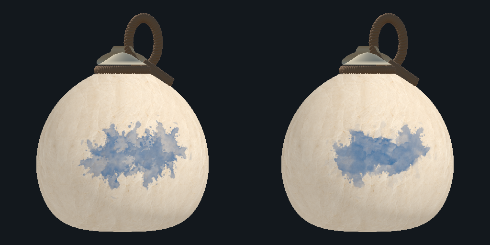
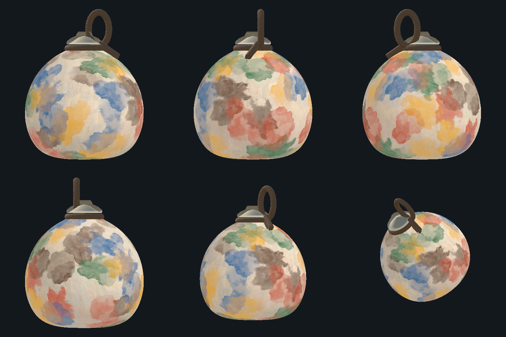
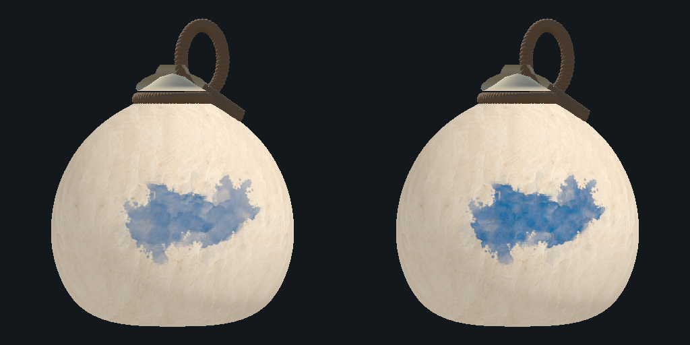
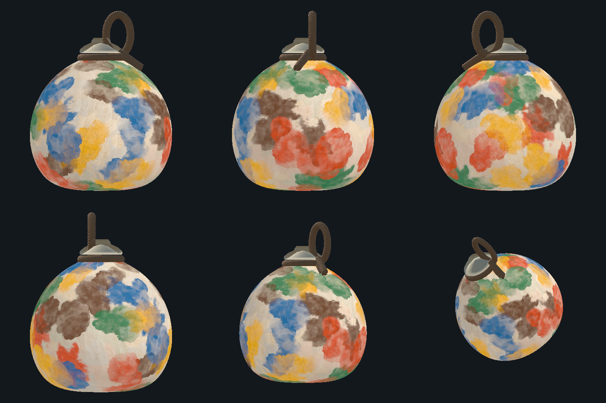
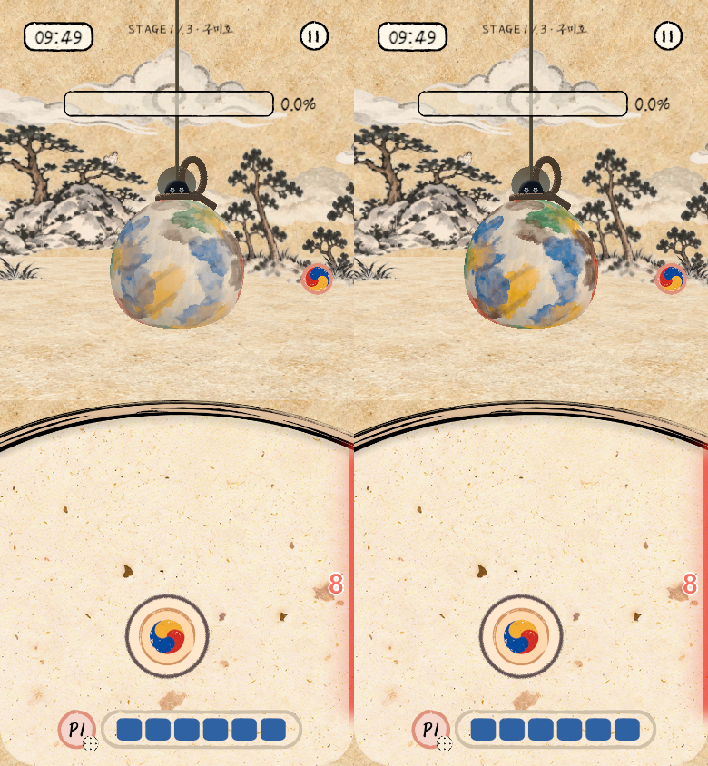
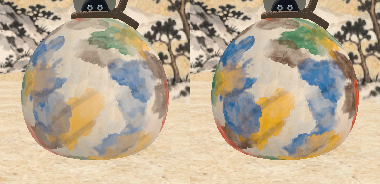
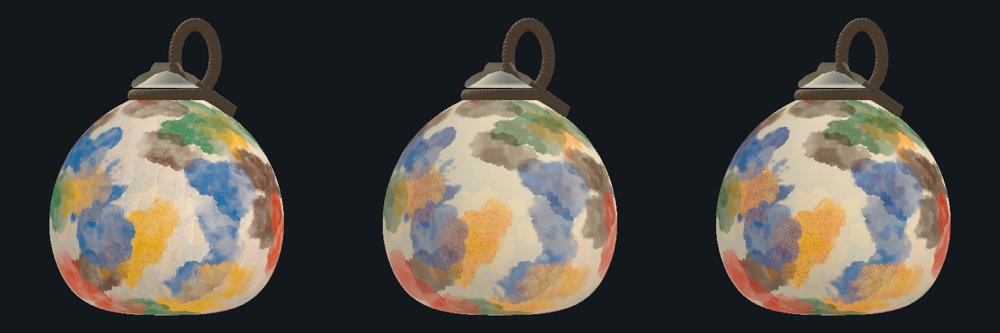
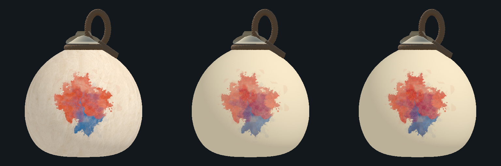
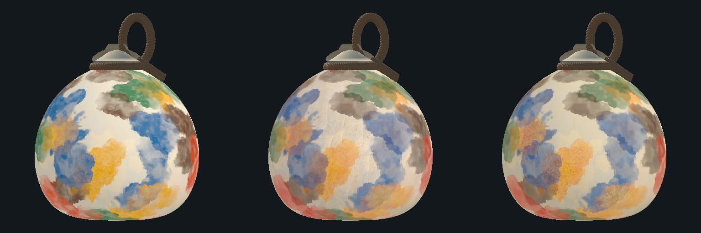

# 수채 브러시 누적 채색 (#466)

> 2026-11-04: 일반 협동의 최신 승인 기본 표현은 [불투명 얼룩 스티커](PAPER_STICKER_PAINT.md)다. 이 문서의 V2·V3 수채 및 투명 외곽 비교는 보존된 구현/실험 이력이며, 현재 스티커의 Alpha나 겹침 규칙으로 해석하지 않는다.

## 기준과 범위

- 구현 기준: main `2ab6b3c3` (#461 도색 압축, #463 공유 연출 시계).
- 일반 협동의 표현 전용 변경이다. Host 셀 색/P 지도·실제 면적·성장 예산·건조·승패·투척 물리는 기존 경로를 따른다. 청홍 땅따먹기는 기존 표현을 사용하며 새 작품 기록을 만들지 않는다.
- 승인된 외형 기준은 [채색 표현 명세](PAINT_PRESENTATION_SPEC.md)다. AI 시안과 아래 Editor 비교 렌더는 구분한다.
- 호환 규약: **5684 / C6PhysicsLab45 / C6HapioGame29**, 공유 LabConfig는 **257개 그대로**다. V2는 와이어/게임 설정을 추가하지 않고 표현 버전을 `watercolor-stamps-v2`로 올렸다. 같은 규약이라도 표현 버전이나 프로필이 다른 참가자는 준비 완료로 처리하지 않는다.

## 변경 지점

| 책임 | 파일·API |
|---|---|
| 원본·데이터 베이크 | `Assets/Editor/WatercolorPaint/BrushMasters`, `LabWatercolorBrushBaker.BakeAll/Validate` |
| 표현 설정 | `Assets/Lab/Resources/GourdPaint/WatercolorStampProfile.asset`, `LabWatercolorStampSettings` |
| 실제 변경 관찰 | `LabPaintSurface.Art.cs`, `PaintFundedCell`, `ErodeBoundaryTick` |
| 기록·디스크·재생 | `LabPaintArtJournal` |
| 페이지 압축·경계 검사·전송 순번 | `LabPaintArtTransfer`, `LabPaintArtSendCursor` |
| 세션 수명·통신 | `LabNetwork.PaintArt.cs`, `LabNetwork.Bulk.cs` |
| 누적 지도·최종 표면 표현 | `LabWatercolorStampRuntime`, `WatercolorStampRuntime.shader`, `LabGourdPaint.shader` |
| 전투·관람 연결 | `LabGourdPaint`, `LabGourdResultPreview`, `GameSession.CaptureResult` |
| 실제 박 비교 | `LabWatercolorStampStudy`, `LabWatercolorStampValidation`, 기존 Watercolor Paint 창 |

## 원본과 베이크

원본 PNG 3장(둥근형·퍼짐형·겹침형)은 1254×1254 RGBA다. 회색 농담과 Alpha가 함께 있으므로 Alpha만으로 농도를 계산하지 않는다. 원본은 Editor 폴더에 보존하고 CPU 판정용 `GourdPaint/Patterns`는 교체하지 않는다.

`LabWatercolorBrushBaker`는 전체 원본을 384×384 안으로 축소해 512×512 중앙에 놓는다. 사방 64픽셀 이상의 투명 여백을 확보하고 다음 데이터를 만든다. 채널의 정확한 계산식과 버전 검사는 베이크 도구에 있다.

| 채널 | 의미 |
|---|---|
| R | 회색 농담과 Alpha를 반영한 농도 |
| G | 외곽 커버리지 |
| B | 안쪽 경계 거리 데이터 |
| A | 커버리지 |

실행용 텍스처는 Linear·Bilinear·Clamp, 압축/밉맵/Read Write OFF다. `WatercolorBrushes/Version.txt`는 베이크 결과 해시이며 설정 버전에 포함된다. 빌드 전 검사는 누락되거나 오래된 데이터를 오류로 알린다. 고해상도 출력 기본값은 기존대로 1024×512다.

## Inspector에서 조정하기

`WatercolorStampProfile`을 선택해 다음 값을 바꾼다. 이 파일은 게임 판정 설정이 아니라 표현 설정이다.

| 설정 | V2 기본값 | 역할 |
|---|---:|---|
| `enabled` | ON | 새 누적 브러시. OFF는 기존 수채 비교 경로 |
| `density` / `overlap` | 0.9 / 0.78 | 안료 농도 / 이미 칠한 곳의 겹침 농도 |
| `edgeStrength` / `edgeWidth` | 0.55 / 0.025 | 안료 테두리 강도 / 폭 |
| `pigmentContrast` | 1.6 | 원본 농담 대비와 진한 부분의 광학적 농도 |
| `pigmentSaturation` | 1.15 | 표현용 채도. 실제 오행 색/P 지도는 유지 |
| `granulationStrength` / `granulationScale` | 0.25 / 120 | 최종 박 표면의 안료 입자 강도 / 물체 기준 주파수 |
| `rimBreakup` | 0.45 | 확정 seed를 따르는 테두리의 끊김 |
| `revealSeconds` | 0.35 | 공유 연출 시계 기준 등장 시간 |

V2는 대비·채도·입자·테두리 변수를 모두 복제/정리/검증과 표현 지문에 포함한다. 기존 기본 수채·땅따먹기의 공용 머터리얼 값과 LabConfig의 그레인 설정은 변경하지 않는다. 새 수채는 전용 입자를 사용하고, 기존 그레인은 보존된 표현 경로에서 사용해 두 질감이 중복 적용되지 않게 한다.

실제 세션은 라운드 시작 때 설정 사본과 브러시/표현 버전을 고정한다. 실행 중 원본 Inspector를 바꿔도 진행 중인 그림을 다른 설정으로 다시 만들지 않는다. 다음 라운드부터 적용한다. 참가자들의 버전이 다르면 준비 완료로 처리하지 않으며 오류를 표시한다. 고해상도 품질 변경이나 GPU 자원 재생성은 동일한 기록을 다시 읽어 복원한다.

## V2 색감과 표면 질감

색층 지도에서는 원본 안료의 내부 대비와 테두리를 조절한다. 진한 부분에는 `1 - (1 - opacity)^opticalDepth` 형태의 광학 농도 보정을 적용해 종이색에 과하게 묻히는 인상을 줄이고, 옅은 부분의 투명도는 남긴다. 채도는 이미 Linear인 원소 색을 기준으로 휘도 주변에서 조절하고 색역 한계에서 증가량을 제한한다. 같은 색에 다시 Gamma/Linear 변환을 적용하지 않는다. 테두리의 끊김은 기록된 seed와 브러시 좌표로 고정된다.

미세 입자는 셀 경계 보간이 끝난 지도를 읽는 **최종 박 표면 셰이더**에서 RGB에만 적용한다. 물체의 로컬 방향에 고정된 고운/중간 입자와 실제 종이 텍스처의 섬유결을 결합하고, 화면에서 구분되지 않는 세부는 미분으로 걸러낸다. 시간·화면·월드 위치를 새 난수 기준으로 쓰지 않는다. Alpha·판정 셀·P지도와 미도색 종이는 유지한다.

`_WatercolorV2Enabled`, `_WatercolorGranulationStrength`, `_WatercolorGranulationScale`은 `LabGourdPaint`가 `MaterialPropertyBlock`에 넣는 표면 표현 연결이다. 기본값0인 모드 플래그는 실제 새 수채 경로에서만 켜진다. 공용 머터리얼/Scene을 덮어쓰지 않고, 관람 사본도 이 블록을 복사한다.

`VisualPaintTexture`는 경계가 재구성된 **원본 누적 색층 지도**다. 최종 표면 입자는 이 지도에 다시 저장하지 않으므로 다음 등장 연출의 아래층에 입자가 이중 누적되지 않는다. 전투·완성 박 관람·관람 PNG의 최종 모습은 같은 지도와 셸 셰이더/표현 블록으로 렌더한다. 원본 RGBA 지도를 직접 저장한 이미지는 표면 입자와 조명이 들어간 완성 박 PNG와 구분한다.

## 실제 그림 보존

기존 최근 128개 `LabPaintVisualStamp`와 셀 프레임은 유지한다. 새 `LabPaintArtJournal`은 다음 사건을 별도로 순서대로 기록한다.

1. `RoundBegin`: 라운드·표면 크기·표현 버전.
2. `StrokeBegin`: 도장 ID, 확정 seed, 중심/축/반경, 색/P/기존 패턴.
3. `PaintCells`: 실제 새로 칠한 셀과 최종 소비된 공급의 도장 ID.
4. `EraseCells`: 실제 건조로 지워진 셀.
5. `SurfaceCommit`: 셀 리비전과 색/P 지도 SHA-256.
6. `RoundSeal`: 최종 리비전·지도 해시.

도장 ID와 전체 연산 순번은 별개다. 최초 Splatter의 분리된 덩어리는 같은 도장 ID다. 여러 소수 예산으로 만들어진 셀은 기존 `Consume`이 선택한 최종 공급에 귀속한다. 기록을 위해 난수를 추가로 뽑거나 셀/예산을 다시 선정하지 않는다. Guest의 예측 명중은 이 기록을 만들지 않는다.

GPU는 기록 순서대로 premultiplied source-over 합성을 한다. 새 도장의 겹침은 당시 논리적 칠 위에 한 번 적용하고, 성장 때는 실제로 추가된 셀에만 적용한다. 출력 픽셀의 셀 귀속은 고정한다. 프레임/페이지/일괄 처리 크기가 바뀌어도 이미 쌓인 농도를 다시 누적하지 않는다. 건조는 해당 셀의 누적 색층 전부를 지우므로 재도색 때 과거 아래층이 되살아나지 않는다.

CPU/GPU 재구성을 위해 모든 도장을 RAM에 계속 쌓아두지 않는다. 디스크에 기록·도장 인덱스를 보존하고 제한된 페이지/도장 캐시로 읽는다. 오래된 도장은 캐시에서 빠져도 디스크 기록에 남아 있다.

## 전송과 준비 상태

기존 `paint_cells`의 원본/deflate 형식은 바꾸지 않는다. 새 `paint_art`는 같은 Bulk 전달·재전송 위에서 별도 메시지로 전송한다.

- 원본 페이지 최대 **4KiB**(헤더·이전 페이지 SHA·본문·자체 SHA 포함).
- 피어당 미확인 페이지 **1개**. 과거 전체 기록을 Bulk에 한꺼번에 넣지 않는다.
- 게임 상태 발행 뒤에만 추가하고 Bulk 백로그가 **8KiB 미만**일 때 다음 페이지를 넣는다.
- deflate가 더 작을 때만 압축하고, 수신 시 선언한 원본 크기 안에서만 해제한다.
- 라운드·설정·표현 버전·페이지 순서·해시를 검사한 후 디스크에 반영한다.
- 중복 페이지는 같은 바이트일 때만 인정한다. 누락은 다음 순번을 적용하지 않고 기존 Bulk 재전송 및 수신 확인으로 복구한다.

다음 세 값은 다르다.

| 상태 | 의미 |
|---|---|
| `receivedPages` | 검증한 페이지를 수신 기록에 보관 |
| `AppliedThrough` | CPU 재생기가 연산을 GPU 작업으로 적용 |
| `RenderedThrough` | 해당 GPU 작업이 완료됨을 확인 |

GPU 색층 지도 완료는 전체 이미지를 CPU로 가져오지 않고 1픽셀 완료 확인을 사용한다. 완성 박은 최종 `RoundSeal`, 현재 색/P 지도 해시·리비전, 적용/렌더 순번이 모두 일치해야 정확한 작품으로 준비 완료다. 관람 사본은 같은 `LabGourdPaint.VisualPaintTexture`와 표면 표현 블록을 소유하며 Battle 자원과 독립적으로 보존된다.

## 수명·오류·상한

라운드 소유자가 임시 디스크 파일과 도장 인덱스를 만든다. 현재 라운드 및 결과 관람 동안 보존하고 다음 라운드·스테이지·홈/연결 종료 때 소유한 파일만 정리한다. 실행 중 원본 파일을 덮어쓰지 않으며 영구 갤러리·앱 재실행 후 복원은 제공하지 않는다.

- 원본 기록 상한: **64MiB**.
- 페이지 RAM 캐시 상한: **2MiB**. 이 수치는 전체 프로세스 RAM 상한이 아니다. 페이지 위치 인덱스·GPU 출력·마스크·제한된 도장 캐시는 별도다.
- 정상 프레임 재생: 최대 8개 draw 묶음/1024개 연산. 관람 준비 호출도 최대 16개/4096개로 제한하며 여러 호출에 나눠 복원한다.
- 저장 실패·상한·해시/버전 오류·GPU 실패 시 오류를 표시한다. 오래된 그림을 몰래 버리거나 잘못된 그림을 완성 작품으로 처리하지 않는다.
- 기존 Host 판정과 게임 결과는 계속 유지한다. 정확한 작품 관람이 준비되지 않으면 비활성화하고 결과 안내를 남긴다. 기존 완료 연출 대기 한도를 무한히 늘리지 않는다.

## 비교와 확인 방법

1. Unity 메뉴 `C6 Lab > Experiments > Watercolor Paint`를 연다.
2. 새 브러시 비교에서 Blue 최초 명중+재타격 0/1/3회, 2색 겹침, 3색 교차, 5색 완성을 선택한다.
3. 기존/새 표현을 같은 박·조명·카메라로 비교하고 6방향을 확인한다. V2는 실제 Battle 화면의 게임 크기·확대 화면에서도 확인한다. 이 도구의 건조 OFF는 격리된 정적 비교 복사본에만 적용한다.
4. 실제 플레이에서는 같은 빌드/표현 버전의 Host·Guest로 시작해 명중·성장·건조·완성 박을 확인한다. 고해상도 변경/표시 재생성 뒤 같은 그림이 복원되는지도 확인한다.
5. iOS 일반 Wi-Fi·핫스팟은 각각 별도 실행 검증이 필요하다. Editor 렌더·단위 검사로 실기기 통과를 대신하지 않는다.

V1 산술 보존 비교는 독립된 동일 명중 fixture에서 농도0.8·겹침0.72·테두리0.35/0.04·안료 대비1·채도1·테두리 끊김0·입자0을 지정한다. 대비1은 광학 농도 보정을 건너뛰므로 V1의 합성 산술과 비교할 수 있다. 이 비교를 위해 진행 중인 V1 기록을 V2로 바꿔 읽지는 않는다.

자동 검사와 실제 수행 범위는 [검증 기록](VALIDATION.md)의 #466 항목에 기록한다. 원본 지도 재생의 일치와 최종 박 표면의 입자/고정 좌표 검사는 별개다.

## V1 당시 실제 Editor 비교 렌더

아래는 **V1 당시** 저장된 박 모델의 Metal Editor 비교다. 왼쪽은 기존 표현, 오른쪽은 당시 새 누적 브러시(ON·농도0.8)다. V2 완료·현재 기본값의 증거로 해석하지 않는다. 승인된 AI 예상 시안과도 구분한다.

외곽과 서로 다른 도장의 셀 경계에만 표현 보간을 적용한다. 원본 누적 색층과 판정 지도는 바꾸지 않고, 같은 도장 내부의 붓결까지 전체 흐림으로 대체하지 않는다. 최초 렌더에서 발견한 회색 색 전달과 내부 셀 계단 문제를 보정한 결과다. 실제 프로젝트의 종이 재질·조명 때문에 승인된 AI 시안과 색감이 완전히 같지는 않으며 농도·테두리는 프로필에서 조정한다.

## 겹친 작업 정리

다른 채팅에서 같은 수채 작업을 잘못 이어 수정한 내용도 실제 파일과 대조했다. 중복 타입을 만들었던 `LabPaintArtTransport.cs`와 그 메타 잔재는 현재 프로젝트에 남기지 않고, `LabPaintArtTransfer` 경로 하나만 사용한다. 필요한 기록/재생 검사는 유지했다. 겹쳐 추가됐던 고해상도 조건의 중복과 작품 준비 검사가 게임 진행까지 차단하는 연결은 정리했다. 유선 네트워크 검토 보고서 등 프로젝트 밖의 다른 작업 자료는 삭제하지 않는다.

## V2 실제 비교 이미지

다음 이미지는 AI 시안이 아니라 Unity6000.6.5f1/Metal의 실제 박 셰이더 출력이다. 좌측은 V1 중립 비교값, 우측은 위 V2 기본값이다.

다음은 실제 `Home → StartSolo → Battle` 진입 후390×844 Game 뷰에서 캡처했다. 전후의 카메라·Scene 배치·조명은 같고, 격리된 Host 규칙 비교 지도를 잠시 렌더에만 연결했다. 화면의0%는 실제 게임 지도이며 이미지의5색100% 비교 지도와 다르다. 게임 승리나 실제 투척 수행으로 해석하지 않는다. 비교 종료 후 실제 렌더 바인딩과 컴포넌트 활성 상태를 복원하고 게임 색/P지도 해시가 그대로임을 확인했다.

색 농담과 안료 입자는 강화됐지만 첫 참고 확대 이미지보다 전체 색이 옅고 큰 색군의 배치도 다르다. 참고 이미지와 완전히 같은 외형이 되었다고 판단하지 않는다. 현재 Inspector 시작값과 고정 기록으로 재현한 결과이며 미적 최종 승인은 별도로 남는다.

[실제 PNG 내보내기 경로로 출력한 V2 박](images/watercolor-stamps-v2-466-production-export.png)도 같은 최종 셸 셰이더를 사용한다. PNG 출력 경로와 관람 설정의 실제 검사 범위, 첫 출력에서만 관찰된 미세 RGB 차이는 [검증 기록](VALIDATION.md)의 V2 항목에 분리했다.

## V3 Editor 비교 시제품 — 기본 전환 전

게임 기본값은 **V2 그대로**다. V3는 `Assets/Editor/WatercolorPaint/V3`의 별도 셰이더·브러시·종이·프로필로 비교한다. Player 빌드에는 이 폴더가 들어가지 않는다. 판정·성장·건조·공유설정257개·5684/Lab45/Game29와 기존 미커밋 작업을 보존한다.

### 기술 근거와 표현

[Curtis 등의 Computer-Generated Watercolor](https://grail.cs.washington.edu/wp-content/uploads/2015/08/curtis-1997-cgw.pdf)는 안료 침착·테두리 고임·광학적 색층을 다룬다. [Bousseau 등의 Interactive watercolor rendering](https://doi.org/10.1145/1124728.1124751)은 표현 요소를 제어하는 접근을 제시한다. V3는 후자를 참고해 종이와 안료 농담·입자·테두리를 분리한 시제품이다. 유체나 실제 안료 혼합을 구현한 것으로 설명하지 않으며 합성은 기존 premultiplied source-over다.

- 원본 PNG와 V2 베이크는 보존한다. 새512² 데이터는 G/A의 지원 영역·B의 거리·64픽셀 여백을 그대로 쓰고 R만 원본 농담/저주파 분포로 만든다. 고정 농도 바닥값을 제거하고 새 범위에 맞는 단조 곡선을 사용한다.
- 안료 RGB 농담과 레이어 Alpha를 분리했다. 채널별 `pow`는 경험적 농담 표현이며 Gamma 보정이나 Kubelka–Munk 모델이 아니다. 테두리는 좁은 고임과 불규칙한 폭/끊김을 사용한다. 칠한 셀 안의 마른 붓 빈틈에는 옅은 유색 담채를 남긴다.
- 1024² 종이는 고정 seed의2~12픽셀 교차 섬유로 만든다. 기본 RGB246/235/211·미세±10이며 큰 주름/사전 조명/저주파 명암장은 넣지 않는다. 기존 한지를 교체하지 않는다.
- 입자는 최종 셸에서 물체 좌표에 고정하고 미해상 세부를 필터링한다. 누적 아래층에 입자를 되먹이지 않는다. P무늬 입력은 유지하되 정적 색 비교에서는 끈다.

### 조절·재현

1. `Assets/Editor/WatercolorPaint/V3/Data/V3StudyProfile.asset`을 선택해 조절한다. 게임의 Resources 프로필과 다른 비교 전용 파일이다.
2. `C6 Lab > Experiments > Watercolor V3 Comparison`에서 프로젝트 밖 출력 폴더를 선택한다. 실제 박 PNG·6방향·색 조합표·검증 JSON이 생성된다.
3. 두 비교 열의 상한은0.75·0.85로 고정하고 나머지는 프로필을 캡처한다. 원본/베이크를 고칠 때만 `LabWatercolorV3Baker.BakeAll()`을 실행하며 기존 조정값을 매번 덮어쓰지 않는다.

| 설정 | 현재 비교 시작값 |
| --- | ---: |
| 레이어 상한 / 담채 |0.75·0.85 / 0.12|
| 안료 깊이 / 테두리 고임 |1.4 / 0.5|
| 내부 흐름 주파수 / 테두리 불규칙함 |4 / 0.35|
| 종이 요철 / 섬유의 안료 영향 |0.0005 / 0.15|
| 입자 강도 / 크기 기준 |0.32 / 96|
| 종이 밝기 / 섬유 대비 |1.0 / 1.4|

스냅샷은 수치·텍스처 핸들·데이터 SHA·지문을 고정한다. 버전은`watercolor-stamps-v3-study-r3`, 데이터 SHA는`9c4ce4b23678b0cfa9aff5c2cca7d2cdb254e3f17f2aada4e721925d986bce5f`다. 출력 JSON은 실제 셰이더 SHA도 기록한다. 원본 V2 기록과 동일한 순서 재생기를 사용하며 별도 셰이더/브러시 주입은 `UNITY_EDITOR`에만 존재한다. **비교 ID는 실제 게임의 라운드/접속 버전이 아니다.**

### 실제 렌더

열은 **V2 / V3 상한0.75 / V3 상한0.85** 순서다. AI 시안이 아닌 Unity Editor/Metal의 실제 박이며 같은 명중 기록·판정 지도를 사용했다.

[0.75 여섯 방향](images/watercolor-v3-466-six-views-075.png) · [0.85 여섯 방향](images/watercolor-v3-466-six-views-085.png)

다음 분리 비교는 **V2 물감+새 종이 / V3 물감+기존 종이 / V3 물감+새 종이**다. 모두 같은5색 기록·박·카메라·도색 준비 상태를 유지한다.

큰 주름은 줄고 투명한 자국이 남지만, 참고 이미지와 같은 외형이라는 미적 승인은 아직 받지 않았다. 두 상한의 차이는 반복이 적은 자국에서 더 잘 보이고, 반복 합성으로 누적 Alpha가 높아질 수 있다. 수치 검사를 미적 승인으로 대신하지 않는다. 실제 수행 범위는 [검증 기록](VALIDATION.md)을 따른다.

### V3 실제 Battle 크기 확인

[Battle 전체 화면](images/watercolor-v3-466-battle.png) · [같은 화면의 박 영역](images/watercolor-v3-466-battle-crop.png). 열은 V2/0.75/0.85다. 저장된 Home→솔로→Battle에서390×844로 촬영했다. 비교 지도만 렌더에 잠시 붙인 것이므로 HUD0%와5색 완료 그림은 다른 데이터이며 실제 게임 승리/투척 수행을 뜻하지 않는다. 촬영 뒤 원래 재질·MPB·컴포넌트 상태·자세·V2 준비 상태를 복원하고 실제 게임 지도 해시가 그대로임을 확인했다. 원본 Scene/설정은 저장하지 않았다.

## 2026-11-03 — Editor 투과·겹침 비교

일반 게임의 V2와 기존 V3를 보존한 채 `Assets/Editor/WatercolorPaint/TransmissionStudy`에 독립 시제품을 추가했다. `C6 Lab > Experiments > Watercolor Transmission Comparison`에서 출력 폴더를 고르면 실제 WhiteGourd 복사본의 세 비교안과 표면 진단을 다시 만든다.

왼쪽은 이전 V3(층 상한 .85), 가운데는 원본 안료 농도에 따른 투과(층 상한 .95·안료량 1.8), 오른쪽은 같은 투과에 겹침 광학 두께 .55를 적용한다. 최소 funded wash .02, 가산 노이즈 대신 ±.2의 곱셈 변화를 사용한다. 기존 source-over의 시각 근사이며 물리적 안료 혼색 모델은 아니다. 최초 도장은 가운데/오른쪽이 동일해야 한다.

입력 기록·판정 셀·색/P·성장/건조·랜덤·투척·네트워크 버전은 바꾸지 않는다. 비교 팔레트는 이전 Reds5를 표현 단계에서만 주입한다. 게임 기본 팔레트와 DEV 설정은 그대로다. 실제 종이/중립 종이를 각각 세 열에 동일 적용하며, 별도 네 칸 진단은 종이색/요철과 입자/섬유 변조를 독립해서 끈다. 박의 확산 음영은 남긴다.

원본 자산과 Scene·지도·기록 보존 및 반복/새 런타임 재생 일치가 확인됐다. 시각 평가는 아직 진행 중이며, 둥근 경계 반복과 표면 입자 인상이 남는다. 시제품을 Resources·전투 기본 표현에 연결하지 않았다. 검사 범위는 VALIDATION의 같은 날짜 기록과 비교 폴더의 README를 따른다.

## 2026-11-04 — 단일 얼룩 평면 텍스처 비교 (계획 1~2단계)

텍스처 평가를 위해 `Assets/Editor/WatercolorPaint/TextureStudy`에 평면 셰이더와 비교 도구를 추가했다. 메뉴는 `C6 Lab > Experiments > Watercolor Flat Texture Comparison`이다. 조명·광택·요철·구형 투영·게임 셀 마스크를 제외하고 원본/농도/Alpha/기존 변환 데이터와 한 자국을 비교한다. 첫 열은 현재 V3 데이터와 Transmission 수식의 평면 이식이며 실제 게임 셀 외곽이나 최종 표면 입자를 재현한 출력은 아니다.

새 비교는 원본 RGB/Alpha의 직접 darkness(A·(1−RGB))를 사용한다. 검정·Gain1의 원본 충실도와 색을 입힌 비교의 농도 보정 Gain6을 구분한다. 중앙/오른쪽은 같은 Gain6이며, 오른쪽만 원본에서 구한 중간 대비1.4·미세 잔차.85를 사용한다. 추가 무작위 노이즈는 없으며 새 값은 원래 안료의 .65~1.35배 범위다. 원본·V2·V3·Transmission과 기존 설정은 그대로다.

이 단계의 시각 승인은 미정이다. 실제 판정 셀·성장·겹침·박 표면 연결은 후속 단계이며, 게임 기본값·규칙·통신 버전은 변경하지 않았다. 사용법과 출력 해석은 비교 폴더 README를 따른다.

## 2026-11-04 — 선택한 원본 질감의 실제 박 시제품

평면 비교 오른쪽을 선택한 사용자 평가를 기록했다. `TextureStudy/WatercolorSelectedGourd.shader`와 `LabWatercolorSelectedGourdStudy`는 승인한 Round 농담/질감 계산을 기존 저널·지급셀·재생/삭제·최종 보간에 연결하는 Editor 시제품이다. 기존 Flat 데이터 생성/디코드 helper는 internal로 공유하며 내용은 바꾸지 않았다. SourceGain6·Medium1.4·Fine.85와 원본의 같은 darkness/bands를 사용하고, 축소 표본을 위해 base픽셀을 보존한 mip 복사본을 만든다.

선택된 흰 바탕 색을 유효한 premultiplied source-over 층으로 변환하며, 새 그림 전체나 최소바탕색을 덧칠하지 않는다. 실제 판정 셀의 잘림은 유지된다. 이 한계는 시각 완성으로 간주하지 않는다. 실제 박 복사본에서 명중1회·재타격3회를 동일 입력으로 비교했고, 게임 기본 경로는 여전히 V2다. 메뉴/이미지 판독은 TextureStudy README를 따른다.

## 2026-11-04 — 수채 브러시 윤곽으로 외곽 교체 시제품

기존 외곽을 유지하지 말아 달라는 사용자 피드백을 반영해 `LabWatercolorContourStudy`를 추가했다. 선택한 Round Alpha로 로컬 CPU 마스크를 만들고, 초기 셀 선택과 재타격 군집이 같은 윤곽을 따르게 한다. 기본 Resources/Splatter 캐시는 유지하며 두 Editor 전용 factory/setter와 fixture 입력만 추가했다. 면적·성장 설정·seed는 같고 실제 셀 배치는 달라진다.

CPU 윤곽 변경 외에 중간 고해상도 텍스처의 옛 외곽에 재잘림되는 경로도 비교에서 해제했다. `_StudyLegacySilhouette` 기본1은 기존 선택 셰이더에 유지하고, 새 비교에서만0을 적용한다. Editor 주입 runtime의 선택적 material callback은 최종 패스에도 설정을 전달하며 Player 기본 생성자/리소스에는 들어가지 않는다.

새 결과는 Editor 복사본의 실제 박 비교이며 게임 기본 연결은 아직 V2다. 원본Alpha·판정 셀의 보간으로 바깥 형태가 달라지며, 셀 해상도에 의한 미세 계단이나 최종 다색/관람 품질을 승인한 것은 아니다. 기존 시제품·Scene·사용자 변경을 보존한다.
