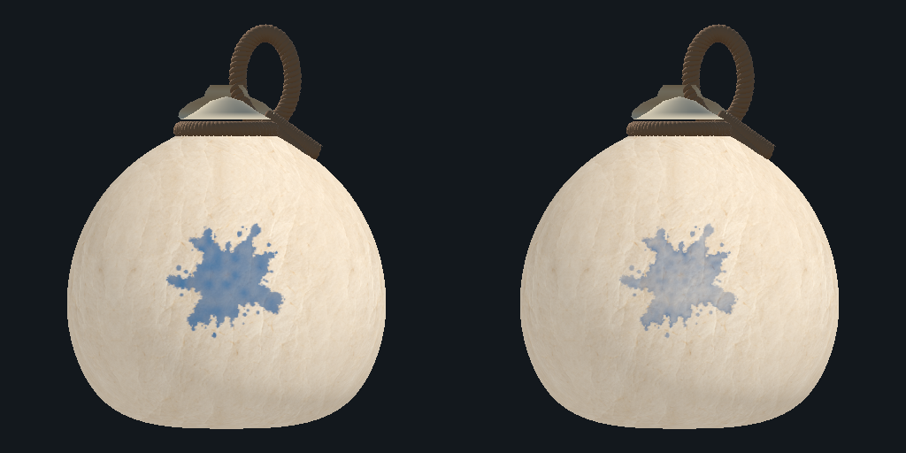
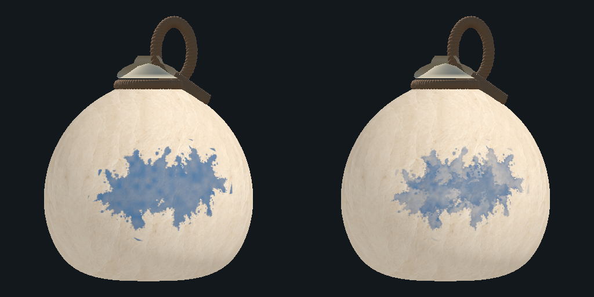
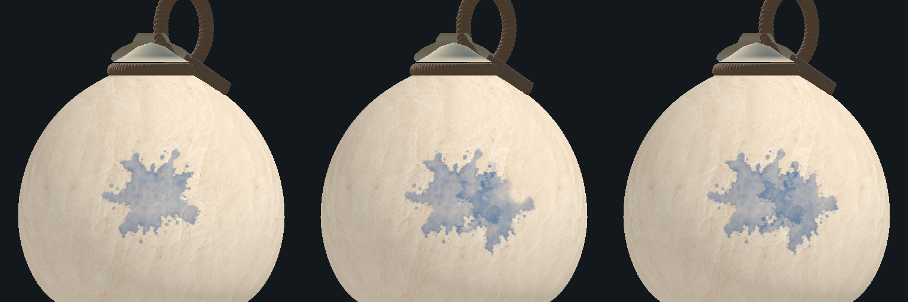

# 박 표면 수채 질감 — #369

## 현재 연결과 설정

파란 정적 시안은 사용자 확인을 받았으며, 같은 표현을 실제 `LabGourdPaint`의 고해상도 경로에 연결했다. 최초 박 연결 때 `Resources/GourdPaint/WatercolorProfile`을 읽는다. 고해상도 표현과 Profile의 `enabled`가 모두 켜져 있을 때 적용하며, 지원하지 않는 GPU나 생성 실패에서는 기존 고해상도 표현으로 대체한다. 게임 도색 지도·100% 완료·소유권·네트워크 규약을 변경하지 않는다.

2:2 땅따먹기 판(`snapshot.teamTerritory`)에서는 수채 표현을 끄고 기존 고해상도 칠을 쓴다(#293). 칠이 반투명하게 겹쳐 청·홍 구분이 흐려지기 때문이다. 스토리 스테이지는 그대로 수채다.

설정 에셋은 `Assets/Lab/Resources/GourdPaint/WatercolorProfile.asset`이다. Inspector에서 표현만 조절한다. 기존 Host 공통 LabConfig의 수치 인덱스나 DEV 전파 배열에는 추가하지 않았다.

| 표현 항목 | 승인 기본값 |
| --- | --- |
| density / broadVariation / mottle | .62 / .55 / .38 |
| grain / grainScale | .35 / 1 |
| edgeStrength / edgeWidth | .6 / .022 |
| textureScale | 1 |
| spreadSeconds | .4초, 0이면 즉시 확정 |
| maxActiveStains | 12개, 초과 시 오래된 활성 표현부터 확정 |

번짐 시간은 Inspector에서0~2초로 비교할 수 있다. .4초는 현재 시작값이며 고정 게임 사양이 아니다. 실기기 검증 상태는 [VALIDATION](VALIDATION.md)의 #369 후속 기록을 따른다.

## 실제 처리와 보존 경계

1. 기존 Host의 `LabPaintSurface`가 군집·도색 셀·색·P·완료를 확정한다. 최초/반복 공급량·조밀도·인접 관계·방향 가중치·건조 셀 삭제는 그대로다.
2. 기존 `LabHighResolutionPaintRuntime`이 연속적인 브러시 형태와 확정 색/P 표시 지도를 만든다.
3. `LabWatercolorPaintRuntime`이 같은 제한된 `LabPaintVisualStamp` 기록으로 속성별 농도·개별 가장자리 흔적을 재구성한다. 색상이 다른 얼룩의 광학 데이터를 분리하고 현재 확정 지도에서 선택된 색을 사용한다. P 지도는 기존 출력에 그대로 맡긴다.
4. 기존 기록 뒤에 정상적으로 추가된 얼룩만 로컬 수신 시각에서 번진다. 고정된 최종 브러시 안의 등장 임계값을 바꾸며 브러시·내부 입자·표면 결을 확대하거나 이동하지 않는다.
5. 활성 기록은 매번 비운 별도 캐시에 현재 진행률로 그린다. 완료 기록은 고정 캐시에 한 번만 누적한다. 같은 시각의 재호출이나 프레임 수가 농도를 추가하지 않는다. 활성 표현도 지도 변경도 없으면 GPU 갱신을 중단한다.
6. 초기 복원·기록 교체/128개 FIFO 폐기·설정/해상도 변경·텍스처 재생성은 최종 정적 모습으로 복원한다. 지나간 타격을 재애니메이션하지 않는다. 세션/판이 바뀌면 이전 캐시를 해제한다.
7. Victory/Defeat와 `PrepareVisualCapture`는 활성 표현을 최종 상태로 확정한다. 관람·PNG는 이 실제 표시 텍스처를 복사한다. GPU 오류는 판정이나 승패를 바꾸지 않고 기존 표시로 대체한다.

최종 합성은 기존 불투명 박 재질 내부에서 한다. 표시 alpha는 도색 완료 판정에 사용하지 않는다. 기존 P번호 무늬와 선택 가능한 Grain 후처리도 그대로다. 박을 종이나 흰 배경으로 교체하지 않는다.

## 코드 지도

- `Assets/Lab/Scripts/Throw/LabGourdPaint.cs`: Profile 로드, 전투 표시 연결, 변경/활성 시 갱신, 최종 캡처와 수명 관리.
- `LabWatercolorPaintRuntime.cs`: 제한된 기록 재생·정적/활성 캐시·한 번만 확정·오류 대체.
- `LabWatercolorPaintSettings.cs` / `LabWatercolorPaintProfile.cs`: 렌더링 전용 Inspector 설정과 안전한 값 복사.
- `LabWatercolorBrushDistance.cs`: 원본 브러시를 바꾸지 않는 내부 거리 복사본. 광학 가장자리에만 사용한다.
- `Assets/Lab/Resources/GourdPaint/WatercolorRuntime.shader`: 속성별 농도·불균일한 가장자리·표면에 고정된 미세 입자·고정 형태 내부의 등장 연출.
- `Assets/Editor/WatercolorPaint/LabWatercolorPaintStudy.cs`: 실제 게임과 같은 수채 렌더러를 사용하는 격리 정적 비교.
- `LabWatercolorPaintWindow.cs` / `.uxml` / `.uss`: UI Toolkit 비교 창·조절·PNG 내보내기.
- `LabWatercolorPaintValidation.cs`: 비교 지도·원본 보존·반복 재생·리소스 해제의 명시적 GPU 검사.

## 비교 창 사용

`C6 Lab > Experiments > Watercolor Paint`를 연다. 왼쪽 BASELINE은 이전 고해상도 표현, 오른쪽 WATERCOLOR는 현재 게임 수채 렌더러다. 같은 실제 저장 박·도색 지도·카메라·조명을 사용한다. 이 창 자체는 실제 세션을 수정하지 않는다.

- `Re-hits after first`: 최초 명중 뒤 재명중0~3회. seed와 Hit location은 양쪽 공통이다.
- `Hit location`: 정면·경도 이음새·극의 실제 도색 위치. Yaw/Pitch/Zoom 및 Rotate 버튼은 시점만 바꾼다.
- 8개 표현 슬라이더: 변경 이벤트를100ms로 묶어 그때만 다시 렌더링한다. 게임 Profile 에셋은 변경하지 않는다.
- `Export comparison PNG`: 현재 비교 저장. 실제 박의 격리 Editor 렌더이며 실기기/실제 플레이 캡처가 아니다.

정지 화면을 위해 비교 전용 설정 복사본에서만 Drying을 끄고 번짐을 최종 상태로 확정한다. 저장 LabConfig와 실제 게임의 건조 규칙은 바꾸지 않는다.

아래 두 그림은1단계 승인 시안이다. 이후 공통 런타임 연결의 실제 검사/이미지는 검증 기록을 따른다.

공통 런타임의 번짐을 왼쪽부터0/.2/.41초로 샘플링했다. 격리된 실제 박의 GPU 렌더이며 실제 플레이 동영상이나 iPhone 캡처가 아니다.

## 성능 경계와 남은 제한

- 기록은 최근128개, 복원 작업은 프레임당 최대8개, 별도 활성 표현은 기본12개다. 이것이 전체 GPU draw 수8개를 보장한다는 뜻은 아니다.
- 속성별 정적/활성 캐시는 각5슬라이스의 RGBA32 Linear 배열이며 출력 RT1장을 더한다. 1024×512에서 새3개 RT의 원시 픽셀 합은22MiB, 기존 고해상도 RT까지 포함하면28MiB다. 2048×1024에서는 각각88/112MiB다. 거리 텍스처·관람 사본·드라이버 등을 제외한 계산이며 실제 프로세스 메모리나 FPS 측정값이 아니다.
- 다른 속성은 RGB로 혼합하지 않는다. 최종 도색색은 항상 기존 확정 지도이며, 같은 속성의 제한된 얼룩 기록에서 농도/경계만 누적한다.
- 모든 과거 타격의 개별 경계를 영구 보존하지 않는다. 폐기된 기록의 영역은 기존 확정 지도 fallback으로 남는다.
- 전체 유체·수분 시뮬레이션·반응 확산·런타임 AI·렌더 파이프라인 교체는 도입하지 않았다.
- 피버의 실제 플레이 부하·다기기 네트워크·iPhone의 CPU/GPU 시간·메모리·발열은 별도 실측해야 한다. 자동 GPU fixture와 원시 저장량 계산을 모바일 PASS로 쓰지 않는다.
